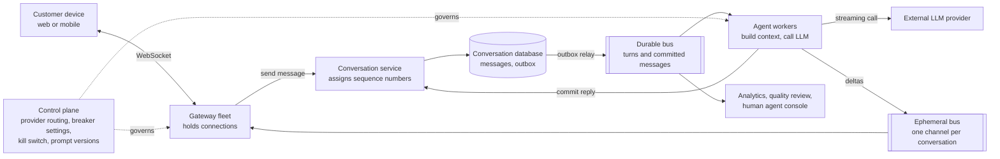

# Designing an LLM-powered customer service chat system that survives failure

This folder is a complete system design for one interview question: *a customer opens a chat on a website or mobile app and talks to an AI agent whose replies come from an external LLM provider. Walk through the happy path, show where publish/subscribe fits, and explain what happens when the provider partially fails and when the network breaks.*

The question gives no traffic numbers, so the first job is to choose them and say so out loud. Every document in this folder reuses the numbers below, and each number is derived here in small steps so you can re-derive it on a whiteboard.

## The one idea the whole design rests on

Most chat designs fail in the same way. They treat the **live token stream** as if it were the reply. The stream is the thing on the customer's screen, so it feels like the real object. But a stream is a view: it can be cut, delayed, duplicated or lost at five different points between the LLM and the customer's eyes.

This design flips that. The **reply is a durable record in a database**, with a sequence number, and the stream is only a convenient, disposable way to show that record to the customer *while it is still being written*. We call this principle:

> **The log is the truth; the stream is a view.**

Once you hold that principle, every failure scenario collapses into the same recovery step. The client says "here is the last thing I definitely have," and the server replays everything after that point from the log. Reconnecting after a network break, resuming after a gateway crash and recovering from a cut-off LLM stream all become variations of that one step. That is why the design stays small even though the list of failures is long.

## The running system: "Marlin Chat"

Marlin Chat is a hosted support-chat product. Retail businesses embed it on their sites and apps. The agent answers questions and can look up orders and issue refunds by calling the business's systems.

These are assumptions, stated as an interviewer expects you to state them:

| Quantity | Value | How it is derived |
|---|---|---|
| Chats per day | 1,500,000 | assumed |
| Customer messages per chat | 6 | assumed |
| Customer messages per day | 9,000,000 | 1,500,000 × 6 |
| Average message rate | about 104 per second | 9,000,000 ÷ 86,400 seconds |
| Peak message rate | about 417 per second | 104 × 4, because the busiest hour runs at about 4 times the daily average |
| Average chat duration | 6 minutes (360 s) | assumed |
| Average new chats per second | about 17.4 | 1,500,000 ÷ 86,400 |
| Average open chats at once | about 6,250 | Little's law: arrival rate × duration = 17.4 × 360 |
| Peak open chats at once | about 25,000 | 6,250 × 4 |
| Peak open connections | about 30,000 | 25,000 × 1.2, because some customers keep the chat open on a second tab or device |
| Reply length | 120 tokens | assumed |
| Time to first token (TTFT) | 0.8 s | assumed provider behaviour |
| Streaming speed | 50 tokens per second | assumed provider behaviour |
| Total time to produce a reply | 3.2 s | 0.8 + 120 ÷ 50 = 0.8 + 2.4 |
| Replies being generated at peak | about 1,330 at once | Little's law again: 417 per second × 3.2 s |
| Stream frames per second at peak | about 13,300 | each stream sends one frame every 100 ms, so 10 per second × 1,330 streams |
| Durable message writes at peak | about 834 per second | each turn writes two messages, the customer's and the agent's: 417 × 2 |

*Little's law* says the average number of things inside a system equals the rate at which they arrive times the time each one spends inside. We use it twice: for open chats and for in-flight replies.

Notice the last two rows. The ephemeral stream traffic (13,300 frames per second) is sixteen times larger than the durable write traffic (834 per second). That ratio is why the design uses two different channels for the two kinds of traffic ([doc 02](02-pub-sub-durable-and-ephemeral.md)).

## Three guarantees the system promises

An interviewer's "strong answer" list asks for explicit guarantees. These are ours, and each document says which mechanism enforces them:

1. **No lost customer message.** Once the customer sees the "delivered" mark on a message, that message is stored in the database and will be answered. Before that mark, the client keeps the message and resends it.
2. **No duplicate reply.** For each customer turn there is at most one committed agent reply, no matter how many retries, restarts or redelivered events occur.
3. **Order within a conversation.** Every message in a conversation has a sequence number assigned by one authority, and every client displays messages in that order.

Across conversations there is no ordering promise, and none is needed.

## Map of the documents

| Doc | Question it answers |
|---|---|
| [01 The happy path](01-the-happy-path.md) | What exactly happens, step by step, from the customer pressing Send to the reply appearing? |
| [02 Pub/sub: durable and ephemeral](02-pub-sub-durable-and-ephemeral.md) | Where does publish/subscribe fit, and how does a reply produced on one server reach a customer connected to another? |
| [03 When the LLM provider partially fails](03-when-the-llm-provider-partially-fails.md) | What do we do about error responses, slowness and a stream that stops halfway? |
| [04 When the network breaks](04-when-the-network-breaks.md) | What does the customer see, and how do we recover without duplicates or gaps? |
| [05 The turn journal](05-turn-journal-side-effects-and-concurrent-messages.md) | How do we avoid issuing a refund twice, and what happens when the customer sends three messages quickly? |
| [06 Extended outage and human handoff](06-extended-outage-and-human-handoff.md) | The provider is down for an hour. Now what? |
| [07 Observability, testing and trade-offs](07-observability-testing-and-tradeoffs.md) | How do we know it works, how do we test failures before production, and how do we answer this in 45 minutes? |

## The architecture at a glance

The dotted lines show the control plane, which changes behaviour (for example "send all traffic to the backup provider") without touching the code of the data plane that carries the messages. The principles behind that split follow the 8-area structure used in the other designs in this repository: runtime and state machine, orchestration, memory and context, tools, safety, observability, governance, and cost.
