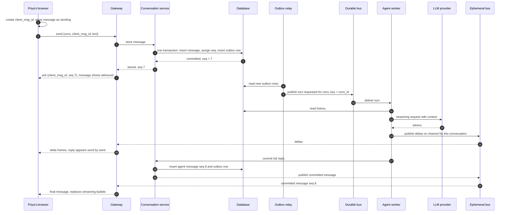

# 01 — The happy path: one message, from Send to reply

Before any failure handling, you need a precise picture of what normally happens. Failure handling is just "which of these steps can break, and what do we do about each one," so a vague happy path produces vague failure answers.

We will follow one concrete customer. Priya is chatting with the support agent of an online shop and types: *"Where is order 88213?"*

## Step 0 — Choosing how the client talks to the server

The browser needs two things: a way to send Priya's message up, and a way to receive the reply *as it is generated*, a few words at a time. There are three common options.

| Option | How it works | Fits this problem because | Weakness |
|---|---|---|---|
| Long polling | The client asks "anything new?", and the server holds the request open until there is | works everywhere | each reply token would need a new request, so streaming is clumsy |
| Server-sent events (SSE) | One long-lived HTTP response that the server keeps writing to; the client sends messages with ordinary POST requests | simple, and the browser reconnects automatically | one direction only, so typing indicators and human-agent presence need extra requests |
| WebSocket | One long-lived two-way connection | both directions on one channel, low overhead per frame | we must write the reconnect and resume logic ourselves |

**Decision: WebSocket**, with SSE plus POST as a fallback for networks that block WebSockets. We write the resume logic ourselves in [doc 04](04-when-the-network-breaks.md) anyway, because even SSE's automatic reconnect cannot know which *reply deltas* the client already displayed. Two-way traffic also matters later, when a human agent joins and typing indicators flow in both directions.

*A gateway* is a server whose only job is to hold these connections. It authenticates the connection, forwards messages inward, and pushes outbound frames to the right sockets. It holds no business logic and does not call the LLM. Keeping it that thin means a gateway crash costs only connections, which clients re-establish, and never costs work in progress.

## Step 1 — The data model

Three tables carry everything. Naming them first makes the rest of the walkthrough concrete.

**conversation**: `conv_id`, `tenant_id` (which business), `customer_id`, `status` (open, handed_off, closed), and `next_seq`, a counter starting at 1.

**message**: one row per customer message or agent reply.

| Column | Meaning |
|---|---|
| `conv_id`, `seq` | primary key. `seq` is the position within the conversation: 1, 2, 3, … |
| `msg_id` | globally unique id, for references from other systems |
| `role` | customer, agent, or system |
| `client_msg_id` | a random id the *client* generates before sending (only on customer messages) |
| `turn_id` | the sequence number of the customer message this row answers or starts |
| `state` | for agent messages: complete, or truncated (explained in doc 03) |
| `content`, `created_at` | the text and the time |

Two uniqueness rules do the heavy lifting. First, `(conv_id, client_msg_id)` is unique, so sending the same customer message twice cannot create two rows. Second, at most one `complete` agent message exists per `(conv_id, turn_id)`, so two workers racing to answer the same turn cannot both commit. These two rules are the database-level enforcement of the "no lost message" and "no duplicate reply" guarantees. Code and queues can have bugs, but a violated unique constraint is rejected by the database.

**outbox**: rows describing events that must be published ("turn requested", "message committed"). Why this table exists is covered in Step 4.

### Where sequence numbers come from

Ordering needs exactly one authority. The conversation service assigns `seq` by running, inside a database transaction, `UPDATE conversation SET next_seq = next_seq + 1 WHERE conv_id = ? RETURNING next_seq - 1`. Because the update locks that conversation's row, two concurrent messages receive different numbers and a definite order. We choose a database counter over timestamps because clocks on different servers disagree by milliseconds or more, and a tie or a swap in message order is visible to the customer as a nonsensical conversation.

This costs a row lock per conversation, but conversations are small and independent, so locks never contend across conversations.

## Step 2 — Priya presses Send

Walk through it in order.

**Steps 1–2: the client creates the id.** Priya's browser generates a random `client_msg_id` *before* sending and shows the message with a "sending" indicator. The id is generated on the client so that if the send is repeated for any reason, the server can recognize it as the same message. The whole retry story in doc 04 depends on this.

**Steps 3–6: store first, then acknowledge.** The conversation service writes the message, takes the sequence number, and adds an outbox row, all in one transaction. Only after the commit does the acknowledgment go back. The "delivered" mark in Priya's UI therefore means exactly one thing: *this message is durably stored and will be answered*. We deliberately do **not** wait for the LLM before acknowledging. The LLM takes seconds and can fail; storing takes milliseconds. Separating them means a provider failure can never lose Priya's message.

**Steps 7–9: the outbox.** Writing a row to the database and then publishing to a message bus are two separate systems, and a crash between them would lose the event: the message is stored but no one is ever told to answer it. The *transactional outbox pattern* removes that gap. The event is inserted into an `outbox` table in the same transaction as the message. A separate relay process reads new outbox rows and publishes them, marking each as sent. If the relay crashes after publishing but before marking, it publishes again after restart. That means the bus can receive the same event twice, which is acceptable because consumers deduplicate (doc 02). The pattern converts "might lose an event" into "might repeat an event," and repeats are easy to handle.

**Step 10: the agent worker takes the turn.** The event is partitioned by `conv_id`, so all turns of one conversation go to one consumer at a time, in order. The worker reads the history and builds the prompt.

### Building the context

The prompt for Priya's turn is assembled from four parts, in this order:

1. The system prompt for this business: tone, policies, what the agent may and may not do. Versioned in the control plane.
2. A short summary of older conversation, if the history is long.
3. The most recent messages verbatim. We keep the last 10 messages, or as many as fit a budget of about 1,500 input tokens.
4. Tool definitions the agent may call (`lookup_order`, `issue_refund`).

Budgeting matters because the cost and latency of every call grow with prompt length. The 1,500-token figure is an assumption, and it is also why the prompt must be built from the stored log rather than from anything held in a worker's memory: any worker can rebuild the identical prompt after a crash.

**Step 11–13: stream the reply.** The worker calls the provider in streaming mode. As tokens arrive, the worker groups them into frames every 100 ms and publishes each frame on the ephemeral channel for this conversation (the channel naming is in doc 02). Each frame carries `reply_id`, `attempt`, `delta_index` and the text. The three bookkeeping fields exist so the client can detect gaps and repeats, which is the heart of doc 04.

If the model decides to call `lookup_order`, the worker runs the tool, adds the result to the context and continues the call. Priya sees a "checking your order…" indicator during this pause. Tools that change things are covered in doc 05.

**Steps 14–18: commit.** When the stream ends, the worker sends the full text to the conversation service, which inserts the agent message with the next `seq`, in a transaction, with an outbox row. The committed message is then published, and the client **replaces** its streaming bubble with the committed version. The streamed text was a preview, and the committed message is the reply.

### Guardrails on a stream

Safety checks must run on text the customer sees, and the stream shows text before it is complete. The worker runs its output filter on a sliding window of the last sentence, and holds back each frame until its sentence passes. This adds roughly one sentence of delay (about 0.4 seconds at 50 tokens per second for a typical 20-token sentence) in exchange for never showing a sentence that violates policy. If a violation is found mid-stream, the worker stops, publishes a reset for that attempt, and commits a safe fallback message instead.

## Latency budget, derived

What does Priya wait for? Add the steps:

| Step | Time |
|---|---|
| WebSocket frame to gateway | 30 ms |
| Store message and acknowledge | 20 ms |
| Outbox relay and bus delivery | 40 ms |
| Read history, build prompt | 20 ms |
| Provider time to first token | 800 ms |
| Output filter hold-back | 400 ms |
| Publish and push to client | 30 ms |
| **Time until first words appear** | **about 1.34 s** |

Delivery acknowledgment (the "delivered" mark) arrives after about 50 ms, long before the reply. The provider's 800 ms dominates, which tells you where optimizing effort (and failure effort) belongs.

## What to take away

1. The acknowledgment means "stored," never "answered." Acknowledging before calling the LLM is what makes a provider outage unable to lose messages.
2. The client generates `client_msg_id`, so a repeated send is recognizable. This single field underpins all later retry safety.
3. One authority (a database counter per conversation) assigns order. Do not order by timestamps.
4. The outbox pattern turns "might lose an event" into "might repeat an event." Pair it with consumers that deduplicate.
5. The worker reconstructs context from the stored log, so any worker can resume any turn.
6. The streamed text is a preview and the committed row is the reply. Everything in the failure documents follows from keeping them separate.
