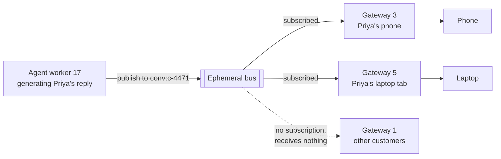

# 02 — Publish/subscribe: two buses for two kinds of traffic

*Publish/subscribe (pub/sub)* is a messaging style where senders (publishers) put messages on a named topic or channel without knowing who reads them, and any number of receivers (subscribers) listen to that channel. The sender and receivers are decoupled: neither needs the other's address, and neither slows the other down.

The interview asks where pub/sub fits. The honest answer is "in two places, and they need different properties." Here is why one bus is not enough.

## The problem with a single bus

Recall the numbers from the [README](00-README.md): about 834 durable message writes per second, but about 13,300 stream frames per second.

Now ask what each kind of traffic needs.

| Property | A committed message ("Your order ships Friday.") | A stream frame (the word "ships") |
|---|---|---|
| Must it survive a broker restart? | Yes, it is the reply | No, it is worthless 3 seconds later |
| Must it be delivered even if the client is offline? | Yes, the client will fetch it later | No |
| Does order matter? | Yes | Yes, but gaps are detectable and repairable |
| How many per second? | hundreds | thousands to tens of thousands |
| Cost of losing one | a customer never gets an answer | a momentary stutter, repaired by the committed message |

A bus that stores every frame to disk with replication (what you need for the first column) pays 16 times more write cost for data nobody will read after 3 seconds. A bus that stores nothing (what is cheap for the second column) loses replies. So we use two:

- A **durable bus** (a partitioned log such as Kafka) for events that must not be lost.
- An **ephemeral bus** (in-memory pub/sub such as Redis pub/sub or NATS core) for stream frames and presence signals.

## Topic and channel design

### Durable bus

| Topic | Published by | Consumed by | Partition key |
|---|---|---|---|
| `turns.requested` | outbox relay | agent workers | `conv_id` |
| `messages.committed` | outbox relay | analytics, quality review, human agent console, notification service | `conv_id` |
| `turns.dead` | workers, after exhausting recovery | human-handoff service, operators | `conv_id` |

*Partitioning by `conv_id`* means all events of one conversation go to the same partition, and a partition delivers events in order to a single consumer within a consumer group. That gives per-conversation ordering for free, and it requires no ordering across conversations, which is what lets the topic scale by adding partitions. With peak traffic of 417 turns per second and a worker handling a turn in about 3.2 seconds, 64 partitions is more than enough, and leaves room to grow.

### Ephemeral bus

One channel per conversation: `conv:{conv_id}`. Every frame published here is one of: a reply delta, a "reply reset" (see doc 04), a typing indicator, or a committed-message notification.

A gateway **subscribes** to `conv:{conv_id}` when a customer's socket opens that conversation and **unsubscribes** when the socket closes. With 25,000 open conversations at peak, the ephemeral bus holds about 25,000 active channels, which in-memory brokers handle easily.

## The question the interviewer is really asking: how does a reply reach the right server?

Priya's socket lives on gateway 3. The agent worker that generates her reply runs on a completely different machine. The worker does not know gateway 3 exists. How does the text reach her?

The worker publishes to the channel named after the conversation. Gateway 3 holds a subscription to that name because Priya's phone connected to that conversation. The broker routes the frame to every current subscriber. Neither side knows the other's address. This is the decoupling pub/sub gives: workers scale independently of gateways, and a gateway restart changes nothing for workers.

### Multiple devices come for free

Priya also has the chat open on her laptop, connected to gateway 5. Gateway 5 is also subscribed to `conv:c-4471`, so it receives the same frames. Each device tracks its own progress (`last_seq`, and its position within the in-flight reply), so a device that was asleep catches up independently using the resume protocol in doc 04. Nothing needs to be told "there are two devices."

The same channel makes handoff to a human simple: the human agent's console subscribes to the same channel and sees what Priya sees.

### Why not have workers hold the sockets?

It is tempting to make the worker the connection holder, so there is no bus between them. The cost is that a worker crash drops the customer's connection, a deployment of the worker fleet disconnects every customer, and the LLM-bound workers (about 50 concurrent streams each, bound by waiting on the network) could not be sized separately from connection holders (about 5,000 sockets each). Separating them lets each fleet be sized for its own bottleneck: about 8 gateways for connections and about 40 workers for streams.

## Delivery guarantees, per bus

### Durable bus: at-least-once, deduplicated

*At-least-once delivery* means every event is delivered one or more times, never zero. The outbox relay can publish twice after a crash, and the broker can redeliver an event if a consumer dies before acknowledging. So a consumer sees an event twice sometimes, and must behave as though it saw it once.

*Deduplication* here uses keys that already exist:

- A worker handling `turns.requested(conv, turn_id)` first checks whether a `complete` agent message already exists for that turn. If yes, it drops the event. If the worker crashed mid-turn, the next worker finds no reply and does the turn. The database's unique rule from doc 01 is the final guard: even if two workers both generated a reply, only one insert succeeds, and the loser discards its result.
- Downstream consumers (analytics, notifications) deduplicate on `(conv_id, seq)`.

Why not use *exactly-once* delivery? Because it cannot be made true across a network boundary into a system like an LLM or a payment API. What we can build is *effectively-once processing*: at-least-once delivery plus idempotent handling. That is what these checks are.

### Ephemeral bus: at-most-once, repaired by the log

*At-most-once* means a frame is delivered zero or one times, with no retry. If a gateway is briefly disconnected from the bus, the frames sent during that time are gone. That is acceptable only because of the design rule from the README: the frames are a view, and the committed message is the truth. The two repair paths:

1. The client notices a gap in `delta_index` and asks for the missing deltas from a short-lived reply buffer (below).
2. If it is not repaired, the committed message arrives at the end and replaces the streaming bubble. The customer sees a momentary stutter, never a wrong final answer.

### The reply buffer: how a late subscriber catches up

A subscriber who connects mid-reply (for example, Priya's phone reconnecting after a tunnel) missed earlier frames, and pub/sub does not replay. So the worker also appends each delta to a short-lived list in a key-value store, `reply:{reply_id}`, with a time-to-live of 10 minutes. The resume procedure is:

1. Subscribe to `conv:{conv_id}` first, and buffer arriving live frames in memory.
2. Read the stored deltas from `reply:{reply_id}` starting at the client's last-seen `delta_index + 1`.
3. Send those, then release the buffered live frames, skipping any whose `delta_index` was already sent.

The order matters. If you read the buffer first and subscribe second, any frame published in between is lost forever, which produces a gap. Subscribing first and reading second can produce *overlap* (a frame in both the buffer and the live stream), and overlap is harmless because `delta_index` lets you discard repeats. The general rule is **subscribe, then backfill, then deduplicate**; trading a possible gap for a possible overlap is always correct, because overlap is detectable and a gap is not.

## Back-pressure: when a client reads slowly

A phone on a weak connection cannot accept frames as fast as the worker publishes them. If the gateway queues frames for it without limit, gateway memory grows. The gateway keeps a small outbound buffer per socket (say 64 frames). If the buffer fills, the gateway *drops the intermediate deltas* for that socket and sends one "resync" marker. The client then takes the committed message or re-reads the reply buffer. Dropping frames is safe because they are a view, and dropping them is the very reason the view is allowed to be lossy.

## Fan-out to other consumers

The durable `messages.committed` topic has one consumer group per interested system: analytics (builds dashboards), quality review (samples conversations for human grading), the human agent console, and the notification service (sends a push notification or email when a reply arrives while the customer is offline). Adding a new consumer means adding a group, and does not change any producer. Every group has its own position in the log, so a slow analytics job cannot delay the console.

## What to take away

1. Use two buses because the two kinds of traffic have opposite needs: committed messages must never be lost, and stream frames lose their value in seconds and number sixteen times more.
2. Partition the durable bus by `conv_id` to get per-conversation order without any global order.
3. Gateways subscribe to a per-conversation channel. That one mechanism delivers a reply produced anywhere to a customer connected anywhere, and it handles multiple devices and human handoff.
4. Accept at-least-once delivery and build idempotent consumers. Do not claim exactly-once.
5. Always subscribe first, backfill second, and deduplicate by index. Prefer a harmless overlap to an undetectable gap.
6. The ephemeral bus can be lossy only because the committed log repairs everything it loses.
