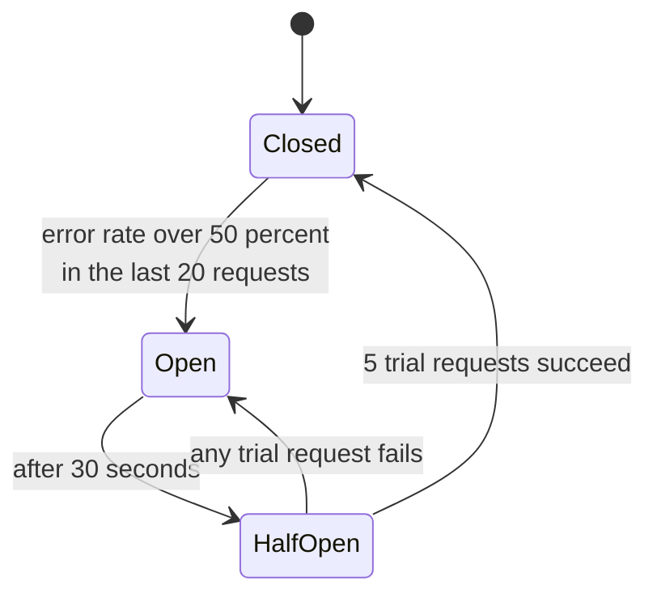
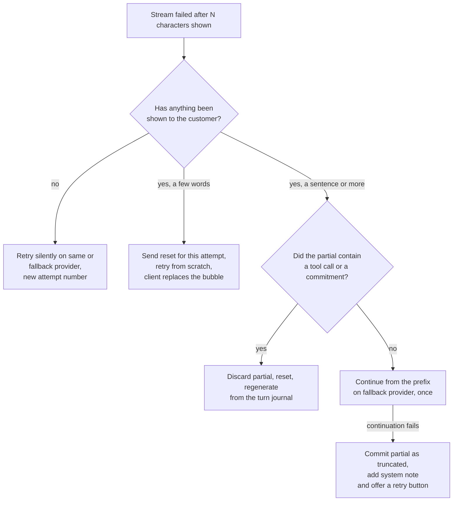
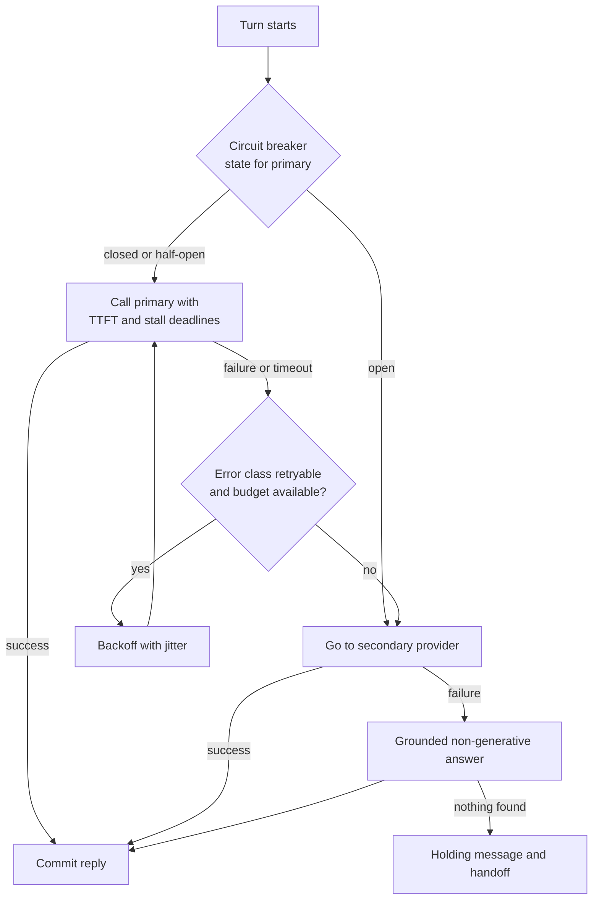

# 03 — When the LLM provider partially fails

The provider is outside our control, so we plan for it misbehaving. "Partially fails" is vague, and the first step of a good answer is to say which failure you mean. There are three, and each needs a different response.

| Failure | What it looks like | Typical cause |
|---|---|---|
| **A. A fraction of requests fail** | 20% of calls return 500, 503 or 429 (too many requests) | overload at the provider, capacity limits |
| **B. Responses are slow** | time to first token jumps from 0.8 s to 9 s | degraded provider, queueing |
| **C. A stream stops midway** | tokens flow, then the connection closes or goes silent after 40 tokens | provider crash, network reset, proxy timeout |

The rest of this document handles them in order, then ties them into one controller.

## Step 1 — Classify before you react

Retrying everything is wrong, and retrying nothing is wrong. The class of error decides.

| Error | Meaning | Action |
|---|---|---|
| 400 invalid request, context too long | our request is broken, resending will fail identically | **do not retry.** Trim the context or fail the turn, and raise an alert |
| 401 or 403 | our credentials or permissions are wrong | **do not retry.** Page the on-call. It is a configuration problem |
| 429 too many requests | we are sending too fast, or the provider is shedding load | retry **after** the delay in the `Retry-After` header, if present |
| 500, 502, 503, 504 | provider-side failure | retry with backoff, then fall back |
| Connection reset or timeout before any token | unknown, the request may or may not have started | retry, because generation has no side effects |
| Stream cut after some tokens | see failure C | see Step 5 |

**Why is retrying a generation call safe at all?** The question "could the first attempt already have taken effect?" is the one interviewers care about. For a *pure text generation* the answer is: it may have been computed, and we may have been charged, but nothing visible in the world changed. So a retry cannot do harm beyond extra cost. That is true only for generation. Tool calls that change business state (refunds) are different, and doc 05 handles them separately. Keeping generation and side effects in separate steps is what makes this safe.

## Step 2 — Retrying without making things worse

Consider failure A at peak. The provider fails half of all requests. There are 417 requests per second. If every failed request is retried up to three times, how much load do we send?

Each attempt fails with probability 0.5, independently. The expected number of attempts for one request is:

- first attempt: 1
- second attempt happens if the first failed: 0.5
- third attempt happens if the first two failed: 0.5 × 0.5 = 0.25
- fourth attempt: 0.5 × 0.5 × 0.5 = 0.125

Total = 1 + 0.5 + 0.25 + 0.125 = **1.875 attempts per request**. The provider that was already failing half of 417 requests per second now receives 417 × 1.875 ≈ **782 requests per second**. Our retries nearly doubled the pressure on a service that was struggling, which can turn a partial failure into a total one. This feedback loop is called a *retry storm*.

Four mechanisms stop it. They work together and none replaces the others.

**1. Exponential backoff with full jitter.** *Backoff* means waiting longer before each retry: 200 ms, then 400 ms, then 800 ms (doubling). *Jitter* means picking the actual wait at random between zero and that ceiling. Without jitter, every request that failed at the same moment retries at the same moment, creating synchronized waves of load. With full jitter (a random wait between 0 and the ceiling), retries spread evenly over time.

**2. A retry budget.** Allow retries to add at most 10% to the normal request rate. In practice a counter over a sliding window: if retries in the last 10 seconds already exceed 10% of first attempts, further failures are *not* retried and go straight to fallback. With the budget, the worst-case load is 417 × 1.10 ≈ 459 requests per second, instead of 782. A budget caps the total, while a per-request retry limit only caps each request.

**3. A circuit breaker.** *A circuit breaker* is a state machine around the provider call, borrowed from electrical breakers.

- **Closed**: normal. Requests flow, and results are counted.
- **Open**: the provider is considered down. Requests do **not** go to it at all. They go straight to the fallback. This gives the provider room to recover and saves our customers from waiting for timeouts that will certainly happen.
- **Half-open**: after 30 seconds, let five trial requests through. If they succeed, close. If any fail, open again for another 30 seconds.

**4. A per-attempt deadline.** Every attempt has its own timeout (Step 3), and the whole turn has an overall deadline of 20 seconds. Retries cannot extend the customer's wait forever.

## Step 3 — Slowness (failure B)

A slow provider is in some ways worse than a failing one, because failure is quick and informative while slowness holds resources and the customer's patience. There are two separate clocks.

- **Time-to-first-token deadline: 4 seconds.** Normal is 0.8 seconds, and the 99th percentile is about 1.5 seconds. A deadline of 4 seconds is far enough above normal that it rarely fires on a healthy provider, and short enough that the customer is not staring at a blank typing indicator for long. If no token arrives in 4 seconds, abandon the attempt and go to the next option.
- **Inter-token stall deadline: 3 seconds.** Once streaming starts, tokens normally arrive every 20 ms (50 per second). A silence of 3 seconds means the stream is stuck. This is the detector for failure C as well, and it matters because a cut stream often does not send a clean error. The connection simply goes quiet.

**Hedging.** *A hedged request* is a second, parallel request sent to a different provider when the first has not responded within a short time. If the first provider's responses are usually back by 1.5 seconds, send the hedge at 2 seconds, and use whichever answers first, cancelling the other. Hedging cuts tail latency at the cost of extra spend, and extra load on the backup. We hedge only when the circuit breaker shows the primary is degraded (say error rate above 10% but below the 50% trip point), never in normal operation. In normal operation 5% of requests being hedged would cost 5% more for a tiny latency gain.

## Step 4 — Fallback tiers

When the primary fails, there is a ladder. Each rung is worse than the one before, and the system moves down only as far as it must.

1. **Retry the primary** (within the retry budget).
2. **Secondary provider or model.** A different vendor, or a smaller model from the same vendor. It is slower to set up (the prompt must work on both, and we must evaluate both), but it fails independently. Quality may be lower, so we log which model answered each turn.
3. **Grounded, non-generative answer.** Search the business's help articles and show the best passage with a link, with no generation involved. It works while every LLM is down.
4. **Honest holding message and handoff** (doc 06).

Which rung served each reply is recorded on the message, so quality review can compare.

## Step 5 — A stream that stops midway (failure C)

This is the hardest of the three, because **the customer has already seen part of the reply**. The first 40 tokens, "Your order 88213 shipped on Tuesday and should arrive by", are on Priya's screen. The stream dies. What now?

First, the options, and why most fail.

| Option | What happens | Problem |
|---|---|---|
| Show the partial and stop | Priya reads a sentence that ends mid-clause | looks broken, and the partial may be misleading |
| Delete the partial and restart | text vanishes, new text appears | jarring, and the new text may contradict what she just read |
| Retry silently and append | the second attempt's text is appended after the cut | the second attempt starts from scratch, so the text repeats or contradicts |
| **Continue from the prefix** | ask a model to continue exactly where the text stopped | works if the provider supports it, and reads naturally |
| **Truncate honestly** | commit the partial, marked truncated, and add a follow-up | always available, and never lies |

The policy combines the last two, decided by *how much the customer has seen*:

Reading the diagram: the less the customer has seen, the cheaper it is to simply start again. "A few words" we define as under 40 characters, which in 100 ms frames is typically the first one or two frames, and a quick replacement of such a short bubble is not noticed. Past the first sentence we try to *continue*, passing the shown text as the beginning of the assistant's turn and asking for the rest, because replacing a paragraph the customer is already reading is the worse experience.

**Truncated is a real, visible state.** If continuation also fails, the message is committed with `state = truncated`, with a short system note beneath it ("Sorry, my reply was cut off. Tap to retry."). We never commit an unmarked partial as `complete`. If we did, the log (the truth) would claim the agent said something it did not finish saying, and all later context built from the log would carry a broken sentence.

**The `attempt` field.** Every frame carries an attempt number. When a new attempt begins, the first frame carries a higher number and a *reset* flag, and the client discards the previous attempt's partial text. Without this, a late frame from the dead attempt, delayed in the network, could be mixed into the new text. The client's rule is one line: accept only frames whose attempt equals the highest attempt seen for that reply.

## Step 6 — The controller that ties it together

Because the controller is configuration-driven, thresholds (the 4 s deadline, 50% trip point, 10% budget) live in the **control plane**. During an incident an operator can force the breaker open, change the routing weight to 100% secondary, or enable hedging without a code deploy. This separation of governing settings from the message-carrying code is the design principle the rest of this repository follows.

## What to take away

1. Say which "partial failure" you mean: some requests fail, responses are slow, or a stream is cut. They need different handling.
2. Classify errors first. Never retry a request that will fail identically, and always respect `Retry-After`.
3. Retrying a pure generation is safe because it has no side effects. That safety ends the moment a tool call that changes state is involved.
4. Retries multiply load. At a 50% failure rate with three retries the load rises from 417 to 782 requests per second. Backoff with jitter, a 10% retry budget and a circuit breaker keep it near 459.
5. Use two timers for streams: time to first token (4 s) and the gap between tokens (3 s). A cut stream usually goes silent rather than reporting an error.
6. Handle a mid-stream cut by how much the customer has seen: start over if almost nothing, continue from the prefix if a lot, and mark truncated honestly if continuation fails.
7. Every frame carries an attempt number, so frames from a dead attempt can never corrupt the new one.
