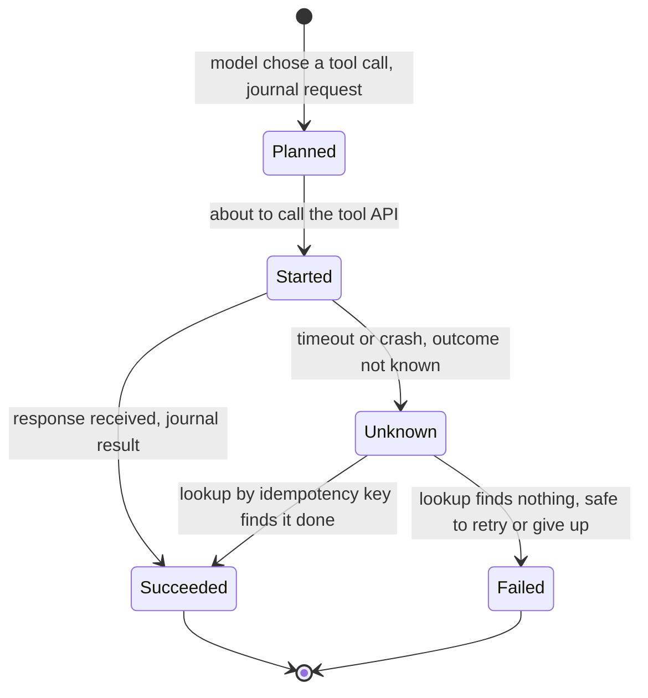

# 05 — The turn journal: refunds that happen once, and customers who type fast

Two of the follow-up questions in this interview look unrelated. One asks how to stop a retry from issuing a refund twice. The other asks what happens when the customer sends three messages while the agent is still answering the first. Both have the same root cause: **a turn is not a single call, it is a sequence of steps over time, and failures and new input can arrive between the steps.** The solution is the same for both: a durable record of the steps.

## Part 1 — Why a refund can happen twice

Priya now writes: *"My order 88213 arrived broken. Please refund me."* The agent's turn has four steps:

1. LLM call: the model reads the conversation and decides to call `issue_refund(order=88213, amount=49.90)`.
2. Tool execution: the worker calls the payments API, which sends the money back.
3. LLM call: the model receives the result and writes "Done, you will see $49.90 back in 3 to 5 days."
4. Commit the reply.

Now let failures in. Suppose the payments API call in step 2 times out after 10 seconds. The worker does not know the answer to a crucial question: **did the refund happen?** There are three possibilities, and from the worker's side they look identical:

| What actually happened | What the worker sees |
|---|---|
| Request never reached the payments API | timeout |
| Payments API processed it, response lost | timeout |
| Payments API is still processing it | timeout |

If the worker simply retries, in the second and third cases Priya is refunded twice. For generation (doc 03) a repeat is harmless. For a refund it costs real money. Two separate problems must be solved.

### Problem 1: the retried request must be recognized as a repeat — idempotency keys

An *idempotency key* is a unique string the caller attaches to a request. The receiving service remembers keys it has processed, and if it sees the same key again, it returns the result of the first attempt instead of acting again. Most payment APIs support this.

The crucial design question is: **where does the key come from?** If the worker invents a random key for each attempt, the retry carries a different key, and the payments API treats it as a new refund. The key must be **derived deterministically from the identity of the action**, so every retry, by any worker, computes the same value:

```
idempotency_key = hash(conv_id, turn_id, tool_call_index)
               = hash("c-4471", 9, 0)   // first tool call of turn 9
```

Every attempt at "the first tool call in turn 9 of conversation c-4471" sends the same key. The payments API then guarantees one refund.

### Problem 2: the model might decide something different the second time

Here is a subtler failure. Suppose a worker crashes after step 2 succeeded but before step 4. A new worker takes over the turn. If it simply regenerates from step 1, the LLM is non-deterministic. The first run decided "refund $49.90." The second run might decide "refund $49.90 plus shipping, $54.85" or "ask the customer a clarifying question first." If it decides a different refund, the idempotency key (same turn and index, but different amount) would collide, or, worse, if the key included the amount, a second refund would be issued.

The fix is to stop regenerating decisions that were already made. We write a **turn journal**: a durable record of each step *before* we rely on it.

### The turn journal

For every turn, the worker appends one row per step to a table `turn_step(conv_id, turn_id, step_no, kind, request, result, state)`:



The rules for a worker that picks up a turn, whether new or taking over:

1. **Read the journal first.** Replay every `Succeeded` step from the recorded result. Do **not** call the LLM or the tool again for those. The model's earlier decision is read from the journal, not re-rolled.
2. **A step in `Planned`**: the tool was never called. Execute it, using the stored request and the derived key.
3. **A step in `Started` or `Unknown`**: the tool may have run. First **look up the outcome** at the service using the idempotency key (most payment APIs provide a lookup, for example "get refund by idempotency key"). If it shows done, record `Succeeded` with that result. If it shows nothing, retry the call with the same key. If the service has no lookup, retrying with the same key is the safe action, because the key makes a duplicate a no-op.
4. Only continue to new LLM calls after all earlier steps are resolved.

Now replay Priya's crash: worker A journaled the plan, called payments, got the result, journaled `Succeeded`, and crashed before writing the reply. Worker B reads the journal, sees the refund `Succeeded` with its refund id, **does not call payments again**, makes only the *final* LLM call (step 3) with the recorded result in context, and commits the reply. The refund happened exactly once, and the model's earlier decision was honored.

This pattern is a small *durable workflow*, the same idea used by workflow engines such as Temporal. You can adopt such an engine, or implement the journal with one table as above. For a turn of three or four steps, a table is enough.

### Additional safety around money

- **Authorization limits in the tool layer, not the prompt.** `issue_refund` is capped (for example $100 per turn, $200 per conversation, and only for orders belonging to this customer). The prompt may *say* this, but the cap is enforced in code, because models can be talked out of instructions.
- **Confirm before irreversible actions.** For refunds above a threshold, the agent asks Priya to confirm, or hands the decision to a human.
- **Read tools and write tools are separate.** Read-only tools (`lookup_order`) are safe to retry freely. Write tools go through the journal and idempotency path.

## Part 2 — Three messages while the agent is answering the first

Priya sends three messages quickly:

- t = 0.0 s: "Where is order 88213?" (seq 7)
- t = 1.0 s: "Also, can I change the delivery address?" (seq 8)
- t = 2.0 s: "Never mind, it's the same address." (seq 9)

The reply to message 7 takes 3.2 seconds (finishing at t = 3.2 s). Messages 8 and 9 arrive while it is streaming. What do we do?

### Rule 1: one turn at a time per conversation

Only one worker may generate for a conversation at a time. That is already the effect of partitioning by `conv_id` plus the lease from doc 04: events of one conversation are processed in order, one after another. Without this, two workers would generate replies 8 and 9 concurrently, their text could interleave on screen, and the second reply would be written without knowing the first.

### The options for the new messages

| Strategy | What it does | Cost for Priya's three messages |
|---|---|---|
| **Serial** | Answer 7, then answer 8, then answer 9, each as its own turn | Three replies, the second one ("yes, you can change it, what is the new address?") is already out of date when 9 arrives. Three LLM calls |
| **Cancel and restart** | When 8 arrives, abort the stream for 7 and answer 7+8 together | Wasteful, and the customer sees text vanish |
| **Finish, then coalesce** | Let reply 7 finish. Then answer all pending customer messages (8 and 9) in **one** turn | Two replies, two LLM calls, and the second reply sees all the facts |

**Decision: finish, then coalesce.** The reasoning: the in-flight reply is cheap to finish (it takes 3.2 seconds) and cancelling it wastes the tokens already paid for and shows the customer a vanishing bubble. But making the customer wait for a *separate* reply to each of the following messages is clearly worse, because by the time the reply to 8 appears, message 9 has already changed the question. Coalescing gives a reply to 8 and 9 together that says "Understood, no change needed to the address, your order will arrive Friday."

The timeline:

| Time | Event |
|---|---|
| 0.0 s | message 7 stored, turn 7 requested |
| 0.0–3.2 s | worker streams reply 7 (seq 10 on commit) |
| 1.0 s, 2.0 s | messages 8 and 9 stored (seq 8, 9), turn events queued behind turn 7. Priya's screen shows a typing indicator |
| 3.2 s | reply to 7 committed |
| 3.2 s | worker takes next event for this conversation, and **reads all customer messages with seq greater than the last answered one**: finds 8 and 9. It marks events for 8 and 9 as handled by this one turn |
| 3.2–6.4 s | one reply answers both |

Notice that sequence numbers interleave as messages arrive: customer messages 8 and 9 get their `seq` when stored, so the reply to 7 is committed *after* them, as seq 10. That is correct: the order reflects the true order of storage. The reply's `turn_id` field (7) records which message it answers, so the UI can show it as a reply to the first message even though it appears after the others.

### One exception: abort only before any text was shown

If a new message arrives while the worker is still waiting for the first token (time to first token), nothing is on screen yet, so the worker can abort and restart with all messages included, at no visible cost. After the first token, it finishes. This rule is cheap to apply and avoids pointless work in the common case where the customer sends a second message right after the first.

### The journal makes it correct

Coalescing relies on the turn journal: if turn 7 had called a tool (a read, say), the journal marks it as part of turn 7. The new coalesced turn is a *different* turn (call it turn 8) with its own `turn_id`, its own journal and its own idempotency keys, so tool calls from the two turns never collide.

## What to take away

1. A turn is a sequence of steps, so crashes and retries can land between steps. A durable record of the steps (the turn journal) is the tool that makes both problems manageable.
2. Derive idempotency keys from the identity of the action, never generate them per attempt. The key `hash(conv_id, turn_id, tool_call_index)` is the same for every retry by every worker.
3. Never re-ask the model for a decision already acted upon. Replay it from the journal, because the model is non-deterministic.
4. After a timeout on a write, first look up the outcome by key, and only then retry.
5. Enforce money limits in code, and keep read tools and write tools on separate paths.
6. Process one turn per conversation at a time. For messages that arrive meanwhile, finish the in-flight reply and then answer all pending messages in one coalesced turn.
