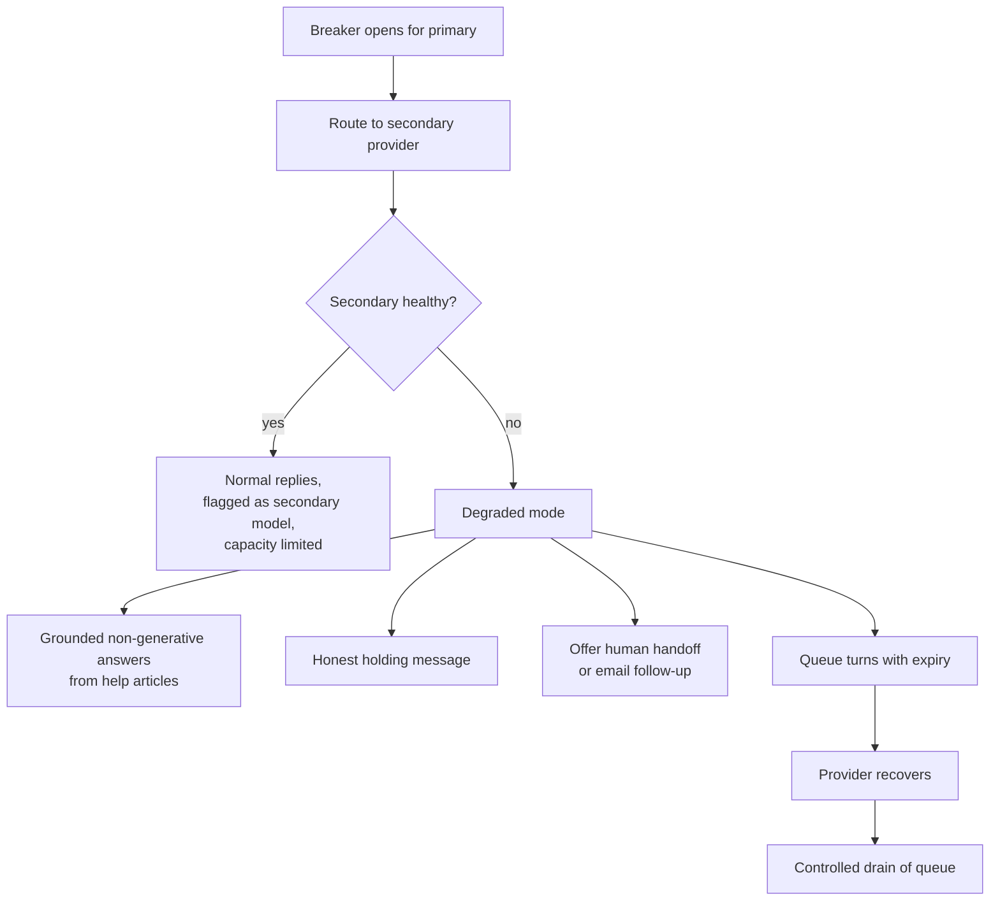

# 06 — The provider is down for an extended period

Doc 03 handled brief failures with retries and a circuit breaker. This document answers the first follow-up question: *the provider is down for an hour; what does the customer experience, and what does the system do?* A short failure can be hidden from the customer. A long one cannot, so the design goal changes from "hide the failure" to "stay honest, lose nothing, and recover without causing a second failure."

## What the customer should experience

Think about it from Priya's side. She types a question and nothing happens for 30 seconds. She types again. She leaves, and she is angry. The worst outcome is silence. So the design fixes four customer-facing behaviors:

1. **Her message is acknowledged immediately.** The delivered check appears, because storing the message never depended on the provider.
2. **She is told within about 5 seconds what is happening**, in plain words: "Our assistant is taking longer than usual. Your message is saved. You can keep waiting, or we can email you the answer."
3. **She gets something useful if one exists.** A help-article answer (rung 3 of the ladder in doc 03) or, where available, a human.
4. **She is never lied to.** The system does not pretend to be typing forever.

## What the system does, in order

### 1. Switch to the secondary provider

The first response is the secondary provider from doc 03. Two practical points. First, the secondary may have **less capacity** than we need. At peak we send about 417 requests per second, and a backup contracted for, say, 150 per second cannot take everything. Second, its answers may be **lower quality**. So the control plane carries a *degradation policy* that decides who gets the limited capacity: conversations already in progress first, new conversations later, and conversations involving a refund or complaint ahead of general questions. Priority comes from a cheap classification made at the gateway (for example by keywords and the customer's open order status), without any LLM.

### 2. Admission control: shed load on purpose

When capacity is below demand, accepting everything just produces long waits for everyone. **Admission control** means deliberately limiting what is accepted. For example, with 150 requests per second available and 417 arriving, we answer the highest-priority 150 with generation and give the rest the non-generative path. Every customer gets a prompt, honest response, rather than all customers a timeout. Rejecting early is a kindness, because waiting 30 seconds for a failure is worse than being told in 2 seconds.

### 3. Non-generative answers

Search the business's help content (keyword and embedding search) and respond with the best matching article passage and a link: "Here's what our help centre says about changing a delivery address." This path calls no LLM and needs only our own search index, so it keeps working in the worst case. It cannot handle "refund my order" requests, which need actions, and those go to the next two paths.

### 4. Human handoff

*Handoff* means moving the conversation to a human agent. The mechanics are cheap because of the design from doc 02: the human console is just another subscriber to `conv:{conv_id}` and a consumer of `messages.committed`. Handoff is:

1. Set `conversation.status = handed_off` (a database update). Workers check this status before generating, so the agent stops answering.
2. Publish a handoff event to the human queue with the conversation's `conv_id`, a summary, and the priority.
3. The human reads the full history from the database, and replies are written as `role = human` messages through the same conversation service, so they get ordinary `seq` numbers and appear to Priya like any other reply.

Because the history lives in the database and not in the agent's memory, the human sees everything instantly. Handoff capacity is the limit: if 25,000 conversations are open and a team of 200 humans can each handle 5 at once, that is 1,000 conversations. So handoff is offered selectively (high priority and refund cases), and everyone else is offered "we'll email you."

### 5. Queue turns, but with an expiry

For customers who choose "email me," and for those who simply wait, turns are queued for processing once the provider returns. The danger here is arithmetic. At 417 requests per second, a 10-minute outage accumulates 417 × 600 = **250,200 pending turns**. Two problems follow if we naively process them all later.

- **Most are stale.** A customer who left 8 minutes ago does not need a "typing…" reply. Each queued turn therefore has an **expiry** (for example 15 minutes). After that, the turn is not generated, and the customer receives a short email: "Sorry we missed you. Reply here to continue."
- **A backlog drain is itself a spike.** If the provider recovers and we immediately send 250,000 queued turns plus the live 417 per second, we overload it again, and it fails again. This is the same retry-storm problem as doc 03, at a larger scale.

### Controlled drain

When the breaker closes, drain at a rate we choose. Suppose the provider can handle 2 times our normal peak, 834 requests per second. Live traffic uses 417, leaving 417 per second for the backlog. A 250,200-turn backlog (with no expiry) would take 250,200 ÷ 417 = **600 seconds**, 10 minutes, to clear. With a 15-minute expiry, many are skipped, so it clears faster. Two refinements:

- **Newest conversations first**, because the customers who are still connected are the ones who benefit.
- **Ramp the drain up gradually** (for example from 10% to 100% of the available headroom over 2 minutes) and watch the provider's error rate. If errors rise, the controller slows. This is the half-open idea from the circuit breaker, applied to the backlog.

## Recovering the conversation itself

Customers who waited do not need to do anything. When the provider recovers and a turn is processed, the committed reply is written to the log. A customer still connected receives it through the live channel. A customer who left receives a push notification or email through the notification service, a consumer of `messages.committed`. In both cases the delivery path is the one from doc 04, with no special outage logic.

## Kill switch and manual controls

The control plane exposes a few operator controls, because during an incident people decide faster than any automatic rule:

- **Force breaker open or closed** for a provider.
- **Set routing weights** (for example 70% secondary, 30% primary, to test recovery).
- **Switch the whole product into degraded mode.**
- **Pause the drain.**

Each is a configuration change that the data plane reads within seconds, and each is recorded in an audit log: who changed what, and when.

## What to take away

1. Brief failures can be hidden. Long ones cannot, so be honest within seconds, acknowledge the message immediately, and never let a customer wait in silence.
2. Fall back in layers: secondary provider, then non-generative help-article answers, then humans and email. Each layer is worse but works when the layer above does not.
3. Use admission control. Shedding load deliberately and quickly is better than letting everyone time out.
4. Handoff is cheap because history is in the database and the human console is another subscriber. Its limit is human capacity, so offer it selectively.
5. Queue turns with an expiry, and drain the queue at a controlled rate. A backlog released all at once can cause a second outage.
6. Keep manual controls in the control plane, with audit logging.
