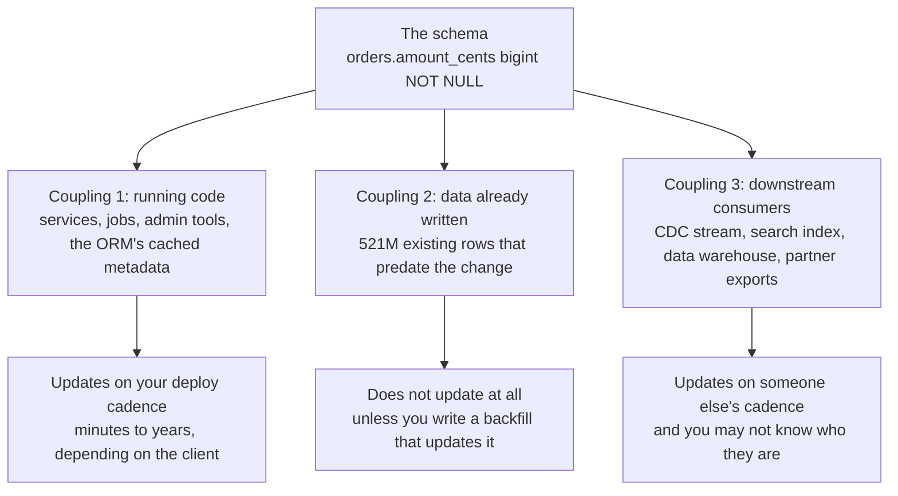
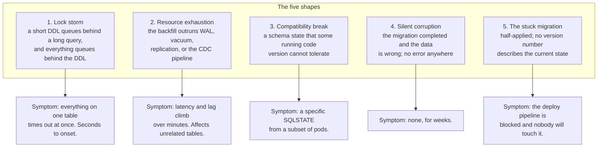

# What a Database Migration Actually Is, and Why It Is the Most Dangerous Routine Operation You Run

Start with the word itself, because it hides three different activities that fail in three
different ways, and most migration incidents come from a team that planned for one of them and
got hit by another.

When an engineer says "I have a migration to run," they might mean any of these:

1. **A schema change.** `ALTER TABLE orders ADD COLUMN currency text;` — a statement that
   changes the *structure* the database enforces. The technical term is DDL, Data Definition
   Language: the subset of SQL that defines objects rather than reading or writing rows.
2. **A data change.** `UPDATE orders SET currency = 'USD' WHERE currency IS NULL;` — a statement
   that changes the *content* of existing rows, usually to make them conform to a structure that
   just changed. When it runs over a large table in controlled pieces, it is called a
   **backfill**.
3. **A store change.** Moving the `orders` table out of the shared Oracle database and into a
   PostgreSQL cluster owned by the order service. Nothing about the logical schema need change
   at all, and yet this is by far the largest and riskiest of the three.

Those three share a name and almost nothing else. The first is bounded by *locking*. The second
is bounded by *throughput and side effects*. The third is bounded by *correctness across two
systems that disagree about types, nulls, and sort order*. A team that has done fifty of the
first and none of the third will confidently under-plan the third by an order of magnitude.

This collection covers all three, plus the thing that sits underneath all of them and causes
more outages than any of them individually: **the coordination between a schema change and the
code that uses the schema**.

---

## The one invariant that makes all of this hard

Here is the sentence to carry through every one of the twenty-two documents that follow.

> **For some window of time, two versions of your application code are running against one
> version of your schema.**

That is not a bad practice you can engineer away. It is a direct consequence of deploying
without downtime. If you have forty pods and you replace them one at a time over four minutes,
then for four minutes some pods run the old code and some run the new. If you have a mobile app,
the window is not four minutes — it is however long it takes users to update, which at Waypoint
(one of this collection's running systems) is **measured in years**.

So every schema state you pass through must be simultaneously compatible with:

- the code that was running before the change, and
- the code that will be running after it.

Read that again, because the implications are not obvious and they are the source of most of the
discipline in this collection:

- **You cannot rename a column.** Not because renaming is technically hard — `ALTER TABLE orders
  RENAME COLUMN amount TO amount_cents` is a metadata-only operation that completes in
  milliseconds — but because there is no instant at which both the old code (which selects
  `amount`) and the new code (which selects `amount_cents`) can both succeed. One of them gets
  `ERROR: column "amount" does not exist`, SQLSTATE `42703`.
- **You cannot add a `NOT NULL` column without a default.** The old code does not know the
  column exists, so its `INSERT` omits it, so its `INSERT` fails.
- **You cannot drop a column while any running code still selects it** — including code that
  says `SELECT *`, which is most code, and including code you did not know existed, such as a
  reporting job that runs on the first of the month.

A single schema change that looks atomic in a migration file is therefore almost always **a
sequence of three to six separately deployed steps**, spread over days or weeks, where each
individual step is safe with the code on either side of it. That sequence has a name —
expand/contract — and [01-the-migration-lifecycle-and-expand-contract.md](01-the-migration-lifecycle-and-expand-contract.md)
is entirely about it.

---

## Why this is the largest single cause of enterprise incidents

You will see the claim "most outages are caused by change" quoted often and sourced rarely. You
do not need an industry study; you can derive why it must be true for your own system.

Consider what can trigger an incident in a steady-state service:

- **Traffic changes.** Real, but gradual in most systems and predictable in the rest. You scale
  for it.
- **Hardware and infrastructure failures.** Real, and you have already engineered redundancy for
  them, because that is what the last decade of platform work was about. A node dying is a
  non-event.
- **Dependency failures.** Real, and the subject of an entire sibling collection
  ([`../MicroservicesPOF`](../MicroservicesPOF/README.md)). Also increasingly well-defended with
  timeouts, bulkheads and circuit breakers.
- **Change you deliberately made.** No redundancy protects you from this, because the change
  propagates to every replica by design. That is what makes it different in kind.

Now narrow to schema change specifically, and count the properties that make it worse than a
code deploy:

| Property | Code deploy | Schema migration |
|---|---|---|
| Rollback | Redeploy the previous image; minutes | Often impossible; the old data may be gone |
| Blast radius | The pods running that image | Every reader and writer of that table, in every service, forever |
| Canary | Route 1% of traffic to the new version | There is one schema; you cannot have 1% of a column |
| Observability | You know which version served each request | The schema has no version in the request path |
| Failure timing | Usually immediate | Often weeks later, when a quarterly job runs |

The fourth and fifth rows are the ones that matter most and get the least attention. **A schema
migration can be wrong and silent.** A backfill with an off-by-one in its `WHERE` clause misses
40,000 rows; every test passes; the dashboards are green; and five months later somebody
notices that refunds issued in a particular three-day window have the wrong currency.
[12-verification-and-reconciliation.md](12-verification-and-reconciliation.md) exists because of
that failure shape, and doc 19's case `CS-8` is a worked example of it running undetected for
six weeks at Corridor.

**The practical conclusion:** a migration deserves more review, more instrumentation, and more
rehearsal than a code change of the same apparent size — and in most organisations it gets less,
because it is one file with four lines in it.

---

## The vocabulary, defined once

These terms appear throughout and are used precisely. If you already know them, skim; several
are used loosely elsewhere and the loose usage will make later arithmetic confusing.

**DDL** — Data Definition Language. Statements that change structure: `CREATE`, `ALTER`, `DROP`,
`TRUNCATE`. The important property is that DDL takes locks that ordinary reads and writes do
not, and in most engines those locks conflict with everything.

**DML** — Data Manipulation Language. `INSERT`, `UPDATE`, `DELETE`, `SELECT`. A backfill is DML.

**Metadata-only change** — a DDL statement the engine can satisfy by editing its catalogue
without touching any data pages. `ALTER TABLE orders ADD COLUMN currency text;` in PostgreSQL 11
and later is metadata-only: the catalogue records that the column exists, and existing rows are
interpreted as having `NULL` for it because they are physically shorter than the new row
definition. Cost: milliseconds, independent of table size.

**Table rewrite** — a DDL statement that requires the engine to write out a new physical copy of
every row. `ALTER TABLE orders ALTER COLUMN amount TYPE numeric(14,2);` is a rewrite, because
the on-disk representation of every value changes. Cost: proportional to table size, and it
needs free space equal to the table while it runs. On a 336 GB table this is not a statement you
run at 14:00 on a Tuesday.

The distinction between those two is the single most useful thing to know about DDL, and it is
engine-specific and version-specific. The same statement is metadata-only on PostgreSQL 15,
a full rewrite on PostgreSQL 10, instant on MySQL 8.0.29, and a rebuild on MySQL 5.7.
[02-what-ddl-does-to-a-live-database.md](02-what-ddl-does-to-a-live-database.md) has the tables.

**Online** — an operation that permits concurrent reads *and writes* to the same table for
substantially all of its duration. Note what the word does **not** mean: it does not mean
"takes no locks" (almost every online operation takes a brief exclusive lock at the start,
the end, or both), and it does not mean "costless" (an online index build on a busy table can
double your write latency). Vendors use "online" to mean "does not require a maintenance
window," which is a business statement, not a technical one.

**Backfill** — a controlled, chunked, resumable DML job that brings existing rows into
conformance with a new schema. The defining characteristics are that it is *chunked* (many small
transactions, not one big one), *rate-controlled* (it slows down when the database is busy), and
*resumable* (it records progress, so killing it loses at most one chunk).

**Cutover** — the moment at which reads or writes switch from the old structure to the new one.
Almost all the risk in a store migration concentrates here, which is why
[09-store-to-store-migrations-and-cdc-cutovers.md](09-store-to-store-migrations-and-cdc-cutovers.md)
spends most of its length on the ten minutes around it.

**Expand/contract** — the discipline of splitting a change into an additive phase (expand: add
the new thing, nothing is removed, everything stays compatible), a transition, and a subtractive
phase (contract: remove the old thing, once nothing uses it). Sometimes called parallel change.

**Schema drift** — the condition in which two databases that should have the same schema do not.
It arises whenever a migration is applied to a fleet rather than to a single database, and it is
the defining problem of [11-fleet-rollout-multi-region-and-multi-tenant.md](11-fleet-rollout-multi-region-and-multi-tenant.md).
Drift is dangerous specifically because it is quiet: 4,084 of 4,096 shards took the change, the
deploy reported success, and the twelve that did not will fail in five months.

**The point of no return** — the step in a migration plan after which rollback is no longer a
matter of reverting a deploy. Every plan has one. Most plans do not say where it is, which means
the team discovers it by crossing it.
[13-rollback-the-point-of-no-return-and-forward-fix.md](13-rollback-the-point-of-no-return-and-forward-fix.md)
is about finding it deliberately.

---

## Three couplings, and why the second one surprises people

A schema is a contract. What makes migrations hard is that it is simultaneously a contract with
three different parties, and they have different update cadences.

**Coupling 1, running code**, is the one everybody plans for. It is the source of the
two-versions invariant above.

**Coupling 2, data already written**, is the one people underestimate, because the mental model
of a schema is a *definition* and definitions feel instantaneous. But a schema is also a claim
about every row that already exists. When you write `ALTER TABLE orders ALTER COLUMN currency
SET NOT NULL`, you are asserting something about 521 million rows written over the last ninety
days — and the database will check, one row at a time, before it lets you. The duration of your
"instant" DDL statement is set by data you wrote years ago.

**Coupling 3, downstream consumers**, is the one that produces the worst incidents, because you
usually cannot enumerate them. Riverbend's `orders` table is read by:

- the `order-service` that owns it,
- a Debezium connector publishing change events to Kafka,
- from there, a search indexer, a lakehouse writer, and a fraud scoring pipeline,
- a nightly reconciliation job owned by Finance, written four years ago,
- a read replica that an analyst team queries directly with a BI tool,
- a quarterly regulatory export nobody has looked at since it was written.

Only the first of those is in the order team's repository. A column rename that the order team
executes perfectly — expand, dual-write, backfill, verify, contract, all six phases textbook —
breaks the last one, ninety days later, with a regulatory deadline attached.
[18-organisation-ownership-and-enterprise-process.md](18-organisation-ownership-and-enterprise-process.md)
is about how you find coupling 3 before it finds you.

---

## What a migration must be at enterprise scale, and why each property costs something

At small scale, a migration can be a statement you run. At enterprise scale it has to be a
*process with four properties*, and each one is bought with complexity you would rather not
have. Naming the cost is the point; a team that adopts all four unconditionally on a 2 GB
database has made their life worse for no benefit.

### Property 1: online

The operation must permit concurrent reads and writes for substantially all of its duration.

**Cost:** you give up atomicity. A blocking `ALTER TABLE` is one statement with one outcome. An
online change is a sequence of steps, each of which can fail independently, leaving the system
in a state that is neither "before" nor "after". You now need to be able to describe, name, and
recover from every intermediate state.

**When you do not need it:** if the table is small enough that the blocking version finishes
inside your `lock_timeout`, take the blocking version. A 400 ms `ACCESS EXCLUSIVE` lock on a
2 million row table at 03:00 is not an outage, and the online machinery costs more than it
saves. Doc 02 gives you the arithmetic for deciding where that threshold is on your hardware.

### Property 2: resumable

If the process dies at 68%, restarting it must continue from 68%, not from 0%, and must not
corrupt the 68% already done.

**Cost:** every unit of work must be idempotent, and you must persist progress. Concretely: the
backfill needs a cursor table and its `UPDATE` needs a predicate that makes re-running a chunk a
no-op (`WHERE currency IS NULL`, not just `WHERE id BETWEEN ...`).

**Why this is not optional above a certain size:** a backfill that takes 63 hours (Riverbend's,
derived in doc 06) will be interrupted. Not might — will. A pod eviction, a node drain, a
failover, a deploy, someone's laptop closing. Over 63 hours the probability of an uninterrupted
run is low enough that a non-resumable backfill is a backfill that never completes.

### Property 3: reversible until an explicitly named point

Every step before the point of no return must be revertible by a deploy revert. The point of no
return must be written in the plan, and crossing it must be a deliberate decision with a named
person making it.

**Cost:** you carry both the old and the new structure, and both the old and the new write path,
for the whole duration. That means double the storage for the migrated column, double the write
cost, and a codebase with an `if` in it that you must remember to remove.

### Property 4: verifiable

You must be able to state, with evidence, that the new structure contains what it should.

**Cost:** verification is frequently more expensive than the migration. Comparing 521 million
rows across two representations is a 521-million-row read of both, and if you do it naively you
do it by pulling both into one process. Doc 12 derives the cheaper methods, including the
sampling arithmetic that tells you **460,500 rows is enough to be 99% confident the error rate
is under one in 100,000** — which is a very different amount of work from 521 million.

---

## Why calendar time, not execution time, is the real cost

Here is the arithmetic that reframes how you plan. Take one concrete, unremarkable change at
Riverbend: `orders.amount_cents bigint` becomes `orders.amount numeric(14,2)` plus
`orders.currency text`, because the marketplace is launching in Canada.

The execution time is small:

| Step | Execution time |
|---|---|
| `ADD COLUMN amount numeric(14,2)` (metadata-only) | 8 ms |
| `ADD COLUMN currency text` (metadata-only) | 6 ms |
| Backfill 521M rows | 63 hours |
| `CREATE INDEX CONCURRENTLY` on `(currency, created_at)` | 41 minutes |
| `DROP COLUMN amount_cents` (metadata-only) | 4 ms |
| **Total machine time** | **~64 hours** |

The calendar time is not:

| Step | Calendar time | Why |
|---|---|---|
| Design and review | 4 days | Because coupling 3 has to be enumerated |
| Deploy 1: expand — add columns, deploy code that writes both | 2 days | Normal release cadence |
| Soak | 3 days | Confirm the dual write is correct before you rely on it |
| Backfill | 4 days | 63 hours of run time, throttled, plus two restarts |
| Verification | 2 days | Chunked checksums plus a reconciliation run |
| Deploy 2: read from the new column, behind a flag | 2 days | |
| Flag ramp 1% → 100% | 5 days | |
| Soak before contract | **30 days** | Because month-end reporting must run once against the new column before you delete the old one |
| Deploy 3: stop writing the old column | 2 days | |
| Deploy 4: contract — drop the old column | 2 days | |
| **Total calendar time** | **~8 weeks** | |

**Sixty-four hours of machine time inside eight weeks of calendar time.** The ratio is roughly
1:21. Every practice in this collection that looks like bureaucracy is either reducing that
eight weeks or reducing the chance that you spend it and get the wrong answer anyway.

Two consequences follow immediately, and they are the ones staff engineers are expected to draw:

1. **Optimising the backfill from 63 hours to 30 hours saves you about two days of an eight-week
   programme.** It is usually not the thing to optimise. Removing the 30-day soak by building
   a verification method Finance trusts saves four weeks.
2. **You will have several of these in flight at once**, on the same tables, run by different
   teams. Doc 04's ordering problems and doc 18's ownership problems both come from this, and
   neither is visible when you think of a migration as a four-line file.

---

## The failure classes, and which document owns each

Every scenario in this collection has an identifier. The letter names the owning document, so
when doc 19's case study says "this is `B-04` compounding `R-02`," you can go read both. Here
is the full taxonomy, which doubles as a map of the ways a migration can hurt you.

| Prefix | Doc | Class | The question it answers |
|---|---|---|---|
| `L-nn` | 02 | **L**ocking and DDL execution | Why did a 3 ms statement cause an 11-minute outage? |
| `O-nn` | 03 | **O**nline schema change tools | What breaks in gh-ost, pt-osc, pgroll, Vitess? |
| `T-nn` | 04 | **T**ooling, versioning, pipeline | Why is the schema in a state no version number describes? |
| `C-nn` | 05 | **C**ompatibility between code and schema | Why did the old pods start throwing `42703`? |
| `B-nn` | 06 | **B**ackfills | Why did the backfill take the database, or the CDC pipeline, down? |
| `W-nn` | 07 | Dual **w**rites and shadow reads | Why do the two columns disagree for 0.03% of rows? |
| `R-nn` | 08 | **R**eplication and replicas | Why are the replicas an hour behind, and why did the subscriber stop? |
| `M-nn` | 09 | Store-to-store **m**igration and CDC | Why does the new store have 2.1M rows that differ subtly? |
| `S-nn` | 10 | **S**harding and resharding | Why are twelve shards on a different schema? |
| `F-nn` | 11 | **F**leet rollout | Why did 9 of 4,000 tenants fail, and what state are they in? |
| `V-nn` | 12 | **V**erification | Why did verification pass on data that was wrong? |
| `U-nn` | 13 | **U**ndo and rollback | Why can we not just roll it back? |
| `N-nn` | 14 | **N**on-relational stores | Schemaless was supposed to mean no migrations. Why is this worse? |
| `P-nn` | 15 | **P**latform-level operating failures | It is 02:40, the migration is stuck, what do I do? |

Case studies in doc 19 are `CS-1` … `CS-10`.

---

## The five shapes every migration incident takes

Before the detail, here is the compressed map. Almost every incident in the catalogue is one of
five shapes, and recognising the shape in the first two minutes is most of the triage.

The shapes differ in how fast they appear and how loudly:

- **Shape 1 is loud and fast** — seconds from DDL to full outage. It is the easiest to fix once
  you recognise it (cancel the DDL, cancel the blocker) and the easiest to prevent (a
  `lock_timeout`). It is also still the most common, because the prevention is one line that
  teams forget.
- **Shape 2 is loud and slow** — you have minutes of warning in the graphs, and its distinguishing
  feature is that it hurts things the migration does not touch. A backfill on `orders` that
  causes timeouts on `customers` is shape 2, and the mechanism is always a shared resource:
  WAL, the vacuum worker, the replication stream, the connection pool, the CDC connector.
- **Shape 3 is loud, fast, and partial** — some requests fail, some succeed, and which ones
  depends on which pod served them. The partiality is diagnostic; nothing else in your system
  fails per-pod like that.
- **Shape 4 is the one this collection takes most seriously**, because it has no symptom. There
  is no page. You find it when a human notices an implausible number, and by then the
  wrong data has propagated into the warehouse, the search index, and three quarterly reports.
- **Shape 5 is not an outage; it is a freeze.** Nothing is down. But the migration table says
  version 214 and the schema is somewhere between 213 and 214, so no further migration can run,
  so no team can deploy anything that touches the database. At Ironvale, a shape-5 event on a
  shared database blocked eleven teams for two days.

---

## What to take away

1. **"Migration" names three unrelated activities** — schema change (bounded by locking), data
   change (bounded by throughput and side effects), and store change (bounded by cross-system
   correctness). Plan for the one you are actually doing.
2. **Two versions of your code run against one schema, always.** This is a consequence of
   deploying without downtime, not a mistake you can avoid. Every schema state must be
   compatible with the code before it and the code after it.
3. **Therefore you never rename and never drop in the same step as the code change.** A single
   logical change is three to six deploys.
4. **Metadata-only versus table rewrite is the most useful distinction in DDL**, it is
   engine- and version-specific, and getting it wrong is the difference between 8 milliseconds
   and four hours.
5. **A schema couples to three parties, not one** — running code, data already written, and
   downstream consumers you cannot enumerate. The third produces the worst incidents because
   they arrive weeks later.
6. **Migrations deserve more rigour than code changes of the same size**, because they cannot be
   canaried, often cannot be rolled back, and can fail silently months after they run.
7. **Calendar time dominates execution time by roughly 20:1.** Optimise the review, the
   verification and the soak before you optimise the backfill.
8. **Four properties are required at scale — online, resumable, reversible-until-a-named-point,
   verifiable — and each costs something.** Below roughly ten million rows and outside a
   regulated change process, most of that machinery is not worth its complexity; take the
   blocking `ALTER` in a quiet window and move on.
9. **A backfill measured in days will be interrupted.** Resumability is not a nice-to-have at
   that duration; it is the difference between finishing and not.
10. **Five incident shapes cover nearly everything**: lock storm, resource exhaustion,
    compatibility break, silent corruption, stuck migration. Naming the shape in the first two
    minutes is most of the triage.

Next: [01-the-migration-lifecycle-and-expand-contract.md](01-the-migration-lifecycle-and-expand-contract.md),
which turns the two-versions invariant into a concrete, repeatable sequence of steps.
