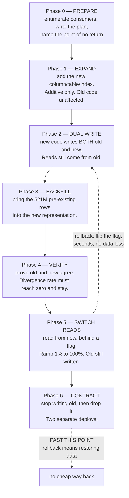

# The Migration Lifecycle: Turning One Change Into a Safe Sequence

Doc 00 established the invariant: two versions of your code run against one schema. This
document turns that constraint into a procedure you can follow, and derives the numbers the
rest of the collection reuses.

It has three parts. First, the systems these documents are built on, with their sizes, because
every later derivation refers back to them. Second, a demonstration of what happens when you
ignore the invariant, minute by minute, because the failure is more instructive than the rule.
Third, expand/contract: the six phases, when you need all six, and where the point of no return
sits in each.

---

## The systems, and the numbers every later document reuses

Abstract examples make this material harder. Every number below is fixed, and when doc 06 says
"recall the 521 million rows in `orders`," it means this section.

Two systems carry most of the weight, and they were chosen because they fail differently.

### Riverbend — an online marketplace, and the scale most readers operate at

Riverbend is the same marketplace used in [`../K8s/cronJobs`](../K8s/cronJobs/README.md),
[`../Observability`](../Observability/README.md), [`../Kafka`](../Kafka/README.md),
[`../MicroservicesPOF`](../MicroservicesPOF/README.md) and
[`../LogCollector`](../LogCollector/README.md). Its shape: 240 services on EKS, 380 nodes,
deploys several times a day, no change advisory board, engineers own their tables.

The database that matters here is `orders-db`:

- Aurora PostgreSQL 15.4, one writer `db.r6g.4xlarge` (16 vCPU, 128 GiB RAM) and two readers.
- `max_connections` 600, about 180 in use, fronted by PgBouncer in transaction pooling mode.
- Peak write rate of **350 orders/second** during a flash sale, 67/second on an ordinary day.

Now derive the table sizes, because the whole collection turns on them.

**Orders per day.** 67 orders/second × 86,400 seconds = **5.79 million orders/day**.

**Rows in `orders`.** Riverbend keeps 90 days in Postgres and archives older orders to the
lakehouse. 5.79M × 90 = **521 million rows**.

**Physical size of `orders`.** The row is 38 columns, mostly integers, timestamps and short
identifiers, with one free-text delivery-note column. Measured average width including the
24-byte tuple header: **460 bytes**. So the heap is 521M × 460 = 240 GB. At 8 KB per page and
460 bytes per row, **17 rows fit on a page** (8,192 bytes minus a 24-byte page header, minus
4 bytes of line pointer per row), which is a figure doc 06 uses again.

**Indexes on `orders`.** Five of them — primary key on `order_id`, and indexes on
`(customer_id, created_at)`, `(status, created_at)`, `(merchant_id, created_at)` and a unique
index on `idempotency_key`. Together **96 GB**. So `orders` occupies 336 GB.

**The rest of the cluster.** `order_items` at 3.4 items per order is 1.77 billion rows at
120 bytes = 212 GB heap plus 74 GB of indexes. `payments` is 521 million rows at 280 bytes =
146 GB. `customers` is 180 million rows at 1.1 KB = 198 GB and is not time-bounded. With the
outbox table and the smaller tables, the cluster volume is **1.42 TB**.

**The ratio that matters for every backfill.** 1.42 TB of data against 128 GiB of RAM, of which
Aurora gives roughly 75% to the buffer cache: **96 GiB cache for 1.42 TB of data, or 6.8%
resident.** Any operation that reads the whole `orders` table reads 336 GB from storage, and
evicts the working set while it does it. This is why "just run an `UPDATE`" is never free, even
when the statement itself is cheap.

**Write rate in rows, not orders.** One order produces 1 row in `orders`, 3.4 in `order_items`,
1 in `payments`, 3.4 inventory adjustments and 2.6 outbox rows: **11.4 row-writes per order**.
So 67 × 11.4 = **764 row-writes/second** on an ordinary day and 350 × 11.4 = **3,990/second** at
peak. Doc 06's central argument is a comparison against that 764.

**The consumers of `orders`.** This list is doc 00's coupling 3 made concrete, and several
later scenarios depend on it: the `order-service` that owns the table; a Debezium connector
publishing to `orders.created` in Kafka; a search indexer and a lakehouse writer consuming that
topic; a fraud scoring pipeline; a Finance reconciliation job running at 02:00 daily; analysts
querying a read replica through a BI tool; and a quarterly regulatory export.

### Ironvale — a regulated bank, and the scale where process is the constraint

Ironvale exists in this collection because Riverbend cannot teach you anything about the thing
that actually limits migrations in most large enterprises, which is not the database.

- Retail and commercial bank. **4,100 engineers in 62 teams.**
- **2,400 production databases**: 1,310 Oracle 19c on Exadata, 680 SQL Server 2019, 310
  PostgreSQL 14 and 15, 100 MySQL 8. The Oracle estate is 19 years old.
- Core banking runs on `ACCT_MASTER`: **1.1 billion rows, 340 columns, 4.7 TB**, with 61
  applications reading it and 4 writing it. Nobody can enumerate the 61.
- **Separation of duties is mandatory**: a developer cannot execute DDL in production. A DBA
  executes a signed script during an approved window. This is a control required by the bank's
  regulator, and it is not negotiable as stated — though *how* it is satisfied is, which is
  doc 18's argument.
- **Change windows**: Saturday 02:00–06:00, one per month. Twelve per year, minus a
  year-end freeze from 1 December to 15 January and two quarter-end regulatory reporting
  freezes: **8 usable windows per year**.
- **Change advisory board**, meeting weekly, with a 10-business-day submission lead time.
- **Median lead time for a schema change: 63 days.** That number is the subject of doc 18.

Here is the arithmetic that everything in doc 18 rests on. Ironvale has 8 usable windows of
4 hours: **32 hours of change capacity per year**. If each of the 62 teams needs only four
schema changes a year — a very low estimate for teams shipping software — that is 248 changes
into 1,920 minutes.

> 1,920 minutes ÷ 248 changes = **7.7 minutes per change**, including execution, verification
> and rollback rehearsal.

The window model is not merely inconvenient; it is **arithmetically impossible**. That matters
because of what an organisation does when a control is impossible to satisfy: it does not stop
changing. It reclassifies. Changes become "configuration," or "data fixes," or "emergency
changes" with an abbreviated approval. The control produces documentation rather than safety,
and the actual risk moves to the paths nobody is watching.

### The other four systems

These appear mainly in doc 19's case studies and are reused from
[`../MicroservicesPOF`](../MicroservicesPOF/README.md), so the collections agree.

| System | Shape | What it teaches about migrations |
|---|---|---|
| **Lumen** | Instagram-shaped, 500M DAU | **4,096 MySQL shards.** A migration is a fleet rollout, and 12 shards silently not taking it is the default outcome, not the exception |
| **Gateline** | Ticketmaster-shaped, 5,000 → 500,000 QPS in 10 s | **The window is set by someone else's calendar.** On-sales are announced months ahead; you migrate between them or not at all |
| **Waypoint** | Uber-shaped, 5M mobile clients | **Clients you cannot upgrade.** 14 app versions in the field, the oldest two years old. Coupling 1's window is measured in years |
| **Corridor** | LinkedIn-shaped, versioned derived stores | **Silent wrongness.** A migration that completes successfully and produces incorrect derived data for six weeks |
| **Northlight** | Netflix-shaped, 2,500 services, Cassandra | **The platform's migration is everyone's migration.** One schema change propagates to 100,000 sidecars |

---

## The naive attempt, and exactly how it fails

Before the discipline, watch the thing it prevents. This is worth reading slowly, because the
failure is not where most people expect it.

Riverbend is launching in Canada. Today, `orders.amount_cents bigint NOT NULL` holds an amount
in US cents. It needs to become an amount plus a currency. An engineer writes the obvious
migration:

```sql
-- V214__orders_multicurrency.sql
ALTER TABLE orders RENAME COLUMN amount_cents TO amount_minor;
ALTER TABLE orders ADD COLUMN currency char(3) NOT NULL DEFAULT 'USD';
```

and the obvious code change, which reads `amount_minor` and `currency` instead of
`amount_cents`. Both go out in one pull request. The migration runs as an init container before
the new pods start, which is a common setup and part of the problem.

Here is the timeline.

**14:02:00 — the migration Job starts.** It requests `ACCESS EXCLUSIVE` on `orders`.

**14:02:00 — the lock request queues.** A Finance query started at 14:01:12 and is still
running: an aggregate over `orders` for a mid-month report, expected to take 90 seconds. It
holds `ACCESS SHARE`. `ACCESS EXCLUSIVE` conflicts with it, so the `ALTER` waits.

**14:02:01 — everything else begins to queue behind the `ALTER`.** This is the part people do
not anticipate. PostgreSQL's lock queue is ordered. A new `SELECT` needs `ACCESS SHARE`, which
does not conflict with the Finance query's `ACCESS SHARE` — but it *does* conflict with the
pending `ACCESS EXCLUSIVE` ahead of it in the queue, and PostgreSQL will not let it jump ahead.
So every read and every write of `orders` now blocks. **One pending DDL statement converts a
compatible lock into an exclusive one for queueing purposes.**

**14:02:09 — `checkout-api` saturates.** At 350 requests/second with each request now holding
a connection open indefinitely, the PgBouncer pool of 480 server connections is exhausted in
under ten seconds. Requests that do not touch `orders` at all now fail, because they cannot get
a connection. This is the moment the incident stops being about one table.

**14:02:40 — the pager fires.** Checkout error rate is 100%.

**14:02:42 — the Finance query completes** at its expected 90 seconds. The `ALTER` acquires its
lock and finishes in 3 milliseconds. The queue drains. Recovery begins.

**14:03:10 — recovered.** Total: **70 seconds of complete checkout outage, caused by a
3-millisecond statement.**

That is failure one, and it is shape 1 from doc 00 — a lock storm. It is the well-known one.
Now failure two, which is the interesting one, and which the team does not notice for another
four minutes.

**14:03:10 — the new pods start rolling out.** The deployment replaces 40 pods over four
minutes. At any instant during those four minutes, some pods run the old code.

**14:03:11 — the old pods start failing.** The old code executes:

```sql
INSERT INTO orders (order_id, customer_id, amount_cents, status, created_at)
VALUES ($1, $2, $3, $4, now());
```

and gets `ERROR: column "amount_cents" of relation "orders" does not exist`, SQLSTATE `42703`.
The column was renamed. Every order placed by an old pod fails.

**14:03:11 to 14:07:20 — a partial outage that looks like a mystery.** Roughly half of checkout
requests fail, and which half depends on which pod the load balancer chose. Retries sometimes
succeed, because a retry may land on a new pod. The error rate declines smoothly from 100% to
0% over four minutes as pods are replaced, which makes it look like something is "recovering"
and encourages everyone to wait rather than act.

**Total impact: 70 seconds of full outage and 4 minutes of 50% failure, from a change whose
execution time was 3 milliseconds.**

Notice what was and was not the problem:

- The rename was not slow. It was metadata-only and instant.
- The lock storm was not caused by the rename being expensive. It was caused by an unrelated
  90-second query and the fact that lock queues are ordered.
- The 42703 errors were not a bug in the new code. The new code was correct. The old code was
  also correct — for the schema it was written against.
- **No test could have caught the second failure**, because tests run one version of the code
  against one version of the schema. The failure lives in the combination, and nothing in a
  normal CI pipeline ever constructs that combination. Doc 17 is about building a pipeline
  that does.

And one more thing. Suppose the team rolls back the deploy. The pods revert to old code. The
schema does not revert, because a deploy rollback does not run a down migration. **The rollback
takes the site from 50% broken to 100% broken.** This is doc 13's central point, and it is the
reason migrations and deploys must be separately triggered steps.

---

## Expand/contract: the six phases

The discipline that prevents all of the above has one rule:

> **Never change the meaning of an existing thing. Add a new thing, move to it, remove the old
> one — and put a deploy boundary between every pair of steps.**

"Add" is safe because code that does not know about the new thing is unaffected. "Remove" is
safe once nothing references it. The danger lives entirely in the middle, and the middle is
where you spend the time.

Here are the six phases. Not every change needs all six; the table after the diagram says which.



### Phase 0 — Prepare

Enumerate the consumers. Write down the phases with their expected durations. **Write down
where the point of no return is** and who decides to cross it. Decide the abort criteria for
each phase as numbers, not adjectives, so that the person watching at 03:00 does not have to
exercise judgement (doc 16 covers what those numbers should be).

The single most valuable output of phase 0 is the consumer list, and the single most common
defect in it is that it contains only the services in your own repository.

### Phase 1 — Expand

Add the new structure. This must be strictly additive and strictly compatible with every
running code version.

```sql
ALTER TABLE orders ADD COLUMN amount numeric(14,2);   -- nullable, no default
ALTER TABLE orders ADD COLUMN currency char(3);       -- nullable, no default
```

Both are metadata-only in PostgreSQL. Both are invisible to old code. Note what is *not* here:
no `NOT NULL`, no default, no index, no constraint. Each of those would either scan the table
or change behaviour for old writers, and each gets its own later phase.

### Phase 2 — Dual write

Deploy code that writes both representations on every write path. Reads still use the old
column, so a bug in the new write path cannot affect a user yet.

"Every write path" is the trap. At Riverbend the order amount is written by the checkout flow,
by the refund flow, by an admin correction tool, by a CSV importer used by merchant onboarding,
and by a data-repair script somebody runs occasionally. A dual write that covers four of those
five produces a divergence you will spend a week chasing. Doc 07 lists the four places you can
put the dual write and what each one catches.

**Then wait.** The purpose of soaking here is to establish that the new write path is correct
*before* the backfill runs, because if it is not, the backfill and the live writes will produce
two different kinds of wrong and you will not be able to tell them apart.

### Phase 3 — Backfill

Bring the pre-existing rows into the new representation. This is the long phase — 63 hours of
run time at Riverbend, and it is the phase most likely to cause a production incident that has
nothing to do with the correctness of your migration. Doc 06 is entirely about it.

The backfill's predicate must not fight the dual write. Use:

```sql
UPDATE orders
   SET amount = amount_cents / 100.0, currency = 'USD'
 WHERE order_id >= $1 AND order_id < $2
   AND amount IS NULL;                 -- <-- this clause is load-bearing
```

Without `AND amount IS NULL`, a backfill chunk that runs after a live write to the same row
overwrites the live value with a value derived from the old column. If the two ever disagree —
and during a currency migration they will, for the Canadian orders that arrive during the
backfill — the backfill silently destroys correct data.

### Phase 4 — Verify

Prove the two representations agree. Not "spot-check a few rows": a defined method with a
stated confidence. Doc 12 gives three, and shows that a random sample of **460,500 rows** is
enough to be 99% confident that fewer than one row in 100,000 differs.

Verification must run *after* the backfill and *keep running* while you are in phase 5, because
the population it is checking keeps growing.

### Phase 5 — Switch reads

Deploy code that reads the new representation, behind a flag, defaulting off. Then ramp: 1%,
10%, 50%, 100%, with a soak at each step. The old column is still being written throughout, so
**rollback at this phase is flipping a flag** — seconds, no data loss, no deploy.

This is the phase where you find the consumers phase 0 missed, because they are the ones still
reading the old column after you stopped looking at it.

### Phase 6 — Contract

Two deploys, never one.

**6a: stop writing the old column.** Deploy code that writes only the new representation. The
old column stays in the schema, holding data that is now frozen at the moment of this deploy.
If you need to roll back to reading the old column after this, you can — but you will be missing
everything written since 6a, so the rollback is now a data-repair job rather than a flag flip.
**6a is the point of no return for most column migrations.**

**6b: drop the old column.** Only after the soak. `ALTER TABLE orders DROP COLUMN amount_cents;`
is metadata-only in PostgreSQL (the space is reclaimed lazily, not immediately), a full rebuild
in MySQL before 8.0.29.

How long between 6a and 6b? **At least one full business cycle.** At Riverbend that is 30 days,
because month-end reporting must run once against the new column before the old one disappears.
At Ironvale it is a quarter, because quarterly regulatory reporting is the consumer nobody
tests. A team that drops the column two days after 6a and discovers the quarterly export in
week eleven has to restore a 336 GB table from a backup to recover a column they deleted.

---

## How many phases does your change actually need?

Running all six for every change would be miserable and unnecessary. Here is the mapping. The
rule underneath it: **count the phases by asking which of the three couplings from doc 00 the
change touches.**

| Change | Phases needed | Why |
|---|---|---|
| Add a table | 1 | Nothing references it |
| Add a nullable column | 1 | Old code ignores it; old rows read `NULL` |
| Add an index | 1 | Invisible to correctness, but see `L-05` for the build cost |
| Add a column with a default | 1, but check the engine | Metadata-only on PG 11+ and Oracle 11g+; a full rewrite on PG 10 and MySQL 5.7 |
| Make a nullable column `NOT NULL` | 1, 2, 3, 4 | Existing rows may violate it; old code may omit it |
| Widen a type (`varchar(50)`→`varchar(100)`) | 1 | Metadata-only, and old code still reads fine |
| Narrow a type | 1, 2, 3, 4, 5, 6 | Existing data may not fit; this is a full migration |
| Change a type's representation (`bigint`→`numeric`) | all 6 | The classic case |
| Rename a column | all 6 | Never do it as a rename. Add, copy, switch, drop |
| Drop a column | 5, 6 | Phase 5 is "stop reading it," which you must prove first |
| Add a foreign key | 1 (as `NOT VALID`), then validate | See `L-07` |
| Add a unique constraint | 1, 3, 4, then add | Existing duplicates must be resolved first, and they exist |
| Split one table into two | all 6, twice | The hardest; see below |
| Move a table to another database | all 6, plus doc 09 | The largest |

### The one people get wrong: adding `NOT NULL`

This looks like a one-liner and is a four-phase migration. Walk through why.

`ALTER TABLE orders ALTER COLUMN currency SET NOT NULL` does two things at once: it changes what
future writes are allowed to do, and it asserts something about all 521 million existing rows.
The engine verifies the assertion by scanning the table under `ACCESS EXCLUSIVE` — a 336 GB
scan, several minutes, with the lock queue behind it. That alone rules it out.

But even if the scan were free, the *semantic* problem remains: old code does not set the
column, so the instant the constraint exists, every insert from an old pod fails. You need the
dual write (phase 2) deployed everywhere before the constraint can exist.

The correct sequence on PostgreSQL 12 and later avoids the exclusive scan entirely:

```sql
-- Phase 1: add a constraint that is not checked against existing rows.
-- Takes ACCESS EXCLUSIVE, but only for milliseconds - no scan.
ALTER TABLE orders ADD CONSTRAINT orders_currency_not_null
  CHECK (currency IS NOT NULL) NOT VALID;

-- Phases 2-3: deploy dual write, backfill existing rows.

-- Phase 4: validate. Takes only SHARE UPDATE EXCLUSIVE, which does NOT
-- block reads or writes. Scans the table, but concurrently.
ALTER TABLE orders VALIDATE CONSTRAINT orders_currency_not_null;

-- Then, if you want a real NOT NULL rather than a CHECK: PostgreSQL 12+
-- uses the validated CHECK to skip the scan, so this is fast.
ALTER TABLE orders ALTER COLUMN currency SET NOT NULL;
ALTER TABLE orders DROP CONSTRAINT orders_currency_not_null;
```

That sequence is the single most useful PostgreSQL migration pattern in this collection. Its
MySQL and Oracle equivalents are in doc 02.

### The hardest shape: splitting a table

Suppose Riverbend wants to move the delivery address out of `orders` into a
`delivery_addresses` table. This is two migrations interleaved: creating a new table with a
relationship, and removing columns from an existing one. It needs all six phases, and phase 3
is more expensive than usual because it is an insert of 521 million rows into a new table rather
than an update of existing ones.

The wrinkle specific to splitting: **during phases 2 through 5, a single logical write now spans
two tables.** Inside one PostgreSQL transaction that is fine. Across two services or two
databases it is not, and you have converted a schema migration into a distributed-transaction
problem — see the `T` class in [`../MicroservicesPOF`](../MicroservicesPOF/07-transactions-sagas-and-dual-writes.md).
If the split is also a move to a different database, do not attempt it as one migration. Split
the table in place first, then move the new table, as two separate programmes.

---

## When you should not do any of this

The machinery above costs eight weeks. Do not spend it when you do not have to.

**Take the blocking `ALTER` if all of these are true:**

1. The table is small enough that the statement completes within your `lock_timeout`. On the
   hardware above, a full rewrite runs at roughly 80–120 MB/s, so a 2 GB table rewrites in
   about 20 seconds and a 200 MB table in 2 seconds. A metadata-only change is instant at any
   size.
2. You can take the lock at a time when there is no long-running query to queue behind, and
   you have set `lock_timeout` so that a failed attempt fails fast instead of jamming the queue.
3. The change is compatible with running code, or you can tolerate a brief error rate.

**Skip the dual write if** the old and new representations are derivable from each other by a
deterministic expression with no new information — in which case use a generated column
(PostgreSQL 12+, MySQL 5.7+) and let the engine maintain it. `GENERATED ALWAYS AS (amount_cents
/ 100.0) STORED` removes phases 2 and 3 entirely. The catch, which doc 07 covers as `W-06`: on
PostgreSQL, adding a stored generated column rewrites the table, so you have traded a backfill
for a rewrite. On a 336 GB table that is a bad trade; on a 4 GB table it is an excellent one.

**Skip verification if** you can afford to be wrong. There are such cases — a denormalised
cache column, a search-ranking hint — and pretending otherwise burns credibility you need for
the migrations where it matters.

**If your whole database is under ten gigabytes and you deploy from one repository with no
mobile clients**, most of this collection is describing problems you do not have. Read docs 00,
02 and 05, put a `lock_timeout` in your migration tooling, and stop.

---

## What to take away

1. **Riverbend's anchor numbers**: `orders` is 521 million rows and 336 GB, the cluster is
   1.42 TB against 96 GiB of cache (6.8% resident), and the baseline write rate is 764
   row-writes/second. Every later derivation refers to these.
2. **Ironvale's anchor arithmetic**: 8 usable change windows × 4 hours ÷ 248 changes = **7.7
   minutes per change**. The window model is arithmetically impossible, and organisations
   respond to impossible controls by reclassifying work, not by stopping.
3. **A pending DDL statement blocks everything behind it in the lock queue**, including
   statements that would not have conflicted with each other. This is why a 3-millisecond
   `ALTER` can cause a 70-second outage.
4. **Rolling back a deploy does not roll back a migration**, so a coupled deploy-and-migrate can
   make rollback strictly worse than doing nothing.
5. **No ordinary test suite can catch a compatibility break**, because tests run one code
   version against one schema version and the failure lives in the combination.
6. **The rule is: never change the meaning of an existing thing.** Add, move, remove, with a
   deploy boundary between each.
7. **The six phases are prepare, expand, dual-write, backfill, verify, switch-reads,
   contract** — and contract is always two deploys, stop-writing and then drop.
8. **The backfill predicate must include `AND new_col IS NULL`**, or the backfill will overwrite
   live writes with values derived from stale data.
9. **The point of no return is usually "stop writing the old column"**, not "drop it". Name it
   in the plan and have a person decide to cross it.
10. **Wait a full business cycle between stop-writing and drop** — 30 days at Riverbend, a
    quarter at Ironvale — because the consumer that will break is the one that runs monthly or
    quarterly and that nobody tests.
11. **`SET NOT NULL` is a four-phase migration**, and on PostgreSQL 12+ the
    `CHECK ... NOT VALID` → `VALIDATE CONSTRAINT` → `SET NOT NULL` sequence avoids the exclusive
    scan entirely.
12. **Do not run six phases on a 200 MB table.** Below the threshold where the blocking
    statement finishes inside your `lock_timeout`, the machinery costs more than it saves.

Next: [02-what-ddl-does-to-a-live-database.md](02-what-ddl-does-to-a-live-database.md), which
explains why the lock queue behaves the way it did at 14:02, engine by engine.
