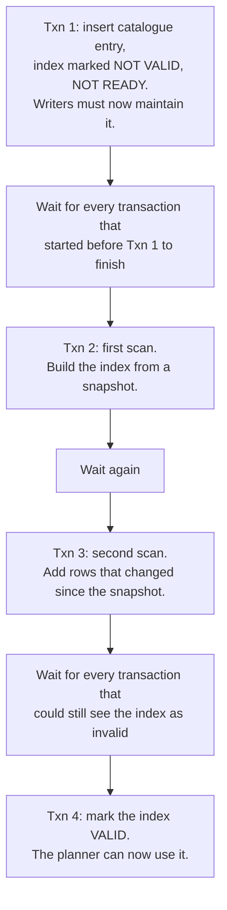
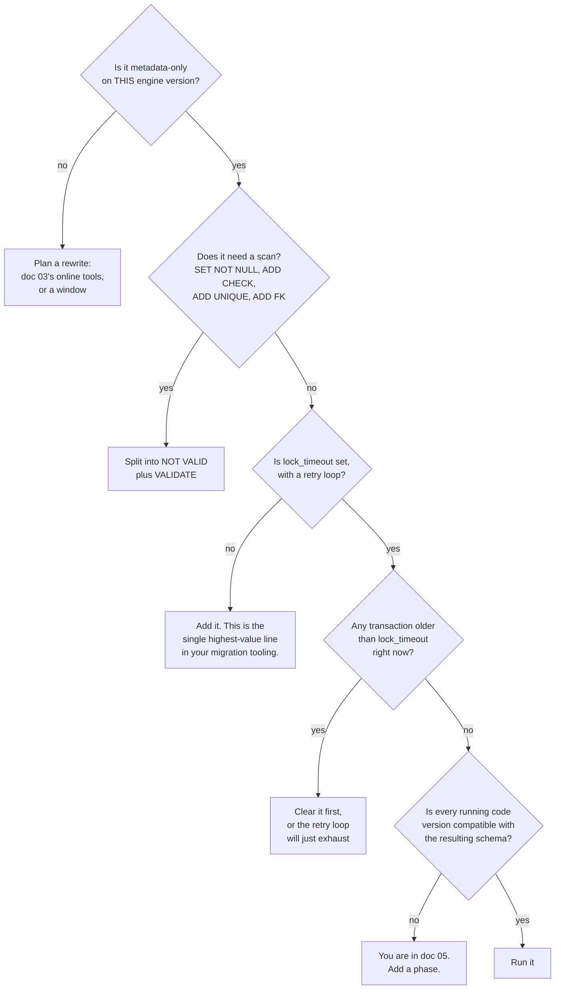

# What DDL Actually Does to a Live Database

Doc 01 showed a 3-millisecond `ALTER TABLE` causing a 70-second outage. This document explains
the mechanism precisely enough that you can predict, for any statement you are about to run,
whether it will do that.

Three questions decide everything:

1. **What lock does the statement take, and what does that lock conflict with?**
2. **Does the statement have to read or rewrite the table, or can the engine satisfy it by
   editing a catalogue?**
3. **How long will it hold the lock, and what is already holding a conflicting one?**

The answers are engine-specific and version-specific, and the same statement can be instant on
one version and an outage on another. Scenario IDs here are `L-nn`.

---

## Why locks exist at all, which makes the rest predictable

It helps to know what the lock is protecting, because then the conflict matrix stops being a
table you look up and becomes something you can reason about.

A running query has already been planned. The plan says "read the third column of this heap
page and interpret the next eight bytes as a `bigint`." If the table's definition changes
underneath that plan, those eight bytes might now be something else. So a statement that
changes the definition must guarantee that no query planned against the old definition is
still running.

That guarantee is what `ACCESS EXCLUSIVE` (PostgreSQL) or an exclusive metadata lock (MySQL)
buys. It is not about the data; it is about the *agreement on how to interpret the data*.

From that one idea, two consequences follow that you would otherwise have to memorise:

- **Statements that only add information the old plans do not reference can be cheap.** Adding a
  column does not change how existing columns are laid out, so old plans stay valid. This is
  why `ADD COLUMN` is metadata-only on modern engines.
- **Statements that change existing layout cannot be cheap.** Changing `bigint` to `numeric`
  changes the bytes, so every row must be rewritten and every plan invalidated.

The lock is short in the first case and long in the second — but as doc 01's timeline showed,
**a short lock can still cause a long outage**, because the problem is not how long you hold it
but how long you wait for it while everything else waits for you.

---

## PostgreSQL: the eight lock modes, and the four that matter

PostgreSQL has eight table-level lock modes. You need to be fluent in four of them.

| Mode | Taken by | Conflicts with |
|---|---|---|
| `ACCESS SHARE` | `SELECT` | Only `ACCESS EXCLUSIVE` |
| `ROW EXCLUSIVE` | `INSERT`, `UPDATE`, `DELETE` | `SHARE` and above |
| `SHARE UPDATE EXCLUSIVE` | `VACUUM`, `ANALYZE`, `CREATE INDEX CONCURRENTLY`, `VALIDATE CONSTRAINT` | Itself and above — **not** reads, **not** writes |
| `ACCESS EXCLUSIVE` | Most `ALTER TABLE`, `DROP`, `TRUNCATE`, `REINDEX`, `VACUUM FULL` | Everything, including `SELECT` |

**`SHARE UPDATE EXCLUSIVE` is the mode that makes online operations possible.** It allows
concurrent reads and writes and only excludes other maintenance operations. Every PostgreSQL
migration technique in this collection is, underneath, an effort to get an operation done under
`SHARE UPDATE EXCLUSIVE` instead of `ACCESS EXCLUSIVE`.

### What each statement costs

This is the table to bookmark. "Metadata-only" means milliseconds regardless of table size.
"Scan" means it reads every row. "Rewrite" means it writes a complete new copy.

| Statement | Lock | Work | On `orders` (521M rows, 336 GB) |
|---|---|---|---|
| `ADD COLUMN c text` | `ACCESS EXCLUSIVE` | Metadata-only | ~8 ms |
| `ADD COLUMN c text DEFAULT 'x'` | `ACCESS EXCLUSIVE` | Metadata-only (PG 11+) | ~8 ms |
| `ADD COLUMN c uuid DEFAULT gen_random_uuid()` | `ACCESS EXCLUSIVE` | **Rewrite** — the default is volatile | ~50 min |
| `DROP COLUMN c` | `ACCESS EXCLUSIVE` | Metadata-only; space reclaimed lazily | ~4 ms |
| `RENAME COLUMN` | `ACCESS EXCLUSIVE` | Metadata-only | ~3 ms |
| `SET DEFAULT` / `DROP DEFAULT` | `ACCESS EXCLUSIVE` | Metadata-only | ~3 ms |
| `DROP NOT NULL` | `ACCESS EXCLUSIVE` | Metadata-only | ~3 ms |
| `SET NOT NULL` | `ACCESS EXCLUSIVE` | **Scan** (unless a validated `CHECK` exists, PG 12+) | ~6 min blocking |
| `varchar(50)` → `varchar(100)` or `text` | `ACCESS EXCLUSIVE` | Metadata-only | ~3 ms |
| `varchar(50)` → `varchar(40)` | `ACCESS EXCLUSIVE` | **Rewrite** | ~50 min |
| `bigint` → `numeric` | `ACCESS EXCLUSIVE` | **Rewrite** + all indexes rebuilt | ~70 min |
| `ADD CHECK (...)` | `ACCESS EXCLUSIVE` | **Scan** | ~6 min blocking |
| `ADD CHECK (...) NOT VALID` | `ACCESS EXCLUSIVE` | Metadata-only | ~3 ms |
| `VALIDATE CONSTRAINT` | `SHARE UPDATE EXCLUSIVE` | Scan, **concurrent** | ~6 min, non-blocking |
| `ADD FOREIGN KEY` | `SHARE ROW EXCLUSIVE` on **both** tables | Scan | Blocks writes on both |
| `ADD FOREIGN KEY ... NOT VALID` | `SHARE ROW EXCLUSIVE` on both | Metadata-only | ~5 ms, blocks writes briefly |
| `CREATE INDEX` | `SHARE` | Build — **blocks writes** | ~14 min, writes blocked |
| `CREATE INDEX CONCURRENTLY` | `SHARE UPDATE EXCLUSIVE` | **Two** scans + waits | ~41 min, non-blocking |
| `DROP INDEX` | `ACCESS EXCLUSIVE` | Metadata-only | ~5 ms |
| `DROP INDEX CONCURRENTLY` | `SHARE UPDATE EXCLUSIVE` | Metadata-only | ~1 s |
| `TRUNCATE` | `ACCESS EXCLUSIVE` | Metadata-only | ~5 ms |
| `VACUUM FULL` / `CLUSTER` | `ACCESS EXCLUSIVE` | **Rewrite** | ~70 min, table unavailable |

Two rows deserve comment.

**`ADD COLUMN ... DEFAULT` changed in PostgreSQL 11** and this is the most consequential
version difference in the table. Before 11, adding a column with a default rewrote the entire
table. From 11 onward, PostgreSQL stores the default in the catalogue as `attmissingval` and
synthesises it when reading a row that is physically too short. So the same statement is 50
minutes on PostgreSQL 10 and 8 milliseconds on PostgreSQL 11. If you are reading a migration
guide written before 2018, it will tell you never to add a column with a default, and that
advice is now wrong — except for volatile defaults, where each row needs a different value and
the rewrite is unavoidable.

**`CREATE INDEX` without `CONCURRENTLY` takes `SHARE`, not `ACCESS EXCLUSIVE`.** Reads
continue; writes block. On a read-heavy table during a quiet period this is sometimes the right
choice, because it finishes in 14 minutes rather than 41 and cannot leave an invalid index
behind. Knowing that distinction is worth more than reflexively appending `CONCURRENTLY`.

---

## The failure catalogue

### L-01 · The lock queue jam

**What you see.** A migration runs. Within ten seconds, every query against one table times
out, then the connection pool saturates and queries against *unrelated* tables fail too. The
migration itself, when it finally runs, takes milliseconds.

**Mechanism.** This is doc 01's 14:02 timeline. PostgreSQL's lock manager maintains a queue per
lock object, and it does not allow a new request to be granted ahead of a waiting request that
conflicts with it. The reason is fairness — without it, a stream of `ACCESS SHARE` requests
would starve an `ACCESS EXCLUSIVE` request forever.

The consequence is that the queue behaves transitively:

```
Holder:   [ACCESS SHARE] long-running Finance query, 90 s remaining
Queue:    [ACCESS EXCLUSIVE] your ALTER TABLE          <- waits for the holder
          [ACCESS SHARE] checkout SELECT                <- waits for your ALTER
          [ROW EXCLUSIVE] checkout INSERT               <- waits for your ALTER
          [ACCESS SHARE] ... 400 more ...
```

The third and fourth entries do not conflict with the holder. They conflict with the second
entry. **Your pending DDL converts a compatible workload into a serialised one.**

The amplification is what makes this an outage rather than a delay. Each blocked query holds a
database connection. At Riverbend's 350 requests/second, the PgBouncer pool of 480 server
connections is exhausted in 480 ÷ 350 ≈ **1.4 seconds** once requests stop completing. After
that, requests that never touch `orders` cannot get a connection either.

**Confirm it.** The blocking chain is visible directly:

```sql
SELECT  blocked.pid        AS blocked_pid,
        blocked.query      AS blocked_query,
        blocking.pid       AS blocking_pid,
        blocking.query     AS blocking_query,
        now() - blocking.xact_start AS blocking_xact_age,
        blocking.state
FROM pg_stat_activity blocked
JOIN LATERAL unnest(pg_blocking_pids(blocked.pid)) AS bpid ON true
JOIN pg_stat_activity blocking ON blocking.pid = bpid
WHERE blocked.wait_event_type = 'Lock'
ORDER BY blocking_xact_age DESC;
```

The row with the oldest `blocking_xact_age` and a state of `active` or `idle in transaction` is
the root. Everything else is downstream of it.

**Recover.** Cancel the DDL first, not the blocker. Cancelling the DDL immediately drains the
queue and restores service; cancelling the blocker just lets the DDL proceed, which is what you
no longer want during an incident.

```sql
SELECT pg_cancel_backend(<the ALTER's pid>);
```

⚠️ **Use `pg_cancel_backend`, not `pg_terminate_backend`, on the DDL.** Cancel asks the backend
to abort the current statement; terminate kills the whole connection. For a DDL statement in
its own transaction the effect is similar, but if the DDL is one statement inside a larger
migration transaction, terminating the connection aborts the transaction in a way your
migration tool may not report accurately, which turns a lock storm into `T-05`, a stuck
migration.

⚠️ **Do not cancel the blocker first "to let the migration through."** During an active
incident you want the queue drained, and cancelling the blocker leaves your `ACCESS EXCLUSIVE`
at the head of a 400-deep queue where it will now be granted and then hold everything for as
long as the statement runs.

**Prevent.** Two lines, always, in every migration session:

```sql
SET lock_timeout = '2s';        -- fail fast rather than queue
SET statement_timeout = '0';    -- but allow the statement itself to run long
```

`lock_timeout` bounds only the wait for a lock, not the execution. With it set, the `ALTER`
above fails after 2 seconds with `55P03 lock_not_available`, the queue behind it never forms,
and the total impact is two seconds of elevated latency instead of seventy seconds of outage.

Then wrap it in a retry loop, because failing is only useful if something tries again:

```sql
DO $$
DECLARE
  attempt int := 0;
BEGIN
  LOOP
    attempt := attempt + 1;
    BEGIN
      SET LOCAL lock_timeout = '2s';
      ALTER TABLE orders ADD COLUMN currency char(3);
      RAISE NOTICE 'acquired on attempt %', attempt;
      RETURN;
    EXCEPTION WHEN lock_not_available THEN
      IF attempt >= 30 THEN RAISE; END IF;
      PERFORM pg_sleep(5 + random() * 5);   -- jitter, so parallel migrations do not sync up
    END;
  END LOOP;
END $$;
```

Thirty attempts with 5–10 second jitter gives roughly four minutes of opportunistic retrying.
On a table with a steady stream of short queries, it succeeds within three attempts almost
always. On a table with a permanent long-running reader, it never succeeds — which is
information you want, delivered as a clean failure rather than an outage.

### L-02 · The DDL that waits forever behind `idle in transaction`

**What you see.** The retry loop from `L-01` exhausts all thirty attempts. `pg_blocking_pids`
points at a session whose `query` column shows a `SELECT` that completed minutes ago.

**Mechanism.** The session's state is `idle in transaction`. An application opened a
transaction, ran a query, and then went off to do something else — call an HTTP API, wait on a
message queue, or simply sit in a connection pool with an un-rolled-back transaction. The
transaction still holds every lock it acquired, including the `ACCESS SHARE` on `orders` from a
query that finished ten minutes ago.

This is the single most common reason a correctly written, correctly timed-out migration cannot
run. It is not a migration problem; it is a connection-handling bug in an application, and the
migration is merely the first thing to notice.

**Confirm it.**

```sql
SELECT pid, usename, application_name, state,
       now() - xact_start  AS xact_age,
       now() - state_change AS idle_for,
       left(query, 120)     AS last_query
FROM pg_stat_activity
WHERE state = 'idle in transaction'
  AND now() - xact_start > interval '1 minute'
ORDER BY xact_age DESC;
```

**Recover.** Terminate the idle-in-transaction sessions. This is safe by construction: they are
not doing anything, and their transaction will roll back.

```sql
SELECT pg_terminate_backend(pid) FROM pg_stat_activity
WHERE state = 'idle in transaction' AND now() - xact_start > interval '5 minutes';
```

**Prevent.** Set `idle_in_transaction_session_timeout = '60s'` at the database level, so the
engine does this for you continuously rather than you doing it during an incident. Then find
the application. The usual causes are an ORM that opens a transaction on the first query of a
request and only commits at the end, an explicit `BEGIN` in a script whose author forgot that
`psql` does not autocommit inside a transaction block, and a BI tool that keeps a session warm.

### L-03 · The rewrite you did not know was a rewrite

**What you see.** A migration that took 40 milliseconds in staging takes 70 minutes in
production and holds `ACCESS EXCLUSIVE` the whole time. The table is unreadable for 70 minutes.

**Mechanism.** The statement required a table rewrite, and staging's copy of `orders` has
400,000 rows rather than 521 million. Rewrite time is linear in table size; staging is 1,300
times smaller, so 70 minutes becomes 3 seconds and nobody noticed.

The statements that surprise people, in rough order of frequency:

- **Narrowing a type.** `varchar(100)` → `varchar(50)`, `bigint` → `int`, `numeric(14,2)` →
  `numeric(10,2)`. Widening is free, narrowing is a rewrite, and the asymmetry is easy to
  forget.
- **`ADD COLUMN` with a volatile default.** `DEFAULT gen_random_uuid()`, `DEFAULT now()`,
  `DEFAULT nextval(...)`. Each row needs a distinct value, so the catalogue trick cannot apply.
  Note that `DEFAULT now()` is subtle: `now()` is stable within a transaction but PostgreSQL
  classifies it as stable, not immutable, and only immutable-enough defaults get the fast path.
- **Changing a column's collation**, which invalidates every index on it.
- **`ALTER TABLE ... SET LOGGED` / `SET UNLOGGED`.**
- **Adding a column to a table with a `TOAST`-eligible change in row layout**, when the new
  column moves an existing column past the point where the row no longer fits.

**Confirm it before you run it.** Take a production-sized copy and run the statement inside a
transaction you never commit, timing it:

```sql
BEGIN;
SET lock_timeout = '2s';
\timing on
ALTER TABLE orders ALTER COLUMN amount_cents TYPE numeric(14,2);
ROLLBACK;   -- <-- never commit
```

On a restored clone this tells you the duration exactly. **Do not do this on production** —
the rollback undoes the change but you have already held `ACCESS EXCLUSIVE` for the duration.

A cheaper static check: PostgreSQL's `pg_total_relation_size` tells you what a rewrite has to
move, and the rule of thumb on the `db.r6g.4xlarge` above is **80–120 MB/s** for a rewrite
including index rebuilds. 336 GB ÷ 100 MB/s = 56 minutes. Add 25% for the index rebuilds that
a type change forces, and you get the 70 minutes in the table.

**Recover.** If it is already running: cancel it. A rewrite in progress rolls back cleanly
because PostgreSQL builds the new copy as a separate relation file and only swaps at commit —
so the cancel is fast, and the wasted work is disk I/O and time, not consistency.

**Prevent.** Two mechanisms, both cheap:

1. **Migration linting in CI** (doc 04's `T-09`). Tools such as `squawk` and `eugene` for
   PostgreSQL flag rewriting statements at review time.
2. **A size gate.** Refuse to run any rewriting statement against a table over some threshold —
   say 1 GB — without an explicit override in the migration file. Riverbend's gate is a comment
   header the tooling parses:
   `-- migration:allow-rewrite reason="one-off, table is 40 MB" approved-by="…"`.

### L-04 · The rewrite that runs out of disk

**What you see.** A `VACUUM FULL` or type change at 78% disk utilisation fails partway through
with `could not extend file: No space left on device`, and now the database is read-only
because the WAL cannot be written either.

**Mechanism.** A rewrite builds a complete second copy before swapping. Peak usage is
**old + new = 2× the table**, plus the WAL generated (which on a `VACUUM FULL` is roughly the
size of the new table again if `wal_level` is `replica` or higher).

For `orders` at 336 GB, a rewrite needs 336 GB of free space plus 240 GB of WAL headroom. On a
cluster volume of 1.42 TB provisioned at 1.8 TB, that is 576 GB needed against 380 GB free. It
will fail, and it will fail at about the 66% mark — after an hour of holding `ACCESS EXCLUSIVE`.

Aurora changes this: storage auto-extends to 128 TiB, so you do not hit the wall, but you do
pay for the peak and the rewrite still takes the lock. On plain RDS or self-managed, the wall
is real.

**Confirm it.** Before, not after:

```sql
SELECT pg_size_pretty(pg_total_relation_size('orders')) AS table_total,
       pg_size_pretty(pg_relation_size('orders'))       AS heap_only,
       pg_size_pretty(pg_indexes_size('orders'))        AS indexes;
```

Compare `table_total × 2 + heap_only` against free space on the data volume.

**Recover.** If the failure has already filled the volume and the database has stopped
accepting writes, the fastest safe recovery is to delete WAL archives that have already been
shipped (never unarchived WAL), or to extend the volume — which on EBS is an online operation
that takes minutes and is almost always the right answer. ⚠️ **Never delete files from
`pg_wal/` directly.** Removing an unarchived WAL segment makes the cluster unrecoverable.

**Prevent.** Use `pg_repack` (doc 03's `O-04`) rather than `VACUUM FULL`, which needs the same
2× but does not hold the lock; and keep a standing alert at 70% volume utilisation rather than
85%, because 70% is the level at which a rewrite of your largest table still fits.

### L-05 · `CREATE INDEX CONCURRENTLY` leaves an invalid index

**What you see.** The migration job was killed — a pod eviction, a node drain, a `Ctrl-C`.
Later, queries are slower than expected, writes are slower than expected, and
`\d orders` shows an index marked `INVALID`.

**Mechanism.** `CREATE INDEX CONCURRENTLY` (CIC) is not one operation. It is five, in separate
transactions, which is exactly why it cannot run inside a transaction block:



If the session dies at any point before transaction 4, the catalogue entry survives — the index
exists, is maintained by every write, and is never used by the planner. **You pay the write
cost and get none of the read benefit**, which is the worst of both.

There is a second, more operationally annoying property: **the wait phases wait for
transactions anywhere in the database, not only on this table.** CIC needs to know that no
transaction could still hold a snapshot predating the index's visibility, and it establishes
that by waiting on all concurrent transactions. So a single analyst session that has been
`idle in transaction` for two hours will hang CIC for two hours — and the CIC is not blocked in
a way `pg_blocking_pids` reports, because it is not waiting on a lock. It is waiting on a
virtual transaction ID. That combination, "hung but not blocked," is why this one confuses
people.

**Confirm it.**

```sql
-- Invalid indexes left behind
SELECT i.indexrelid::regclass AS index_name, i.indrelid::regclass AS table_name
FROM pg_index i WHERE NOT i.indisvalid;

-- A CIC that is waiting rather than working
SELECT pid, phase, blocks_done, blocks_total,
       tuples_done, tuples_total, current_locker_pid
FROM pg_stat_progress_create_index;
```

`pg_stat_progress_create_index` is the tool that makes this tractable. If `phase` reads
`waiting for writers before validation` and `current_locker_pid` is set, that pid is your
problem.

**Recover.** Drop the invalid index concurrently, then retry:

```sql
DROP INDEX CONCURRENTLY orders_currency_created_idx;
```

⚠️ Do not simply re-run `CREATE INDEX CONCURRENTLY` with the same name — it fails with "relation
already exists," and in some tooling that failure is swallowed and reported as success.

**Prevent.**

- Make the migration tool treat CIC as its own step, with a pre-check for an existing invalid
  index of that name and an automatic `DROP INDEX CONCURRENTLY` before retrying.
- Run CIC from a session that will not be evicted — a Kubernetes Job with
  `restartPolicy: Never` and a generous `activeDeadlineSeconds`, not an init container on a pod
  that a node drain can move.
- Kill long-running transactions before starting, with the same query as `L-02`.

### L-06 · Index bloat makes the next migration slower than the last

**What you see.** A `CREATE INDEX CONCURRENTLY` that took 41 minutes last quarter takes 67
minutes this quarter, on a table that grew 8%.

**Mechanism.** PostgreSQL's B-tree indexes do not shrink when rows are deleted or updated. A
table that has absorbed a backfill (doc 06) carries index pages that are largely empty but
still read. The index on `(status, created_at)` is particularly exposed at Riverbend because
`status` is updated several times per order, so every order produces four or five index entries
over its life and only the last one is live.

This matters for migrations specifically because rewriting operations rebuild indexes, and they
rebuild them from the bloated source.

**Confirm it.** Compare the actual index size with a fresh rebuild:

```sql
SELECT indexrelname, pg_size_pretty(pg_relation_size(indexrelid)) AS size,
       idx_scan
FROM pg_stat_user_indexes WHERE relname = 'orders' ORDER BY pg_relation_size(indexrelid) DESC;
```

An index with `idx_scan = 0` after a month of uptime is not bloated, it is unused — drop it,
and every future migration on this table gets cheaper.

**Recover and prevent.** `REINDEX INDEX CONCURRENTLY` (PostgreSQL 12+) rebuilds under
`SHARE UPDATE EXCLUSIVE`. Schedule it before a large migration, not after, so the migration
operates on compact indexes. And drop unused indexes as standing hygiene: at Riverbend, two of
the five indexes on `orders` had zero scans in 90 days, and dropping them took 22% off every
subsequent rewrite.

### L-07 · The foreign key that locks two tables

**What you see.** Adding a foreign key from `order_items` to `orders` causes write timeouts on
`orders` — a table the migration was not supposed to touch.

**Mechanism.** `ADD FOREIGN KEY` takes `SHARE ROW EXCLUSIVE` on **both** the referencing and
the referenced table. `SHARE ROW EXCLUSIVE` conflicts with `ROW EXCLUSIVE`, so **writes to both
tables block** for the duration of the validating scan. Reads continue.

This is better than it was — before PostgreSQL 9.5 it took `ACCESS EXCLUSIVE` on both, blocking
reads too — but it is still a write outage on your busiest table for as long as it takes to
verify 1.77 billion `order_items` rows.

**Prevent.** Split it into the metadata step and the scanning step:

```sql
-- Step 1: SHARE ROW EXCLUSIVE on both, but no scan. Milliseconds.
ALTER TABLE order_items
  ADD CONSTRAINT order_items_order_fk FOREIGN KEY (order_id) REFERENCES orders(order_id)
  NOT VALID;

-- Step 2: SHARE UPDATE EXCLUSIVE on order_items, ROW SHARE on orders.
-- Scans, but blocks nothing.
ALTER TABLE order_items VALIDATE CONSTRAINT order_items_order_fk;
```

Between the two steps the constraint is enforced for *new* rows but not verified for old ones,
which is usually exactly what you want. Note what `NOT VALID` does not do: it does not skip the
brief `SHARE ROW EXCLUSIVE` acquisition, so it still needs a `lock_timeout` and a retry loop.

### L-08 · The unique constraint that finds duplicates at 03:00

**What you see.** `ALTER TABLE orders ADD CONSTRAINT orders_idem_key UNIQUE (idempotency_key)`
runs for 12 minutes under `ACCESS EXCLUSIVE` and then fails with
`could not create unique index ... Key (idempotency_key)=(a3f0…) is duplicated.`

**Mechanism.** Two problems compound. First, `ADD CONSTRAINT ... UNIQUE` builds an index
non-concurrently under `ACCESS EXCLUSIVE`, so the table is unavailable for the whole build.
Second, it fails at the end, after the full cost, on data that has been wrong for two years.

**Prevent.** Never add a unique constraint directly. Three steps:

```sql
-- 1. Find the duplicates first, on a replica, at no cost to production.
SELECT idempotency_key, count(*), array_agg(order_id)
FROM orders GROUP BY idempotency_key HAVING count(*) > 1;

-- 2. Resolve them. This is a data question, not a schema question, and it
--    will take longer than the migration.

-- 3. Build the index concurrently, THEN attach the constraint to it.
CREATE UNIQUE INDEX CONCURRENTLY orders_idem_key_idx ON orders (idempotency_key);
ALTER TABLE orders ADD CONSTRAINT orders_idem_key UNIQUE USING INDEX orders_idem_key_idx;
```

The `USING INDEX` form is the part most people do not know: it converts an already-built index
into a constraint with a metadata-only `ACCESS EXCLUSIVE` lock. All the expensive work happens
under `CONCURRENTLY`.

Step 2 is where the calendar time goes. At Riverbend, `idempotency_key` had 1,840 duplicate
pairs accumulated over two years from a retry bug fixed eighteen months ago. Deciding which of
each pair was authoritative required the payments team, and took three weeks.

### L-09 · MySQL: the metadata lock pile-up, with a one-year timeout

**What you see.** Identical to `L-01`, with `SHOW PROCESSLIST` full of
`Waiting for table metadata lock` — and it does not resolve on its own, for a very long time.

**Mechanism.** MySQL takes a metadata lock (MDL) on every table a transaction touches, held
until the transaction commits. A DDL statement needs an exclusive MDL, so it waits for every
open transaction on that table, and every new statement queues behind it. Same transitive jam
as PostgreSQL.

The MySQL-specific trap is the timeout. **`lock_wait_timeout` defaults to 31,536,000 seconds —
one year.** So where PostgreSQL's default `lock_timeout` of `0` means "wait forever" and you
notice immediately, MySQL's default means "wait forever" *and* the metric that would tell you
looks like a normal configured timeout. Set it:

```sql
SET SESSION lock_wait_timeout = 5;
```

**Confirm it.**

```sql
SELECT ot.OBJECT_SCHEMA, ot.OBJECT_NAME, ot.LOCK_TYPE, ot.LOCK_STATUS,
       t.PROCESSLIST_ID, t.PROCESSLIST_INFO
FROM performance_schema.metadata_locks ot
JOIN performance_schema.threads t ON t.THREAD_ID = ot.OWNER_THREAD_ID
WHERE ot.OBJECT_SCHEMA = 'riverbend' AND ot.OBJECT_NAME = 'orders';
```

`LOCK_STATUS = 'PENDING'` rows are waiters; `'GRANTED'` rows are holders. The holder with the
oldest thread is the root.

**Recover.** `KILL <processlist_id>` on the holder, or on the DDL. Same ordering advice as
`L-01`: kill the DDL first during an incident.

**Prevent.** `lock_wait_timeout = 5` plus a retry loop, set in the migration tool's session,
not in `my.cnf` (a global five-second value will break legitimate long DDL).

### L-10 · MySQL: `ALGORITHM=INPLACE` is not `ALGORITHM=INSTANT`

**What you see.** A migration documented as "online" runs for three hours, and at the end fails
with `Error 1799: Creating index 'idx_x' required more than 'innodb_online_alter_log_max_size'
bytes of modification log. Please try again.`

**Mechanism.** MySQL 8.0 has three algorithms and the names mislead:

| Algorithm | What it does | Duration | Blocks DML? |
|---|---|---|---|
| `INSTANT` | Catalogue only | Milliseconds | No |
| `INPLACE` | **Rebuilds the table**, but allows concurrent DML | Hours | Briefly, at start and end |
| `COPY` | Rebuilds the table, blocks writes throughout | Hours | Yes, entirely |

`INPLACE` is "online" in the sense that writes are accepted, but they are accepted into a
**temporary modification log**, and applied to the new table at the end. That log is capped by
`innodb_online_alter_log_max_size`, default **128 MB**. On a write-heavy table, three hours of
DML overflows 128 MB easily, and the failure comes at the end, after all the work.

`INSTANT` is available for a specific and expanding list: `ADD COLUMN` (8.0.12+, last position
only; any position from 8.0.29), `DROP COLUMN` (8.0.29+), `RENAME COLUMN`, `SET`/`DROP DEFAULT`,
appending values to an `ENUM`, and adding a virtual column. **There is a hidden limit:** a table
records a row version for each instant change, and after **64 instant changes** the next one
requires a full rebuild, failing with `Maximum row versions reached`. A table that has absorbed
64 instant `ADD COLUMN`s over five years will, on the 65th, silently become a three-hour
rebuild.

**Confirm it in advance.** Always state the algorithm explicitly and let MySQL reject the
statement rather than silently downgrading:

```sql
ALTER TABLE orders ADD COLUMN currency char(3), ALGORITHM=INSTANT;
-- If INSTANT is not possible, this fails immediately with a clear error
-- instead of quietly running for three hours as INPLACE.
```

Check remaining instant versions:

```sql
SELECT NAME, TOTAL_ROW_VERSIONS FROM information_schema.INNODB_TABLES
WHERE NAME = 'riverbend/orders';
```

**Prevent.** Make `ALGORITHM=INSTANT` (or `INPLACE, LOCK=NONE`) mandatory in every MySQL
migration your linter accepts. Raise `innodb_online_alter_log_max_size` to 1–2 GB before a long
`INPLACE` operation. And for anything larger, use gh-ost instead (doc 03).

### L-11 · MySQL: DDL is not transactional across statements

**What you see.** A migration file with four `ALTER` statements fails on the third. The
migration tool records the migration as failed. The schema now has statements 1 and 2 applied
and 3 and 4 not, and there is no version number that describes that.

**Mechanism.** MySQL 8.0 introduced atomic DDL, which means *each individual DDL statement*
either fully applies or fully does not. It does **not** mean a sequence of them is atomic. Each
DDL implicitly commits. So a multi-statement migration in MySQL is, unavoidably, a sequence of
independently committed changes.

PostgreSQL is the opposite and this is one of the few places where it is genuinely, materially
better: `BEGIN; ALTER …; ALTER …; ALTER …; COMMIT;` is atomic, and a failure leaves nothing
applied. (The exceptions are `CREATE INDEX CONCURRENTLY`, `DROP INDEX CONCURRENTLY`,
`VACUUM`, `CREATE DATABASE` and `ALTER TYPE ... ADD VALUE` before PostgreSQL 12, none of which
can run inside a transaction block.)

**Prevent.** On MySQL, **one DDL statement per migration file**. It is tedious and it is the
only way the version number means anything. Doc 04's `T-05` covers recovery when this has
already happened to you.

### L-12 · SQL Server: lock escalation turns a chunked backfill into a table lock

**What you see.** A backfill written in 10,000-row chunks — carefully chunked, specifically to
avoid table locks — takes a table lock anyway, and the application blocks.

**Mechanism.** SQL Server escalates fine-grained locks to a table lock when a single statement
acquires more than approximately **5,000 locks** on one object. A 10,000-row `UPDATE` takes
10,000 row locks, crosses the threshold, and the engine converts them into one table lock as a
memory optimisation. The chunking achieved nothing.

**Prevent.** Either keep chunks under 5,000 rows, or disable escalation for the table during
the migration:

```sql
ALTER TABLE dbo.Orders SET (LOCK_ESCALATION = DISABLE);
-- ... run the backfill ...
ALTER TABLE dbo.Orders SET (LOCK_ESCALATION = TABLE);
```

Under 5,000 is the simpler answer and it is why SQL Server backfills conventionally use 2,000 or
4,000 rather than the 5,000–10,000 that is idiomatic on PostgreSQL and MySQL.

**The related edition trap.** `ALTER INDEX ... REBUILD WITH (ONLINE = ON)` is **Enterprise
Edition only**. Ironvale runs 680 SQL Server instances, of which 410 are Standard Edition for
cost reasons, and on those there is no online index rebuild at all. The migration strategy is
therefore different per instance based on a licensing decision made by procurement — which is
the kind of constraint that does not appear in any engineering design document and determines
the plan anyway. `RESUMABLE = ON` (2017+) is also Enterprise-only for online operations, though
2019 allows resumable offline rebuilds in Standard.

### L-13 · Oracle: the DDL that invalidates 200 packages

**What you see.** A one-second `ALTER TABLE ACCT_MASTER ADD (fatca_status VARCHAR2(2))` during
Ironvale's Saturday window. The statement completes instantly. Then, at 06:05 on Monday when
traffic returns, the database CPU saturates and every application is slow for forty minutes.

**Mechanism.** Oracle tracks dependencies between objects. Any DDL on a table marks every
dependent PL/SQL package, procedure, view and trigger as `INVALID`. They are not broken — Oracle
recompiles them automatically on first use. But "on first use" means that at 06:05 on Monday,
when 61 applications simultaneously make their first call, **Oracle recompiles 200+ packages
concurrently**, each taking library cache locks, and you get a hard-parse storm.

`ACCT_MASTER` has 61 reading applications, 340 columns, and a PL/SQL layer accumulated over 19
years. The recompilation storm is reliably worse than the DDL.

**Confirm it.**

```sql
SELECT owner, object_type, count(*)
FROM dba_objects WHERE status = 'INVALID'
GROUP BY owner, object_type ORDER BY 3 DESC;
```

**Prevent.** Recompile explicitly, in the window, immediately after the DDL, rather than
letting production do it:

```sql
EXEC UTL_RECOMP.RECOMP_PARALLEL(8);
```

Eight parallel recompiles at 03:00 take four minutes and cost nothing. The same work at 06:05
on Monday is an incident. This is one of the clearest examples in the collection of a migration
step whose cost is entirely a function of *when* you pay it.

**Two more Oracle specifics worth knowing:**

- `ALTER TABLE ... ADD (col DEFAULT 'X' NOT NULL)` has been metadata-only since 11g, and was
  extended to nullable columns with defaults in 12c. Oracle got there before PostgreSQL did.
- Dropping a column is expensive (`DROP COLUMN` rewrites), so the idiom is
  `ALTER TABLE t SET UNUSED COLUMN c` — instant, metadata-only, makes the column invisible —
  followed by `ALTER TABLE t DROP UNUSED COLUMNS` in a maintenance window when you have time.
  This is Oracle's native expand/contract and it is genuinely good.

### L-14 · DDL on a partitioned table touches every partition

**What you see.** `ALTER TABLE events ADD COLUMN trace_id text` on a partitioned table with 730
daily partitions takes 90 seconds rather than 8 milliseconds, and holds `ACCESS EXCLUSIVE` on
the parent for all of it.

**Mechanism.** The parent is a routing structure; the data lives in the partitions. A change to
the parent's definition must be applied to all 730 children, each requiring its own lock, and
the parent's `ACCESS EXCLUSIVE` is held across the whole operation. At 120 milliseconds per
partition — which is what catalogue updates plus lock acquisition actually cost — 730
partitions is 88 seconds.

**Prevent.** Two things:

1. **Keep the partition count down.** Daily partitions with two years of retention is 730;
   monthly partitions with the same retention is 24. Partition count is a migration cost as
   well as a planning cost, and most teams choose granularity on query patterns alone.
2. **Use `ATTACH PARTITION` carefully.** Since PostgreSQL 12, `ATTACH PARTITION` takes
   `SHARE UPDATE EXCLUSIVE` on the parent rather than `ACCESS EXCLUSIVE`, so adding tomorrow's
   partition is non-blocking — but only if the partition already has a validated `CHECK`
   constraint matching its partition bounds. Without it, PostgreSQL scans the new partition
   while holding the lock. Create the child with the constraint, validate it, then attach.
   Since PostgreSQL 14, `DETACH PARTITION CONCURRENTLY` gives you the same on the way out.

---

## The decision procedure: is this statement safe to run right now?

Five questions, in order. Stop at the first "no".



The fourth question is the one teams skip, and it is why a correctly configured retry loop
still fails: `lock_timeout` protects production from your migration, but it does not make your
migration succeed. Check for blockers *before* you start, not after thirty failed attempts.

---

## What to take away

1. **The lock protects the agreement about how to interpret bytes**, not the bytes. That is why
   adding information is cheap and changing layout is not.
2. **`SHARE UPDATE EXCLUSIVE` is the mode that makes online work possible** in PostgreSQL. Every
   technique in this collection is an attempt to get an operation into that mode.
3. **A pending exclusive lock blocks everything behind it**, including statements that are
   mutually compatible. This transitivity is why a 3-millisecond statement causes a 70-second
   outage.
4. **`SET lock_timeout` plus a jittered retry loop is the single highest-value change you can
   make to migration tooling.** It converts an outage into a clean failure.
5. **During an incident, cancel the DDL first, not the blocker** — and use `pg_cancel_backend`
   rather than `pg_terminate_backend` on a migration session.
6. **`idle in transaction` is the most common reason a well-written migration cannot run.** Set
   `idle_in_transaction_session_timeout`, and fix the application that causes it.
7. **Widening a type is free; narrowing is a rewrite.** The asymmetry catches people every time.
8. **`ADD COLUMN ... DEFAULT` became metadata-only in PostgreSQL 11**, so guidance written
   before 2018 is now wrong — except for volatile defaults.
9. **`CREATE INDEX CONCURRENTLY` is five transactions and waits on transactions anywhere in the
   database.** It can hang without appearing blocked, and it leaves an invalid index that costs
   write time and returns nothing.
10. **Build unique indexes concurrently and attach them with `ADD CONSTRAINT ... USING INDEX`.**
    Never add a unique constraint directly, and find the duplicates weeks in advance, because
    resolving them is a business decision, not an engineering one.
11. **MySQL's `lock_wait_timeout` defaults to one year.** Set it to five seconds in the
    migration session.
12. **MySQL `INPLACE` is a rebuild, not an instant operation**, and it can fail at the very end
    when `innodb_online_alter_log_max_size` overflows. State `ALGORITHM=INSTANT` explicitly so
    the engine rejects rather than silently downgrades.
13. **MySQL DDL is not transactional across statements**, so put one statement per migration
    file or accept states no version number describes.
14. **SQL Server escalates to a table lock at ~5,000 locks**, which silently defeats chunking
    above that size; and online index rebuild is Enterprise Edition only, so licensing
    determines your migration strategy.
15. **Oracle DDL invalidates dependent packages**, and letting production recompile them is
    worse than the DDL. Recompile explicitly inside the window.
16. **DDL on a partitioned parent touches every partition**, so partition count is a migration
    cost, not just a query-planning one.

Next: [03-online-schema-change-tools.md](03-online-schema-change-tools.md), which covers what
to do when the answer to question 1 is "no, it is a rewrite."
