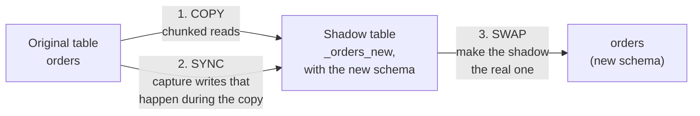
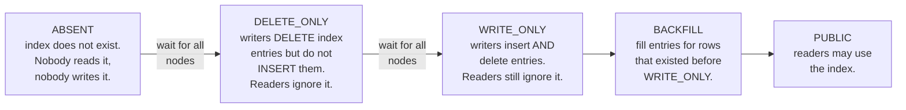
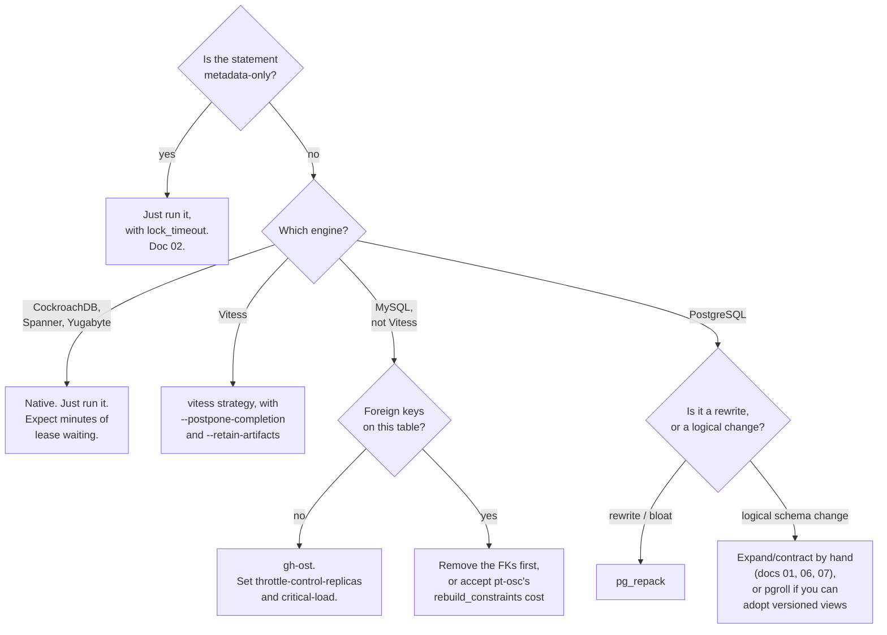

# Online Schema Change Tools: How They Work, and How Each One Fails

Doc 02 ended at the point where the answer is "no, this statement rewrites a 336 GB table."
That is where online schema change tools come in — and they are all, without exception, the
same three-step idea with different implementations of each step.

Understanding the shared shape first makes the individual tools much easier to hold, and makes
their failure modes predictable rather than something you memorise. Scenario IDs are `O-nn`.

---

## Every online schema change tool is the same three steps



**Step 1, copy.** Read the original in chunks, transform each row into the new schema, write it
to a shadow table. This is the long part and it is bounded by I/O and by how much load you are
willing to add.

**Step 2, sync.** The original keeps receiving writes during the hours that step 1 runs. Those
writes must reach the shadow. There are exactly **two** ways to do this, and the choice is the
main thing that distinguishes the tools:

- **Triggers.** Put `AFTER INSERT/UPDATE/DELETE` triggers on the original that write to the
  shadow (or to a log table the tool drains). Synchronous: the application's write pays for it.
- **Log tailing.** Read the engine's own replication log — MySQL's binlog, PostgreSQL's WAL via
  logical decoding — and apply the changes to the shadow asynchronously. The application's write
  pays nothing extra.

**Step 3, swap.** Make the shadow the real table. Two ways again:

- **Rename.** `RENAME TABLE orders TO _orders_old, _orders_new TO orders`. Atomic in MySQL.
- **View swap.** The "table" applications use is actually a view; you repoint it.

That is the whole design space. Here is where each tool sits:

| Tool | Engine | Sync mechanism | Swap mechanism | Write overhead during copy |
|---|---|---|---|---|
| `pt-online-schema-change` | MySQL | Triggers | Atomic rename | **High** — every write doubled, synchronously |
| `gh-ost` | MySQL | Binlog tailing | Rename with a lock dance | **Near zero** on the write path |
| `pg_repack` | PostgreSQL | Trigger into a log table | Rename under brief exclusive lock | Moderate — one extra insert per write |
| `pgroll` | PostgreSQL | Triggers, **two-way** | Views per schema version | Moderate |
| Vitess online DDL | MySQL/Vitess | VReplication (binlog) | Vitess-managed cutover | Near zero |
| CockroachDB / Spanner | Native | None needed — see below | None needed | Low |
| Aurora fast DDL | MySQL/PG | N/A | N/A | Limited statement support |

The last two rows are qualitatively different and the reason is worth a section of its own,
because it is the deepest idea in this document.

---

## Why CockroachDB and Spanner do not need a shadow table

The tools above exist because the engine cannot change a table's definition while queries are
running against the old one. Distributed SQL engines solved this differently, and the solution
is a formalisation of doc 01's expand/contract — which makes it the best available explanation
of *why* expand/contract is the right shape.

The problem, stated precisely for a distributed database. You have 40 nodes. You want to add an
index. You cannot update all 40 nodes atomically, so for some window, some nodes know about the
index and some do not. What goes wrong?

Suppose node A knows about the index and node B does not:

- **B inserts a row.** B does not write an index entry, because B does not know the index
  exists. The index is now missing an entry — a query served by A using the index will not
  return that row. **Missing data.**
- **B deletes a row.** B does not delete the index entry, because it does not know to. The
  index now points at a row that no longer exists. A query served by A using the index returns
  a deleted row, or errors. **Phantom data.**

Both are corruption, and both come from the same cause: two nodes disagreeing about whether the
index exists. Since you cannot make them agree instantaneously, you must find a sequence of
states in which **any two adjacent states are safe to hold simultaneously.** That is exactly
doc 01's rule, stated as a distributed-systems constraint.

The F1 protocol (the paper is "Online, Asynchronous Schema Change in F1", and CockroachDB
implements essentially the same thing) uses three intermediate states:



Now check each adjacent pair for the two failure modes above:

- **ABSENT next to DELETE_ONLY.** An ABSENT node inserts a row without an index entry — fine,
  because no reader uses the index. A DELETE_ONLY node deletes a row and removes the index
  entry — fine, deleting a non-existent entry is a no-op. **Safe.**
- **DELETE_ONLY next to WRITE_ONLY.** A DELETE_ONLY node inserts without an entry — still fine,
  no reader uses the index. A WRITE_ONLY node inserts *with* an entry, and a DELETE_ONLY node
  that later deletes that row will correctly remove the entry, because DELETE_ONLY nodes do
  delete. **Safe** — and this is precisely why DELETE_ONLY must come before WRITE_ONLY rather
  than the other way round. The deleting behaviour has to be universal *before* the writing
  behaviour starts, or you get orphans.
- **WRITE_ONLY next to PUBLIC.** By the time any node is PUBLIC, every node writes and deletes
  entries, and the backfill has filled in the history. **Safe.**

Each transition waits for every node to pick up the previous state, which the engine achieves
by bounding how long a node may cache a schema version (a lease, typically a few minutes).
That is why a `CREATE INDEX` on CockroachDB takes minutes even on an empty table: it is not
doing work, it is waiting out two lease intervals.

**Why this matters even if you never run CockroachDB.** The state machine is the formal version
of what you do by hand in doc 01: add the thing (nobody reads it), write to it (nobody reads
it), backfill it, then read from it. When you find yourself asking "can I combine phases 2 and
5?", the answer is the same as the answer to "can a node go from ABSENT straight to PUBLIC?" —
no, and for the same reason.

---

## `pt-online-schema-change`: the trigger-based original

Percona's tool is the oldest widely used approach and the mental model is simple:

1. `CREATE TABLE _orders_new LIKE orders`, then apply the `ALTER` to the empty shadow.
2. Create three triggers on `orders` that replay every insert, update and delete into
   `_orders_new`.
3. Copy existing rows in chunks, sized dynamically to hit a target chunk time.
4. `RENAME TABLE orders TO _orders_old, _orders_new TO orders` — atomic in MySQL.
5. Drop the triggers and, optionally, `_orders_old`.

Step 2 is where the costs are.

### O-01 · The triggers double your write cost, synchronously

**What you see.** Write latency on the table doubles the moment the tool starts, and stays
doubled for the whole copy — which on Lumen's largest per-shard table (`post_engagement`, 1.34
billion rows, 310 GB) is about **15 hours**. p99 write latency goes from 4 ms to 11 ms, and a
downstream service with a 10 ms timeout starts failing.

**Mechanism.** The trigger runs inside the application's transaction. An `INSERT` into `orders`
becomes an `INSERT` into `orders` plus an `INSERT` into `_orders_new`, both durable, both
counted in the user's latency. An `UPDATE` becomes an update plus a `REPLACE`. The cost is not
"some overhead"; it is close to **exactly double**, and it lands on the request path.

It is worse than double for updates on wide tables, because the trigger's `REPLACE INTO` writes
the whole row even when the original update touched one column.

**Confirm it.** Compare `Handler_write` and `Innodb_rows_inserted` before and after the tool
starts. The doubling is unmistakable.

**Recover.** `pt-online-schema-change` can be killed cleanly, but killing it does **not** remove
the triggers if it dies abruptly. Check and remove them:

```sql
SELECT TRIGGER_NAME, EVENT_OBJECT_TABLE FROM information_schema.TRIGGERS
WHERE TRIGGER_SCHEMA = 'lumen' AND TRIGGER_NAME LIKE 'pt_osc_%';
```

⚠️ Leftover triggers writing into a `_orders_new` table you have since dropped will cause
**every write to the original table to fail**. This is the single most damaging way a
`pt-osc` run can end.

**Prevent.** Prefer gh-ost on MySQL. The trigger approach has no answer to this cost; it is
inherent to doing the sync synchronously.

### O-02 · Foreign keys, and three bad options

**What you see.** You run `pt-osc` on a table that other tables reference, and the tool asks
you to choose `--alter-foreign-keys-method`. Every choice is unpleasant.

**Mechanism.** After the rename, the child tables' foreign keys still point at `_orders_old` —
because in MySQL a foreign key references the table by name at definition time, and the rename
carried the name to a different table. The tool's options:

| Method | What it does | The cost |
|---|---|---|
| `rebuild_constraints` | `ALTER` each child to re-point its FK | **Each child gets its own full rebuild.** `order_items` at 1.77 billion rows is a second multi-hour migration you did not plan |
| `drop_swap` | Drop the original, then rename the shadow into place | **Not atomic.** There is a window — short, but real — with no table of that name, during which every query fails. Also: FK checks are disabled during it |
| `none` | Leave the FKs broken | Exactly what it says |
| `auto` | Picks `rebuild_constraints` if it estimates it is fast enough, otherwise `drop_swap` | The tool decides which unpleasant thing happens, at runtime, based on an estimate |

**Prevent.** The honest answer for MySQL at scale is the one Lumen, Vitess users, and most
large MySQL shops reached independently: **do not use database-level foreign keys on your
largest tables.** Enforce referential integrity in the application and accept the trade. This
is a genuinely contested position and you should know the counter-argument — application-level
enforcement is not enforcement, and you will have orphans — but the migration cost is a real
input to that decision and it is usually left out of the debate.

If you keep the foreign keys, use gh-ost, which refuses to run on tables with foreign keys
rather than offering you three bad options. Refusing is arguably the better interface.

### O-03 · The cut-over that deadlocks

**What you see.** Fifteen hours of copying completes. The rename step hangs, then fails with
`Lock wait timeout exceeded` or a deadlock, and the tool retries. Sometimes it retries for
twenty minutes.

**Mechanism.** The atomic rename needs an exclusive metadata lock on both tables. That is
`L-09` all over again: it waits for every open transaction on `orders`, and everything queues
behind it. On a table doing 60 writes/second with occasional long transactions, the window in
which the rename can succeed may be small.

`pt-osc` handles this with `--max-lag`, `--tries`, and a lock-wait timeout, retrying the rename.
gh-ost handles it more cleverly, with a lock dance worth knowing:

```
Connection 1:  CREATE TABLE _orders_del (id int PRIMARY KEY);   -- sentinel
Connection 1:  LOCK TABLES orders WRITE, _orders_del WRITE;     -- writes now block
Connection 2:  RENAME TABLE orders TO _orders_old,
                            _orders_gho TO orders;              -- blocks on the lock
               (gh-ost now applies the last binlog events to the ghost table)
Connection 1:  DROP TABLE _orders_del;                          -- sentinel gone
Connection 1:  UNLOCK TABLES;                                   -- rename proceeds atomically
```

The point of the sentinel is a safety property: if connection 1 dies at any moment, its lock is
released and the rename in connection 2 completes — so you never end up with no table. And
because the rename is *already queued* behind the write lock when writes are blocked, no write
can slip in between "last binlog event applied" and "rename". The cut-over is genuinely
lossless.

**Prevent.** Schedule the cut-over. gh-ost's `--postpone-cut-over-flag-file` is the feature that
makes online DDL operationally sane: run the fifteen-hour copy whenever you like, then remove
the flag file at 03:00 on a Tuesday when you are watching. Separating "the long expensive part"
from "the risky moment" is the single most useful operational property any of these tools has.

---

## `gh-ost`: binlog-based, and why it is the default on MySQL

GitHub's tool replaced the triggers with binlog tailing, which removes `O-01` entirely.

1. Create `_orders_gho` with the new schema.
2. Connect as a replica and read the binlog, applying every change to the ghost table.
3. Copy existing rows in chunks, **from a read replica** by default, so the copy load does not
   touch the primary.
4. Cut over with the lock dance above.

The costs move rather than disappear, and knowing where they moved is the point.

### O-04 · The binlog retention window expires mid-copy

**What you see.** Twelve hours into a fifteen-hour copy, gh-ost fails with
`could not find first log file name in binary log index file`.

**Mechanism.** gh-ost is reading the binlog from a position it established at the start. If the
server's `binlog_expire_logs_seconds` (default 30 days in MySQL 8, but often lowered to a day
or two on high-volume servers for disk reasons) purges the file gh-ost is reading, the stream
breaks and the whole run is lost.

Lumen's shards write 9 GB of binlog per hour at peak. With 200 GB allocated to binlogs, that is
22 hours of retention — comfortably above a 15-hour copy until a traffic spike makes it 14
hours, at which point a copy that started before the spike dies.

**Confirm it.** Before starting, not after:

```sql
SHOW BINARY LOGS;  -- total size and count
SELECT @@binlog_expire_logs_seconds / 3600 AS retention_hours;
```

Compare retention against your estimated copy time with 2× margin.

**Prevent.** Raise binlog retention to at least 3× the estimated copy duration for the duration
of the migration, and lower it afterwards. On RDS/Aurora MySQL this is
`CALL mysql.rds_set_configuration('binlog retention hours', 96)`.

### O-05 · Throttling configured for the wrong signal

**What you see.** gh-ost's throttle never engages, the copy runs at full speed, and replica lag
climbs to eleven minutes, which breaks read-after-write for the application.

**Mechanism.** gh-ost throttles on several signals and you must configure the right ones:

| Flag | Watches | When it is the right signal |
|---|---|---|
| `--max-lag-millis` | Replica lag on the replica gh-ost reads from | Always — but it only watches **that** replica |
| `--throttle-control-replicas` | Lag on a named list of other replicas | When your application reads from replicas gh-ost does not use |
| `--max-load` | A list of status counters, e.g. `Threads_running=50` | Protecting the primary from the copy |
| `--critical-load` | Same, but **aborts** instead of pausing | The safety net |
| `--throttle-query` | An arbitrary SQL query returning 0 or 1 | Coupling the throttle to your own health signal |
| `--throttle-flag-file` | A file's existence | Manual control from a runbook |

The default configuration throttles on lag for the replica gh-ost reads from and nothing else.
At Lumen, that replica was a dedicated migration replica with no application traffic, so its
lag stayed at zero while the three application-serving replicas fell eleven minutes behind.

**Prevent.** Always set `--throttle-control-replicas` to the replicas your *application* reads,
and always set `--critical-load` with `Threads_running` at roughly 2× your normal peak, so that
a genuine production problem aborts the migration rather than competing with it.

`--throttle-query` is the underused one. Pointing it at your own SLI — "return 1 if checkout p99
is above 200 ms" — makes the migration back off for the reason you actually care about rather
than for a proxy.

### O-06 · The copy that can never catch up

**What you see.** The copy progresses to 94% and then the estimated completion time starts
increasing instead of decreasing.

**Mechanism.** The ghost table must absorb both the row copy and the live change stream. If the
change stream alone exceeds what the ghost table can ingest, the copy never finishes — it is
not slow, it is divergent.

Do the arithmetic before you start. On a Lumen shard at peak:

- Live writes to `post_engagement`: 60/second.
- Each write applied to the ghost table costs roughly the same as the original write.
- Row-copy throughput observed on this hardware: ~22,000 rows/second when unthrottled.

60 writes/second consumes 0.27% of 22,000. Fine. But the same table on Gateline during an
on-sale takes **18,000 writes/second**, which consumes 82% of the copy budget, leaving 4,000
rows/second of progress. At 4,000 rows/second, 1.34 billion rows takes **93 days**.

**The general rule:** if live write rate exceeds roughly 30% of your measured unthrottled copy
rate, the migration will not complete in a predictable time. You need a different approach —
usually Vitess-style resharding, or splitting the table first.

**Prevent.** Measure the copy rate on a clone before committing to a plan, and compute the
ratio. It takes an hour and it is the difference between a 15-hour migration and a 93-day one.

---

## PostgreSQL's tools, and the gap

PostgreSQL has no equivalent of gh-ost, and the reason is structural: there is no stable,
documented, easily consumed row-level change stream outside logical replication, and logical
replication has its own constraints (doc 08). So PostgreSQL's tools are trigger-based or
view-based.

### `pg_repack` — for rewrites, not for schema changes

`pg_repack` removes bloat and can change a table's physical order. It does **not** apply an
arbitrary `ALTER`. People reach for it expecting gh-ost and are disappointed.

Its mechanism: brief `ACCESS EXCLUSIVE` to install a trigger and a log table; copy rows to a
new table; apply the log; build indexes; brief `ACCESS EXCLUSIVE` to swap.

### O-07 · `pg_repack` killed mid-run leaves triggers behind

**What you see.** A `pg_repack` on `orders` is interrupted. Afterwards, writes to `orders`
continue to work but are 40% slower, and disk usage keeps growing.

**Mechanism.** The trigger and the `repack.log_<oid>` table survive. Every write to `orders`
still writes a log row that nothing drains, so the log table grows without bound.

**Recover.**

```sql
-- pg_repack ships a cleanup mode; use it first
-- pg_repack --dbname=riverbend --no-superuser-check --table=orders --drop

-- If that fails, clean manually:
SELECT * FROM pg_trigger WHERE tgname LIKE 'repack_trigger%';
DROP TRIGGER repack_trigger ON orders;
DROP TABLE repack.log_16401;
DROP SCHEMA IF EXISTS repack CASCADE;   -- only if no repack is running
```

**Prevent.** Run `pg_repack` from a supervised context and add a post-run check for a
`repack` schema to your migration tooling's health checks.

### O-08 · `pgroll` and the view-based model: the plan you did not expect

`pgroll` is a different and genuinely interesting design, and it is worth understanding even if
you do not adopt it, because it makes doc 01's two-versions invariant explicit in the database
rather than in a runbook.

For a column rename, `pgroll`:

1. Creates a new PostgreSQL schema (namespace) per migration version, containing **views** over
   the physical table with the version-appropriate column names.
2. Adds the new physical column.
3. Installs triggers that keep the old and new physical columns in sync **in both directions**.
4. Backfills.
5. On `complete`, drops the old column, the triggers, and the old version's views.

Old application instances set `search_path` to `public_v14`; new ones to `public_v15`. Both work
simultaneously, against one physical table, with no application coordination. That is a clean
solution to a real problem.

**What goes wrong.** Applications now query views, not tables, and two things follow:

- **`INSERT ... RETURNING` and `ON CONFLICT` on a view** need the view to be auto-updatable,
  which constrains what the view can do. Complex migrations hit this.
- **The planner is usually fine but not always.** A simple view is inlined and the plan is
  identical. A view with an expression in a column — which is exactly what a type-change
  migration produces — can defeat an index on the underlying column, because the query filters
  on `amount` (an expression over `amount_cents`) rather than on an indexed column. A migration
  that changes nothing about the data can change a query from an index scan to a sequential
  scan over 240 GB.

**Confirm it.** `EXPLAIN` the application's top ten queries against the *view*, not the table,
as part of the migration's pre-checks. This is a good practice with any view-based approach and
almost nobody does it.

### O-09 · The two-way sync trigger and the write loop

**What you see.** With `pgroll`-style bidirectional triggers, a write storm: one `UPDATE`
produces two, or the database reports `stack depth limit exceeded`.

**Mechanism.** The trigger on the old column writes the new column; the trigger on the new
column writes the old one. Without a guard, they call each other.

Real implementations guard with a check that the value actually changed, or with
`pg_trigger_depth() = 1`, or by setting a session variable. If you write your own
bidirectional sync — and doc 07 discusses when you should — **the guard is the whole design**,
not a detail. The standard pattern:

```sql
CREATE FUNCTION sync_amount() RETURNS trigger AS $$
BEGIN
  IF pg_trigger_depth() > 1 THEN RETURN NEW; END IF;   -- do not recurse
  IF NEW.amount IS DISTINCT FROM OLD.amount THEN
    NEW.amount_cents := (NEW.amount * 100)::bigint;
  ELSIF NEW.amount_cents IS DISTINCT FROM OLD.amount_cents THEN
    NEW.amount := NEW.amount_cents / 100.0;
  END IF;
  RETURN NEW;
END $$ LANGUAGE plpgsql;
```

Note the `IS DISTINCT FROM` rather than `<>`: with `<>`, a change from `NULL` to a value
evaluates to `NULL`, which is not true, so the branch does not fire and the sync silently misses
every row where the old value was null. That is `W-04` in doc 07, and it is the most common bug
in hand-written sync triggers.

---

## Vitess: online DDL as a managed operation

Vitess treats a schema change as a tracked, named, cancellable operation rather than a
statement, and this is the model the other tools are converging on.

```sql
SET @@ddl_strategy = 'vitess --postpone-completion --retain-artifacts=72h';
ALTER TABLE post_engagement ADD COLUMN reaction_type tinyint;
-- returns a migration UUID immediately

SHOW VITESS_MIGRATIONS LIKE '<uuid>' \G
ALTER VITESS_MIGRATION '<uuid>' COMPLETE;   -- when you choose
ALTER VITESS_MIGRATION '<uuid>' CANCEL;     -- before completion
```

Four properties worth copying into whatever you use:

1. **The migration has an identity and a queryable status.** You can ask "what is the state of
   this change on shard 417?" — which, across 4,096 shards, is the difference between a
   tractable rollout and a guess (doc 11).
2. **Completion is a separate, explicit action.** Same idea as gh-ost's postpone flag.
3. **`--retain-artifacts` keeps the old table for a stated period.** Rollback after cutover
   becomes a rename rather than a restore. This is the single best rollback property available
   in any of these tools and it is worth choosing a tool for.
4. **Throttling is a platform concern**, via the Vitess tablet throttler, rather than a flag on
   each migration.

### O-10 · The migration that reported success on 4,084 of 4,096 shards

**What you see.** A schema change is declared complete. Five months later, queries fail on
0.3% of traffic with `Unknown column 'reaction_type'`.

**Mechanism.** Twelve shards did not apply it — a tablet was down for maintenance, or a
migration was cancelled by an operator during an unrelated incident and never re-run, or the
shard was created from a backup taken before the change. The rollout reported success because
it reported the *aggregate*, and 99.7% rounded to "done" in the dashboard.

This is doc 11's `F-01` and it is the defining failure of fleet migrations. The fix is not
better rollout tooling; it is **standing drift detection** — a job that compares the schema of
every shard against the expected schema, continuously, forever, and alerts on any difference.
Vitess has `VDiff` and schema tracking for this. If your platform does not, build it: it is
about 200 lines and it will find things.

---

## Choosing: a decision procedure



The honest summary for PostgreSQL: **there is no tool, and the expand/contract discipline is
the tool.** That is why this collection spends six documents on doing it by hand and three
paragraphs on `pg_repack`. If that seems backwards relative to the MySQL world, it is because
PostgreSQL's cheap metadata-only operations remove the need for a shadow table in most of the
cases where MySQL needs one — you reach for expand/contract instead, which you needed anyway
for the code-compatibility reasons in doc 05.

---

## What to take away

1. **Every online schema change tool is copy, sync, swap.** The tools differ in how they sync
   (triggers versus log tailing) and how they swap (rename versus view). Once you know which
   two a tool picked, you can predict its failure modes.
2. **Trigger-based sync puts the cost on the application's write path**, roughly doubling write
   latency for the whole copy. Log-tailing sync does not.
3. **The F1 state machine — absent, delete-only, write-only, backfill, public — is
   expand/contract proved correct.** Delete-only must precede write-only, or you get orphaned
   index entries, and that ordering is the same reason your phase 2 must precede your phase 5.
4. **Leftover `pt-osc` triggers pointing at a dropped shadow table make every write to the real
   table fail.** Check for them after any abnormal termination.
5. **MySQL foreign keys and online schema change are close to incompatible at scale**, which is
   a genuine input to the "enforce integrity in the database or the application" argument and
   is usually omitted from it.
6. **gh-ost's postponed cut-over is the most valuable operational feature in this space**:
   it separates the long expensive part from the short risky part, so you can do the risky part
   while watching.
7. **Check binlog retention against copy duration before you start**, with 3× margin. A copy
   that outlives its binlog window loses all of its work.
8. **Throttle on the replicas your application reads**, not on the one the tool reads, and set
   `--critical-load` so a real incident aborts the migration instead of competing with it.
9. **If live write rate exceeds ~30% of your measured copy rate, the copy may never finish.**
   Compute the ratio before committing to a plan.
10. **View-based approaches can change query plans** even when they change no data. `EXPLAIN`
    the top queries against the view as a pre-check.
11. **Bidirectional sync triggers need a recursion guard and `IS DISTINCT FROM`**, not `<>`;
    with `<>`, every row whose old value was `NULL` is silently skipped.
12. **`--retain-artifacts` — keeping the old table for a stated period — is the best rollback
    property any of these tools offers.** Prefer a tool that has it.
13. **A fleet rollout that reports 99.7% success has failed.** Build standing schema-drift
    detection; the aggregate number will always look fine.

Next: [04-migration-tooling-versioning-and-the-pipeline.md](04-migration-tooling-versioning-and-the-pipeline.md),
which is about the layer above the statement — how migrations are ordered, recorded, and run.
