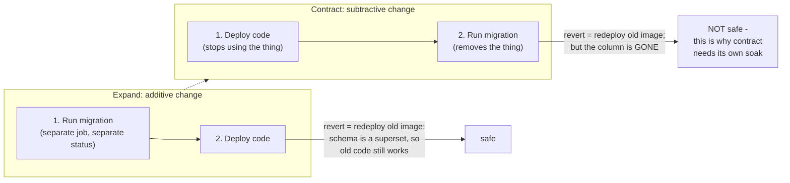

# Migration Tooling, Versioning, and the Pipeline That Runs Them

Docs 02 and 03 were about a single statement. This document is about the layer above it: how
migrations are named, ordered, recorded, locked, reviewed and executed — and why that layer
produces a failure mode the statement layer cannot, which is **a schema in a state no version
number describes**.

That failure is quiet. Nothing is down. But the migration table says version 214, the schema is
somewhere between 213 and 214, and until a human reconstructs what actually happened, nobody
can deploy anything that touches the database. At Ironvale a single occurrence of this on a
shared database blocked eleven teams for two days. Scenario IDs are `T-nn`.

---

## Two models: versioned and declarative

Every migration tool is one of two kinds, and the choice has consequences you inherit for
years.

**Versioned (imperative).** You write the steps. The tool records which steps have run.

```
migrations/
  V212__add_delivery_window.sql
  V213__index_orders_merchant.sql
  V214__add_currency_columns.sql
```

Flyway, Liquibase, Alembic, golang-migrate, goose, Rails and Django all work this way. The
tool keeps a table — `flyway_schema_history`, `alembic_version`, `schema_migrations` — listing
what has been applied, and on each run it applies what is missing.

**Declarative.** You write the *desired* schema. The tool diffs it against reality and
generates the steps.

```sql
-- schema/orders.sql  -- the whole truth about this table
CREATE TABLE orders (
  order_id    bigint PRIMARY KEY,
  customer_id bigint NOT NULL,
  amount      numeric(14,2),
  currency    char(3),
  ...
);
```

Atlas, Skeema and most ORM "sync" commands work this way.

### Which to choose, and the honest trade

Declarative is seductive because the repository shows you the schema rather than a pile of
diffs you have to replay mentally. It is the right answer for a schema you fully control, with
small tables, and no data transformations.

It is the wrong answer the moment a change needs a data step, because **a diff cannot infer
intent**. The tool sees `amount_cents` gone and `amount` present. Is that a rename, or a drop
plus an add? Those produce identical schemas and opposite outcomes — one preserves 521 million
values and one destroys them. Declarative tools ask you, or guess, and the guess is a coin
flip on your data.

The practical position most large organisations land on, and the one this collection
recommends:

- **Versioned migrations as the source of truth**, because migrations are sequences of
  deliberate steps and some of those steps are data, not schema.
- **A declarative tool in CI as a check**, diffing the schema that results from replaying all
  migrations against the schema a review expects. This catches drift (`T-07`) without letting a
  diff engine decide what happens to your rows.

---

## What the migration table must record, and what most record instead

Here is a typical `schema_migrations` from golang-migrate:

```
 version | dirty
---------+-------
     214 | f
```

Two columns. One of them is a boolean. This is not enough to operate a system, and the gap
between what is recorded and what you need during an incident is the source of several
scenarios below.

What you actually want recorded, per migration:

| Field | Why you need it |
|---|---|
| Version and description | Obvious |
| **Checksum of the file as applied** | To detect that someone edited an applied migration (`T-06`) |
| Start time and end time | To correlate a migration with an incident (doc 16) |
| **Who or what ran it** | A pipeline run ID, so you can find the logs |
| Success / failure / **partially applied** | Because "dirty" does not say *how* dirty |
| Statements completed | On engines without transactional DDL, this is the only way to resume |

Flyway records most of this; Liquibase records most of this plus an execution type;
golang-migrate records the two columns above. If your tool records two columns, wrap it: write
your own row into your own table around each run. It is twenty lines and it is the difference
between a ten-minute recovery and a two-day archaeology project.

---

## The failure catalogue

### T-01 · Forty pods race to run the same migration

**What you see.** A deploy rolls out 40 pods. The logs show 39 of them failing with
`relation "orders_currency_idx" already exists` or `duplicate key value violates unique
constraint "schema_migrations_pkey"`. Sometimes one pod wins cleanly; sometimes two partially
apply different statements and you land in `T-05`.

**Mechanism.** The migration runs on application startup — a common default in Rails, Django,
Spring Boot and many Go services. Kubernetes starts all 40 replicas within a few seconds of
each other, and all 40 read the migration table, all 40 see version 213, and all 40 begin
applying 214.

**Confirm it.** Count distinct pods logging a migration attempt in the same minute. If it is
more than one, you have this, whether or not it has hurt you yet.

**Recover.** Usually self-healing — one pod wins and the rest crash-loop until the migration
table catches up. The damage case is when two pods interleave statements of a non-transactional
multi-statement migration, which is `T-05`.

**Prevent — two layers, use both.**

First, **an advisory lock** so that only one process can be in the migration path at a time:

```sql
-- A constant derived from the application name; any bigint will do,
-- as long as every instance of this application uses the same one.
SELECT pg_advisory_lock(hashtext('riverbend-order-service-migrations'));
-- ... run migrations ...
SELECT pg_advisory_unlock(hashtext('riverbend-order-service-migrations'));
```

Flyway does this for you on PostgreSQL. Liquibase uses a `DATABASECHANGELOGLOCK` *table* rather
than an advisory lock, which is a meaningfully worse design and the cause of `T-02`.

Second, and more important: **do not run migrations from application startup at all.** See
"Where migrations should run" below.

### T-02 · The lock holder dies, and the lock does not

**What you see.** Every subsequent deploy fails with Liquibase's
`Could not acquire change log lock. Currently locked by <host> since <timestamp>` — and the
timestamp is from three hours ago, on a pod that no longer exists.

**Mechanism.** Liquibase's lock is a row in `DATABASECHANGELOGLOCK` with `LOCKED = 1`. The row
is written at the start and cleared at the end. If the process dies in between — OOMKilled,
node drained, pipeline cancelled — nothing clears it. The lock is durable state with no owner
and no lease.

The contrast with PostgreSQL advisory locks is the lesson. `pg_advisory_lock` is tied to the
*session*. When the connection dies, the server releases the lock automatically, because the
server knows the session is gone. A row in a table knows nothing.

**Recover.**

```sql
-- Confirm nothing is actually running first: check pg_stat_activity for
-- a live session from a migration client.
SELECT * FROM "DATABASECHANGELOGLOCK";
UPDATE "DATABASECHANGELOGLOCK" SET LOCKED = 0, LOCKGRANTED = NULL, LOCKEDBY = NULL WHERE ID = 1;
```

⚠️ **Verify no migration is genuinely running before clearing this.** The whole point of the
lock is to stop two migrations overlapping, and clearing it during a live run gives you exactly
the interleaving it existed to prevent. Check `pg_stat_activity` for a session whose
`application_name` matches your migration client and whose `state` is `active`.

**Prevent.** Prefer tools that use session-scoped advisory locks. If you must use a table-based
lock, add a lease: store a timestamp and treat a lock older than, say, twice your longest
expected migration as stale. A lock without a lease is not a lock; it is a flag that sometimes
gets stuck.

### T-03 · Two branches, one version number

**What you see.** Two teams merge to main on the same afternoon. Both added
`V214__something.sql`. The merge succeeds — git has no opinion about two different files with
the same version prefix in different directories, and even in the same directory the filenames
differ after the `__`. Deployment fails, or worse, applies one and silently skips the other.

**Mechanism.** Sequential integers are a shared global counter in a distributed system with no
coordination. Two people reading "the latest is 213" at the same time both write 214.

**The two standard answers, and why neither is complete:**

**Timestamps instead of integers** (`20260930142201__add_currency.sql`). Collisions become
essentially impossible. But you have traded a loud failure for a quiet one: migrations now
apply in *timestamp* order, which is the order they were **written**, not the order they were
**merged**. Team A writes a migration on the 1st and merges on the 20th. Team B writes on the
10th and merges on the 12th, and it ships to production. When A merges, A's migration has an
earlier timestamp than B's — but B's is already applied. Most tools (Flyway in default mode,
golang-migrate) will refuse to apply a version lower than the current one, so A's migration is
silently skipped in production while applying cleanly in every fresh environment. That is
`T-07`, drift, arriving by a different road.

**An explicit dependency graph** (Alembic's `down_revision`). Each migration names its parent,
so order is a DAG rather than a number, and two branches produce two heads. The tool notices
and refuses to run until you write a merge revision. This is the correct model and the cost is
that engineers must understand it; the common failure is somebody resolving "multiple heads" by
editing `down_revision` by hand until the error stops.

**Prevent.** Pick timestamps *plus* an out-of-order policy you have chosen deliberately:

- Flyway: `outOfOrder=true` in non-production, `false` in production, and a CI check that fails
  the build if a pull request adds a migration with a timestamp earlier than the highest
  already merged to main. That check is about fifteen lines and it converts `T-03` into a
  review comment.

### T-04 · The migration that applied before the code that needs it, or after

**What you see.** A deploy succeeds. For ninety seconds, a fraction of requests fail with
`column "currency" does not exist`. Then it stops.

**Mechanism.** Ordering between the migration and the deploy is not something the migration
tool controls, and the two valid orders are not interchangeable:

| Change | Correct order | If you get it wrong |
|---|---|---|
| **Additive** (expand) | Migration **first**, then deploy | New code runs against the old schema and fails on the missing column |
| **Subtractive** (contract) | Deploy **first**, then migration | Old code runs against a schema missing the column it uses |

The rule compresses to: **expand before deploy, contract after deploy.** It is a direct
consequence of doc 01's two-versions invariant, and the reason a tool that couples migration
and deploy into one artifact (`T-12`) cannot get both right.

**Prevent.** Make the direction explicit in the migration file, and have the pipeline enforce
the ordering from it:

```sql
-- migration: expand
-- Runs BEFORE the application deploy. Must be compatible with the currently
-- running code version.
ALTER TABLE orders ADD COLUMN currency char(3);
```

### T-05 · The half-applied migration, and the `dirty` flag that tells you nothing

**What you see.** `ERROR: Dirty database version 214. Fix and force version.` Deploys are
blocked. Nobody knows what state the schema is in.

**Mechanism.** The migration contained several statements. It failed partway. On an engine
without transactional DDL — MySQL, Oracle, and PostgreSQL for the handful of statements that
cannot run in a transaction — the statements before the failure are committed and cannot be
rolled back.

`golang-migrate` records this as `dirty = true`. That boolean carries no information about
*which* statements ran. Recovering means reading the migration file and checking the live
schema, statement by statement.

**Confirm it.** Reconstruct the actual state rather than guessing:

```sql
-- What does the schema actually look like?
SELECT column_name, data_type, is_nullable, column_default
FROM information_schema.columns
WHERE table_name = 'orders' ORDER BY ordinal_position;

SELECT indexname, indexdef FROM pg_indexes WHERE tablename = 'orders';

SELECT conname, pg_get_constraintdef(oid) FROM pg_constraint
WHERE conrelid = 'orders'::regclass;
```

Diff that against the migration file. Every statement whose effect is present, ran.

**Recover.** Three steps, in this order:

1. **Write down the actual state** in the incident channel before changing anything. If you
   start fixing first, nobody can reconstruct what happened.
2. **Make the schema match either 213 or 214 completely** — whichever is less work and is
   compatible with running code. Partially-forward is usually easier: run the remaining
   statements by hand.
3. **Only then** clear the flag: `migrate force 214`, or
   `UPDATE schema_migrations SET dirty = false, version = 214;`

⚠️ **Never clear the flag first.** It unblocks deploys, which is exactly what you want and
exactly what makes the problem permanent: the next deploy proceeds against a schema nobody has
reconciled, and the discrepancy is now invisible.

**Prevent.** Four things, in decreasing order of value:

1. **One statement per migration file** on MySQL and Oracle. Tedious, and the only way the
   version number means anything.
2. **Wrap PostgreSQL migrations in an explicit transaction** and verify your tool is doing it.
   Several tools default to autocommit.
3. **Put `CREATE INDEX CONCURRENTLY` in its own file**, flagged as non-transactional, because it
   cannot be in a transaction and will silently break the atomicity of a file that also
   contains transactional statements.
4. **Record statements-completed** in your own wrapper table, so recovery reads a number
   instead of diffing a schema.

### T-06 · Somebody edited an applied migration

**What you see.** `FlywayValidateException: Migration checksum mismatch for version 214`.
Deploys fail in production and work locally.

**Mechanism.** An engineer noticed a bug in `V214` after it had been applied to staging, and
fixed the file rather than adding `V215`. Flyway stores a checksum of each applied migration
and validates it on every run. Staging has the old checksum; the file has a new one.

The validation is correct and the instinct to defeat it is wrong. The checksum exists because
the database's state depends on what was *run*, not on what the file currently says, and
without it your repository would be describing a schema that does not exist anywhere.

**Recover.** The decision is: has the edited migration run anywhere you care about?

- **No** (only on local machines): the edit is fine. Reset the local databases.
- **Yes**: revert the file to exactly what was applied, and add a **new** migration with the
  fix. Then `flyway repair` only if the checksum difference is cosmetic — whitespace, a comment
  — and you have verified the statements are identical.

⚠️ `flyway repair` rewrites the recorded checksum to match the current file. If the file's
*statements* changed, repair makes a real divergence invisible forever. Use it for whitespace,
never for logic.

**Prevent.** Make applied migrations immutable by policy and by CI: a check that fails any pull
request modifying a file whose version is at or below the highest version applied in
production. Riverbend's is a six-line shell script in the pipeline and it has fired nine times
in two years.

### T-07 · The schema that drifted, and nobody noticed for a year

**What you see.** A migration applies cleanly in staging and fails in production with
`column "legacy_region" does not exist` — a column no migration ever created and no migration
ever dropped.

**Mechanism.** Someone ran DDL by hand. In an incident, three years ago, at 04:00, to unblock
something. It was never written into a migration. Every environment created since has the
migration-derived schema; production has the migration-derived schema *plus or minus* whatever
has been done by hand.

This accumulates. Ironvale's `ACCT_MASTER` has 340 columns, of which the migration history
accounts for 297. The other 43 arrived by hand over nineteen years, and at least four are
load-bearing.

**Confirm it.** This is the check that should run continuously, not during an incident:

```
# Build the expected schema by replaying every migration into a scratch database,
# dump it, and diff against production's dump.
migrate -database "$SCRATCH_URL" up
pg_dump --schema-only --no-owner --no-privileges "$SCRATCH_URL" | sed -E 's/^--.*//' > expected.sql
pg_dump --schema-only --no-owner --no-privileges "$PROD_URL"    | sed -E 's/^--.*//' > actual.sql
diff -u expected.sql actual.sql
```

Run it nightly against every environment, and alert on any difference. The first run will find
things; that is the point, and it is also why teams put off writing it.

**Recover.** For each difference, decide: adopt it (write a migration that creates it, and mark
it as already applied in non-production environments) or remove it. Adopting is usually right
for anything that has been there a year, because something depends on it.

**Prevent.** Remove the ability to run ad-hoc DDL in production. At Riverbend that means the
application's database role has no `CREATE` privilege and the migration role is only reachable
from the pipeline. At Ironvale the DBA team is the control, which works for DDL and does not
work for the emergency path — and the emergency path is where drift comes from.

### T-08 · The init container that runs migrations on every pod restart

**What you see.** A node drains at 02:00. Pods reschedule. Each one runs the migration init
container. Nothing breaks, because the migrations are all already applied — until the night a
pending migration is in the image and 40 pods try to apply it simultaneously under memory
pressure, which is `T-01` with worse timing.

**Mechanism.** An init container runs on **every pod start**, not on every deploy. Pod starts
happen for reasons that have nothing to do with you: node drains, evictions, autoscaling,
spot interruptions, liveness probe failures.

There is a second, worse property. An init container couples the migration to the rollout, so
`T-04`'s ordering is forced: the migration always runs immediately before the new code. That is
correct for expand and **wrong for contract**, and there is no way to express the difference.

**Prevent — where migrations should actually run.** Ranked:

| Approach | Verdict |
|---|---|
| **A separate pipeline step, explicitly triggered, before or after the deploy as the migration's direction requires** | **This.** Separately observable, separately revertible, correct ordering for both directions, one execution |
| A Kubernetes `Job` with `backoffLimit: 0`, created by the pipeline | Good. Same properties, if the pipeline waits for it and fails on its failure |
| Helm `pre-install`/`pre-upgrade` hook | Acceptable for expand-only. Runs once per release, but cannot express contract-after-deploy |
| Init container | No. Runs on every pod start and forces the wrong ordering for contract |
| Application startup | No. `T-01`, plus a failed migration becomes a crash loop that looks like an application bug |

The underlying principle, which is doc 13's as well: **a migration and a deploy are two
changes, and you must be able to do, observe and revert each without the other.**

### T-09 · The migration that passed CI because CI's database was empty

**What you see.** A migration that CI ran in 90 milliseconds takes 70 minutes in production,
holding `ACCESS EXCLUSIVE` (doc 02's `L-03`).

**Mechanism.** CI creates an empty database, replays every migration, and reports success. It
has measured that the statements are *syntactically valid and mutually consistent*. It has
measured nothing about their cost, because cost is a function of data and there is none.

**Prevent — the four checks CI can actually run.** None requires production data:

1. **Replay from empty.** What most pipelines already do. Catches syntax errors and ordering
   bugs. Keep it.
2. **Replay from a production schema snapshot.** Nightly, dump production's schema (no data)
   into a scratch database and apply the new migrations against it. Catches "this migration
   assumes a column that only exists in staging" and `T-07` drift.
3. **Lint.** Static analysis of the statements. For PostgreSQL, `squawk` and `eugene` flag
   rewriting type changes, `SET NOT NULL` without a prior validated check, non-concurrent index
   creation, and missing `lock_timeout`. This is the check with the best return, because it
   encodes doc 02's whole table as a build failure.

   ```
   squawk --exclude=prefer-text-field migrations/V214__add_currency_columns.sql
   ```

4. **The size gate.** The lint rules do not know your table sizes. Maintain a table-size
   snapshot (a nightly query into a checked-in file) and fail the build when a rewriting or
   scanning statement targets a table over a threshold without an explicit, reviewed override:

   ```sql
   -- migration:allow-rewrite table=orders size=336GB
   -- reason: one-off, scheduled for the 02:00 window of 2026-10-18, approved by @vk
   ```

   The comment is the artefact a reviewer can argue with. Without it, the reviewer is looking
   at four lines of SQL with no indication that one of them is an hour-long outage.

5. **Old code against the new schema.** The highest-value check and the rarest. Covered in
   doc 17, because it belongs to testing rather than linting.

### T-10 · The migration role with the wrong privileges, in both directions

**What you see.** Either a migration fails with `permission denied for table orders`, or — the
worse case — an application compromise results in `DROP TABLE`, because the application
connects as the owner.

**Mechanism.** Most teams have one database role. It owns the schema, runs the migrations, and
serves the application. That role can drop any table, and the application uses it on every
request.

**Prevent.** Three roles, which takes an hour to set up and removes a class of incident:

```sql
-- Owns the objects. Used ONLY by the migration pipeline.
CREATE ROLE riverbend_owner LOGIN;

-- The application. Can read and write, cannot change structure.
CREATE ROLE riverbend_app LOGIN;
GRANT USAGE ON SCHEMA public TO riverbend_app;
GRANT SELECT, INSERT, UPDATE, DELETE ON ALL TABLES IN SCHEMA public TO riverbend_app;
GRANT USAGE ON ALL SEQUENCES IN SCHEMA public TO riverbend_app;

-- The crucial line: make the grants apply to tables created by FUTURE migrations.
ALTER DEFAULT PRIVILEGES FOR ROLE riverbend_owner IN SCHEMA public
  GRANT SELECT, INSERT, UPDATE, DELETE ON TABLES TO riverbend_app;
ALTER DEFAULT PRIVILEGES FOR ROLE riverbend_owner IN SCHEMA public
  GRANT USAGE ON SEQUENCES TO riverbend_app;

-- Read-only, for analysts and the BI tool.
CREATE ROLE riverbend_ro LOGIN;
GRANT SELECT ON ALL TABLES IN SCHEMA public TO riverbend_ro;
ALTER DEFAULT PRIVILEGES FOR ROLE riverbend_owner IN SCHEMA public
  GRANT SELECT ON TABLES TO riverbend_ro;
```

The `ALTER DEFAULT PRIVILEGES` lines are the ones everyone forgets, and the symptom is
distinctive: **a migration deploys successfully and then the application cannot see the new
table.** `GRANT ... ON ALL TABLES` is a point-in-time operation; it does not cover tables that
do not exist yet.

This also satisfies, mechanically, a large part of Ironvale's separation-of-duties requirement
— the developer's credentials genuinely cannot alter the schema — which is doc 18's argument
for replacing a human gate with a structural one.

### T-11 · Adopting migration tooling on a nineteen-year-old schema

**What you see.** You introduce Flyway on Ironvale's core banking database. It wants to apply
`V1__initial_schema.sql` to a database that already has 1,400 tables.

**Mechanism.** Versioned tools assume they created everything. An existing database has a
history the tool knows nothing about.

**Recover — the baseline.** Every tool has this concept and it is worth doing carefully:

1. Dump the current production schema into `V1__baseline.sql`. Do not hand-write it, and do not
   tidy it — it must describe reality, including the 43 columns nobody can explain.
2. Tell the tool that version 1 is already applied here: `flyway baseline -baselineVersion=1`,
   or Alembic's `alembic stamp head`.
3. New environments replay `V1__baseline.sql` and get a faithful copy.
4. Everything from `V2` onward is normal.

⚠️ The failure mode is baselining from a **tidied** schema. Somebody takes the opportunity to
remove the four columns they believe are dead. Production keeps them; every new environment
lacks them; and you have manufactured permanent drift on day one of adopting the tool that was
supposed to prevent it.

### T-12 · Migration and deploy in one artifact

**What you see.** Doc 01's 14:02 incident. The rollback makes it worse.

**Mechanism.** The migration is part of the deploy, so "roll back the deploy" is a single
button that reverts the code and not the schema. The system goes from 50% broken to 100%
broken, because now *all* pods run code that predates the schema.

**Prevent.** The pipeline must have two steps with two outcomes, and the second must be able to
run without the first:



The diagram also shows why the two directions have different risk: **reverting an expand is
free, and reverting a contract is not.** That asymmetry is the whole reason doc 01 puts a
30-day soak before the contract step.

---

## A migration file worth copying

Everything above, as one annotated template:

```sql
-- V214__orders_add_currency.sql
--
-- direction:   expand            (pipeline runs this BEFORE the deploy)
-- phase:       1 of 6            (see MIGRATIONS.md, ticket RVB-4471)
-- tables:      orders (521M rows, 336 GB)
-- rewrite:     no                (metadata-only on PG 11+; verified on clone 2026-10-02)
-- duration:    ~10 ms            (measured on a restored clone)
-- rollback:    V214_down.sql     (drops the columns; safe until phase 6a)
-- reviewed-by: @vk, @dba-oncall

SET lock_timeout = '2s';         -- never queue; fail and let the runner retry
SET statement_timeout = '30s';   -- this statement is metadata-only; 30s is generous

ALTER TABLE orders ADD COLUMN amount   numeric(14,2);
ALTER TABLE orders ADD COLUMN currency char(3);

-- Deliberately NOT here, each for a stated reason:
--   NOT NULL        - needs the backfill first (phase 3), see L-08
--   DEFAULT 'USD'   - would make every pre-existing row silently claim to be USD,
--                     which destroys our ability to tell backfilled rows from real ones
--   an index        - CREATE INDEX CONCURRENTLY cannot run in a transaction;
--                     it is V215, its own file, flagged non-transactional
```

The header is the part that matters. It is what a reviewer reads, what an incident responder
greps for at 03:00, and what makes the size gate in `T-09` enforceable.

---

## What to take away

1. **Versioned migrations are the source of truth; declarative tools belong in CI as a check.**
   A diff engine cannot distinguish a rename from a drop-plus-add, and those have opposite
   consequences for 521 million rows.
2. **Record more than version and a `dirty` boolean.** Checksum, timing, who ran it, and
   statements-completed turn a two-day archaeology project into a ten-minute recovery.
3. **Use a session-scoped advisory lock, not a lock table.** A table row has no owner, so when
   the holder dies the lock outlives it.
4. **Expand before deploy, contract after deploy.** This is the two-versions invariant applied
   to pipeline ordering, and no tool that couples migration to deploy can get both right.
5. **Timestamps prevent version collisions and introduce out-of-order application.** Pick a
   policy deliberately and enforce it with a CI check on merge order.
6. **Never clear a `dirty` flag before reconciling the schema.** Clearing first unblocks
   deploys and makes the divergence permanent and invisible.
7. **Applied migrations are immutable.** `flyway repair` is for whitespace, never for logic; if
   the statements changed, add a new migration.
8. **Nightly schema diff against production is the only thing that finds drift.** The first run
   will find something, which is why it keeps getting postponed.
9. **Do not run migrations from init containers or application startup.** Init containers run
   on every pod start and force the wrong ordering for contract migrations.
10. **CI on an empty database proves syntax, not cost.** Add a schema-snapshot replay, a linter,
    and a size gate keyed to real table sizes.
11. **Three roles — owner, app, read-only — and remember `ALTER DEFAULT PRIVILEGES`**, or the
    migration will succeed and the application will not be able to see the new table.
12. **Baseline from the schema that actually exists, not a tidied one**, or you manufacture
    permanent drift on the first day of adopting the tool meant to prevent it.
13. **The migration file's header comment is the most useful part of it.** Direction, table
    size, whether it rewrites, measured duration, and the reason each omitted clause was
    omitted.

Next: [05-compatibility-between-code-and-schema.md](05-compatibility-between-code-and-schema.md),
which is about the half of this problem that lives in the application, the driver, and the
connection pooler.
