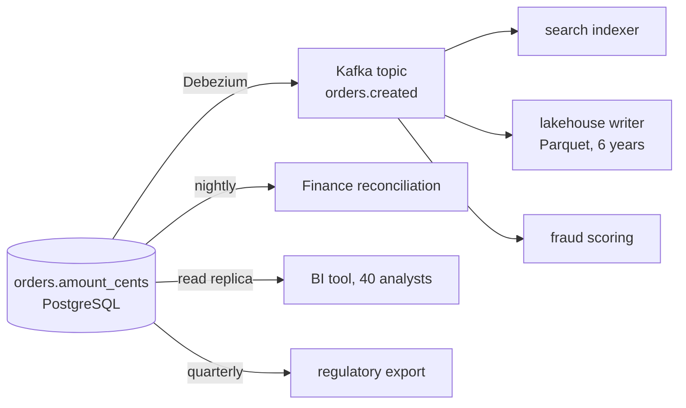

# Compatibility Between Code and Schema

Docs 02 through 04 were about the database. This one is about everything in front of it — the
driver, the connection pooler, the ORM, the service that consumes your change events, and the
mobile app somebody installed in 2024 and never updated.

The reason it needs its own document is that **most migration-caused outages are not database
failures.** The DDL ran in eight milliseconds and the database is healthy. Something in the
layers above had a cached belief about the schema, and the belief is now wrong. Scenario IDs
are `C-nn`.

---

## The compatibility matrix

Doc 01 established that two code versions run against one schema. The practical question is:
for a given change, which of the two versions breaks?

Read this as "if I make this change right now, with the current code still running, what
happens?"

| Change | Old code (does not know about the change) | New code (expects the change) |
|---|---|---|
| Add a nullable column | Fine — ignores it | Fine |
| Add a column with a default | Fine | Fine |
| Add a column `NOT NULL`, no default | **Breaks** — its `INSERT` omits the column | Fine |
| Add a column `NOT NULL` with a default | Fine | Fine |
| Add a table | Fine | Fine |
| Add an index | Fine | Fine |
| Add a `CHECK` constraint | **Breaks** if old code writes violating values | Fine |
| Add a unique constraint | **Breaks** if old code writes duplicates | Fine |
| Add a foreign key | **Breaks** if old code writes orphans, or deletes parents | Fine |
| Widen a type (`int`→`bigint`, `varchar(50)`→`varchar(100)`) | Fine to write; **see `C-08`** for reads | Fine |
| Narrow a type | **Breaks** on values that no longer fit | Fine |
| Change a type's representation | **Breaks** — the driver decodes differently | Fine |
| Rename a column | **Breaks** immediately | Fine |
| Drop a column | **Breaks** — `INSERT` lists it, or `SELECT *` expects it | Fine |
| Drop a table | **Breaks** | Fine |
| Change a default | Fine, but silently changes what old code writes | Fine |
| Add an enum value | Fine to write; **breaks on read** if old code switches exhaustively | Fine |
| Remove an enum value | **Breaks** | Fine |
| Change a collation | **Breaks silently** — see `C-11` | Breaks silently too |

Three observations are worth drawing out, because they shape the whole discipline.

**Everything in the "breaks" column is a constraint or a removal.** Pure additions are safe.
That is not a coincidence — it is the reason expand/contract works, and the reason the safe
phases are the ones that only add.

**Two rows break *both* columns.** Collation changes break old and new code equally, because
the data's meaning changed underneath both. These are the dangerous ones, and they are the
ones no compatibility discipline protects you from.

**Several rows say "fine" and are not.** "Add a column with a default" is fine for
compatibility and may be a 50-minute table rewrite (doc 02). The matrix answers one question
only; you need doc 02's table as well.

---

## The failure catalogue

### C-01 · `SELECT *` and the dropped column

**What you see.** You drop a column that nothing references — you grepped, nothing uses it.
A service you do not own starts failing with a deserialisation error, not a SQL error:
`json: cannot unmarshal ... into Go struct field`, or Python's
`KeyError: 'legacy_region'`, or Java's `Column 'legacy_region' not found`.

**Mechanism.** The grep found every reference to the column *by name*. It did not find
`SELECT * FROM orders`, which references the column implicitly, and which becomes a different
query the instant the column vanishes.

What happens next depends on how the result is mapped:

- **Strict struct mapping** (Go's `sqlx.StructScan`, `scany`, Rust's `sqlx` macros): fails
  loudly at the scan. Best case.
- **Positional access** (`row[4]`): silently reads the wrong column. Every column after the
  dropped one shifts left by one, so `amount` is now read from the `status` position. **This is
  silent corruption, and it is the worst outcome in this document.**
- **Dictionary or map access** (Python's `DictCursor`, Ruby's hashes): raises a `KeyError` at
  the point of use, which may be far from the query, in a code path that runs monthly.
- **ORM with a schema cache**: see `C-04`.

**Confirm it before you drop anything.** You cannot grep your way to confidence, but you can
ask the database what it has actually been asked for:

```sql
-- Has anything queried this column in the retention window?
-- pg_stat_statements normalises literals but keeps column names.
SELECT queryid, calls, left(query, 200)
FROM pg_stat_statements
WHERE query ILIKE '%legacy_region%'
ORDER BY calls DESC;

-- And the broader question: who still does SELECT * on this table?
SELECT calls, left(query, 200) FROM pg_stat_statements
WHERE query ~* 'select\s+\*\s+from\s+orders' ORDER BY calls DESC;
```

⚠️ `pg_stat_statements` has a bounded size (`pg_stat_statements.max`, default 5,000) and evicts
least-used entries. A query that runs quarterly will **not** be there. Absence is not evidence;
presence is. For the quarterly job, the only reliable method is the one in doc 18: an ownership
registry that says who consumes this table.

**Recover.** Re-add the column, as nullable, immediately. On PostgreSQL this is metadata-only
and takes milliseconds — but the data is gone, and whether that matters depends on whether the
broken consumer reads it or merely expects its presence. For positional-access corruption, the
recovery is worse: you must find and repair everything written during the window.

**Prevent.** Make phase 5 of doc 01 real. Before you drop a column, deploy a change that
*stops reading it*, and then prove nothing reads it for a full business cycle — using the
query above plus, where you can, a trigger or a view that raises on access. The thirty days
between "stop writing" and "drop" exist for exactly this.

### C-02 · `cached plan must not change result type`

**What you see.** Immediately after an otherwise clean migration, a fraction of requests fail
with:

```
ERROR: cached plan must not change result type
SQLSTATE: 0A000
```

It affects some pods and not others, does not affect new connections, and goes away if you
restart the service.

**Mechanism.** This is the single most characteristic PostgreSQL migration error and it is
worth understanding exactly, because the instinct it triggers — "roll back the migration" — is
wrong.

When a client prepares a statement, PostgreSQL plans it and sends back a **row description**:
the number, names and types of the output columns. The client stores that and uses it to decode
every subsequent result.

When you run DDL, PostgreSQL invalidates the cached plans that depend on the changed object and
re-plans them on next use. Usually that is invisible. But if re-planning produces a *different
row description* — because `SELECT *` now returns five columns instead of four, or because a
column's type changed — the server cannot send the new description, since the client was
already told the old one at prepare time. So it refuses, with `0A000`.

The per-pod pattern follows directly: a pod only fails for the prepared statements it had
already prepared on its existing connections. Pods started after the migration, and connections
opened after it, are fine.

**Confirm it.** The error text is unambiguous. To predict it, ask which of your queries use
`SELECT *` on the table you are about to change, with the `pg_stat_statements` query above.

**Recover.** Cycle the connections. Any of these works:

```sql
-- Server side: terminate idle application connections; the pool reconnects.
SELECT pg_terminate_backend(pid) FROM pg_stat_activity
WHERE application_name = 'order-service' AND state = 'idle';
```

or a rolling restart of the deployment, or — best — the client already handles it. Most mature
drivers retry `0A000` once by discarding the cached statement and re-preparing. `pgx` does this
for its own statement cache; `node-postgres` and `psycopg` generally do not.

⚠️ **Do not roll back the migration.** Rolling back changes the result type a second time,
which invalidates the plans *again*, on the pods that had already recovered. You convert a
brief, self-healing error into a second wave of the same error, and you now have the schema
back at a state your newly deployed code may not expect.

**Prevent.** Three things, in order of effect:

1. **Do not use `SELECT *` in application code.** Listing columns explicitly means adding a
   column cannot change a result type, which removes the most common trigger entirely.
2. **Make the driver retry `0A000`** by discarding and re-preparing. Ten lines of middleware.
3. **Cycle connections deliberately after a migration** that changes result types, as a
   pipeline step, rather than letting production discover it.

### C-03 · PgBouncer, prepared statements, and the pool that remembers

**What you see.** `C-02`, but it does not clear on its own and the pattern makes no sense —
the same pod succeeds and fails alternately.

**Mechanism.** PgBouncer in transaction pooling mode multiplexes many client connections onto
few server connections, assigning a server connection per transaction. A protocol-level
prepared statement lives on a *server* connection; the client thinks it owns one connection but
is actually rotating across many.

PgBouncer 1.21 added real support for this (`max_prepared_statements`), tracking prepared
statements per client and re-preparing them on whichever server connection it hands out. That
makes the feature work and means that after a migration, **PgBouncer's own cache of prepared
statements can be stale across the whole pool**, so the error appears to follow no pod
boundary.

**Recover.** `RECONNECT` and `RELOAD` through PgBouncer's admin console:

```
psql -p 6432 -U pgbouncer pgbouncer
PAUSE riverbend;      -- stop issuing new server queries, wait for in-flight
RECONNECT riverbend;  -- drop and re-establish server connections
RESUME riverbend;
```

**Prevent.** Add the `PAUSE`/`RECONNECT`/`RESUME` sequence as a post-migration pipeline step
for any migration that changes a result type. Or use `prepare_threshold=0` / simple protocol
for the small number of queries that do `SELECT *` on volatile tables — slower, and it removes
the problem.

### C-04 · The ORM's schema cache outlives the schema

**What you see.** The migration ran. The new code is deployed. The application insists the
column does not exist — or, in Hibernate's case, refuses to start at all with
`Schema-validation: missing column [currency] in table [orders]`.

**Mechanism.** ORMs cache schema metadata to avoid an introspection round-trip per query, and
the cache's lifetime is rarely tied to anything that knows about migrations:

| Framework | Cache | Invalidated by |
|---|---|---|
| Rails | `db/schema_cache.yml`, built at deploy time | Rebuilding the file — so a migration after the build is invisible |
| Django | In-process introspection per connection | A new connection |
| Hibernate | `hbm2ddl.auto=validate` runs once at startup | Restart. A mismatch is a **startup failure**, not a query failure |
| SQLAlchemy | `MetaData` reflected at import | Process restart |
| PostgREST | Full schema cache in-process | `NOTIFY pgrst, 'reload schema'` or `SIGUSR1` |
| Prisma | Generated client, compiled in | A rebuild |

Hibernate's is the most disruptive and the most useful: validation at startup turns a
compatibility break into a pod that will not start, which is loud, immediate and safe. It also
means that **an expand migration deployed in the wrong order takes your whole service down**
rather than failing a fraction of requests — a trade that is correct, and surprising the first
time.

**Prevent.** Know which of the above you have, and put the invalidation into the pipeline. For
PostgREST that is one `NOTIFY` after the migration step. For Rails it is regenerating
`schema_cache.yml` after migrations rather than before. For Prisma and compiled clients it
means the code artefact and the schema version are coupled, which brings `T-04`'s ordering
rules back with full force.

### C-05 · The column added in the middle

**What you see.** A bulk loader, a `COPY`, or a report starts writing values into the wrong
columns. No error.

**Mechanism.** PostgreSQL appends new columns at the end, so this is mostly a MySQL and Oracle
problem — `ALTER TABLE ... ADD COLUMN c AFTER b` is supported there and people use it for
tidiness. Anything that depends on column *position* rather than name then shifts:

- `COPY orders FROM STDIN` without a column list.
- `INSERT INTO orders VALUES (...)` without a column list.
- A CSV export consumed by a downstream system that reads by index.
- `SELECT *` into a positional tuple.

**Prevent.** Never add a column anywhere but the end, and make "`INSERT` without a column list"
a lint failure. The tidiness is not worth it; column order is a physical detail, and tools that
display it alphabetically exist.

### C-06 · Enum types, which are easy to extend and impossible to contract

**What you see.** You need to add `'refund_pending'` to an order-status enum. Adding it is
easy. Three months later you need to remove `'legacy_hold'`, and there is no statement that
does it.

**Mechanism.** PostgreSQL enums are a type with an ordered list of values stored in
`pg_enum`. You can:

- `ALTER TYPE order_status ADD VALUE 'refund_pending';` — fine. Before PostgreSQL 12 this
  could not run inside a transaction block at all; from 12 it can, but **the new value cannot
  be used in the same transaction that adds it**, which surprises migration tools that wrap
  everything in a transaction and then insert test data.
- `ALTER TYPE order_status RENAME VALUE 'a' TO 'b';` — fine (PostgreSQL 10+).
- Remove a value — **there is no statement.** The only route is creating a new type, converting
  the column, and dropping the old type, which is a table rewrite and a full six-phase
  migration.

And there is a compatibility trap on the read side. Adding a value is safe for old code only if
old code tolerates unknown values. Code that switches exhaustively —
`match status { Created => …, Paid => …, Shipped => … }` with no default, or a Java `switch` on
an enum with no `default` branch — throws when it sees `refund_pending`. The database change is
backward compatible; the *application* is not. So adding an enum value needs its own
mini-expand/contract: deploy tolerant readers first, then add the value.

**Prevent.** For any status field that will plausibly grow, use `text` with a `CHECK`
constraint, or a lookup table with a foreign key:

```sql
-- Instead of an enum type:
ALTER TABLE orders ADD CONSTRAINT orders_status_valid
  CHECK (status IN ('created','paid','shipped','delivered','cancelled')) NOT VALID;
```

Adding a value is then `DROP CONSTRAINT` plus `ADD CONSTRAINT ... NOT VALID` — two
metadata-only operations. Removing one is a real migration either way, but at least it is
possible. The cost of giving up the enum type is four bytes per row versus the string, and
slightly weaker type-checking in some ORMs. On `orders` at 521 million rows, `status` as
`text` averaging 8 characters costs 521M × 5 extra bytes = **2.6 GB**, against 240 GB of table.
That is a good trade.

### C-07 · `NOT NULL` plus `DEFAULT`, and the semantics that differ by engine

**What you see.** A migration tested on PostgreSQL behaves differently on MySQL in a way that
changes data.

**Mechanism.** Two differences bite:

- **Existing rows.** `ADD COLUMN c int NOT NULL DEFAULT 0` sets existing rows to 0 on every
  engine. But `ADD COLUMN c int DEFAULT 0` — nullable with a default — sets existing rows to
  **0 on PostgreSQL and MySQL**, while a later `INSERT` that explicitly passes `NULL` stores
  `NULL`. The distinction between "omitted" and "explicitly null" is where application bugs
  hide, and it differs by driver: many ORMs send an explicit `NULL` for unset fields rather
  than omitting the column, which defeats the default entirely.
- **MySQL's non-strict mode.** With `sql_mode` lacking `STRICT_TRANS_TABLES`, inserting `NULL`
  into a `NOT NULL` column does not error; it inserts the type's implicit default — `0` for
  numbers, `''` for strings. So a migration that adds `NOT NULL` does not protect you; it
  silently converts nulls into zeros. MySQL 8 defaults to strict mode, but plenty of inherited
  configurations do not, and Ironvale's 100 MySQL instances were migrated from 5.6 with their
  `sql_mode` carried over.

**Confirm it.** `SELECT @@sql_mode;` on every MySQL instance before trusting any `NOT NULL`
constraint, and check whether your ORM omits unset columns or sends explicit nulls. The second
is a five-minute experiment with the query log and it determines whether your defaults do
anything at all.

### C-08 · Widening a type, and the client that did not widen

**What you see.** `order_id` is changed from `int` to `bigint` ahead of exhausting the 2.1
billion range. Everything works. Eleven months later, when IDs cross 2,147,483,647, a Java
service throws `NumberFormatException`, a Go service silently truncates, and a JavaScript
consumer starts producing IDs that differ from the real ones by small amounts.

**Mechanism.** Widening is safe *in the database*. The compatibility problem is entirely on the
client side and it does not appear until the values actually exceed the old range — which can
be a year after the migration, long past any correlation with it.

Three distinct failures:

- **Java/C# with `int`**: an exception, or a silent overflow depending on how it is read. Loud
  enough.
- **Go with `int32`**: `database/sql` returns an error on overflow into `int32`, but code using
  `int` on a 64-bit platform is fine. Mixed.
- **JavaScript and JSON**: `Number` is a double, exact only to 2^53 ≈ 9.007 × 10^15. A `bigint`
  beyond that is silently rounded. Your API returns `9007199254740993` and the browser reads
  `9007199254740992`. This is silent, it affects identity, and it is the reason mature APIs
  serialise 64-bit identifiers as **strings**.

**Prevent.** Widen the database column and the client types in the same programme, with the
client change first, and verify by writing a value above the old range into a staging
environment — because a widening migration with no large values is a migration you have not
tested.

### C-09 · The downstream contract you changed without knowing

**What you see.** You rename a column using the full six-phase discipline. Everything in your
service is perfect. The data warehouse's `orders` model breaks, and the analytics team's
dashboards show zeros for three days before anyone notices.

**Mechanism.** The column is not just a column. At Riverbend, the path is:



A Debezium change event carries the column names from the table. Rename the column and the
event's field name changes, which means:

- The Avro schema in the registry gets a new version. Depending on the compatibility mode, the
  registry may **reject** it (breaking your producer) or **accept** it (breaking consumers).
  Doc 14 covers which mode does what.
- The lakehouse writer adds a new column and leaves the old one. Six years of Parquet has
  `amount_cents`; new files have `amount`. Any query spanning the boundary sees nulls on one
  side.
- The BI tool's saved queries reference the old name and return an error, or worse, the tool
  silently drops the field from a dashboard.

**The general statement:** a schema change inside your database is a **contract change at every
boundary the data crosses.** The six-phase discipline protects your service; it does nothing for
the four systems downstream unless you extend it to them, which means the expand phase has to
happen in the Kafka schema and the warehouse model too, before you contract in the database.

**Prevent.** Two mechanisms:

1. **A consumer registry.** Doc 18's ownership model: every table lists its known consumers,
   and the migration template requires signing off each one. It is a human control and it is
   imperfect and it is much better than nothing.
2. **Keep the event schema decoupled from the table schema.** If Debezium publishes your table
   verbatim, your table *is* your public API and you can never change it. Publishing from an
   outbox table with a deliberately designed event schema costs you a write per event and buys
   you the ability to change the table without renegotiating with four teams. Riverbend already
   has the outbox (2.6 rows per order, from doc 01), and this is the main reason.

### C-10 · The client you cannot upgrade

**What you see.** Waypoint drops a field from an API response after confirming the current
mobile app does not use it. Ninety thousand drivers on an app version from 2024 start crashing
on launch.

**Mechanism.** Doc 01's two-versions window is bounded by your deploy duration for services.
For mobile clients it is bounded by user upgrade behaviour, which is a long tail with no end.
Waypoint has **14 app versions in the field, the oldest two years old**, and roughly 0.4% of
active drivers on versions older than twelve months. 0.4% of five million is 20,000 people
whose livelihood depends on the app.

The database schema is three layers removed from this, which is exactly what makes it
dangerous: an engineer migrating a table does not think of themselves as changing a mobile API.

**Prevent.** The rule Waypoint settled on, and it is a reasonable default for anyone with
uncontrolled clients:

- **The API is versioned and the database is not the API.** A response is assembled from the
  schema; it does not mirror it.
- **Removal from an API requires a measured-to-zero usage signal**, per app version, over a
  stated window — not an absence of evidence. Waypoint instruments field-level access on the
  server and will not remove a field until it reads zero for 90 days across all supported
  versions.
- **A supported-version floor, published and enforced**, so the tail is bounded by policy
  rather than by user behaviour. Waypoint forces an upgrade below a floor that moves every six
  months. This is the only mechanism that actually bounds the window, and it costs you the
  users who cannot upgrade.

### C-11 · The collation change that silently corrupts every text index

**What you see.** Nothing, for weeks. Then: a `SELECT` by exact string match returns no rows
for a value you can see in the table. An `INSERT` fails with a unique violation against a row
that a `SELECT` on the same value cannot find. A range query over `WHERE name BETWEEN 'A' AND
'M'` skips rows.

**Mechanism.** This is the most dangerous item in this document, because it is caused by an
operation nobody classifies as a migration: an **operating system upgrade**.

PostgreSQL's default text collation delegates sort order to the operating system's C library.
A B-tree index on a text column is physically sorted according to that order, and index lookups
*assume* the order is stable. **glibc 2.28** — shipped in RHEL 8, Debian 10, Ubuntu 18.10 and
everything after — changed the ordering of many strings. Indexes built on glibc 2.27 and read
on glibc 2.28 are, for a subset of values, sorted wrongly, and a binary search on a wrongly
sorted index silently misses entries.

It applies to any text or `varchar` index, including unique indexes and primary keys on text
columns, and it applies to partitioned tables' routing. The symptom is wrong answers, not
errors.

The same class of event: upgrading a PostgreSQL major version via `pg_upgrade` to a host with a
different glibc, restoring a physical backup onto a newer OS image, or an Aurora/RDS engine
upgrade that moves the underlying OS. ICU collations have their own version changes with the
same effect.

**Confirm it.** PostgreSQL 15 and later record the collation version and warn:

```sql
SELECT datname, datcollate, datcollversion, pg_database_collation_actual_version(oid)
FROM pg_database;
-- A mismatch between datcollversion and the actual version means indexes may be invalid.

SELECT collname, collversion, pg_collation_actual_version(oid)
FROM pg_collation WHERE collprovider IN ('c','i');
```

On older versions, the check is empirical and worth running after any OS change:

```sql
-- If an index scan and a sequential scan disagree, the index is corrupt.
SET enable_indexscan = off; SET enable_bitmapscan = off;
SELECT count(*) FROM customers WHERE email = 'x@example.com';   -- seq scan
RESET enable_indexscan; RESET enable_bitmapscan;
SELECT count(*) FROM customers WHERE email = 'x@example.com';   -- index scan
```

The `amcheck` extension does this properly:
`SELECT bt_index_check(index => 'customers_email_idx', heapallindexed => true);`

**Recover.** `REINDEX` every text index. On `orders` and `customers` that is hours, and it must
happen before the database serves traffic, or you serve wrong answers while reindexing.
`REINDEX INDEX CONCURRENTLY` lets you do it online, which is the difference between a
maintenance window and a background task.

**Prevent.** The durable fix is to stop depending on the operating system:

- Use **ICU collations** with an explicitly pinned version, or
- Use `COLLATE "C"` for columns where you only need byte equality and ordering — identifiers,
  emails, hashes, enum-like strings. `C` collation never changes, is faster, and is correct for
  anything that is not human-facing sorted text. **This is the right default for identifier
  columns and almost nobody sets it.**
- Treat an OS or engine upgrade as a migration with a `REINDEX` step, planned and scheduled.

### C-12 · `timestamp` versus `timestamptz`, and the conversion that moves every value

**What you see.** Converting `created_at timestamp` to `timestamptz` shifts every historical
timestamp by several hours, and nobody notices until a monthly report's boundaries are wrong.

**Mechanism.** `timestamp without time zone` stores a wall-clock reading with no zone.
`timestamptz` stores an absolute instant. Converting requires knowing **what zone the stored
values were written in**, and the database does not know — it stored digits.

```sql
-- PostgreSQL applies the SESSION TimeZone if you do not say otherwise:
ALTER TABLE orders ALTER COLUMN created_at TYPE timestamptz;
-- If the session is 'America/New_York' and the app wrote UTC, every row
-- moves by 4-5 hours, and the shift varies with daylight saving.

-- Say it explicitly, always:
ALTER TABLE orders ALTER COLUMN created_at TYPE timestamptz
  USING created_at AT TIME ZONE 'UTC';
```

And it is a table rewrite, so on `orders` it is a 70-minute `ACCESS EXCLUSIVE` operation unless
you do it as a new column plus backfill.

**Prevent.** Use `timestamptz` from the beginning for everything that records when something
happened. Use `timestamp` only for a wall-clock intention with no instant — a recurring
"09:00 local" appointment. Getting this wrong is cheap to fix on a new table and expensive on a
521-million-row one.

### C-13 · The JSON column that was supposed to avoid migrations

**What you see.** A team puts variable fields into a `jsonb` column to avoid schema changes.
Two years later they need to change `metadata->>'shipping_tier'` from a string to an object,
and discover they have all the problems of a migration and none of the tools.

**Mechanism.** The schema did not disappear; it moved into the application, where the database
cannot enforce it, cannot report on it, and cannot help you change it. Concretely, you lose:

- **Enumeration.** "Which rows have the old shape?" is a full scan with a JSON predicate, not
  an index lookup — unless you anticipated it and built a specific expression index.
- **Constraint enforcement.** Nothing stops a service writing `"shipping_tier": 3` where
  everything else writes `"express"`. By the time you migrate, you have four shapes.
- **Type safety at the boundary.** A typo in a key name is a silent null, forever.

The migration is still six phases; you just run them with worse instruments. And the backfill
is more expensive, because `jsonb` updates rewrite the whole document, and a 2 KB `metadata`
column means each row's update writes 2 KB rather than 8 bytes.

**When `jsonb` is genuinely right:** data that is opaque to your queries (a webhook payload you
store for audit), or genuinely open-ended per-tenant attributes you will never query across
tenants. **When it is not:** anything you filter, sort, aggregate or report on. "We might need
flexibility later" is not a use case; it is a deferral, and deferral has the interest rate above.

**Prevent, if you are already there.** Add a `schema_version` integer alongside the JSON column
from day one. It costs 4 bytes and converts "scan 240 GB to find the old shape" into an index
lookup, which is the difference between a tractable migration and an untractable one. Doc 14
covers the same pattern for document stores, where it is the standard answer.

### C-14 · How long must the old version keep working?

**What you see.** A team wants to know whether it is safe to contract. The honest answer is
"when nothing uses the old thing," and nobody can say when that is.

**Mechanism.** The compatibility window is set by the slowest-updating consumer, and most
organisations have never measured it.

**Confirm it — measure the window per consumer class.** For Riverbend:

| Consumer | Window | How it is measured |
|---|---|---|
| Services in the same cluster | 4 minutes | Rollout duration |
| Async consumers with retries | 6 hours | Max retry backoff × attempts |
| Messages in a Kafka topic | 72 hours | Topic retention |
| Cached entries | 24 hours | Longest TTL |
| Scheduled jobs | 31 days | Slowest job's period |
| Regulatory export | 92 days | Quarterly |
| **Effective window** | **92 days** | The maximum, not the typical |

The effective window is the **maximum**, not the average, and that is the number that decides
when contract is safe. Riverbend's 30-day soak in doc 01 is therefore too short for any table
the quarterly export touches, which is a real finding that came out of writing this table.

**Prevent.** Build the table once, per system, and keep it. It is the single most useful
artefact for migration planning and it takes an afternoon.

---

## What to take away

1. **Most migration outages are not database failures.** The DDL succeeded; something above it
   had a cached belief about the schema.
2. **Everything in the "breaks old code" column of the compatibility matrix is a constraint or
   a removal.** Pure additions are safe, which is why expand/contract works.
3. **Collation changes break old and new code equally**, because the data's meaning changed
   underneath both. No compatibility discipline protects you from them.
4. **`SELECT *` is the main reason a drop is unsafe**, and positional result access turns it
   into silent corruption rather than an error.
5. **`cached plan must not change result type` is self-healing — cycle connections, do not roll
   back.** Rolling back invalidates the plans a second time and makes it worse.
6. **`pg_stat_statements` cannot prove a column is unused**, because it evicts entries. Absence
   is not evidence; you need an ownership registry for the quarterly consumer.
7. **Know your ORM's schema cache and invalidate it in the pipeline.** Hibernate's
   validate-at-startup turns compatibility breaks into failed pods, which is loud and correct.
8. **Never add a column anywhere but the end**, because positional access exists in loaders and
   exports you do not own.
9. **Enums extend easily and cannot contract.** Prefer `text` with a `CHECK` constraint; on a
   521-million-row table the storage difference is 2.6 GB against 240 GB.
10. **Adding an enum value needs its own expand/contract on the read side**, because
    exhaustive matches in application code throw on unknown values.
11. **Widening a type is a client-side migration that fails a year later**, when values finally
    exceed the old range. Serialise 64-bit identifiers as strings in JSON.
12. **A column change is a contract change at every boundary the data crosses.** If Debezium
    publishes your table verbatim, your table is your public API; an outbox with a designed
    event schema is what buys back the freedom to change it.
13. **Use `COLLATE "C"` for identifier-like text columns.** It never changes across OS
    upgrades, it is faster, and almost nobody sets it.
14. **Convert to `timestamptz` with an explicit `AT TIME ZONE`**, never implicitly, or every
    historical value shifts by the session's offset.
15. **A `jsonb` column does not remove the migration; it removes the tools.** Add a
    `schema_version` integer from day one.
16. **The compatibility window is the maximum over all consumers, not the typical one** —
    at Riverbend, 92 days, set by a quarterly export nobody tests.

Next: [06-backfills.md](06-backfills.md), the longest phase and the one most likely to cause an
incident that has nothing to do with whether your migration is correct.
