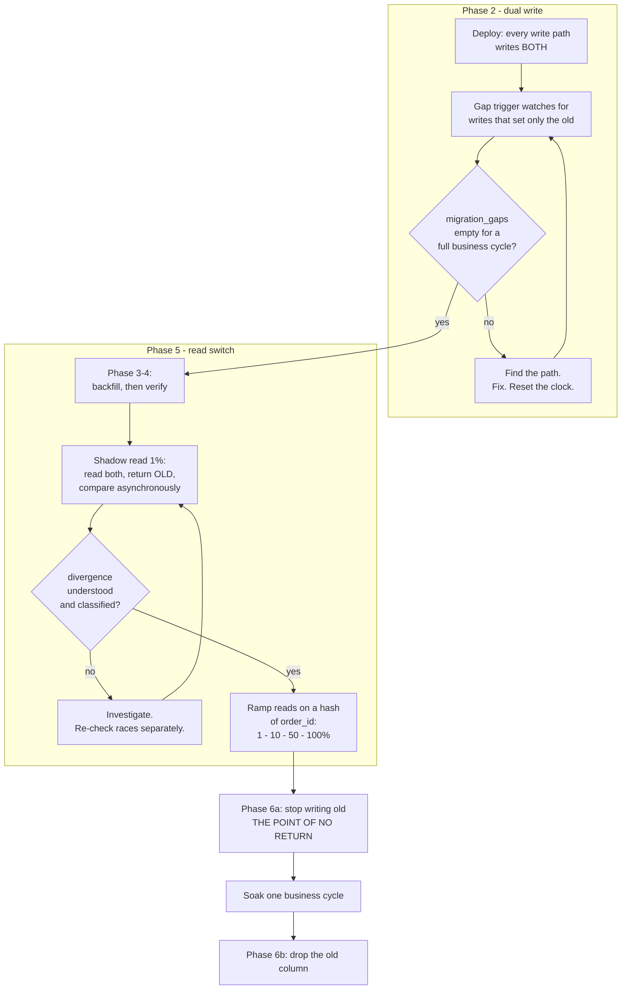

# Dual Writes, Shadow Reads, and the Transition Between Representations

Phases 2 and 5 of doc 01 — writing both representations, then reading the new one — are where
a migration stops being a database operation and becomes an application change. They are also
where the correctness of the whole thing is established or quietly lost.

The dual write does two jobs, and it is worth separating them because they have different
failure modes:

1. **It freezes the backfill's target.** Without it, new rows keep arriving in the old
   representation and the set needing backfill keeps growing (doc 06's `B-09`).
2. **It creates a comparison.** For every row, you now have two independently produced answers.
   Where they disagree, one of them is wrong, and you can find out which before any user
   depends on it.

The second is the more valuable and the more often skipped. Scenario IDs are `W-nn`.

---

## Four places to put the dual write

The choice is not obvious and teams usually make it by habit rather than by analysis.

| Where | Mechanism | Catches writes from | Cost | Best for |
|---|---|---|---|---|
| **Application code** | An assignment in the write path | Only paths that go through that code | A code change per path, and you must find them all | Services with one clear data-access layer |
| **Database trigger** | `BEFORE INSERT OR UPDATE` setting the new column | **Everything** — including `psql`, importers, other services | Trigger overhead on every write; a trigger is code nobody reviews | Shared tables with many writers |
| **Generated column** | `GENERATED ALWAYS AS (expr) STORED` | Everything, enforced by the engine | A table rewrite to add it; expression must be immutable | Pure deterministic transformations |
| **CDC consumer** | Read the change stream, write back | Everything, asynchronously | Eventual, with a lag window; a write loop to avoid | Cross-database transformations |

### Application code: the honest default, with one hard part

Putting the dual write in the service is the most common choice and usually the right one,
because the transformation often needs information the database does not have. Riverbend's
`currency` is not derivable from `amount_cents` — it depends on which storefront took the
order, which is in the request, not the row.

The hard part is coverage, and it is `W-01`.

### Generated columns: the underrated answer, with a sharp edge

When the new value *is* derivable from existing columns by a deterministic expression, let the
engine do it:

```sql
ALTER TABLE orders
  ADD COLUMN amount numeric(14,2)
  GENERATED ALWAYS AS (amount_cents / 100.0) STORED;
```

This removes phase 2 and phase 3 entirely. There is no dual write to write, no write path to
miss, and no backfill — the engine populates every row.

**The sharp edge** is that adding a *stored* generated column rewrites the table, so on a
336 GB table you have traded a 63-hour background job for a 70-minute outage. That trade, its
size threshold, and the two further constraints are `W-05` in the catalogue below.

### Database triggers: for tables with writers you do not control

Ironvale's `ACCT_MASTER` has four writing applications and a DBA team that runs corrections by
hand. An application-level dual write covers at most four of those five, and the fifth is the
one that runs during incidents, which is when correctness matters most.

A trigger covers everything that goes through the engine. Its costs: it runs inside the
writer's transaction (so it is on their latency), it is code that lives outside the
application repository and tends to escape review, and it has the null-handling trap in `W-04`.

### CDC consumers: for when the destination is elsewhere

If the new representation lives in a different database, the dual write cannot be
transactional and you are in doc 09's territory. Reading the change stream and applying it is
the standard answer, and the reason is that it inherits the source's ordering and durability
rather than inventing a new consistency story.

---

## The failure catalogue

### W-01 · The write path you did not know about

**What you see.** The backfill completes. Verification reports a divergence rate of 0.031% —
about one row in 3,200 — and it is not decreasing. The diverging rows have no obvious pattern.

**Mechanism.** The dual write covers the paths you found. At Riverbend, `orders.amount_cents`
is written by:

1. The checkout flow — found, covered.
2. The refund flow, which writes a negative adjustment — **missed**, because it lives in
   `payment-service`, not `order-service`.
3. An admin correction tool — found late, in week three.
4. A CSV importer used for merchant bulk onboarding — missed, because it uses `COPY` and
   bypasses the ORM entirely.
5. A data-repair script in a runbook, run perhaps twice a year — missed, and not discovered
   until someone ran it.

0.031% is the refund path: refunds are about 1 in 3,200 of all writes to the table.

**Confirm it — find the writers from the database, not from the code.** Code search finds
paths in repositories you thought to search. The database knows who actually writes:

```sql
-- Over the retention window, who writes to this table?
SELECT DISTINCT application_name, usename, count(*) AS stmts
FROM pg_stat_statements s
JOIN pg_stat_activity a ON true          -- illustrative; pair with your own sampling
WHERE s.query ~* '(insert|update|delete)\s+(into\s+)?orders\b'
GROUP BY 1, 2 ORDER BY 3 DESC;
```

More reliably, because `pg_stat_statements` does not record who ran what: sample
`pg_stat_activity` every few seconds for a week into a table, and group by `application_name`
and `usename`. A week of 5-second samples is 120,960 rows and it finds the quarterly importer
only if it ran that week — so also check the audit log, and ask.

**The most reliable method** is to make the database tell you when something unexpected
happens, rather than trying to enumerate in advance. Add a trigger during phase 2 that does
nothing except notice:

```sql
CREATE FUNCTION flag_unmigrated_write() RETURNS trigger AS $$
BEGIN
  IF NEW.amount IS NULL AND NEW.amount_cents IS NOT NULL THEN
    INSERT INTO migration_gaps(table_name, app, usr, at, pk)
    VALUES ('orders', current_setting('application_name', true),
            session_user, now(), NEW.order_id);
  END IF;
  RETURN NEW;
END $$ LANGUAGE plpgsql;
```

Every row in `migration_gaps` is a write path you missed, labelled with who did it. This turns
a search problem into a monitoring problem, and it finds the quarterly importer the quarter it
runs rather than after you have dropped the column.

**Prevent.** Run phase 2 for at least one full business cycle before trusting it, and watch
`migration_gaps` go to zero and stay there. That is what the "soak" in doc 01's phase 2 is
for, and it is why the soak length is set by the slowest writer, not by your confidence.

### W-02 · The dual write that is not atomic

**What you see.** For a small fraction of rows, one representation is updated and the other is
not. The rate correlates with error spikes and deploys.

**Mechanism.** It depends entirely on whether the two writes are in one transaction:

- **Two columns in the same table, one `UPDATE`**: atomic. Cannot diverge. This is the case
  Riverbend is in, and it is why same-table migrations are so much easier than they look.
- **Two tables in the same database, one transaction**: atomic.
- **Two tables, two transactions** (because the code does them in sequence): **not atomic.** A
  crash, a timeout, or a deployment between them leaves them inconsistent.
- **Two databases**: not atomic, and no amount of care makes it so. This is the dual-write
  problem from [`../MicroservicesPOF`](../MicroservicesPOF/07-transactions-sagas-and-dual-writes.md),
  and the answer is the same: do not dual-write across stores. Write once and derive the second
  from the change stream, so there is one durable decision point.

**Prevent.** Keep the two writes in one statement where you can:

```sql
-- One statement, atomic by construction
UPDATE orders SET amount_cents = $1, amount = $1 / 100.0, currency = $2 WHERE order_id = $3;
```

rather than two statements that someone will later reorder, wrap in different error handling,
or split across a refactor.

### W-03 · The trigger the bulk loader walked past

**What you see.** A trigger-based dual write, carefully installed, and a batch of 400,000 rows
from the merchant importer with `amount` null.

**Mechanism.** Row-level triggers fire for `INSERT`, `UPDATE` and `DELETE` — including through
`COPY`, which surprises people in the other direction. What they do **not** fire for:

- `TRUNCATE` (needs a statement-level `TRUNCATE` trigger).
- Writes to a different partition's parent routing in some configurations.
- `ALTER TABLE` operations that rewrite the table — the rewrite does not fire row triggers.
- Logical replication apply, unless the subscriber table has `ENABLE ALWAYS TRIGGER` set.
  **This is the one that catches people**: by default, triggers do not fire on changes applied
  by a logical replication subscriber, because `session_replication_role` is `replica`. If part
  of your data arrives by logical replication, your trigger-based dual write silently skips it.

**Confirm it.**

```sql
SELECT tgname, tgenabled FROM pg_trigger WHERE tgrelid = 'orders'::regclass AND NOT tgisinternal;
-- 'O' = origin only (default, skipped during replication apply)
-- 'A' = always (fires during replication apply too)
-- 'R' = replica only,  'D' = disabled
ALTER TABLE orders ENABLE ALWAYS TRIGGER sync_amount;
```

### W-04 · `<>` instead of `IS DISTINCT FROM`, and the rows that are silently skipped

**What you see.** The dual write works for every row that had a value, and silently skips every
row whose old value was `NULL`.

**Mechanism.** In SQL, `NULL <> 'x'` is not `true`. It is `NULL`, which in an `IF` is not true,
so the branch does not execute. A sync trigger written as:

```sql
IF NEW.amount_cents <> OLD.amount_cents THEN ...   -- WRONG
```

does nothing whenever either side is null — which includes every insert where the column was
not set, and every update of a previously-null column. The bug is invisible in testing with
non-null fixtures.

```sql
IF NEW.amount_cents IS DISTINCT FROM OLD.amount_cents THEN ...   -- correct
```

`IS DISTINCT FROM` treats `NULL` as a comparable value: `NULL IS DISTINCT FROM 'x'` is `true`,
and `NULL IS DISTINCT FROM NULL` is `false`.

This is the most common bug in hand-written sync triggers, it affects the comparison code in
`W-06` identically, and it is worth a grep across your repository right now.

### W-05 · Adding a stored generated column rewrites the table

**What you see.** A generated column looks like the elegant answer — no dual write, no
backfill — and adding it holds `ACCESS EXCLUSIVE` on `orders` for 70 minutes.

**Mechanism.** The engine must compute and store the value for all 521 million existing rows,
which means writing a complete new copy of the table (doc 02's `L-03`). You have traded a
63-hour *background* job for a 70-minute *outage*, and those are not comparable currencies.

The threshold is worth computing rather than guessing. At the 80–120 MB/s rewrite throughput
from doc 02, a table rewrite is roughly ten seconds per gigabyte. So:

- Under about 4 GB: the rewrite is under a minute. **Take the generated column** — it removes
  two entire phases and every hazard in this document.
- Between 4 GB and roughly 40 GB: a judgement call, and it depends on whether you have a quiet
  window.
- Above that: not available. Use the dual write.

**Two further constraints.** The expression must be `IMMUTABLE` — no `now()`, no
`current_user`, no function whose definition you might later change. And **PostgreSQL has no
virtual generated columns before version 18**, whereas MySQL has had `VIRTUAL` columns since
5.7 and adding one is metadata-only. That difference makes this technique far more attractive
on MySQL than on PostgreSQL, and it is the main case where the MySQL answer to a migration is
genuinely simpler.

### W-06 · The comparison function has its own bugs

**What you see.** Verification reports divergence. You investigate ten rows and all ten are
actually fine — the comparison is wrong, not the data. Or the reverse, which is worse.

**Mechanism.** Comparing two representations means defining equality, and equality is where
assumptions hide. Every item below has produced a false divergence report or a missed real one:

| Trap | Example | What to do |
|---|---|---|
| Null versus empty string | Old path stores `''`, new stores `NULL` | Normalise before comparing, and decide which is correct |
| Float representation | `0.1 + 0.2 ≠ 0.3` in binary floating point | Compare money as `numeric`/integers, never as `float`. If you must, compare with an explicit epsilon |
| Numeric scale | `10.5` versus `10.50` as `numeric` | `numeric` equality ignores trailing zeros, but `::text` does not. Pick one and state it |
| Timezone | `timestamp` versus `timestamptz` | Normalise both to UTC instants before comparing (doc 05's `C-12`) |
| Trailing whitespace | Oracle's `CHAR` pads; `VARCHAR2` does not | `rtrim` both sides, knowingly |
| Empty string versus null, in Oracle | Oracle stores `''` **as** `NULL` | Any Oracle-to-anything comparison must handle this explicitly (doc 09's `M-05`) |
| Unicode normalisation | `é` as one code point or two | `normalize(x, NFC)` both sides |
| Collation | `'Straße'` versus `'STRASSE'` under different collations | Compare with an explicit `COLLATE "C"` |
| Ordering of a set | Two arrays or JSON objects with the same members, different order | Sort before comparing; for `jsonb`, PostgreSQL already normalises key order, for `json` it does not |
| Row order | Comparing two result sets without `ORDER BY` | Always order by the key |

**Prevent.** Write the normalisation as **one named function used by both the comparison and
the reports**, so there is a single place where "equal" is defined and a single place to fix
when it is wrong:

```sql
CREATE FUNCTION canon_money(n numeric) RETURNS text AS $$
  SELECT CASE WHEN n IS NULL THEN '∅' ELSE to_char(n, 'FM9999999990.00') END;
$$ LANGUAGE sql IMMUTABLE;
```

The `'∅'` sentinel rather than `NULL` is deliberate: it makes "both null" compare equal under
ordinary `=`, which removes an entire category of three-valued-logic mistakes from the
comparison code.

⚠️ **Do not derive both sides of the comparison from the same function.** The classic
self-defeating verification is comparing `amount` against `amount_cents / 100.0` using the same
expression the backfill used. That proves the expression is deterministic, which you knew. It
proves nothing about whether the expression is *right*. Doc 12 is about verification that
actually tests something.

### W-07 · Shadow reads double the read load

**What you see.** Turning on shadow reads raises database CPU from 35% to 71% and p99 read
latency from 3 ms to 9 ms.

**Mechanism.** A shadow read reads both representations on every request, so read load doubles.
At Riverbend, `orders` serves about 4,200 reads/second, so shadow reads add 4,200/second of
additional work — not free on a 16-vCPU writer.

Worse, the naive implementation does them **sequentially**, so request latency is the sum of
both reads rather than the maximum.

**Prevent.** Three adjustments, each of which costs you something:

1. **Sample.** Shadow-read 1% of requests. 42/second instead of 4,200, and you still collect
   3.6 million comparisons a day, which is far more than enough to detect a 0.03% divergence
   rate. The cost: you will not catch a divergence that affects only one specific row.
2. **Compare asynchronously.** Return the old value immediately; enqueue the comparison. The
   request pays for the extra query but not for the comparison logic.
3. **Compare in a batch job instead of on the request path.** Cheapest, and it loses the one
   property shadow reads uniquely have — they sample the *real access pattern*, so they
   naturally weight the rows users actually read. A batch job over the whole table weights all
   rows equally, including 500 million nobody will ever read again.

The honest ranking: **sample the shadow reads at 1% and also run the batch comparison.** They
catch different things and neither subsumes the other.

### W-08 · Divergence that will not reach zero

**What you see.** Divergence falls from 0.031% to 0.0004% and then stops. Four rows in a
million keep disagreeing, and each investigation finds a different cause.

**Mechanism.** At low rates, the remaining divergence is usually not one bug. It is a mix of:

- **Races.** The shadow read reads the old column, then the new one, and a write landed
  between them. This is a measurement artefact, not a data problem, and it is the single most
  common residue. Detect it by re-reading both in one statement, or by re-checking the
  disagreeing rows a second later — a race resolves, a real divergence does not.
- **The write path that runs rarely.** The data-repair script from `W-01`.
- **Genuinely ambiguous rows.** Orders from 2019 with `amount_cents = 0` and a null currency,
  where "correct" is a business question nobody has answered.

**Prevent, and decide.** The target is not "zero forever"; it is "zero that you understand."
Two rules that work:

- **Re-check before reporting.** Any disagreeing row is re-read once, five seconds later. Rows
  that agree on the second read are races; count them separately and do not investigate them
  individually.
- **Classify the residue and write it down.** If 180 rows out of 521 million are ambiguous
  2019 orders, the correct outcome is a documented exception list, not an indefinite delay to
  phase 5. The failure mode here is a team that will not proceed until a number reaches zero,
  and a number that can never reach zero, so the migration stalls permanently in phase 4.

### W-09 · The flag ramp that is not sticky

**What you see.** During the 50% read ramp, support reports that a customer sees different
order totals on refresh.

**Mechanism.** The flag is evaluated per request with a random 50%. The same user hits the new
path and the old path alternately, and if the two representations disagree for their row — which
is precisely what you are ramping to find out — they see it flicker.

**Prevent.** Hash on a stable key, always:

```
use_new = hash(order_id) % 100 < rollout_percent
```

Hashing on `order_id` rather than on the user means a given *order* is always rendered the same
way, which is the unit the inconsistency would be visible in. Hashing on `user_id` is the right
choice when the inconsistency would be visible across a user's whole session instead. Pick
based on what the user can see at once, and write down which you picked.

### W-10 · Reading new while one path still writes old

**What you see.** After the read switch, a specific flow produces orders that display as zero.

**Mechanism.** Phase 5 switches reads to the new column. If any write path still only writes
the old column — `W-01`'s refund flow, say — then rows written by that path have `amount` null,
and the new read path renders null as zero.

This is the direct consequence of entering phase 5 before `migration_gaps` was empty, and it is
why the ordering in doc 01 is not negotiable.

**Prevent.** Gate the phase-5 deploy on the gap table being empty for a full business cycle,
and make that a literal check in the deploy pipeline rather than a line in a runbook:

```sql
SELECT count(*) FROM migration_gaps
WHERE table_name = 'orders' AND at > now() - interval '31 days';
-- must be 0
```

### W-11 · The dual write that makes the transaction too large

**What you see.** Deadlock rate rises after the phase-2 deploy.

**Mechanism.** If the dual write adds a write to a *second* table, every transaction now holds
locks on two tables instead of one, in whatever order the code happens to touch them. Two
transactions acquiring the same two locks in different orders deadlock.

**Prevent.** Establish a lock ordering — always touch tables in a fixed order, alphabetical is
as good as any — and keep the dual write in the same statement when both columns are in the
same table, which avoids the problem entirely.

### W-12 · Stopping the dual write too early

**What you see.** Phase 6a ships. A week later, a rollback is needed for an unrelated reason,
and the old column is a week stale.

**Mechanism.** This is the point of no return from doc 01, crossed without being named. Before
6a, rollback is a flag flip. After it, rollback requires re-deriving a week of data.

**Prevent.** Make 6a an explicit, separately approved step with its own soak, and record the
timestamp. Doc 13 treats this as the central decision of a migration plan, because it is the
moment the plan's reversibility ends.

---

## The shape of the transition, end to end



Two features of that diagram are the whole argument of this document.

**There are two loops, and both can run for weeks.** The gap loop and the divergence loop are
where migration schedules actually go, and neither is visible in a plan that lists six phases
as six steps.

**Everything before 6a is reversible by a flag or a deploy.** The design goal of phases 2
through 5 is to push all the risk into a single, named, late, deliberate moment — and then to
arrive at that moment with evidence rather than hope.

---

## What to take away

1. **The dual write does two jobs**: it freezes the backfill's target, and it creates a
   comparison. The second is the valuable one and the one usually skipped.
2. **Four places to put it** — application code, trigger, generated column, CDC consumer — and
   the choice is about *which writers you control*, not about taste.
3. **A stored generated column removes phases 2 and 3 entirely** and costs a table rewrite to
   add. Excellent on a 4 GB table, unavailable on a 336 GB one. MySQL's `VIRTUAL` columns make
   this far more attractive there than on PostgreSQL.
4. **Two columns in one table written by one statement cannot diverge.** Same-table migrations
   are structurally easier than they look, and most of this document's hazards come from
   leaving that case.
5. **Never dual-write across two databases.** Write once; derive the second from the change
   stream.
6. **Triggers do not fire on logical-replication apply by default.** `ENABLE ALWAYS TRIGGER` if
   any of your data arrives that way.
7. **`<>` silently skips every row where either side is null.** Use `IS DISTINCT FROM`, in
   triggers and in comparisons alike.
8. **A gap trigger that records writes setting only the old column turns "find every write
   path" from a search problem into a monitoring problem**, and it finds the quarterly importer
   the quarter it runs.
9. **Define equality once, in a named normalisation function**, and use a sentinel rather than
   `NULL` so "both null" compares equal.
10. **Never verify by re-applying the backfill's own expression.** That proves determinism, not
    correctness.
11. **Sample shadow reads at 1% and also run a batch comparison.** Shadow reads weight the rows
    users actually read; the batch job covers the rows nobody reads. Neither subsumes the other.
12. **Re-check disagreeing rows once before reporting them**, because at low rates most
    divergence is a read race rather than a data problem.
13. **The target is "zero that you understand", not "zero".** Classify and document the
    residue, or the migration stalls in phase 4 forever.
14. **Hash the read-ramp flag on a stable key**, so a user never sees the same object rendered
    two ways.
15. **Gate the read switch on the gap table being empty for a full business cycle**, as a
    pipeline check rather than a runbook line.
16. **Stopping the dual write is the point of no return.** Name it, approve it separately, and
    record when it happened.

Next: [08-replication-replicas-and-logical-decoding.md](08-replication-replicas-and-logical-decoding.md),
which covers what all of this does to the copies of your database.
