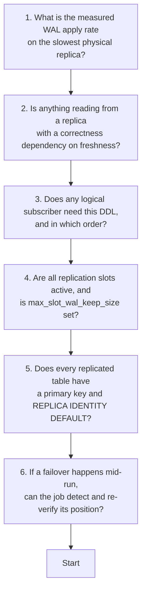

# Replication, Replicas, and Logical Decoding During a Migration

Your database is not one database. It is a primary, some physical replicas, probably a logical
subscriber feeding a warehouse or a search index, and a change-data-capture connector. A
migration touches all of them, and the rules are different for each.

The single most useful distinction to hold: **physical replication copies bytes, logical
replication copies rows.** Everything in this document follows from that. Physical replication
carries your DDL automatically and carries its cost too; logical replication carries neither,
which sounds easier and is the source of its worst failures. Scenario IDs are `R-nn`.

---

## What each kind of replication does with a schema change

| | Physical (streaming) | Logical (decoding) |
|---|---|---|
| What travels | WAL bytes — block-level changes | Row changes, decoded into inserts, updates, deletes |
| DDL | **Replicated automatically.** The replica is byte-identical | **Not replicated at all.** You must apply it on both sides yourself |
| Schema divergence | Impossible | Possible, and the normal state during a migration |
| Replica can differ in version | No — same major version, same architecture | **Yes** — this is why it enables zero-downtime upgrades |
| Cost of a big backfill | The replica replays every byte: 625 GB | The subscriber applies every row change: 521M statements |
| Sequences | Replicated | **Not replicated.** See `R-09` |
| Replicas are writable | No | Yes, which is also a hazard |

Both carry the backfill's cost, in different currencies. Physical replicas pay in WAL apply
throughput; logical subscribers pay in per-row statement execution, which is considerably
slower — a logical subscriber typically applies 10,000–30,000 row changes per second against a
physical replica's 45 MB/s of WAL, and 521 million rows at 20,000/s is **7.2 hours** of apply
even if the publisher produced them instantly.

---

## The failure catalogue

### R-01 · Replica lag grows faster than you expect, by a formula worth knowing

**What you see.** An unthrottled backfill on Ironvale's self-managed PostgreSQL. After one
hour, the replicas are one hour behind. After two, two hours.

**Mechanism.** The arithmetic is simple and the result is counter-intuitive the first time.
WAL is generated at rate `G` and applied at rate `A`. Lag in seconds grows at:

> **(G − A) / A seconds of lag per second of wall clock**

PostgreSQL's WAL replay on a standby is a **single process**. It cannot be parallelised the way
query execution can, because replay must be strictly ordered. On Ironvale's hardware that
process sustains **45 MB/s**.

An unthrottled backfill generates 90 MB/s of WAL. So:

> (90 − 45) / 45 = **1 second of lag per second** — the replica falls behind in real time,
> indefinitely.

After a six-hour backfill the replica is six hours behind, and it then needs another six hours
to catch up after the backfill stops. **Total time with degraded replicas: twelve hours**, from
a six-hour job.

Doc 06's throttle target of 27,500 rows/s came from inverting this: pick a lag you can tolerate,
work back to a WAL rate, divide by 1.2 KB per row.

**Confirm it.** Measure both sides, not just the lag:

```sql
-- On the primary: WAL generation rate
SELECT pg_current_wal_lsn();  -- sample twice, 10 s apart, difference / 10 = bytes/s

-- On the primary: per-replica lag, in bytes and in time
SELECT application_name, state,
       pg_wal_lsn_diff(pg_current_wal_lsn(), replay_lsn) AS bytes_behind,
       write_lag, flush_lag, replay_lag
FROM pg_stat_replication;
```

`replay_lag` is the one that matters for reads. `write_lag` and `flush_lag` being small while
`replay_lag` grows is the signature of this problem exactly: the bytes arrived fine, the
standby cannot apply them fast enough.

**Prevent.** Throttle from `replay_lag` (doc 06), and know your `A` before you start — it is a
ten-minute measurement and it sets every backfill rate you will ever choose on that cluster.

### R-02 · `canceling statement due to conflict with recovery`

**What you see.** During a migration, queries on the read replicas start failing:

```
ERROR: canceling statement due to conflict with recovery
DETAIL: User was holding a relation lock for too long.
```

The primary is fine. Only replica queries fail.

**Mechanism.** A physical replica replays the primary's WAL, including the WAL record for an
`ACCESS EXCLUSIVE` lock. To replay it, the standby must acquire that lock, which conflicts with
every query running there.

PostgreSQL resolves the conflict by waiting `max_standby_streaming_delay` (default **30
seconds**) and then **cancelling the queries**. It chooses the queries over the replay,
deliberately: a standby that stops replaying falls behind without bound, which is worse.

There are four conflict types and it is worth knowing which you hit, because the detail message
tells you:

| `DETAIL` says | Cause |
|---|---|
| "holding a relation lock for too long" | DDL on the primary, which is you |
| "using a statement that depends on a relation being dropped" | `DROP TABLE` on the primary |
| "query might have needed to see row versions that must be removed" | Vacuum on the primary cleaning rows the replica's query needs |
| "conflict with recovery; buffer pin" | Rare; a vacuum needing a page the query has pinned |

The third is the common one outside migrations, and it is the one `hot_standby_feedback`
addresses — which creates `R-03`.

**Recover.** Nothing to do; it self-resolves when the DDL finishes replaying. The application
should retry.

**Prevent.** The choices, with their costs:

- **Raise `max_standby_streaming_delay`** to, say, 300 seconds. Queries survive a five-minute
  conflict. Cost: the replica can now be five minutes behind, which breaks read-after-write.
- **Set it to `-1`** (wait forever). The replica never cancels a query and can fall arbitrarily
  behind. Only defensible on a dedicated reporting replica nobody reads for current data.
- **Drain analytics queries before a DDL step.** The cleanest answer and the one that needs
  coordination: the migration's pre-check verifies no query on any replica is older than the
  configured delay.

### R-03 · `hot_standby_feedback` moves the problem to the primary

**What you see.** You set `hot_standby_feedback = on` to stop `R-02`. Cancellations stop.
Three days later the primary has 180 GB of bloat and autovacuum logs show it cannot remove
anything.

**Mechanism.** `hot_standby_feedback` makes the standby report its oldest running transaction's
xmin to the primary, and the primary then refuses to vacuum rows that standby's query might
still need. That is exactly what prevents the cancellation — and it means **a long-running
query on a replica blocks vacuum on the primary**, which is doc 06's `B-06` arriving from
another machine.

An analyst's forgotten BI session on a read replica can therefore cause transaction ID
wraparound pressure on your production primary. That causal chain is long enough that people
do not find it.

**The honest framing:** `max_standby_streaming_delay` and `hot_standby_feedback` are two ends
of one trade. You can protect replica queries or protect primary vacuum; you cannot do both
with these two knobs. The resolution is to bound query duration on replicas
(`statement_timeout` on the read-only role) so that neither end of the trade has an unbounded
input.

```sql
ALTER ROLE riverbend_ro SET statement_timeout = '120s';
ALTER ROLE riverbend_ro SET idle_in_transaction_session_timeout = '60s';
```

### R-04 · Read-after-write breaks during the backfill

**What you see.** Users place an order and the confirmation page says the order does not
exist. Only during the migration window.

**Mechanism.** The application writes to the primary and reads from a replica. Normally the
replica is 30 ms behind and nobody notices. During the backfill it is 90 seconds behind, and
a read 200 ms after a write misses it.

This is not a migration bug; it is a pre-existing correctness assumption that the migration
falsified. The application was relying on replica lag being small, without saying so anywhere.

**Confirm it.** The signature is a spike in "not found" responses for freshly created
identifiers, correlated with `replay_lag`.

**Prevent.** Three mechanisms, increasing in cost and correctness:

1. **Read your own writes from the primary.** For a bounded window after a write — say the
   session's next 5 seconds, tracked in a cookie or session store — route that user's reads to
   the primary. Cheap, and it covers the user-visible case.
2. **LSN-based routing.** After a write, capture `pg_current_wal_lsn()`, pass it with the
   request, and have the reader either wait for the replica to reach that LSN
   (`pg_last_wal_replay_lsn()`) or fall back to the primary. Correct, and it requires plumbing
   an opaque token through your API.
3. **A lag circuit breaker.** When `replay_lag` exceeds a threshold, route all reads to the
   primary. Simple and blunt: it protects correctness and transfers all read load to the
   primary at exactly the moment the primary is busiest with your backfill. Size the primary
   for it or do not use it.

**Whichever you pick, add the pre-check.** The migration runbook should verify the read-routing
strategy is in place before the backfill starts, because the backfill is the thing most likely
to expose its absence.

### R-05 · Logical replication does not replicate DDL, and the order matters in both directions

**What you see.** You add a column on the publisher. The subscriber stops with:

```
ERROR: logical replication target relation "public.orders" is missing replicated column: "currency"
```

Replication halts completely. The slot stops advancing. WAL accumulates (`R-06`).

**Mechanism.** PostgreSQL logical replication decodes row changes and matches columns **by
name**. It never replicates DDL. So during any migration, the publisher's schema and the
subscriber's schema differ, and whether that is survivable depends on *which way* they differ:

| Situation | Result |
|---|---|
| Publisher has a column the subscriber lacks | **Apply error. Replication stops.** |
| Subscriber has a column the publisher lacks | Fine — the subscriber's default or `NULL` is used |
| Publisher drops a column the subscriber still has | Fine |
| Subscriber drops a column the publisher still sends | **Apply error. Replication stops.** |

From that table the rules fall out, and they are opposite for the two directions:

> **Adding a column: subscriber first, then publisher.**
> **Dropping a column: publisher first, then subscriber.**

Both rules are the same underlying principle — the subscriber must always be a *superset* of
what the publisher sends — and both are easy to get backwards, because the natural instinct is
to change the source of truth first in both cases.

**Recover.** Apply the missing DDL on the subscriber. Replication resumes from where it
stopped; nothing is lost, provided the slot still has the WAL (`R-06`).

**Prevent.** Put the subscriber's DDL into the same migration programme as the publisher's,
with the ordering encoded:

```sql
-- V214a__subscriber_add_currency.sql     target: warehouse-subscriber
--   direction: expand, runs FIRST
ALTER TABLE orders ADD COLUMN currency char(3);

-- V214b__publisher_add_currency.sql      target: orders-db
--   direction: expand, runs SECOND, depends on V214a
ALTER TABLE orders ADD COLUMN currency char(3);
```

Two migration targets, one dependency, enforced by the pipeline. Teams that manage the
subscriber as "someone else's database" discover this ordering during an incident instead.

### R-06 · The stopped subscriber fills the primary's disk

**What you see.** Replication has been halted for six hours because of `R-05`. The **primary**
runs out of disk.

**Mechanism.** A replication slot guarantees the primary retains WAL until the consumer has
confirmed it. That is the whole point of a slot — it is what makes logical replication reliable
across a subscriber restart. It also means a subscriber that is stopped, broken, or forgotten
retains WAL **forever**, and the primary's `pg_wal` directory grows until the volume is full,
at which point the primary stops accepting writes.

At Riverbend's 11 MB/s of normal WAL, a forgotten slot consumes 950 GB a day. During a
backfill at 90 MB/s it is 7.8 TB a day.

**Confirm it.** This should be a standing alert, not an incident query:

```sql
SELECT slot_name, active, wal_status, safe_wal_size,
       pg_size_pretty(pg_wal_lsn_diff(pg_current_wal_lsn(), restart_lsn)) AS retained
FROM pg_replication_slots ORDER BY pg_wal_lsn_diff(pg_current_wal_lsn(), restart_lsn) DESC;
```

`wal_status` tells you how bad it is: `reserved` is fine, `extended` means it is past
`max_wal_size`, `unreserved` means it is about to be invalidated, `lost` means it already has
been and the subscriber must be rebuilt from scratch.

**Recover.** Either fix the subscriber quickly, or drop the slot and accept rebuilding the
subscriber:

```sql
SELECT pg_drop_replication_slot('warehouse_sub');
```

⚠️ Dropping the slot means the subscriber can never resume — it must be re-initialised with a
fresh snapshot of every table. For a 1.42 TB database that is hours. Make the decision
deliberately, not as a reflex to a disk alert.

**Prevent.** Set `max_slot_wal_keep_size` (PostgreSQL 13+) to a value you can afford — say
200 GB. Past that, PostgreSQL invalidates the slot rather than filling the disk. You have
chosen which failure you get: a subscriber that needs rebuilding, or a primary that stops
accepting writes. **Choose the first.** The default is the second, and the default is wrong for
every production system.

### R-07 · `REPLICA IDENTITY` and the update that cannot be replicated

**What you see.** `ERROR: cannot update table "orders_archive" because it does not have a
replica identity and publishes updates`. Or: logical replication works but the subscriber's
apply is catastrophically slow during the backfill.

**Mechanism.** To replicate an `UPDATE` or `DELETE`, the publisher must tell the subscriber
*which row* changed. That identification is the replica identity:

| Setting | Publisher sends | Cost |
|---|---|---|
| `DEFAULT` | The primary key columns of the old row | Minimal. Requires a primary key |
| `USING INDEX` | A chosen unique, not-null index | Minimal |
| `FULL` | **The entire old row** | Large WAL, and the subscriber does a **sequential scan per row** unless it has a matching index |
| `NOTHING` | Nothing — updates and deletes cannot be replicated | Errors on update |

`FULL` is the one that bites during a backfill. Riverbend sets it on `orders` because the fraud
pipeline needs before-images (doc 06). That means each of the 521 million backfill updates
sends a full old row, roughly doubling the CDC byte volume — and on any subscriber lacking a
suitable index, the apply does a **sequential scan of the target table per row**, which turns
7.2 hours of apply into something that will not finish this decade.

**Confirm it.**

```sql
SELECT relname,
       CASE relreplident WHEN 'd' THEN 'default' WHEN 'n' THEN 'nothing'
                         WHEN 'f' THEN 'full'    WHEN 'i' THEN 'index' END AS replica_identity
FROM pg_class WHERE relname IN ('orders','order_items','payments');
```

**Prevent.** Make sure every replicated table has a primary key and uses `DEFAULT`. Where
`FULL` is genuinely required, confirm the subscriber has an index matching the lookup, and
budget the doubled WAL into the backfill rate.

### R-08 · Failover in the middle of a migration

**What you see.** During the backfill, the primary fails over. The backfill job reconnects and
continues. Later, verification finds a band of rows that were never migrated.

**Mechanism.** Several things can go wrong at once:

- **With asynchronous replication, the new primary may be missing the last few seconds of
  committed work.** Including the cursor update from doc 06. If the cursor is ahead of the
  data — because the cursor commit made it and some chunk commits did not — the backfill skips
  a range permanently.
- **If the failover happened mid-DDL**, the new primary may have a partially applied
  multi-statement migration, which is doc 04's `T-05` with no log of how it happened.
- **Replication slots do not fail over** before PostgreSQL 17. A logical subscriber pointed at
  the old primary has no slot on the new one and must be rebuilt.
- **Any `CREATE INDEX CONCURRENTLY` in flight is lost**, and leaves an invalid index (doc 02's
  `L-05`).

**Prevent.**

- **Put the cursor update in the same transaction as the chunk** (doc 06). With one
  transaction, "chunk applied" and "cursor advanced" cannot disagree — either both survived
  the failover or neither did.
- **Make the job re-verify its position on reconnect** rather than trusting its in-memory
  state: re-read the cursor from the database, and additionally scan backwards a few chunks
  for rows still matching `amount IS NULL`.
- **Use synchronous replication for the migration window** if your durability requirements make
  the lost-write window unacceptable. It costs write latency and it makes the failover
  lossless.
- **Treat a failover during a migration as a reason to pause and re-verify**, as a runbook
  step, not as something the job silently recovers from.

### R-09 · The logical-replication upgrade that forgot sequences

**What you see.** Ironvale moves a database from PostgreSQL 13 to 16 using logical replication
for near-zero downtime. The cutover goes perfectly. Thirty seconds after traffic switches,
every insert fails with `duplicate key value violates unique constraint "txn_log_pkey"`.

**Mechanism.** **Logical replication does not replicate sequence values.** The subscriber's
sequences are wherever they were when the subscriber was created — typically 1. At cutover,
`nextval('txn_log_id_seq')` returns 1, and row 1 already exists.

This is the single most common failure in logical-replication-based upgrades, it happens at
the worst possible moment, and the fix is three lines that are easy to leave out of a runbook.

The complete list of what logical replication does **not** carry, which doubles as the cutover
checklist:

- **Sequences.** Must be advanced manually.
- **DDL.** `R-05`.
- **Large objects** (`pg_largeobject`).
- **`TRUNCATE`** before PostgreSQL 11.
- Changes made by other subscriptions, unless explicitly configured.
- Materialised view contents (the definition exists; the data must be refreshed).

**Prevent.** Generate and run the sequence advance as the last step before cutover, with
headroom:

```sql
-- Run on the PUBLISHER to generate statements, then run the output on the SUBSCRIBER
SELECT format('SELECT setval(%L, %s, true);',
              schemaname || '.' || sequencename,
              last_value + 1000)        -- headroom for in-flight writes
FROM pg_sequences WHERE schemaname NOT IN ('pg_catalog','information_schema');
```

The `+ 1000` matters: between generating the value and switching traffic, the publisher keeps
consuming sequence values. Headroom turns a race into a gap, and a gap in an integer sequence
costs nothing.

### R-10 · MySQL: single-threaded apply, and what actually fixes it

**What you see.** Lumen's backfill produces 40 minutes of replica lag on a shard.
`SHOW REPLICA STATUS` shows `Seconds_Behind_Source` climbing.

**Mechanism.** The same formula as `R-01`. MySQL's defence is parallel apply, and getting it to
work requires more than setting a worker count:

```sql
SET GLOBAL replica_parallel_workers = 16;
SET GLOBAL replica_parallel_type = 'LOGICAL_CLOCK';     -- default in 8.0
SET GLOBAL replica_preserve_commit_order = ON;          -- required for consistent reads
-- On the SOURCE - this is the one that matters:
SET GLOBAL binlog_transaction_dependency_tracking = 'WRITESET';
```

`LOGICAL_CLOCK` alone parallelises only transactions that *committed together* on the source —
so a backfill issuing chunks sequentially gets no parallelism at all, which is exactly the
workload you need it for. `WRITESET` tracks which rows each transaction touched and allows
parallel apply of transactions touching disjoint rows, which a chunked backfill always does.
**Setting `WRITESET` on the source is what makes parallel replication help a backfill**, and
it is set on the wrong server often enough to be worth repeating.

### R-11 · Cascading replicas multiply the lag

**What you see.** The second-level replica is 4× further behind than the first-level one.

**Mechanism.** A replica that feeds another replica cannot send WAL it has not replayed. So
lag composes: if each hop adds 60 seconds under load, a three-hop chain is 180 seconds.

Cascades exist for good reasons — reducing load on the primary, crossing regions once rather
than N times — but they turn a backfill's lag into a multiplied lag, and the furthest replica
is usually the one serving the analytics queries that are hardest to drain.

**Prevent.** Know your topology before setting a backfill rate, and throttle on the lag of the
**furthest** replica anything reads from, not the nearest.

### R-12 · Aurora: what shared storage changes, and what it does not

Riverbend's `orders-db` is Aurora, where replicas read the same storage volume rather than
replaying WAL. It is worth being precise about what that buys, because the common summary —
"Aurora has no replica lag" — leads teams to skip protections they still need.

**What shared storage removes:**

- `R-01` entirely. There is no WAL apply, so a backfill cannot cause minutes of replay lag.
  `AuroraReplicaLag` stays in the tens of milliseconds under heavy write load.
- `R-04` largely, for the same reason — though "tens of milliseconds" is not zero, and a read
  issued 2 ms after a write can still miss it.
- `R-11` — there is no cascade.

**What it does not remove:**

- **`R-02`.** Aurora replicas still have to honour the writer's DDL, and a query on a reader
  can still be cancelled when a conflicting lock arrives.
- **Cache invalidation.** A large DDL or a backfill invalidates buffer cache pages on the
  readers. Reader query latency degrades during the backfill — not because of lag, but because
  their working set was evicted. On a 96 GiB cache against 1.42 TB of data (6.8% resident,
  doc 01), this is a significant effect and it is the main reader-side cost of a Riverbend
  backfill.
- **Everything logical.** `R-05` through `R-09` apply unchanged, because Aurora's logical
  replication and CDC use the same mechanisms.
- **The writer is still one instance.** The backfill's write work does not scale out.

**The generalisable point:** when you adopt a managed database, some failure modes disappear
and your mental model should be updated *precisely*, not wholesale. A team that concludes
"Aurora means we do not have to think about replication during migrations" will skip the
read-routing pre-check, the DDL-cancellation case, and the logical-slot disk alert, all of
which still apply.

---

## The pre-flight checklist for the replication layer

Before any migration step that generates significant WAL, verify:



Items 3 and 4 are the ones most often skipped, and together they produce the worst outcome in
this document: a subscriber stopped by a missing column, retaining WAL, filling the primary's
disk, during a migration that is already generating 90 MB/s of it.

---

## What to take away

1. **Physical replication copies bytes and carries your DDL automatically; logical replication
   copies rows and carries none of it.** Every difference in this document follows from that.
2. **Lag grows at `(G − A) / A` seconds per second.** If generation is double the apply rate,
   the replica falls behind one second per second, and recovery takes as long as the backfill
   did.
3. **PostgreSQL WAL replay on a standby is a single process.** Measure its throughput once; it
   sets every backfill rate you will choose on that cluster.
4. **`max_standby_streaming_delay` and `hot_standby_feedback` are two ends of one trade** —
   protect replica queries or protect primary vacuum. Bound query duration on the read-only
   role so neither end has an unbounded input.
5. **A backfill falsifies an unstated assumption that replica lag is small.** Have a
   read-after-write strategy *before* the migration, and verify it in the pre-check.
6. **Logical replication ordering is opposite for add and drop**: add on the subscriber first,
   drop on the publisher first. The subscriber must always be a superset of what is sent.
7. **A stopped subscriber fills the primary's disk**, at 950 GB/day normally and 7.8 TB/day
   during a backfill. Set `max_slot_wal_keep_size` so you lose a subscriber instead of a
   primary; the default is the other way round.
8. **`REPLICA IDENTITY FULL` doubles CDC volume and makes the subscriber sequential-scan per
   row** unless it has a matching index.
9. **Put the backfill cursor in the same transaction as the chunk**, so a failover cannot leave
   the cursor ahead of the data.
10. **Logical replication does not replicate sequences.** Advance them with headroom as the last
    step before any logical-replication cutover, or the first insert after cutover is a
    duplicate key.
11. **MySQL parallel replication needs `binlog_transaction_dependency_tracking = WRITESET` on
    the source**, not just workers on the replica — otherwise a sequential backfill gets no
    parallelism at all.
12. **Cascading replicas multiply lag.** Throttle on the furthest replica anything reads from.
13. **Aurora removes WAL-apply lag and nothing else.** DDL cancellation, buffer-cache
    invalidation on readers, and every logical-replication hazard apply unchanged.

Next: [09-store-to-store-migrations-and-cdc-cutovers.md](09-store-to-store-migrations-and-cdc-cutovers.md),
which uses this machinery to move data between databases rather than within one.
