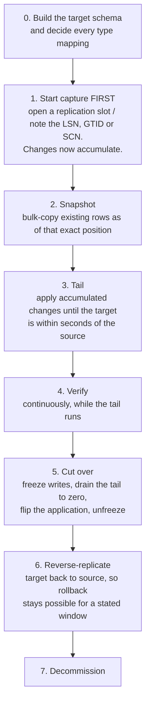

# Store-to-Store Migrations and CDC Cutovers

Moving data from one database to another is the largest and riskiest migration class, and it
is almost entirely a different problem from everything in docs 02 through 08. Those were about
one engine's locks and logs. This is about two systems that disagree — about types, about what
an empty string is, about whether `'Bob'` and `'bob'` are the same value — and about the ten
minutes in which you stop writing to one and start writing to the other.

The schema part is often trivial. The semantic part is where the data is silently corrupted,
and the cutover is where the outage is. Scenario IDs are `M-nn`.

---

## The canonical pattern, and why every variation is a variation of it

Whether you are moving Oracle to PostgreSQL, PostgreSQL to DynamoDB, or a table out of a shared
monolith database into a service's own, the shape is the same:



Three things about this diagram are the whole design and are frequently got wrong.

**Step 1 comes before step 2.** If you snapshot first and then start capture, changes made
during the snapshot are lost — there is a gap, and it is invisible. If you start capture first
and then snapshot, the changes made during the snapshot are captured *and* included in the
snapshot, so they are applied twice. That overlap is fine **provided every apply is an upsert**,
which is the whole reason CDC pipelines insist on idempotent writes. Choose the overlap, never
the gap (`M-01`).

**Step 4 runs concurrently with step 3, not after it.** The tail may run for days. Verification
that only happens at the end tells you about a problem when you have no time to fix it.

**Step 6 is the one teams skip**, and it is the difference between a cutover you can reverse
and one you cannot. Covered below and in doc 13.

---

## Getting the boundary right

The snapshot has to be consistent with a specific point in the source's change stream. Each
engine gives you a way to do this exactly, and it is worth using the exact mechanism rather
than approximating.

**PostgreSQL.** Creating a logical replication slot returns a consistent snapshot name that a
parallel dump can use:

```sql
-- One session; keep it open.
SELECT * FROM pg_create_logical_replication_slot('migration_slot', 'pgoutput');
-- returns slot_name, lsn

BEGIN;
SELECT pg_export_snapshot();    -- e.g. '00000003-0000001B-1'
-- Other sessions now: SET TRANSACTION SNAPSHOT '00000003-0000001B-1';
-- and read a view of the database exactly as of the slot's LSN.
```

This is the cleanest of the three. Eight parallel dump workers can read a genuinely consistent
view with no locking at all.

**MySQL.** `FLUSH TABLES WITH READ LOCK`, record the GTID or binlog position, start a
consistent-snapshot transaction, release the lock. The lock is brief but it is a **global write
lock**, so at Lumen's write rates it is a real, if short, stall. Debezium's
`snapshot.locking.mode=minimal` shortens it; `none` removes it and gives up consistency between
the schema read and the data read.

**Oracle.** Record the SCN, then read `AS OF SCN`:

```sql
SELECT current_scn FROM v$database;          -- e.g. 24881930712
SELECT * FROM CUSTOMER_PREFS AS OF SCN 24881930712;
```

Flashback query is genuinely good for this. ⚠️ It is bounded by `UNDO_RETENTION` and the undo
tablespace's actual size — a snapshot that takes longer than undo retention fails partway with
`ORA-01555: snapshot too old`, which is `M-02`.

### M-01 · The gap between snapshot and stream

**What you see.** Verification finds rows in the source that are absent from the target. They
cluster in a time window that matches the snapshot's duration, and the count is roughly
`write_rate × snapshot_duration`.

**Mechanism.** Capture started after the snapshot began. Everything written during the snapshot
and not yet reached by the snapshot's scan was never captured by either mechanism.

At Ironvale's `CUSTOMER_PREFS` — 240 million rows, 180 GB, a 4-hour snapshot with 340
writes/second — the gap is 340 × 14,400 = **4.9 million rows**, and they are invisible because
nothing errors.

**Prevent.** Establish the position first, always, and make every apply an upsert so the
overlap is harmless:

```sql
INSERT INTO customer_prefs (customer_id, ...) VALUES (...)
ON CONFLICT (customer_id) DO UPDATE SET ... WHERE customer_prefs.updated_at < EXCLUDED.updated_at;
```

The `WHERE` clause on the update is the part people omit. Without it, a late-arriving *old*
change event overwrites a newer value — the overlap window replays changes that the snapshot
already contains in a more recent form, and a blind upsert moves the row backwards in time.

### M-02 · The snapshot that outlives its own consistency guarantee

**What you see.** Four hours into a snapshot, `ORA-01555: snapshot too old: rollback segment
number 12 with name "_SYSSMU12" too small`. Or on PostgreSQL, the slot has accumulated more WAL
than the volume can hold (doc 08's `R-06`).

**Mechanism.** A consistent read requires the source to retain the old versions of every row
changed since the snapshot began. Oracle keeps them in undo; PostgreSQL keeps them in the table
plus retained WAL for the slot. Both are bounded.

**Prevent.** Three options, in order of preference:

1. **Make the snapshot faster.** Parallel readers partitioned by primary-key range, 8 or 16 at
   a time. A 4-hour snapshot becomes 30 minutes, and most of this problem disappears.
2. **Snapshot per table, with a separate position per table**, rather than one database-wide
   consistent read. You lose cross-table consistency in the target during the tail, which is
   acceptable if the application is not reading the target yet.
3. **Raise the retention.** Increase `UNDO_RETENTION` and the undo tablespace, or
   `max_slot_wal_keep_size`. Works, and it moves the failure to "the primary's disk fills",
   which is worse.

---

## Semantic mismatches: where the data is silently corrupted

This is the section to read twice. A type mapping table generated by a tool will compile,
load, and produce wrong data.

### M-03 · Oracle treats the empty string as NULL

**What you see.** After migrating Oracle to PostgreSQL, 2.1 million rows that read as
`''` in the application now read as `NULL`, and a dozen code paths behave differently —
`length('')` is 0 and `length(NULL)` is `NULL`; `'' || 'x'` is `'x'` and `NULL || 'x'` is
`NULL`.

**Mechanism.** In Oracle, `''` and `NULL` are the **same value** for character types.
`INSERT INTO t VALUES ('')` stores `NULL`, and `WHERE c = ''` never matches anything. Oracle
documentation has warned for twenty years that this may change and it never has.

Every other engine distinguishes them. So:

- **Oracle to anything**: every `''` the application thought it wrote is a `NULL` in the
  source, and will be a `NULL` in the target. Application code that distinguishes them now sees
  a difference that did not exist before. Whether that is a bug depends on the code, and you
  have to look.
- **Anything to Oracle**: the distinction is **destroyed**, silently and irreversibly. A column
  where `''` means "the user explicitly cleared this" and `NULL` means "never set" loses that
  information at load time.

**Prevent.** Decide explicitly per column, write the decision in the mapping document, and
enforce it in the load:

```sql
-- Oracle to PostgreSQL: if the application's convention was that empty means empty,
-- restore it on load rather than discovering it in production.
INSERT INTO customer_prefs (customer_id, nickname)
SELECT customer_id, COALESCE(nickname, '') FROM oracle_staging;
```

And add a `CHECK` constraint on the target that enforces whichever convention you picked, so
the next engineer cannot reintroduce the ambiguity.

### M-04 · A case-insensitive source and a case-sensitive target

**What you see.** After migrating SQL Server (or MySQL) to PostgreSQL: users cannot log in with
the capitalisation they have always used; a unique index that prevented duplicate emails now
permits `Bob@x.com` and `bob@x.com` as separate accounts; and the load itself may fail with
duplicate-key errors on rows that were distinct in the source only by case.

**Mechanism.** Default collations differ in a way nobody thinks about because it is invisible
until the engine changes:

| Engine | Default collation | Case-sensitive? | Accent-sensitive? |
|---|---|---|---|
| SQL Server | `SQL_Latin1_General_CP1_CI_AS` | **No** | Yes |
| MySQL 8 | `utf8mb4_0900_ai_ci` | **No** | **No** |
| PostgreSQL | OS or ICU locale, deterministic | **Yes** | Yes |
| Oracle | Binary, unless `NLS_SORT` set | Yes | Yes |

So a SQL Server unique index on `email` enforces uniqueness **case-insensitively**. Moving to
PostgreSQL, the same index enforces it case-**sensitively**, which is a weaker constraint. You
have silently permitted duplicates that the application's whole login flow assumes cannot
exist.

In the other direction — PostgreSQL to MySQL — rows that were distinct become duplicates, and
the load fails, which is at least loud.

**Confirm it before loading.** Ask the source for the collisions:

```sql
-- On the source, before migrating: how many rows differ only by case?
SELECT lower(email), count(*) FROM customers GROUP BY lower(email) HAVING count(*) > 1;
```

**Prevent.** On PostgreSQL, three options with real differences:

1. **`citext`** — a case-insensitive text type. Simple, widely used, and it is an extension, so
   it behaves slightly differently from a real collation in index and `LIKE` handling.
2. **A non-deterministic ICU collation** (PostgreSQL 12+), which is the principled answer:

   ```sql
   CREATE COLLATION case_insensitive (provider = icu, locale = 'und-u-ks-level2',
                                      deterministic = false);
   ALTER TABLE customers ALTER COLUMN email TYPE text COLLATE case_insensitive;
   ```

   ⚠️ Non-deterministic collations cannot be used with pattern matching (`LIKE`, regex) on that
   column, which breaks more queries than people expect.
3. **Normalise at write time** — store `lower(email)` in a separate column with the unique
   index on it. Ugly, explicit, works everywhere, and it is what most large systems end up
   with.

### M-05 · Numeric types, and the precision you did not know you had

**Mechanism.** Oracle's `NUMBER` without precision is a variable-precision decimal holding up
to 38 significant digits. Automated tools map it by guessing:

| Oracle | Common tool mapping | Why it can be wrong |
|---|---|---|
| `NUMBER` (no precision) | `numeric` | Correct but slow; some tools pick `double precision`, which **loses precision on money** |
| `NUMBER(10,0)` | `integer` | 10 digits exceeds `integer`'s 2,147,483,647. Overflows above that |
| `NUMBER(19,0)` | `bigint` | Correct |
| `NUMBER(38,0)` | `bigint` | **Overflows.** 38 digits needs `numeric` |
| `NUMBER(*,2)` | `numeric(38,2)` | Correct |
| `FLOAT` | `double precision` | Oracle `FLOAT(n)` is binary precision, not decimal digits |

The dangerous one is `NUMBER(10,0) → integer`. It works for every row you test, because your
test data has small values, and it fails in production on the row that exceeds 2.1 billion.

**Prevent.** Do not trust a generated mapping for numeric columns. Ask the data:

```sql
-- On the source, for every numeric column you care about:
SELECT max(length(trim(to_char(abs(amount))))) AS max_digits,
       max(amount), min(amount) FROM acct_master;
```

Then choose a type that fits the *declared* range, not the observed one — the declaration is
the contract, and somebody will eventually write to its limit.

### M-06 · Oracle `DATE` has a time component

**Mechanism.** Oracle's `DATE` stores year through **second**. PostgreSQL's `date` stores only
the date. A tool mapping `DATE → date` truncates the time from every row, silently, and the
truncation is not recoverable.

Map Oracle `DATE` to `timestamp(0)`, always. Map `TIMESTAMP WITH LOCAL TIME ZONE` with
particular care: it is stored normalised to the database's time zone and rendered in the
session's, which is a behaviour PostgreSQL has no equivalent for — `timestamptz` is the closest
and it is not the same thing.

### M-07 · Identifier case, and the quoting you can never escape

**Mechanism.** Oracle folds unquoted identifiers to **upper** case; PostgreSQL folds them to
**lower** case. A migration tool that quotes everything produces PostgreSQL tables literally
named `"ACCT_MASTER"` with a column `"CUST_ID"`.

From then on, every query in every application must quote them forever, because
`SELECT cust_id FROM acct_master` looks for lowercase names and fails. Tools that generate SQL
without quoting — reporting tools, ORMs with naming conventions, somebody in `psql` — all
break.

**Prevent.** Fold to lower case at migration time and never quote. It is a one-time cost in the
migration scripts and it removes a permanent tax on everything afterwards. Set the mapping
rule once, in the tool's configuration, and verify with:

```sql
SELECT tablename FROM pg_tables WHERE schemaname='public' AND tablename <> lower(tablename);
```

### M-08 · `VARCHAR2(50)` is fifty *bytes*

**Mechanism.** Oracle's default length semantics are `BYTE`, so `VARCHAR2(50)` holds 50 bytes —
about 16 characters of three-byte UTF-8. PostgreSQL's `varchar(50)` holds 50 **characters**.

Mapping `VARCHAR2(50) → varchar(50)` therefore *widens* the column, which is safe for the
migration and means the target now accepts values the source would have rejected. If anything
replicates back (step 6's reverse stream, or a hybrid period where both run), those values
fail to write to Oracle with `ORA-12899: value too large for column`.

**Prevent.** Check `NLS_LENGTH_SEMANTICS` and `char_used` per column, and either match the byte
limit with a `CHECK (octet_length(col) <= 50)` during the reverse-replication window, or widen
Oracle first.

### M-09 · The business logic that lives in the database

**What you see.** The data migration is complete and verified. The programme is 70% done by
row count and 20% done by effort, because `ACCT_MASTER` has 340 columns, 61 reading
applications, and **18,000 lines of PL/SQL** that nobody has read since 2011.

**Mechanism.** In long-lived enterprise databases, a substantial fraction of the business logic
is in the database: packages, triggers, views with embedded rules, scheduled jobs, and
constraints that encode policy. None of it ports automatically, and much of it depends on
Oracle features with no equivalent:

| Oracle feature | PostgreSQL situation |
|---|---|
| Packages (state, private procedures) | No equivalent. Schemas plus naming conventions, and package-level state must move elsewhere |
| `PRAGMA AUTONOMOUS_TRANSACTION` | **No equivalent.** Needs `dblink`/`pg_background`, or a redesign |
| `CONNECT BY` hierarchical queries | Recursive CTEs — a rewrite, not a translation |
| `MERGE` | Available from PostgreSQL 15; `INSERT ... ON CONFLICT` before that, with different semantics |
| `DECODE`, `NVL`, `NVL2` | `CASE`, `COALESCE` — mechanical |
| `SYSDATE`, `DUAL`, `ROWNUM` | `now()`, no `DUAL` needed, `LIMIT`/window functions |
| Global temporary tables | Temporary tables, with different lifetime semantics |
| `DBMS_SCHEDULER` jobs | `pg_cron` or an external scheduler, which changes who owns them |

**Prevent — or rather, plan for.** The only honest approach is to inventory it before
estimating:

```sql
SELECT type, count(*), sum(line) AS total_lines
FROM dba_source WHERE owner = 'CORE' GROUP BY type ORDER BY 3 DESC;
```

At Ironvale that query returned 18,412 lines across 94 packages for one schema, and it was the
number that changed the programme's estimate from two quarters to six. **Run it in week one.**

The strategic choice — and it is a choice, not a technicality — is whether to port the logic or
to move it into services. Porting is faster and preserves a design you were migrating away
from. Moving it out is the actual goal and it turns a database migration into an application
rewrite. Most programmes port first and move later, and most never do the second part.

---

## The cutover

Everything above can be done calmly over weeks. The cutover is minutes, and it is where the
outage is.

### The four strategies

| Strategy | Downtime | Rollback | When it fits |
|---|---|---|---|
| **Big bang with a window** | Minutes to hours | Restore the source and replay | Small datasets, or a business that genuinely tolerates a window |
| **Read switch, then write switch** | Seconds | Easy before the write switch, hard after | The default for most systems |
| **Dual write with reconciliation** | Zero | Easy | Tempting and usually wrong — see `M-11` |
| **Strangle by entity or tenant** | Zero | Per-tenant | Multi-tenant systems; the lowest-risk option available |

**Strangling by tenant is underused.** Instead of moving 240 million rows at one moment, move
one tenant, then ten, then a hundred. Each move is small, the routing layer decides per request
which store to use, and a failure affects one tenant rather than all of them. The cost is that
you run both stores for months and must handle cross-tenant queries, which is why it works for
genuinely tenant-partitioned data and not for anything with global joins.

### The write-freeze cutover, minute by minute

The standard low-downtime cutover for Ironvale's `CUSTOMER_PREFS`:

```
T-24h   Tail lag has been under 2 s for 24 hours. Verification clean for 24 hours.
        Go/no-go meeting. Rollback owner named.
T-10m   Announce. Pause all batch jobs writing the source.
T-2m    Scale up the target. Warm its caches with a representative read workload.
T-0     FREEZE WRITES on the source.
          - Revoke INSERT/UPDATE/DELETE from the application role, OR
          - Flip the application to a read-only mode it already supports.
        Reads continue from the source. The user sees a degraded, not broken, system.
T+5s    Wait for the tail to drain: capture lag = 0, confirmed by comparing
        the source's current LSN/SCN against the applied position.
T+20s   Advance all sequences on the target, with headroom (doc 08's R-09).
T+25s   Run the fast verification: row counts per table, plus checksums on the
        last hour's rows. NOT a full verification - there is no time.
T+40s   Flip the application's connection target. Unfreeze.
T+1m    Start the REVERSE stream: target to source.
T+5m    Watch error rates, latency, and the reverse stream's health.
T+24h   Rollback window closes. Decommission the reverse stream.
```

**Total write downtime: about 40 seconds.** The value of the rehearsal is that every number
above was measured in a rehearsal rather than hoped for.

Three details carry most of the risk:

- **Freeze by revoking privileges, not by stopping the application.** Revoking takes effect
  immediately and catches writers you forgot. Stopping the application takes as long as a
  rollout and misses the batch job on a different cluster.
- **"Tail lag is zero" must be measured against the source's current position**, not against
  "no events received recently". No events received recently is also what a broken connector
  looks like.
- **Warm the target's caches.** A cold target serving production traffic at T+40s has a cold
  buffer cache and will be several times slower for the first few minutes, which looks exactly
  like a failed cutover and triggers an unnecessary rollback.

### M-10 · The cutover with no way back

**What you see.** Two hours after cutover, a serious defect appears in the new store. Rolling
back means losing two hours of writes, because the source has not received anything since
T-0.

**Mechanism.** Once the target accepts writes, the source is stale, and it diverges further
every second. "Roll back" is no longer a configuration change; it is a data migration in the
opposite direction, designed under pressure.

**Prevent.** Step 6 of the canonical pattern: **start replicating target to source
immediately after cutover**, and keep it running for a stated window. Then rollback is the
same flip in reverse.

This is harder than it sounds and the difficulties are worth naming:

- The reverse direction hits every type mapping in the opposite sense, including `M-03`'s
  empty-string destruction and `M-08`'s byte limits. Values the target accepts may not fit.
- New rows in the target use the target's sequence; those values must not collide with the
  source's.
- If the target's schema is a genuine improvement — split tables, a new column — the reverse
  mapping may be lossy, and you must decide what the source does with information it cannot
  represent.

If a reverse stream is genuinely impossible, then **say so in the plan** and treat the cutover
as the point of no return with a correspondingly heavier go/no-go. The failure is not
"cutover without reverse replication"; it is "cutover without reverse replication while
believing you could roll back".

### M-11 · Dual-writing to both stores from the application

**What you see.** A team avoids CDC by having the application write to both stores. Divergence
appears within hours, at a rate matching the error rate of the slower store.

**Mechanism.** Two writes to two systems cannot be atomic. Every failure mode produces
divergence: the first succeeds and the second times out; the process dies between them; the
second succeeds and the first is rolled back by a later statement in the transaction. And the
divergence is not self-healing, because neither store knows it happened.

Teams reach for this because it feels simpler than CDC. It is simpler to *write* and
substantially harder to *operate*, because you have replaced an automatic, ordered, resumable
stream with a hand-rolled one that has no ordering guarantee and no replay.

**Prevent.** One durable decision point. Write to one store, and derive the other from its
change stream. If you need the second write to be synchronous for read-your-writes reasons,
use the transactional outbox pattern — write the row and the outbox entry in **one** local
transaction, and let a publisher drain the outbox. Riverbend already does exactly this
(doc 01's 2.6 outbox rows per order).

### M-12 · The CDC connector cannot capture what you need

**What you see.** The connector is running, the lag is zero, and some changes never arrive.

**Mechanism.** Change capture has blind spots, and each one is a silent partial failure:

- **Tables without a primary key.** PostgreSQL refuses to replicate updates (doc 08's `R-07`);
  MySQL binlog captures them but the consumer cannot identify the row to update.
- **Large objects.** PostgreSQL `pg_largeobject` is not logically replicated. Oracle `LOB`
  columns need special handling in LogMiner and are often silently skipped or truncated at a
  configured size.
- **`TRUNCATE`.** Replicated from PostgreSQL 11 only, and many connectors ignore it by default,
  so the target keeps rows the source deleted.
- **DDL in the stream.** Debezium emits schema-change events but the sink usually does not
  apply them, so a column added on the source silently stops flowing.
- **Writes made with `session_replication_role = replica`**, or MySQL writes with
  `sql_log_bin = 0`. Data-repair scripts frequently use these to avoid "noise", which means the
  repair is invisible to the migration.
- **Bulk loads** that bypass the log — Oracle direct-path inserts with `NOLOGGING`, PostgreSQL's
  `COPY` into an unlogged table.

**Prevent.** Enumerate the blind spots for your connector against your tables, write them down,
and verify each one specifically rather than relying on aggregate row counts. A `TRUNCATE` that
did not replicate does not change the target's row count in a way a count comparison notices —
it makes the target's count *higher*, and a verification that only checks "target has
everything the source has" passes.

### M-13 · Extracting a table out of a shared database

**What you see.** You move `orders` out of the shared monolith database into `order-service`'s
own PostgreSQL. The data migration succeeds. Twelve queries across four other services stop
working, and one of them was a transaction.

**Mechanism.** This is the most common store-to-store migration in practice and the one least
likely to be planned as one, because no engine changes and the table looks the same at both
ends. What you actually removed is:

- **The join.** `SELECT ... FROM orders o JOIN customers c ON ...` was one query and is now two
  calls plus an application-side join, with N+1 risk and new failure modes.
- **The foreign key.** `order_items.order_id → orders.order_id` cannot cross databases. You drop
  it and referential integrity becomes an application concern — and a reconciliation job.
- **The transaction.** Anything that wrote `orders` and another table atomically is now a
  distributed write, which means a saga with compensations. See the `T` class in
  [`../MicroservicesPOF`](../MicroservicesPOF/07-transactions-sagas-and-dual-writes.md).
- **The ad-hoc query.** Analysts joining `orders` to anything else in a BI tool now cannot, and
  this is discovered after cutover because nobody asked them.

**Prevent.** Do the decoupling *before* the move, in the shared database where it is cheap to
verify:

1. Remove cross-boundary joins first; replace them with an API call or a denormalised column,
   while both tables are still in one database so you can compare results.
2. Drop the cross-boundary foreign keys and add the reconciliation job, while you can still
   verify it finds nothing.
3. Convert the cross-boundary transaction to a saga and run it for a month.
4. **Then** move the table, which by that point is a pure data-copy exercise.

Teams that move the table first and fix the couplings afterwards spend the intervening months
with a distributed system that has none of the protections, and they fix the couplings during
incidents.

### M-14 · The verification that could not finish before the window closed

**What you see.** At T+25s the fast verification is still running at T+9m, and nobody knows
whether to proceed or roll back.

**Mechanism.** Full verification of 240 million rows across two engines is not a 25-second
operation. Teams that have not rehearsed discover this at the cutover.

**Prevent.** Split verification into two things with different deadlines:

- **Continuous verification during the tail** (days): chunked checksums over the whole dataset,
  running constantly, so that at T-0 you already know the bulk of the data agrees. Doc 12 has
  the methods.
- **Cutover verification** (seconds): row counts per table, plus checksums over only the most
  recent hour of rows — the only data the continuous verification has not already covered.

If the cutover verification needs more than a minute, it is doing work that belonged in the
continuous phase.

---

## What to take away

1. **Start capture before you snapshot, never after.** The gap is invisible; the overlap is
   harmless provided every apply is an upsert.
2. **Make the upsert's update conditional on a version or timestamp**, or a replayed old event
   moves a row backwards in time.
3. **A consistent snapshot is bounded by undo retention or WAL retention.** Parallelise the
   snapshot to shrink the window rather than extending the retention.
4. **Oracle's empty string is NULL.** Migrating *to* Oracle destroys the distinction
   irreversibly; migrating *from* it surfaces a difference that did not exist before.
5. **SQL Server and MySQL default to case-insensitive collations; PostgreSQL does not.** A
   unique index that prevented duplicate emails silently stops doing so.
6. **Never trust a generated numeric mapping.** `NUMBER(10,0) → integer` works on all your test
   data and overflows in production.
7. **Oracle `DATE` has a time component**; map it to `timestamp(0)`, never `date`.
8. **Fold identifiers to lower case at migration time**, or quote them forever in every tool
   anyone ever uses.
9. **Inventory the PL/SQL in week one.** At Ironvale, 18,412 lines in one schema changed the
   estimate from two quarters to six.
10. **Freeze writes by revoking privileges**, which is immediate and catches writers you forgot
    — not by stopping the application.
11. **"Tail lag is zero" must be measured against the source's current position.** No recent
    events is also what a broken connector looks like.
12. **Warm the target's caches before the flip**, or the first minutes look like a failed
    cutover.
13. **Start reverse replication immediately after cutover and keep it for a stated window.** If
    that is genuinely impossible, say so in the plan and treat the cutover as the point of no
    return.
14. **Do not dual-write to two stores from the application.** One durable decision point; derive
    the other from the change stream or a transactional outbox.
15. **Enumerate your CDC connector's blind spots** — no primary key, large objects, `TRUNCATE`,
    DDL, `sql_log_bin = 0` repairs, direct-path loads — and verify each specifically. A missed
    `TRUNCATE` makes the target's count higher, which a one-sided comparison passes.
16. **Extracting a table from a shared database removes a join, a foreign key, a transaction
    and an analyst's query.** Decouple those first, while both tables are still in one place
    and you can verify the replacements.
17. **Split verification into continuous (days) and cutover (seconds).** Anything the cutover
    check takes more than a minute to do belonged in the continuous phase.

Next: [10-sharding-resharding-and-moving-tenants.md](10-sharding-resharding-and-moving-tenants.md),
which applies all of this to data that is already split across many databases.
