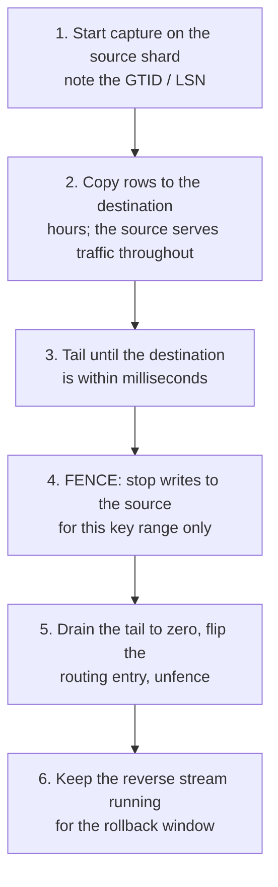

# Sharding, Resharding, and Moving Tenants

Everything so far assumed one database. This document is about data already split across many,
where a migration is not an operation you perform but a **rollout you supervise** — and where
the most dangerous moment is not the data movement but the instant different parts of your
system disagree about where a row lives.

The organising idea: in a sharded system, **the routing decision is a piece of state, and like
any replicated state it can be stale on some nodes and fresh on others.** Almost every failure
below is a consequence of that. Scenario IDs are `S-nn`.

---

## Your sharding scheme decided your resharding cost years ago

Before any technique, the arithmetic that determines whether resharding is a weekend or a
quarter.

### Hash-modulo: the scheme that cannot be grown

```
shard = hash(customer_id) % N
```

Simple, perfectly balanced, and it has the worst possible resharding property. Changing `N`
changes the answer for almost every key.

Going from 8 shards to 9: a key stays put only if `hash % 8 == hash % 9`, which happens for
roughly 1 in 9 keys. **8 out of 9 keys — 89% of your data — must move.**

Going from 8 to 16 is the special case people rely on: `hash % 16` is either `hash % 8` or
`hash % 8 + 8`, so exactly **50%** moves, and each key's destination is one of two known
shards. That is why hash-modulo systems only ever double, and why doubling from 256 to 512
hosts when you needed 300 is a decision the scheme made for you.

### Consistent hashing: growth is cheap, balance is approximate

Keys and shards both map onto a ring; a key belongs to the next shard clockwise. Adding one
shard to `N` moves roughly `1/(N+1)` of keys — **3.2% when going from 30 to 31.**

The cost is balance. With one point per shard, load variance is large; you fix it with virtual
nodes (each physical shard owning 100–200 ring positions), which brings variance down and makes
the ring metadata bigger. It is the right scheme for caches and for systems where approximate
balance is acceptable.

### Fixed virtual shards: the scheme to choose if you still can

Pick a large, fixed number of **logical** shards up front — 1,024 or 4,096 — and map them onto
a smaller number of **physical** servers. The logical count never changes. Growing the cluster
means moving whole logical shards between servers.

This is what Lumen does: **4,096 logical shards on 256 MySQL hosts, 16 per host.** Doubling to
512 hosts moves 8 logical shards off each existing host — still 50% of the data, but as **whole
shards**, which is a bulk copy plus a routing flip rather than a per-row rehash. It is
operationally a different kind of work: resumable, verifiable per shard, and abortable halfway.

It is also what Vitess, Citus and most managed sharded systems do, and the reason is exactly
this.

**The number to pick.** Large enough that you never need to change it (4,096 logical shards
supports 4,096 physical servers, which is beyond most systems), small enough that per-shard
overhead is tolerable. Each logical shard costs a schema, a connection pool entry, a backup
job, and a row in every rollout dashboard. At 4,096, a migration's status page has 4,096 rows,
which is its own problem (doc 11).

### Range partitioning: good for queries, bad for hotspots

`shard = f(created_at)` or `f(customer_id range)`. Range scans are efficient and growth is
trivial — add a new range. The failure is that load is rarely uniform across ranges: with
time-based ranges, **all writes go to the newest shard**, and you have a distributed system
with one busy node.

### S-01 · The hot shard that resharding does not fix

**What you see.** After doubling shard count, the p99 is unchanged, and one shard still runs at
90% while the rest sit at 30%.

**Mechanism.** Resharding redistributes *keys*, not *load*. If one key is hot — one tenant, one
celebrity account, one merchant running a flash sale — splitting the shard that contains it
puts it, intact, on one of the halves. Lumen's largest account has 480 million followers; no
shard arrangement makes that account's fan-out fit alongside normal traffic.

**Prevent.** Hot keys need a different mechanism entirely, and the resharding project should
not be funded as if it will solve them:

- **A secondary key dimension**: shard by `(account_id, bucket)` where `bucket` splits a single
  hot account across shards, at the cost of every read of that account becoming a scatter-gather.
- **Dedicated shards** for known-large tenants, with the routing table carrying the exception.
  Ugly, explicit, works. At Lumen the top 200 accounts have their own placement.
- **Caching and read replicas** in front of the hot shard, which addresses read hotspots and
  does nothing for write hotspots.

---

## Moving a shard: the five-step dance

Moving one logical shard from host A to host B — whether for a split, a rebalance, or a server
replacement — is the primitive everything else is built from. It is doc 09's pattern again,
compressed, with one extra concern: **the routing flip**.



Step 4 is the one that distinguishes this from doc 09, and it is where `S-02` and `S-03` live.

### S-02 · The routing table that propagates unevenly

**What you see.** During a shard move, a small number of rows written just after the flip are
missing. Or worse: a row exists on both shards with different values.

**Mechanism.** The routing table — "key range 0x4000–0x4FFF lives on host B now" — is read by
every application instance. Those instances learn about the change at different times: some
poll every 30 seconds, some cache for 5 minutes, one has been up for a week and refreshes on a
timer that drifted.

So for a window, **some instances write to the old shard and some to the new one.** Both
accept the write. Neither knows the other exists. You now have two divergent copies of the same
row and no mechanism will reconcile them, because each shard believes it owns the key.

The window is as long as your slowest routing cache, which is almost never the number in the
configuration — it is that number plus whatever an instance that missed a refresh does.

**Confirm it.** This is hard to detect after the fact, which is why the prevention is
structural. The detectable signature is two shards both holding a row with the same primary key
and different `updated_at` values, found by a full cross-shard scan — expensive, and the reason
you run it only when you suspect this happened.

**Prevent.** Fencing, below. There is no configuration of cache timeouts that makes this safe,
because "every instance has refreshed" is not observable from the control plane.

### S-03 · Fencing: making the old shard refuse, rather than hoping nobody asks

The structural fix is to make the source shard **actively reject** writes it no longer owns,
rather than relying on every client having learned the new routing.

The mechanism is a **generation number** (also called a fence token or shard epoch):

```
Routing entry:  range 0x4000-0x4FFF  ->  host B,  generation 7

Every write carries the generation the client believes is current.
The shard rejects any write whose generation does not match its own.
```

The sequence at the flip:

1. **Source shard bumps its generation to 8 and marks the range as "moved".** It now rejects
   every write for that range, including from clients that still think it is the owner. Those
   clients get a distinguishable error — not a timeout, not a success.
2. The tail drains; the destination applies the last events.
3. **Destination takes generation 8 for the range** and begins accepting.
4. The routing table is updated. Clients that have not refreshed get rejected by the source,
   and the error tells them to refresh.

The invariant that makes this correct: **at no instant do two shards both accept writes for the
same key range.** There is a brief window where *neither* does, which is an availability cost —
writes to that range fail for a few hundred milliseconds — and that is the trade. Unavailability
for 300 ms is recoverable; divergence is not.

**The error must be distinguishable.** A client receiving "wrong generation" should refresh its
routing and retry, which turns the fence window into added latency rather than a user-visible
failure. A client receiving a generic error retries against the same wrong shard and fails
again.

This is the same pattern as a lease or a fence token in distributed locking, and
[`../MicroservicesPOF`](../MicroservicesPOF/10-state-coordination-and-time.md)'s `L` class
covers the general form.

### S-04 · The in-flight transaction that spans the flip

**What you see.** A write that started before the fence and committed after it, on the old
shard, is lost.

**Mechanism.** Fencing rejects *new* writes. A transaction that was already open on the source
when the fence went up may still commit, after the tail has been declared drained.

**Prevent.** The fence must wait for in-flight transactions to complete before declaring the
range drained:

```sql
-- MySQL: after fencing, wait for open transactions touching the range
SELECT trx_id, trx_started, trx_query FROM information_schema.INNODB_TRX
WHERE trx_started < now() - interval 1 second;
```

and only proceed when that returns nothing, with a timeout after which you kill them. The
timeout matters: one long transaction should not hold a shard move open indefinitely, and
killing a transaction that is going to be rejected anyway costs nothing.

---

## Vitess as the reference implementation

Vitess's `Reshard` and `MoveTables` are the most complete public implementation of the above,
and worth knowing as a reference even if you do not run Vitess — they encode decisions you
would otherwise have to rediscover.

```
# 1-3: copy and tail. Runs for days; no traffic impact.
vtctldclient Reshard --workflow=split4 --target-keyspace=lumen create \
  --source-shards='-80' --target-shards='-40,40-80'

# 4: verify, continuously, while the tail runs
vtctldclient VDiff --workflow=split4 --target-keyspace=lumen create

# 5: flip reads first - low risk, instantly reversible
vtctldclient Reshard --workflow=split4 --target-keyspace=lumen SwitchTraffic \
  --tablet-types=replica,rdonly

# ... soak ...

# 6: flip writes - this is the fenced moment
vtctldclient Reshard --workflow=split4 --target-keyspace=lumen SwitchTraffic \
  --tablet-types=primary

# 7: reverse replication is now running automatically, new -> old
#    Rollback is one command, for as long as you leave it running:
vtctldclient Reshard --workflow=split4 --target-keyspace=lumen ReverseTraffic

# 8: when satisfied, stop the reverse stream and clean up
vtctldclient Reshard --workflow=split4 --target-keyspace=lumen complete
```

Four design decisions in there are worth copying into any home-grown system:

1. **Reads switch before writes, as separate commands.** Switching reads exercises the new
   shards' data and capacity with zero correctness risk, because the old shards remain
   authoritative. Most of what goes wrong is found here, cheaply.
2. **Reverse replication starts automatically at the write switch.** Rollback is a command for
   as long as you leave it running, and this is the single most valuable property of the
   design.
3. **`VDiff` runs during the tail, not after it.** Doc 09's `M-14` again.
4. **Completion is explicit.** Nothing is cleaned up until you say so, so the rollback window
   is a decision rather than a side effect of the tooling finishing.

---

## Schema changes across a shard fleet

### S-05 · The migration that takes 45 days, during which the schema changes again

**What you see.** A column addition is rolled out across 4,096 shards. It is in week five.
Another team needs a different change to the same table, and there is no state in which the
fleet is consistent enough to start.

**Mechanism.** Doc 06's arithmetic: Lumen's per-shard backfill is 16.9 hours, 64 shards in
parallel, 64 waves — **45 days**. For 45 days, some shards have the new column populated, some
have it empty, and some do not have it.

During that time:

- **Application code must tolerate all three states.** A read that assumes the column is
  populated fails on 60% of shards for the first month.
- **Any cross-shard query** (a scatter-gather, an analytics export) sees an inconsistent
  schema.
- **A second migration cannot safely start**, because its own expand phase would interleave
  with the first one's contract phase.

**Prevent.** Three disciplines, all of which cost something:

1. **A migration queue per table.** Only one structural migration in flight per table at a
   time, enforced by the platform rather than by convention. It serialises work and it is the
   only thing that keeps the state space comprehensible.
2. **Code tolerates the intermediate state by construction** — read the new column, fall back
   to deriving from the old one, for the whole rollout. This is the dual-read mirror of doc 07's
   dual write, and it is what makes the 45 days survivable.
3. **Shrink the rollout.** 64 shards in parallel is a choice. 256 in parallel is 11 days, at
   4× the load on the shared infrastructure the shards sit on — which at Lumen is the binlog
   archive and the backup system, not the database hosts. Compute the real constraint before
   accepting the duration.

### S-06 · Per-shard schema drift

**What you see.** Doc 03's `O-10`: 4,084 shards have the column, 12 do not, and nobody notices
for five months.

**Mechanism.** Any fleet operation partially fails. A tablet was down, a migration was
cancelled during an unrelated incident, a shard was restored from a backup predating the
change, or a new shard was provisioned from a stale template.

The last one deserves attention because it is a *recurring* source rather than a one-off: if
new shards are created from a golden image or a schema template, **the template is now a second
place the schema lives**, and it drifts the moment somebody forgets to update it.

**Confirm it.** Standing drift detection, running continuously:

```sql
-- Collect a schema fingerprint per shard, then compare.
SELECT md5(string_agg(col, ',' ORDER BY col)) AS schema_hash
FROM (
  SELECT table_name || '.' || column_name || ':' || data_type ||
         ':' || coalesce(character_maximum_length::text, '') AS col
  FROM information_schema.columns WHERE table_schema = 'lumen'
) s;
```

One hash per shard, compared against the mode. Anything that differs is reported with the
actual diff. This is roughly 200 lines including the collection and it is the single highest-
value piece of infrastructure in a sharded estate.

**Prevent.** Beyond detection: make shard provisioning replay the migration history rather than
copy a template, so there is exactly one definition of the schema.

### S-07 · Sequence and identity collisions across shards

**What you see.** After a shard split, two rows on different shards share a primary key, and a
cross-shard query returns both.

**Mechanism.** If each shard generates identifiers with a local sequence, the sequences overlap
by construction. It works while keys never cross shards, and breaks the moment they do — which
is exactly what a shard move does.

**Prevent.** Identifiers in a sharded system must be globally unique **before** you shard, not
after:

| Scheme | Properties |
|---|---|
| UUIDv4 | Globally unique, no coordination, **random** — poor index locality, 16 bytes |
| UUIDv7 / ULID | Globally unique, **time-ordered** — good index locality, 16 bytes. The current default answer |
| Snowflake | 64-bit: timestamp, machine ID, counter. Compact, ordered, needs machine-ID assignment |
| Per-shard offset sequences | `shard_id × 10^12 + local` — works, and breaks when a key moves shards or a shard is split |
| Central allocator | A single sequence service handing out blocks. Simple, and it is a dependency on the write path |

If you are already in the per-shard-offset situation, the move is itself a migration: allocate
new global identifiers, dual-write both, and migrate references — which is doc 01's six phases
applied to a primary key, the most expensive version of it there is.

### S-08 · The cross-shard transaction you did not know you had

**What you see.** During a tenant move, an operation that updates a customer and their orders
fails intermittently, because the two now live on different shards.

**Mechanism.** Sharding works when the shard key partitions the data along the same boundary as
the transactions. The moment a transaction spans two shards, you need two-phase commit (slow,
and it introduces a coordinator that can block) or a saga (eventual, and it needs
compensations).

The discovery usually happens *during* a move rather than during design, because before the
move both rows happened to be on the same shard and nothing surfaced the dependency.

**Prevent.** Find them before you move anything:

```sql
-- Log every transaction that touches more than one shard, for a week,
-- at the routing layer. Then read the list.
```

That instrumentation lives in your sharding middleware and it is a day's work. The output is
the list of operations that must become sagas, and it is also the correct input to choosing a
shard key — if the list is long, the shard key is wrong.

---

## Moving one tenant

Multi-tenant systems get an option single-tenant ones do not: migrate **one customer at a
time**. It is the lowest-risk migration strategy available and it is underused.

The pattern:

```
1. Mark the tenant "migrating" in the routing table. Reads continue from the source.
2. Copy the tenant's rows to the destination. Minutes, for most tenants.
3. Tail the tenant's changes.
4. Fence: reject writes for this tenant on the source (S-03's generation bump).
5. Drain, flip the tenant's routing entry, unfence.
6. Reverse-stream for the rollback window.
```

Per tenant, the write-unavailability window is sub-second. A failure affects one customer. And
the first ten tenants you move are a rehearsal that tells you the real duration, the real
failure rate, and the real rollback cost — with a blast radius of ten customers.

**The order to move them in** is a genuine decision:

- **Smallest first** finds bugs cheaply and builds confidence, but the bugs that only appear at
  scale appear last, when you have already committed.
- **Largest first** surfaces the hard problems immediately and risks your most important
  customer on the least-rehearsed run.
- **The pragmatic order**: a handful of internal or test tenants, then the smallest external
  ones, then a deliberately chosen medium-large tenant as a scale rehearsal, then the bulk,
  then the largest last with extra attention.

### S-09 · The tenant that is too big to move in one operation

**What you see.** 97% of tenants move in under four minutes. Three take eleven hours each and
the fence window would be unacceptable.

**Mechanism.** Tenant size distributions are extremely skewed — a 60:1 ratio between the
largest and the median is typical, and 1000:1 is not unusual. The procedure designed around
the median does not work for the tail.

**Prevent.** The large tenants need the full doc 09 treatment — long tail, continuous
verification, a scheduled cutover with a go/no-go — rather than the automated per-tenant
pipeline. Budget them as individual projects. The mistake is assuming the automation that
handled 4,000 tenants will handle the last three, and discovering otherwise in month six.

### S-10 · The tenant move that races with its own background jobs

**What you see.** A tenant is moved successfully. An hour later, a scheduled report for that
tenant writes to the old shard.

**Mechanism.** The fence covers the request path. Background workers, scheduled jobs, and
retry queues may hold a connection, a cached routing decision, or a queued task created before
the move.

**Prevent.** The fence must be at the **shard**, not at the client, which is `S-03`'s whole
point — a worker with a stale routing decision gets rejected rather than silently writing to
the wrong place. Additionally: drain or pause the tenant's background work as step 0, and make
queued tasks re-resolve routing at execution time rather than carrying a resolved target.

---

## When not to shard, and when not to reshard

Both decisions get made too early and too often.

**Do not shard** if a bigger instance, a read replica, or deleting data would buy you two more
years. Riverbend's `orders-db` at 1.42 TB on 16 vCPU is nowhere near a sharding threshold;
[`../MicroservicesPOF`](../MicroservicesPOF/16-case-ecommerce-riverbend.md) only reaches it in
the Amazon-scale re-derivation at 5,000 orders/second. Sharding costs you joins, transactions,
unique constraints, and every migration in this collection becomes 4,096 times harder.

**Do not reshard** to fix a hot key (`S-01`), to fix slow queries (that is indexing), or
because a shard is at 60% capacity (that is a rebalance, which is one shard move, not a
resharding). Resharding is for "the total is outgrowing the total", and it is worth confirming
that is what you have.

---

## What to take away

1. **Your sharding scheme fixed your resharding cost years ago.** Hash-modulo moves `N/(N+1)`
   of keys — 89% when going from 8 shards to 9 — which is why such systems only ever double.
2. **Fixed virtual shards are the scheme to choose if you still can.** 4,096 logical shards on
   256 hosts means growth moves whole shards by bulk copy, not keys by rehash.
3. **Resharding redistributes keys, not load.** A hot tenant stays hot on whichever half it
   lands in; that needs a secondary key dimension or dedicated placement.
4. **The routing table is replicated state and it is stale somewhere.** No cache timeout makes
   the flip safe, because "every instance refreshed" is not observable.
5. **Fence with a generation number**: the source shard actively rejects writes it no longer
   owns, and the rejection must be distinguishable so clients refresh and retry.
6. **Accept a few hundred milliseconds where nobody accepts writes.** Brief unavailability is
   recoverable; two shards both accepting the same key is not.
7. **Wait for in-flight transactions after fencing**, with a timeout, or a transaction that
   opened before the fence commits after the drain.
8. **Switch reads before writes, as separate steps.** It exercises the new shards' data and
   capacity at zero correctness risk, and finds most problems cheaply.
9. **Start reverse replication at the write switch**, automatically, and make completion an
   explicit command so the rollback window is a decision.
10. **A 45-day fleet migration means 45 days of three coexisting schema states.** Code must
    tolerate all of them by construction, and only one structural migration per table may be in
    flight.
11. **Shard provisioning from a template creates a second place the schema lives.** Replay the
    migration history instead.
12. **Standing schema-drift detection — one hash per shard, compared against the mode — is the
    highest-value infrastructure in a sharded estate**, and it is about 200 lines.
13. **Identifiers must be globally unique before you shard.** UUIDv7 or Snowflake; per-shard
    offset sequences break the first time a key moves.
14. **Log cross-shard transactions for a week before moving anything.** A long list means the
    shard key is wrong, and the list is the set of operations that must become sagas.
15. **Move one tenant at a time when you can.** Sub-second impact, blast radius of one
    customer, and the first ten moves are a rehearsal with real numbers.
16. **The largest three tenants will not fit the pipeline that handled four thousand.** Budget
    them as individual projects rather than discovering it in month six.

Next: [11-fleet-rollout-multi-region-and-multi-tenant.md](11-fleet-rollout-multi-region-and-multi-tenant.md),
which generalises this to any migration applied to many databases at once.
