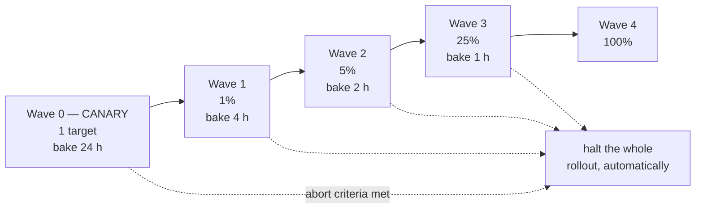

# Fleet Rollout: Running One Migration Against Many Databases

When a migration targets one database, it either worked or it did not. When it targets 4,096
shards, 2,400 databases, or 4,100 tenant schemas, **partial success is the normal outcome**,
and the question stops being "did it work?" and becomes "which ones, and what state are the
rest in?"

That shift is the whole subject. A fleet migration is not a bigger version of a single
migration; it is a different kind of object, with a state machine, a convergence property, and
a progress report that has to be honest about a 0.3% tail. Scenario IDs are `F-nn`.

---

## A script is the wrong shape; a reconciler is the right one

The instinct is to write a loop:

```python
for db in all_databases():
    apply_migration(db)          # the wrong shape
```

It fails for reasons that have nothing to do with the migration:

- It must run to completion in one process, so it cannot survive a restart.
- A failure at database 1,840 leaves 1,840 done, 1 broken, and 2,255 untouched, with that fact
  held only in the terminal scrollback.
- Re-running it repeats work on the 1,840 that succeeded.
- A database created while it runs is missed, permanently.

The right shape is a **reconciler**: a process that repeatedly compares desired state against
actual state and acts on the difference. The same shape as a Kubernetes controller, and for the
same reasons.

```python
while True:
    for db in discover_databases():              # re-discovered each pass
        actual = read_schema_version(db)
        if actual == DESIRED:        continue
        if is_blocked(db):           continue    # someone paused this one
        if not within_rate_budget(): break       # wave control
        try:    advance_one_step(db)             # idempotent
        except: record_failure(db); continue     # never abort the whole pass
    sleep(interval)
```

Four properties follow, and each one maps to a failure the loop version has:

| Property | What it buys |
|---|---|
| **Re-discovers targets each pass** | A tenant provisioned mid-rollout converges automatically (`F-05`) |
| **Each step is idempotent** | Restarting the reconciler costs nothing |
| **One failure does not stop the pass** | 1 broken database does not block 2,255 untouched ones |
| **State lives in a table, not in the process** | The progress report is a query, and so is the pause switch |

The state table is the artefact:

```sql
CREATE TABLE fleet_migration_state (
  migration_id   text    NOT NULL,
  target         text    NOT NULL,      -- database, shard or schema identifier
  wave           int     NOT NULL,
  state          text    NOT NULL,      -- pending|running|applied|failed|blocked|skipped
  attempts       int     NOT NULL DEFAULT 0,
  last_error     text,
  started_at     timestamptz,
  completed_at   timestamptz,
  PRIMARY KEY (migration_id, target)
);
```

Everything else in this document is a policy expressed over that table.

---

## Waves: how much to break at once

A fleet rollout needs a schedule, and the schedule is a bet about how much damage you are
willing to discover at once.



**The canary's bake time is the one that matters and the one that gets cut.** 24 hours is not
arbitrary: it is the shortest period that exercises a daily batch window, a backup, a peak
traffic hour, and an autovacuum cycle. A two-hour canary tells you the DDL applied. A
24-hour canary tells you whether anything else in the system cares.

**Which target to canary.** Not the smallest and not the biggest. The right canary is the
smallest target that is *structurally representative* — same schema, same extensions, same
workload shape, same consumers. At Ironvale, canarying on an internal test database proved
nothing, because it had no logical replication slots and therefore none of doc 08's hazards.

**Abort criteria, written as numbers before the rollout starts.** Doc 16 covers what to watch;
the fleet-specific rule is that the reconciler must halt itself:

```
halt the rollout if, in any wave:
  - failure rate across targets in this wave > 2%, or
  - any single target has failed 3 times, or
  - p99 latency on any migrated target is > 1.5x its pre-migration baseline, or
  - the error rate for SQLSTATE 42703 or 0A000 across the fleet is non-zero, or
  - a human has set state='blocked' on anything
```

The last line is the most useful. A rollout nobody can stop with one `UPDATE` is a rollout
that will be stopped by killing a pod, which loses the state.

### F-01 · The progress report that says 99.7%

**What you see.** The rollout dashboard reads "4,084 / 4,096 — 99.7% complete" in green.
The rollout is declared done. Five months later, 0.3% of traffic fails with
`Unknown column 'reaction_type'`.

**Mechanism.** The aggregate hid the tail. Twelve shards never took the change, and twelve out
of 4,096 rounds to a number that looks like success in every visualisation.

This is doc 03's `O-10` and doc 10's `S-06`, and it recurs because every progress UI is built
to show a percentage.

**Prevent.** Three changes, all cheap:

1. **The rollout is not complete until the count of non-`applied` targets is zero.** Make
   "complete" a boolean derived from `count(*) FILTER (WHERE state <> 'applied') = 0`, never
   from a percentage.
2. **Display the tail, not the percentage.** The dashboard's primary number should be
   "**12 targets not applied**", with their identifiers, not "99.7%".
3. **Standing drift detection outlives the rollout** (doc 10's `S-06`). The rollout's own
   reporting is a point-in-time view; drift detection is the thing that notices when a shard is
   restored from a pre-migration backup three weeks later. **These are different controls and
   you need both.**

### F-02 · The wave that was too big, and the one that was too small

**Too big.** 25% of 4,096 shards is 1,024 shards taking a change simultaneously. If the change
is bad, you have 1,024 broken shards and a rollback that is itself a fleet operation.

**Too small.** 1% waves with 4-hour bakes across 4,096 targets is 100 waves × 4 hours =
**17 days of bake time alone**, before counting execution. At that duration the rollout
collides with other work (doc 10's `S-05`) and people start skipping bakes.

**The resolution** is that wave size should grow geometrically while bake time shrinks, which
is what the diagram above does: 1, 41, 205, 1024, 2825 targets across five waves is
log-ish coverage with five bakes totalling 31 hours. The information value of a bake falls as
you accumulate evidence, so the schedule should spend time where the information is.

### F-03 · The fleet migration with no per-target rollback

**What you see.** Wave 2 reveals a problem. The rollout halts cleanly. Now 246 targets are on
the new schema and 3,850 are not, and the only rollback procedure anyone wrote assumes one
database.

**Mechanism.** Rollback was designed as an operation, not as a fleet state. The reconciler can
drive forward but has no reverse gear.

**Prevent.** Make the reconciler bidirectional from the start: `DESIRED` is a parameter, and
setting it to the previous version makes the same loop drive targets backwards. Then:

- Rollback inherits all four properties — idempotent, resumable, per-target, observable.
- You can roll back **a subset**: set `desired_version` per target, so the 246 affected
  targets revert while the rest hold.
- And the rollback is exercised by the same code path as the rollout, which means it is tested
  continuously rather than written under pressure.

This only works for reversible steps. For anything past doc 13's point of no return, the
reconciler must refuse to drive backwards and say so explicitly — which is better than
appearing to support something it cannot do.

---

## Multi-region

### F-04 · Which region first, and the two wrong answers

**The two instincts, both wrong:**

- **"Start with the least important region."** Appealing, and it often means starting with a
  region whose traffic shape is unrepresentative — a disaster-recovery region with no live
  traffic proves only that the DDL parses.
- **"Start with the biggest region to find problems fastest."** Finds them at maximum cost.

**The right ordering** considers three things in sequence:

1. **Representativeness.** The first region must exercise the real workload: live traffic, real
   consumers, real batch jobs. A region at 8% of global traffic with the full application stack
   beats a region at 0.1% with a subset.
2. **Recoverability.** Prefer a region where you can shed traffic to another if it goes wrong.
   That is a genuine argument for *not* starting with your largest region — not because of its
   size, but because there may be nowhere to fail it over to.
3. **Replication direction.** If regions replicate to each other, the direction constrains the
   order, and this is where it gets technical.

### F-05 · Cross-region replication and DDL ordering

**What you see.** A column is added in `us-east`. The `eu-west` subscriber stops with
`logical replication target relation "public.orders" is missing replicated column`. Replication
halts, the slot retains WAL, and the US primary's disk starts filling (doc 08's `R-06`).

**Mechanism.** Doc 08's rule, now with geography attached: for logical replication,
**add on the subscriber first, drop on the publisher first.** With a one-way topology that is
merely an ordering constraint. With bidirectional replication — two regions each publishing to
the other, which is a common active-active arrangement — **every region is both a publisher and
a subscriber**, so the two rules apply simultaneously and in opposite directions.

The resolution for bidirectional topologies:

| Change | Order |
|---|---|
| **Add a column** | Add it **everywhere** before anything writes to it. All regions become supersets simultaneously; no region sends a column another lacks |
| **Drop a column** | Stop writing it everywhere; then drop it everywhere. The reverse order of the add |

Which is to say: in a bidirectional topology, **the expand phase must complete across the whole
fleet before the dual-write phase begins anywhere**, because the fleet is one logical system.
That is a materially stronger constraint than the single-region case, and it is what makes
active-active schema changes slow.

For **physical** replication across regions (a streaming standby in another region), DDL
replicates automatically and the constraint disappears — replaced by doc 08's `R-01` lag
arithmetic, now over a link with 80 ms of latency and finite bandwidth.

### F-06 · The region that is ahead of the one it replicates from

**What you see.** A failover promotes `eu-west`, which was mid-rollout and has migration 214
applied. `us-east`, now the standby, has 213. Replication cannot resume.

**Prevent.** Treat **"what is the maximum schema version skew across regions, and is the system
correct at that skew?"** as a design question with a written answer, not as a property that
emerges. The practical rule: a fleet rollout should never span a planned failover window, and
the failover runbook should include a schema-version check as a pre-flight item.

---

## Multi-tenant: two models, two completely different migration costs

### Schema-per-tenant

Ironvale's commercial banking portal runs **4,100 tenant schemas across 12 PostgreSQL
clusters** — 342 schemas per cluster, 40 tables each.

**What a migration costs here.** The DDL itself is cheap: three `ALTER TABLE` statements ×
4,100 schemas = 12,300 statements at ~180 ms each including connection and lock acquisition.
Run 12 clusters in parallel and that is about 3 minutes. The problems are elsewhere:

- **Catalogue size.** 4,100 schemas × 40 tables = **164,000 tables**. `pg_class` has 164,000
  rows; `pg_attribute`, at roughly 40 columns per table plus 6 system columns, has **7.5
  million rows**. Query *planning* slows measurably, `pg_dump` takes hours, autovacuum spends
  significant time on catalogue tables, and a `\dt` in `psql` is a bad idea.
- **Catalogue lock contention.** Twelve concurrent DDL streams all take locks on shared
  catalogue rows. Beyond a modest parallelism the streams serialise on the catalogue rather
  than on the tables, so raising concurrency stops helping — which is surprising the first time
  and worth measuring rather than assuming.
- **Partial failure is guaranteed.** Nine of 4,100 will fail: a schema left in a weird state
  by a half-finished provisioning run, one with a tenant-specific extra index that collides,
  one owned by a role that was deleted.

**What it buys.** Per-tenant rollback, per-tenant pause, trivially provable data isolation, and
the ability to migrate one tenant at a time (doc 10's tenant-move pattern).

### Shared table with a tenant column

One `orders` table with a `tenant_id` column, as Riverbend and most modern SaaS systems do.

**What a migration costs here.** One `ALTER TABLE` — and one backfill over *all* tenants'
rows at once, with no way to do one tenant and stop. The migration is a single atomic
reputational event: it works for everyone or it fails for everyone.

**The trade, stated plainly:**

| | Schema-per-tenant | Shared table |
|---|---|---|
| DDL execution | 4,100 statements, minutes, 9 will fail | 1 statement |
| Backfill | Per tenant; can pause, order, and skip | One job over everything |
| Blast radius of a bad migration | One tenant, if you stop | All tenants |
| Rollback granularity | Per tenant | All or nothing |
| Catalogue cost | 7.5 million `pg_attribute` rows | Negligible |
| Noisy neighbour | Isolated by schema, not by resource | Shared |
| Per-tenant customisation | Possible, and it becomes drift | Impossible, which is a feature |

**The decision rule that actually works:** schema-per-tenant is right when tenants are few,
large, and contractually isolated (an enterprise B2B product with 4,000 customers paying six
figures). Shared-table is right when tenants are many, small, and uniform. The failure is
choosing schema-per-tenant for 200,000 small tenants, which produces a catalogue nobody can
operate, and it is not recoverable without a migration that merges 200,000 schemas.

### F-07 · The tenant provisioned mid-rollout

**What you see.** A tenant created during wave 3 has the old schema, because the rollout's
target list was computed at the start.

**Mechanism.** The script version of the problem again. The reconciler version does not have
it — it re-discovers targets each pass.

**Prevent.** Two things together: re-discovery each pass, **and** making provisioning create
tenants at the current desired version rather than from a template (doc 10's `S-06`). Without
the second, you have a race between provisioning and the reconciler that resolves correctly
only by luck and by the reconciler's next pass.

### F-08 · The tenant restored from a backup taken before the migration

**What you see.** Three weeks after a successful rollout, one tenant starts failing. Their
database was restored from a backup for an unrelated reason.

**Mechanism.** A rollout applies a change once, at a moment. A restore returns a database to
an earlier moment, discarding everything applied after it — including your migration. Nothing
in the rollout's own state table notices: it says `applied`, and it was, before the restore.

**Prevent.** This is the clearest argument for keeping drift detection running permanently
after the rollout completes. It is also an argument for the restore procedure itself to include
"replay any migrations applied after the backup's timestamp" as a mandatory step, which most
restore runbooks do not.

---

## Version skew: the code must span the whole fleet

### F-09 · The application that assumed the rollout was done

**What you see.** During a 45-day shard rollout (doc 10's `S-05`), a deploy goes out that reads
the new column directly. It works on 62% of shards.

**Mechanism.** The application is one artefact deployed everywhere; the schema is 4,096
artefacts at two different versions. **Application code must tolerate the full range of schema
versions present in the fleet**, for the entire duration of the rollout.

**Prevent.** Make the range explicit and enforce it:

1. **Record `min_schema_version` and `max_schema_version` across the fleet**, continuously, as
   a metric. It is one query against the state table.
2. **The application declares the range it supports** — in code, as a constant.
3. **The deploy pipeline refuses** to ship an application whose supported range does not cover
   the fleet's actual range.

That third step is the one that turns a convention into a control. It costs a few lines in the
pipeline and it prevents the most common fleet-migration incident there is: a deploy that
assumes a rollout finished.

### F-10 · The control plane becomes the bottleneck, or the thundering herd

**What you see.** 4,096 migration jobs start within the same ten seconds. The schema registry,
the secrets manager, and the configuration service all saturate. Nothing to do with databases
fails first.

**Mechanism.** Fleet operations concentrate load on shared infrastructure that is sized for
steady state. Each migration job needs credentials, configuration, a connection, and somewhere
to report — and 4,096 of anything at once is a load test of whatever is in the middle.

This is the same thundering-herd shape as
[`../K8s/cronJobs`](../K8s/cronJobs/README.md)'s scheduled-work material, arriving from a
different direction.

**Prevent.** Rate-limit the reconciler by **concurrent targets in flight**, not by wave size
alone — the wave says who is eligible, the rate limit says how many actually run. Add jitter to
start times. And, cheaply, verify that your shared services can handle the configured
concurrency before the rollout rather than during it.

---

## The honest progress report

A fleet rollout's status should answer five questions, and a percentage answers none of them:

```
migration: V214__orders_add_currency      desired version: 214

  applied     3,958
  running        48
  pending        82
  failed          8   <-- shard-0412 shard-1180 shard-1181 shard-2044
                          shard-2891 shard-3300 shard-3301 shard-3987
  blocked         0

  wave: 4 of 5                started: 2026-10-09 02:14Z
  min schema version in fleet: 213   max: 214
  oldest pending target: shard-0007 (pending 6 d)
  estimated completion at current rate: 2026-10-19 11:00Z
```

Five things that report does and a percentage does not:

- **Names the failures.** Eight identifiers you can act on.
- **Shows the version range**, which is what the application must tolerate (`F-09`).
- **Shows the oldest pending target**, which catches the shard that is quietly never eligible —
  a stuck target hides inside a healthy-looking aggregate indefinitely.
- **Shows `blocked` separately from `failed`**, so a deliberate human pause is not mistaken for
  a problem.
- **Projects completion from the observed rate**, which is what tells you in hour four that
  this is a 45-day rollout.

---

## What to take away

1. **A fleet migration is a reconciler, not a script.** Re-discover targets each pass, make
   each step idempotent, never let one failure abort the pass, and keep state in a table.
2. **Partial success is the normal outcome.** Design for "which ones failed and what state are
   they in", not for "did it work".
3. **Waves should grow geometrically while bake times shrink**, because the information value
   of a bake falls as evidence accumulates. 1 → 1% → 5% → 25% → 100% with 24 h, 4 h, 2 h, 1 h.
4. **The canary's 24-hour bake is the one that gets cut and the one that matters** — it is the
   shortest window that exercises a batch run, a backup, a peak hour, and an autovacuum cycle.
5. **Canary on the smallest *structurally representative* target**, not the smallest target. A
   database with no replication slots cannot reveal replication problems.
6. **Write abort criteria as numbers before you start**, and give the reconciler a one-`UPDATE`
   pause switch, or it will be stopped by killing a pod.
7. **"Complete" is `count(not applied) = 0`, never a percentage.** Display the tail — "12 not
   applied", with names.
8. **The rollout's reporting and standing drift detection are different controls.** The first
   is point-in-time; only the second catches the shard restored from an old backup three weeks
   later.
9. **Make the reconciler bidirectional from the start**, so rollback inherits idempotency,
   resumability and per-target granularity — and is exercised by the same code path.
10. **Choose the first region for representativeness and recoverability**, not for size.
11. **In a bidirectionally replicated topology the expand phase must complete fleet-wide before
    dual-write begins anywhere**, because the fleet is one logical system.
12. **Schema-per-tenant costs 7.5 million catalogue rows at 4,100 tenants** and buys per-tenant
    rollback; shared-table costs all-or-nothing blast radius and buys a single statement.
    Choosing schema-per-tenant for 200,000 small tenants is not recoverable.
13. **Provisioning must create tenants at the current desired version**, not from a template,
    or you race the reconciler.
14. **A restore silently undoes every migration applied after the backup was taken.** The
    restore runbook needs a replay step.
15. **Track min and max schema version across the fleet and refuse deploys whose supported
    range does not cover it.** This single pipeline check prevents the most common
    fleet-migration incident.
16. **Rate-limit by concurrent targets, with jitter.** 4,096 jobs starting together is a load
    test of your secrets manager, not of your databases.

Next: [12-verification-and-reconciliation.md](12-verification-and-reconciliation.md), which is
about proving that any of this produced the right data.
