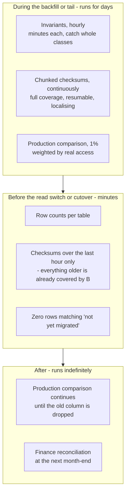

# Verification: Proving the Migration Produced the Right Data

Doc 00 named silent corruption as the incident shape this collection takes most seriously,
because it has no symptom. Verification is the only defence, and it is the phase most often
reduced to a row count and a handful of spot-checks.

This document is about verification that can actually fail. The test of a verification method
is not whether it passes — it is whether you can describe a realistic defect it would catch.
If you cannot, you have a ritual rather than a control. Scenario IDs are `V-nn`.

---

## Why row counts are necessary and nowhere near sufficient

Counting rows on both sides is cheap, fast, and the first thing to do. It catches a whole
class: a chunk range skipped, a filter that excluded rows, a load that stopped early.

It catches nothing about **values**. Every one of these passes a count comparison:

- The backfill wrote `'USD'` for 4,100 Canadian orders (doc 01's race).
- `NUMBER(10,0)` overflowed into `integer` and wrapped (doc 09's `M-05`).
- Oracle `DATE` lost its time component (doc 09's `M-06`).
- Every `amount` is correct except that the decimal is in the wrong place for orders over
  10,000.
- The target has the same number of rows, but 2.1 million of them are the *wrong* rows,
  because an upsert keyed on a non-unique column merged pairs and a `TRUNCATE` that did not
  replicate left extras.

A row count can tell you that rows are missing. It can never tell you that the rows that
are present hold the wrong values.

---

## Method 1: sampling, and the arithmetic that tells you how many

Comparing a random sample is the cheapest method with a defensible claim attached, and the
arithmetic is worth deriving because the resulting numbers are much smaller than people guess.

**The question.** If I compare `n` randomly chosen rows and find zero defects, what defect rate
can I rule out?

**The derivation.** Suppose the true defect rate is `p`. The probability that one randomly
chosen row is *not* defective is `(1 − p)`. The probability that all `n` are not defective is
`(1 − p)^n`. If that probability is below 1%, then observing zero defects in `n` rows is
strong evidence that the rate is below `p` — specifically, we can state it at 99% confidence.

> (1 − p)^n < 0.01
> n · ln(1 − p) < ln(0.01)
> **n > ln(0.01) / ln(1 − p)**

For `p = 0.00001` (one defect in 100,000 rows):

> n > −4.6052 / ln(0.99999) = −4.6052 / (−0.0000100000) = **460,520 rows**

So **460,500 rows** out of 521 million — **0.088% of the table** — is enough to be 99%
confident the defect rate is below one in 100,000.

The full ladder, which is the table to use when deciding how much verification to buy:

| Confidence | Max defect rate ruled out | Rows to compare |
|---|---|---|
| 95% | 1 in 1,000 | 2,995 |
| 95% | 1 in 10,000 | 29,957 |
| 95% | 1 in 100,000 | 299,573 |
| 99% | 1 in 1,000 | 4,603 |
| 99% | 1 in 10,000 | 46,051 |
| 99% | 1 in 100,000 | **460,517** |
| 99% | 1 in 1,000,000 | 4,605,170 |

Two things fall out that change how people plan.

**Sample size depends on the defect rate you want to rule out, not on the table size.**
Verifying 460,500 rows gives the same guarantee whether the table has 10 million rows or 10
billion. This is the most useful and least intuitive property, and it means sampling scales
to any table you will ever have.

**One in 100,000 on 521 million rows is still 5,210 wrong rows.** The guarantee is a rate, not
an absence. For `orders.amount`, 5,210 wrong monetary values is not acceptable, and you need a
full comparison. For a denormalised search-ranking hint, it is fine. **Decide what rate is
acceptable before choosing the method**, because that decision — not the technique — is what
determines the cost.

### V-01 · The sample that was not random

**What you see.** Sampling reports zero defects. A full comparison later finds 31,000.

**Mechanism.** The sample was taken as `ORDER BY order_id LIMIT 460500`, which is the *oldest*
460,500 orders. Those are exactly the rows least likely to be wrong: backfilled first, under
the most scrutiny, and written long before the dual-write race could affect them. The defects
cluster in recent rows, and the sample systematically excluded them.

**Prevent.** Three ways to sample, with different properties:

```sql
-- 1. Deterministic hash-based. Reproducible, uniform, and the same rows every
--    run - so you can re-verify exactly what you verified before.
SELECT * FROM orders WHERE abs(hashtext(order_id::text)) % 1132 = 0;
--    521,000,000 / 1132 = 460,247 rows

-- 2. TABLESAMPLE BERNOULLI - true row sampling, but scans the whole table.
SELECT * FROM orders TABLESAMPLE BERNOULLI (0.088);

-- 3. TABLESAMPLE SYSTEM - samples PAGES, so it is fast but biased when rows
--    are clustered. On `orders`, physically clustered by insertion time,
--    page sampling correlates with time and is NOT a random row sample.
SELECT * FROM orders TABLESAMPLE SYSTEM (0.088);        -- fast, biased
```

**Use the hash-based method.** It is uniform, it is reproducible across both sides of a
cross-engine comparison (provided you use a hash both engines can compute identically — a
modulo on the key itself, if the key is numeric, avoids the problem entirely), and
reproducibility matters more than it sounds: when you re-verify after a fix, comparing the same
rows tells you whether the fix worked rather than whether you got luckier.

**And stratify.** On top of the uniform sample, deliberately over-sample the places defects
concentrate: the most recent rows, the oldest rows, rows written during the backfill window,
rows at the extremes of the value range, and rows with nulls. These are not a random sample and
should be counted separately — they are a targeted search, and conflating the two invalidates
the confidence claim above.

---

## Method 2: chunked checksums, for a full comparison that can localise

Sampling gives you a rate. A full comparison gives you certainty, and the engineering problem
is doing it without a single enormous query.

**The naive version and why it fails:**

```sql
-- Do not do this.
SELECT md5(string_agg(order_id || '|' || amount, ',' ORDER BY order_id)) FROM orders;
```

Three problems. It reads 240 GB in one statement; it holds one snapshot for the duration,
blocking vacuum everywhere (doc 06's `B-06`, which is `V-06` here); and when it returns a
different hash from the other side, **you have learned that something differs and nothing about
what.**

**The chunked version:**

```sql
SELECT (order_id / 5000) AS chunk,
       count(*)                                           AS n,
       md5(string_agg(order_id || '|' || canon_money(amount) || '|' ||
                      coalesce(currency, '∅'), ',' ORDER BY order_id)) AS h
FROM orders
WHERE order_id >= $1 AND order_id < $2
GROUP BY 1;
```

Run it over 5,000-row windows on both sides, compare hashes, and you get:

- **Short transactions** — no snapshot held for more than a second.
- **Resumability** — a cursor, like the backfill.
- **Localisation** — a mismatched chunk narrows the problem to 5,000 rows immediately, and a
  binary search within the chunk finds the row in `log₂(5000) ≈ 13` further comparisons.
- **Parallelism** — chunks are independent; eight workers is eight times faster.

**Cost.** Reading 240 GB per side at 400 MB/s is 600 seconds; MD5 at roughly 500 MB/s per core
adds 480 seconds. One core, one side: about 18 minutes. Eight parallel workers on both sides:
**under 5 minutes of wall clock**, and it is the full table rather than a sample. On this
hardware, a full chunked checksum of `orders` is cheaper than most people assume and there is
often no good reason to settle for sampling.

**`ORDER BY` inside the aggregate is mandatory.** `string_agg` without it produces a
nondeterministic order, so the two sides will disagree for no reason. This is the single most
common bug in home-grown checksum comparisons.

### V-02 · The verification that re-applies the backfill's own expression

**What you see.** Verification reports perfect agreement. The data is wrong.

**Mechanism.** The check was:

```sql
SELECT count(*) FROM orders WHERE amount <> amount_cents / 100.0;   -- returns 0
```

The backfill set `amount = amount_cents / 100.0`. The verification checks that
`amount = amount_cents / 100.0`. It is comparing the expression against itself. It proves the
expression is deterministic, which was not in doubt.

**What it cannot catch:** that the expression is wrong. If the right transformation was
`amount_cents / 100.0` only for USD orders, and the 4,100 CAD orders needed a different
treatment, this check is blind to all 4,100.

**Prevent.** A verification must compare against a source of truth that is **independent of the
transformation under test**. Concretely:

- Compare against the *original* source system, not against a derived column in the same row.
- Compare against a reimplementation written by a different person from the specification, not
  from the migration code.
- Compare against an invariant the business can state without reference to the migration —
  which is method 3.

### V-03 · The verification that ran before the tail caught up

**What you see.** A store migration's verification reports 3,400 missing rows. Investigation
finds they are all from the last four minutes, and they arrive while you are investigating.

**Mechanism.** The target is behind by the replication lag. Any point-in-time comparison of a
live source against a lagging target reports the lag as a defect.

**Prevent.** Compare **as of a position**, not as of now:

```sql
-- Source: read as of a specific point, not the current state.
SET TRANSACTION SNAPSHOT '00000003-0000001B-1';     -- PostgreSQL
-- or Oracle: SELECT ... AS OF SCN 24881930712;

-- Target: wait until the applied position is at or past that point, then read.
```

If the engines cannot express a shared position, the fallback is a **high-water mark**: compare
only rows whose `updated_at` is older than `now() − (observed_lag × 3)`. It excludes the
recent window where lag can confuse you, which is fine during the tail and is exactly the
window the cutover verification (doc 09's `M-14`) covers separately.

---

## Method 3: invariants, which are cheap and catch whole classes

An invariant is a property that must hold regardless of the migration's details. They are the
highest-value checks per line of code, and they are the ones a business stakeholder can
confirm.

```sql
-- 1. The total must be preserved. Catches scale errors, truncation, sign flips,
--    and missing rows, in one pass.
SELECT sum(amount_cents) / 100.0 AS old_total, sum(amount) AS new_total,
       sum(amount) - sum(amount_cents) / 100.0 AS difference
FROM orders;

-- 2. Distributions must match. Catches a transformation that is right on
--    average and wrong at the extremes.
SELECT status, count(*), min(amount), max(amount),
       percentile_cont(0.5) WITHIN GROUP (ORDER BY amount) AS median
FROM orders GROUP BY status;

-- 3. Nothing should be null that was not null before.
SELECT count(*) FROM orders WHERE amount IS NULL AND amount_cents IS NOT NULL;

-- 4. Referential integrity the migration may have broken.
SELECT count(*) FROM order_items oi
LEFT JOIN orders o ON o.order_id = oi.order_id WHERE o.order_id IS NULL;

-- 5. The business invariant. The one Finance will check anyway.
SELECT date_trunc('day', created_at) AS day, sum(amount)
FROM orders WHERE created_at >= now() - interval '90 days'
GROUP BY 1 ORDER BY 1;
--    Compare against the ledger. If these disagree, nothing else matters.
```

The fifth is the most valuable and the most neglected. **Finance already has an independent
record of what the totals should be.** Reconciling against it is a verification whose source of
truth genuinely does not come from your database, which is the property `V-02` says you need.

A difference of a few cents, incidentally, is itself informative: it is almost always a
rounding rule applied differently, and it will scale up the moment a larger currency unit is
involved.

### V-04 · Verifying only what you migrated

**What you see.** Verification covers every migrated row and passes. 40,000 rows were never
migrated and verification never looked at them, because its row set came from the migration's
own cursor.

**Mechanism.** The verification iterated the same ranges the backfill did, from the same cursor
table. Any range the backfill skipped — because of a `WHERE` clause bug, a sparse-key gap
(doc 06's `B-10`), or an exception that was logged and swallowed — is skipped by verification
too. The two share a blind spot because they share a source of iteration.

**Prevent.** Verification must enumerate from the **table**, independently:

```sql
-- Independent of the backfill's cursor, and the cheapest check in this document.
SELECT count(*) FROM orders WHERE amount IS NULL;        -- must be 0
SELECT min(order_id), max(order_id) FROM orders WHERE amount IS NULL;
```

With the partial index from doc 06's `B-07` this is an index-only scan over an empty index.
Without it, a 240 GB sequential scan — which is 10 minutes and still worth running.

### V-05 · The comparison that cannot tell you which row

**What you see.** "The checksums differ." Three engineers spend a day finding out where.

**Prevent.** Design for localisation from the start, which the chunked method gives you for
free. When a chunk mismatches, the drill-down is automatic:

```sql
-- Chunk 83,412 mismatches. Find the rows:
SELECT s.order_id, s.amount AS source_amount, t.amount AS target_amount
FROM source_orders s FULL OUTER JOIN target_orders t USING (order_id)
WHERE s.order_id BETWEEN 417060000 AND 417065000
  AND (s.amount IS DISTINCT FROM t.amount OR s.order_id IS NULL OR t.order_id IS NULL)
LIMIT 100;
```

Note `FULL OUTER JOIN` and `IS DISTINCT FROM`: an inner join misses rows present on only one
side, which is the defect you most want to find, and `<>` misses every row where one side is
null (doc 07's `W-04`).

### V-06 · The checksum that blocked vacuum for forty minutes

**What you see.** Running verification causes bloat and slow queries across the database.

**Mechanism.** A long-running `SELECT` holds a snapshot, which pins the vacuum horizon for
every table (doc 06's `B-06`). A 40-minute full-table checksum has exactly the same effect as a
40-minute backfill transaction, and because it is "only a read" nobody expects it.

**Prevent.** Chunk the verification for the same reason you chunk the backfill, and run it
against a **replica** where possible — which also removes the read load from the primary. The
caveat is doc 08's `R-02`: a long read on a replica either gets cancelled or blocks the
primary's vacuum via `hot_standby_feedback`, so "run it on the replica" is not free either. It
is simply cheaper, and chunking fixes both.

---

## Method 4: continuous production comparison

The three methods above are batch jobs over a table. This one samples the **live access
pattern**, and it catches things the others structurally cannot.

It is doc 07's shadow read, promoted to a standing control: on some fraction of real requests,
read both representations, return the old one, and compare asynchronously.

**What it uniquely catches:**

- Defects in rows users actually read. A batch comparison weights all 521 million rows equally,
  including 500 million nobody will ever read again. The production comparison weights by
  actual use, which is the distribution that matters for impact.
- Defects that only appear under the real query path — a different code path, a different
  type coercion, a cache in between.
- **Regressions after the migration is "done"**, because it keeps running.

**What it cannot catch:** anything in the cold tail. The two methods are complements and
neither subsumes the other.

**Cost and sampling rate.** At Riverbend's 4,200 reads/second, a 1% sample is 42 extra reads
per second and yields 3.6 million comparisons per day — far more than the 460,500 the
confidence table requires, though biased toward hot rows, so the confidence claim does not
transfer. Treat it as a continuous defect *detector*, not as a statistical *guarantee*.

---

## The verification plan, as a whole

Four methods with different costs and different blind spots. The plan is which to run when:



The split between `DURING` and `GATE` is doc 09's `M-14`: anything the gate takes more than a
minute to do belonged in the continuous phase. The `AFTER` block is what makes the 30-day soak
before contract (doc 01) mean something — without it, the soak is just waiting.

### What "verified" should mean, written down

A migration's verification section should state, specifically:

```
Verification for V214 (orders.amount, orders.currency)

  Method            Coverage        Confidence             Ran
  ----------------  --------------  ---------------------  -------------------
  Row count         100%            exact                  continuous
  Invariant: sum    100%            exact to 0.01          hourly, 384 runs
  Chunked checksum  100%            exact                  2026-10-06..10-09
  Production cmp    1% of reads     3.6M/day, hot-weighted continuous since 10-04
  Finance recon     90 days of      exact to the ledger    2026-11-01 month-end
                    daily totals

  Known exceptions: 180 rows from 2019 with amount_cents=0 and no derivable
  currency. Reviewed with Finance 2026-10-07; left as NULL deliberately.
  Tracked in RVB-4488.

  Residual risk: rows never read and written before 2019-03 are covered by the
  chunked checksum but not by any independent source of truth, because the
  pre-2019 ledger is in the archived system.
```

The last two blocks are what separates this from a ritual. **A verification report with no
known exceptions and no stated residual risk is a report nobody looked hard at** — at 521
million rows there is always something, and the value of the document is that it names what you
decided to accept.

---

## What to take away

1. **The test of a verification method is whether you can name a realistic defect it would
   catch.** If you cannot, it is a ritual.
2. **A row count detects missing rows and nothing else.** Every defect that leaves the right
   number of rows with the wrong values in them passes a count comparison.
3. **Sample size depends on the defect rate you want to rule out, not on table size.**
   `n > ln(1 − confidence) / ln(1 − p)`.
4. **460,500 rows gives 99% confidence that fewer than 1 in 100,000 differ** — 0.088% of
   `orders`, and the same number for a ten-billion-row table.
5. **One in 100,000 on 521 million rows is still 5,210 wrong rows.** Decide the acceptable rate
   before choosing the method; that decision determines the cost, not the technique.
6. **Sample by a deterministic hash**, not by `ORDER BY id LIMIT n`, and not by
   `TABLESAMPLE SYSTEM`, which samples pages and is biased when rows are physically clustered.
7. **Stratify on top of the uniform sample** — recent rows, extremes, nulls, the backfill
   window — and count those separately, because they are a targeted search, not a random
   sample.
8. **A full chunked checksum of a 240 GB table is under five minutes with eight workers.**
   Sampling is often not necessary; check before settling for it.
9. **`ORDER BY` inside `string_agg` is mandatory**, or the two sides disagree for no reason.
10. **Never verify by re-applying the transformation under test.** Compare against the source
    system, an independent reimplementation, or a business invariant.
11. **Compare as of a replication position, not as of now**, or the lag reports as a defect.
12. **Verification must enumerate from the table, not from the backfill's cursor**, or it
    inherits the backfill's blind spot. `count(*) WHERE new_col IS NULL` is the cheapest check
    in this document.
13. **Use `FULL OUTER JOIN` and `IS DISTINCT FROM` in the drill-down.** An inner join hides
    one-sided rows and `<>` hides nulls.
14. **A long verification query blocks vacuum exactly as a long backfill does.** Chunk it, and
    prefer a replica while knowing that is not free either.
15. **Reconcile against Finance.** They have an independent record, which is the one source of
    truth that does not come from the system you are migrating.
16. **Batch comparison and production comparison are complements.** One covers the cold tail,
    the other weights by what users actually read.
17. **A verification report with no known exceptions and no stated residual risk is one nobody
    looked hard at.** Naming what you accepted is the deliverable.

Next: [13-rollback-the-point-of-no-return-and-forward-fix.md](13-rollback-the-point-of-no-return-and-forward-fix.md),
which is about what you do when verification fails.
