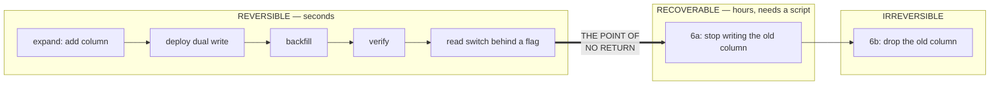

# Rollback, the Point of No Return, and When to Fix Forward Instead

Every migration plan has a rollback section. Most of them are wrong, and they are wrong in a
specific, predictable way: they describe undoing the *schema* and say nothing about the
*data*, which is the part that cannot be undone.

This document is about being honest. It defines what can actually be reversed, shows how to
locate the exact step after which reversal stops being possible, and argues that for most
migrations past the early phases, **fixing forward is the correct answer and rollback is the
dangerous instinct.** Scenario IDs are `U-nn`.

---

## Down migrations are mostly a lie, and it is worth saying why

Every versioned migration tool supports a `down` script. Almost none of them are correct, for
three reasons that compound.

**They are never run.** `V214__add_currency.sql` runs in CI, in every developer's environment,
in staging and in production — dozens of times. `V214_down.sql` runs zero times before the
moment you need it, under pressure, at 03:00. It is the only code in your system with no test
coverage and no production exercise, and it is the code you reach for in your worst hour.

**For data changes they are impossible.** The down migration for "add a column and backfill it"
is "drop the column", which discards the backfilled data. That is not an inverse; it is a
second destructive operation. There is no statement that recovers the value of a column you
dropped.

**They assume the forward migration completed.** A down script written for state 214 does not
describe how to get back from "somewhere between 213 and 214", which is precisely the state you
are in when a migration fails (doc 04's `T-05`).

So: write down migrations for the ones that genuinely invert — they are cheap and occasionally
useful — and do not let their existence stand in for a rollback plan.

---

## Three categories, and knowing which one you are in

Every step in a migration falls into exactly one of three categories. Knowing which is the
entire content of a rollback plan.

### Reversible — undo with a statement, no data loss

The step added something that nothing has yet written to or read from.

- `ADD COLUMN` where nothing writes it yet → `DROP COLUMN` loses nothing.
- `CREATE INDEX` → `DROP INDEX` loses nothing.
- `ADD CONSTRAINT ... NOT VALID` → `DROP CONSTRAINT` loses nothing.
- Deploying code behind a flag, with the flag off → turn the flag off.

**Reversal cost: seconds.** These are the phases to spend time in and the reason doc 01 front-
loads so much.

### Recoverable — the data still exists, but reversal is work

The step changed what is authoritative, while the old representation still holds most of the
truth.

- **After phase 6a** (stop writing the old column): the old column holds correct data up to the
  deploy timestamp, and nothing since. Reverting means re-deriving the gap — hours to days of
  writes — with a script written now.
- **After a store cutover with a reverse stream running**: reversal is flipping back, provided
  the reverse stream is healthy. Minutes, and it degrades to "irreversible" the moment the
  reverse stream breaks and nobody notices.
- **After a shard move with the source retained**: reversal is a routing flip plus replaying
  the delta.

**Reversal cost: hours, and it depends on a script and a stream you must verify are working.**

### Irreversible — the information is gone

- `DROP COLUMN`, `DROP TABLE`, `TRUNCATE`.
- A type narrowing that truncated values.
- A store cutover where the reverse stream was never started and the new store has accepted
  writes for two hours.
- Any destructive data transformation where the input was not preserved.

**Reversal cost: a restore, with its data loss (`U-04`), or a reconstruction from another
system, or nothing.**



**The point of no return is the boundary between the first box and the second**, and for a
column migration it is phase 6a, not 6b. That surprises people: dropping the column *feels*
like the irreversible step, and by the time you drop it you crossed the real line weeks ago.

---

## Finding your own point of no return

For any migration, it is the first step after which **reverting the deploy does not restore
correct behaviour**. Work through the plan and ask, at each step: *if I redeploy the previous
application version right now and change nothing else, does the system work correctly?*

The first step where the answer is no is your point of no return. For the common shapes:

| Migration | Point of no return | Why |
|---|---|---|
| Add a column | None — fully reversible | Nothing depends on it |
| Backfill | None | The old column is still authoritative |
| Read switch behind a flag | None | Flipping the flag restores the old path |
| **Stop writing the old column** | **Here** | Old code reads a column that stopped updating |
| Drop the column | Already past it | |
| Store cutover, reverse stream running | At the cutover, **softly** | Reversible while the stream is healthy; the moment it is not, you are past |
| Store cutover, no reverse stream | **At the cutover, hard** | Target has writes the source has never seen |
| Shard move, source retained | At the routing flip, softly | |
| Narrow a type | **At the DDL** | Values that did not fit are gone |
| Merge two columns into one | **At the DDL** | The decomposition is not recoverable unless you kept both |

**Write it in the plan, with a name attached.** The sentence to include, literally:

> **Point of no return: step 6a, scheduled 2026-11-12. After this step, rollback requires
> re-deriving `amount_cents` for all writes since the deploy, using `scripts/rederive_216.sql`
> (tested 2026-11-05 on a restored clone, 11 minutes for 24 hours of writes). Decision to
> proceed is owned by @vk; abort criteria are in §7.**

Three properties make that sentence useful: it names the step, it names the cost of reversal in
measured time, and it names a person. A plan with "rollback: run the down migration" has none
of them.

---

## The rollback window: how long you keep the option

Reversibility is not free. During the window you are paying for:

| Cost | Example at Riverbend |
|---|---|
| Double storage for the migrated column | `amount_cents` plus `amount`: 521M × 8 B = 4.2 GB, trivial. For a duplicated **table**, 336 GB |
| Double write cost | Every order write touches two representations |
| Code complexity | An `if` in the write path, plus the flag, plus the comparison |
| The reverse stream, where there is one | A whole pipeline to operate and monitor |
| Cognitive load | Two sources of truth that engineers must keep straight |

So the window has to end. How long should it be?

**The rule from doc 01: at least one full business cycle.** The number comes from doc 05's
`C-14` table — the maximum over all consumers, not the typical. At Riverbend that is **92 days**
(the quarterly regulatory export), not the 30 days people assume from month-end reporting.

**For a store cutover, the window is shorter and the reasoning is different.** The reverse
stream degrades: every day it runs, the schemas diverge further as the new store evolves, and
the probability that a rollback actually works falls. Twenty-four to seventy-two hours is
typical, and the right way to decide is to ask *how long until a defect would have surfaced* —
which, for a store serving live traffic, is usually one full business day plus one batch cycle.

### U-01 · The retained artefact that expired

**What you see.** Vitess's `--retain-artifacts=72h` on a migration completed four days ago. A
problem surfaces. The old table is gone, garbage-collected on schedule.

**Mechanism.** The retention was set to a default rather than chosen, and nobody tracked when
it expired.

**Prevent.** Make the window's expiry an event, not a silent deletion: a calendar entry, an
alert 24 hours before, and an explicit decision to let it lapse. The retention parameter should
come from the `C-14` analysis, not from the tool's default.

---

## What actually rolls back, and the matrix nobody draws

The deploy and the migration are two independent things that can each be at one of two
versions. That is four states and only some of them work.

| | **Schema old (213)** | **Schema new (214)** |
|---|---|---|
| **Code old** | Normal, before | **Works if the migration was additive.** This is the state after reverting a deploy that followed an expand migration — and it is why expand-before-deploy is safe |
| **Code new** | **Broken.** New code needs the column | Normal, after |

Two things fall out:

**Expand migrations make deploy rollback safe.** The schema is a superset; old code ignores the
extra column. This is the single practical benefit of the expand/contract discipline and it is
worth stating as the reason for it: not elegance, but that **the bottom-left cell works**.

**Contract migrations make deploy rollback unsafe**, because reverting the code puts you in the
top-right cell with the column already gone. Hence doc 04's rule — contract *after* the deploy,
with a soak long enough that you will not want to revert.

### U-02 · Rolling back the deploy made it worse

**What you see.** Doc 01's 14:02 incident: 50% of requests failing because half the pods run
old code against a renamed column. Someone reverts the deploy. Now **100%** fail.

**Mechanism.** The top-right cell. Reverting the code while the schema stays new moves every
pod into the broken state.

**Recover.** Roll *forward* — complete the rollout so all pods run new code — which takes the
remaining minutes of the deploy and resolves it. ⚠️ **The instinct during an incident is to
revert, and here it is exactly wrong.** This is why the runbook for a migration-adjacent
incident should state the direction explicitly rather than leaving it to judgement under
pressure.

### U-03 · The rollback that invalidates cached plans a second time

**What you see.** `cached plan must not change result type` (doc 05's `C-02`) appears after a
migration, clears on some pods, and then returns in a second wave after someone rolls the
migration back.

**Mechanism.** The error is caused by a *change* in result type, in either direction. Rolling
back is another change, so pods that had recovered break again, and now the schema is in a
state the currently-deployed code may not expect.

**Recover.** Cycle connections and let the original migration stand. Do not roll back a
migration to fix `0A000`.

---

## Point-in-time recovery as rollback: the arithmetic that rules it out

The last-resort plan in many documents is "restore from backup." It is worth doing the
arithmetic once, because it shows that the problem is not the restore time.

Riverbend's `orders-db`: 1.42 TB, Aurora PostgreSQL, continuous backup with PITR.

**Restore time.** Aurora restores to a *new* cluster, roughly 25–40 minutes for this volume
plus log replay to the chosen point. Call it **45 minutes**. Then you must repoint the
application, warm the cache, and verify. **About 70 minutes to usable.**

That is survivable. The problem is the other number.

**Data loss.** Restoring to a point before the migration means discarding everything written
since. If the migration ran two hours ago:

> 67 orders/second × 7,200 seconds = **482,400 orders**

Every one of those was confirmed to a customer, charged to a card, and in many cases already
picked in a warehouse. Discarding them is not a rollback; it is a second, larger incident with
a legal dimension.

**So PITR is a rollback only when:**

- The data written since the restore point is genuinely disposable (a derived store, a cache,
  an analytics replica), **or**
- You can replay it from an independent source — an event log, an outbox, a message queue with
  sufficient retention — which is a capability you must have built in advance, **or**
- The alternative is worse, which is the case for actual corruption rather than a migration
  defect.

**What PITR is genuinely good for in a migration context** is not rollback at all: it is
**making a production-sized clone** to rehearse on (doc 17). Restoring a copy to a scratch
cluster costs nothing but money and is the single most useful thing a backup system does for
migration work.

---

## Fixing forward, and why it is usually right

For anything past the point of no return, "roll back" is not available and the real choice is
between **fix forward** and **restore with loss**. Fix forward is almost always correct, and
the reason is structural rather than a matter of nerve.

**The argument.** Each step in a well-designed migration is small, reviewed, and reversible up
to a named point. If a defect appears, the defect is in one small step. Repairing it is another
small step of the same kind — written, reviewed and applied with the same machinery you have
been using for weeks. A restore, by contrast, is a large, rarely exercised operation with
irreversible data loss.

**What makes fixing forward safe is the thing you did earlier.** Specifically:

- The old representation still exists (before 6b), so a repair can re-derive from it.
- The backfill is idempotent and resumable, so a corrected backfill can simply re-run over the
  affected range.
- Verification can localise the affected rows (doc 12's chunked checksums), so the repair has a
  defined scope.

If none of those are true, fixing forward is also hard, and that is a sign the earlier phases
were skipped.

**The repair, concretely.** Suppose verification finds 4,100 rows where the backfill wrote
`'USD'` over a correct `'CAD'`:

```sql
-- 1. Define the affected set precisely, and freeze it in a table.
CREATE TABLE repair_216 AS
SELECT o.order_id, o.currency AS wrong_currency, s.storefront_currency AS correct_currency
FROM orders o JOIN storefronts s ON s.storefront_id = o.storefront_id
WHERE o.currency <> s.storefront_currency
  AND o.updated_at BETWEEN '2026-10-06 02:00Z' AND '2026-10-08 17:00Z';

-- 2. Verify the set is what you expect BEFORE repairing. 4,100 expected.
SELECT count(*), correct_currency FROM repair_216 GROUP BY 2;

-- 3. Repair, chunked, idempotent, from the frozen set - not from a live query.
UPDATE orders o SET currency = r.correct_currency
FROM repair_216 r
WHERE o.order_id = r.order_id AND o.currency = r.wrong_currency
  AND o.order_id >= $1 AND o.order_id < $2;

-- 4. Re-verify. The chunked checksum over the affected range must now match.
```

Freezing the affected set in step 1 is the part that distinguishes a careful repair from a
panicked one: the live query's result changes while you work, and a repair driven by a moving
set cannot be reasoned about or audited afterwards.

### U-04 · The rollback nobody tested

**What you see.** The rollback script fails on its first real use, with a syntax error.

**Prevent.** Rollback is code; run it. Specifically:

- **Run every down migration in CI**, as part of the standard pipeline: apply up, apply down,
  apply up again, and assert the schema matches. It catches syntax errors, ordering problems,
  and down scripts that were never written.
- **Rehearse the recoverable-category rollbacks on a restored clone**, with timing, and put the
  measured duration into the plan — that is where "11 minutes for 24 hours of writes" in the
  point-of-no-return sentence comes from.
- **Exercise a store-migration reverse stream** by actually reversing, in a rehearsal, before
  the real cutover. A reverse stream that has never carried traffic is a configuration, not a
  capability.

### U-05 · The rollback that the pipeline immediately undid

**What you see.** An engineer manually reverts a migration. Eleven minutes later the next
pipeline run re-applies it, because the migration file is still in `main`.

**Mechanism.** The migration tool's desired state comes from the repository, and the repository
still says 214. Any out-of-band reversal is transient.

**Prevent.** Rollback must go through the same mechanism as rollout: a commit that changes the
desired version, or a `blocked` flag in the state table (doc 11) that the reconciler respects.
An out-of-band fix that the automation will undo is worse than no fix, because it creates a
window in which the system flaps.

### U-06 · Partial rollback across a fleet

**What you see.** 246 of 4,096 shards took the change before the rollout halted. Rollback is
needed for those 246 and not for the rest.

**Prevent.** Doc 11's bidirectional reconciler: set the desired version per target and let the
same loop drive the 246 backwards. The alternative — a hand-written script operating on a list
pasted from a dashboard — is how shards get missed in both directions.

### U-07 · Rolling back a store migration after accepting writes

**What you see.** Two hours after a cutover, a defect appears. The reverse stream was never
started.

**Mechanism.** Doc 09's `M-10`. The target has two hours of writes the source has never seen.
Rolling back means either losing them or migrating them backwards under pressure, through a
mapping that was never designed to run in that direction.

**Recover.** The least-bad path, in order:

1. **Can you fix forward?** Almost always the answer, and the rest of this list is for when it
   genuinely is not.
2. **Can you extract the new writes?** If the target has a change log, an outbox, or ordered
   identifiers, you can enumerate exactly what arrived after the cutover and replay it into the
   source. Two hours of orders is 482,400 rows and a day of work, which beats losing them.
3. **Dual-serve temporarily** — route reads for recent records to the new store and everything
   else to the old. Horrible, and it buys time to do (2) properly.
4. **Accept the loss**, with an explicit, documented business decision and a customer
   communication plan. This is a decision for someone whose job includes making it.

**Prevent.** Start the reverse stream at the cutover (doc 09), or write in the plan that this
cutover is one-way and raise the go/no-go bar accordingly.

---

## The rollback section a plan should actually contain

```
ROLLBACK

  Phases 1-5 (expand through read switch)
    Mechanism:  turn off feature flag `orders.read_new_amount`
    Duration:   < 30 seconds, no deploy
    Data loss:  none
    Tested:     2026-10-04, flag flipped in production during the 1% ramp
    Owner:      on-call, no approval required

  Phase 6a (stop writing amount_cents)       <-- POINT OF NO RETURN
    Mechanism:  redeploy previous image, then run scripts/rederive_216.sql
                to repopulate amount_cents for writes since the 6a deploy
    Duration:   11 minutes per 24 hours of elapsed writes (measured on a
                restored clone, 2026-11-05)
    Data loss:  none, provided `amount` is intact
    Tested:     2026-11-05 on clone orders-db-clone-1105
    Owner:      @vk must approve; abort criteria in §7
    Expiry:     this path works only while `amount_cents` exists (until 6b)

  Phase 6b (drop amount_cents)
    Mechanism:  NONE. Irreversible.
    Precondition for proceeding:
      - 92 days elapsed since 6a (the quarterly export has run once: 2027-01-05)
      - production comparison divergence zero for 92 days
      - Finance reconciliation signed off for two month-ends
    Owner:      @vk plus the data platform team
```

Everything in that section is either a measured number, a named person, or an explicit
"none". Those three are what a rollback plan is for.

---

## What to take away

1. **Down migrations are the only code in your system with zero production exercise**, and you
   reach for them in your worst hour. Write them where they genuinely invert; do not let them
   stand in for a plan.
2. **For data changes there is no inverse.** The down migration for "add and backfill" is
   "drop", which is a second destructive operation.
3. **Three categories: reversible (seconds), recoverable (hours, needs a tested script),
   irreversible.** A rollback plan is the statement of which category each step is in.
4. **The point of no return is the first step after which reverting the deploy does not restore
   correct behaviour.** For a column migration that is "stop writing the old column", not
   "drop it" — weeks earlier than people assume.
5. **Write the point of no return into the plan with a step, a measured reversal cost, and a
   person's name.**
6. **The rollback window is the maximum over all consumers**, which at Riverbend is 92 days,
   not the 30 everyone assumes from month-end.
7. **For a store cutover the window is short and shrinking**, because the reverse stream
   degrades as the new store's schema evolves. 24–72 hours.
8. **Expand migrations make deploy rollback safe; contract migrations make it unsafe.** That
   asymmetry is the practical reason for the whole discipline.
9. **During a migration-adjacent incident the instinct to revert the deploy is frequently
   wrong.** Say the direction explicitly in the runbook.
10. **Do not roll back a migration to fix `cached plan must not change result type`.** The
    rollback is another result-type change and starts a second wave.
11. **PITR's problem is not restore time (70 minutes) but data loss — 482,400 orders for a
    two-hour-old restore point.** It is a rollback only for disposable data, or when you can
    replay from an independent log.
12. **PITR's real value for migrations is making a production-sized clone to rehearse on.**
13. **Fix forward is usually right past the point of no return**, and what makes it safe is
    that the old representation still exists, the backfill is idempotent, and verification can
    localise the damage. If those are not true, the earlier phases were skipped.
14. **Freeze the affected row set in a table before repairing it.** A repair driven by a live
    query cannot be reasoned about or audited.
15. **Run every down migration in CI — up, down, up, assert.** It is the only way they are ever
    exercised.
16. **Rollback must go through the same mechanism as rollout**, or the automation will undo it
    eleven minutes later.

Next: [14-migrations-in-nosql-search-and-analytics-stores.md](14-migrations-in-nosql-search-and-analytics-stores.md),
which covers the stores where "schemaless" was supposed to mean no migrations.
