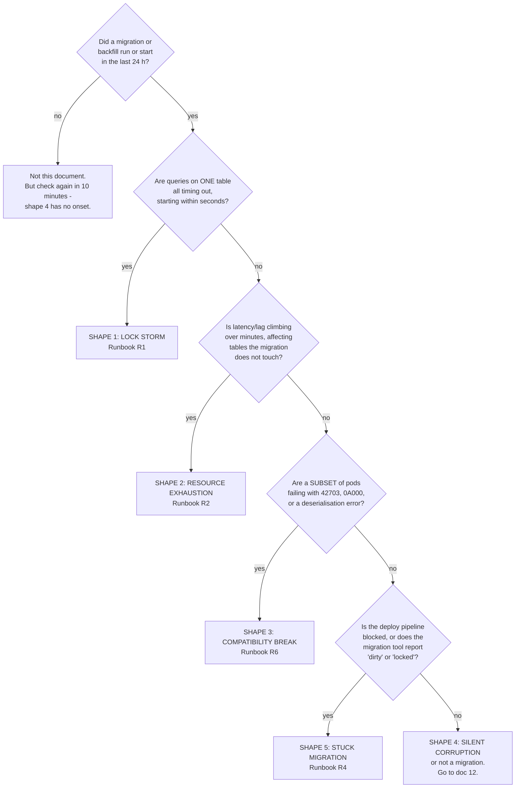

# The Failure Catalogue and Operations Playbook

This is the document for 02:40. Everything before it explains mechanisms; this one is
organised around what you do, in what order, with the specific commands.

It also covers the platform-level failures — the ones that are not about any single
migration's correctness but about running a migration programme at all, across many teams, on
a system that is also doing other things. Scenario IDs are `P-nn`.

---

## The first question, and why it is first

**During any production incident, the first question is: did anything change in the last 24
hours — including a migration?**

Not because migrations cause most incidents in absolute terms, but because they are the
cheapest hypothesis to test and the most expensive to miss. Testing it takes one query:

```sql
SELECT version, description, installed_on, execution_time, success
FROM flyway_schema_history
WHERE installed_on > now() - interval '24 hours' ORDER BY installed_on DESC;

SELECT job_name, state, rows_done, max_key, updated_at
FROM backfill_progress WHERE state IN ('running','paused');
```

Thirty seconds, and it either eliminates a whole branch of the investigation or points
directly at the cause. The failure mode it prevents is a team spending forty minutes on
application metrics while a backfill saturates the WAL, which is doc 00's shape 2 and is
invisible from the application's own dashboards.

**Make it structural.** Doc 16's single highest-value practice is annotating every dashboard
with migration events. When the responder's first graph already shows a vertical line labelled
"V214 backfill started 02:11", the question answers itself.

---

## Triage: identifying the shape in two minutes

Doc 00's five shapes, now as a decision procedure.



**Shape 4 has no onset**, so it never arrives through a page. It arrives through a human
noticing an implausible number, and the triage for it is doc 12, not this one.

---

## Runbook R1 — A DDL statement is causing a lock storm

**Signature.** Queries against one table all blocked. Connection pool saturating. Onset within
seconds of a migration starting.

```sql
-- 1. CONFIRM. Find the blocking chain and its root.
SELECT blocked.pid AS blocked_pid, left(blocked.query, 60) AS blocked_q,
       blocking.pid AS blocking_pid, left(blocking.query, 60) AS blocking_q,
       blocking.state, now() - blocking.xact_start AS blocking_age
FROM pg_stat_activity blocked
JOIN LATERAL unnest(pg_blocking_pids(blocked.pid)) AS bp ON true
JOIN pg_stat_activity blocking ON blocking.pid = bp
WHERE blocked.wait_event_type = 'Lock'
ORDER BY blocking_age DESC;

-- 2. ACT. Cancel the DDL, not the blocker.
SELECT pg_cancel_backend(<ddl_pid>);

-- 3. If the DDL is not the problem - it already holds the lock and is running long -
--    then cancel it anyway. A long-running ACCESS EXCLUSIVE during an incident is
--    not something to wait out.

-- 4. VERIFY the queue drained.
SELECT count(*) FROM pg_stat_activity WHERE wait_event_type = 'Lock';
```

MySQL equivalent:

```sql
SELECT ot.OBJECT_NAME, ot.LOCK_STATUS, t.PROCESSLIST_ID, t.PROCESSLIST_INFO
FROM performance_schema.metadata_locks ot
JOIN performance_schema.threads t ON t.THREAD_ID = ot.OWNER_THREAD_ID
WHERE ot.OBJECT_SCHEMA = '<db>';
-- KILL <processlist_id of the DDL>;
```

⚠️ **Cancel the DDL before the blocker.** Cancelling the blocker grants the DDL its lock and
hands it a 400-deep queue.
⚠️ **`pg_cancel_backend`, not `pg_terminate_backend`.** Terminating a migration session can
leave the tool unable to report what completed.

**After.** Add `lock_timeout` to the migration (doc 02's `L-01`) before retrying, and check for
`idle in transaction` sessions (`L-02`) before the next attempt, or the retry loop will simply
exhaust.

---

## Runbook R2 — A backfill is exhausting a shared resource

**Signature.** Latency or lag climbing over minutes. Tables the migration does not touch are
affected. Replica lag, WAL rate, dead tuples, CDC lag or connection count elevated.

```sql
-- 1. PAUSE FIRST, DIAGNOSE SECOND. This is cheap and reversible.
UPDATE backfill_progress SET state = 'paused' WHERE state = 'running';

-- 2. Now find which resource. Check in this order - fastest to confirm first.
SELECT application_name, state, now() - xact_start AS age, wait_event_type, wait_event
FROM pg_stat_activity WHERE state <> 'idle' ORDER BY xact_start;

SELECT application_name, replay_lag, pg_wal_lsn_diff(pg_current_wal_lsn(), replay_lsn)
FROM pg_stat_replication;

SELECT slot_name, active, wal_status,
       pg_size_pretty(pg_wal_lsn_diff(pg_current_wal_lsn(), restart_lsn)) AS retained
FROM pg_replication_slots;

SELECT relname, n_dead_tup, n_live_tup, last_autovacuum
FROM pg_stat_user_tables WHERE n_dead_tup > 1000000 ORDER BY n_dead_tup DESC;
```

**3. Recovery depends on which resource:**

| Resource | Action |
|---|---|
| Replica lag | Stay paused until lag returns to baseline. It will recover at `(A − G)/A` of real time, so a 6-hour backfill means hours of recovery |
| WAL/disk | Pause, then confirm archiving and slots are draining. Check for an inactive slot (doc 08's `R-06`) |
| Dead tuples | Pause, run `VACUUM (VERBOSE) orders;` manually, and tune the table before resuming (doc 06's `B-05`) |
| CDC lag | Pause. Check whether consumers are merely behind or have lost their offsets to retention — **the second is unrecoverable and changes the response from "wait" to "re-snapshot"** |
| Connections | Pause, and check whether the backfill is holding connections or merely causing others to |

**4. Resume at a lower rate**, not at the same one. Halve it, and record why in the migration's
log.

⚠️ **On MySQL and Oracle, do not kill a long-running backfill transaction.** The rollback
replays the undo log and takes longer than the work did. Pause the job so it stops issuing new
chunks and let the current one finish.

---

## Runbook R3 — An invalid index is left behind

**Signature.** Write latency elevated after an interrupted migration. Queries not using an
index you believe exists.

```sql
-- 1. CONFIRM
SELECT i.indexrelid::regclass AS idx, i.indrelid::regclass AS tbl
FROM pg_index i WHERE NOT i.indisvalid;

-- 2. Is a build currently in progress, or is this a corpse?
SELECT pid, phase, blocks_done, blocks_total, tuples_done, tuples_total, current_locker_pid
FROM pg_stat_progress_create_index;

-- 3. If no build is running, drop the corpse.
DROP INDEX CONCURRENTLY <index_name>;

-- 4. Before rebuilding, clear what blocked it last time.
SELECT pid, now() - xact_start AS age, state, left(query,80)
FROM pg_stat_activity WHERE xact_start < now() - interval '5 minutes';
```

⚠️ Do not re-run `CREATE INDEX CONCURRENTLY` with the same name without dropping first — it
fails with "relation already exists", and some tooling reports that as success.

---

## Runbook R4 — A migration is half applied and the pipeline is blocked

**Signature.** `Dirty database version N`, or Liquibase's
`Could not acquire change log lock`, or a multi-statement migration that failed partway.

**This is the runbook where the ordering matters most, because the tempting first action is the
one that makes recovery impossible.**

```
1. DO NOT clear the dirty flag or the lock yet.

2. Determine whether anything is still running.
     SELECT pid, state, now()-xact_start AS age, left(query,100)
     FROM pg_stat_activity WHERE application_name LIKE '%migrate%' OR query ILIKE 'alter%';
   If something IS running: wait, or cancel it deliberately. Do not act on a moving target.

3. RECORD THE ACTUAL SCHEMA STATE in the incident channel, before changing anything.
     \d+ orders
     SELECT indexname, indexdef FROM pg_indexes WHERE tablename='orders';
     SELECT conname, pg_get_constraintdef(oid) FROM pg_constraint
      WHERE conrelid='orders'::regclass;

4. Read the migration file. For each statement, decide: did it apply?
   Write the list in the channel. This is the artefact that makes the rest reviewable.

5. CHOOSE A DIRECTION.
     Forward  - run the remaining statements by hand. Usually easier.
     Backward - undo the applied ones. Only if forward is unsafe with running code.

6. Execute the chosen direction, one statement at a time, pasting each into the channel.

7. ONLY NOW reconcile the tool's state.
     golang-migrate:  migrate -path ... -database ... force 214
     Flyway:          flyway repair     (after verifying checksums are genuinely unchanged)
     Liquibase:       UPDATE "DATABASECHANGELOGLOCK" SET LOCKED=0 WHERE ID=1;

8. Run the next migration in a non-production environment first to confirm the
   chain is intact.
```

⚠️ **Clearing the flag first unblocks deploys and makes the divergence permanent and
invisible.** Every later migration will apply on top of a schema nobody reconciled.
⚠️ **Clearing a Liquibase lock while a migration is genuinely running** produces the
concurrent execution the lock existed to prevent.

---

## Runbook R5 — A column was dropped and the application is failing

**Signature.** `42703 column does not exist`, or deserialisation errors, immediately after a
contract migration.

```sql
-- 1. RESTORE THE STRUCTURE FIRST. Metadata-only, milliseconds.
--    This stops the bleeding even though the data is gone.
SET lock_timeout = '2s';
ALTER TABLE orders ADD COLUMN legacy_region text;

-- 2. Determine whether the failing consumer needs the DATA or just the COLUMN.
--    An INSERT that lists the column, or a strict struct scan, needs only the column.
--    A report that reads values needs the data.

-- 3. If it needs data: recover it. In order of preference:
--    a. From the new representation, if the drop was part of a migration
--       that moved the data elsewhere.
--    b. From the lakehouse / warehouse copy, which almost certainly still has it.
--    c. From a PITR clone restored to a scratch cluster - NOT by restoring
--       production (doc 13's U-04).
```

Step 3c is the one worth internalising: **restore a clone and copy the column out of it**,
rather than restoring production to a point before the drop. The clone costs money and an hour;
restoring production costs every write since.

⚠️ **Do not re-drop the column to "get back to a clean state".** You are in a recovery, not a
migration.

---

## Runbook R6 — A subset of pods is failing with a compatibility error

**Signature.** Partial failure correlated with pod identity, not with request content. Error
is `42703`, `0A000`, or a client-side mapping failure.

```
1. Identify the direction. Which version is failing?
     - OLD pods failing  -> a contract migration ran too early. The schema is
                            ahead of some code.
     - NEW pods failing  -> an expand migration has not run, or ran on the
                            wrong database.

2. If OLD pods are failing:
     ROLL FORWARD. Complete the rollout so every pod runs new code.
     ⚠️ DO NOT revert the deploy - that moves all pods into the failing state
        (doc 13's U-02).

3. If NEW pods are failing:
     Revert the deploy (safe - the schema is a superset), then run the
     missing migration, then redeploy.

4. If the error is 0A000 'cached plan must not change result type':
     Cycle connections. Do not roll back the migration.
       SELECT pg_terminate_backend(pid) FROM pg_stat_activity
        WHERE application_name = 'order-service' AND state = 'idle';
     Through PgBouncer:  PAUSE <db>; RECONNECT <db>; RESUME <db>;
```

The direction check in step 1 is the whole runbook. Getting it backwards converts a 50% failure
into a 100% failure, and under pressure the instinct is to revert in both cases.

---

## Runbook R7 — A logical subscriber is stopped and the primary's disk is filling

**Signature.** Disk utilisation climbing on the **primary** with no corresponding data growth.
`pg_replication_slots` shows an inactive slot with large retention.

```sql
-- 1. CONFIRM and measure the runway.
SELECT slot_name, active, wal_status,
       pg_size_pretty(pg_wal_lsn_diff(pg_current_wal_lsn(), restart_lsn)) AS retained
FROM pg_replication_slots ORDER BY pg_wal_lsn_diff(pg_current_wal_lsn(), restart_lsn) DESC;

SELECT pg_size_pretty(sum(size)) FROM pg_ls_waldir();
-- Runway = free space / current WAL generation rate. At 90 MB/s during a
-- backfill, 300 GB free is 55 minutes.

-- 2. Why is it stopped? Usually a missing column on the subscriber (doc 08's R-05).
--    On the SUBSCRIBER:
SELECT * FROM pg_stat_subscription;
--    and check its log for the apply error.

-- 3. FASTEST FIX: apply the missing DDL on the subscriber. Replication resumes
--    from where it stopped and the slot drains. Minutes.

-- 4. If the subscriber cannot be fixed in the available runway:
--    extend the volume (EBS modification is online, minutes), OR
--    pause the backfill to cut WAL generation, OR
--    as a last resort, drop the slot:
--      SELECT pg_drop_replication_slot('warehouse_sub');
```

⚠️ **Dropping the slot means the subscriber must be rebuilt from a fresh snapshot** — hours for
a 1.42 TB database. Try steps 3 and 4's first two options first.
⚠️ **Never delete files from `pg_wal/`.** Removing an unarchived segment makes the cluster
unrecoverable.

---

## Runbook R8 — A store cutover must be reversed

**Signature.** Post-cutover defect. Decision to go back.

```
1. Is the reverse stream running and healthy?
     Check its lag against the target's current position - the same check as
     "tail lag is zero", in the other direction.
     YES -> flip the application back. Seconds. Then STOP, assess, and
            decide whether to retry the cutover.
     NO  -> continue.

2. Can you fix forward? Ask explicitly and answer in writing.
   Past a cutover this is usually the right answer and the rest of this
   runbook is for when it genuinely is not.

3. Enumerate what the target accepted since cutover.
     By identifier range, by timestamp, or from the target's own change log.
     You need the COUNT before deciding anything:
       SELECT count(*), min(created_at), max(created_at) FROM target.orders
        WHERE created_at > '<cutover time>';

4. Replay those into the source, through the reverse mapping, with the
   known hazards: empty-string handling, byte-length limits, identifier
   collisions with the source's own sequences.

5. Verify the replay with doc 12's chunked checksum over the affected range
   before flipping back.

6. Flip. Then write down why the reverse stream was not running, because
   that is the actual finding.
```

---

## Platform-level failures

### P-01 · The incident that is a migration, and nobody says so

**What you see.** Forty minutes into an incident bridge, someone mentions a backfill.

**Prevent.** Three things, all structural rather than cultural:

1. **Deploy and migration markers on every dashboard.** Doc 16.
2. **A standing item in the incident template**: "Recent changes (last 24 h)", filled in by the
   responder in the first two minutes from the query at the top of this document.
3. **Notify the incident channel automatically** when a migration or backfill starts and
   finishes. One webhook from the pipeline, and it removes the whole category.

### P-02 · The migration nobody can stop

**What you see.** A backfill needs to stop. It runs in a Kubernetes Job. The only option is
`kubectl delete job`, which loses whatever was in flight and leaves no record.

**Prevent.** Every long-running migration job must have a **pause switch readable from the
database**, which doc 06's `state` column provides. The properties that matter:

- Reachable by anyone with database access, without cluster credentials, tooling, or a deploy.
- It leaves a record — the row says who paused it and when.
- It is graceful: the job finishes its current chunk and stops, rather than aborting a
  transaction.
- **It works when the pipeline is broken**, which is exactly when you need it.

Put the exact `UPDATE` statement in the runbook, copy-pasteable.

### P-03 · Two teams migrating the same table

**What you see.** Team A is in phase 3 of a column migration on `orders`. Team B, unaware,
starts a different migration on the same table. The two interleave and neither can reason
about the state.

**Mechanism.** No coordination mechanism exists, because migrations are files in repositories
and repositories are per-team.

**Prevent.** A **migration registry**: one row per in-flight migration, per table, visible to
everyone, with an enforced constraint that at most one *structural* migration is in flight per
table.

```sql
CREATE TABLE migration_registry (
  table_name   text NOT NULL,
  migration_id text NOT NULL,
  owner        text NOT NULL,
  phase        text NOT NULL,
  started_at   timestamptz NOT NULL DEFAULT now(),
  expected_end date NOT NULL,
  PRIMARY KEY (table_name, migration_id)
);
CREATE UNIQUE INDEX one_structural_per_table ON migration_registry (table_name)
  WHERE phase NOT IN ('complete','abandoned');
```

The partial unique index is the enforcement, and it is four lines. The registry is also what
lets a responder at 02:40 answer "what else is happening to this table?" without asking around.

### P-04 · The migration that ran during an unrelated incident

**What you see.** A sev-2 is in progress on the payments path. A scheduled backfill starts at
02:00 on `orders`, adding load and a confounding variable.

**Prevent.** The migration pipeline should check the incident-management system before starting
a long-running step, and refuse if there is an active incident above a severity threshold. This
is a two-line integration and it removes a recurring, entirely avoidable, compounding factor.

The converse is equally important: **declaring an incident should pause running backfills**
automatically, via the same `state` column. If that feels aggressive, make it a prompt — but
make it a default.

### P-05 · The migration owner is asleep

**What you see.** A migration in its fifth day of backfill misbehaves at 03:00. The runbook
says "contact the migration owner." The owner is nine time zones away.

**Prevent.** A long-running migration must be operable by the on-call engineer without
specialist knowledge, which means the runbook must contain:

- The pause statement, copy-pasteable.
- The abort criteria as numbers, so no judgement is required.
- The three most likely failures and their responses.
- What is safe to do without the owner, and the one thing that is not: **crossing the point of
  no return**, which should require the owner or their delegate regardless of the hour.

A migration that cannot be paused safely by on-call is a migration that should not be running
overnight.

### P-06 · The runbook that references a tool nobody can access

**What you see.** The runbook says "run `vtctldclient Reshard ... ReverseTraffic`". The on-call
engineer does not have the binary, the credentials, or the network path.

**Prevent.** Rehearse the runbook **as the on-call engineer**, from their laptop, with their
permissions, before the migration starts. This finds missing access, missing tooling, and
missing VPN rules at a time when they are an inconvenience rather than an outage extension.

Doc 17 makes this a formal gameday item; the minimum version is one person spending twenty
minutes.

### P-07 · The post-migration watch period that nobody ran

**What you see.** A migration completes at 03:40. Everyone goes to bed. At 09:00 the business
day starts and a problem appears that nobody connects to the migration six hours earlier.

**Mechanism.** "Done" was defined as "the statement completed", not "the system behaved
correctly through a full cycle of its workload." The workload at 03:40 is nothing like the
workload at 09:00.

**Prevent.** Define done as **one full business cycle after the change**, with someone
explicitly watching the first peak. For Riverbend that is the 09:00–11:00 window; for Ironvale
it is the Monday batch. Put it in the plan as a step with a name against it, because an
unassigned watch period is not a watch period.

### P-08 · The small migration that skipped the process

**What you see.** A one-line `ALTER TABLE` on a small table, applied without review, takes the
site down — because the table was small and the lock queue was not.

**Mechanism.** Process is applied by perceived size, and perceived size is table rows. The
hazards in doc 02 are mostly independent of table size: a lock queue jam needs only a
long-running reader, and a compatibility break needs only a column that code references.

**Prevent.** Make the *cheap* parts of the process unconditional and the expensive parts
conditional:

| Always, regardless of size | Only for large or risky changes |
|---|---|
| `lock_timeout` and a retry loop | A production-sized rehearsal |
| CI lint | A written plan with phases |
| The compatibility check against running code | A go/no-go meeting |
| Expand-before-deploy ordering | A named point of no return |
| A migration-registry row | A rollback rehearsal |

The left column costs nothing per migration once it is in the tooling, and it covers the
failures that do not care how big your table is. **Most "we skipped the process" incidents are
left-column failures**, which means the fix is tooling, not discipline.

---

## Actions that make things worse

The consolidated list, because during an incident the dangerous actions are the intuitive ones.

| ⚠️ Do not | Because | Instead |
|---|---|---|
| Cancel the blocking query to "let the migration through" | The DDL is granted its lock and holds a 400-deep queue | Cancel the DDL |
| `pg_terminate_backend` a migration session | The tool may not record what completed | `pg_cancel_backend` |
| Clear a `dirty` flag or a change-log lock first | Unblocks deploys onto an unreconciled schema | Reconcile the schema, then clear |
| Revert the deploy when **old** pods are failing | Moves every pod into the failing state | Roll forward |
| Roll back a migration to fix `0A000` | A second result-type change, a second wave | Cycle connections |
| Kill a long `UPDATE` on MySQL or Oracle | Undo rollback takes longer than the work | Pause the job; let the chunk finish |
| Restore production to a pre-migration point | Discards every write since — 482,400 orders for two hours | Restore a clone, copy out what you need |
| Delete files from `pg_wal/` | Unrecoverable cluster | Extend the volume, or drop the slot deliberately |
| Drop a replication slot as a reflex to a disk alert | The subscriber needs a full rebuild | Fix the subscriber's DDL first |
| Re-run `CREATE INDEX CONCURRENTLY` after a failure | "Already exists", sometimes reported as success | `DROP INDEX CONCURRENTLY` first |
| Re-drop a column you just re-added in a recovery | You are in a recovery, not a migration | Stop, stabilise, plan |
| `flyway repair` after editing a migration's logic | Hides a real divergence permanently | Revert the file; add a new migration |

---

## What to take away

1. **The first question in any incident is "did anything change in the last 24 hours."** One
   query, thirty seconds, eliminates or confirms a whole branch.
2. **Migration markers on every dashboard make that question answer itself**, which is why it
   is doc 16's highest-value practice.
3. **Five shapes, identified in two minutes**: one table timing out (lock storm), unrelated
   tables degrading (resource exhaustion), a subset of pods erroring (compatibility), pipeline
   blocked (stuck), and no symptom at all (silent corruption).
4. **Shape 4 never arrives through a page**, so the triage for it is verification, not this
   document.
5. **Cancel the DDL, not the blocker**, and prefer `pg_cancel_backend`.
6. **Pause the backfill first, diagnose second.** It is cheap and reversible, and it removes a
   variable.
7. **For a stuck migration, record the actual schema state before changing anything**, and
   clear the tool's flag last.
8. **When old pods are failing, roll forward.** Reverting moves every pod into the failing
   state.
9. **Restore a clone to recover a dropped column**, never production.
10. **Fix the subscriber's missing column before dropping its slot**, and measure the disk
    runway so you know how long you have.
11. **Every long-running migration needs a pause switch readable from the database**, graceful,
    recorded, and working when the pipeline is not.
12. **A partial unique index on a migration registry enforces one structural migration per
    table** in four lines, and answers "what else is happening to this table?" at 02:40.
13. **An active incident should block a migration starting, and declaring an incident should
    pause running backfills.** Both are two-line integrations.
14. **A migration that cannot be safely paused by on-call should not run overnight**, and
    crossing the point of no return should require the owner regardless of the hour.
15. **Rehearse the runbook as the on-call engineer, with their access**, before the migration
    starts.
16. **"Done" is one full business cycle later, with someone named watching the first peak.**
17. **Make the cheap parts of the process unconditional.** Most "we skipped the process"
    incidents are failures of `lock_timeout` and a lint rule, which cost nothing per migration.

Next: [16-observability-for-migrations.md](16-observability-for-migrations.md), which is what
you should be watching so that most of this document is unnecessary.
