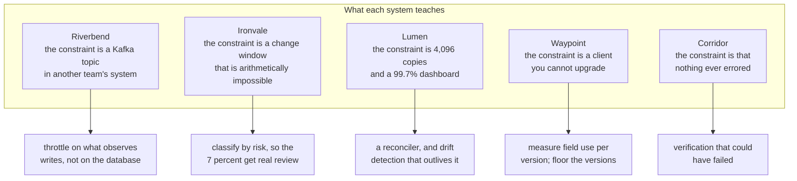

# Database Migrations at Enterprise Scale

A staff-level collection on the operation every team performs routinely and few perform
safely: changing a schema, moving data into it, or moving it to a different database
altogether — while the system stays up, the data stays correct, and several hundred engineers
keep shipping.

The organising claim is this. **A migration is the only change you make that cannot be
canaried, usually cannot be rolled back, and can be wrong silently for months.** A code deploy
has a previous image; a migration has a dropped column. A bad config push affects the pods you
pushed it to; a bad schema change affects every reader and writer of that table, in every
service, forever. And a code bug produces an error, while a backfill with an off-by-one in its
`WHERE` clause produces green dashboards and a currency field that is wrong for 4,100 orders
until somebody notices in five months.

Four properties cause nearly everything in this collection:

- **Two versions of your code run against one schema**, always, because that is what deploying
  without downtime means. For a mobile client the window is years, not minutes.
- **A schema couples to three parties, not one**: running code, the data already written, and
  downstream consumers you usually cannot enumerate. The third produces the worst incidents.
- **Calendar time exceeds machine time by roughly twenty to one.** Sixty-four hours of work
  inside an eight-week programme. Optimising the backfill is almost never the thing to
  optimise.
- **The cheapest failure is loud and immediate; the expensive one is silent.** Most of the
  discipline here exists to convert the second kind into the first.

## Who this is for

Read this if two or more are true:

- You have a table big enough that `ALTER TABLE` is a decision rather than a statement.
- You deploy more than one instance of your application, so there is a window in which two
  code versions run at once.
- Something downstream reads your database — a CDC stream, a warehouse, a search index, a
  partner export — and you cannot name all of it.
- Your organisation has a change process that migrations have to pass through, and you suspect
  the process is not making anything safer.
- You are migrating off something: Oracle, a monolith's shared database, a sharding scheme
  that cannot grow, a database version going end-of-life.
- You are preparing for a design interview where "how would you add a column to a
  500-million-row table with no downtime" comes up, which it does.

**If your whole database is under ten gigabytes, you deploy from one repository, and you have
no uncontrolled clients, most of this is describing problems you do not have.** Read
[00](00-what-a-migration-actually-is.md), [02](02-what-ddl-does-to-a-live-database.md) and
[05](05-compatibility-between-code-and-schema.md), put a `lock_timeout` in your migration
tooling, and stop. Tier 1 of
[21-golden-defaults-and-checklists.md](21-golden-defaults-and-checklists.md) is four items
long and it is genuinely all you need.

## Start here, in this order

1. **[00-what-a-migration-actually-is.md](00-what-a-migration-actually-is.md)** — read first
   even if you have run migrations for a decade. It separates the three activities that share
   the name, establishes the two-versions invariant everything else assumes, and names the
   five incident shapes.
2. **[01-the-migration-lifecycle-and-expand-contract.md](01-the-migration-lifecycle-and-expand-contract.md)**
   — the six phases, and every number the collection reuses, derived. When a later doc says
   "recall the 521 million rows in `orders`", it means this page.
3. **[02-what-ddl-does-to-a-live-database.md](02-what-ddl-does-to-a-live-database.md)** — if
   you read only one more, read this one. It is the difference between eight milliseconds and
   a seventy-second outage, and it is engine- and version-specific in ways most published
   advice is now wrong about.
4. Then read in whatever order matches your problem. Docs cross-reference rather than assuming
   you read them in sequence.

If something is **broken right now**, go to
[21](21-golden-defaults-and-checklists.md) for the triage order, then
[15](15-the-failure-catalogue-and-operations-playbook.md) for the runbooks. If you are
**planning a migration**, go to [01](01-the-migration-lifecycle-and-expand-contract.md) and
the plan template in [21](21-golden-defaults-and-checklists.md). If you are **arguing with a
change process**, go to [18](18-organisation-ownership-and-enterprise-process.md). If you are
**preparing for an interview**, read 00, 01, 02, 06, then
[19](19-case-studies.md) and [20](20-staff-interview-questions.md).

## Topics

### Part 1 — Foundations

| Doc | Covers |
|-----|--------|
| [00-what-a-migration-actually-is.md](00-what-a-migration-actually-is.md) | Schema, data and store changes as three different problems; the two-versions invariant and what it forbids; why migrations deserve more rigour than code changes of the same size; the three couplings; the four properties required at scale and what each costs; calendar time versus machine time; the five incident shapes |
| [01-the-migration-lifecycle-and-expand-contract.md](01-the-migration-lifecycle-and-expand-contract.md) | The running systems and every number reused later; a minute-by-minute walk through the naive attempt and its two separate failures; the six phases; how many phases each kind of change actually needs; the `CHECK ... NOT VALID` route to `SET NOT NULL`; when to skip all of it |

### Part 2 — The mechanics

| Doc | Covers |
|-----|--------|
| [02-what-ddl-does-to-a-live-database.md](02-what-ddl-does-to-a-live-database.md) | `L-01…L-14`: why locks exist, which makes the conflict matrix derivable; the per-statement cost table for PostgreSQL; the lock queue jam and the two-line fix; rewrites you did not know were rewrites; `CREATE INDEX CONCURRENTLY` as five transactions; MySQL's metadata locks, `INSTANT` versus `INPLACE`, and a one-year default timeout; SQL Server lock escalation; Oracle's recompile storm |
| [03-online-schema-change-tools.md](03-online-schema-change-tools.md) | `O-01…O-10`: every tool is copy, sync, swap — and the two choices in each; why CockroachDB and Spanner need no shadow table, and what the F1 state machine proves about expand/contract; pt-osc's trigger cost and foreign-key options; gh-ost's cut-over lock dance and throttling; `pg_repack`; `pgroll`'s versioned views; Vitess as the reference implementation |
| [04-migration-tooling-versioning-and-the-pipeline.md](04-migration-tooling-versioning-and-the-pipeline.md) | `T-01…T-12`: versioned versus declarative; what the migration table should record and what it does; advisory locks versus lock tables; version collisions and out-of-order application; the half-applied migration and how to recover it in the right order; drift; where migrations should actually run; the three database roles |
| [05-compatibility-between-code-and-schema.md](05-compatibility-between-code-and-schema.md) | `C-01…C-14`: the compatibility matrix; `SELECT *` and positional corruption; `cached plan must not change result type` and why rolling back makes it worse; ORM schema caches; enums; widening a type and the client that did not; the contract change at every boundary; clients you cannot upgrade; the glibc collation change that silently breaks every text index; measuring the real compatibility window |

### Part 3 — Moving the data

| Doc | Covers |
|-----|--------|
| [06-backfills.md](06-backfills.md) | `B-01…B-10`: 1.2 KB of WAL per row derived; why the single statement is bad in four independent ways; chunking, idempotent predicates, cursors in the same transaction, and feedback-driven rate control; **choosing the throttle signal from your architecture**, and why Riverbend's binding constraint is a Kafka topic 79× away; triggers and `updated_at`; autovacuum; the long transaction that stops vacuum everywhere |
| [07-dual-writes-shadow-reads-and-the-transition.md](07-dual-writes-shadow-reads-and-the-transition.md) | `W-01…W-12`: four places to put a dual write; the gap trigger that turns "find every write path" into a monitoring problem; generated columns and their size threshold; `IS DISTINCT FROM`; defining equality once; shadow reads at 1%; divergence that will not reach zero, and what to do about it; sticky flag ramps |
| [08-replication-replicas-and-logical-decoding.md](08-replication-replicas-and-logical-decoding.md) | `R-01…R-12`: the `(G − A)/A` lag formula; recovery conflicts versus `hot_standby_feedback` as two ends of one trade; read-after-write breaking under lag; **logical replication's opposite ordering rules for add and drop**; the stopped subscriber that fills the primary's disk; `REPLICA IDENTITY FULL`; failover mid-migration; the sequences nobody advanced; what Aurora does and does not remove |
| [09-store-to-store-migrations-and-cdc-cutovers.md](09-store-to-store-migrations-and-cdc-cutovers.md) | `M-01…M-14`: capture before snapshot, always; Oracle's empty string; case-insensitive sources and case-sensitive targets; numeric mappings that overflow in production; the PL/SQL inventory that changes the estimate; the write-freeze cutover minute by minute; the reverse stream; why you must not dual-write across stores; extracting a table from a shared database |

### Part 4 — Many databases

| Doc | Covers |
|-----|--------|
| [10-sharding-resharding-and-moving-tenants.md](10-sharding-resharding-and-moving-tenants.md) | `S-01…S-10`: why hash-modulo moves 89% of keys and fixed virtual shards do not; the five-step shard move; **fencing with a generation number**, and accepting 300 ms of unavailability to avoid divergence; Vitess's four design decisions worth copying; a 45-day rollout with three coexisting schema states; global identifiers; moving one tenant at a time |
| [11-fleet-rollout-multi-region-and-multi-tenant.md](11-fleet-rollout-multi-region-and-multi-tenant.md) | `F-01…F-10`: a reconciler rather than a script, and the four properties that buys; wave and bake design; **the 99.7% dashboard that means failure**; bidirectional rollback; region ordering and bidirectional replication's stronger constraint; schema-per-tenant versus shared-table costed; version skew as a deploy gate |

### Part 5 — Correctness and reversal

| Doc | Covers |
|-----|--------|
| [12-verification-and-reconciliation.md](12-verification-and-reconciliation.md) | `V-01…V-06`: the sampling arithmetic — 460,500 rows for 99% confidence, independent of table size; chunked checksums that localise in 13 comparisons; invariants and reconciling against Finance; **never verify with the transformation under test, and never iterate from the backfill's cursor**; the verification report that states its exceptions and residual risk |
| [13-rollback-the-point-of-no-return-and-forward-fix.md](13-rollback-the-point-of-no-return-and-forward-fix.md) | `U-01…U-07`: why down migrations are mostly a lie; reversible, recoverable, irreversible; **finding the point of no return**, which is earlier than people think; the rollback window; the deploy/schema matrix; PITR's real cost (482,400 orders, not 70 minutes); fixing forward, and the freeze-the-set discipline that makes a repair auditable |

### Part 6 — Beyond the relational database

| Doc | Covers |
|-----|--------|
| [14-migrations-in-nosql-search-and-analytics-stores.md](14-migrations-in-nosql-search-and-analytics-stores.md) | `N-01…N-14`: schemaless moved the schema into the readers; versioned documents and the sweeper that lets you delete the branches; DynamoDB's immutable key schema and the GSI that throttles the base table; Cassandra's eventually-consistent schema and removed `ALTER TYPE`; Elasticsearch alias swaps; ClickHouse mutations and the `ORDER BY` rule that silently breaks deduplication; Redis key formats; `BACKWARD` compatibility that is not safe; Protobuf `reserved`; Iceberg field IDs, and why they guarantee identity but not meaning |

### Part 7 — Operating and organising

| Doc | Covers |
|-----|--------|
| [15-the-failure-catalogue-and-operations-playbook.md](15-the-failure-catalogue-and-operations-playbook.md) | `P-01…P-08`: the first question in any incident; shape identification in two minutes; eight runbooks with the exact commands; the migration registry's four-line enforcement; incidents and migrations blocking each other; **the consolidated list of actions that make things worse** |
| [16-observability-for-migrations.md](16-observability-for-migrations.md) | Change annotations as the highest-return hour you can spend; the pre-flight gate that refuses rather than warns; the seven signals and the SQLSTATE codes worth alerting on; abort criteria in three bands; the single-glance dashboard; **which metric misleads during which failure**; four programme-level metrics, including why a zero abort rate is a problem |
| [17-testing-migrations.md](17-testing-migrations.md) | What staging fails to reproduce, line by line; **the CI job most teams do not have** — the previous release's tests against the new schema; the lint rules worth enforcing and the override that requires a reason; Aurora's near-free production-sized clone; measuring WAL per row; gamedays, with the one item that matters most |
| [18-organisation-ownership-and-enterprise-process.md](18-organisation-ownership-and-enterprise-process.md) | **The arithmetic that shows the window model is impossible**, and what organisations do with an impossible control; risk classification that gives the 7% two hours instead of everyone eight minutes; separation of duties satisfied better by a pipeline than a person; ownership and consumer registries; the review checklist and how much of it automates; erasure, residency and the forgotten rehearsal clone; funding the migrations nobody wants |

### Part 8 — Practising

| Doc | Covers |
|-----|--------|
| [19-case-studies.md](19-case-studies.md) | `CS-1…CS-10`: ten incidents as timelines — the 3 ms statement that caused 70 seconds of outage and 4 more from the response; the backfill that took down the search index; the empty string that became NULL for 2.1M customers; the window that ran out at 03:50; twelve shards found five months later; the freeze that delayed a security fix six weeks; the field removed for 90,000 drivers; the migration that was wrong for six weeks; one Cassandra node on a different schema; the OS upgrade that broke every text index |
| [20-staff-interview-questions.md](20-staff-interview-questions.md) | Eighteen questions with model answers and the follow-ups a strong answer invites, plus the five patterns that distinguish a strong answer from a complete one |
| [21-golden-defaults-and-checklists.md](21-golden-defaults-and-checklists.md) | Triage order; golden configuration for PostgreSQL, MySQL, gh-ost and the backfill harness; the migration file header; the plan template; the pre-flight gate; **what to build at your scale, in three tiers**; the numbers worth remembering; the ten rules |

## The running systems

Abstract examples make this material harder. Every number below is fixed and reused, so when
doc 06 says "recall the 521 million rows", it means this table — and doc 06's arithmetic
reconciles with doc 01's.

Two systems carry most of the weight, and they were chosen because **they fail differently**:
at Riverbend the constraint is engineering, and at Ironvale it is not.

| System | Shape | What it contributes |
|---|---|---|
| **Riverbend** | Online marketplace on EKS — the same system as [`../K8s/cronJobs`](../K8s/cronJobs/README.md), [`../Observability`](../Observability/README.md), [`../Kafka`](../Kafka/README.md), [`../MicroservicesPOF`](../MicroservicesPOF/README.md), [`../LogCollector`](../LogCollector/README.md) | `orders-db`: Aurora PostgreSQL 15, `db.r6g.4xlarge` (16 vCPU / 128 GiB), 1 writer + 2 readers, `max_connections` 600. **`orders` is 521M rows and 336 GB**; the cluster is 1.42 TB against 96 GiB of cache — **6.8% resident**. 67 orders/s (350 at peak) = **764 row-writes/s**. Seven known consumers, including a quarterly export |
| **Ironvale** | Regulated retail and commercial bank | 4,100 engineers, 62 teams, **2,400 production databases** (1,310 Oracle 19c, 680 SQL Server, 310 PostgreSQL, 100 MySQL). `ACCT_MASTER`: 1.1B rows, 340 columns, 4.7 TB, 61 reading applications. Separation of duties is mandatory. **8 usable change windows × 4 hours per year. Median schema-change lead time: 63 days** |
| **Lumen** | Instagram-shaped, 500M DAU | **4,096 MySQL shards** on 256 hosts. A migration is a fleet rollout, and twelve shards silently not taking it is the default outcome. Per-shard backfill 16.9 hours; 64 in parallel is **45 days** |
| **Gateline** | Ticketmaster-shaped, 5,000 → 500,000 QPS in 10 s | The window is set by someone else's calendar. On-sales are contractually committed months ahead |
| **Waypoint** | Uber-shaped, 5M mobile clients | **14 app versions in the field, the oldest two years old.** The two-versions window measured in years |
| **Corridor** | LinkedIn-shaped, versioned derived stores | A migration that completes successfully and produces wrong derived data for six weeks |
| **Northlight** | Netflix-shaped, 2,500 services, Cassandra | One schema change propagates to 100,000 sidecars, and one node can miss it |

## Conventions used across docs

**Scenario IDs.** Every failure has an identifier whose letter names the owning document. They
are the cross-reference spine — the case studies, the interview bank and the playbook cite them
rather than re-explaining. **153 scenarios** across fourteen classes:

| Prefix | Doc | Class |
|---|---|---|
| `L-nn` | 02 | **L**ocking and DDL execution |
| `O-nn` | 03 | **O**nline schema change tools |
| `T-nn` | 04 | **T**ooling, versioning, pipeline |
| `C-nn` | 05 | **C**ompatibility between code and schema |
| `B-nn` | 06 | **B**ackfills |
| `W-nn` | 07 | Dual **w**rites and shadow reads |
| `R-nn` | 08 | **R**eplication and replicas |
| `M-nn` | 09 | Store-to-store **m**igration and CDC |
| `S-nn` | 10 | **S**harding and resharding |
| `F-nn` | 11 | **F**leet rollout |
| `V-nn` | 12 | **V**erification |
| `U-nn` | 13 | **U**ndo and rollback |
| `N-nn` | 14 | **N**on-relational stores |
| `P-nn` | 15 | **P**latform-level operating failures |

Case-study incidents are `CS-1` … `CS-10` (doc 19).

**Each scenario follows the same five headings**, so you can skim to the part you need:

- **What you see** — the symptom, from the point of view of whoever gets paged.
- **Mechanism** — why it happens, derived rather than asserted.
- **Confirm it** — the query or measurement that distinguishes this from the three other things
  it looks like.
- **Recover** — what to do in the next ten minutes.
- **Prevent** — the design or configuration change, and what that change costs.

**Every doc ends with a numbered "What to take away."** If you are revisiting a doc, read that
first.

**Numbers are derived in visible steps.** Where a doc says a backfill takes 63 hours, the
arithmetic is on the page. Check it against your own figures rather than adopting the
conclusion — several of these numbers move by an order of magnitude on different hardware, and
one of them (doc 06's throttle rate) moves by 8× depending on whether you route the backfill
around change-data-capture.

**Statements are marked engine- and version-specific where they are.** `ADD COLUMN ... DEFAULT`
is a 50-minute rewrite on PostgreSQL 10 and 8 milliseconds on PostgreSQL 11, and a great deal
of published migration advice predates the change.

**⚠️ marks an action that can make an ongoing incident worse.** These appear in recovery
procedures where the obvious action is the wrong one, and doc 15 collects them in one table.

## Related collections in this repo

This collection cites rather than re-deriving:

- [`../MicroservicesPOF`](../MicroservicesPOF/README.md) — its `G` class covers deploy, config
  and schema change as *one scenario among thirteen*; this collection is that scenario
  expanded, and its `T` class on transactions and sagas is what doc 09's table extraction turns
  into.
- [`../Kafka`](../Kafka/README.md) — doc 06's backfill flood lands in a Kafka topic, and doc
  09's CDC cutover rides one. The broker, consumer-group and delivery-semantics internals are
  there, not here.
- [`../Observability`](../Observability/README.md) — RED, USE, SLIs and error budgets. Doc 16
  applies those methods to a change whose worst failure has no signal, rather than re-teaching
  them.
- [`../LogCollector`](../LogCollector/README.md) — shares the "make degradation visible; zero
  is almost always a lie" discipline that doc 19's `CS-8` turns into a rule.
- [`../ErrorHandling.md`](../ErrorHandling.md) — converting silent failures into loud ones,
  which is the philosophy underneath this entire collection.
- [`../DataPlatform.md`](../DataPlatform.md) — the analytical-pipeline and tenant-skew material
  doc 14's lakehouse section and doc 11's multi-tenancy section assume.
- [`../../system-design-notes/database`](../../../system-design-notes/database) — PostgreSQL
  internals, transactions and read-path optimisation; doc 02's lock modes and doc 06's MVCC
  arithmetic build on them.
- [`../../system-design-notes/Clickhouse`](../../../system-design-notes/Clickhouse/README.md) —
  the columnar-engine internals doc 14's ClickHouse section assumes.
