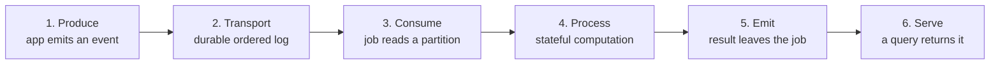

# What a Data Streaming Platform Is, and Why It Is Hard

Read this first, even if you have operated Kafka and Flink for years. It defines the vocabulary
that every other document here uses without stopping to re-explain, and it makes the case for
the one claim the whole collection is organised around: **the hard part of a streaming platform
is time, not throughput.**

Throughput is a procurement problem. If you need to move twice as many events per second, you
buy more machines, and the arithmetic for how many is in
[01-requirements-and-the-capacity-model.md](01-requirements-and-the-capacity-model.md). Time is
different. If you get the time semantics wrong, the system does not fall over. It produces
answers — plausible, well-formatted, confidently-served answers — that are quietly incorrect,
and you find out three months later when someone reconciles a dashboard against a nightly batch
job and the numbers do not match.

## 1. Start with a job you have already written

Here is a piece of code you have almost certainly written, in some language, at some point:

```
every 5 minutes:
    rows = SELECT user_id, COUNT(*) FROM clicks
           WHERE ts >= now() - 5 minutes
    write rows to dashboard_table
```

It runs on a cron schedule, it reads a table, it writes a table. Everybody understands it.

Now suppose the business asks for the same number, but updated every second instead of every
five minutes, and covering 1.85 million clicks per second instead of 400. You cannot run that
query every second. The query planner alone takes longer than a second, and even if it did not,
re-reading five minutes of history every second means reading each row 300 times.

The streaming answer is to turn the computation inside out. Instead of storing the data and
repeatedly asking it questions, you store the *question* and push the data through it:

```
for each click as it arrives:
    counter[click.user_id] += 1
    if a 5-minute boundary has passed:
        emit all counters, reset
```

Each click is touched exactly once. The cost is now proportional to the arrival rate, not to the
history depth multiplied by the query rate. That is the entire economic argument for stream
processing, and it is a good one.

But look at what you gave up. In the batch version, `WHERE ts >= now() - 5 minutes` was
unambiguous — the rows either had a timestamp in range or they did not, and every row that would
ever exist was already in the table when the query ran. In the streaming version, you have to
answer a question the batch version never asked: **when is a five-minute window finished?**

A click that happened at 10:04:59 might arrive at 10:05:03, because the phone that produced it
was in a lift. Do you include it? If you wait for it, how long do you wait — and how do you know
when you have waited long enough, given that you cannot distinguish "no more events are coming"
from "events are coming but the network is slow"? If you do not wait, your 10:00–10:05 count is
wrong, and it is wrong in a way that no error message will ever tell you about.

That question has no correct answer. It has a *chosen* answer, and the choice is a trade between
latency and completeness, and defending that choice with data is one of the things that
distinguishes a staff-level streaming engineer from a competent one. It is the subject of
[05-event-time-watermarks-and-lateness.md](05-event-time-watermarks-and-lateness.md), and it is
why that document sits at the centre of this collection rather than at the end.

## 2. The words, defined once

These terms get used loosely in conversation and precisely in this collection. Where they differ
from casual usage, the difference matters.

**Event.** A fact that happened, at a particular moment, to a particular subject. "Driver
`d-88401` was at latitude 37.7793, longitude -122.4193 at 09:14:07.221Z." Events are immutable —
the past does not change — and this immutability is the property that makes replay possible.
Contrast with a **command** ("charge this card"), which is a request that may be refused, and a
**state update** ("the driver's location is now X"), which overwrites.

The distinction between an event and a state update is not pedantry. If your stream carries
events, a consumer that misses one has a gap. If your stream carries state updates keyed by
subject, a consumer that misses one is simply out of date until the next one arrives, and can be
brought current by replaying only the newest update per key. This is exactly the difference
between a normal Kafka topic and a compacted one, and it is a design decision you make per
stream. It is covered in [04-the-transport-log.md](04-the-transport-log.md).

**Record.** The serialized form of an event on the wire or on disk: a key, a value, a timestamp,
and a set of headers. When this collection quotes an average of 400 bytes, it means the record,
not the event as you think about it in a schema editor.

**Stream.** An unbounded, append-only, ordered-within-a-partition sequence of records. Three
words there are load-bearing:

- *Unbounded* — there is no end. A job over a stream has no natural completion. Every design
  question about restart, upgrade and schema change is harder for this reason.
- *Append-only* — you cannot go back and fix a record. Correcting a mistake means emitting a
  compensating record, which is a different thing and every downstream consumer has to
  understand it.
- *Ordered within a partition* — and explicitly **not** ordered across partitions. This is the
  single most misunderstood property in the whole field, and Section 6 of
  [04-the-transport-log.md](04-the-transport-log.md) exists because of it.

**Topic / stream / log.** Three words for the same thing at different layers. "Topic" is the
Kafka noun, "stream" is the conceptual noun, "log" emphasises the storage shape — an append-only
file you read by offset. This collection uses *stream* for the concept and *topic* when talking
about the broker.

**Partition.** A subdivision of a stream that is the unit of ordering, of parallelism, and of
assignment to a consumer. If a stream has 720 partitions, at most 720 consumer tasks can read it
in parallel, and records that need to be processed in order relative to each other must land in
the same partition.

**Stream processor.** A long-running program that reads one or more streams, maintains state,
and writes to one or more sinks. Flink, Spark Structured Streaming, Kafka Streams, and the
tuned-up consumer loop you wrote yourself are all stream processors; they differ in what they do
for you, not in kind. [21-cost-model-and-build-vs-buy.md](21-cost-model-and-build-vs-buy.md)
compares them with numbers.

**Job.** One deployed stream-processing program. Meridian, the platform in this collection, runs
180 of them.

**Operator.** One step inside a job — a filter, a map, a keyed aggregation, a join, a sink. A job
is a directed graph of operators.

**Task / subtask.** One parallel instance of one operator. If a keyed aggregation has parallelism
120, there are 120 subtasks, each owning a disjoint subset of keys.

**State.** Anything a job remembers between records. A running count, the set of order IDs seen
in the last hour, the current contents of a session, the last-known price of every SKU. State is
the reason streaming is powerful and the reason it is operationally hard, which is why it gets
two documents ([07](07-state-the-state-backend-and-keying.md) and
[08](08-checkpointing-savepoints-and-recovery.md)) rather than one.

**Checkpoint.** A consistent snapshot of every operator's state plus the input positions that
produced it, written to durable storage so the job can be restarted from it. "Consistent" is
doing a lot of work in that sentence and Section 2 of
[08-checkpointing-savepoints-and-recovery.md](08-checkpointing-savepoints-and-recovery.md)
unpacks it.

**Watermark.** An assertion, carried in the stream alongside the records, of the form "I believe
no record with an event timestamp earlier than *T* will arrive after this point." It is a
*belief*, not a fact, and everything interesting about event-time processing follows from that.

**Sink.** Where results go: another stream, an OLAP store, a key-value store, an object-store
table format, a webhook. The sink usually determines what delivery guarantee you can actually
offer, which surprises people who assumed the processor determined it.

**Backpressure.** The mechanism by which a slow consumer slows down its producer, rather than
falling behind silently or running out of memory. Present by design in Flink and in Kafka's
consumer model; absent in most hand-rolled pipelines, which is why they die at 3 a.m.

## 3. The six stages every event passes through

Every event in Meridian goes through the same six stages. Naming them is useful because almost
every failure in this collection can be located at one of the five boundaries between them.



**1. Produce.** Your application code calls something like `producer.send(event)`. The event is
serialized, assigned a partition, placed in an in-memory batch, and — some milliseconds later —
sent. The gap between "the call returned" and "the broker has it durably" is where the first
class of data loss lives, and it is entirely invisible to the application unless you go looking.
Covered in [02-producers-and-the-ingestion-edge.md](02-producers-and-the-ingestion-edge.md).

**2. Transport.** The record is appended to a partition, replicated, and retained for some
window. This is the stage most people mean when they say "our streaming platform", and it is the
best-understood stage, because a decade of Kafka operations has made its failure modes public.
This collection does not re-derive them — [`../Kafka`](../Kafka/README.md) does that — and
instead covers the design decisions that are specific to being the transport layer of a
processing platform: partitioning for parallelism rather than for throughput, retention as a
recovery budget, and compaction as a way of turning a stream into a table.

**3. Consume.** A job's source operator fetches records from its assigned partitions, decodes
them, assigns timestamps, and generates watermarks. Two things go wrong here that go wrong
nowhere else: the assignment of partitions to tasks can be unbalanced, and a partition that
receives no records at all can stall the entire job's notion of time. Both appear in
[05-event-time-watermarks-and-lateness.md](05-event-time-watermarks-and-lateness.md).

**4. Process.** The computation: filter, transform, key, aggregate, window, join. This is where
state lives and where the semantics are decided.

**5. Emit.** Results leave the job. Whether they leave *once*, *at least once*, or *once but only
visibly every 60 seconds* is determined here, and the answer is almost always dictated by what
the sink can do rather than by what the processor can do. Covered in
[09-delivery-guarantees-and-exactly-once.md](09-delivery-guarantees-and-exactly-once.md).

**6. Serve.** Someone queries the result. The freshness they experience is the sum of every
delay above, plus whatever the serving store adds — and if you have not measured the sum end to
end, you do not know it. [13-serving-the-results.md](13-serving-the-results.md) and
[16-observability-of-a-streaming-pipeline.md](16-observability-of-a-streaming-pipeline.md)
handle this jointly.

## 4. Three clocks, and why you need all three

Batch systems have one clock, and it does not matter much: the job runs at 02:00 and processes
yesterday. Streaming systems have three, and confusing them is the most common source of
incorrect results in the field.

**Event time** is when the thing actually happened, according to the device or service where it
happened. `09:14:07.221Z`, stamped by the driver's phone.

**Ingest time** is when the platform first took durable responsibility for the record — the
broker's append timestamp. `09:14:09.104Z`.

**Processing time** is when a particular operator in a particular job looked at the record.
`09:14:09.652Z` for the enrichment job, `09:47:31.008Z` for the backfill run of the same job
three days later.

The gap between event time and ingest time is **lateness**, and it is not a small number. Here
is the distribution measured on Waypoint's `location.updates` stream, which is 750,000 events
per second from three million mobile phones:

| Percentile of lateness | Delay from event time to ingest time |
|---|---|
| p50 | 340 ms |
| p90 | 1.2 s |
| p99 | 4.8 s |
| p99.9 | 41 s |
| p99.99 | 6 min 20 s |
| max observed in 30 days | 4 h 12 min |

Read that table again, because three separate design decisions fall out of it.

First, if you want to emit a one-minute window as soon as the minute ends, you will be missing
roughly 1% of its events, because p99 lateness is 4.8 seconds. Whether that is acceptable
depends on what the number is for. A real-time driver-supply heat map: completely fine. A
regulatory count of trips per city per hour: not fine at all.

Second, the tail does not decay gracefully. Going from p99 to p99.9 costs you 36 more seconds of
waiting for 0.9% more data. Going from p99.9 to p99.99 costs another five and a half minutes for
0.09% more data. There is no waiting time that gets you to "complete" — there is only a curve
with diminishing returns, and you pick a point on it. This is why
[05](05-event-time-watermarks-and-lateness.md) insists that you measure this distribution for
*your* streams before you choose a watermark delay, rather than copying the five seconds out of
a tutorial.

Third, the four-hour maximum is real and it has a cause: a phone that lost connectivity in a
rural area, buffered its events, and uploaded them when it reconnected. No watermark strategy
will ever wait four hours. Those events must be handled by a separate mechanism — a side output,
a late-arrival path, a nightly reconciliation — and if you do not build one, those events are
silently discarded. See scenario `E-06`.

**The rule this collection follows:** use event time for anything whose correctness a human will
ever check against another system, and processing time only for things that are explicitly
about the platform itself ("how many records did we handle in the last minute"). Ingest time is
a useful middle ground for data where the producer's clock cannot be trusted — it is
monotonically non-decreasing per partition, which event time is not, and it is close enough to
event time for high-volume server-side streams. Waypoint's mobile stream is the case where it
is *not* close enough, and `E-04` covers what to do about it.

## 5. Four properties, and why you cannot have all of them at full strength

A streaming platform is evaluated on four properties. Every interesting design decision in this
collection is a trade among them, so it is worth naming them precisely and then showing the
trade concretely.

**Latency** — how long from "the event happened" to "a query can see its effect." Meridian's
at-least-once path delivers p50 36 milliseconds; its exactly-once path delivers p50 31.8
seconds. Same events, same hardware, same code. Section 6 explains why.

**Correctness** — does the result equal what an exhaustive batch computation over the same
events would produce? Note that this is a *comparison to a reference*, not an absolute. If
nobody ever computes the reference, you will never know, which is the entire problem.

**Cost** — Meridian's bill is $361,170 a month for 345.6 billion events a day, derived line by
line in [21-cost-model-and-build-vs-buy.md](21-cost-model-and-build-vs-buy.md). That works out
to **$34 per billion events**, and about two thirds of it is network transfer between
availability zones rather than compute.

**Operability** — can you upgrade a job, change its schema, rescale it, and recover it from a
crash, without a change-management ticket and a four-hour window? For a stateless job the answer
is trivially yes. For the 4.2-terabyte stateful job in Section 7, the answer is a project.

Here is the trade made concrete. Meridian's checkpoint interval is 60 seconds. Suppose someone
asks for lower latency on the exactly-once path and you consider dropping it to 10 seconds.

- Visible latency at the sink improves from p50 31.8 s to p50 6.8 s. Big win on *latency*.
- Checkpoint work rises six-fold. For the 4.2 TB attribution job, each incremental checkpoint
  currently uploads about 5.7 GB in roughly 11 seconds of wall time; at a 10-second interval the
  checkpoints would overlap, which Flink refuses to allow, so the job would spend most of its
  time snapshotting. Cost and operability both get worse.
- Transactional sinks open a new transaction per checkpoint. Six times as many transactions
  against the downstream Kafka cluster means six times the transaction-coordinator load and six
  times as many `__transaction_state` writes. Cost worse again.
- Correctness is unchanged. It was exactly-once before and it is exactly-once after.

So the honest sentence is: *on this job, latency below about 30 seconds is purchasable only by
giving up exactly-once, not by tuning*. Saying that out loud in a design review, with those
numbers, is the job. Reaching for `checkpointInterval: 10s` and hoping is not.

## 6. The two decisions that determine the architecture

Almost every other decision in a streaming platform follows from two. Make these two
deliberately and the rest are mostly consequences; make them by accident and you will spend a
year discovering what you committed to.

### Decision one: which guarantee, per stream, not per platform

The three classical guarantees:

- **At most once** — a record may be lost, never duplicated. You get this by committing your
  read position before doing the work. Almost nobody wants it, and almost everybody who
  hand-rolls a consumer loop gets it by accident.
- **At least once** — a record may be processed more than once, never lost. You get this by
  doing the work before committing the read position. This is the default, it is cheap, and it
  is correct for any computation that is idempotent in its effect.
- **Exactly once** — each record affects the result exactly one time. Note carefully: this is a
  statement about *effects*, not about deliveries. The record may well be *delivered* twice; the
  guarantee is that the second delivery does not change anything.

The choice is per stream, and it should be, because the cost differs by two orders of magnitude
in latency. On Meridian:

| Stream | Guarantee | Why |
|---|---|---|
| `waypoint.location.updates` | At least once | A duplicated GPS point moves a heat-map cell by one part in several thousand. Nobody can see it. 750,000 events/s makes any stronger guarantee expensive. |
| `riverbend.payments.settled` | Exactly once | A duplicated settlement double-counts revenue. The stream is 67 events/s; the cost of a transactional sink is irrelevant at that rate. |
| `corridor.tracking.events` | At least once, with idempotent sink | Deduplication happens in ClickHouse via a `ReplacingMergeTree` on `(event_id)` rather than in the processor, because the processor would need a 1.85-million-per-second dedupe set. |

The third row is the interesting one and it generalises: **the cheapest way to get
exactly-once-in-effect is very often to make the sink idempotent rather than to make the
pipeline transactional.** That is the subject of Section 5 of
[09-delivery-guarantees-and-exactly-once.md](09-delivery-guarantees-and-exactly-once.md).

### Decision two: where state lives

Three options, and the choice determines your recovery time, your rescaling story, and your
failure blast radius.

**Local state** — the job keeps its working set on the machine it runs on (Flink's RocksDB
backend, Kafka Streams' state stores). Reads are a local disk access, roughly 40 microseconds
warm. There is no network call in the hot path, so throughput is high and predictable. The price
is that the state must be snapshotted somewhere durable, that recovery means downloading it
again, and that changing the parallelism means redistributing it.

**Remote state** — the job keeps nothing and calls out to Redis, DynamoDB or Cassandra for
every lookup. Recovery is instant because there is nothing to restore. The price is a network
round trip in the hot path — 2 to 8 milliseconds — which caps a single task at a few hundred
events per second unless you make the calls asynchronous, and which makes you vulnerable to the
remote store's availability. `J-05` in
[10-joins-and-enrichment.md](10-joins-and-enrichment.md) does this arithmetic.

**No state** — the job is a pure function of each record. Deployment is trivial, recovery is
instant, rescaling is instant. If your problem fits here, stop reading this collection at
document 13; you do not need most of it.

Meridian uses all three, per job. The platform-wide totals:

| Class | Jobs | Aggregate state |
|---|---|---|
| Stateless | 74 | 0 |
| Small keyed state (< 50 GB) | 81 | 2.4 TB |
| Large keyed state (> 50 GB) | 21 | 28.6 TB |
| Remote-state (async lookup) | 4 | 0 local, 3.1 TB in DynamoDB |

Those 21 large-state jobs are 12% of the job count and roughly 80% of the operational pain.
That ratio is typical and it is worth knowing in advance, because it tells you where to spend
your platform-engineering effort: on the tooling for stateful upgrades, not on the tooling for
deploying jobs.

## 7. The running platform: Meridian, and the six tenants

Abstract examples make this material harder, not easier, so every number in this collection
comes from one fixed system. **Meridian** is the streaming platform. Its six tenants are the
same fictional companies used across the other collections in this repository, which is
deliberate: when [`../Kafka`](../Kafka/README.md) says Riverbend's `orders.created` runs at 640
events per second, this collection uses 640, not 700.

| Tenant | What it is | Its largest stream on Meridian |
|---|---|---|
| **Corridor** | Professional network, 1B members | `corridor.tracking.events` — 1,850,000/s average, 3.1M/s peak. 46% of the platform |
| **Northlight** | Video streaming platform | `northlight.playback.heartbeats` — 1,100,000/s, 11M concurrent streams at one heartbeat per 10 s |
| **Waypoint** | Ride hailing, 25M trips/day | `waypoint.location.updates` — 750,000/s, 1.2M/s at rush hour |
| **Lumen** | Photo and video sharing, 500M DAU | `lumen.engagement.events` — 240,000/s, 900,000/s peak |
| **Riverbend** | Online marketplace, 240 services | `riverbend.clickstream.events` — 34,000/s, 180,000/s at a flash sale |
| **Gateline** | Mega-event ticketing | `gateline.ticket.requests` — 5,000/s baseline, **500,000/s within 10 seconds of a sale opening** |

The full capacity model — every rate, every size, every derived figure — is in
[01-requirements-and-the-capacity-model.md](01-requirements-and-the-capacity-model.md). The
headline numbers that recur throughout:

- **4.0 million events/second** from outside, at a weighted-average **400 bytes** = **1.6 GB/s**
  uncompressed = **345.6 billion events/day** = **138.3 TB/day**.
- Jobs write **1.9 million events/second** of derived streams back into the platform, so the log
  actually carries **5.9 million events/second**.
- **48 Kafka brokers**, 4,000 partitions, **24-minute page-cache residency**.
- **180 jobs** on **96 to 168 TaskManager nodes**, **1,536 to 2,688 vCPU**, **31 TB** of state.
- The single largest job holds **4.2 TB** and takes **9.8 minutes** from crash to caught up.
- **$361,170 a month**, **$34 per billion events**, of which **67% is cross-availability-zone
  network transfer**.

## 8. The nineteen failure classes

Everything that goes wrong in this collection is an instance of one of nineteen classes. Each
class has a letter, each letter names the document that owns it, and each individual scenario
has an ID like `E-03` so that the case studies, the runbooks and the interview bank can cite
them rather than re-explaining. The full index is in the README.

| Letter | Class | Owning doc | The shape of the failure |
|---|---|---|---|
| `I` | Ingestion and producers | [02](02-producers-and-the-ingestion-edge.md) | The event never reached the log, and the application does not know |
| `S` | Schema and contracts | [03](03-the-event-schema-and-contracts.md) | A producer changed a field and eleven consumers stopped, or worse, did not stop |
| `T` | Transport log | [04](04-the-transport-log.md) | Partitioning, ordering, retention and compaction behaving as specified but not as assumed |
| `E` | Event time and watermarks | [05](05-event-time-watermarks-and-lateness.md) | Results are complete but late, or prompt but incomplete, and nothing says which |
| `W` | Windowing | [06](06-windowing-and-aggregation.md) | The window emitted, and the number in it is wrong |
| `K` | State and keying | [07](07-state-the-state-backend-and-keying.md) | State grows without bound, or concentrates on one key, or both |
| `C` | Checkpointing and recovery | [08](08-checkpointing-savepoints-and-recovery.md) | The job cannot snapshot fast enough to keep up, or cannot restore fast enough to matter |
| `D` | Delivery guarantees | [09](09-delivery-guarantees-and-exactly-once.md) | Duplicates, losses, and the gap between what was promised and what the sink can do |
| `J` | Joins and enrichment | [10](10-joins-and-enrichment.md) | Two streams that should meet do not, or meet against the wrong version of a fact |
| `B` | Backpressure | [11-backpressure-and-flow-control.md](11-backpressure-and-flow-control.md) | Everything is slow and every metric is red, and the actual cause is one operator |
| `P` | Parallelism and rescaling | [12](12-scaling-parallelism-and-rescaling.md) | Adding machines does not help, or helps and loses state |
| `Q` | Serving | [13](13-serving-the-results.md) | The pipeline is healthy and the dashboard is stale, or fresh and wrong |
| `M` | Multi-tenancy | [14](14-multi-tenancy-isolation-and-quotas.md) | One tenant's mistake is every tenant's incident |
| `O` | Operating the platform | [15](15-failure-modes-and-the-operations-playbook.md) | Restart storms, metastable failure, and the platform fighting itself |
| `R` | Reprocessing and backfill | [17](17-reprocessing-backfill-and-the-lambda-question.md) | Replaying history at a rate the live system cannot survive |
| `X` | Change data capture | [18](18-cdc-and-streaming-from-databases.md) | A database's log turned into a stream, and all the ways that lies |
| `G` | Multi-region | [19](19-multi-region-and-disaster-recovery.md) | Offsets, state and ordering across a boundary that can partition |
| `Z` | Security and governance | [20](20-security-governance-and-pii.md) | Personal data on an append-only log that legally must be deletable |
| `CS` | Case studies | [22](22-case-studies.md) | Ten real-shaped incidents that combine the above |

## 9. Why this is harder than the batch system it replaces

It is worth being explicit about what you are signing up for, because "we'll just make it
streaming" is a sentence that has started a great many two-year projects.

**A batch job has an end; a streaming job does not.** Every operational procedure that batch
systems get for free — deploy between runs, change the schema between runs, re-run the whole
thing if it was wrong, size for the largest day — has to be redesigned. You deploy while
running. You change schema while running. You fix a bug by deciding what to do about the wrong
outputs already emitted.

**A batch job is idempotent by construction; a streaming job is not.** Re-running yesterday's
aggregation overwrites yesterday's partition and you are done. Re-running a streaming job means
deciding what happens to the records it already emitted, which depends on whether the sink is
append-only, upsertable, or transactional, and on whether any downstream system has already
acted on them.

**Batch failures are loud; streaming failures are quiet.** A failed batch job has a non-zero
exit code and a red square in a scheduler. A streaming job that is dropping 0.3% of its events
because a watermark is slightly too tight looks *exactly* like a healthy one: green, low lag, no
errors, throughput matching input. This is the same property that makes log pipelines dangerous
(see [`../LogCollector`](../LogCollector/README.md), whose organising principle is that log
loss is silent), and the countermeasure is the same: **build the measurement before you build
the feature**, and make degradation visible rather than assuming zero.

**Batch state is a table; streaming state is a process.** If a batch job's intermediate table is
wrong you truncate it and re-run. If a streaming job's RocksDB state is wrong you have to
reconstruct it from history, which means having the history, which means retention long enough
to cover the worst bug you will ever ship — a number nobody wants to put in a design document.
[17-reprocessing-backfill-and-the-lambda-question.md](17-reprocessing-backfill-and-the-lambda-question.md)
puts it in the design document anyway.

**And you cannot test it the way you test everything else.** The interesting bugs require a
specific interleaving of event time, processing time, failure timing and partition assignment.
Your unit tests will pass. The technique that actually works is deterministic replay of a
recorded shard of production with injected faults, and it takes real effort to build; Section 8
of [15-failure-modes-and-the-operations-playbook.md](15-failure-modes-and-the-operations-playbook.md)
describes the programme and what it reliably finds the first time you run it.

## 10. When not to build this

The most valuable section in a document like this is the one that tells you to stop.

**If your latency requirement is above five minutes, do not build a streaming platform.** Run
incremental batch — a job every one to five minutes over a partitioned table, with a watermark
column and an idempotent overwrite. You get event-time correctness for free (the data is all
there when you query it), recovery for free (re-run), schema evolution for free (it is just a
table), and you can hire people who already understand it. Somewhere around one minute this
stops being comfortable and somewhere around fifteen seconds it stops being possible, and that
is the threshold where streaming starts to earn its cost.

**If you have one stream and one consumer, do not build a platform.** Write the consumer. A
well-written Kafka consumer with manual offset management and an idempotent sink will do 80,000
events per second on four cores and will be understood by everyone on your team. You need a
platform when you have enough jobs that the *per-job* cost of state management, rescaling,
schema evolution and lineage exceeds the cost of building shared machinery — in practice,
somewhere between fifteen and thirty jobs.

**If your state is unbounded and you have not designed the bound, stop and design the bound
first.** "Count distinct users, ever" is not a streaming computation; it is a streaming
computation plus an unstated promise that you will buy an unbounded amount of memory. Either the
key space is bounded, or the retention is bounded by a window, or the state has a TTL, or the
job will die — and it will die three months after launch, at 4 a.m., when the state finally
exceeds the disk. `K-02` covers this class.

**If you need a transactional guarantee across your operational database and your stream, look
at the outbox pattern before you look at distributed transactions.** Section 7 of
[18-cdc-and-streaming-from-databases.md](18-cdc-and-streaming-from-databases.md) explains why
the version of this problem that looks hardest is usually the one you should not be solving.

## What to take away

1. **The hard part is time, not throughput.** You can buy your way out of a throughput problem.
   You cannot buy your way out of having chosen the wrong clock, because the system will not
   tell you that you did.
2. **There are three clocks — event, ingest, processing — and mixing them is the most common
   source of quietly wrong results.** Use event time for anything a human will reconcile against
   another system.
3. **Lateness has a long tail that never terminates.** Waypoint's mobile stream is 4.8 seconds
   at p99 and four hours at maximum. No waiting strategy reaches "complete"; you pick a point on
   a curve and build a separate path for everything past it.
4. **Guarantees are chosen per stream, not per platform**, and the cheapest route to
   exactly-once-in-effect is usually an idempotent sink rather than a transactional pipeline.
5. **Exactly-once through a transactional sink makes visible latency equal to the checkpoint
   interval.** On Meridian that is 60 seconds (p50 31.8 s), against 36 milliseconds on the at-least-once
   path — same code, same hardware.
6. **Where state lives determines recovery time, rescaling difficulty and blast radius.** On
   Meridian, 12% of jobs hold large state and account for roughly 80% of the operational load;
   spend your platform effort accordingly.
7. **Streaming failures are quiet.** A job dropping 0.3% of events looks identical to a healthy
   one on every default metric. Build the completeness measurement before you build the feature.
8. **Do not build this if your latency budget is over five minutes, or if you have fewer than
   about fifteen jobs.** Incremental batch and a hand-written consumer are the right answers far
   more often than the streaming literature admits.
