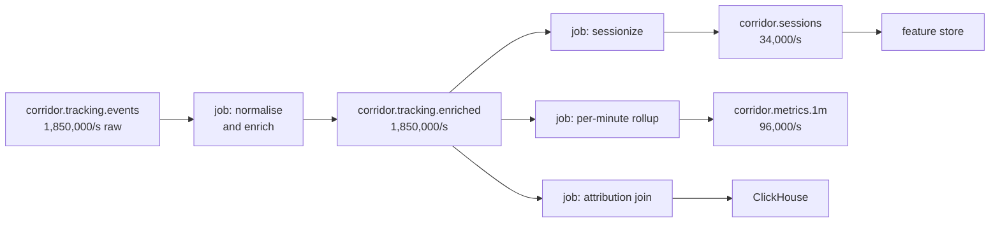

# Requirements and the Capacity Model

This is the arithmetic page. Every number the rest of the collection reuses is derived here in
visible steps, so that when document 11 says "recall the 24-minute page-cache residency" it
means a specific division that you can check, and when document 21 puts $361,170 on a slide you
can see which line you disagree with.

Read it once now to see the shape, then come back to it whenever a later document asserts a
figure. If your own numbers differ — and they will — the useful thing to take is the *method*,
not the total.

## 1. Five ambiguities to resolve before any arithmetic

Someone hands you "design a streaming platform for four million events a second." Before that
sentence can be turned into a machine count, five things have to be pinned down. In a design
interview, asking these is most of the signal; in a real project, not asking them is most of the
rework.

**What is an "event"?** Four million *application-level* facts is not the same as four million
*records on the log*. If one user action produces an impression event, a page-view event and
three sub-component events, is that one or five? On Meridian it is five, because each is
independently consumable, and this is why the platform's record rate is higher than any tenant's
mental model of their own traffic.

**Is the four million the average or the peak?** These differ by 1.75× diurnally on Meridian,
and by 100× on one particular stream (Gateline's). Sizing for the average gives you an outage
every evening; sizing for the sum of all peaks gives you a bill nobody will approve. Section 3
shows why the observed aggregate peak (7.0M/s) is materially below the sum of the individual
peaks (7.8M/s), and why relying on that is a judgement call rather than a law.

**How long must the data be replayable?** This is the single biggest cost lever in the transport
tier and almost nobody states it up front. It is not a data-retention question; it is a question
about the worst bug you are willing to be able to recover from. If a job ships a mapping error
on Monday and it is caught on Thursday, can you re-derive? On Meridian the answer is "seven days
for anything a tenant can query, six hours locally on the brokers with the rest in object
storage" — and Section 6 shows what that costs.

**What guarantee, on which streams?** Not "the platform is exactly-once." Per stream. The
answer changes the latency by three orders of magnitude on the streams where it is "exactly
once", and it changes nothing at all on the ones where it is "at least once with an idempotent
sink". See [09-delivery-guarantees-and-exactly-once.md](09-delivery-guarantees-and-exactly-once.md).

**What freshness does the *consumer* actually perceive?** A platform whose pipeline latency is
80 milliseconds and whose serving store refreshes a materialised view every 30 seconds has a
30-second product. Measure end to end or you are measuring your own diligence rather than the
user's experience.

## 2. The tenants and their streams

Here is the complete input to every calculation that follows. Rates are steady-state daily
averages; peaks are the highest one-minute average observed in the last 90 days.

| Stream | Tenant | Avg events/s | Peak events/s | Avg record | Partitions | Retention |
|---|---|---|---|---|---|---|
| `corridor.tracking.events` | Corridor | 1,850,000 | 3,100,000 | 640 B | 480 | 24 h |
| `northlight.playback.heartbeats` | Northlight | 1,100,000 | 1,900,000 | 220 B | 288 | 6 h |
| `waypoint.location.updates` | Waypoint | 750,000 | 1,200,000 | 96 B | 360 | 12 h |
| `lumen.engagement.events` | Lumen | 240,000 | 900,000 | 310 B | 96 | 24 h |
| `riverbend.clickstream.events` | Riverbend | 34,000 | 180,000 | 512 B | 200 | 24 h |
| `gateline.ticket.requests` | Gateline | 5,000 | 500,000 | 350 B | 240 | 24 h |
| `waypoint.trip.events` | Waypoint | 4,060 | 14,000 | 480 B | 24 | 72 h |
| `riverbend.inventory.adjustments` | Riverbend | 1,200 | 6,000 | 260 B | 48 | compacted |
| `riverbend.orders.lifecycle` | Riverbend | 640 | 3,400 | 1,400 B | 24 | 72 h |
| `riverbend.payments.settled` | Riverbend | 67 | 355 | 900 B | 12 | 7 d |
| `riverbend.catalog.changes` | Riverbend | 40 | 400 | 2,100 B | 6 | compacted |
| 34 smaller streams | mixed | 15,000 | 60,000 | ~400 B | 408 | 24 h |

Four of those rows deserve a word, because they are where the reference notes and the other
collections in this repository pin the numbers.

**`waypoint.location.updates` at 750,000/s** comes straight from the Uber-scale figure in
[`../../system-design-notes/uberHLD.md`](../../../system-design-notes/uberHLD.md): three million
concurrent drivers emitting one position every four seconds is 750,000 writes per second, rising
to 1.2 million at rush hour. The 96-byte record is a deliberately tight binary encoding — driver
ID, latitude, longitude, timestamp, heading, speed, accuracy — and its tightness is what makes
the stream affordable. Encoding the same event as JSON with field names would take it to roughly
310 bytes and triple the cost of the biggest-by-count stream on the platform. That is the single
highest-leverage schema decision on Meridian and it is covered in
[03-the-event-schema-and-contracts.md](03-the-event-schema-and-contracts.md).

**`corridor.tracking.events` at 1,850,000/s** is the LinkedIn-scale tracking figure from
[`../../system-design-notes/LinkedIn`](../../../system-design-notes/LinkedIn/README.md) —
"hundreds of billions of tracking events per day." At 1.85 million a second that is 159.8
billion a day, which lands in the stated range. It is 46% of the platform's event count and 74%
of its bytes, and that concentration matters: almost every capacity decision on Meridian is
really a decision about Corridor.

**`riverbend.*` rates are inherited, not invented.** The [`../Kafka`](../Kafka/README.md)
collection fixes `orders.created` at 640 events/s average and 3,400/s peak, with roughly 9.6
lifecycle events per order — which reconciles to 240,000 orders an hour, the figure the
[`../K8s/cronJobs`](../K8s/cronJobs/README.md) collection uses for its invoice rollup. This
collection uses the same numbers so that the three agree.

**`gateline.ticket.requests` peaks at 100× its average, on a schedule.** Five thousand a second
all week, half a million a second ten seconds after a sale opens. That is not a spike to absorb;
it is a scheduled load test you are told about in advance, and the correct response is to
pre-scale rather than to size for it permanently. `P-07` covers the mechanism and `CS-4` covers
the time it went wrong.

## 3. Deriving the aggregate: events, bytes, and the sum-of-peaks trap

### Event rate

Add the average column:

```
 1,850,000   corridor.tracking.events
 1,100,000   northlight.playback.heartbeats
   750,000   waypoint.location.updates
   240,000   lumen.engagement.events
    34,000   riverbend.clickstream.events
     5,000   gateline.ticket.requests
     4,060   waypoint.trip.events
     1,200   riverbend.inventory.adjustments
       640   riverbend.orders.lifecycle
        67   riverbend.payments.settled
        40   riverbend.catalog.changes
    15,000   34 smaller streams
 ─────────
 4,000,007   ≈ 4.0 million events/second from outside the platform
```

Per day: `4,000,000 × 86,400 = 345,600,000,000` — **345.6 billion events a day**.

### Byte rate

Multiply each rate by its record size. The three largest rows:

```
corridor    1,850,000/s × 640 B = 1,184,000,000 B/s = 1,184 MB/s
northlight  1,100,000/s × 220 B =   242,000,000 B/s =   242 MB/s
waypoint      750,000/s ×  96 B =    72,000,000 B/s =    72 MB/s
```

and the rest, summed, come to 102.9 MB/s. Total:

```
1,184 + 242 + 72 + 102.9 = 1,600.9 MB/s ≈ 1.60 GB/s uncompressed
```

Weighted-average record size: `1,600.9 MB/s ÷ 4,000,000/s = 400 bytes`. Keep that number; it is
used everywhere.

Per day: `1.6009 GB/s × 86,400 s = 138,318 GB` — **138.3 TB a day** before compression.

The interesting thing about this table is the mismatch between count and bytes. Corridor is 46%
of the events and 74% of the bytes. Waypoint is 19% of the events and 4.5% of the bytes.
Anything you size by *event count* — partition assignment, operator parallelism, state entries —
is dominated by different streams from anything you size by *bytes* — broker disk, network,
compression. Confusing the two is how people end up with a cluster that has plenty of disk and
no CPU.

### The sum-of-peaks trap

Add the peak column and you get 7,804,155 events/s. The highest aggregate ever *observed* is
7.0 million. The difference is 10%, and it exists because the peaks do not coincide:

- Corridor and Lumen peak during the US evening.
- Waypoint peaks twice, at local morning and evening rush, in whichever time zones are awake —
  so its global aggregate is flatter than any single city's.
- Northlight peaks at 20:00 to 23:00 local, which smears across time zones.
- Gateline's 500,000/s peak lasts under a minute and happens at a time *you choose*, because you
  schedule the on-sale.

So you have a choice, and it is a real one:

**Size for the sum of peaks (7.8M/s).** You will never shed load. You will pay for roughly 11%
more capacity than the worst real minute has ever needed, permanently.

**Size for the observed peak plus a margin (7.0M/s × 1.15 = 8.05M/s).** Slightly more than the
sum of peaks, actually — which tells you the margin matters more than the correlation
assumption. This is what Meridian does.

**Size for the observed peak exactly (7.0M/s).** You are betting that two tenants never have a
bad day simultaneously, and that bet loses eventually. The event that breaks it is usually not
two independent peaks but one *common cause* — a regional network event that delays everybody's
traffic and then delivers it all at once. See `B-06`.

The rule worth carrying: **peaks correlate more than you expect, because the thing that causes
them is often shared.** Treat statistical independence between tenants as an assumption to be
tested, not a property to be relied on.

## 4. What compression actually buys, and why the codec is the small decision

Records do not go on the wire as you wrote them. Two things happen: an encoding (Avro,
Protobuf, JSON) and then a compression codec over a batch of encoded records.

These compose multiplicatively, and the first is worth far more than the second. Here is the
same Corridor tracking event — 41 fields, mostly small strings and integers — measured four ways:

| Representation | Bytes per record | Ratio vs JSON |
|---|---|---|
| JSON, field names repeated | 1,640 B | 1.0× |
| JSON + zstd-3 over a 64 KB batch | 218 B | 7.5× |
| Avro binary, schema by ID | 640 B | 2.6× |
| Avro binary + zstd-3 over a 64 KB batch | 200 B | 8.2× |

Two observations, and the second is the one people miss.

First, **JSON compresses better than Avro** — 7.5× versus 3.2× — because JSON's redundancy (the
field names, repeated in every record) is exactly what a dictionary compressor is good at.
People see that ratio and conclude JSON is fine.

Second, **the compressed sizes are still different, and the uncompressed sizes are very
different**, and the uncompressed size is what you pay for everywhere except the wire and the
disk. Broker page cache holds decompressed batches when a consumer needs them. The Flink network
shuffle carries deserialized objects. Operator state holds deserialized values. RocksDB stores
what you put in it. Choosing JSON because "it compresses better" means carrying 1,640 bytes
through every one of those, instead of 640.

Meridian uses **Avro with a schema registry, compressed with zstd level 3 over producer batches,
for a measured aggregate ratio of 3.2:1**. That ratio is a weighted blend — Waypoint's tight
96-byte records compress at only 1.9:1 because there is little redundancy left in them, while
Corridor's at 3.2:1 and Northlight's at 4.1:1 pull the average up.

Why zstd-3 and not something else:

| Codec | Ratio on Meridian's mix | Producer CPU (ms/MB) | Broker CPU to recompress |
|---|---|---|---|
| none | 1.0:1 | 0 | 0 |
| lz4 | 2.4:1 | 1.1 | low |
| snappy | 2.3:1 | 1.3 | low |
| zstd-1 | 2.9:1 | 2.4 | medium |
| zstd-3 | 3.2:1 | 4.1 | medium |
| zstd-9 | 3.6:1 | 31.0 | high |
| gzip-6 | 3.1:1 | 24.0 | high |

Going from zstd-3 to zstd-9 buys 11% more compression for 7.6× the producer CPU. On a service
producing 1,184 MB/s that is the difference between 4.9 and 36.7 CPU-cores spent on compression
across the fleet. Not worth it. Going from lz4 to zstd-3 buys 33% more compression for 3.7× the
CPU — worth it here, because Meridian's dominant cost is *network*, not producer CPU, and 33%
off the network bill is $80,000 a month.

**The rule:** pick the codec by looking at which resource is scarce. If your bill is network,
compress harder. If your producers are latency-critical and CPU-bound, compress less. If you are
on a 10 Gb LAN with idle CPUs, `none` is a defensible choice that nobody ever makes.

### The compressed byte rate

```
1,600.9 MB/s ÷ 3.2 = 500.3 MB/s of external traffic onto the log
```

## 5. The traffic nobody budgets for: derived streams and read amplification

Here is the mistake that turns a correct capacity model into a cluster that falls over in month
four. You size the transport tier for the 500 MB/s coming in from outside. Then jobs start
running, and jobs *write back*.

A typical Meridian pipeline looks like this:



The enrichment job alone doubles the traffic for that stream, because it reads 1.85 million a
second and writes 1.85 million a second. Across the platform:

| Category | Events/s | Avg record | MB/s uncompressed | MB/s compressed |
|---|---|---|---|---|
| External ingest | 4,000,000 | 400 B | 1,600.9 | 500.3 |
| Derived streams written by jobs | 1,900,000 | 180 B | 342.0 | 106.9 |
| **Total onto the log** | **5,900,000** | | **1,942.9** | **607.2** |

The derived records are smaller (180 bytes average) because most of them are aggregates or
compacted projections rather than full events. But there are 1.9 million a second of them, and
**they are 47.5% of the event count on the log**. If you size the transport tier from the tenant
traffic alone, you are 32% under on bytes and 48% under on messages.

Read amplification is the other half. Each record on the log is read by:

```
consumer groups per stream, weighted by volume:
  stream-processing jobs           2.6
  direct consumers (services,
    connectors, the lake sink)     0.8
  ───────────────────────────────────
  total read fan-out               3.4
```

So outbound bytes from the brokers are `607.2 MB/s × 3.4 = 2,064 MB/s`, before replication.
That number is the one that drives the network bill in Section 9, and it is the number that
makes "just add another consumer" a non-trivial request when the consumer is reading Corridor.

## 6. Sizing the transport tier, and why the binding constraint is page cache

This section is where the interesting judgement lives, because four different resources give
four wildly different answers and only one of them is the answer.

The write volume with replication factor 3:

```
607.2 MB/s × 3 = 1,821.6 MB/s written across the cluster
```

Now ask four separate questions.

### What does network say?

Total broker egress: replication (2 followers × 607.2) plus consumer fetch (2,064) = 3,278 MB/s.
Total ingress: 607.2 + 1,214.4 = 1,821.6 MB/s. A modern instance sustains comfortably over 1
GB/s each way.

```
3,278 MB/s ÷ 1,000 MB/s per broker ≈ 4 brokers
```

**Network says 4.**

### What does disk capacity say?

Meridian uses **tiered storage**: brokers keep six hours locally, and older segments live in
object storage where a consumer can still read them (more slowly). Local bytes:

```
607.2 MB/s × 21,600 s (6 h) = 13,116 GB = 13.1 TB, × RF3 = 39.3 TB
```

At an `i3en.2xlarge` with 5.0 TB of NVMe and a 70% fill ceiling:

```
39.3 TB ÷ (5.0 TB × 0.70) = 11.2 → 12 brokers
```

**Disk says 12.**

### What does partition count say?

Sum the partition column in Section 2: 1,778 partitions on the named streams, 408 on the
smaller ones, and roughly 1,814 for derived streams, changelogs, dead-letter topics and retry
topics across 180 jobs. Call it **4,000 partitions**, or 12,000 partition-replicas at RF3.

Kafka gets unhappy somewhere above 400 partition-replicas per broker — not because of a hard
limit, but because controller failover time, leader-election storms, and the per-partition
memory and file-handle cost all scale with it. (The [`../Kafka`](../Kafka/README.md) collection
derives this; `B-04` there is the relevant scenario.)

```
12,000 ÷ 400 = 30 brokers
```

**Partitions say 30.**

### What does page-cache residency say?

This is the constraint that actually wins, and it needs a definition first.

A Kafka consumer reading the newest records reads them out of the operating system's page cache,
because they were written moments ago and are still in memory. A consumer reading records from
half an hour ago reads them from disk. The difference in cost is not subtle: a page-cache read
is a memory copy, and a disk read on a busy broker competes with the write path and can be
30 to 100× slower.

**Page-cache residency** is how far back in time the cache reaches:

```
residency = (page cache bytes per broker) ÷ (bytes written per broker per second)
```

Now the design question: how far behind is a consumer allowed to get and still be cheap? On
Meridian the answer is set by recovery. The 4.2-terabyte attribution job takes about four
minutes to restart (Section 8), and a rolling upgrade of a session cluster takes about eight.
Add margin for a bad deploy that is rolled back, and the requirement becomes:

> A job that has been down for 20 minutes must catch up from memory, not from disk.

With `i3en.2xlarge` — 64 GiB of RAM, of which roughly 6 GiB is the broker heap and 6 GiB is the
operating system and other processes — about 52 GiB, or 55.8 GB, is available as page cache.

```
residency = 55,800 MB ÷ (1,821.6 MB/s ÷ N brokers)
          = 55,800 × N ÷ 1,821.6
          = 30.6 × N seconds
```

For 25 minutes (1,500 s) of residency: `N = 1,500 ÷ 30.6 = 49`.

**Page cache says 48** (rounding to a number that divides evenly across three availability
zones), giving:

```
per-broker write = 1,821.6 ÷ 48 = 38.0 MB/s
residency        = 55,800 ÷ 38.0 = 1,468 s = 24.5 minutes
```

And at the 1.75× diurnal peak:

```
per-broker write = 66.4 MB/s
residency        = 55,800 ÷ 66.4 = 840 s = 14.0 minutes
```

So the answer is **48 brokers, `i3en.2xlarge`, 3 availability zones, 16 per zone** — four times
what disk requires and twelve times what network requires. The extra hardware is not buying
throughput. It is buying **the ability to recover without a disk-read storm**, which is exactly
the moment you cannot afford one.

⚠️ Note the coupling that makes this number fragile. Residency depends on the *compressed* write
rate, which depends on the codec. If someone switches a large stream from zstd-3 to lz4 to save
producer CPU, the compressed rate rises by 33%, the per-broker write rate rises with it, and
residency falls from 24.5 to 18.4 minutes — silently, with no alert, until the next incident
recovery is four times slower than the runbook says. Document 04 keeps this as a worked example
under `T-09`. **Recompute residency whenever compression changes anywhere.**

## 7. Sizing the processing tier

### Work volume

Each external event is read by an average of 2.6 jobs; each derived event by 1.4.

```
external  4,000,000/s × 2.6 = 10,400,000 operator-input events/s
derived   1,900,000/s × 1.4 =  2,660,000 operator-input events/s
                              ───────────
                              13,060,000 ≈ 13.1 million events/s
```

### Throughput per core, by operator class

These are measured on Meridian's hardware (`r6id.4xlarge`, Flink 1.19, RocksDB state backend,
Avro deserialization) with one task slot per core. They are the numbers to argue with if your
workload differs; the shape of the argument is what transfers.

| Operator class | Events/s per core | Why it is that number |
|---|---|---|
| Stateless map, filter, route | 55,000 | Dominated by Avro deserialization (~9 µs) and the object churn it creates |
| Keyed aggregation, state < 50 GB per slot | 14,000 | One RocksDB read plus one write per record; block cache mostly hits, ~40 µs |
| Keyed aggregation, state > 50 GB per slot | 6,000 | Block cache misses go to NVMe (~110 µs) and compaction steals CPU |
| Stream-stream join, 24 h window | 4,500 | Two state accesses, a range scan for matches, and timer bookkeeping |
| Async enrichment (capacity 200, p99 8 ms) | 22,000 | Not CPU-bound; bounded by in-flight capacity ÷ latency |

Note the 9× spread between the top and bottom rows. **Which operators your pipeline uses matters
more than how many events it processes**, which is why capacity planning for a streaming
platform cannot be done from an events-per-second figure alone.

### The mix and the total

Across Meridian's 180 jobs, weighted by input volume:

```
stateless          45% × 13.1M = 5.895M/s ÷ 55,000 =  107 cores
keyed agg, small   30% × 13.1M = 3.930M/s ÷ 14,000 =  281 cores
keyed agg, large   12% × 13.1M = 1.572M/s ÷  6,000 =  262 cores
stream-stream join  8% × 13.1M = 1.048M/s ÷  4,500 =  233 cores
async enrichment    5% × 13.1M = 0.655M/s ÷ 22,000 =   30 cores
                                                     ──────────
                                                      913 cores at 100% utilisation
```

You cannot run a streaming cluster at 100%. Flink's operators have no queueing headroom at
saturation; a task at 100% busy has already begun to backpressure its upstream. Meridian targets
**60% average busyness**, which leaves room for the 1.75× diurnal swing to be partly absorbed
before autoscaling reacts:

```
913 ÷ 0.60 = 1,522 cores → 1,536 vCPU → 96 nodes of r6id.4xlarge (16 vCPU each)
```

At the diurnal peak:

```
913 × 1.75 = 1,598 cores at 100%
1,598 ÷ 0.60 = 2,663 cores → 2,688 vCPU → 168 nodes
```

**96 nodes steady, autoscaling to 168 at peak.** The autoscaling mechanism, and why it is harder
for stateful jobs than for stateless services, is
[12-scaling-parallelism-and-rescaling.md](12-scaling-parallelism-and-rescaling.md).

### Check the other resources

Having sized on CPU, confirm nothing else binds first.

**Local disk for state.** 31 TB of state across 96 nodes is 323 GB per node. RocksDB needs
roughly 2× its live data during compaction, so budget 646 GB against the 950 GB NVMe on an
`r6id.4xlarge` — 68% full, acceptable but not comfortable. Sizing on state alone:

```
31 TB ÷ (950 GB × 0.45 usable after compaction headroom) = 73 nodes
```

State says 73, CPU says 96. **CPU binds — but only just.** At 1.4× the current state this flips,
and the cluster would need to grow for a reason that has nothing to do with throughput. That is
worth knowing before it happens; `K-06` covers the symptom.

**Memory.** 128 GiB per node, 16 slots. Per slot: roughly 2 GiB of JVM heap plus 3 GiB of
RocksDB block cache and write buffers, so 80 GiB of the 128 is committed and the remainder is
page cache for the state files. Comfortable.

**Network.** The shuffle is the largest consumer. About 55% of operator input is re-partitioned
by key:

```
13.1M/s × 0.55 × 330 B (average post-filter record) = 2,376 MB/s shuffled
÷ 96 nodes = 24.8 MB/s per node
```

Trivial against the instance's bandwidth. It is not trivial against the *bill*, because two
thirds of it crosses an availability-zone boundary — Section 9.

## 8. Sizing state, and the recovery number that matters

### Total state

| Job class | Jobs | Aggregate state | Largest single job |
|---|---|---|---|
| Stateless | 74 | 0 | — |
| Keyed state under 50 GB | 81 | 2.4 TB | 48 GB |
| Keyed state over 50 GB | 21 | 28.6 TB | 4.2 TB |
| Remote state (async lookup) | 4 | 0 local | 3.1 TB in DynamoDB |
| **Total** | **180** | **31.0 TB local** | |

### Where the 4.2 TB comes from

The largest job is `corridor-ad-attribution`: a stream-stream join that holds every ad
impression for 24 hours so that a click arriving later can be attributed to the impression that
caused it.

```
ad impressions on corridor.tracking.events:  180,000/s
window:                                       24 h = 86,400 s
rows held:      180,000 × 86,400 =            15,552,000,000 rows
bytes per row (impression key + attributes):  220 B
raw:            15.552e9 × 220 =              3.42 TB
RocksDB overhead (keys, index blocks,
  bloom filters, space amplification 1.23×):  × 1.23
                                              ─────────
                                              4.21 TB
```

That 1.23× is worth internalising. **RocksDB does not store what you give it; it stores what you
give it plus keys, plus per-block indexes, plus Bloom filters, plus whatever sits in levels
waiting to be compacted away.** Between 1.2× and 1.5× is the normal range, and a job with a
badly-chosen key can be far worse. `K-03` covers the pathological case.

### Checkpoint cost

Incremental checkpoints upload only the RocksDB SST files created since the last one.

```
new rows per 60-second interval:   182,400/s × 60 =  10,944,000 rows
bytes:                             10.944e6 × 220 =  2.41 GB
× RocksDB write amplification from compaction rewriting older
  levels (measured 2.4× on this job's workload):    5.78 GB uploaded
upload time at 360 subtasks × 90 MB/s effective
  S3 throughput = 32.4 GB/s aggregate:              0.18 s of transfer
plus snapshot coordination, barrier alignment
  and metadata commit:                              ~1.6 s
                                                    ─────────
checkpoint duration                                 ~1.8 s
```

1.8 seconds every 60 seconds is 3% overhead. That is healthy. When checkpoint duration
approaches the interval, you are in `C-01` territory and the job is about to enter a death
spiral; that scenario, and the four things that cause it, are in
[08-checkpointing-savepoints-and-recovery.md](08-checkpointing-savepoints-and-recovery.md).

### Recovery: the number to quote in a design review

Not "how fast does it restart" but "how long from the crash until the output is correct and
current." Four terms:

```
1. Failure detection + rescheduling            45 s
     (heartbeat timeout 30 s, then the scheduler
      places 360 subtasks on available slots)

2. State download from S3
     4.2 TB ÷ 360 subtasks = 11.67 GB each
     at 90 MB/s per subtask                   130 s

3. RocksDB open, SST ingest, cache warm        60 s
                                              ─────
   job is running again                       235 s = 3.9 minutes

4. Catch-up on the backlog accumulated
   during those 235 seconds:
     182,400/s × 235 s = 42,864,000 events
   drained at the job's spare capacity:
     provisioned to run at 60% busy on an input
     of 182,400/s, so its ceiling is
       182,400 ÷ 0.60 = 304,000 events/s
     and the surplus is
       304,000 − 182,400 = 121,600 events/s
     42,864,000 ÷ 121,600 =                   352 s = 5.9 minutes
                                              ─────
   crash → caught up                          587 s = 9.8 minutes
```

**9.8 minutes**, and the second half of it — the catch-up — is the half people forget.

Now notice what happens if you economise on headroom. The surplus is
`input × (1 ÷ busyness − 1)`, which collapses fast as busyness rises:

| Target busyness | Ceiling | Surplus | Catch-up | Total recovery |
|---|---|---|---|---|
| 60% | 304,000/s | 121,600/s | 5.9 min | **9.8 min** |
| 70% | 260,571/s | 78,171/s | 9.1 min | 13.0 min |
| 80% | 228,000/s | 45,600/s | 15.7 min | 19.6 min |
| 90% | 202,667/s | 20,267/s | 35.2 min | 39.2 min |

**Provisioned headroom is recovery time**, and the relationship is hyperbolic rather than
linear — the last 10% of utilisation you squeeze out costs you 20 minutes of recovery. That is
the argument for 60% utilisation, and it is a better argument than "for safety."

Document 08 covers the two techniques that attack term 2 — task-local recovery, which keeps a
copy of the state on the machine and makes a single-task failure nearly free, and
fine-grained recovery, which restarts only the affected part of the graph.

## 9. The network bill, which is most of the bill

Cross-availability-zone transfer inside one AWS region is charged at $0.01 per GB *in each
direction*, so $0.02 per GB transferred. With brokers and TaskManagers spread across three
zones, the default behaviour of every component sends roughly two thirds of its traffic across a
zone boundary.

### Kafka

```
produce:      607.2 MB/s × 2/3 (producer's zone ≠ leader's zone)    =   405 MB/s
replication:  607.2 MB/s × 2   (both followers are in other zones)  = 1,214 MB/s
consume:    2,064.0 MB/s × 2/3 (consumer's zone ≠ leader's zone)    = 1,376 MB/s
                                                                      ─────────
                                                                      2,995 MB/s
```

### Flink shuffle

```
shuffled volume:  13.1M/s × 0.55 × 330 B = 2,376 MB/s
cross-zone:       2,376 × 2/3            = 1,584 MB/s
```

### The total

```
2,995 + 1,584 = 4,579 MB/s cross-zone
monthly:  4,579 MB/s × 2,629,800 s (730 h) = 12,040,650 GB ≈ 12.04 PB
cost:     12,040,650 GB × $0.02            = $240,813 per month
```

Against a total platform bill of $361,170 (document 21), that is **66.7%**. The compute for a
four-million-event-per-second platform costs about $77,000 a month; moving the bytes between
racks in the same building costs three times as much.

Two mitigations, both with real costs:

**Rack-aware consumer fetch** (Kafka's `client.rack`, which lets a consumer read from an
in-zone follower rather than the leader) removes almost all of the 1,376 MB/s consume term:

```
1,376 MB/s × 2,629,800 s ÷ 1,000 = 3,618,605 GB × $0.02 = $72,372 per month saved
```

The cost is that a follower may be slightly behind the leader, so a consumer reading from it
sees records a few tens of milliseconds later, and a follower that falls out of the in-sync
replica set stops serving. Both are acceptable for everything on Meridian except
`riverbend.payments.settled`, which reads from the leader.

**Zone-local job placement** for jobs that can tolerate losing a zone — pin all of a job's
TaskManagers into one zone so the shuffle never leaves it, and accept that a zone failure means
that job restarts elsewhere rather than degrading:

```
shuffle cross-zone falls from 2/3 to 1/3 → 792 MB/s removed
792 MB/s × 2,629,800 s ÷ 1,000 = 2,082,802 GB × $0.02 = $41,656 per month saved
```

Together: **$114,028 a month, 31.6% of the bill**, in exchange for slightly stale reads on some
streams and a slower failure mode for some jobs. That is the highest-value trade available on
this platform and it is not a code change.

## 10. The latency budget, term by term

Three different paths, three very different answers, same cluster.

### Path A — stateless enrichment, at-least-once

`riverbend.orders.lifecycle` → deserialize → enrich → serialize → `riverbend.orders.enriched`.

| Term | p50 | p99 | What it is |
|---|---|---|---|
| Producer `linger.ms = 20` | 10 ms | 20 ms | Uniform wait; average is half the linger |
| Serialize + network to broker | 0.4 ms | 1.1 ms | |
| Broker append + replicate to 2 ISR (`acks=all`) | 4 ms | 18 ms | Cross-zone round trip dominates |
| Consumer fetch wait (`fetch.max.wait=50`, `min.bytes=65536`) | 13 ms | 50 ms | 64 KB accumulates in ~26 ms on this stream |
| Deserialize + source operator | 0.4 ms | 1.4 ms | |
| Network shuffle for `keyBy` | 1.8 ms | 9 ms | Cross-zone |
| Process | 0.3 ms | 1.2 ms | |
| Sink producer `linger.ms = 5` | 2.5 ms | 5 ms | |
| Sink broker append + replicate | 4 ms | 18 ms | |
| **Total** | **36.4 ms** | **123.7 ms if summed** | |

The p99 column needs a warning. **You cannot add percentiles.** The sum of nine p99s is the
latency of a record that was unlucky at every single stage simultaneously, which is far rarer
than 1 in 100. The measured end-to-end p99 on this path is **78 ms**, about 63% of the naive
sum. Quote the measured number; use the sum only as an upper bound and as a way of seeing which
term to attack.

Attacking it: the two largest terms are the fetch wait (13 ms) and the two broker round trips
(4 ms each). Dropping `fetch.min.bytes` to 1 removes 12 ms of the p50 at the cost of more,
smaller fetches — more broker CPU and more network packets. That is the trade, and on a
640-events-per-second stream it is obviously worth it; on Corridor's 1.85 million it is
obviously not.

### Path B — event-time windowed aggregation, at-least-once

`corridor.tracking.events` → 1-minute tumbling window → ClickHouse.

The pipeline terms above still apply, but they are noise next to two new ones:

```
window length                                        60 s
watermark delay (Corridor's p99.5 lateness)           8 s
watermark propagation across 480 source partitions  0.4 s
sink batching (ClickHouse async_insert, 1 s flush)  0.5 s
serving store visibility                            0.2 s
```

A window covering 10:00:00 to 10:01:00 is emitted at 10:01:08.4 and visible at 10:01:09.1.

So: **the newest event in that window is visible 9.1 seconds after it happened; the oldest is
visible 69.1 seconds after it happened.** When a product manager asks "how fresh is this
dashboard", both numbers are true and they mean different things. The one to quote is the
second, because it is the worst case a user can observe, and the one people quote is the first.

The formula worth remembering:

```
worst-case freshness of a windowed result
  = window length + watermark delay + sink flush + serving visibility
```

Pipeline processing time (36 ms) does not appear, because it is three orders of magnitude
smaller than the terms that do. **Optimising the pipeline to improve a windowed dashboard's
freshness is almost always wasted effort**; shortening the window or tightening the watermark
is the only lever that moves it, and both have correctness costs.

### Path C — exactly-once through a transactional Kafka sink

Same work as Path A, but the sink writes inside a Kafka transaction that commits when a
checkpoint completes.

```
processing (as Path A)                              0.036 s
wait for the next checkpoint:
  checkpoint interval 60 s, record arrives
  uniformly within it → p50 30.0 s, p99 59.4 s
checkpoint duration before the commit is issued:
  p50 1.8 s, p99 2.6 s
transaction commit + consumer sees it
  (read_committed)                                  p50 0.02 s, p99 0.1 s
                                                    ──────────────────────
                                                    p50 31.8 s, p99 62.1 s
```

**Thirty-two seconds at p50, against thirty-six milliseconds for the same computation.** A
factor of 870. This is the single most important number in the collection to have in your head,
because it is the one that makes "should this be exactly-once?" a design conversation rather
than a checkbox.

## 11. The reference table

Everything above, in one place. Later documents cite these.

### Volume

| Quantity | Value |
|---|---|
| External events/s, average | 4,000,000 |
| External events/s, observed peak | 7,000,000 (1.75×) |
| Sum of individual stream peaks | 7,804,155 |
| Weighted-average record size | 400 B |
| External bytes/s, uncompressed | 1,600.9 MB/s |
| Events/day | 345.6 billion |
| Bytes/day, uncompressed | 138.3 TB |
| Compression ratio (Avro + zstd-3) | 3.2:1 |
| External bytes/s onto the log | 500.3 MB/s |
| Derived events/s written by jobs | 1,900,000 at 180 B |
| **Total events/s on the log** | **5,900,000** |
| **Total bytes/s onto the log** | **607.2 MB/s** |
| Read fan-out (consumer groups per record) | 3.4 |
| Broker egress before replication | 2,064 MB/s |

### Transport tier

| Quantity | Value |
|---|---|
| Brokers | 48 × `i3en.2xlarge`, 3 zones |
| Written across cluster (RF3) | 1,821.6 MB/s |
| Per broker write | 38.0 MB/s average, 66.4 MB/s peak |
| Page cache per broker | 55.8 GB |
| **Page-cache residency** | **24.5 min average, 14.0 min peak** |
| Partitions | 4,000 (12,000 replicas, 250 per broker) |
| Local retention | 6 h (39.3 TB), tiered beyond |
| What network alone would need | 4 brokers |
| What disk alone would need | 12 brokers |
| What partition count alone would need | 30 brokers |

### Processing tier

| Quantity | Value |
|---|---|
| Jobs | 180 |
| Operator input events/s | 13.1 million |
| Cores at 100% | 913 |
| Target busyness | 60% |
| Nodes | 96 × `r6id.4xlarge` steady, 168 at peak |
| vCPU | 1,536 steady, 2,688 peak |
| Total local state | 31.0 TB |
| Largest job state | 4.2 TB |
| Checkpoint interval / duration | 60 s / 1.8 s |
| **Largest job crash → caught up** | **9.8 min** |
| Shuffle volume | 2,376 MB/s |

### Latency

| Path | p50 | p99 |
|---|---|---|
| Stateless enrichment, at-least-once | 36.4 ms | 78 ms |
| 1-min windowed aggregation, newest event | 9.1 s | — |
| 1-min windowed aggregation, oldest event | 69.1 s | — |
| Stateless, exactly-once (60 s checkpoints) | 31.8 s | 62.1 s |

### Cost (derived in [21](21-cost-model-and-build-vs-buy.md))

| Quantity | Value |
|---|---|
| Total | $361,170/month |
| Cross-zone network | $240,813 (66.7%) |
| Per billion events | $34 |
| Per GB ingested | $0.086 |
| Savings from rack-aware fetch + zone-local jobs | $114,028/month (31.6%) |

## What to take away

1. **Resolve the five ambiguities first** — what an event is, average versus peak, how far back
   you must be able to replay, which guarantee per stream, and what freshness the consumer
   actually perceives. Skipping them means sizing a system nobody asked for.
2. **Count and bytes are dominated by different streams.** Corridor is 46% of events and 74% of
   bytes; Waypoint is 19% of events and 4.5% of bytes. Size partitions and parallelism by count,
   disk and network by bytes, and never by the same number.
3. **Peaks do not add, but they correlate more than you expect** — the sum of stream peaks is
   7.8M/s against an observed aggregate of 7.0M/s, and the thing that eventually breaks the
   independence assumption is a common cause, not a coincidence.
4. **Encoding beats codec.** Avro at 640 bytes versus JSON at 1,640 matters everywhere except
   the wire, because page cache, shuffle buffers and RocksDB all hold the decompressed form.
   Pick the codec by which resource is scarce — on Meridian that is network, so zstd-3.
5. **Derived streams are 47.5% of the records on the log.** Size the transport tier for what the
   jobs write back, not only for what the tenants send in.
6. **Page-cache residency is the binding constraint on the broker count** — 48 brokers where
   network says 4 and disk says 12 — because it is what determines whether a 20-minute recovery
   is cheap or catastrophic. Recompute it whenever compression changes.
7. **Throughput per core varies 9× by operator class.** A capacity plan built from an
   events-per-second number without an operator mix is a guess.
8. **Recovery is restart time plus catch-up time, and headroom determines the second.** 9.8
   minutes at 60% busyness becomes 39.2 minutes at 90%. The relationship is hyperbolic, not
   linear: provisioned headroom is recovery time.
9. **Two thirds of the bill is cross-zone network**, and $114,028 a month of it is recoverable
   with rack-aware fetch and zone-local job placement — a configuration change, not a rewrite.
10. **Exactly-once through a transactional sink costs a factor of 870 in latency** — 31.8
    seconds against 36 milliseconds. Decide it per stream, with that number visible.
