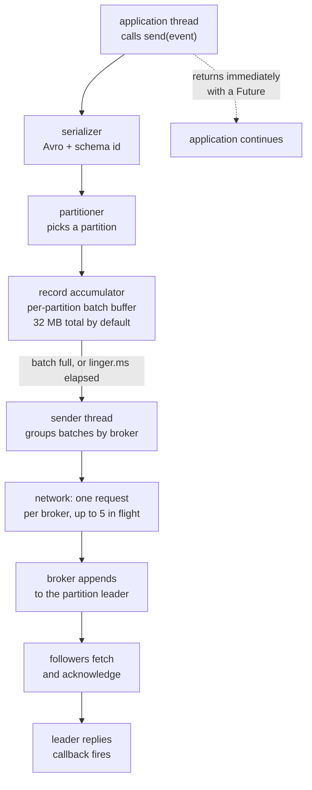
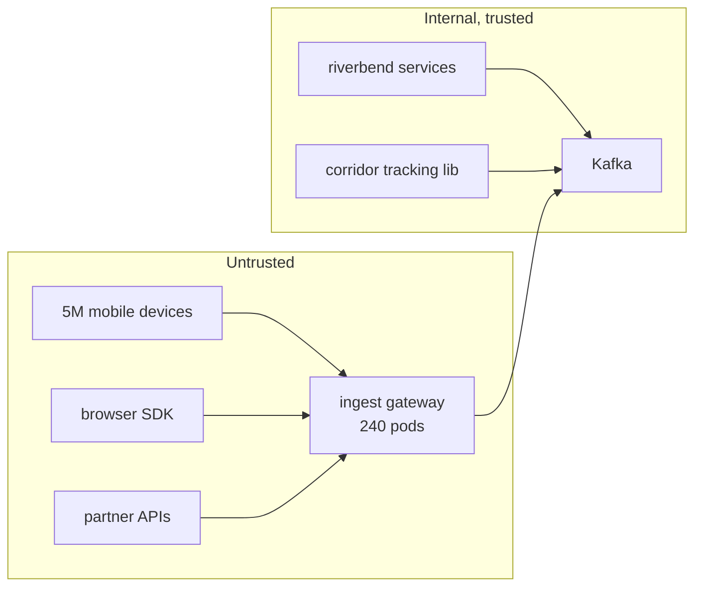

# Producers and the Ingestion Edge

Scenarios `I-01` … `I-13`.

This document covers the first stage: getting an event from the line of application code that
created it onto a durable, replicated log. It is the stage that gets the least design attention
and causes the most unexplained data loss, for one structural reason: **the producer is code you
do not own, running in a process you do not operate, and the only feedback path it has is a
callback most people ignore.**

## 1. What `producer.send()` actually does

Start with the naive mental model, because almost everyone has it and it is wrong in a specific
way that matters.

The naive model: `send()` transmits the event to the broker and returns when it is safe.

What actually happens in a Kafka producer (and, with different names, in every other client):



The application thread returns at the *third* box. Everything after that is asynchronous. So
between "my code called `send()` and moved on" and "the data is durable" there is a window —
typically 20 to 40 milliseconds on Meridian, longer under load — in which the event exists only
in the memory of one process.

If that process exits during the window, the event is gone. Nothing logs an error, because the
error would have arrived on the callback, and the process that would have received it no longer
exists.

**This is the single largest source of silent loss in a streaming platform**, and it is
invisible by construction: the producing service's metrics show the event was produced, the
platform's metrics show it was never received, and nobody compares the two. Section 9 is about
building the comparison.

### The four settings that define your durability

| Setting | Default | What it controls | Meridian |
|---|---|---|---|
| `acks` | `all` (since 3.0) | How many replicas must have the record before the callback fires | `all` everywhere |
| `enable.idempotence` | `true` (since 3.0) | Whether a retried send can create a duplicate | `true` everywhere |
| `retries` / `delivery.timeout.ms` | `MAX_INT` / 120 s | How long the client keeps trying before giving up | 120 s, except 15 s for Waypoint |
| `max.in.flight.requests.per.connection` | 5 | Concurrent unacknowledged requests per broker | 5 (safe with idempotence on) |

The pairing of the last two is the historical trap. Before idempotence existed, more than one
in-flight request meant a retry could reorder records: request 1 fails, request 2 succeeds,
request 1 succeeds on retry, and now record 1 sits after record 2 in the partition. The advice
"set `max.in.flight` to 1 for ordering" comes from that era. With `enable.idempotence=true` the
broker tracks a sequence number per producer per partition and refuses out-of-order writes, so
five in-flight requests preserve order *and* give you five times the throughput. If you are
still carrying `max.in.flight.requests.per.connection=1` in a config file, it is probably
costing you 60–80% of your producer throughput for no benefit.

### What `acks=all` does and does not promise

`acks=all` means the leader waits until every replica in the in-sync replica set has the record.
It does **not** mean "three replicas". If two of the three replicas have fallen behind and
dropped out of the in-sync set, `acks=all` means "one replica", and the callback still fires
successfully.

The setting that actually determines durability is `min.insync.replicas` on the *topic*, which
refuses the write when the in-sync set is too small. This is derived in detail in
[`../Kafka`](../Kafka/README.md) — its central thesis is that durability is
`min.insync.replicas`, not replication factor — and Meridian follows it: `RF=3, min.insync=2`
on every topic, so an acknowledged write survives one broker loss and writes continue through
one broker loss.

## 2. Batching: the arithmetic that decides your cost and your latency

Every producer batches. The two knobs are `batch.size` (bytes, per partition) and `linger.ms`
(how long to wait for the batch to fill). A batch is sent when either is reached.

Batching matters more than people expect because the per-request overhead is large and fixed:

```
Kafka produce request overhead (protocol header, topic and partition
  metadata, CRC, TLS record framing):  ~70 B per request
                                     + ~40 B per partition in the request
TLS handshake amortised, TCP ack, broker request-handler dispatch:
  ~55 µs of broker CPU per request regardless of size
```

Now apply it to Corridor's tracking stream, 1,850,000 events/s at 640 bytes across 480
partitions from roughly 900 producer instances.

**Without batching** (`batch.size=1`, or `linger.ms=0` on a low-rate producer):

```
1,850,000 requests/s × 55 µs = 101.75 CPU-seconds per second
  = 102 cores spent purely on request dispatch, across 48 brokers
  = 2.1 cores per broker out of 8, just to receive
compression: none possible (a single record has no redundancy to exploit)
  → 1,184 MB/s on the wire instead of 370 MB/s
```

**With `linger.ms=20` and `batch.size=262144` (256 KB):**

```
each producer instance holds, per partition:
  1,850,000/s ÷ 900 instances ÷ 480 partitions = 4.28 events/s per partition
  … which is only 2.7 KB in 20 ms, nowhere near 256 KB
```

That result is the trap, and it is worth sitting with. **The batch size you achieve is not the
batch size you configure; it is `rate ÷ producers ÷ partitions × linger`.** Spreading 1.85
million events a second across 900 producers and 480 partitions leaves each individual
producer-partition pair with almost nothing to batch.

Three ways out, in increasing order of effort:

**Raise `linger.ms`.** At 200 ms each producer-partition pair accumulates 27 KB — 43 records —
which compresses well and cuts request count by 43×. The cost is 100 ms of added p50 latency
(half the linger). For a tracking stream feeding hourly dashboards, that is free. For
`riverbend.payments.settled`, it is not, which is why linger is set per stream and not
globally.

**Reduce the fan-out.** With the sticky partitioner (Kafka's default since 2.4), a producer
sends a *run* of records to one partition until the batch is full or lingers out, then switches.
Instead of spreading 4.28 events/s across 480 partitions it puts 2,055 events/s into one
partition at a time. Same distribution over a minute, vastly better batching. If you are running
an older client with the round-robin partitioner, upgrading is the highest-value change
available.

**Aggregate before producing.** Put a local collector on the host or in the sidecar that
receives from many application processes and produces as one. This is what Meridian does for
Northlight's 100,000 sidecars — Section 7.

Meridian's settings, and their reasoning:

| Stream | `linger.ms` | `batch.size` | Achieved batch | Why |
|---|---|---|---|---|
| `corridor.tracking.events` | 200 | 512 KB | 118 KB | Dashboards tolerate 100 ms; batching is 43× |
| `northlight.playback.heartbeats` | 500 | 512 KB | 96 KB | Heartbeats are already 10 s apart; 250 ms is nothing |
| `waypoint.location.updates` | 100 | 256 KB | 41 KB | Live driver map needs sub-second |
| `riverbend.orders.lifecycle` | 20 | 64 KB | 1.8 KB | Low rate, latency matters, batching is hopeless anyway |
| `riverbend.payments.settled` | 5 | 16 KB | 0.9 KB | 67 events/s. Batching is pointless; latency is not |
| `gateline.ticket.requests` | 50 | 256 KB | 2 KB → 210 KB at peak | Batching appears exactly when it is needed |

That last row is a small piece of luck worth noticing: **batching gets better under load,
automatically.** A producer that is barely batching at 5,000 events/s is batching beautifully at
500,000, because the same `linger.ms` now collects 100× as many records. Your per-event overhead
falls precisely when you need it to. It is one of the few places in a streaming platform where
the system's behaviour under stress is in your favour, and it is why `linger.ms` is a better
lever than `batch.size` for spiky streams.

## 3. Partitioning: where ordering and skew are decided

The partitioner maps a record to a partition. Three modes:

**No key (round-robin or sticky).** Maximum spread, no ordering guarantee between any two
records. Correct for anything where records are independent — Northlight's heartbeats, most
tracking events.

**Hash of a key.** `partition = murmur2(key) % numPartitions`. All records with the same key land
in the same partition and are therefore ordered relative to each other. This is the mechanism
behind every "process a user's events in order" requirement.

**Custom.** You write the function. Almost always a mistake, with two exceptions covered in
`I-06` and `I-07`.

### Choosing a key is choosing your ordering guarantee and your skew

The key decision is the most consequential single choice in a stream's design, because it
simultaneously fixes three things:

- **What is ordered.** Records with the same key are ordered; nothing else is.
- **How work distributes.** A hot key is a hot partition is a hot consumer task.
- **What can be co-partitioned.** Two streams keyed the same way can be joined without a
  shuffle. Two streams keyed differently cannot.

Meridian's keys:

| Stream | Key | Consequence |
|---|---|---|
| `waypoint.location.updates` | `driver_id` | A driver's positions are in order. Different drivers are not comparable, which is fine |
| `corridor.tracking.events` | `member_id` | Sessionization works without a shuffle |
| `riverbend.orders.lifecycle` | `order_id` | An order's nine or ten lifecycle events are strictly ordered |
| `riverbend.inventory.adjustments` | `sku` | Required: the topic is compacted, and compaction keeps the newest record per key |
| `northlight.playback.heartbeats` | none | Heartbeats are independent; spreading is worth more than ordering |
| `gateline.ticket.requests` | `event_id` | ⚠️ See `I-05` — this is a deliberate, dangerous choice |

### Deriving the skew you will get

Key skew is not a risk; it is a certainty whose magnitude you can compute in advance. For a
stream keyed by `member_id` with 1 billion members, the distribution is roughly Zipfian: a few
accounts (brands, celebrities, bots, integration test accounts) generate orders of magnitude
more events than the median.

Measured on Corridor:

| Percentile of member | Events/day from that member |
|---|---|
| p50 | 34 |
| p90 | 210 |
| p99 | 1,850 |
| p99.9 | 22,400 |
| p99.99 | 310,000 |
| max (an automated content account) | 41,000,000 |

With 480 partitions and 100 million active members a day, the average partition carries 208,333
members. The partition containing the 41-million-events-a-day account carries:

```
average partition load:  1,850,000/s ÷ 480  =     3,854 events/s
that account alone:      41,000,000 ÷ 86,400 =      474 events/s
```

So the worst key adds 12% to one partition. That is survivable. **But run the same arithmetic
with 48 partitions instead of 480** and the account adds 1.2% — wait, that is *better*, because
the average partition load rose to 38,542. The hot key is only a problem relative to the
partition's capacity, not relative to its neighbours.

The real hazard is different and it is `K-03`'s subject: **the hot key is a problem in the
processing tier, not the transport tier**, because a Flink keyed operator processes one key at a
time within a task and cannot parallelise a single key. A partition can absorb 474 extra
events/s without noticing. A single keyed-aggregation slot that must also do a RocksDB read and
write for each of them may not.

## 4. Scenarios: the ways ingestion loses data

### I-01 — The producer buffer fills and `send()` starts blocking

**What you see.** The application's request latency rises across the board, with no change in
database or downstream-service latency. Thread dumps show application threads parked in
`KafkaProducer.send` → `RecordAccumulator.append` → `BufferPool.allocate`. The producer metric
`buffer-available-bytes` is at or near zero, `bufferpool-wait-time-total` is climbing.

**Mechanism.** The producer's record accumulator is a fixed pool (`buffer.memory`, 32 MB by
default). When the sender thread cannot drain it as fast as the application fills it — because
the brokers are slow, because a partition's leader is unavailable, because the network is
congested — the pool fills. `send()` then blocks for up to `max.block.ms` (60 s by default)
waiting for space, and after that throws `TimeoutException`.

This is Kafka's backpressure reaching into your application, and it is *correct behaviour*: the
alternative is unbounded memory growth and an out-of-memory kill. But most applications are not
designed for `send()` to block. A synchronous HTTP handler that calls `send()` inline will hold
its request thread, and with a 60-second `max.block.ms` and a 200-thread pool, a slow broker
takes your API down.

**Confirm it.** The producer exposes this directly:

```
kafka.producer:type=producer-metrics,client-id=*
  buffer-available-bytes      → near 0
  bufferpool-wait-ratio       → > 0
  record-queue-time-avg       → climbing
  request-latency-avg         → climbing (the cause)
```

If `request-latency-avg` is climbing, the brokers are the cause. If it is flat and the queue
time is climbing anyway, you are simply producing faster than the configured throughput allows —
check `max.request.size` and whether compression is on.

**Recover.** In the moment, the only real options are to reduce what you send or to accept
dropping it. Do *not* raise `buffer.memory` during an incident; it delays the symptom by
however many seconds of traffic the extra memory holds and then you are in the same place with
less headroom.

⚠️ Do not set `max.block.ms=0` as an emergency fix unless you have a drop path already written.
It converts blocking into an immediate exception on every send, and if your callback handler
logs and continues, you have just converted a latency problem into silent total data loss for
that stream.

**Prevent.** Three things, in order of value:

1. **Never call `send()` on a request-serving thread without a bounded local queue in front of
   it.** Put an in-process ring buffer between the handler and the producer, with an explicit
   policy — drop oldest, drop newest, or block — that you chose deliberately and that emits a
   counter when it fires. This converts an invisible failure into a metric.
2. **Set `max.block.ms` to something smaller than your request timeout**, so a stuck producer
   fails the send rather than the request.
3. **Size `buffer.memory` from the arithmetic**: it should hold at least `delivery.timeout.ms`
   worth of traffic at your peak rate, so a transient broker problem is absorbed rather than
   propagated. For a service producing 8 MB/s with a 120-second delivery timeout, that is 960 MB
   — which tells you immediately that the default 32 MB is not a considered value for a
   high-rate producer, and that you cannot buffer your way through a two-minute broker outage.

### I-02 — Fire-and-forget: the callback nobody reads

**What you see.** Nothing. That is the entire problem. Downstream counts are 0.4% below what the
producing service's own instrumentation reports, discovered during an unrelated reconciliation
three months after launch.

**Mechanism.** The code looks like this:

```java
producer.send(new ProducerRecord<>("corridor.tracking.events", memberId, event));
```

No callback. No `.get()`. The returned `Future` is discarded. When the send eventually fails —
after `delivery.timeout.ms` of retries — the exception is delivered to a callback that does not
exist, and the producer increments `record-error-rate`, which nobody is alerting on.

This is not a hypothetical. It is the default shape of every Kafka tutorial, and it is in
production in most companies.

**Confirm it.**

```
kafka.producer:type=producer-metrics
  record-error-rate     → should be 0; anything else is loss
  record-retry-rate     → nonzero is fine, but a rising trend precedes errors
```

Then grep your producing code for `producer.send(` and count how many call sites pass a
callback. The ratio is usually sobering.

**Recover.** Nothing to recover; the data is gone. What you can do is bound the damage: find out
*which* records, using the ingest-time reconciliation in Section 9, and decide whether the
affected window can be re-derived from another source.

**Prevent.** Make it structurally impossible rather than a code-review item:

- Wrap the producer in a thin internal library whose `send` method *requires* a failure handler
  as an argument. Not optional with a default — required.
- The default handler should increment a metric tagged with the topic and the exception class,
  and — for anything above a threshold — write the record to a local dead-letter file so it can
  be recovered.
- Alert on `record-error-rate > 0` for every producer, at every service. Yes, every one. It
  should be zero.

### I-03 — Retry storms amplify a broker problem into an outage

**What you see.** One broker becomes slow. Within 90 seconds, *every* broker is slow, producer
latency across all topics is up 20×, and the cluster's inbound request rate has tripled while
its useful throughput has halved.

**Mechanism.** This is retry amplification, the same metastable pattern described in
[`../MicroservicesPOF`](../MicroservicesPOF/README.md). One broker slows; requests to it time
out; producers retry; retried requests add load; the broker slows further. Meanwhile the
producers' in-flight slots are occupied by retries to the slow broker, so their sends to *other*
brokers queue behind them, and those start timing out too.

The multiplier is exact and it is worth computing. With `retries` effectively unbounded and
`retry.backoff.ms=100`, a producer facing a 30-second broker stall issues:

```
30,000 ms ÷ (100 ms backoff + ~50 ms attempt) = 200 attempts per record batch
```

Two hundred times the intended load, from every producer, at the worst possible moment.

**Confirm it.** The signature that distinguishes a retry storm from a genuine traffic increase:

```
broker request rate       → up 3×
broker bytes-in rate      → flat or down
producer record-send-rate → flat
producer record-retry-rate → up 200×
```

**Useful load flat while request count triples** is the fingerprint. If bytes-in rose with
request count, it is real traffic.

**Recover.** Raise `retry.backoff.ms` fleet-wide — if you have a mechanism to do that without a
deploy, which is the whole argument for dynamic producer configuration. Otherwise, remove the
sick broker from the cluster so that leadership moves and the retries have somewhere to succeed.

⚠️ Do not restart all the producers. A synchronised restart means every producer re-fetches
metadata and re-establishes connections at the same moment, which is a second thundering herd on
top of the first.

**Prevent.**

- **Exponential backoff with jitter**, not a fixed backoff. Kafka clients added
  `retry.backoff.max.ms` (default 1,000 ms) in 3.7 — set it, and set `retry.backoff.ms` to
  something like 50, so the backoff grows from 50 ms to 1 s with jitter rather than hammering
  at a fixed interval.
- **Bound total retry time with `delivery.timeout.ms`**, not with `retries`. 120 seconds is the
  default and it is reasonable; `retries=MAX_INT` with a bounded delivery timeout is the correct
  pairing.
- **Per-broker circuit breaking** is not built into the client. If your traffic justifies it,
  the practical approximation is a short `request.timeout.ms` (Meridian uses 15 s, not the 30 s
  default) so that a stalled broker is abandoned quickly and leadership failover starts.

### I-04 — Idempotence is on and duplicates appear anyway

**What you see.** `enable.idempotence=true`, and the downstream consumer still finds two copies
of the same record with different offsets.

**Mechanism.** Idempotence deduplicates within a *producer session* for a *bounded window*. Three
things break it, and all three are normal operations:

1. **The producer restarted.** A new `producer.id` is allocated, the broker has no memory of the
   old sequence numbers, and any record that was sent but not acknowledged before the crash is
   re-sent by the application's own retry logic as a brand-new record.
2. **`transactional.id` is not set.** Without it, the producer ID is ephemeral and item 1 applies
   to every restart, including every deploy.
3. **The producer's session expired.** The broker retains producer state for
   `transactional.id.expiration.ms` (7 days) or, for non-transactional idempotent producers, in
   a bounded per-partition cache of the last five sequence numbers. A producer that is idle
   longer than the cache lifetime, or that has more than five in-flight batches out of order,
   can have its state evicted.

The honest sentence: **idempotent producers prevent duplicates caused by network retries. They
do not prevent duplicates caused by process restarts, and process restarts are the common
case.**

**Confirm it.** Look at the duplicate records. If they have the same payload but different
`producer_id` in the record batch header, it was a restart. Same `producer_id` and different
`base_sequence` means something stranger and is worth escalating.

```
kafka-dump-log.sh --files 00000000000123456789.log --print-data-log \
  | grep -A2 "offset: 987654"
```

**Recover.** Deduplicate downstream. See `D-04`.

**Prevent.** Carry a **business idempotency key** in the record and deduplicate on it at the
sink. `event_id`, `order_id + sequence`, `request_id` — something the producing application
generates deterministically, so that the same logical event produced twice carries the same key.
This is the only mechanism that survives restarts, and it is the reason every record on Meridian
has an `event_id` in the envelope (see
[03-the-event-schema-and-contracts.md](03-the-event-schema-and-contracts.md)).

### I-05 — A keyed stream collapses onto one partition under load

**What you see.** Gateline's `ticket.requests` has 240 partitions. During an on-sale, 238 of them
are idle and two are receiving 250,000 events/s each. Consumer lag on those two is in the
millions; the other 238 have zero.

**Mechanism.** The stream is keyed by `event_id` — the concert, not the record. That is
deliberate: all requests for one concert must be processed in order so that seat allocation is
consistent. But there is only one concert on sale at a time, so every record has the same key,
so every record goes to one partition.

This is the correct behaviour of a hash partitioner given a single key, and it is a design
failure, not a bug. It is worth stating plainly: **keying by a business entity guarantees
ordering within that entity and guarantees a hotspot when that entity is the only active one.**

**Confirm it.** Per-partition produce rate, which most dashboards aggregate away:

```
kafka.server:type=BrokerTopicMetrics,name=BytesInPerSec,topic=gateline.ticket.requests
```

broken down per partition, or more simply:

```bash
kafka-run-class.sh kafka.tools.GetOffsetShell \
  --bootstrap-server broker:9092 --topic gateline.ticket.requests \
  --time -1 | sort -t: -k3 -n | tail
```

Run it twice 10 seconds apart and difference the offsets. Two partitions moving and 238 not is
unmistakable.

**Recover.** Nothing good, in the moment. The ordering requirement is real, so you cannot simply
re-key. What you *can* do is shed: admit a fraction of requests to a waiting room and let the
rest through gradually, which is what a ticketing system should have been doing anyway.

**Prevent.** Two patterns, and choosing between them is the design conversation:

**Key by a finer entity.** Is the ordering requirement really per-concert, or is it per-seat, or
per-section? `event_id + section_id` gives 40 to 200 keys instead of one, spreads across
partitions, and still guarantees that two requests for the same section are ordered — which is
where the actual conflict is. This is nearly always the right answer, and finding it requires
asking "what specifically must not be reordered?" rather than accepting "the concert."

**Decouple ordering from partitioning.** Produce round-robin for throughput, and enforce
ordering downstream with a sequence number per entity and a reorder buffer in the processor.
This works, it scales, and it costs you a bounded buffer plus the complexity of handling a
sequence gap. Use it when the ordering entity genuinely cannot be subdivided.

### I-06 — The partition count changed and ordering silently broke

**What you see.** A stream keyed by `order_id` grew from 24 to 48 partitions last Tuesday. Since
then, roughly one order in 2,000 has had its lifecycle events processed out of order, producing
a handful of orders stuck in `PENDING` forever.

**Mechanism.** `partition = hash(key) % numPartitions`. Change `numPartitions` and the mapping
changes for almost every key. Order `ord-7781204` was going to partition 11; now it goes to
partition 35. Its `created` event is at offset 9,481,002 on partition 11, still unconsumed, and
its `paid` event is on partition 35, consumed immediately. The state machine sees `paid` before
`created`.

The window of damage lasts as long as the unconsumed backlog on the old partitions — usually
seconds, occasionally hours if a consumer group was lagging.

**Confirm it.** Compare the topic's partition count history against the timestamps of the stuck
entities. If the incident starts within minutes of a partition-count change, this is it.

**Recover.** Identify the entities whose events straddle the change — anything whose first event
predates the change and whose later events postdate it — and replay or repair them. For a
state-machine consumer, the usual approach is to re-derive the entity's state from an
authoritative source rather than from the stream.

**Prevent.**

- **Treat partition count as immutable once a topic carries keyed, ordered data.** Over-provision
  at creation instead. Partitions are cheap up to the per-broker ceiling; ordering breakage is
  not.
- If you must increase it, **drain first**: stop producers, let every consumer group reach the
  end of every partition, then add partitions, then restart producers. On Meridian this is a
  documented change procedure with an approval gate, and it has been used twice in three years.
- **Alternatively, use a partitioner that is stable under resizing** — consistent hashing with
  virtual nodes, or a fixed "logical partition" count much larger than the physical count. This
  is one of the two legitimate reasons to write a custom partitioner. It costs you the ability
  to use out-of-the-box co-partitioned joins, because nothing else on the platform will hash the
  same way.

### I-07 — The sticky partitioner concentrated a low-rate stream

**What you see.** `riverbend.catalog.changes` has 6 partitions, no key, and 40 events/s. The
consumer group has 6 members and 5 of them are idle for tens of seconds at a time, with the
sixth handling everything, then it flips.

**Mechanism.** The sticky partitioner is doing exactly what it was designed to do: it sends a
run of records to one partition until the batch lingers out, then picks a new partition. With
`linger.ms=20` and a 40-events-per-second stream, each run is about one record — so it should
spread fine. But with `linger.ms=500` and a bursty producer, a run can be hundreds of records,
and with only 6 partitions the "spread over time" argument does not have enough partitions to
average over at any instant.

This is usually harmless. It becomes a problem when a downstream stateful operator has
processing-time timers or per-partition watermarks, because an idle partition stalls the
watermark (see `E-03`).

**Confirm it.** Per-partition offset rates, as in `I-05`. The distinguishing feature from `I-05`
is that the hot partition *rotates* — over five minutes, all six are equally loaded.

**Recover.** Usually no action needed. If a watermark stall is the symptom, configure idleness
detection on the source (`withIdleness(Duration.ofSeconds(30))` in Flink) and the problem
dissolves.

**Prevent.** For low-rate unkeyed streams, `partitioner.class` set to the round-robin
partitioner is defensible — you lose the batching benefit, which at 40 events/s you never had.
More generally: **low-rate streams should have few partitions**, and six is already more than
`riverbend.catalog.changes` needs. Two would be better.

### I-08 — Producers outside your control: mobile clients

**What you see.** Waypoint's `location.updates` arrives from five million mobile devices you do
not operate. 2% of the traffic has timestamps in the future, 0.4% has timestamps more than a day
in the past, a persistent 0.02% is malformed in ways that change with each app release, and
during a regional network outage, a reconnection burst delivers eleven minutes of buffered
positions from 400,000 devices in the space of forty seconds.

**Mechanism.** Every assumption that holds for a server-side producer fails here:

- **Clocks are wrong.** Phones drift, users set them manually, and time zones are applied twice.
- **You cannot deploy a fix.** App store review plus user upgrade means the long tail of an old
  client version lives for eighteen months.
- **Credentials are public.** Anything shipped in the app is extractable.
- **Buffering is on the client**, so lateness is measured in hours and arrives in bursts.

**Confirm it.** Measure the event-time-to-ingest-time distribution per client version. The table
in [00](00-what-a-streaming-platform-is-and-why-it-is-hard.md) Section 4 is that measurement,
and it is worth producing for any stream with untrusted producers before you design around it.

**Recover.** During a reconnection burst, the useful lever is admission control at the gateway
(Section 6), not anything in the producer.

**Prevent.** A mobile stream needs an **ingestion gateway**, not direct produce. The gateway:

- **Terminates authentication** against a real identity, so a leaked app credential does not
  mean unlimited write access to a topic.
- **Stamps `ingest_time` and `receipt_time`** so that downstream jobs have a monotonic clock
  available when the device's clock is untrustworthy.
- **Clamps event time** into a plausible window — Meridian rejects anything more than 15 minutes
  in the future (clock skew) and routes anything more than 6 hours in the past to a late-arrival
  topic rather than the main stream. Both counts are metrics, per client version, and both are
  alerted.
- **Validates and versions the schema** at the edge, so a malformed record from a bad release is
  rejected at the gateway rather than poisoning a consumer 40 minutes downstream.
- **Rate-limits per device and per account**, so one buggy client cannot produce 10,000
  events/s.

`Z-02` covers the authentication design and `E-04` covers the clock handling.

### I-09 — The reconnection burst

**What you see.** A 40-second window in which `location.updates` runs at 6.8× its normal rate.
Consumer lag on every downstream job spikes to 14 million records, the attribution job
backpressures, checkpoints start timing out, and two jobs restart.

**Mechanism.** 400,000 devices lost connectivity for eleven minutes, each buffered roughly 165
positions, and all reconnected within a 40-second window because the network came back at once.

```
400,000 devices × 165 buffered positions = 66,000,000 events
delivered over 40 s                      = 1,650,000 events/s
on top of the normal 750,000/s           = 2,400,000/s, or 3.2× steady
```

The multiplier is not the ratio of buffered data to normal data; it is that ratio divided by how
long the reconnection takes, and reconnections are fast because everything reconnects at once.

**Confirm it.** Ingest rate spikes while event-time rate does not — the events being delivered
have timestamps spread over eleven minutes, so a histogram of event time is flat while a
histogram of ingest time is a spike. That divergence is the fingerprint and it distinguishes a
reconnection burst from a genuine traffic increase, which raises both.

**Recover.** Let it through if the platform can absorb it; the arithmetic above says 40 seconds
at 3.2× is 66 million records, which at 607 MB/s of headroom is well within a 24-minute
page-cache window. The thing to protect is the *processing* tier, not the transport tier — see
`B-02`.

**Prevent.**

- **Client-side jittered reconnect with exponential backoff.** If devices spread their
  reconnection over 10 minutes instead of 40 seconds, the multiplier falls from 3.2× to 1.15×.
  This is a one-line change in the client and it is the single highest-value mitigation, which
  is frustrating because it is in code you ship quarterly.
- **Rate-limit the flush, not the connection.** A reconnecting client should be told how fast it
  may drain its buffer. Meridian's gateway returns a `X-Flush-Rate` header and the client honours
  it; compliance is around 80% because of old versions, which is still worth having.
- **Route replayed data to a separate topic.** A client flushing a buffer marks its records
  `delivery_mode=backfill`, and the gateway routes them to `waypoint.location.updates.backfill`.
  Real-time consumers ignore that topic; the analytics path reads both. The live map stays live
  during the burst, which is what actually matters. This is an instance of the general rule from
  [`../LogCollector`](../LogCollector/README.md): **prefer a separate path to a priority field**.

### I-10 — A poison record kills the producer, not the consumer

**What you see.** A service's producer throws `RecordTooLargeException` and — because the
exception handler catches, logs at `WARN` and continues — the service keeps running while 100%
of one category of events silently vanishes for six days.

**Mechanism.** One event type occasionally carries an unbounded field (an error stack trace, a
user-supplied description, a base64 image). When it exceeds `max.request.size` (1 MB default) or
the broker's `message.max.bytes`, the send fails permanently — retries do not help, because the
record will never fit.

**Confirm it.**

```
kafka.producer:type=producer-topic-metrics,topic=*
  record-error-rate > 0
```

and the exception class in your own logs. `RecordTooLargeException` is unmistakable once you
look for it.

**Recover.** Truncate the offending field and resend, if you still have the data.

**Prevent.** **Bound every unbounded field in the schema, at the producer.** Not at the broker —
the broker's rejection is too late and too blunt. A serializer wrapper that truncates any string
field over, say, 8 KB and sets a `_truncated: true` flag gives you a record that is always
sendable and a metric that tells you it happened. `S-07` covers this as a schema design
principle.

### I-11 — Schema registry unavailable and every producer stops

**What you see.** The schema registry has a bad deploy. Within 30 seconds, every producer in the
company is throwing `RestClientException` and no events are being produced at all.

**Mechanism.** The Avro serializer looks up (or registers) the schema ID for the subject before
serializing. If the registry is unreachable and the ID is not cached, serialization fails and
the send fails. A registry outage is therefore a **total ingestion outage** — which is a
remarkable amount of blast radius for a component most people think of as metadata.

**Confirm it.** Producer errors are `SerializationException` wrapping a REST error, not a Kafka
error. Broker metrics are healthy. That combination — healthy brokers, failing producers — is
the fingerprint.

**Recover.** Roll back the registry. If the registry's backing store is the problem, most
registry implementations can serve reads from an in-memory cache; restarting into a read-only
mode is the fast path.

**Prevent.**

- **Cache schema IDs on disk, not just in memory**, so a producer restart during a registry
  outage still works. Most clients cache in memory only, which means your blast radius is "every
  producer that restarts during the outage" — which, with rolling deploys, is a lot of them.
- **Run the registry with the same availability target as the brokers.** Three replicas, spread
  across zones, with a health check that exercises a real lookup. Most teams run one.
- **Pre-register schemas at build time**, so production producers never need to *write* to the
  registry — only read. A registry that is read-only in production can be served from a static
  artefact, which removes the failure mode entirely. This is the strongest version of the fix
  and it also solves `S-02`.

### I-12 — Producing inside a database transaction

**What you see.** An order is in the database with status `PAID`, and no `payment.settled` event
exists on the stream. Or: the event exists and the database row does not.

**Mechanism.** The code does this:

```
BEGIN
  UPDATE orders SET status = 'PAID' WHERE id = ?
  producer.send(paymentSettledEvent)     ← not part of the transaction
COMMIT
```

There are two failure orders and both happen. If the process dies after `send()` and before
`COMMIT`, the event exists and the state change does not. If the `send()` is asynchronous (which
it is) and fails after `COMMIT`, the state change exists and the event does not.

No amount of careful ordering fixes this, because the database and the broker are separate
systems with separate commit protocols. This is the dual-write problem, and it is the most
common correctness bug in event-driven architectures.

**Confirm it.** Reconcile: for a sample window, count state transitions in the database and
matching events on the stream. A persistent non-zero difference in either direction confirms it.
Do this *proactively* for any stream produced alongside a database write; it is cheap and it
finds real bugs.

**Recover.** Reconcile and emit the missing events, if the database is the source of truth. If
the stream is the source of truth, you have a harder problem.

**Prevent.** The **transactional outbox**: write the event into a table in the same database
transaction as the state change, then have a separate process read that table and produce to
Kafka. The transaction is now local and atomic; the produce is at-least-once and idempotent via
the event ID. Section 7 of
[18-cdc-and-streaming-from-databases.md](18-cdc-and-streaming-from-databases.md) covers this in
full, including how to read the outbox without polling.

### I-13 — Two producers, one logical stream, different clocks

**What you see.** `riverbend.orders.lifecycle` is produced by four services. A downstream
event-time job sees events whose timestamps go backwards by up to 900 milliseconds within a
single order's key.

**Mechanism.** Each producing service stamps `event_time` from its own wall clock. NTP keeps
them within a few hundred milliseconds of each other, not within zero. When `order-service`
stamps `created` at 10:00:00.400 and `payment-service` stamps `paid` at 10:00:00.310 — because
its clock is 90 ms behind — the event that logically happened second has an earlier timestamp.

**Confirm it.** For a keyed stream, compute the fraction of records whose event time is earlier
than the previous record for the same key. On Meridian this metric is called
`event_time_regression_rate` and it is emitted per stream per producing service, which makes the
guilty clock obvious.

**Recover.** Nothing in the moment. Downstream, a job that depends on ordering must not depend
on timestamp ordering.

**Prevent.**

- **Use a logical sequence, not a timestamp, for ordering within a key.** The order service
  assigns `sequence: 1, 2, 3` to an order's lifecycle events; downstream ordering uses the
  sequence and timestamps are used only for windowing and lateness.
- **Or produce from one service.** If several services genuinely need to emit into one logical
  stream, having them emit into their own streams and merging downstream at least makes the
  clock boundaries visible.
- **Monitor clock skew as a platform metric.** Meridian alerts when any producing host's offset
  from NTP exceeds 250 ms, because at that point several downstream watermark assumptions stop
  holding. `E-05` covers the watermark consequences.

## 5. Should there be a gateway at all?

Meridian runs two ingestion paths, and choosing between them is a real decision.

**Direct produce.** The application holds a Kafka client and writes to the broker. Lowest
latency, fewest moving parts, no extra hop to operate or pay for. Used by every internal service
on Meridian — Riverbend's 240 services, Corridor's tracking library, Northlight's backend.

**Gateway.** The application makes an HTTP or gRPC call to an ingestion service, which validates,
enriches and produces. Used by anything Meridian does not control: mobile clients, partner
integrations, browser-based tracking.



The gateway costs you real things, and they should be stated:

- **Latency**: one more hop, +4 ms p50, +22 ms p99 on Meridian.
- **A tier to operate**: 240 pods, autoscaled, and a failure mode of its own.
- **A throughput ceiling**: at 480,000 requests/s across 240 pods, each pod handles 2,000/s, and
  the gateway becomes a capacity planning exercise in its own right.

It buys you five things that are hard to get any other way, and the fifth is the one that
justifies it:

1. **Authentication against real identities** rather than a shared credential in a client
   binary.
2. **Schema validation at the edge**, so bad records never reach the log.
3. **Clock discipline** — `ingest_time` stamped by a trusted clock.
4. **Per-tenant rate limiting** before the traffic costs you anything.
5. **A place to change behaviour without changing clients.** When you need to shed load, reroute
   a stream, add a field, or stop accepting something, the gateway is the only place you can do
   it in minutes rather than in an app release cycle. For producers you cannot deploy to, this
   is not a convenience; it is the only control you have.

**The rule:** if you control the producer, produce directly. If you do not control the producer,
you need a gateway, and the reason is control rather than protocol.

## 6. Admission control: deciding what not to accept

A gateway that accepts everything is a proxy. The value is in what it refuses.

Meridian's gateway runs a four-level admission ladder, evaluated per request:

| Level | Trigger | Action | Metric |
|---|---|---|---|
| 0 | Normal | Accept | — |
| 1 | Tenant over 1.2× its committed rate | Accept, tag `over_quota=true`, bill at surge rate | `ingest_over_quota_events` |
| 2 | Tenant over 2× committed, or platform over 85% | Reject the tenant's `priority=low` streams with `429` and `Retry-After` | `ingest_shed_events{level=2}` |
| 3 | Platform over 95%, or Kafka produce p99 > 500 ms | Reject all but `priority=critical`, per tenant, weighted fair | `ingest_shed_events{level=3}` |

Three properties of this design are worth arguing for explicitly.

**It sheds per tenant, not globally.** If Corridor floods, Corridor is shed. Riverbend's
payments continue. A global threshold would punish the well-behaved tenant for the badly-behaved
one's mistake, which is the definition of a noisy-neighbour failure. See
[14-multi-tenancy-isolation-and-quotas.md](14-multi-tenancy-isolation-and-quotas.md).

**It returns `429` with `Retry-After`, not `503`.** A `429` is a contract: *you*, specifically,
are over your limit, and here is when to come back. A `503` says the service is broken, which
invites a retry storm. The distinction changes client behaviour, and client behaviour during
shedding is the difference between degradation and collapse.

**Every level increments a counter, always.** The platform must never shed silently. This is the
same principle as
[`../LogCollector`](../LogCollector/README.md)'s "make degradation visible — zero is almost
always a lie," and it is the reason Meridian's ingest dashboard leads with shed rate rather than
accept rate.

## 7. Aggregating producers: when a sidecar is worth it

Northlight runs a service mesh with 100,000 sidecars. If each sidecar were a Kafka producer:

```
100,000 producers × 3 connections each (bootstrap + 2 brokers)
  = 300,000 TCP connections against 48 brokers
  = 6,250 connections per broker
```

Kafka handles that, but badly — each connection costs a file descriptor, a socket buffer
(typically 128 KB of kernel memory each way), and a slot in the network thread's selector. 6,250
connections per broker is 1.6 GB of socket buffers before any data moves, and the network
threads spend their time on `epoll` bookkeeping rather than on I/O.

Worse is the batching arithmetic from Section 2. Each sidecar produces roughly 11 events/s. With
`linger.ms=200`, that is 2.2 records per batch. The per-request overhead dominates completely.

The fix is a **node-level aggregator**: one collector per Kubernetes node receives from the
sidecars on that node over a local Unix socket, and produces as a single client.

```
100,000 sidecars on 3,400 nodes = 29 sidecars per node
29 × 11 events/s = 319 events/s per aggregator
with linger.ms=200: 64 records per batch instead of 2.2
connections: 3,400 × 3 = 10,200 instead of 300,000
```

**A 29× improvement in batch size and a 29× reduction in connections, for the cost of one more
process per node and one more hop.** The hop costs about 0.3 ms over a Unix domain socket, and
it introduces a new failure mode — if the aggregator dies, the sidecars on that node buffer and
then drop — which is why the aggregator must have a local disk buffer and an explicit drop
metric.

**When it is worth it:** the threshold is roughly when `producers × 3 > 2,000 × brokers`, or
when per-producer rate falls below about 200 events/s. Below that, direct produce is simpler and
simpler wins.

## 8. Producer-side buffering: the disk question

A producer's in-memory buffer holds a few seconds. If the brokers are unavailable for longer,
you either block, drop, or spill to disk.

**Do not spill to disk by default**, and the reason is not performance. A disk buffer converts a
visible outage into an invisible one: the producing service keeps accepting work, the platform
stops receiving data, and nobody notices until the buffer fills — typically hours later, at
which point you have a large volume of very stale data to deliver into a system that is now
running normally and does not expect it. The reconnection burst in `I-09`, but from your own
infrastructure.

**Do spill to disk when the data is irreplaceable and the producer is at the edge.** Waypoint's
mobile clients buffer, because a driver in a tunnel has no alternative and the trip record
matters. Northlight's sidecars buffer 60 seconds, because a rolling broker upgrade should not
lose mesh telemetry.

If you buffer, three rules:

1. **Bound it by time, not only by size.** "Buffer up to 5 minutes" is a statement about how
   stale the delivered data can be. "Buffer up to 2 GB" is a statement about nothing.
2. **Mark buffered records** so the consumer knows they are late (`delivery_mode=buffered`,
   plus the original event time). Otherwise a burst of hour-old data arriving at once will be
   silently dropped by every windowed job on the platform.
3. **Emit the buffer depth as a metric and alert on it.** A buffer that is never empty is a
   capacity problem wearing a disguise.

## 9. Measuring what you lost

Everything above is prevention. This section is the measurement that tells you whether the
prevention worked, and it is the part most platforms skip.

**You cannot detect loss by looking at the platform.** The platform's metrics count what
arrived. Loss is the difference between what arrived and what was sent, and only the producer
knows the second number. So the measurement must span both.

Three techniques, each catching a different class:

### Technique 1 — Sequence numbers per producer per partition

Each producer maintains a monotonic counter per destination partition and includes it in the
record header. A lightweight auditing consumer reads every stream and checks for gaps.

```
producer emits:  seq 1, 2, 3, 4, 5, 6
auditor sees:    seq 1, 2, 3,    5, 6
                             ^ gap: 1 record lost, and you know which producer
```

**Catches:** any record that was successfully serialized but never reached the log.
**Misses:** records that failed before the sequence was assigned, and whole producers that died.
**Cost:** 8 bytes per record and one extra consumer group reading everything — on Meridian that
is 607 MB/s of extra read, about $29,000 a year in network. Meridian runs it on a 1-in-1,000
sample for the high-volume streams and on everything for `riverbend.payments.settled`.

### Technique 2 — Periodic count reconciliation

Each producing service emits, once a minute, a count of records it *attempted* to send per
stream, into a low-volume audit stream. A job compares those counts against the actual arrival
counts for the same minute, allowing for lateness.

```
audit says   corridor-tracking-svc-7  emitted 41,204 in minute 10:14
platform saw                          arrived 41,204 in minute 10:14 ± lateness window
```

**Catches:** loss at any stage, including producers that died (their last count is missing).
**Misses:** loss *before* the count is taken — the record that was never created because of a
bug in the application.
**Cost:** trivial. This should exist on every stream.

### Technique 3 — Canary records

Inject a synthetic record into every partition of every stream at a fixed interval, with a known
payload, and assert at the other end that all of them arrived within the latency SLO.

**Catches:** whole-path failures, including ones that affect a single partition — which the
count reconciliation would average away.
**Misses:** partial loss. If 3% of real records are dropped, the canary probably still arrives.
**Cost:** negligible, and it doubles as the end-to-end latency probe (see
[16-observability-of-a-streaming-pipeline.md](16-observability-of-a-streaming-pipeline.md)).

### The honest sentence

With all three running, here is what Meridian can actually claim, and the phrasing matters
because vaguer versions of it are what get platforms into trouble:

> For streams produced by services inside our network, with `acks=all`, `min.insync.replicas=2`
> and a mandatory failure handler, we measure ingestion loss at **fewer than 4 records per
> billion** over a 30-day window, excluding records lost inside producing applications before
> `send()` was called, which we cannot see. For streams produced by mobile clients we do not
> make a loss claim, because the client-side buffer can be discarded by the operating system
> and we have no way to count what it held.

Compare that with "we guarantee no data loss," which is what the design document said before
anybody measured.

## What to take away

1. **`send()` returns before the data is durable**, and the gap is the largest source of silent
   loss in a streaming platform. The callback is not optional; make it structurally required.
2. **`acks=all` means "all currently in-sync replicas", which may be one.** Durability is
   `min.insync.replicas`, set on the topic.
3. **The batch size you achieve is `rate ÷ producers ÷ partitions × linger`**, not what you
   configured. With 900 producers and 480 partitions, a 1.85-million-event-per-second stream
   still batches badly unless you raise linger or use the sticky partitioner.
4. **Batching improves automatically under load** — `linger.ms` collects more records when the
   rate rises — which makes it the right lever for spiky streams.
5. **Choosing a key chooses your ordering guarantee, your skew, and your join options at once.**
   Ask "what specifically must not be reordered?" — the answer is usually finer-grained than the
   entity people first name, and the finer answer removes the hotspot.
6. **Partition count is immutable once a topic carries keyed data.** Changing it silently
   reorders everything mid-flight.
7. **Idempotent producers stop network-retry duplicates, not restart duplicates.** Only a
   business idempotency key carried in the record survives a restart.
8. **Producers you do not control need a gateway**, and the reason is not protocol translation —
   it is having somewhere to change behaviour without an app release.
9. **Shed per tenant with `429` and `Retry-After`, never globally with `503`**, and count every
   shed event. A platform that degrades silently has an unknown loss rate, not a zero one.
10. **Loss can only be measured by comparing producer intent with platform arrival.** Run
    sequence gaps, count reconciliation and canaries, and then write the honest sentence about
    what you can and cannot claim.
