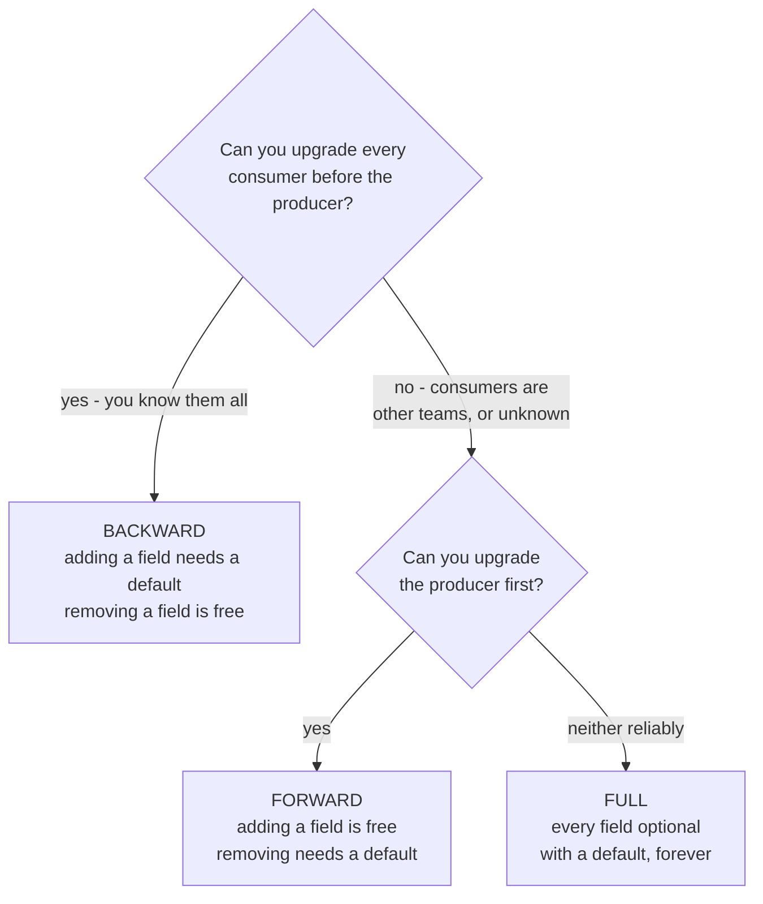

# The Event Schema and Contracts

Scenarios `S-01` … `S-12`.

A stream is an API. It has a producer, many consumers, a version history, and a set of promises
that break loudly if you are lucky and quietly if you are not. Unlike an HTTP API, it has no
request-response cycle in which to negotiate, no obvious place to put a version number, and a
consumer population you frequently cannot enumerate.

This document is about designing that API so that it can change. Almost everything here follows
from one observation: **a stream's records outlive the code that wrote them.** A record produced
today will be read by a backfill job in eight months, written by an engineer who has never met
you, using a schema that has changed four times in between. Design for that reader.

## 1. The three-layer model

Every record on Meridian has three layers, and separating them is the single decision that makes
everything else tractable.

```
┌──────────────────────────────────────────────┐
│  TRANSPORT       key, partition, offset,     │
│                  broker timestamp, headers   │  ← the log's own metadata
├──────────────────────────────────────────────┤
│  ENVELOPE        event_id, event_type,       │
│                  event_time, ingest_time,    │  ← identical on every stream
│                  producer, schema_version,    │
│                  trace_id, tenant            │
├──────────────────────────────────────────────┤
│  BODY            whatever this event is      │  ← different per event type
└──────────────────────────────────────────────┘
```

**The transport layer is set by the broker.** You do not design it, but you use it: the record
key determines partitioning, the broker timestamp gives you ingest time for free, and headers
are the right place for anything a consumer needs to decide *whether to deserialize the body* —
routing, tracing, schema ID.

That last point is worth expanding, because it has a real performance consequence. Deserializing
an Avro record costs about 9 microseconds. A consumer that needs to filter out 95% of a stream
and does so by deserializing and checking a body field spends 19 times more CPU than one that
checks a header. At Corridor's 1.85 million events per second, that is the difference between 17
cores and 320. **Put the fields you filter on in headers.**

**The envelope is identical on every stream, and this is non-negotiable on Meridian.** Every
piece of platform machinery — the auditing consumer, the lineage tracker, the PII scanner, the
dead-letter router, the replay tool — works on any stream precisely because the envelope is
uniform. The moment one team is allowed to name their field `eventId` instead of `event_id`,
every one of those tools needs a per-stream configuration, and the platform stops being a
platform.

**The body is the team's.** The platform does not care what is in it, beyond schema
registration.

### Meridian's envelope

```
event_id         string (UUIDv7)   required   deterministic per logical event
event_type       string            required   "corridor.tracking.impression"
event_time       long (micros UTC) required   when it happened, per the producer
ingest_time      long (micros UTC) required   set by the broker or the gateway
producer         string            required   "corridor-tracking-svc@v4.11.2"
schema_version   int               required   body schema version
tenant           string            required   "corridor"
trace_id         string            optional   W3C trace context
parent_event_id  string            optional   causality, for derived events
partition_key    string            optional   what was hashed, recorded for debugging
```

Ten fields, about 118 bytes in Avro binary. On a 96-byte Waypoint record that is more than
doubling the size, which is why Waypoint's location stream is the one exception on the platform
— it carries a five-field reduced envelope, and every tool that consumes it has a special case.
**One exception is manageable; three is the end of the uniform envelope.** Be very reluctant.

Three of these fields deserve their reasoning spelled out.

**`event_id` is UUIDv7, not UUIDv4.** UUIDv7 embeds a millisecond timestamp in its high bits, so
IDs sort roughly by creation time. That matters when the ID becomes a primary key in ClickHouse
or a partition key in DynamoDB, where random IDs destroy locality. It costs nothing.

**`event_id` must be deterministic for a logical event**, meaning that if the same logical thing
is emitted twice — a retry, a replay, a duplicate delivery — it carries the same ID. Generating
a fresh UUID at `send()` time defeats every deduplication mechanism downstream. Derive it from
the business fact: `uuidv7_from(order_id, transition, sequence)`. This is what makes `I-04`
survivable.

**`ingest_time` is set by the platform, never by the producer.** It is the only clock on the
record that you control, and it is the only one that is monotonically non-decreasing within a
partition. Half the recovery techniques in this collection depend on having it.

## 2. Avro, Protobuf, or JSON

The choice is usually made on familiarity and then defended on performance. Both are the wrong
axis. The axis that matters is **how the format handles a reader and a writer who disagree**,
because that disagreement is the permanent condition of a streaming platform.

| | JSON | Avro | Protobuf |
|---|---|---|---|
| Size (Corridor event) | 1,640 B | 640 B | 610 B |
| Schema travels with data | Yes (field names) | No — schema ID only | No — field numbers only |
| Reader can use a *different* schema than the writer | Informally | **Yes, by design** | Partially |
| Unknown field on read | Ignored or crashes, depending on parser | Ignored, per resolution rules | Preserved in unknown fields |
| Missing field on read | `null` / crash | **Writer's default, or reader's default** | Zero value |
| Field removal | Breaks unaware consumers | Safe if it had a default | Safe if reserved |
| Field rename | Breaks everything | Safe via aliases | Safe (number is the identity) |
| Enum value added by producer | Consumer gets a string it does not know | Consumer gets an error unless a default is declared | Consumer gets the raw number |
| Tooling maturity for streaming | Universal | Deep (Kafka ecosystem) | Deep (gRPC ecosystem) |

The row that decides it is the third one. **Avro's schema resolution is the only one of the
three that was designed around a reader whose schema differs from the writer's.** When an Avro
consumer reads a record, it has both the writer's schema (fetched by ID) and its own reader
schema, and the resolution rules define exactly what happens for every kind of difference. That
is not a nice-to-have on a platform where a job written in March reads records written in
November.

Meridian uses **Avro with Confluent Schema Registry** for everything except two cases:

- **Protobuf** where the same messages are already defined for gRPC. Maintaining two definitions
  of the same thing guarantees they drift, and the drift is silent. Riverbend's services use
  Protobuf on their streams for this reason.
- **JSON** at the edge of the ingestion gateway — mobile clients send JSON, the gateway converts
  to Avro. Forcing an Avro encoder into a mobile app is a fight not worth having, and the
  gateway is where the conversion belongs.

**Do not use JSON on internal high-volume streams.** The arithmetic from
[01](01-requirements-and-the-capacity-model.md) Section 4 is the argument: 1,640 bytes versus
640 costs you page cache, shuffle bandwidth, deserialization CPU and state size, and the fact
that it compresses better on the wire does not help with any of those.

## 3. Compatibility: the four modes, and which one you actually want

A schema registry enforces a compatibility rule when a new schema version is registered. There
are four, and the names are confusing enough that people pick the wrong one routinely.

**BACKWARD** — a consumer using the *new* schema can read data written with the *old* one.
Register a new version, upgrade consumers first, then producers.

**FORWARD** — a consumer using the *old* schema can read data written with the *new* one.
Upgrade producers first, consumers whenever.

**FULL** — both. The intersection of what each permits.

**NONE** — anything goes. Do not.

Which you want depends entirely on **who you can upgrade first**, and that is an organisational
fact, not a technical one.



Meridian's default is **FULL_TRANSITIVE** — full compatibility checked not just against the
previous version but against *every* version still readable in the retention window. The
transitive part matters and is usually forgotten:

Suppose v1 has `country: string`. v2 removes it. v3 adds it back as `country: int` (a country
code). v2→v3 is compatible (adding a field with a default). v1→v2 is compatible (removing a
field with a default). But **v1→v3 is not**, and a backfill job reading seven days of history
spans all three. Non-transitive compatibility checks pass this and the backfill fails.

The cost of FULL_TRANSITIVE is real: **every field must be optional with a default, forever.**
You can never make a field required. Teams hate this, and the pushback is always "but this field
genuinely is required." The answer is that it is required *at write time*, which the producer
enforces, and optional *at read time*, which is what the schema declares — and conflating those
two is how you end up unable to deploy.

## 4. Designing for evolution: the five rules

These are the rules Meridian's schema review applies. They are boring and they are the entire
value of having a schema review.

### Rule 1 — Every field has a default

```
{"name": "referrer_url", "type": ["null", "string"], "default": null}
```

Not because the field is meaningfully nullable, but because a reader that does not know about
the field needs something to produce, and a reader that expects it needs something when reading
older data. `null` is usually right. An empty string is usually wrong, because it conflates "not
present" with "present and empty" and downstream aggregations cannot distinguish them.

### Rule 2 — Never reuse a name with a different meaning

The worst schema change is the one that passes compatibility. `status: string` changing from
`"OK" | "FAIL"` to `"ok" | "fail" | "partial"` is fully compatible — the type did not change —
and it silently breaks every consumer that does a string comparison. Compatibility checking is
structural; it knows nothing about meaning.

If the meaning changes, **the name changes**. `status` becomes `status_v2`, or better,
`outcome`. Deprecate the old one, populate both for a retention window, then remove.

### Rule 3 — Enums are a trap; use strings with a documented set

Avro enums are attractive and they break in a specific way. If the producer adds `PARTIAL` to an
enum and a consumer running the old schema reads it, the consumer gets an error — not an unknown
value it can handle, an error. Avro added `default` for enums to fix this, and it works, but it
means every unknown value collapses to one known value, which is rarely what you want either.

Use a string with a documented set, and make consumers handle unknown values explicitly:

```java
switch (event.getOutcome()) {
    case "ok": ...
    case "fail": ...
    default:
        unknownOutcomeCounter.increment(event.getOutcome());
        // and then: treat as ok? fail? route to DLQ? Decide explicitly.
}
```

The `default` branch with a counter is the important part. It converts "a value we have never
seen" from a silent misclassification into a metric.

### Rule 4 — Bound every unbounded field

A `string` field with no length bound is a future `RecordTooLargeException` (`I-10`) and a
future 400 MB RocksDB entry (`K-05`). Every free-text field on Meridian carries a documented
maximum, enforced in the serializer wrapper, with a `_truncated` flag when it fires.

The bounds are not arbitrary; they come from the p99.9 of observed values plus headroom:

| Field | Observed p99.9 | Bound |
|---|---|---|
| `error_message` | 1,240 B | 8 KB |
| `user_agent` | 380 B | 2 KB |
| `search_query` | 96 B | 1 KB |
| `attributes` map | 22 entries | 64 entries, 16 KB total |

### Rule 5 — Put the open part in one place

Every event body will eventually need a field that nobody anticipated. The two ways to
accommodate that are a schema change (slow, needs review, needs a deploy) or an open map:

```
{"name": "attributes", "type": {"type": "map", "values": "string"},
 "default": {}}
```

One open map is a pressure valve. It lets a team ship an experiment on Tuesday without a schema
review. The cost is that anything in it is unqueryable by schema-aware tooling, untyped, and
invisible to the PII scanner — so Meridian's rule is that **a key may live in `attributes` for
at most 60 days**, after which it is either promoted to a real field or deleted. The registry
reports keys that have exceeded this, and it is a nagging, low-grade piece of hygiene that
prevents the map from becoming the schema.

## 5. Scenarios

### S-01 — A compatible schema change breaks every consumer

**What you see.** A producer deploys a new schema version. Registry accepted it, compatibility
checks passed. Within minutes, eleven downstream jobs are producing wrong results — not
crashing, producing *wrong results*.

**Mechanism.** The change was `amount: double` in dollars to `amount: double` in cents. Type
unchanged, name unchanged, fully compatible, meaning inverted. Every consumer is now
over-reporting revenue by 100×.

This is Rule 2's failure. Structural compatibility is a necessary condition and not remotely a
sufficient one.

**Confirm it.** Compare a distribution before and after the deploy. A 100× shift in a numeric
field's median at a deploy boundary is unmistakable if anyone is looking, which is the problem.
Meridian's schema registry hooks emit a `schema_version_changed` event, and the dashboards for
every stream annotate that version boundary, so the shift is visually obvious.

**Recover.** Roll the producer back, then decide what to do about the records already written in
the new units. They are indistinguishable from old ones except by offset range and
`schema_version`, which is why `schema_version` is in the envelope: it gives you a predicate to
repair on.

**Prevent.**

- **Units in the field name.** `amount_cents`, `duration_ms`, `distance_m`. Not in a comment; in
  the name. This one convention eliminates the entire class.
- **A semantic-change checkbox in the schema review**, which forces the author to state whether
  the meaning of any existing field changed. It is a human process and it catches things no tool
  can.
- **Distribution monitoring per field**, at least for numeric fields on streams that feed
  financial or regulatory outputs. A 100× jump should page someone.

### S-02 — The registry accepted an incompatible schema because of subject naming

**What you see.** `FULL_TRANSITIVE` is configured, and an incompatible schema got through.

**Mechanism.** The compatibility check runs per *subject*, and the default subject naming
strategy is `<topic>-value`. If a topic carries several event types — which is common and often
correct — they all share a subject, and the registry is checking each new schema against the
previous one *of a different event type*. Nonsense comparisons, which sometimes pass.

The opposite mistake is worse. If you switch to `RecordNameStrategy` (subject = the record's
fully-qualified name), each event type gets its own subject and the checks are meaningful — but
now nothing prevents two topics from carrying incompatible versions of the same record name.

**Confirm it.**

```bash
curl -s $REGISTRY/subjects | jq .
curl -s $REGISTRY/config/corridor.tracking.events-value | jq .
```

If a topic with multiple event types has exactly one `-value` subject, you have this problem.

**Recover.** Migrate to `TopicRecordNameStrategy` (subject = `<topic>-<record name>`), which
scopes the check to one event type within one topic. Migration means re-registering the existing
schemas under new subjects, which is mechanical but must be done before producers switch.

**Prevent.** Choose the subject strategy deliberately at platform level and enforce it in the
producer library, not per team. Meridian uses `TopicRecordNameStrategy` everywhere.

### S-03 — One topic, many event types: the design question

**What you see.** Not a failure — a decision. `riverbend.orders.lifecycle` carries
`OrderCreated`, `OrderPaid`, `OrderShipped`, `OrderCancelled` and six more. Should it?

**Mechanism.** The question is whether the types belong together, and the test is ordering. If a
consumer must see `OrderCreated` before `OrderPaid` for the same order, they *must* be in the
same topic and the same partition, because ordering exists nowhere else. Splitting them into
`orders.created` and `orders.paid` makes that guarantee impossible to provide, and the consumer
then has to implement reordering with a buffer and a timeout, which is a substantial piece of
machinery to rebuild what the log already offered.

Conversely, if the types are independent — `page_view` and `search_performed` have no ordering
relationship — putting them in one topic means every consumer of one reads and discards the
other. At Corridor's rates that is real money: a consumer wanting only `search_performed` (4% of
the stream) pays for 100% of the bytes.

**The rule:** **one topic per ordering domain, not per event type and not per team.** If two
event types must be ordered relative to each other, they share a topic. If they do not, split
them.

**Confirm it.** For an existing multi-type topic, measure what fraction each consumer group
actually uses. A group discarding more than 80% of what it reads is a candidate for a split or
for a header-based filter.

**Prevent.** When a topic must carry multiple types, always set an `event_type` header so
consumers can filter without deserializing. That is the cheap 80% of the benefit of splitting,
for none of the ordering cost.

### S-04 — The schema registry is a single point of failure

Covered as `I-11` from the producer's side. From the consumer's side the failure is worse:
a consumer that restarts during a registry outage cannot deserialize anything at all, because
it cannot resolve the writer schema ID. A producer outage stops new data; a consumer outage
stops *all* processing including of data already safely on the log.

**Prevent.** Beyond the measures in `I-11`: **bundle the schema ID → schema mapping into the
job's artefact at build time** for production jobs. A Flink job that ships with a snapshot of
every schema it might encounter never needs the registry at runtime. The cost is that a schema
registered after the job was built is unknown to it — so the job must fail loudly on an unknown
ID rather than skipping the record, and you must redeploy jobs when new schemas appear. For
Meridian's twelve most critical jobs this trade is worth it; for the other 168 it is not.

### S-05 — A field was removed and the backfill broke six months later

**What you see.** A backfill job reading 90 days of history fails partway through with
`AvroTypeException: Found X, expecting Y`.

**Mechanism.** Field `campaign_id` was removed in v7 because nothing used it. The removal was
BACKWARD-compatible: new readers reading old data get the writer's value and ignore it. But the
new *reader schema* does not contain `campaign_id`, and somewhere in the 90 days there is a
record written with a schema version whose resolution to the current reader schema is not
defined — typically because the intervening versions changed something else too, and the
transitive path was never checked.

**Confirm it.** The exception names the schema IDs. Fetch both and diff them:

```bash
curl -s $REGISTRY/schemas/ids/4471 | jq -r .schema | jq . > writer.json
curl -s $REGISTRY/schemas/ids/5108 | jq -r .schema | jq . > reader.json
diff <(jq -S . writer.json) <(jq -S . reader.json)
```

**Recover.** Pin the backfill job to a reader schema that resolves against the full historical
range — usually an older, more permissive version — or process the history in schema-version
segments.

**Prevent.**

- **FULL_TRANSITIVE**, which is the whole point of the transitive part.
- **Set the transitive window explicitly to your maximum replay depth.** If you can replay seven
  days, you need compatibility across every schema used in seven days. If you can replay from
  the lake going back three years, you need three years of transitive compatibility, and that is
  a very different and much more expensive promise. Write down which one you are making.
- **Never delete a field. Deprecate it.** Mark it deprecated in the schema documentation, stop
  populating it, and leave the declaration in place. It costs a few bytes for `null` and it
  removes an entire failure class.

### S-06 — Field explosion in the open map

**What you see.** The `attributes` map on `corridor.tracking.events` has 41,000 distinct keys
across the platform, 38,000 of which appear on fewer than 100 records. The ClickHouse sink,
which materialises frequently-used attributes into columns, now has a 1,900-column table and a
15-minute mutation queue.

**Mechanism.** The pressure valve became the schema. Rule 5's 60-day expiry was not enforced,
teams learned that adding a key to `attributes` was frictionless, and the frictionlessness was
the problem.

**Confirm it.** A daily job over a sample of each stream counting distinct attribute keys and
their record counts. The distribution is always the same shape — a few dozen keys on most
records, a long tail of keys on almost none.

**Recover.** Two lists: promote the top keys to real schema fields, and delete the tail. Deleting
means the producer stops writing them; historical records keep them, which is fine because they
are in a map.

**Prevent.** Enforce the expiry automatically. Meridian's registry runs a weekly job that:

1. Counts distinct `attributes` keys per stream over the last 7 days.
2. For any key first seen more than 60 days ago and still present, opens a ticket against the
   owning team with two options: promote or remove.
3. After 90 days with no action, the producer library starts dropping the key and emitting a
   counter.

That last step is aggressive and it is the only part that works. Steps 1 and 2 alone produce a
backlog nobody clears.

### S-07 — A 400 MB record

**What you see.** One Flink task is at 100% CPU with a 12 GB heap, the job's checkpoint times
out, and the job enters a restart loop.

**Mechanism.** A user pasted a 400 MB log dump into a support form. The producer's
`max.request.size` was raised to 500 MB two years ago by someone solving a different problem, so
the record was accepted. The consumer deserialized it into a single Java object.

**Confirm it.** Record size distribution per stream, which almost nobody collects. A p99.99 of
40 KB and a maximum of 400 MB is the shape.

**Recover.** Skip the offset. Flink can be started from a specific offset, or you can configure
the deserializer to return `null` on failure and count it. The latter is better because it does
not require knowing the offset in advance.

**Prevent.** Rule 4 — bound the field at the producer. And separately:

- **Keep `max.request.size` at 1 MB** unless there is a written reason. The reason should not be
  "one team needed it once."
- **A deserializer that refuses records over a threshold** and routes them to a dead-letter
  topic with the first 4 KB preserved for diagnosis, rather than one that tries and dies.

### S-08 — Timestamps in the wrong unit, zone, or epoch

**What you see.** A windowed aggregation produces results for the year 56,332.

**Mechanism.** One producer emits `event_time` in milliseconds; the schema and everything else
use microseconds. The value is 1,000× too large, which a `long` accommodates without complaint.

Variants of this that all occur: seconds instead of milliseconds (results in 1970), local time
instead of UTC (results shifted by the timezone offset, which is the subtle one because the
records look plausible), and the JavaScript `Date.now()` in a mobile client where the user has
set their phone clock forward.

**Confirm it.** A guard on the source, always on, in every job:

```
if (eventTime < now - 30d || eventTime > now + 15m) {
    lateOrFutureCounter.labels(stream, producer, reason).inc();
    route to the quarantine stream;
}
```

Broken out by producer, which makes the guilty service obvious in one glance.

**Recover.** Repair the affected offset range, if the correct value is recoverable — it usually
is, by dividing by 1,000.

**Prevent.**

- **Unit in the field name**: `event_time_micros`. Rule 2 again.
- **Use Avro's logical types** (`timestamp-micros`) so the tooling knows the unit and a code
  generator produces an `Instant` rather than a `long`. A typed API makes the mistake harder to
  make.
- **Clamp at the gateway** for untrusted producers, as in `I-08`.

### S-09 — Two producers, one stream, diverging schemas

**What you see.** `riverbend.orders.lifecycle` is produced by four services. Three have adopted
schema v9; one is still on v6 and will be for another quarter. A consumer that needs a v9 field
gets `null` for a quarter of the records, and has no way to tell "the field is genuinely absent"
from "this producer has not been upgraded."

**Mechanism.** Schema version is a property of the record, and the envelope's `schema_version`
and `producer` fields exist precisely for this. The failure is not technical; it is that the
consumer treated `null` as data.

**Confirm it.** Group by `producer` and count non-null values of the field. A perfectly clean
split by producer is the signature.

**Recover.** Nothing to recover; the consumer must handle it.

**Prevent.** **Make "not yet supported by this producer" distinguishable from "absent".** Two
patterns:

- A per-stream `schema_floor` in the registry: the minimum version all producers have reached.
  Consumers read it and refuse to depend on fields newer than the floor, failing loudly at
  startup rather than silently at runtime.
- An explicit three-valued field: `{"type": ["null", "string"], "default": null}` plus a
  `has_campaign_id: boolean` — verbose, but unambiguous. Use it for fields where the difference
  matters, which is usually anything financial.

### S-10 — A consumer that ignores unknown event types

**What you see.** A new event type `OrderPartiallyRefunded` was added to
`riverbend.orders.lifecycle` six weeks ago. The revenue aggregation job has a `switch` on
`event_type` with no `default`, so it has been silently skipping them, and reported revenue is
0.8% high.

**Mechanism.** Multi-type topics (`S-03`) require every consumer to decide what to do with a
type it does not know. The default decision, made by omission, is to ignore it — and ignoring is
correct for some consumers and catastrophic for others.

**Confirm it.** A platform-level metric: for each consumer group, the count of records whose
`event_type` is not in the set the job declares it handles. Meridian requires jobs to declare
their handled types in the job manifest, which makes this computable without the job's
cooperation.

**Recover.** Reprocess from the point the new type appeared, which is findable because the
registry records when the schema was registered.

**Prevent.** **Consumers declare what they handle, and the platform checks.** When a new event
type is registered on a stream, the registry hook lists every consumer group on that stream
whose declared type set does not include it, and notifies their owners. This turns an invisible
change into an explicit "does this affect you?" question, which is the only thing that works.

### S-11 — The contract nobody wrote down

**What you see.** A producer team removes a field that their own schema marks optional with a
default. Compatibility passes. Three consumers break, because all three treated it as required.

**Mechanism.** The schema is a structural contract. It says nothing about which fields are
always populated in practice, what their valid ranges are, what the ordering guarantees are,
what the volume is, or what happens during an incident. Consumers infer all of that from
observation, and observation is not a contract.

**Prevent.** A **stream contract document**, one per stream, living next to the schema and
reviewed like it. Meridian's template:

```
Stream:            corridor.tracking.events
Owner:             corridor-data-platform (Slack: #corridor-data)
Tier:              1 (platform-critical)

Semantics
  One record per user-visible interaction. Not deduplicated at source.
  event_id is stable across retries.

Ordering
  Guaranteed within member_id. Not guaranteed across members.

Volume
  1,850,000/s average, 3,100,000/s peak (US evening).
  Growth: +18% year over year.

Fields always populated
  member_id, surface, interaction_type, event_time
  (these are enforced by the producer, not by the schema)

Fields sometimes null, and what null means
  campaign_id — null when the interaction was organic, not when data is missing
  geo_country  — null when the IP could not be resolved (0.4% of records)

Retention          24 h on the log, 400 days in the lake
Guarantee          At least once. Duplicates are ~1 in 10^5, keyed by event_id.
Lateness           p99 2.1 s, p99.9 18 s, max observed 9 h (mobile buffering)
PII                member_id is a pseudonymous ID. No direct identifiers. See Z-04.

Breaking changes   Announced in #corridor-data 30 days ahead, with a migration note.
Consumers          31 registered groups (see registry). Contact before removing a field.
```

The two sections that pay for the whole document are **"fields sometimes null, and what null
means"** and **"lateness."** Both are things consumers guess at, and both are things that break
them.

### S-12 — Schema changes that are only expensive downstream

**What you see.** Adding one field to `corridor.tracking.events` — `experiment_variant`, a
short string — increased the platform's monthly bill by $8,400.

**Mechanism.** The field is 14 bytes on average. At 1.85 million events a second:

```
1,850,000/s × 14 B                         =     25.9 MB/s uncompressed
compressed at 3.2:1                        =      8.1 MB/s onto the log
× RF3                                      =     24.3 MB/s of disk and replication
read fan-out 3.4                           =     27.5 MB/s of consumer egress
cross-zone portion, produce + replication
  + consume (per doc 01 §9 ratios)         =   ~40.2 MB/s cross-zone
monthly: 40.2 MB/s × 2,629,800 s ÷ 1,000   = 105,718 GB × $0.02 = $2,114
```

plus the same field in the enriched derived stream, in three jobs' RocksDB state, in the
ClickHouse table (where it becomes a low-cardinality column, cheap) and in the lake. The
$8,400 is the sum.

**Prevent.** Not prevention exactly — awareness. Meridian's schema review shows an estimated
cost delta for every field added to a Tier 1 stream, computed from the stream's rate and the
field's expected size. It is a small piece of tooling and it changes behaviour immediately,
because "this costs $8,400 a month" is a different conversation from "this adds a field."

This generalises: **on a high-volume stream, the schema is a budget.** The 14-byte field is not
free and neither is the 118-byte envelope. Waypoint's reduced envelope (Section 1) exists
because 118 bytes on a 96-byte record would have cost $61,000 a year.

## 6. Where to validate, and why the answer is "in three places"

Validation has to happen more than once, because each place catches something the others cannot.

**At the producer, in the serializer.** Catches: wrong types, missing required fields, unbounded
strings. Cannot catch: anything requiring knowledge the producer does not have. Cost: ~2 µs per
record. Always on.

**At the gateway, for untrusted producers.** Catches: everything the producer's validation would
have caught if the producer were running your code, which it is not. Plus clock clamping and
rate limiting. Cost: a hop. Only for external producers.

**At the consumer, on deserialization.** Catches: records written before a validation rule
existed, records from a producer version you have never seen, and corruption. Cannot catch
anything at write time. Cost: ~9 µs. Always on, but the important part is *what it does on
failure* — see the next section.

**Not at the broker.** Kafka can validate schemas at the broker (Confluent's server-side schema
validation), and it is tempting because it is the one place nothing can bypass. It costs broker
CPU on the hot path — roughly 18 µs per record on Meridian's mix, which at 5.9 million records a
second is 106 cores across 48 brokers, or 2.2 cores per 8-core broker. That is 28% of the
brokers' CPU spent on validation. Meridian does not do it. If your volumes are two orders of
magnitude lower, it is an excellent idea.

## 7. What to do with a record you cannot parse

Three options and they are not equivalent.

**Fail the job.** Correct for streams where a parse failure means something is deeply wrong and
processing further records would produce incorrect output — `riverbend.payments.settled`. The
job stops, someone is paged, nothing wrong is emitted. This is the "prefer a loud stall to a
quiet wrong answer" principle from [`../ErrorHandling.md`](../ErrorHandling.md).

**Skip and count.** Correct for high-volume streams where a few bad records genuinely do not
matter — Northlight's heartbeats. The critical word is *count*: a skipped record must increment
a metric tagged with the stream, the producer and the failure reason, and that metric must have
an alert. A skip without a count is data loss you have chosen not to know about.

**Dead-letter.** Write the unparseable record, plus the failure reason and the consumer's
identity, to a dead-letter topic. Correct as the default for everything in between, which is
most streams.

The dead-letter topic needs its own design, and the part people skip is the last one:

- **Keep the raw bytes**, not a stringified version. You will want to re-parse it.
- **Include the reason, the consumer group, the original topic-partition-offset, and the
  timestamp.** Without the offset you cannot reprocess in place.
- **Give it a retention and an owner.** A dead-letter topic with 400 GB in it that nobody has
  looked at for a year is worse than no dead-letter topic, because it creates the impression the
  problem is handled.
- **Alert on its rate, not its depth.** Depth grows forever; rate tells you something changed.
- **Have a replay path.** The point of keeping the records is to reprocess them after the bug is
  fixed. If there is no tool to do that, you are keeping them for sentiment. Meridian's replay
  tool reads a dead-letter topic, filters by reason and time range, and produces back to the
  original topic with `delivery_mode=dlq_replay` so downstream windows know the records are
  late.

## What to take away

1. **A stream is an API whose records outlive the code that wrote them.** Design for a reader
   eight months from now with a different schema.
2. **Three layers: transport, envelope, body.** Keep the envelope identical across every stream
   — every piece of platform tooling depends on that uniformity, and one exception per platform
   is the budget.
3. **Put the fields you filter on in headers.** Deserializing to discard costs 9 µs per record,
   which at Corridor's rate is 300 cores.
4. **Choose Avro for the schema-resolution rules, not the byte size.** It is the only one of the
   three designed around a reader and writer that disagree, which is the permanent condition of
   a streaming platform.
5. **FULL_TRANSITIVE, with the transitive window set to your maximum replay depth.** Every field
   optional with a default, forever. Never delete a field — deprecate it.
6. **Compatibility checking is structural and knows nothing about meaning.** Units in field
   names, new names for new meanings, and a semantic-change question in the review.
7. **One topic per ordering domain**, not per event type and not per team. If two types must be
   ordered relative to each other they share a topic; otherwise split, or at minimum set an
   `event_type` header.
8. **The open map is a pressure valve that becomes the schema unless the expiry is enforced
   automatically.** Ticket at 60 days, drop at 90.
9. **Write the stream contract, and make sure it says what null means and what the lateness
   distribution is.** Those two sections are what consumers otherwise guess.
10. **On a high-volume stream the schema is a budget** — a 14-byte field on Corridor is $8,400 a
    month. Show the cost in the review and the conversation changes.
11. **Validate at the producer, at the gateway for untrusted sources, and at the consumer** —
    each catches what the others cannot. Not at the broker unless your volume is small.
12. **A skipped record must be counted, and a dead-letter topic must have a replay path.**
    Otherwise both are data loss you have chosen not to look at.
