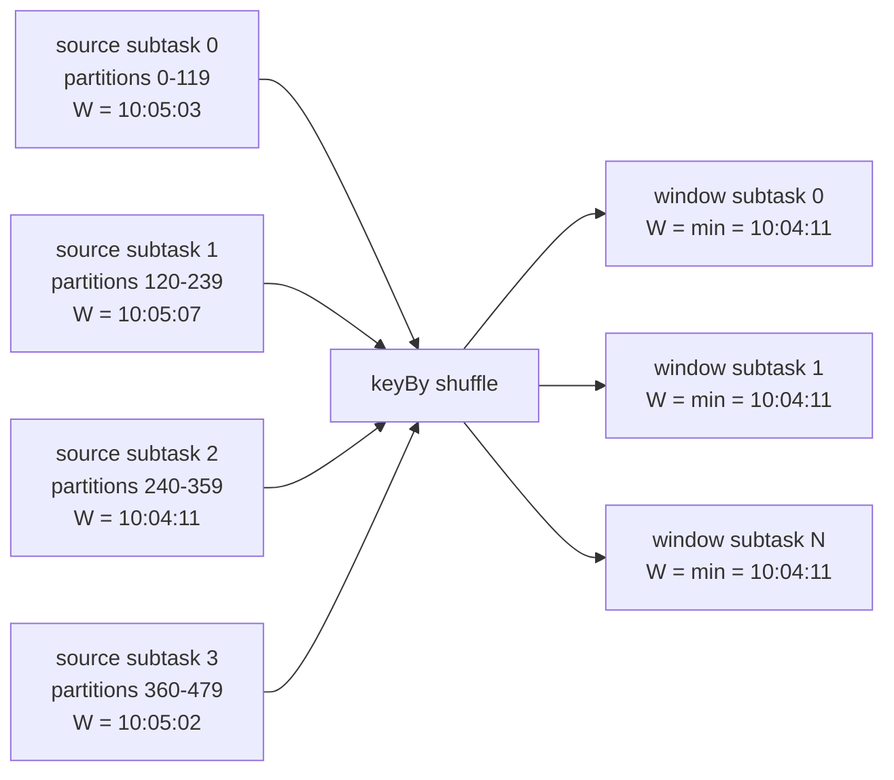

# Event Time, Watermarks and Lateness

Scenarios `E-01` … `E-12`.

This is the centre of the collection. Everything before it is plumbing you could reason about
with batch intuitions; everything after it depends on the ideas here.

The problem in one sentence: **a streaming computation has to decide when it is finished with a
period of time, and it can never actually know.**

## 1. Building up to the problem

Forget watermarks for a moment. Here is a concrete task.

Waypoint wants a count of trip requests per city per minute, updated continuously. Trip requests
arrive on a stream at 290 per second across 300 cities. You write:

```
for each trip_request:
    minute = floor(trip_request.requested_at, 1 minute)
    counts[(minute, city)] += 1
```

Now: when do you emit `counts[(10:04, "San Francisco")]` and move on?

### Attempt 1 — emit when the clock says 10:05

```
when wall_clock reaches 10:05:00:
    emit every counts[(10:04, *)]
    delete them
```

This is **processing-time windowing**, and it is simple, cheap, and produces results with
bounded latency. It is also wrong in a way that is worth being precise about.

A trip request made at 10:04:58 travels through the rider's phone, the mobile network, the API
gateway, the trip service, the Kafka producer's 100 ms linger, the broker, and the consumer's
fetch. On Waypoint the p50 of that journey is 340 milliseconds, so most requests made at 10:04:58
arrive before 10:05:00 and are counted correctly. But the p99 is 4.8 seconds, so **roughly 1% of
the requests made in the last five seconds of the minute arrive too late and are counted in
10:05 instead.**

Five seconds out of sixty is 8.3% of the minute; 1% of that is 0.083% of the minute's requests
landing in the wrong bucket. That sounds tolerable, and often it is.

Now change one thing: the consumer restarts, is down for four minutes, and comes back. It
immediately processes four minutes of backlog in about twenty seconds. Every one of those
records is now assigned to the minute in which it was *processed* — so `counts[(10:09, *)]`
contains four minutes of traffic and `counts[(10:05..10:08, *)]` are all zero.

**Processing-time windows produce a result that depends on when your job ran.** Restart the job
and the answer changes. Replay the data and the answer changes. Run the same job on two clusters
and they disagree. For anything a human will ever reconcile, this disqualifies it.

### Attempt 2 — emit when you have seen a later event

```
when a record arrives with requested_at >= 10:05:00:
    emit every counts[(10:04, *)]
```

Better: the trigger is now based on the data, so a replay produces the same answer as the live
run. But it fails immediately in practice, because records arrive out of order. The first record
you see with `requested_at >= 10:05:00` might be followed by twenty more from 10:04:5x, arriving
late. You emitted too early and lost them.

### Attempt 3 — emit when you have seen an event sufficiently later

```
when a record arrives with requested_at >= 10:05:00 + 5 seconds:
    emit every counts[(10:04, *)]
```

Now you are waiting five seconds of *event time* — not wall-clock time — past the end of the
window before closing it. This is correct-ish, deterministic under replay, and it has a tunable
knob: the five seconds.

**This is a watermark.** The "sufficiently later" threshold, tracked continuously and propagated
through the job, is exactly what a watermark is. Everything else in this document is detail on
top of that idea.

## 2. The definition, stated carefully

A **watermark** is a timestamp *W* carried in the stream, interleaved with the records, meaning:

> "I assert that no record with `event_time < W` will arrive after this point."

Three things about that sentence matter.

**It is an assertion, not a fact.** The system has no way to verify it. Records with
`event_time < W` *will* arrive — they are called *late records* and Section 6 is about them. The
watermark is a statement about what the job is willing to wait for, dressed up as a statement
about the data.

**It travels in the stream.** It is not global state. Each source subtask generates watermarks
for its own partitions; each operator receives watermarks from its inputs, takes the *minimum*
across them, and forwards that. Understanding this propagation rule explains almost every
watermark bug in this document.

**It is monotonically non-decreasing.** Once the job has asserted "nothing before 10:05", it
cannot un-assert it. A record arriving with an earlier timestamp does not move the watermark
backwards; it is simply late.

### How watermarks are generated

The common strategy is **bounded out-of-orderness**:

```
W = (maximum event_time seen so far in this partition) − delay
```

With `delay = 5s` and a maximum seen timestamp of 10:05:03, the watermark is 10:04:58 — the job
asserts nothing before 10:04:58 will arrive, which is true for 99.x% of records depending on the
lateness distribution.

Two important properties of this formula:

**The watermark is driven by data, not by the clock.** If no records arrive, the maximum does not
move, so the watermark does not move, so no windows close. A stream that goes quiet freezes time.
This is the cause of `E-03` and it is the single most common watermark failure in production.

**The delay must be chosen from measurement.** Which brings us to the most important section in
this document.

## 3. Choosing the delay: the measurement almost nobody makes

The tutorials say five seconds. Five seconds is not an answer; it is a placeholder someone typed.
The answer comes from the lateness distribution of *your* stream, measured, and it differs by
three orders of magnitude between streams on the same platform.

### The measurement

For a representative sample of records, compute `ingest_time − event_time` and build a histogram.
Both fields are in Meridian's envelope precisely so that this is a one-line query. On the four
largest streams:

| Percentile | `waypoint.location.updates` | `corridor.tracking.events` | `northlight.playback.heartbeats` | `riverbend.orders.lifecycle` |
|---|---|---|---|---|
| p50 | 340 ms | 180 ms | 95 ms | 22 ms |
| p90 | 1.2 s | 640 ms | 210 ms | 41 ms |
| p99 | 4.8 s | 2.1 s | 480 ms | 86 ms |
| p99.5 | 9.1 s | 8.0 s | 620 ms | 110 ms |
| p99.9 | 41 s | 18 s | 1.4 s | 240 ms |
| p99.99 | 6 m 20 s | 3 m 50 s | 9 s | 1.9 s |
| max / 30 d | 4 h 12 m | 9 h 04 m | 3 m 10 s | 14 s |

Four streams, one platform, and the p99.9 spans from 240 milliseconds to 41 seconds — a factor
of 171. A single platform-wide watermark delay would be either useless for Waypoint or
catastrophically slow for Riverbend.

### Reading the shape

The interesting structure is in *where the curve bends*, and each bend has a cause you can name:

**Riverbend, p50 22 ms to p99 86 ms.** Server-to-server, same data centre, no client involved.
The whole distribution is network and batching. There is no tail to speak of until 1.9 s at
p99.99, which is a GC pause or a broker leader election.

**Northlight, flat until p99.9 then 9 s at p99.99.** Backend-generated heartbeats, but delivered
through a mesh with retries. The 9-second cliff is a retry after a 3-second timeout, twice.

**Corridor, 2.1 s at p99 and 18 s at p99.9.** Mixed: most events are server-side and behave like
Riverbend, but 6% come from browser beacons which are held until the page unloads. The bimodality
is visible in the histogram as two humps, and it is the reason a single percentile is a poor
summary — see the next subsection.

**Waypoint, 4.8 s at p99 and 4 hours at max.** Mobile, with client-side buffering. The tail does
not decay; it has a second population in it (`I-09`'s reconnection burst) that is not a tail at
all but a different process.

### The cost curve

Now put a price on the delay. For a 1-minute tumbling window:

| Watermark delay | Records included | Result latency after window end |
|---|---|---|
| 0 s | ~98.4% | 0 s |
| 1 s | 99.6% | 1 s |
| 2 s | 99.86% | 2 s |
| 5 s | 99.91% | 5 s |
| 10 s | 99.94% | 10 s |
| 30 s | 99.97% | 30 s |
| 60 s | 99.982% | 60 s |
| 300 s | 99.994% | 300 s |

(These are Corridor's numbers, computed by integrating the lateness distribution against the
window.)

The shape is the point. **Going from 2 seconds to 60 seconds — a 30× latency increase — buys
0.12% more completeness.** Going from 0 to 2 seconds buys 1.46%. The curve is almost entirely
flat after the first few seconds, and the reason is structural: the records still missing at 60
seconds are missing because of a *different mechanism* (client buffering, retry storms,
reconnection) that no amount of additional waiting resolves.

**The rule this collection follows:** set the delay at roughly the **p99.5** of the lateness
distribution, and build an explicit late-arrival path for everything beyond it. Waiting past
p99.9 is almost always a mistake, because you are paying a large, permanent latency cost to
capture a population that needs different handling anyway.

Meridian's settings, and the reason for each:

| Stream | Delay | Percentile it covers | Why |
|---|---|---|---|
| `riverbend.orders.lifecycle` | 250 ms | p99.9 | Cheap to wait, and the order state machine wants completeness |
| `northlight.playback.heartbeats` | 1 s | p99.9 | Concurrency metrics; 1 s is imperceptible |
| `corridor.tracking.events` | 8 s | p99.5 | Beyond this is the browser-beacon population; handled separately |
| `waypoint.location.updates` | 10 s | ~p99.5 | Live map needs freshness more than completeness |

### When one percentile is not enough

Corridor's bimodal distribution is worth handling properly, because it recurs whenever a stream
mixes server-side and client-side producers.

The naive fix is to set the delay at the client population's p99.5, which is 4 minutes — making
every dashboard four minutes stale to accommodate 6% of records.

The better fix is to **split the stream**. Route browser beacons to
`corridor.tracking.events.beacon` at the gateway, using a field the gateway already knows. Now
you have two streams with two watermark strategies:

```
corridor.tracking.events         delay 1.2 s  (server-side only, p99.5)
corridor.tracking.events.beacon  delay 240 s  (browser, p99.5)
```

and a job that needs both reads both and unions them, taking the minimum watermark — so it is
as slow as the slowest. But a job that needs only server-side events is now 200× fresher.

This is the general principle again: **prefer a separate path to a shared path with a
discriminating field.** It appears in `I-09` (backfill topic), in
[`../LogCollector`](../LogCollector/README.md) (priority streams), and here.

## 4. Watermark propagation: the minimum rule, and everything that goes wrong

A watermark enters the job at the sources and flows through the operator graph. The rules:



**A source subtask** owning several partitions takes the *minimum* watermark across them, because
it cannot assert progress past the least-advanced partition.

**An operator with several inputs** — whether from a shuffle, a union, or a join — takes the
*minimum* across all of them, for the same reason.

The consequence, stated bluntly: **the watermark of the entire job is the minimum over every
partition of every source.** One slow, stalled, or idle partition holds back the entire job's
notion of time, no matter how far ahead the other 479 are.

In the diagram, subtask 2 is at 10:04:11 — 52 seconds behind — so every window subtask is at
10:04:11 and windows for 10:04 and later stay open. Three of the four sources are wasting their
progress.

This single rule explains `E-02`, `E-03`, `E-05`, `E-07` and `E-09`. If you remember nothing
else from this document, remember that the watermark is a minimum and go looking for the
laggard.

## 5. Scenarios

### E-01 — Windows never fire

**What you see.** A job is running, consuming records, checkpointing, no errors. Its sink
receives nothing. State grows steadily.

**Mechanism.** The watermark is not advancing past any window boundary. Causes, in order of
frequency:

1. **A source partition with no data** (`E-03`).
2. **No timestamp assigner configured**, so every record gets `Long.MIN_VALUE` and the watermark
   never moves. Flink warns about this; the warning is in a log nobody reads.
3. **The watermark strategy is attached to the wrong operator** — after a `keyBy`, for instance,
   where it cannot see the source's per-partition structure.
4. **An event time far in the future** poisoned the maximum, so the watermark jumped ahead, every
   window fired at once, and now nothing will ever fire again because the watermark cannot go
   backwards. This one is `E-04` and it is the nastiest, because the symptom (nothing fires) is
   identical while the cause is the opposite.

**Confirm it.** Flink exposes the watermark per operator per subtask:

```
flink_taskmanager_job_task_operator_currentInputWatermark
```

Plot it against wall-clock time. A healthy job's watermark tracks wall clock with a constant
offset. Flat means stalled; a vertical jump to the year 2287 means `E-04`.

The single most useful derived metric is **watermark lag**:

```
watermark_lag = now() − current_watermark
```

On a healthy Corridor job it sits at roughly 8.2 seconds (the delay plus propagation). Anything
growing is a problem, and it is a better leading indicator than consumer lag, because consumer
lag can be zero while the watermark is stuck.

**Recover.** Depends on the cause. For cause 4, the only recovery is to restart the job from a
savepoint taken before the poisoned record, or from a point after it with state cleared.

**Prevent.** All of Sections 5's other scenarios, plus: **alert on watermark lag, per job, as a
first-class SLI.** Meridian alerts at 3× the configured delay.

### E-02 — One slow source partition holds back the whole job

**What you see.** Watermark lag on one job is 14 minutes and growing. The job's throughput is
normal. 479 of 480 source partitions have sub-second lag; one has 14 minutes.

**Mechanism.** The minimum rule. One partition is behind — perhaps its leader is on a slow
broker, perhaps its consumer subtask is co-located with a noisy neighbour, perhaps it is the hot
partition from `T-02`. Its watermark is 14 minutes behind, so the job's watermark is 14 minutes
behind, so every window for the last 14 minutes is still open, so state is 14 minutes larger
than it should be, so the checkpoint is bigger, and the job is now slower than it was.

The feedback loop matters: **a watermark stall grows state, which grows checkpoints, which slows
the job, which grows the stall.** Left alone, this ends in `C-01`.

**Confirm it.** Per-subtask watermark, which most dashboards aggregate with `avg` and thereby
hide the problem entirely:

```promql
min(flink_taskmanager_job_task_operator_currentInputWatermark{job="..."}) by (subtask_index)
```

Use `min`, never `avg`. Then find the partition that subtask owns.

**Recover.** Fix the laggard: move the partition's leader, restart the subtask, or if it is a
genuinely hot partition, accept it and rescale.

**Prevent.**

- **Alert on the spread**, not just the minimum: `max(watermark) − min(watermark)` across
  subtasks. A healthy job's spread is under a second. This catches the problem while there is
  still one laggard rather than after the whole job has stalled.
- **Consider watermark alignment** (Flink's `withWatermarkAlignment`), which pauses the *fast*
  sources when they run too far ahead of the slow ones. This does not fix the laggard, but it
  stops the fast partitions from buffering records for windows that cannot close, which is what
  actually causes the state growth. Set the maximum drift to something like 30 seconds. The cost
  is that your throughput becomes bounded by your slowest partition, deliberately — which is
  honest, because it already was.

### E-03 — An idle partition freezes time

**What you see.** A job over a low-rate stream produces results during business hours and
nothing overnight. At 09:00 the next morning it emits fourteen hours of windows at once.

**Mechanism.** The watermark is `max(event_time) − delay`. If a partition receives no records,
`max(event_time)` does not move, so its watermark does not move, so the job's watermark (the
minimum) does not move.

`riverbend.catalog.changes` has 6 partitions and 40 events per second during the day, near zero
overnight. With the sticky partitioner (`I-07`), at any moment several partitions are receiving
nothing. Overnight all six are.

**This is not a low-volume-stream problem exclusively.** Any stream where a partition can be
empty for longer than your latency budget has it — including a high-volume stream that is keyed
such that some partitions serve only a time zone that is asleep.

**Confirm it.** Per-partition record rate and per-subtask watermark together. A partition at zero
records/s whose subtask watermark is frozen at the timestamp of its last record is unambiguous.

**Recover.** Restarting does not help — the watermark restarts from the same place.

**Prevent.** **Configure idleness detection**, always, on every source:

```java
WatermarkStrategy
    .<Event>forBoundedOutOfOrderness(Duration.ofSeconds(8))
    .withTimestampAssigner((e, ts) -> e.getEventTime())
    .withIdleness(Duration.ofSeconds(30));
```

`withIdleness` marks a partition idle after 30 seconds with no records, and an idle partition is
excluded from the minimum. The other partitions' watermarks then drive the job.

⚠️ There is a correctness cost and it should be stated. If a partition is marked idle and then
receives a record whose event time is behind the now-advanced watermark, that record is **late**
and may be dropped. `withIdleness` trades a guaranteed stall for a possible small loss. On
Meridian that trade is correct for every stream except `riverbend.payments.settled`, where the
job instead keeps a synthetic heartbeat producer writing a no-op record to every partition every
10 seconds — an ugly solution that costs 1.2 records/s and removes the failure mode entirely.

That heartbeat trick is worth knowing. **If you cannot tolerate idleness-induced lateness, make
the stream never idle.**

### E-04 — One record with a future timestamp poisons the watermark forever

**What you see.** Every window in the job fires simultaneously. Then nothing ever fires again.
Downstream sees a huge burst of results with impossible timestamps, followed by silence.

**Mechanism.** A record arrived with `event_time = 2287-04-11T00:00:00Z` — a mobile client with
a wrong clock, or a milliseconds-vs-microseconds bug (`S-08`). The watermark generator takes the
maximum, so the watermark jumped to 2287. Every open window's end is now before the watermark,
so all of them fire. And because the watermark is monotonic, it stays at 2287 forever: every
subsequent real record is late, every subsequent window closes instantly with nothing in it, and
the job is permanently dead while looking completely healthy.

This is the most destructive single-record failure in stream processing, and it is caused by one
bad byte in one record out of hundreds of billions.

**Confirm it.** The current watermark value, read directly. If it is in a year that has not
happened, this is it. Also: `numLateRecordsDropped` jumping to equal the input rate.

**Recover.** The job's watermark state is in the checkpoint, so restarting from the latest
checkpoint restores the poison. You must restart from a savepoint or checkpoint taken *before*
the bad record, or restart the job with state discarded for the affected operator.

**Prevent.** **Clamp event time at the timestamp assigner, always, on every stream.** This is
four lines and it eliminates the class:

```java
.withTimestampAssigner((event, recordTs) -> {
    long et = event.getEventTime();
    long now = System.currentTimeMillis() * 1000;   // micros
    if (et > now + FIFTEEN_MINUTES_MICROS) {
        futureTimestampCounter.inc();
        return recordTs;        // fall back to the broker's ingest time
    }
    if (et < now - THIRTY_DAYS_MICROS) {
        ancientTimestampCounter.inc();
        return recordTs;
    }
    return et;
})
```

Falling back to the broker timestamp rather than dropping the record is deliberate: the record's
*payload* is probably fine and only its clock is wrong, so you keep the data and lose a little
precision. And the counter means you find out.

Also clamp at the gateway for untrusted producers (`I-08`), so the bad record never reaches the
log at all — belt and braces, because this failure is severe enough to deserve both.

### E-05 — Producer clock skew makes the watermark wrong in the other direction

**What you see.** A job's results are consistently missing about 3% of records for one tenant,
and the missing records all come from one of the four services producing the stream.

**Mechanism.** `payment-service`'s clock is 900 ms behind the others (`I-13`). Its records carry
event times 900 ms earlier than they should. The watermark, driven by the maximum across all
producers, is set by the *fastest* clock. So records from the slow-clocked service are
effectively 900 ms later relative to the watermark than they should be — and with an 8-second
delay that is fine, but with Riverbend's 250-millisecond delay it means most of that service's
records are late.

**Watermark delay must exceed your clock skew**, and this is the constraint people never
enumerate.

**Confirm it.** `numLateRecordsDropped` broken down by the `producer` envelope field. A clean
split by producer is the signature.

**Recover.** Fix the clock. In the meantime, raise the delay.

**Prevent.**

- **Monitor NTP offset on every producing host** and alert above 250 ms.
- **Set the watermark delay to at least p99.5 lateness plus maximum tolerated clock skew.** For
  Riverbend: 110 ms lateness + 250 ms skew allowance = 360 ms, which is why the configured value
  is 250 ms and the team accepted a small loss rather than the extra latency. That trade was made
  explicitly and written down; the failure mode is when it is made implicitly.
- **Or use ingest time** for streams where producer clocks cannot be trusted and sub-second
  accuracy is not needed. Ingest time is set by one clock (the broker's) and is monotonic per
  partition, so it has no skew at all. The cost is that a genuine processing delay in the
  producer is invisible.

### E-06 — The four-hour-late record

**What you see.** 0.004% of Waypoint's location updates arrive between one and four hours after
they happened, in bursts.

**Mechanism.** Client-side buffering. A driver in an area with no coverage buffers positions for
hours and uploads them on reconnection.

No watermark strategy handles this. A four-hour delay would make the live map four hours stale.

**Confirm it.** The lateness histogram, which shows a distinct population rather than a tail.

**Recover.** Not applicable — this is steady state.

**Prevent.** Not prevention; *design*. Three mechanisms, used together:

**Allowed lateness.** A window can be configured to keep its state for some period after firing,
and to re-fire with an updated result if a late record arrives. Flink's `allowedLateness`. This
gives you correction without unbounded waiting. The cost is that the sink must handle an update
to a result it already emitted, which means the sink must be upsertable, keyed by the window —
so this is only available if you chose the sink for it. Meridian uses 15 minutes of allowed
lateness on the trip-count aggregation.

**Side outputs.** Records later than the allowed lateness go to a side output rather than being
dropped. That side output is written to `waypoint.location.updates.late`, and a separate,
slower, batch-shaped job reconciles it into the analytics tables nightly. The real-time view is
approximate and the daily view is correct, and both are published with their completeness
stated.

**A completeness field on every result.** This is the one people skip and it is the most
important. Every windowed result Meridian emits carries:

```
window_start, window_end, value,
  watermark_at_emit,
  late_records_after_emit,
  completeness_class: "provisional" | "final"
```

A result is `provisional` until the allowed-lateness period expires, then `final`. Consumers
that need correctness read only `final` rows; dashboards read everything and display provisional
values differently.

**Zero late records is almost always a lie.** If your pipeline reports no lateness, either you
are not measuring it or you are dropping it silently. Build the counter before you build the
window.

### E-07 — Watermark stalls during a backfill

**What you see.** A replay of seven days of history runs for two hours and produces no output at
all, then produces everything at once.

**Mechanism.** During a backfill, event time advances far faster than wall-clock time — seven
days of events in 33 hours means event time moves at 5× real time. That part is fine.

The failure is that the *sources are not synchronised*. Source subtask 0 reads partition 0 from
the beginning at full speed and reaches day 7 in four hours. Source subtask 91 has a slower
broker and is still on day 2. The job's watermark is day 2, so no window past day 2 can close,
while subtask 0 has buffered five days of records in state.

```
state held = 5 days × (1/480 of the stream) × record size
           = 5 × 86,400 × 3,854 events/s ÷ ... 
```

More usefully: the job's state grows to hold the *spread* between the fastest and slowest source,
and during an unaligned backfill that spread can be days.

**Confirm it.** Per-subtask watermark spread, as in `E-02`, but measured in days rather than
seconds.

**Recover.** Stop the backfill, reduce its parallelism so the spread is smaller, restart.

**Prevent.** **Watermark alignment is close to mandatory for backfills.** Configure a maximum
drift (Flink: `withWatermarkAlignment("backfill-group", Duration.ofMinutes(5))`) so a source that
runs ahead is paused until the others catch up. The job then progresses through event time
roughly in lockstep, and state stays bounded at five minutes of spread instead of five days.

This is covered further in
[17-reprocessing-backfill-and-the-lambda-question.md](17-reprocessing-backfill-and-the-lambda-question.md),
because it interacts with replay rate limiting.

### E-08 — Late records are dropped and nobody knows

**What you see.** A reconciliation against the lake shows the streaming aggregate is 0.6% low.
Every pipeline metric is green.

**Mechanism.** Records arriving after the watermark passed their window are discarded. Flink
counts them in `numLateRecordsDropped`, which is not on any default dashboard and has no default
alert.

**Confirm it.**

```
flink_taskmanager_job_task_operator_numLateRecordsDropped
```

as a rate, per job, per operator.

**Prevent.** Make it a first-class SLI. Meridian's contract is:

```
late_record_ratio = numLateRecordsDropped / numRecordsIn
warn  at 0.05%
page  at 0.5%
```

and the number is published alongside every derived dataset, so a consumer can see that
yesterday's figure was computed from 99.94% of the data. **Publishing the completeness is what
turns a silent approximation into an honest one**, and it costs nothing.

### E-09 — Two streams joined, one drags the other

**What you see.** A join between `corridor.tracking.events` (8-second watermark delay) and
`corridor.impressions` (240-second delay, because it comes from browser beacons) produces results
four minutes behind, even though 94% of the input is the fast stream.

**Mechanism.** The minimum rule again. A join operator's watermark is the minimum of its inputs,
so the join runs at the speed of the slowest input. Meanwhile it buffers four minutes of the fast
stream's records waiting for windows to close:

```
1,850,000/s × 240 s × 640 B = 284 GB of extra state
```

**Confirm it.** The join operator's input watermark against each upstream operator's output
watermark. The gap names the slow side.

**Prevent.** Three options, in increasing order of correctness and cost:

1. **Accept it** and size the state for it. Sometimes right.
2. **Tighten the slow stream's watermark** and route its late records to a correction path. The
   join becomes fast and approximately correct, with corrections applied later.
3. **Restructure as a lookup rather than a join.** If the slow stream is small and
   slowly-changing, materialise it into state via a broadcast or a keyed table, and have the fast
   stream look it up without a watermark dependency. This removes the coupling entirely and is
   usually the right answer — see [10-joins-and-enrichment.md](10-joins-and-enrichment.md).

### E-10 — Processing time used by accident inside an event-time job

**What you see.** A job configured for event time produces different results on replay than it
did live.

**Mechanism.** Somewhere in the job, something reaches for the wall clock:

- A `ProcessFunction` calling `System.currentTimeMillis()`.
- A processing-time timer (`ctx.timerService().registerProcessingTimeTimer(...)`) instead of an
  event-time one.
- A TTL on state configured with processing time (which is the default for Flink's state TTL, and
  is almost always what you do *not* want in an event-time job).
- A `Tumble` window in Flink SQL over `PROCTIME()` rather than the event-time attribute.

The state TTL one is particularly easy to miss: state TTL defaults to processing time, so during
a 33-hour backfill covering seven days of event time, state that should live for 24 hours of
event time instead lives for 24 hours of *wall clock* — which is most of the backfill. The
backfill's results are therefore not the same as the live run's.

**Confirm it.** Run the job twice over a fixed offset range and compare outputs byte for byte. If
they differ, something is non-deterministic, and a wall-clock dependency is the first thing to
look for. This test is cheap and Meridian runs it in CI for every Tier 1 job.

**Prevent.** A lint rule that rejects `System.currentTimeMillis`, `Instant.now`, `LocalDate.now`
and processing-time timers in operator code, with an explicit allow-list annotation for the few
legitimate uses (emitting a metric, deciding whether to log). And set state TTL to event time
explicitly:

```java
StateTtlConfig.newBuilder(Time.hours(24))
    .setTtlTimeCharacteristic(TtlTimeCharacteristic.EventTime)  // not the default
    .build();
```

### E-11 — The watermark is right and the window boundary is wrong

**What you see.** Daily aggregates are consistently wrong for one region by exactly one hour,
twice a year.

**Mechanism.** The window is "one day", implemented as a 24-hour tumbling window aligned to UTC.
The business wants "one day in the tenant's local time zone", and on daylight-saving transition
days a local day is 23 or 25 hours.

**Prevent.** Windows over calendar units must be computed in the target time zone, not in UTC
with an offset. Flink's `TUMBLE` in SQL supports a time zone; the DataStream API does not
directly, and the usual approach is to key by `(entity, local_calendar_day)` and use a session or
custom window. It is more code and it is correct.

More generally: **"a day" is not a duration.** Neither is "a month". If the business definition
of the window is a calendar unit, the implementation cannot be a fixed number of milliseconds.

### E-12 — Event time in a system with no meaningful event time

**What you see.** A team insists on event-time windowing for a stream whose "event time" is
assigned by the ingestion gateway at receipt.

**Mechanism.** If event time is assigned downstream of the actual event, it is ingest time
wearing a different name, and event-time processing over it buys you nothing except complexity.
Worse, it buys you *false confidence*: the pipeline looks like it handles out-of-order data
correctly, and it does — over a timestamp that has no relationship to when anything happened.

**Prevent.** Ask where the timestamp comes from. If the answer is "we set it when we receive
it," use ingest time explicitly and honestly, or use processing time and accept its
non-determinism. Both are better than pretending.

The corollary is worth stating: **event-time processing is only as good as the producer's
timestamp.** All the machinery in this document is in service of a number that some application
wrote down, and if that number is meaningless the machinery is theatre.

## 6. The three things to build before you need them

Everything above collapses into three pieces of machinery. Build them when you build your first
event-time job, not after your first incident.

**1. A lateness measurement, per stream, always on.** A histogram of `ingest_time − event_time`,
retained for 90 days, broken down by producer. It costs nothing (both fields are in the record)
and it is the input to every watermark decision you will make. Without it, every delay setting
on your platform is a guess.

**2. A late-record path, per job.** Side output → a `.late` topic → a reconciliation job. Not
because you expect lateness, but because the alternative is silent loss, and the reconciliation
job is what lets you say what your completeness actually is.

**3. A completeness field on every result.** `watermark_at_emit` and `completeness_class` on
every windowed output. This is what makes a streaming number defensible when someone compares it
against a batch number, which they will, in a meeting, without warning.

## What to take away

1. **Processing-time windows produce results that depend on when your job ran.** Restart the job
   and the answer changes. That disqualifies them for anything a human reconciles.
2. **A watermark is an assertion, not a fact** — "nothing earlier than *W* will arrive" — and
   records earlier than *W* will in fact arrive. It is a statement about what you are willing to
   wait for.
3. **The watermark is the minimum over every partition of every source.** One idle or slow
   partition stalls the whole job. This rule explains most watermark failures.
4. **Choose the delay by measuring the lateness distribution, not by copying five seconds.** On
   one platform the p99.9 spans 240 ms to 41 s across four streams — a factor of 171.
5. **The completeness curve is almost flat after a few seconds.** Waiting 60 seconds instead of
   2 buys 0.12% more data, because what is still missing is missing for a structural reason that
   waiting does not fix. Set the delay near p99.5 and build a separate path beyond it.
6. **Configure `withIdleness` on every source**, and understand that it trades a guaranteed
   stall for possible lateness. Where you cannot accept that trade, make the stream never idle
   with a heartbeat record.
7. **Clamp event time at the assigner.** One record from the year 2287 permanently kills a job,
   and the symptom is indistinguishable from a stalled watermark.
8. **Watermark delay must exceed your producer clock skew**, which is a constraint nobody
   enumerates until it costs them 3% of one service's records.
9. **Use watermark alignment for backfills.** Without it, the fastest source runs days ahead and
   the job buffers the spread in state.
10. **Alert on watermark lag and on the watermark spread across subtasks**, using `min` and
    `max`, never `avg`. Watermark lag is a better leading indicator than consumer lag, because
    consumer lag can be zero while time is frozen.
11. **Publish completeness with every result.** `late_record_ratio` as an SLI, `completeness_class`
    on every row. Zero late records is almost always a lie.
12. **Event-time processing is only as good as the producer's timestamp.** If the timestamp is
    assigned at ingest, say so and use ingest time — the machinery over a meaningless number is
    theatre with a maintenance cost.
