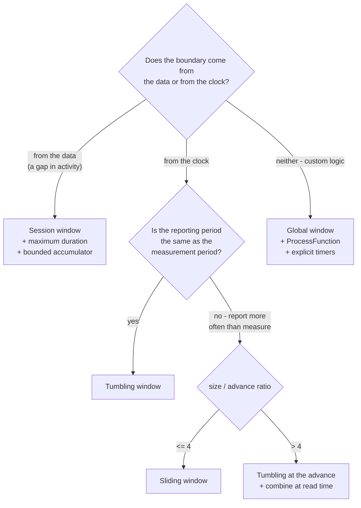

# Windowing and Aggregation

Scenarios `W-01` … `W-11`.

A window is a way of turning an unbounded stream into a finite collection you can compute over.
[05](05-event-time-watermarks-and-lateness.md) covered *when* a window is finished. This document
covers *what shape* windows come in, how much they cost, and the half-dozen ways a window
produces a number that is confidently wrong.

The unifying number to keep in view: **window state is `keys × windows-open-per-key ×
bytes-per-window`**, and each of those three factors can be made a hundred times larger by a
choice that looks innocuous. Most window incidents are an unexpected multiplication.

## 1. The four shapes

### Tumbling

Fixed size, no overlap, every record in exactly one window.

```
records:   a  b   c  d    e   f  g    h  i
           ├─────────┼──────────┼─────────┤
window:    10:00     10:01      10:02
```

Use for: "count per minute", "sum per hour", anything that maps to a reporting period.

Cost: one open window per key at a time (plus any kept for allowed lateness). The cheapest shape.

### Sliding (hopping)

Fixed size, fixed advance, overlapping. A record belongs to `size ÷ advance` windows.

```
records:   a  b   c  d    e   f  g    h  i
           ├─────────────────────┤            10:00–10:05
                  ├─────────────────────┤     10:01–10:06
                         ├─────────────────┤  10:02–10:07
```

Use for: "average over the last 5 minutes, updated every minute" — moving averages, rate
detection, anything where the reporting period is shorter than the measurement period.

Cost: **`size ÷ advance` copies of every record's contribution.** This is where sliding windows
get expensive, and the arithmetic is in Section 3.

### Session

Variable size, defined by a gap of inactivity. Records within `gap` of each other are in one
session; a gap larger than that closes it.

```
records:   a b c        d e f g            h
           ├─────┤      ├───────┤          ├─┤
           session 1    session 2          session 3
           ← gap >30s →         ← gap >30s →
```

Use for: user sessions, trips, viewing sessions, anything whose natural boundary is "they
stopped."

Cost: unbounded in principle. A session that never ends never releases its state, and Section 4
covers what to do about it.

### Global

One window per key, forever, with a custom trigger deciding when to emit. This is not really a
window; it is "keep state per key and emit when I say so", which is what `ProcessFunction` is
for. Use it when none of the above fits and you want the explicitness.

## 2. Incremental versus buffering: a 700× difference

This distinction costs more memory than any other choice in windowing, and it is invisible in
the code unless you know to look.

Two ways to compute "count per minute per member":

**Buffering.** The window collects every record, and the function runs when the window closes.
Flink: `.apply(WindowFunction)` or `.process(ProcessWindowFunction)`.

```
state per open window = every record in it
```

**Incremental.** The window keeps only the running result, updating it as each record arrives.
Flink: `.aggregate(AggregateFunction)` or `.reduce(ReduceFunction)`.

```
state per open window = one accumulator
```

The arithmetic for Corridor's per-minute count per member, 1.85 million events a second, 100
million distinct members a day, roughly 8 million active in any given minute:

```
BUFFERING
  records per minute:                1,850,000 × 60 = 111,000,000
  bytes per record in state:         640 B + ~60 B RocksDB overhead = 700 B
  state per open window:             111,000,000 × 700 B = 77.7 GB
  windows open (1-min tumbling, 8 s watermark, no allowed lateness):
                                     ~2 at any moment
  total:                             155 GB

INCREMENTAL
  accumulator:                       member_id (16 B) + count (8 B)
                                       + RocksDB overhead (~40 B) = 64 B
  active members per minute:         8,000,000
  state per open window:             8,000,000 × 64 B = 512 MB
  windows open:                      ~2
  total:                             1.02 GB
```

**155 GB against 1.02 GB — a factor of 152.** And for a five-minute sliding window advancing
every minute, the buffering version multiplies by five again while the incremental version does
not, taking the ratio past 700.

The reason people write the buffering version is that `ProcessWindowFunction` gives you the
window metadata (start, end, key) and the full record list, which is convenient. The reason to
avoid it is the table above.

**The pattern that gives you both:** Flink lets you combine them — an `AggregateFunction` does
the incremental work, and a `ProcessWindowFunction` receives *only the final accumulator* plus
the window metadata:

```java
stream
  .keyBy(Event::getMemberId)
  .window(TumblingEventTimeWindows.of(Time.minutes(1)))
  .aggregate(new CountAggregator(),          // incremental: 1 accumulator
             new AddWindowMetadata());        // gets the result, not the records
```

**Use this form by default.** There is almost no case where you want the records themselves at
window close; if you think you do, you probably want the top-N or a sample, both of which are
expressible as accumulators.

### When buffering is genuinely necessary

- **Median and exact percentiles.** No constant-size accumulator exists. Use an approximate
  sketch (t-digest, DDSketch) instead: 2 KB of accumulator for 0.5% relative error on any
  quantile, against 77.7 GB of records.
- **Exact distinct count.** Same answer: HyperLogLog at 12 KB per accumulator gives 0.8% error
  for any cardinality. Exact distinct over 8 million members per window is 128 MB per window,
  which for a one-off is fine and for 8 million keys is not.
- **Anything needing the actual records at the end** — emitting a sample, debugging. Keep a
  bounded reservoir, not everything.

The general principle: **a window accumulator should be O(1) in the number of records.** If it is
not, you have chosen an unbounded computation and the only question is when it breaks.

## 3. Sliding windows: the multiplication nobody budgets for

A sliding window of size *S* advancing every *A* places each record in `S ÷ A` windows. That
factor multiplies **both** the state and the per-record CPU.

Northlight wants "concurrent viewers over the last 5 minutes, updated every 10 seconds":

```
S ÷ A = 300 s ÷ 10 s = 30 windows per record

state:  30 × (accumulator per key)
CPU:    each record updates 30 accumulators
        1,100,000 records/s × 30 = 33,000,000 state updates/s
```

Thirty-three million RocksDB read-modify-writes per second. At roughly 40 µs each that is 1,320
CPU-seconds per second — **1,320 cores** for one aggregation. The job as specified is not
affordable.

Three ways out, in increasing order of cleverness.

### Option 1 — accept a coarser update interval

`S ÷ A = 300 ÷ 60 = 5`. Five windows instead of thirty; 220 cores instead of 1,320. The dashboard
updates every minute instead of every ten seconds. Ask whether anybody actually looks at it more
often than that; usually the answer is no and this is the end of the conversation.

### Option 2 — tumbling sub-windows, combined at read time

Compute a *tumbling* 10-second window — one window per record, cheap — and let the consumer sum
the last 30 of them.

```
tumbling 10 s:  1,100,000 records/s × 1 window = 1,100,000 updates/s = 44 cores
consumer sums 30 rows per query
```

**44 cores instead of 1,320, a factor of 30, which is exactly `S ÷ A`.** The cost is that the
consumer does work, and that the sum is only valid for *decomposable* aggregations — sum, count,
min, max, and anything built from them. It does not work for distinct count (unless you emit
HyperLogLog sketches, which merge, which is exactly why sketches are worth knowing) or for
median (unless you emit t-digests, same).

This is the **pre-aggregation** pattern and it is the right default for any sliding window with a
ratio above about 4. Meridian's convention is that streaming jobs emit fine-grained tumbling
windows and the serving layer does the rolling combination — which also means changing the
window size is a query change rather than a job redeploy with a state migration.

### Option 3 — an incremental sliding aggregation

For sum and count specifically, you can maintain one accumulator and add/subtract at the
boundaries: when the window advances, add the newest sub-interval and subtract the oldest.

```
per record: 1 update (not 30)
per advance: 1 add + 1 subtract per key
```

This is what a well-implemented sliding window *should* do, and some engines do it. Flink's
`ReduceFunction`-based sliding windows do not — they genuinely maintain `S ÷ A` separate panes.
Implementing it yourself means a `ProcessFunction` with a ring buffer of sub-interval sums, which
is perhaps forty lines and is worth it for a hot path.

⚠️ Do not do this for floating-point sums. Subtracting values that were added long ago
accumulates floating-point error without bound; after a few million operations your "sum" can
drift arbitrarily far from the truth. Use integers (cents, microseconds, counts) or use option 2.

## 4. Session windows and the session that never ends

A session window is defined by a gap: records within `gap` of each other merge into one session.
The implementation must therefore **merge windows** when a record arrives between two existing
sessions, which makes session windows the most expensive shape to maintain.

Corridor's user sessions, 30-minute gap:

```
active members in a 30-minute window:  ~14,000,000
session accumulator:                    member_id, start, end, event count,
                                        surfaces seen (bounded set of 16)
                                        ≈ 280 B
state:                                  14,000,000 × 280 B = 3.92 GB
```

Reasonable. Now the failure.

### W-01 — The session that never closes

**What you see.** One key's session state grows to 400 MB. The job's checkpoint duration triples.
Eventually a task fails with an out-of-memory error during serialization.

**Mechanism.** A session closes when a gap longer than `gap` occurs. Some keys never have a gap:

- An automated account posting continuously, 24 hours a day.
- A monitoring bot polling every 10 seconds, forever.
- A key that is not really an entity — a null `member_id` that every anonymous request collapses
  onto.

That last one is the common case and it is worth naming: **a null or default key collapses
millions of independent entities into a single session that will never, ever end.**

**Confirm it.** State size per key is not directly observable, but the proxy is: the distribution
of session *durations* emitted. If the p99.99 session is 30 minutes and the maximum is 9 days,
you have this.

**Recover.** Stop the job, clear state for the offending key (which in practice means clearing
the whole operator's state), fix the key, restart.

**Prevent.**

- **Always impose a maximum session duration.** Flink does not offer this directly for session
  windows; the implementation is a `ProcessFunction` with both an inactivity timer and an
  absolute-duration timer, firing whichever comes first. Meridian's maximum is 6 hours.
- **Never allow a null key.** Route records with a missing key to a separate stream, or
  synthesise a per-record unique key so they cannot merge. Do not silently map them to `""`.
- **Bound the accumulator.** "Surfaces seen" is a set — bound it at 16 and count overflow rather
  than growing it. `K-05` covers unbounded accumulators generally.

## 5. Triggers: emitting before the window closes

A window's default trigger fires once, when the watermark passes the window's end. Sometimes you
want more.

**Early firing** emits a provisional result before the window closes — every 10 seconds during a
one-minute window, say. The dashboard updates continuously rather than in a step.

**Late firing** re-emits after a late record arrives during the allowed-lateness period.

Both produce **multiple results for the same window**, and this is the thing that breaks
downstream systems.

### W-02 — Early firing double-counts downstream

**What you see.** A revenue dashboard shows a per-minute figure that is roughly 6× too high.

**Mechanism.** The job fires early every 10 seconds within a one-minute window. Each firing emits
the running total: 40, 95, 140, 210, 260, 310. The sink is an append-only table, so the minute's
row set contains six rows, and the dashboard's `SUM()` over them gives 1,055 instead of 310.

**Confirm it.** Count the rows per `(window_start, key)` in the sink. More than one means
multiple firings.

**Recover.** Deduplicate by keeping the latest per `(window_start, key)`.

**Prevent.** Early and late firing require an **upsert sink keyed by the window**, not an
append-only one. Concretely:

- ClickHouse: `ReplacingMergeTree` with `ORDER BY (window_start, key)` and a version column, plus
  `FINAL` or a deduplicating view at query time. ⚠️ Note the gotcha that a mutable column must
  never be in the `ORDER BY` — see [`../Clickhouse`](../../../system-design-notes/Clickhouse/README.md).
- Kafka: a compacted topic keyed by `(window_start, key)`.
- A key-value store: an upsert, which is natural.

And emit a **sequence or version** on every result so a late-arriving earlier firing cannot
overwrite a later one. The versions must be monotone per window: use the watermark at emit time.

### W-03 — The trigger fires and the result is not idempotent

**What you see.** A job that increments a counter in an external system produces inflated
counters after any restart.

**Mechanism.** The sink is `counter += window_result` rather than `counter = window_result`. A
restart replays some windows, and `+=` is not idempotent.

**Prevent.** **Window results should be absolute, not relative.** Emit "the count for window
10:04 is 310", not "add 310". Absolute values are idempotent under replay; deltas are not. This
is the same principle as `D-05` and it is the cheapest way to get effectively-exactly-once out of
an at-least-once pipeline.

## 6. Allowed lateness: correction without unbounded waiting

`allowedLateness(Duration)` keeps a window's state for that long after it fires, and re-fires
when a late record arrives.

The cost is exactly what you would expect and it is often underestimated:

```
windows retained = allowedLateness ÷ window size + 1

Corridor per-minute windows, 15 minutes allowed lateness:
  16 windows retained per key instead of 2
  state: 8,000,000 keys × 64 B × 16 = 8.2 GB   (was 1.02 GB)
```

**Eight times the state for a correction mechanism that fires on 0.04% of records.** That is
sometimes worth it and sometimes not; the point is that it is a decision with a number attached.

Where it is not worth it, the alternative is the side-output plus reconciliation path from
`E-06`: accept the provisional result, collect the late records separately, and correct in a
batch pass. That decouples the correction from the streaming job's state entirely.

**A useful middle position:** allowed lateness sized to cover the *common* lateness population
but not the structural one. Corridor's server-side records are late by up to 18 seconds at
p99.9; the browser-beacon population is late by minutes. One minute of allowed lateness captures
the first and ignores the second, costs 2 windows instead of 16, and the beacons go to the
reconciliation path.

## 7. Scenarios

### W-04 — Window results arrive before the data that produced them

**What you see.** A downstream consumer of `corridor.metrics.1m` sees a result for window
10:04–10:05 at 10:05:09, and then sees the raw events for that window on a different topic at
10:05:14. A join between them fails.

**Mechanism.** Two paths with different latencies. The windowed result is emitted when the
watermark passes, which is ahead of the slowest raw record's arrival at the *other* consumer.

**Prevent.** This is the general problem of **joining a derived stream to its own source**, and
the answer is not to. If the consumer needs both, derive both from the same job, or make the
consumer wait on the derived stream's watermark rather than on wall clock.

### W-05 — Empty windows are missing, not zero

**What you see.** A per-minute count per city has no rows at all for a small city at 03:00, and
the dashboard's line chart draws a straight segment across the gap, implying the previous value
persisted.

**Mechanism.** A window with no records does not exist. Flink (and every other engine) creates a
window only when a record falls into it. "No data" and "zero" are the same absence.

This is not a bug; it is a semantic gap. It matters when:

- A dashboard interpolates, implying a value that was not measured.
- An alert on "count < 10" never fires, because there is no row to evaluate.
- A downstream join expects a row per (minute, city) and silently drops.

**Prevent.** Decide explicitly and implement it:

- **Fill at query time.** ClickHouse's `WITH FILL`, or a calendar join. Cheapest, and it keeps the
  distinction between "no data" and "zero" visible in the raw table.
- **Emit zeros from the job.** Requires knowing the full key space, which for cities you do and
  for members you do not. Only viable for small, enumerable key sets.
- **Emit a heartbeat per key.** Expensive and rarely right.

The failure mode to avoid is not deciding: a dashboard that silently interpolates is a dashboard
that will be wrong during exactly the outage you built it to detect.

### W-06 — Window size changed, and history became incomparable

**What you see.** A job's window changed from 1 minute to 5 minutes in a deploy. The dashboard
now shows a step change in "events per window" of exactly 5×, which someone interprets as a
traffic surge.

**Mechanism.** The metric is per window, and the window changed.

**Prevent.** **Emit rates, not counts, or emit the window duration alongside the count.** A row
that says `(window_start, window_end, count)` is self-describing; one that says
`(timestamp, count)` is not. This is a five-byte fix that prevents a category of
misinterpretation forever.

Also: changing a window size is a **state-incompatible change** for most jobs, since the window
state's key includes the window boundaries. It requires a savepoint, a state migration or a
state reset, and a decision about the transition period. `C-08` covers the mechanics.

### W-07 — Two jobs compute the same metric and disagree

**What you see.** The streaming per-hour revenue and the batch per-hour revenue differ by 0.3%,
consistently.

**Mechanism.** Almost always one of five things, and it is worth having the checklist because the
investigation otherwise takes days:

1. **Lateness.** The stream dropped late records the batch job included (`E-08`). Check
   `numLateRecordsDropped` for the period.
2. **Window boundary semantics.** The stream uses `[start, end)` and the batch uses
   `[start, end]`, so one record per hour lands in both or neither.
3. **Time zone.** One is UTC, the other is local (`E-11`).
4. **Duplicates.** The stream is at-least-once and the batch deduplicates, or vice versa
   (`D-04`).
5. **Event time versus ingest time.** The batch job partitions the lake by ingest date and the
   stream windows by event time; records near midnight land differently.

**Prevent.** Run the comparison deliberately and continuously rather than discovering it. Meridian
runs a daily reconciliation for every Tier 1 derived dataset, comparing the streaming result
against a batch recomputation from the lake, and publishes the delta. A persistent 0.3% that is
*known and explained* is fine; an unknown 0.3% discovered in a meeting is not.

### W-08 — Aggregating over a key that is not stable

**What you see.** Per-device counts for Waypoint are 4% higher than per-driver counts, and the
difference grows on days when the app releases.

**Mechanism.** The key is `device_id`, which changes when a user reinstalls the app or when the
OS rotates its advertising identifier. The same physical entity appears as several keys.

**Prevent.** This is an entity-resolution problem rather than a windowing problem, and the
windowing decision that matters is: **aggregate over the most stable identifier available, and
document which one it is.** Meridian's convention is that any derived dataset names its grain
explicitly — `per driver_id`, not `per device`.

### W-09 — The accumulator overflowed

**What you see.** A daily sum goes negative.

**Mechanism.** A 32-bit integer accumulator. Corridor's per-day event count per surface exceeds
2.1 billion for the top surface.

**Prevent.** Use 64-bit for any count that could exceed a few hundred million, which is any count
over a day on a high-volume stream. And for sums of money, use integer minor units (cents) in a
64-bit field — not a `double`, which loses precision above 2^53 minor units and, more
practically, gives different answers depending on the order records were added, which makes
replay non-deterministic.

That last point deserves emphasis. **Floating-point addition is not associative**, so a
`double` sum over a stream produces a slightly different result depending on partition
assignment and arrival order. Two runs over the same data give different answers in the last few
digits, which makes every reconciliation ambiguous. Use integers.

### W-10 — Windows on a keyed stream with too few keys

**What you see.** A job with parallelism 240 has 3 busy subtasks.

**Mechanism.** The stream is keyed by `region`, and there are 12 regions. Flink assigns keys to
*key groups* and key groups to subtasks; with 12 keys, at most 12 subtasks can have work.

**Prevent.** **Parallelism cannot exceed key cardinality**, and in practice you want at least
4–8× more keys than subtasks for reasonable balance. If the natural key has low cardinality:

- **Two-phase aggregation.** Key by `(region, hash(record) % 64)` for a first-level partial
  aggregation, then key by `region` for the final combine. The first phase runs at parallelism
  768, the second at 12 — and the second phase's input is 64× smaller, so 12 subtasks is
  plenty. This is the streaming equivalent of a combiner and it is the standard fix for both
  low cardinality and hot keys (`K-03`).
- **Reconsider the key.** Do you need per-region, or per-region-per-something?

### W-11 — Window state survives a change you did not expect

**What you see.** After deploying a job change, windows that should have closed hours ago fire
with stale contents.

**Mechanism.** The job was restarted from a savepoint that contained open windows. Those windows
resume where they left off, which is correct — but if the change altered the aggregation logic,
the restored accumulators were built by the old logic and will be finished by the new one. The
result is a hybrid that matches neither version.

**Prevent.** For any change to aggregation logic:

- **Decide what happens to in-flight windows** and write it down. Options: let them finish with
  mixed logic (acceptable for a compatible change like adding a counter), discard them (a gap in
  the output, which you then backfill), or run both versions in parallel and cut over at a window
  boundary.
- **Version the output** so downstream can tell which logic produced a row.
- **Prefer changes at a natural boundary.** Deploying at a window boundary — for a one-minute
  window, any time — means fewer in-flight windows. For a 24-hour window it means deploying at
  midnight, which is a real operational constraint that should influence the window size choice.

## 8. Choosing a window: the decision procedure



And the checklist to run against whichever you picked:

1. **Is the accumulator O(1) in record count?** If not, use a sketch or bound the state.
2. **Is the accumulator's numeric type large enough, and is it an integer?**
3. **How many windows are open per key at once** — including allowed lateness? Multiply by key
   cardinality and accumulator size; that is your state.
4. **Can the window close?** For sessions, is there a maximum duration? For tumbling, can the
   watermark advance (`E-03`)?
5. **Does the sink handle multiple firings** if you use early or late triggers?
6. **Are empty windows meaningful**, and if so who fills them?
7. **Is the output self-describing** — window start and end on every row?
8. **What happens to in-flight windows when you deploy?**

## What to take away

1. **Window state is keys × windows-open-per-key × bytes-per-window.** Every window incident is
   an unexpected multiplication of one of those three.
2. **Use incremental aggregation, not buffering.** 1.02 GB against 155 GB for the same
   computation. Combine `AggregateFunction` with `ProcessWindowFunction` to get the window
   metadata without the records.
3. **A window accumulator should be O(1) in the number of records.** For percentiles use
   t-digest, for distinct count use HyperLogLog — 2 KB and 12 KB against gigabytes, and both
   merge, which is what makes read-time combination possible.
4. **A sliding window multiplies both state and CPU by `size ÷ advance`.** Above a ratio of
   about 4, emit tumbling sub-windows and combine at read time — a 30× saving on Northlight's
   concurrency metric, and it makes the window size a query change rather than a state
   migration.
5. **A session window needs a maximum duration and a non-null key**, or one automated account
   holds a session open for nine days.
6. **Early and late firing require an upsert sink keyed by the window**, plus a monotone version
   on each emission. Against an append-only sink they silently multiply your numbers.
7. **Emit absolute values, not deltas.** Absolute results are idempotent under replay; `+=` is
   not.
8. **Allowed lateness multiplies retained windows by `lateness ÷ window size`.** Size it to the
   common lateness population, not the structural one, and send the rest to a reconciliation
   path.
9. **An empty window does not exist.** Decide explicitly whether "no data" renders as zero, a
   gap, or an alert — a dashboard that interpolates will be wrong during the outage it exists to
   detect.
10. **Emit window start and end on every row.** Counts without a window duration are not
    comparable across a deploy that changed the window.
11. **Use integers for sums.** Floating-point addition is not associative, so a `double` sum
    gives different answers on replay and makes every reconciliation ambiguous.
12. **Parallelism cannot exceed key cardinality.** For low-cardinality keys, use two-phase
    aggregation with a salted first key — the same fix as for hot keys.
