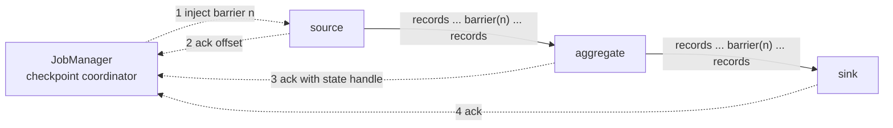
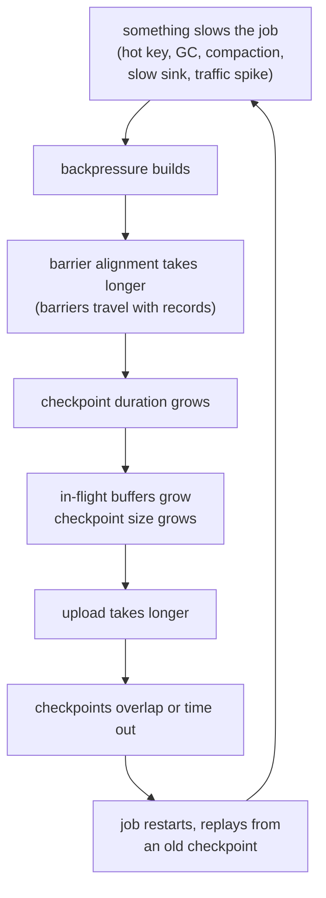

# Checkpointing, Savepoints and Recovery

Scenarios `C-01` … `C-12`.

A streaming job runs forever, so "forever" includes every machine failure, every network
partition, every out-of-memory kill and every deploy. Checkpointing is the mechanism that makes
those survivable, and it is the mechanism that most often becomes the reason a job cannot keep
up.

The shape of the problem: **a checkpoint must capture a consistent picture of a distributed
computation without stopping it.** "Consistent" and "without stopping it" pull in opposite
directions, and everything in this document is about how that tension is resolved and what it
costs.

## 1. What "consistent" means, and why it is hard

Suppose a job has three operators in a chain, running on three machines:

```
source (offset 4,100) → aggregate (counts) → sink
```

Naively, to snapshot it you would write down the source's offset and each operator's state. But
those are on different machines, and you cannot read them at the same instant. So you read the
source's offset at 10:00:00.000 and the aggregate's counts at 10:00:00.040.

In those 40 milliseconds, records flowed. The aggregate's counts now include records the source
has already read past. If you restore from this snapshot — rewinding the source to offset 4,100
and restoring the counts — those records are counted twice.

A **consistent snapshot** is one where the operator states and the input positions correspond:
the state is exactly the result of having processed everything up to those positions, and
nothing after.

### The barrier mechanism

Flink implements the Chandy-Lamport algorithm, adapted. The intuition:



1. The coordinator injects a **barrier** — a special marker — into the stream at every source.
   The source records its current offset and forwards the barrier.
2. Each operator, on receiving the barrier on all of its inputs, snapshots its state and
   forwards the barrier downstream.
3. When every operator has acknowledged, the checkpoint is complete.

The key property: **the barrier separates "before" from "after".** Everything upstream of the
barrier has been incorporated into the snapshot; everything downstream has not. Because the
barrier flows with the records, the correspondence between state and position is exact, without
anyone having to stop.

### Alignment, and why it costs

An operator with several inputs — after a `keyBy` shuffle, a subtask has inputs from every
upstream subtask — receives barriers at different times. Under **aligned checkpointing**, it
must wait for the barrier on *every* input before snapshotting, and while waiting it **buffers
records from inputs that already delivered their barrier.**

That buffering is the cost, and it is the cause of `C-02`. If one upstream subtask is slow, its
barrier arrives late, and the operator sits blocked on it — not processing, buffering — for the
duration of the skew. With backpressure in the system, that skew can be seconds, and the
alignment time becomes a large part of the checkpoint duration.

**Unaligned checkpointing** removes the wait: the operator snapshots immediately and includes
the in-flight buffers in the snapshot. Checkpoints complete fast even under backpressure. The
price:

- Checkpoint size grows by the in-flight data, which under heavy backpressure can be gigabytes.
- Recovery must restore and replay those buffers, which is slower.
- It is incompatible with certain operators and with some exactly-once sink configurations.

**Meridian's default:** aligned, with `alignmentTimeout = 30 s`. If alignment does not complete
in 30 seconds, the checkpoint switches to unaligned for that attempt. This gives you the cheap
path normally and the robust path under backpressure, which is exactly when you need it and
exactly when the cheap path fails.

## 2. Incremental checkpoints, and the arithmetic that decides your interval

A **full** checkpoint writes all state. An **incremental** one writes only what changed — for
RocksDB, the SST files created since the last checkpoint, plus a manifest referencing files
retained from previous checkpoints.

For `corridor-ad-attribution` (4.2 TB, 60-second interval), from
[01](01-requirements-and-the-capacity-model.md) Section 8:

```
full:        4.2 TB per checkpoint
incremental: 5.78 GB per checkpoint
ratio:       727×
```

That ratio is the entire reason large-state streaming is possible.

But incremental checkpoints have a property that surprises people: **the checkpoint's size is
not the state's change rate; it is RocksDB's file-creation rate**, which is the change rate
multiplied by write amplification.

```
new rows per interval:  182,400/s × 60 s × 220 B = 2.41 GB of logical change
SST bytes written:      × 2.4 (compaction rewriting older levels) = 5.78 GB
```

So a job whose logical state barely changes can still write large checkpoints if RocksDB is
compacting heavily — which is why `K-06` (compaction saturation) and `C-01` (checkpoint
overruns) are usually the same incident seen from two angles.

### Choosing the interval

Three forces, and they point in different directions:

**Shorter interval → less replay on recovery.** After a crash, the job reprocesses everything
since the last checkpoint. At a 60-second interval, that is up to 60 seconds of records.

**Shorter interval → more overhead.** Each checkpoint costs alignment time, snapshot time and
upload. If checkpointing takes 1.8 seconds and runs every 60, that is 3% overhead; every 10
seconds is 18%.

**Shorter interval → lower latency, if the sink is transactional.** From
[01](01-requirements-and-the-capacity-model.md) Section 10, the exactly-once path's p50 latency
is half the checkpoint interval.

The binding constraint is usually this one:

```
checkpoint duration must be well under the interval,
and Flink enforces minPauseBetweenCheckpoints on top
```

If duration approaches interval, checkpoints run back to back, the job spends most of its time
snapshotting, and it enters the death spiral in `C-01`.

**Meridian's rule:** interval ≥ 10× measured p99 checkpoint duration, floor of 10 seconds,
ceiling of 5 minutes.

| Job class | p99 duration | Interval | Why |
|---|---|---|---|
| Stateless | 0.2 s | 10 s | Cheap; short interval minimises replay |
| Small keyed state | 0.9 s | 30 s | |
| `corridor-ad-attribution` (4.2 TB) | 4.1 s | 60 s | Duration is dominated by alignment, not upload |
| Exactly-once payment jobs | 0.3 s | 10 s | Latency matters more than overhead here |

Note the last row: `riverbend.payments.settled` has tiny state, so a 10-second interval costs
almost nothing and cuts exactly-once latency from p50 31.8 s to p50 5.3 s. **The checkpoint
interval is a latency knob for exactly-once pipelines, and it is free when state is small.**

## 3. Checkpoints versus savepoints

They are often treated as the same thing with different retention. They are not.

| | Checkpoint | Savepoint |
|---|---|---|
| Triggered by | The system, on a timer | A human or a deploy pipeline |
| Purpose | Recover from failure | Upgrade, rescale, migrate, fork |
| Format | Engine-internal, may be incremental | Self-contained, canonical |
| Portability across Flink versions | Not guaranteed | Guaranteed within a support window |
| Owned by | The job; deleted when it is | You; survives the job |
| Cost to take | Cheap (incremental) | Expensive (full, by default) |
| Restore with different parallelism | Yes | Yes |
| Restore with a changed job graph | Fragile | Supported, with `uid`s |

The `uid` row is the one that bites. **Flink matches operator state to operators by a generated
hash of the operator's position in the graph, unless you assign an explicit `uid`.** Add a
`filter()` upstream and every downstream operator's generated hash changes, so restoring from a
savepoint drops all their state — silently, unless you also set
`--allowNonRestoredState=false`, which is not the default in every deployment path.

```java
stream
  .keyBy(Event::getMemberId)
  .process(new SessionFunction())
  .uid("corridor-sessionize-v1")          // ← never change this
  .name("sessionize");                     // ← cosmetic, change freely
```

**Set a `uid` on every stateful operator, in the first version of every job.** Adding them later
means your first savepoint after the change loses all state, because the hashes change from
generated to explicit. There is a migration path (`--allowNonRestoredState` plus a manual state
transformation) and it is a day of work you can avoid with one line per operator.

### Savepoint cost, and the native format

A savepoint of the 4.2 TB job in the canonical format writes all 4.2 TB:

```
4.2 TB ÷ (360 subtasks × 90 MB/s) = 130 s of upload, plus serialization
measured: 95 s wall clock (upload overlaps serialization)
```

Flink 1.15 added **native-format savepoints**, which use the state backend's own format and can
be incremental. A native savepoint of the same job takes 6 seconds instead of 95. The trade-off:
native savepoints cannot be restored into a job using a different state backend, and their
cross-version portability is weaker.

**Meridian uses native savepoints for routine deploys and canonical savepoints for anything that
crosses a Flink version boundary or that needs to be kept as a recovery point.** The routine
case is 95% of savepoints and saves 89 seconds of downtime each time.

## 4. Recovery strategies: how much restarts

When a task fails, Flink's default is **full restart**: every task in the job stops and restores.
For a 360-subtask job that is 360 state downloads because one machine died.

Two alternatives, and both are worth configuring before you need them.

### Fine-grained (region) recovery

Flink partitions the job graph into **regions** connected by pipelined exchanges. A failure
restarts only the affected region and everything downstream of it.

This helps enormously for jobs with **blocking or batch-style exchanges**, and helps not at all
for a fully-pipelined streaming job, because a fully-pipelined job is one region. So the honest
statement is: **region recovery does not help most streaming jobs.** Configure it — it costs
nothing — but do not plan around it.

### Task-local recovery

This one does help, a lot, and it is off by default.

With `state.backend.local-recovery: true`, each subtask keeps a **local copy** of its checkpoint
on the TaskManager's disk in addition to the copy in S3. When a task fails and is rescheduled
*onto the same TaskManager*, it restores from the local copy — a disk read rather than a network
download.

```
restore from S3:     11.67 GB ÷ 90 MB/s  = 130 s
restore from local:  11.67 GB ÷ 1.4 GB/s =   8 s
```

A 16× improvement, and it applies to the common failure: a single task dying from an exception,
a transient OOM, a Kafka client error. It does not apply when the TaskManager itself dies, which
is when you need the S3 copy.

The cost is local disk — roughly 1× the state again, on top of RocksDB's live data and
compaction headroom:

```
r6id.4xlarge, 950 GB NVMe:
  RocksDB live state     323 GB
  compaction headroom    323 GB
  local recovery copy    323 GB
                        ───────
                         969 GB   ← does not fit
```

So enabling task-local recovery on Meridian's current node shape requires either bigger disks or
fewer slots per node. Meridian runs the 21 large-state jobs on a dedicated pool with 4 slots per
node (`K-11`), where the arithmetic works, and leaves it off for the rest. **This is a real
trade and it should be made explicitly rather than by leaving a default.**

## 5. Scenarios

### C-01 — The checkpoint death spiral

**What you see.** Checkpoint duration climbs from 4 s to 25 s to 58 s over about two hours, then
checkpoints start failing with timeouts. The job's throughput drops. Lag grows. Then the job
restarts, restores from a checkpoint that is now 40 minutes old, and has 40 minutes of lag to
replay — which makes it slower, which makes checkpoints worse.

**Mechanism.** This is the canonical streaming failure and it is a feedback loop with four
possible entry points:



The crucial detail is that **barriers travel with records**, so anything that slows record flow
slows barrier flow. Backpressure and checkpoint duration are the same phenomenon measured
differently.

**Confirm it.** Three metrics together tell you which entry point:

```
checkpoint_alignment_time      ← high means backpressure (the usual case)
checkpoint_sync_duration       ← high means the snapshot itself is slow (large heap state)
checkpoint_async_duration      ← high means upload is slow (S3 throttling, huge delta)
checkpoint_size                ← growing means in-flight buffers or state growth
```

If alignment dominates, the cause is upstream of the checkpoint: find the backpressured operator
(see [11-backpressure-and-flow-control.md](11-backpressure-and-flow-control.md)). If async
dominates, the cause is the storage path.

**Recover.** In order:

1. **Switch to unaligned checkpointing immediately** if not already on the timeout path. This
   breaks the loop at the alignment step and is the single most effective emergency action.
2. **Increase the checkpoint timeout** so a slow checkpoint completes rather than failing and
   being retried from scratch. A checkpoint that takes 8 minutes is better than four that time
   out at 2.
3. ⚠️ **Do not reduce the checkpoint interval**, which is the instinctive reaction ("checkpoint
   more often so there is less to replay"). It makes the spiral tighter.
4. ⚠️ **Do not restart the job** unless you have fixed the underlying slowness. A restart replays
   from the last successful checkpoint, which is old, which means more work, which is the
   condition you are trying to escape.
5. Reduce input rate, by shedding or by pausing a source, until the job drains.

**Prevent.**

- Interval ≥ 10× p99 duration, and alert when the ratio falls below 4.
- Unaligned checkpointing with a 30-second alignment timeout as the standing configuration.
- Alert on `checkpoint_alignment_time` directly, which is a leading indicator that appears
  before duration does.

### C-02 — Alignment blocked by one slow subtask

**What you see.** Checkpoint duration is 40 seconds; the snapshot itself takes 0.9 seconds.
Alignment is 39 seconds.

**Mechanism.** One upstream subtask is slow (hot key, `K-03`; or a slow machine). Its barrier
arrives 39 seconds after the others. Every downstream subtask waits, buffering.

**Confirm it.** `checkpointAlignmentTime` per subtask, and then the upstream subtask whose
barrier is last. Flink's UI shows per-subtask checkpoint timings, which makes this a
two-minute diagnosis if you know to look.

**Recover.** Unaligned checkpointing removes the symptom without fixing the cause, which is
usually the right emergency action and the wrong permanent one.

**Prevent.** Fix the skew (`K-03`, `T-02`). The checkpoint problem is a symptom.

### C-03 — Checkpoint upload throttled by object storage

**What you see.** `checkpoint_async_duration` at 90 seconds. S3 `503 SlowDown` in the
TaskManager logs.

**Mechanism.** Every subtask writes its state to the same S3 prefix:

```
s3://meridian-checkpoints/<job-id>/chk-<n>/<subtask>-<uuid>
```

S3 partitions by key prefix, so 360 subtasks writing under one `<job-id>/chk-<n>/` prefix are
hitting one partition. At 3,500 PUTs per second per prefix, a job writing many small SST files
per checkpoint exceeds it easily.

**Confirm it.** `503 SlowDown` responses, plus async duration that is high while network
utilisation is low. The combination — slow but not busy — points at throttling rather than
bandwidth.

**Recover.** Reduce the number of files per checkpoint by increasing RocksDB's
`write_buffer_size` and target file size, which produces fewer, larger SSTs.

**Prevent.**

- **Entropy injection in the checkpoint path.** Flink supports
  `state.backend.fs.checkpointdir` containing an entropy key that is replaced by random
  characters, spreading writes across S3 partitions:
  ```
  s3://meridian-checkpoints/_entropy_/<job-id>/chk-<n>/
  ```
  This is a configuration change and it eliminates the class.
- **File merging** (`state.checkpoints.file-merging.enabled` in recent Flink) combines small
  state files, cutting object count by an order of magnitude.

### C-04 — Restore takes longer than the outage it is recovering from

**What you see.** A TaskManager was unavailable for 90 seconds. Recovery took 11 minutes.

**Mechanism.** One TaskManager holding 16 subtasks failed. Flink's default restart strategy
restarts **the whole job** — all 360 subtasks download their state, not just the 16 affected.

```
needed:    16 subtasks × 11.67 GB = 187 GB
actually:  360 subtasks × 11.67 GB = 4.2 TB
```

22× more work than the failure required.

**Prevent.** Task-local recovery (Section 4) makes the 344 unaffected subtasks restore from
local disk in 8 seconds each instead of downloading, which turns the 11 minutes into about 2.
It does not reduce the amount restored; it reduces where it comes from.

The deeper fix — restarting only the affected subtasks — is what region recovery would give you
if streaming jobs had regions, and they mostly do not. This is a genuine limitation of the
current generation of stream processors and it is worth knowing rather than being surprised by.

### C-05 — The job restarts in a loop

**What you see.** A job restarts every 45 seconds, indefinitely.

**Mechanism.** A record causes a deterministic exception. The job restarts from the last
checkpoint, reprocesses the same record, fails again. Classic poison pill.

Or: the restart strategy has no backoff and no limit, so a transient problem (a sink briefly
unavailable) produces hundreds of restarts a minute, each of which downloads state, which
saturates S3, which makes the restarts slower and more likely to fail.

**Confirm it.** `numRestarts` as a rate. The exception in the logs is the same every time for a
poison pill and varies for the transient case.

**Recover.** For a poison pill, skip the record: a deserializer or operator that catches,
counts, dead-letters and continues. This must be built in advance; adding it during an incident
means a deploy, which means a savepoint you may not be able to take.

**Prevent.**

- **Exponential restart backoff with a cap**, not `fixed-delay`:
  ```
  restart-strategy: exponential-delay
  restart-strategy.exponential-delay.initial-backoff: 10 s
  restart-strategy.exponential-delay.max-backoff: 5 min
  restart-strategy.exponential-delay.backoff-multiplier: 2.0
  restart-strategy.exponential-delay.reset-backoff-threshold: 10 min
  ```
- **A failure-rate limit** so a job that has failed ten times in an hour stops and pages someone
  rather than thrashing. A stopped job with a page is better than a job that is restarting
  forever while its lag grows.
- **A dead-letter path in every deserializer** (`S-12`, Section 7 of
  [03](03-the-event-schema-and-contracts.md)).

### C-06 — No savepoint could be taken, and the deploy is blocked

**What you see.** The deploy pipeline calls "stop with savepoint", it times out after 10
minutes, and the job is now in an indeterminate state.

**Mechanism.** "Stop with savepoint" stops the sources, waits for in-flight records to drain,
takes a savepoint, and stops. If the job is backpressured, draining takes as long as the
backlog, which can be hours. If a sink is unavailable, draining never completes.

**Recover.** Cancel without a savepoint and restart from the latest *checkpoint*. This is safe —
checkpoints are consistent — but it means restoring into a possibly-incompatible job graph, so
it only works if the deploy did not change the graph.

⚠️ **Retain checkpoints on cancellation** (`execution.checkpointing.externalized-checkpoint-retention:
RETAIN_ON_CANCELLATION`), or cancelling deletes the checkpoints and you have nothing to restore
from. This is a one-line setting and its default has cost people their state.

**Prevent.**

- Take the savepoint **before** stopping sources, using a plain savepoint rather than "stop with
  savepoint", when the job is healthy. Then stop. You lose exactly-once across the boundary,
  which matters for some jobs and not for most.
- Set a savepoint timeout shorter than your deploy window, with an automatic fallback to
  "cancel and restore from checkpoint."
- Do not deploy a backpressured job. Fix the backpressure, then deploy.

### C-07 — Restoring into a changed job graph silently drops state

**What you see.** A deploy succeeds. The job runs. Its results are wrong for the first 24 hours
and then correct.

**Mechanism.** A stateful operator's `uid` was not set, and its generated hash changed because
an operator was added upstream. Flink could not match the savepoint's state to it, and with
`--allowNonRestoredState` set (which many deploy scripts set to make deploys "just work"), it
started with empty state.

The operator was a 24-hour windowed aggregation, so it took 24 hours to refill — hence results
that are wrong and then right, which is the most confusing possible symptom.

**Confirm it.** The JobManager logs list restored and non-restored state on startup. Search for
`Skipped checkpoint state for operator`.

**Prevent.**

- **`uid` on every stateful operator, from version one.**
- **`--allowNonRestoredState=false` in production**, with an explicit override required. The
  flag exists for the case where you deliberately removed an operator; using it as a default is
  how this failure happens.
- **A deploy-time assertion**: the pipeline compares the set of operator `uid`s in the savepoint
  against the set in the new job, and fails the deploy on an unexplained difference.

### C-08 — State schema migration

**What you see.** Not a failure — a task. A job's state class needs a new field.

**Mechanism.** Covered in `K-08`: whether it works depends on the serializer. With Avro state
types it works automatically for compatible changes.

For incompatible changes — splitting a field, changing a key's type, restructuring — the tool is
the **State Processor API**: a batch Flink job that reads a savepoint as a dataset, transforms
it, and writes a new savepoint.

```java
SavepointReader old = SavepointReader.read(env, "s3://.../savepoint-abc", new EmbeddedRocksDBStateBackend());
DataStream<OldState> state = old.readKeyedState("corridor-sessionize-v1", new ReadFunction());
DataStream<NewState> migrated = state.map(new MigrationFunction());
SavepointWriter.newSavepoint(...)
    .withOperator("corridor-sessionize-v1", OperatorTransformation.bootstrapWith(migrated)...)
    .write("s3://.../savepoint-migrated");
```

It works. It takes a day. The important operational property is that **it is offline**: the job
must be stopped while the migration runs, which for a 4.2 TB state is a 40-minute outage.

For a job that cannot take a 40-minute outage, the alternative is a **parallel run**: start the
new version alongside the old, reading from the same source with a different consumer group,
writing to a different sink, let it build state, then cut over. The cost is double the resources
for the duration of the state build — 24 hours for the attribution job — and a cutover procedure
that must handle the overlap. `R-06` covers the general form of this.

### C-09 — Checkpoint storage grows without bound

**What you see.** The checkpoint bucket holds 340 TB for jobs whose total state is 31 TB.

**Mechanism.** Several causes compounding:

- `state.checkpoints.num-retained` greater than 1, each retaining incremental files.
- Retained checkpoints from cancelled jobs (the setting from `C-06`) that nobody deletes.
- Savepoints from every deploy, kept "just in case", for two years.
- Orphaned files from failed checkpoints, which Flink does not always clean up.

**Prevent.**

- `num-retained: 3` is enough. More does not help; if checkpoint *n* is corrupt, *n−1* usually
  is too, because the corruption is in the shared incremental files.
- A lifecycle policy on the checkpoint bucket: delete anything untouched for 30 days. This is
  safe for checkpoints and **unsafe for savepoints**, so put savepoints in a different bucket
  with a different policy. Separating them is the important part.
- A reconciliation job: list the buckets, list the running jobs, delete the orphans. Run it
  weekly.

### C-10 — Exactly-once sink transactions leak

**What you see.** The downstream Kafka cluster's `__transaction_state` topic has 40,000 open
transactions. Consumers with `read_committed` are blocked — they cannot advance past the oldest
open transaction, so their lag grows indefinitely while the producing job looks healthy.

**Mechanism.** A transactional sink opens a transaction per checkpoint and commits it when the
checkpoint completes. If the job crashes between opening and committing, the transaction is
left open until `transaction.timeout.ms` expires.

A job that restarts frequently (`C-05`) leaves one dangling transaction per restart. And if
`transaction.timeout.ms` is set high — people raise it to avoid `C-11` — the transactions stay
open for that long.

The consumer-side effect is the nasty part: **one open transaction blocks every `read_committed`
consumer of that partition**, regardless of how much committed data is available after it. A
single leaked transaction can stall a downstream pipeline for an hour.

**Confirm it.**

```bash
kafka-transactions.sh --bootstrap-server broker:9092 list
kafka-transactions.sh --bootstrap-server broker:9092 describe --transactional-id <id>
```

and on the consumer side, lag that does not decrease while the partition's log-end-offset grows.

**Recover.** Force-abort the dangling transactions:

```bash
kafka-transactions.sh --bootstrap-server broker:9092 \
  abort --topic corridor.metrics.1m --partition 14 --start-offset 8812004
```

⚠️ Aborting a transaction that is actually in progress discards its writes. Confirm the producer
is dead first.

**Prevent.** Stop the restart loop (`C-05`). And set `transaction.timeout.ms` from the
arithmetic in `C-11` rather than by raising it until the errors stop.

### C-11 — Transaction timeout shorter than checkpoint interval

**What you see.** `ProducerFencedException` or `InvalidTxnStateException` on every checkpoint.

**Mechanism.** The transaction is opened at checkpoint *n* and committed when checkpoint *n*
completes. If the broker's `transaction.max.timeout.ms` (15 minutes default) or the producer's
`transaction.timeout.ms` (1 minute default) expires first, the broker aborts the transaction and
fences the producer.

```
required: transaction.timeout.ms > checkpoint interval
                                  + checkpoint duration
                                  + restart time worst case
```

For a 60-second interval, 4.1-second p99 duration, and a 4-minute worst-case restart:

```
60 + 4.1 + 240 = 304 s  → set transaction.timeout.ms = 600,000 (10 min)
```

And the broker's `transaction.max.timeout.ms` must be at least that, which it is by default at
15 minutes.

**Prevent.** Compute it. And note the tension with `C-10`: a longer timeout means a leaked
transaction blocks consumers for longer. Ten minutes is a reasonable compromise; an hour is not.

### C-12 — The checkpoint succeeded and the state is wrong

**What you see.** A job restored cleanly and produces results that disagree with a recomputation.

**Mechanism.** Checkpointing guarantees that the *engine's* state is consistent with the input
positions. It guarantees nothing about state the engine does not know about:

- A static field or a singleton holding accumulated data.
- A cache built in `open()` and mutated per record.
- A connection pool or client with its own buffering.
- Anything in a `ThreadLocal`.

None of these are snapshotted, so after a restore they are empty or stale while the engine's
state is as of the checkpoint. The two are inconsistent.

**Prevent.** **All mutable per-record state goes in Flink state, without exception.** A field on
an operator class that changes per record is a bug, and it is a bug that will not show up in
testing because tests do not restart mid-stream. A lint rule looking for non-final mutable
instance fields in operator classes catches most of it.

## 6. Building a recovery drill

You do not know your recovery time until you have measured it, and you will not measure it
during an incident. Meridian runs a monthly drill per Tier 1 job:

1. **Note the current lag and watermark.**
2. **Kill one TaskManager.** Measure: detection time, reschedule time, restore time, time to
   watermark parity.
3. **Kill the JobManager.** Measure the same. (This should be nearly free with Kubernetes HA;
   verify rather than assume.)
4. **Kill every TaskManager simultaneously.** This is the case people never test and it is the
   one that happens during a zone failure. Measure whether the job can even get enough slots
   back.
5. **Restore from a savepoint into a job with one added stateless operator.** Verify that state
   was restored — check the "restored" log lines, not just that the job started.
6. **Restore from a 6-hour-old checkpoint** and measure how long full catch-up takes. This
   tells you whether your retention (`T-03`) is adequate.

What this reliably finds the first time, in Meridian's experience and generally:

- Recovery is 2 to 4× slower than anyone estimated, because nobody counted the catch-up.
- At least one job has no `uid`s.
- `RETAIN_ON_CANCELLATION` is not set somewhere.
- The S3 checkpoint path has no entropy and throttles when everything restores at once.
- The restart strategy is `fixed-delay` with no limit.
- Nobody knows what the job does if the sink is down during recovery.

## What to take away

1. **A checkpoint must capture a consistent picture without stopping the job**, and the barrier
   mechanism is what makes those compatible: the barrier separates "incorporated" from "not
   incorporated" as it flows with the records.
2. **Barriers travel with records, so backpressure and checkpoint duration are the same
   phenomenon.** Anything that slows record flow slows barriers, which lengthens alignment.
3. **Aligned checkpointing buffers while it waits; unaligned includes the buffers in the
   snapshot.** Run aligned with a 30-second alignment timeout so you get the cheap path normally
   and the robust path exactly when you need it.
4. **Incremental checkpoint size is the change rate times RocksDB write amplification**, not the
   change rate. 5.78 GB for a 4.2 TB job — a 727× saving that is what makes large-state
   streaming possible.
5. **Interval ≥ 10× p99 checkpoint duration.** And for small-state exactly-once jobs, a short
   interval is a nearly-free latency improvement: 60 s → 10 s takes p50 from 31.8 s to 5.3 s.
6. **Set a `uid` on every stateful operator in version one**, and run production with
   `--allowNonRestoredState=false`. Otherwise a savepoint restore silently starts with empty
   state and the results are wrong for exactly as long as the window is deep.
7. **`RETAIN_ON_CANCELLATION`, or cancelling a job deletes your only recovery point.**
8. **Task-local recovery is a 16× improvement on the common failure** and it costs another copy
   of the state on local disk — which on a 16-slot node does not fit. Make that trade
   deliberately.
9. **One dangling exactly-once transaction blocks every `read_committed` consumer of that
   partition.** Size `transaction.timeout.ms` from interval + duration + worst-case restart, and
   fix restart loops rather than raising the timeout.
10. **Checkpointing knows nothing about state the engine does not own.** A mutable field on an
    operator class survives no restart and will not be caught by any test that does not restart
    mid-stream.
11. **Run the recovery drill monthly.** It reliably finds that recovery is 2–4× slower than
    estimated, that some job has no `uid`s, and that the checkpoint path throttles when
    everything restores at once.
