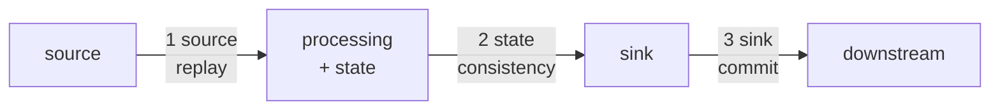
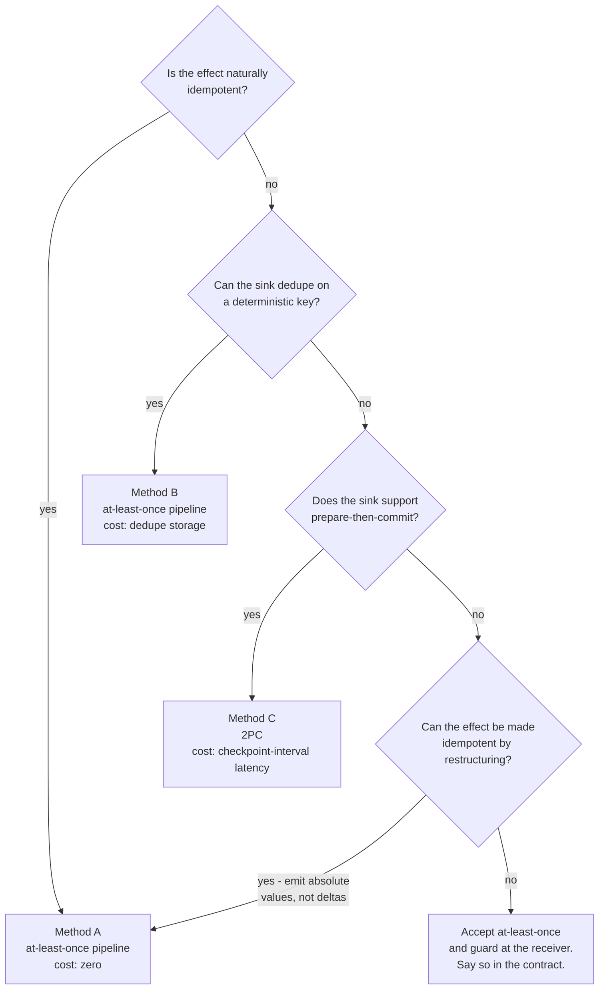

# Delivery Guarantees and Exactly-Once

Scenarios `D-01` … `D-11`.

"Exactly-once" is the most oversold phrase in stream processing. It is not impossible — Flink
genuinely provides it, under conditions — but the phrase as used in marketing means something
different from what it means in a design review, and the gap between them is where production
incidents live.

This document defines the guarantees precisely, derives what each costs, and shows why the
cheapest route to a correct result is usually not the one called exactly-once.

## 1. The guarantee is about effects, not deliveries

Start by fixing the vocabulary, because the usual phrasing is what causes the confusion.

**At most once.** A record's effect happens zero or one times. You get this by recording your
position *before* doing the work. Nobody chooses it; people get it by accident with
`enable.auto.commit=true` (`T-04`).

**At least once.** A record's effect happens one or more times. You get this by doing the work
before recording your position. This is the default, it is cheap, and it is correct whenever the
effect is idempotent.

**Exactly once.** A record's effect happens exactly one time.

The word doing the work is **effect**. The record may well be *delivered* to your operator twice
— after a restart, Flink reprocesses everything since the last checkpoint, so duplicate delivery
is guaranteed, not merely possible. The guarantee is that the second processing does not change
the outcome.

This is why the more careful term is **effectively-once**, and why "exactly-once delivery" is not
a thing anybody provides. A network can always deliver a message twice, and the receiver cannot
distinguish a duplicate from a retry without keeping state — which is exactly what the mechanisms
below do.

### The three places the guarantee has to hold



1. **The source must be replayable from a recorded position.** Kafka is; an HTTP endpoint is not.
   If your source cannot be rewound, no guarantee above at-most-once is available, full stop.
2. **State must be consistent with the source position.** This is what checkpointing gives you
   ([08](08-checkpointing-savepoints-and-recovery.md)).
3. **The sink must not apply the same effect twice.** This is the hard one, because the sink is
   usually a system that does not participate in your checkpoint protocol.

Flink guarantees 1 and 2 by itself. **3 is not Flink's to give** — it depends entirely on what
you are writing to, which is why the honest sentence about any pipeline names the sink.

## 2. The four ways to make a sink safe

### Method A — the sink is naturally idempotent

The write is `SET key = value`, not `INCREMENT key`. Applying it twice is the same as once.

```
UPSERT INTO metrics (window_start, surface, count)
VALUES ('10:04', 'feed', 1128500)
```

Cost: **zero.** No transactions, no coordination, no latency penalty. The at-least-once path's
36-millisecond latency, with exactly-once semantics for the result.

Requirement: the value written must be a **complete, absolute statement** about a key, not a
delta. This is `W-03` and it is almost always achievable by restructuring the computation.

**This is the right answer far more often than people realise**, and it is the first thing to
reach for.

### Method B — deduplicate at the sink using a business key

The sink stores each record under a deterministic ID and ignores a second write with the same
ID.

```
ClickHouse:  ReplacingMergeTree ORDER BY (event_id)
DynamoDB:    PutItem with ConditionExpression attribute_not_exists(event_id)
Postgres:    INSERT ... ON CONFLICT (event_id) DO NOTHING
```

Cost: storage for the ID index, and the sink's deduplication window. ClickHouse's
`ReplacingMergeTree` deduplicates only *within a part* until merges run, so a query must use
`FINAL` or a deduplicating view — which costs query time.

Requirement: a deterministic `event_id` on every record (`I-04`, and the envelope in
[03](03-the-event-schema-and-contracts.md)).

### Method C — two-phase commit with a transactional sink

The sink participates in the checkpoint: it opens a transaction, writes into it, pre-commits
when the checkpoint barrier arrives, and commits when the checkpoint completes. A failure before
the commit means the transaction is aborted and the writes never became visible.

Flink's `TwoPhaseCommitSinkFunction` and the newer sink API implement this for Kafka, for
Iceberg and Delta (via metadata commit), and for JDBC with `XA`.

Cost: **the latency penalty from [01](01-requirements-and-the-capacity-model.md) Section 10** —
p50 31.8 s against 36 ms, because nothing is visible until a checkpoint completes. Plus
transaction-coordinator load, plus the failure modes in `C-10` and `C-11`.

Requirement: the sink must support transactions that can be prepared and then committed later,
by a *different process* than the one that opened them (because the job may have restarted).
This last requirement eliminates most systems.

### Method D — write to a log and let the consumer deduplicate

Write at-least-once to Kafka with a deterministic key, and let each downstream consumer handle
duplicates however suits it. This pushes the problem downstream, which is sometimes exactly
right — a consumer writing into ClickHouse deduplicates for free (Method B), while a consumer
sending an email cannot and needs its own guard.

Cost: every consumer must think about it. That is a real organisational cost and it is the
reason platforms try to centralise the guarantee.

### Which sinks support what

| Sink | A: idempotent | B: dedupe key | C: 2PC | Practical answer |
|---|---|---|---|---|
| Kafka | n/a | via compaction | **Yes** | 2PC, or compacted + key |
| ClickHouse | Upsert-ish | **Yes** (`ReplacingMergeTree`) | No | B |
| Druid | No | Yes, via ingestion-time dedupe | Partial (Kafka indexing is EOS) | B or the native EOS path |
| Iceberg / Delta | n/a | n/a | **Yes** (atomic metadata commit) | C, and it is cheap here |
| Postgres / MySQL | **Yes** (upsert) | Yes | Yes (XA, slow) | A |
| DynamoDB | **Yes** | Yes (conditional write) | No (across partitions) | A |
| Redis | **Yes** | Yes | No | A |
| Elasticsearch | **Yes** (document ID) | Yes | No | A |
| S3 / object store | Per-object, yes | n/a | Via a manifest | A with deterministic object names |
| An HTTP webhook | **No** | Only if the receiver dedupes | No | B, enforced at the receiver |
| Sending an email | **No** | Only with a receiver-side guard | No | Accept at-least-once, guard separately |

The two rows worth dwelling on:

**Iceberg's 2PC is cheap**, unlike Kafka's, because the commit is a single atomic metadata
operation on a table, not a distributed transaction. A Flink job writing to Iceberg with
exactly-once pays the checkpoint-interval latency, but the interval can be long (5 minutes) for
an analytical sink where nobody cares, so the cost is nearly free in practice.

**Sending an email cannot be made exactly-once**, and no amount of pipeline engineering changes
that. The guard has to live in the thing that sends — "have I already sent notification X to
user Y?" — which is a stateful check in the notification service, not in the stream processor.
**When the effect leaves your system, the guarantee leaves with it.**

## 3. The decision procedure



The important property of this procedure is that **it reaches 2PC only after three attempts to
avoid it**, and in Meridian's 180 jobs the distribution is:

| Method | Jobs | Why |
|---|---|---|
| A — idempotent sink | 118 | Absolute values into upsertable stores |
| B — dedupe key | 44 | ClickHouse and Druid sinks |
| C — 2PC | 11 | Kafka-to-Kafka financial streams, Iceberg lake sinks |
| D — accepted at-least-once | 7 | Notifications, webhooks, third-party APIs |

**Eleven jobs out of 180 use transactional exactly-once.** That ratio is typical and it is worth
knowing before someone proposes making it the platform default.

## 4. Scenarios

### D-01 — "We have exactly-once" and duplicates in the database

**What you see.** Flink's `EXACTLY_ONCE` checkpointing mode is configured. The ClickHouse table
has duplicate rows.

**Mechanism.** `CheckpointingMode.EXACTLY_ONCE` configures the *internal* guarantee — state
consistency with source position. It says nothing about the sink. A `JdbcSink` in its default
(non-XA) form writes at-least-once regardless of the checkpointing mode, and on a restart
rewrites everything since the last checkpoint.

This is the single most common misunderstanding about Flink, and the API is partly to blame: the
setting is called `CheckpointingMode.EXACTLY_ONCE` and it is genuinely about checkpointing, but
everybody reads it as a property of the pipeline.

**Confirm it.** Count rows per `event_id` in the sink. Then check the sink connector's
documented delivery guarantee — not the checkpointing mode.

**Prevent.** In the design review, ask: *"which method — A, B, C or D — is this sink using?"*
"Exactly-once mode is on" is not an answer to that question.

### D-02 — 2PC with a sink that cannot recover its transaction

**What you see.** After a restart, the job fails to start with "cannot recover transaction" or,
worse, starts and loses the pre-committed writes.

**Mechanism.** Two-phase commit requires the *new* job instance to find and commit transactions
that the *old* instance pre-committed. For Kafka, that means the new producer must adopt the old
producer's `transactional.id` — which Flink handles by deriving the ID deterministically from
the operator's `uid` and subtask index.

If the `uid` changed (`C-07`), or the parallelism changed, the derived `transactional.id`s
change, and the old transactions are orphaned: never committed, hanging until timeout, and their
writes lost.

**Prevent.**

- `uid` on the sink operator, fixed forever.
- ⚠️ **Rescaling an exactly-once Kafka sink loses pre-committed transactions from subtasks that
  no longer exist.** Flink mitigates this by having the new subtasks abort a range of possible
  old transactional IDs, but the mitigation depends on `transactionalIdPrefix` and pool sizing
  being right. Test a rescale-with-savepoint on any 2PC job before you need to do it under
  pressure.

### D-03 — read_committed consumers stall behind an open transaction

Covered as `C-10`. The point to carry here is the asymmetry: **a producer using exactly-once
imposes a cost on every consumer of that topic**, including consumers that did not ask for
exactly-once. A `read_uncommitted` consumer is unaffected; a `read_committed` one is blocked by
the oldest open transaction on its partition.

This makes exactly-once a *topic-level* decision as much as a job-level one. If one job writes
transactionally to a topic that forty consumers read, all forty inherit the latency and the
stall risk.

### D-04 — Duplicates from a restart, in an at-least-once pipeline

**What you see.** A count is 0.02% high after an incident.

**Mechanism.** Working as designed. The job restarted, replayed from the last checkpoint, and
re-emitted records it had already emitted. With a 60-second checkpoint interval and a restart
every few weeks, the expected duplication rate is:

```
duplicated records = restarts × interval × rate
                   = 3/month × 60 s × 182,400/s = 32,832,000 records/month
                   ÷ (182,400 × 2,629,800)     = 0.0068%
```

**This is a number you can compute in advance and put in the stream contract**, which is far
better than discovering it. And note that it is dominated by the checkpoint interval — halving
the interval halves the expected duplication.

**Prevent.** If 0.0068% matters, use Method A or B. If it does not, state it.

### D-05 — The sink applies a delta

**What you see.** A gauge in a monitoring system drifts upward over months.

**Mechanism.** The sink does `counter.increment(windowCount)`. Under at-least-once, every
duplicated window increments again.

**Prevent.** `W-03`'s rule: emit absolute values. `gauge.set(windowCount)` is idempotent;
`counter.increment` is not. This is a five-minute change that converts an at-least-once pipeline
into an effectively-once one, and it is the single highest-value pattern in this document.

### D-06 — Two sinks, one transaction, no atomicity

**What you see.** A job writes to Kafka and to ClickHouse. After a failure, ClickHouse has rows
that Kafka does not, for the same window.

**Mechanism.** Two sinks, two commit protocols, no distributed transaction between them. Flink
commits the Kafka transaction and then the ClickHouse write (or the reverse); a failure between
them leaves them inconsistent.

There is no fix that makes two heterogeneous sinks atomic. The available approaches:

**Make one of them derived from the other.** Write to Kafka transactionally, and have a separate,
simple job (or Kafka Connect) copy Kafka to ClickHouse. Now there is one transactional sink and
one idempotent copy, and the invariant "ClickHouse is eventually a subset of Kafka" holds.
**This is nearly always the right answer**, and it is the streaming equivalent of the outbox
pattern (`I-12`, `X-07`).

**Make both idempotent on the same key.** Then order does not matter and a partial failure
self-heals on retry.

**Accept the inconsistency and reconcile.** Fine for analytical sinks; not for anything a
customer sees.

### D-07 — Ordering is guaranteed and the result is still wrong

**What you see.** A state machine processes `OrderPaid` before `OrderCreated` even though both
are on the same partition in the right order.

**Mechanism.** Ordering through the *source* is preserved. Ordering through the *job* may not be:

- A `keyBy` on a different field re-partitions, and records that were ordered by `order_id` are
  now distributed by `member_id`. Two records for the same order can be on different subtasks,
  processed concurrently.
- An async I/O operator with `unorderedWait` explicitly reorders.
- A union of two streams has no ordering between them.
- A window emits results in an order determined by key iteration, not arrival.

**Prevent.** **Ordering is preserved only along a path where the key does not change.** Draw the
job graph and mark where the key changes; anywhere it does, ordering between differently-keyed
records is gone. If you need it back, carry a sequence number and reorder explicitly (`I-05`'s
second pattern).

### D-08 — Exactly-once across a job boundary

**What you see.** Job A writes to a topic exactly-once. Job B reads that topic and writes to
ClickHouse. Somebody claims the end-to-end pipeline is exactly-once. It is not.

**Mechanism.** Job A's guarantee ends at its sink. Job B has its own source, its own state, and
its own sink, with its own guarantee. Composition of exactly-once is exactly-once only if
*every* link is, and the weakest link determines the chain.

The common break: job B reads with `read_committed` (good), processes exactly-once internally
(good), and writes to ClickHouse at-least-once (the break). End to end: at-least-once.

**Prevent.** Draw the whole chain and label each link. Meridian's job manifest requires each job
to declare its input guarantee and output guarantee, and a platform check flags chains where a
downstream job claims a stronger guarantee than its input provides.

### D-09 — Measuring duplication and loss in production

**What you see.** You believe the guarantee. You do not know it.

**Mechanism.** Same problem as `I-13`'s loss measurement: the only way to know is to compare two
independent counts.

**Three techniques:**

**Per-record audit with `event_id`.** A sampling job reads the output stream and counts distinct
`event_id` against total records. Duplication rate falls straight out. Cost: a consumer group; on
Meridian it runs at a 1-in-500 sample for high-volume streams.

**Interval reconciliation.** For each hour, count input records and output records and compare
against the expected ratio. A job that emits one output per input should have a ratio of exactly
1.0; drift names the direction.

**End-to-end canaries.** Inject a known record and assert it appears exactly once at the far
end. Catches whole-path breakage, not rate.

**The honest sentence** for Meridian's biggest at-least-once pipeline:

> `corridor.metrics.1m` is produced at-least-once with an idempotent upsert sink keyed by
> `(window_start, surface)`. Measured over 30 days: **duplicate emissions 0.0071% of records**,
> all absorbed by the upsert, so the observable duplication in the served table is **zero**. The
> observable *loss* is the late-record drop rate, **0.031%**, which is published per window in
> the `completeness_class` field.

Note what that sentence does: it separates duplication at the pipeline level from duplication at
the *observable* level, and it names loss separately rather than hiding both under "exactly
once."

### D-10 — Deduplication state that outgrows the job

**What you see.** A dedupe operator holding "event IDs seen in the last 24 hours" is 12.8 TB.

**Mechanism.** `K-02`'s unbounded key space. Deduplicating 159.8 billion IDs exactly costs
12.8 TB.

**Prevent.** Do not deduplicate in the processor if the sink can do it (Method B) — the sink is
almost always better at it, because it has an index anyway. If you must deduplicate in the
processor:

- **Bound the window hard.** Most duplication arises from restarts, so a window slightly longer
  than your maximum checkpoint interval plus restart time catches essentially all of it. Twenty
  minutes, not 24 hours. That is `1,850,000 × 1,200 = 2.22 billion` IDs — still large, but 72×
  smaller.
- **Use a Bloom filter** with a stated false-positive rate. At 0.1%, 2.22 billion IDs cost
  `2.22e9 × 1.44 ÷ 8 = 400 MB` — against 178 GB exact. The cost is discarding 0.1% of genuine
  records as false duplicates, which must be a stated, accepted property.
- **Use a rotating pair of filters** so the window slides without a rebuild: two filters, each
  covering half the window, swap and clear alternately.

### D-11 — The guarantee that was true and stopped being true

**What you see.** A pipeline was exactly-once for a year. A change made it at-least-once and
nobody noticed for four months.

**Mechanism.** Someone added a second sink (`D-06`), or changed a sink connector, or turned off
`read_committed` on a consumer to fix a lag problem, or rescaled and orphaned transactions
(`D-02`). None of these produce an error.

**Prevent.** **Make the guarantee a tested property, not a documented one.** Meridian's Tier 1
jobs have a nightly test that:

1. Starts the job against a fixed input fixture.
2. Kills a TaskManager mid-run.
3. Asserts the output is byte-identical to a clean run.

If the guarantee is exactly-once, the output is identical. If it is at-least-once, it is not, and
the test asserts the *documented* guarantee rather than the strongest one. A change that weakens
the guarantee then fails a test instead of silently shipping.

## 5. Ordering: what is actually guaranteed

Because this comes up in every design review and the answer is narrower than people assume, here
it is in one place.

**Guaranteed:**

- Records with the same key, produced by the same producer, to the same topic, arrive in
  production order within their partition.
- A single operator subtask processes the records it receives from one upstream channel in the
  order it received them.
- Records for the same key reach the same keyed-operator subtask.

**Not guaranteed, and commonly assumed:**

- Order between records with different keys. Ever.
- Order between records on different topics. Ever.
- Order between records from different producers, even for the same key — two services writing
  to the same key have no inter-producer ordering, and their clocks disagree anyway (`I-13`).
- Order of *emission* from a windowed operator.
- Order after a `keyBy` on a different field.
- Order after `unorderedWait` async I/O.
- Order across a partition-count change (`I-06`).

**The rule:** if a downstream computation depends on ordering, name the exact key it depends on
and verify that the key is unchanged along the whole path. If the path changes keys, carry a
sequence number.

## What to take away

1. **The guarantee is about effects, not deliveries.** Duplicate *delivery* is guaranteed after
   any restart; the question is whether the second one changes anything.
2. **Three places must hold: replayable source, consistent state, safe sink.** Flink gives you
   the first two. **The third is a property of your sink, not of your processor**, which is why
   the honest sentence always names the sink.
3. **Four methods, and 2PC is the last resort.** Idempotent sink (zero cost), dedupe on a
   business key, two-phase commit (costs the checkpoint interval in latency), or accept
   at-least-once and guard at the receiver.
4. **Emit absolute values, not deltas.** This one change converts most at-least-once pipelines
   into effectively-once ones for free, and it is the highest-value pattern here.
5. **`CheckpointingMode.EXACTLY_ONCE` is about checkpointing, not about your sink.** It is the
   most common misunderstanding in Flink and it produces duplicate rows in databases while every
   dashboard says exactly-once.
6. **Eleven of Meridian's 180 jobs use transactional exactly-once.** If your platform's answer
   is "all of them", you are paying 870× the latency for something most of your sinks provide
   for free.
7. **A transactional producer imposes costs on every `read_committed` consumer of that topic**,
   including ones that never asked for the guarantee. Treat exactly-once as a topic-level
   decision.
8. **Two heterogeneous sinks cannot be made atomic.** Write to one transactionally and derive
   the other from it.
9. **Ordering is preserved only along a path where the key does not change.** Draw the graph,
   mark the key changes, and carry a sequence number where you need order across one.
10. **Deduplicate at the sink, not in the processor.** The sink has an index anyway; the
    processor needs 12.8 TB. If you must do it in the processor, bound the window to just past
    your restart time and consider a Bloom filter with a stated false-positive rate.
11. **Measure duplication and loss, then write the honest sentence** — separating pipeline-level
    duplication from observable duplication, and naming loss separately rather than hiding both.
12. **Make the guarantee a tested property.** A nightly kill-a-TaskManager test that asserts the
    documented guarantee is what stops a change from silently weakening it for four months.
