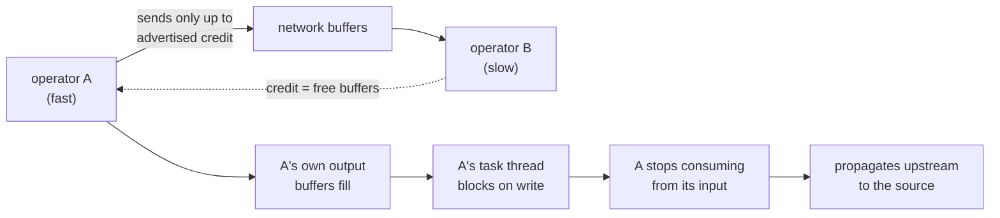

# Backpressure and Flow Control

Scenarios `B-01` … `B-10`.

Backpressure is the mechanism by which a slow consumer slows its producer instead of falling
over. It is a *feature*, and the most common operational mistake is treating it as a failure.

The confusing part is that backpressure is also how every performance problem in a streaming job
presents itself. One operator is slow; every operator upstream of it reports high backpressure;
the dashboard is a wall of red; and the actual problem is a single `keyBy` forty boxes away.
This document is mostly about finding that operator.

## 1. What backpressure actually is, mechanically

Flink's network stack uses **credit-based flow control**. Each receiving subtask advertises how
many buffers it has free; each sender may transmit only up to that credit. When the receiver
stops consuming, its buffers fill, its credit goes to zero, and the sender physically cannot
send.



The chain is exactly that: B is slow → B's input buffers fill → B advertises no credit → A
cannot send → A's output buffers fill → A's task thread blocks → A stops reading its input → the
pressure moves one step upstream. Eventually it reaches the source, which stops fetching from
Kafka.

Three consequences that matter operationally:

**Backpressure is transitive and it propagates upstream, never downstream.** So the *most
downstream* operator showing backpressure is not the problem; the operator **just downstream of
the last backpressured one** is. Section 3 makes this a procedure.

**Backpressure is how the system stays alive.** Without it, A would keep producing into an
unbounded queue and the process would be killed for using too much memory. An architecture with
no backpressure path has, instead, an out-of-memory path.

**Barriers travel in the same buffers as records** ([08](08-checkpointing-savepoints-and-recovery.md)
Section 1), so backpressure directly lengthens checkpoint alignment. Backpressure and checkpoint
duration are the same phenomenon.

## 2. The metrics, and what each one means

Flink exposes three that matter, and they are frequently confused.

**`backPressuredTimeMsPerSecond`** — how many milliseconds per second the task spent blocked
trying to *write* to its output. High means the operator *downstream* is slow.

**`busyTimeMsPerSecond`** — milliseconds per second spent actually processing. High (near 1,000)
means *this* operator is the constraint.

**`idleTimeMsPerSecond`** — milliseconds per second spent waiting for *input*. High means the
operator upstream is slow, or there is simply not enough data.

They sum to roughly 1,000 ms per second. The pattern to look for:

| busy | backpressured | idle | Interpretation |
|---|---|---|---|
| ~1000 | ~0 | ~0 | **This operator is the bottleneck** |
| ~0 | ~1000 | ~0 | Downstream is the bottleneck; this one is blocked |
| ~0 | ~0 | ~1000 | Upstream is slow, or there is no data |
| ~400 | ~600 | ~0 | Downstream is the bottleneck, and this one is not far from being one too |

**The bottleneck is the first operator, walking downstream, whose `busyTime` is high and whose
`backPressuredTime` is low.** Everything upstream of it is backpressured; everything downstream
is idle.

## 3. The diagnosis procedure

This takes about four minutes with the right dashboard and about four hours without one, so
build the dashboard.

**Step 1 — is the job actually behind?** Backpressure with zero lag means the job is
self-regulating at exactly its input rate, which is fine. Check `estimated_time_to_drain`
(`T-01`) before doing anything.

**Step 2 — find the bottleneck operator.** Walk the job graph from source to sink, reading
`busyTime` and `backPressuredTime`. The first operator with high busy and low backpressure is
it.

**Step 3 — is it one subtask or all of them?**

```promql
max(flink_taskmanager_job_task_busyTimeMsPerSecond) by (task_name, subtask_index)
```

- **All subtasks busy** → genuine capacity shortfall. Scale up, or make the operator faster.
- **One subtask busy** → skew. Go to `K-03` (hot key) or `T-02` (partition skew).
- **Subtasks on one machine busy** → a machine problem: a noisy neighbour, a degraded disk, a
  throttled instance.

**Step 4 — what inside the operator?** If all subtasks are busy, the question is what they are
busy *with*. Four candidates, distinguishable by metric:

| Candidate | Metric that confirms it |
|---|---|
| State access | `rocksdb_block_cache_miss`, `rocksdb_estimate_live_data_size` |
| Serialization | Flame graph shows `KryoSerializer` / `AvroSerializer` (`K-07`) |
| A remote call | `asyncIO` in-flight capacity at maximum (`J-05`) |
| Genuine CPU work | Flame graph shows your code |
| RocksDB compaction | `rocksdb_num_running_compactions`, `actual_delayed_write_rate` (`K-06`) |

Flink's built-in flame-graph view (enable `rest.flamegraph.enabled`) answers this directly and
is the fastest path. Turn it on before you need it; it requires a config change and a restart.

**Step 5 — the sink.** If the last operator before the sink is backpressured, the sink is the
bottleneck. This is extremely common and it is covered in `B-03`.

## 4. Scenarios

### B-01 — Everything is backpressured and nothing is the cause

**What you see.** Every operator in a 14-operator job shows 900+ ms/s of backpressure. No
operator shows high busy time.

**Mechanism.** The bottleneck is outside the job. Candidates:

- **The sink**, which does not report busy time in the same way (`B-03`).
- **Checkpointing**, which blocks the task thread during the synchronous snapshot phase. If
  `checkpoint_sync_duration` is 4 seconds and the interval is 10, the job is blocked 40% of the
  time and every operator shows it as backpressure.
- **Garbage collection** (`K-09`). A 4-second pause stops every task on that TaskManager.
- **The TaskManager's CPU is oversubscribed** — more slots than cores, or a co-located job
  (`K-11`).

**Confirm it.** `busyTime + backPressuredTime + idleTime` summing to much less than 1,000 ms/s
is the fingerprint: time is going somewhere Flink is not accounting for, which means GC, a
blocked snapshot, or the OS descheduling the thread.

**Recover.** Depends on which. The distinguishing check is quick:

```
GC:          jvm_gc_collection_seconds rate
checkpoint:  checkpoint_sync_duration vs interval
CPU:         node CPU utilisation vs slot count
```

### B-02 — A traffic spike that the job never recovers from

**What you see.** Waypoint's reconnection burst (`I-09`) delivers 3.2× normal load for 40
seconds. The job backpressures, which is expected. Two hours later it is still backpressured.

**Mechanism.** This is **metastable failure**, the pattern from
[`../MicroservicesPOF`](../MicroservicesPOF/README.md): the trigger is gone but the system
cannot return to its healthy state, because the degraded state is self-sustaining.

Here the loop is:

```
spike → backpressure → checkpoint alignment grows → checkpoint duration grows
     → more time spent checkpointing → less time processing
     → lag grows → more records buffered in windows → state grows
     → checkpoints bigger → duration grows further → ...
```

The job is now slower than it was before the spike, permanently, while processing the same
input rate it handled fine two hours ago.

**Confirm it.** Input rate back to normal, throughput still below input rate, checkpoint
duration elevated. The gap between "the trigger ended" and "the symptom persists" is the
signature of metastability.

**Recover.** You must remove load, not add capacity — adding capacity to a metastable system
often makes it worse, because the new capacity spends its first minutes restoring state.

In order:
1. **Switch to unaligned checkpointing** to break the loop at its tightest link.
2. **Shed input** — pause a source, or drop a low-priority stream — until the job drains and
   checkpoint duration returns to normal.
3. **Then** restore the input.

**Prevent.**

- Headroom (60% busyness), which gives the system somewhere to absorb a spike without entering
  the loop.
- Unaligned checkpointing with a timeout, standing.
- A **load-shedding switch** that can be thrown without a deploy (Section 6).

### B-03 — The sink is the bottleneck and it does not look like one

**What you see.** The last operator before the sink is at 950 ms/s backpressured. The sink shows
nothing interesting.

**Mechanism.** Sinks often do their work in a way Flink's busy-time accounting does not capture —
a blocking write inside `invoke()`, a batch flush on a timer, a commit at checkpoint time. The
time is spent but attributed oddly.

Common sink bottlenecks and their fixes:

| Sink | Typical bottleneck | Fix |
|---|---|---|
| ClickHouse | Too many small inserts; each creates a part, and merges cannot keep up | Batch to 100k+ rows or use `async_insert`; fewer, larger inserts |
| Kafka | `linger.ms=0`, tiny batches, high request rate | Batch (`I-02`'s arithmetic applies in reverse) |
| JDBC | One statement per record | Batched prepared statements; 500–5,000 per batch |
| Elasticsearch | Bulk size too small, or index refresh interval too short | Bulk of 5–15 MB; `refresh_interval: 30s` |
| Iceberg | Too many small files per commit | Fewer writers, larger files, compaction job |
| HTTP | One request per record, synchronous | Async I/O with capacity, or batch the API |

The ClickHouse row is the one Meridian hits most. The arithmetic:

```
1,850,000 records/s ÷ 1,000 rows per insert = 1,850 inserts/s
ClickHouse creates one part per insert per partition
merges cannot keep up above roughly 100 parts/s per table
→ "Too many parts" errors, then write rejection

with 100,000 rows per insert: 18.5 inserts/s   ← fine
```

**Two orders of magnitude, from one batching parameter.**

**Prevent.** Measure the sink's throughput independently before building the pipeline. A
15-minute load test against the sink alone tells you the batch size you need, and it is the
single most useful pre-build measurement.

### B-04 — Backpressure that is actually the source

**What you see.** The source operator shows high busy time. Everything downstream is idle.

**Mechanism.** The job is not backpressured at all; it is **input-starved**. Causes:

- Kafka fetch configuration too conservative (`fetch.min.bytes` high, `max.poll.records` low).
- Reading from tiered storage (`T-08`), which is slower by design.
- Too few source subtasks for the partition count, so each is serially fetching from many
  partitions.
- Deserialization in the source is expensive (`K-07`).
- The brokers are slow.

**Confirm it.** Kafka's `records-lag` per partition against the job's throughput. If lag is
growing and the source is busy, it is a source problem. If lag is growing and the source is
*backpressured*, it is downstream.

**Prevent.** The Kafka source settings worth tuning:

```
max.poll.records:            2000 (default 500)
fetch.min.bytes:             1 for latency-sensitive, 65536 for throughput
fetch.max.bytes:             67108864
max.partition.fetch.bytes:   4194304
receive.buffer.bytes:        1048576 (default 65536 — this one matters
                              for cross-zone fetches with high bandwidth-delay product)
```

### B-05 — Buffer bloat: latency without a bottleneck

**What you see.** The job is not backpressured and throughput matches input, but end-to-end
latency is 2.4 seconds instead of the expected 80 ms.

**Mechanism.** Flink's network buffers between operators hold records in flight. The default
gives each channel a floating pool, and with high parallelism the total in-flight data can be
large:

```
360 subtasks × 360 channels × 2 buffers × 32 KB = 8.3 GB in flight
at 2,376 MB/s of shuffle, that is 3.5 seconds of queueing
```

Records are not stuck; they are queued behind other records. Throughput is fine and latency is
terrible — which is the definition of buffer bloat, the same phenomenon as in network routers.

**Confirm it.** End-to-end latency high, backpressure low, throughput at input rate. And
`inPoolUsage` / `outPoolUsage` persistently high without backpressure.

**Prevent.** **Buffer debloating** (`taskmanager.network.memory.buffer-debloat.enabled: true`),
which dynamically sizes buffers to hold about one second of data rather than a fixed byte count:

```
taskmanager.network.memory.buffer-debloat.enabled: true
taskmanager.network.memory.buffer-debloat.target: 1s
```

On Meridian this took the shuffle-heavy jobs' p99 latency from 2.4 s to 310 ms with no
throughput change. It also shrinks unaligned checkpoints, because there is less in flight to
snapshot. **Turn it on; there is almost no downside.**

### B-06 — Correlated spikes across tenants

**What you see.** Six unrelated jobs all backpressure at the same moment. No single tenant
spiked.

**Mechanism.** A common cause. Examples that have actually happened:

- A regional network event delayed everybody's traffic and then delivered it all at once.
- A Kafka broker's leader elections moved 300 partitions at once, and every consumer re-fetched
  metadata and re-established connections.
- A Kubernetes node pool scaled down and evicted TaskManagers from several jobs.
- A shared S3 prefix throttled and every job's checkpoint slowed (`C-03`).

This is the case that breaks the statistical-independence assumption in
[01](01-requirements-and-the-capacity-model.md) Section 3.

**Prevent.** Diversify the shared resources you can: entropy in checkpoint paths, spread across
node pools, per-job Kafka client IDs so quotas apply independently. And accept that some common
causes are irreducible — the point is to know which they are, so that "six jobs backpressured
simultaneously" prompts "what do they share?" rather than six separate investigations.

### B-07 — Backpressure hidden by an internal queue

**What you see.** A job with a custom operator that buffers internally shows no backpressure and
steadily growing memory, then dies with an out-of-memory error.

**Mechanism.** Someone put an unbounded `ArrayDeque` or an `ExecutorService` with an unbounded
queue inside an operator. Flink's backpressure mechanism works on the *network* buffers between
operators; it cannot see a queue inside your code. The operator accepts records at full speed,
queues them, and never signals that it is behind.

**Prevent.** **Never use an unbounded queue inside an operator.** If you need asynchrony, use
`AsyncDataStream` with an explicit capacity, which participates in backpressure properly. If you
need a buffer, bound it and block when it is full — blocking is how backpressure is expressed.

This generalises beyond Flink: **any queue you add that the framework cannot see is a queue that
converts backpressure into an out-of-memory error.**

### B-08 — Backpressure caused by a downstream job

**What you see.** Job A is backpressured. Job A's sink is a Kafka topic. Nothing in job A is
slow.

**Mechanism.** Job A's producer is being throttled by a Kafka quota (`T-12` Section 7), or the
topic's partitions are on a broker that is slow, or `acks=all` is waiting on a lagging follower.

Backpressure crosses job boundaries through the broker, which people forget because the broker
looks like infinite storage.

**Confirm it.** The producer metrics in job A: `record-queue-time-avg`, `request-latency-avg`,
`produce-throttle-time-avg`. The last one is decisive — nonzero means a quota.

### B-09 — Adding parallelism made it slower

**What you see.** Parallelism raised from 180 to 360. Throughput fell 12%.

**Mechanism.** Several possible, and they are all worth knowing:

- **The shuffle got more expensive.** A `keyBy` at parallelism *p* creates *p²* channels. Going
  from 180 to 360 takes channels from 32,400 to 129,600, each with its own buffers and its own
  small-batch overhead. Network efficiency falls.
- **State per subtask fell below the point where the block cache is effective**, so cache hit
  rates *rose* — that helps. But the number of RocksDB instances doubled, each with its own
  memtables and background threads, and the per-instance overhead is not negligible.
- **Parallelism no longer divides the partition count or `maxParallelism`** (`T-02`, `K-04`),
  producing skew.
- **The bottleneck was never CPU.** If the bottleneck is a sink or a remote lookup, adding
  parallelism adds contention on that resource rather than capacity.

**Prevent.** Change parallelism in steps and measure. And check the divisibility arithmetic
before changing it at all.

### B-10 — The job is fast and the lag never clears

Covered as `T-01`: lag is a stock, throughput is a flow. It appears here because the instinctive
response is "the job must be backpressured somewhere", and it is not — it is running at exactly
its input rate with no surplus.

## 5. Designed backpressure at every hop

A platform's backpressure story is only as good as its weakest hop. Meridian's, end to end, with
the mechanism at each boundary:

| Hop | Mechanism | What happens when it triggers |
|---|---|---|
| Application → producer buffer | `max.block.ms`, then exception | `send()` blocks then throws (`I-01`) |
| Producer → broker | Kafka quotas, throttled response | Producer slows; no error |
| Gateway → broker | Admission ladder, `429` + `Retry-After` | Client backs off ([02](02-producers-and-the-ingestion-edge.md) §6) |
| Broker → consumer | Fetch is pull-based | Consumer sets its own pace inherently |
| Source → operator | Credit-based flow control | Source stops fetching |
| Operator → operator | Credit-based flow control | Upstream blocks |
| Operator → async lookup | Async capacity limit | Operator blocks when capacity is full |
| Job → sink | Sink's own blocking write | Job blocks |
| Sink → downstream Kafka | Quotas again | Sink slows |

The property worth checking on your own platform: **is there a hop where the response to
overload is to buffer without bound, or to drop silently?** Those are the two failure shapes,
and every hop must do one of: block, shed loudly, or degrade visibly.

## 6. The load-shedding switch

Backpressure protects the system by slowing it down. Sometimes you need to protect it by doing
*less*, and that requires a decision about what to stop doing — which must be made in advance,
because during an incident there is no time.

Meridian's five-level shedding switch, settable per job without a deploy (it is read from a
broadcast control stream):

| Level | What is dropped | Effect on output | Who decides |
|---|---|---|---|
| 0 | Nothing | Full fidelity | — |
| 1 | Optional enrichments (`J-05`'s circuit breaker) | Records emitted with `enrichment_status: skipped` | Automatic, on lookup latency |
| 2 | Low-priority derived streams (the job stops writing 3 of its 7 outputs) | Those consumers see a stall | Automatic, on backpressure > 800 ms/s for 3 min |
| 3 | Sampling: 1 in *N* records for streams marked sample-able | Counts scaled by *N*, with `sample_rate` on every record | Human |
| 4 | Stop consuming a whole stream | Lag grows on that stream; it is recoverable within retention | Human |

Four properties of this design are the point:

**Every level emits a metric and marks the output.** A record emitted at level 1 says so. A
count computed at level 3 carries its sample rate. **Shedding that is invisible in the output is
data corruption with extra steps.**

**Levels 1 and 2 are automatic; 3 and 4 are not.** Automatic shedding of things that change the
numbers requires a human, because the decision is about which wrongness is acceptable.

**Level 4 is recoverable.** Because the log retains the data, stopping consumption is not
losing it — it is deferring it. This is the single biggest advantage a log-based platform has
over a queue-based one during an incident, and it is worth designing around: **prefer stopping a
consumer to dropping records.**

**Level 3 scales the output, it does not drop it.** A sampled count with the rate attached is an
estimate with known error. A sampled count without the rate is a wrong number.

## What to take away

1. **Backpressure is a feature, not a failure.** An architecture with no backpressure path has
   an out-of-memory path instead.
2. **It propagates upstream only.** The bottleneck is the first operator, walking downstream,
   with high `busyTime` and low `backPressuredTime` — everything upstream of it is red and
   everything downstream is idle.
3. **`busy + backpressured + idle` should sum to ~1,000 ms/s.** When it does not, the missing
   time is GC, a blocked checkpoint snapshot, or CPU oversubscription.
4. **One busy subtask means skew; all busy means capacity.** Check the distribution before
   scaling, or you will add machines to a problem that adding machines cannot fix.
5. **The sink is the bottleneck more often than anything else**, and it frequently does not
   show as busy time. Load-test the sink alone before building the pipeline; the ClickHouse
   batch size is worth two orders of magnitude.
6. **A spike can leave the job permanently degraded** — metastable failure, where the trigger is
   gone and the symptom self-sustains through the checkpoint feedback loop. Remove load, do not
   add capacity.
7. **Turn on buffer debloating.** Meridian's shuffle-heavy jobs went from 2.4 s to 310 ms p99
   latency with no throughput change, and unaligned checkpoints got smaller as a bonus.
8. **Never put an unbounded queue inside an operator.** Any queue the framework cannot see
   converts backpressure into an out-of-memory kill.
9. **Backpressure crosses job boundaries through the broker** — quotas, slow followers, throttled
   produce — which people forget because the broker looks like infinite storage.
10. **More parallelism can be slower**: `p²` shuffle channels, more RocksDB instances, and a
    bottleneck that was never CPU. Change in steps and measure.
11. **Design the shedding switch before the incident**, with every level marked in the output.
    Prefer stopping a consumer — which is recoverable from the log — to dropping records, which
    is not.
