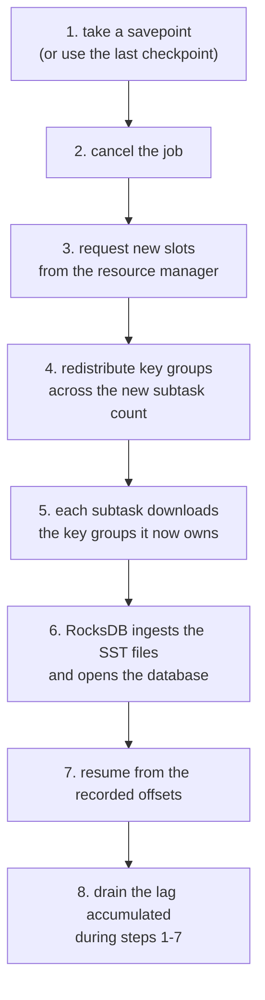

# Scaling, Parallelism and Rescaling

Scenarios `P-01` … `P-11`.

Scaling a stateless service means adding replicas. Scaling a stateful streaming job means
**moving state between machines**, which is an operation with a duration, a failure mode, and a
correctness risk. That difference is why autoscaling, which is a solved problem for web
services, is still genuinely hard here.

## 1. The four numbers, and how they constrain each other

A Flink job has four parallelism-related numbers and they are not independent.

**Source partition count.** The number of Kafka partitions. Fixed at topic creation (`I-06`).
Caps source parallelism.

**`maxParallelism`** (key groups). Fixed at the job's first run
([07](07-state-the-state-backend-and-keying.md) Section 5). Caps job parallelism forever.

**Job parallelism.** What you actually run at. Changeable, but only via savepoint-and-restore
for a stateful job.

**Operator parallelism.** Per-operator override. Lets a cheap filter run at 96 while an
expensive join runs at 360.

The constraints:

```
source parallelism      ≤ partition count
any operator parallelism ≤ maxParallelism
parallelism should divide maxParallelism evenly       (else key-group skew)
source parallelism should divide partition count evenly (else partition skew)
```

Meridian's standard numbers, chosen so that the divisibility works out:

```
maxParallelism:    1440   (2^5 × 3^2 × 5 — thirty-four divisors)
partition counts:  multiples of 24 (24, 48, 96, 240, 288, 360, 480)
parallelisms used: 24, 48, 96, 120, 180, 240, 288, 360, 480, 720
```

Every number in that last list divides 1440. Every partition count in the middle list is divided
evenly by several of them. This is five minutes of arithmetic at platform-design time that
removes an entire class of permanent, unfixable skew.

## 2. What actually happens during a rescale

For a **stateless** job: stop, start with new parallelism, resume from the last checkpoint's
offsets. Seconds.

For a **stateful** job:



Step 4 is where the key-group design pays off or costs you. A subtask's new key-group range
usually overlaps several old subtasks' ranges, so its state comes from several old state
handles, and RocksDB must merge them. With **1440 key groups and a change from 360 to 480
subtasks**:

```
before: each subtask owns 4 key groups
after:  each subtask owns 3 key groups
each new subtask's 3 key groups come from 1 or 2 old subtasks → clean
```

With `maxParallelism = 1024` and a change from 320 to 480:

```
before: 3.2 key groups per subtask  (uneven)
after:  2.13 key groups per subtask (uneven)
each new subtask pulls fragments from 2-3 old ones, and the sizes differ
```

The second case is slower and produces a skewed result. This is the practical consequence of the
divisor arithmetic.

### The rescale cost formula

```
downtime = savepoint     (or 0 if using the last checkpoint)
         + scheduling
         + state download        state ÷ (new parallelism × per-subtask MB/s)
         + RocksDB open
lag added = downtime × input rate
catch-up  = lag ÷ new surplus rate
total     = downtime + catch-up
```

Worked for `corridor-ad-attribution` going 360 → 480, from
[04](04-the-transport-log.md) `T-01`:

```
native savepoint                                        6 s
scheduling 480 slots                                   28 s
download 4.2 TB ÷ (480 × 90 MB/s) = 4.2e6 ÷ 43,200     97 s
RocksDB open                                           60 s
                                                     ──────
downtime                                              191 s
lag added        182,400/s × 191 s          =  34,838,400
new ceiling      304,000 × (480/360)        =     405,333/s
new surplus      405,333 − 182,400          =     222,933/s
catch-up         34,838,400 ÷ 222,933       =         156 s
                                                     ──────
total                                                 347 s  (5.8 min)
```

Note that using a **native savepoint** (6 s) rather than a canonical one (95 s) removes 89
seconds and about 16 million records of lag. That one configuration choice is a third of the
rescale cost.

## 3. Autoscaling a stateful job

The naive autoscaler — "busyness above 80% for 5 minutes, add 20%" — behaves badly here for
three reasons.

**Every scaling action costs downtime**, which *adds* lag, which raises busyness, which triggers
another scale-up. An autoscaler with no awareness of its own cost oscillates.

**Scaling down is not free either.** Fewer subtasks means more state each, which means a longer
restore, which means the next scale event is more expensive.

**Busyness is not the right signal.** A job at 95% busy that is keeping up does not need to
scale; a job at 60% busy with growing lag does.

### What Flink's autoscaler actually does

The Flink Kubernetes Operator's autoscaler works from **true processing rate** rather than
busyness. For each vertex it computes:

```
true processing rate = records processed ÷ (time spent busy)
                     = what the operator could do at 100% busy
required parallelism = target rate ÷ (true processing rate per subtask)
                     ÷ utilisation target
```

This is the right signal because it separates "how fast can this operator go" from "how fast is
it being asked to go", and it works during backpressure — when observed throughput is
*deliberately* below capacity — where a busyness-based metric would be misleading.

Meridian's configuration, with the reasoning:

```yaml
job.autoscaler.enabled: true
job.autoscaler.stabilization.interval: 5m      # ignore signals during and after a scale
job.autoscaler.metrics.window: 15m             # average over 15m, not 1m
job.autoscaler.target.utilization: 0.60        # the 60% from doc 01
job.autoscaler.target.utilization.boundary: 0.15  # act outside 45%-75%
job.autoscaler.scale-up.grace-period: 10m
job.autoscaler.scale-down.interval: 1h         # scale down slowly
job.autoscaler.vertex.max-parallelism: 720
job.autoscaler.vertex.min-parallelism: 24
```

Three of those deserve explanation.

**`scale-down.interval: 1h` — scale down far more slowly than up.** The asymmetry is deliberate:
scaling up when you did not need to costs money; scaling down when you did need it costs an
incident. An hour of over-provisioning is cheap; a scale-down at 17:55 before the evening peak
is not.

**`metrics.window: 15m` — average over a long window.** A short window makes the autoscaler
chase noise, and every chase costs 5.8 minutes of downtime on the big jobs. The window should be
several times the scaling action's cost.

**`target.utilization.boundary: 0.15` — a dead band.** Do not act between 45% and 75%
utilisation. Without a dead band, an autoscaler with a target scales continuously, because
utilisation is never exactly the target.

### What to exclude from autoscaling

Not every job should be autoscaled, and Meridian excludes 24 of 180:

- **Jobs with over 1 TB of state.** A rescale is a 6-minute outage; let a human decide.
- **Jobs with 2PC sinks.** Rescaling risks orphaning pre-committed transactions (`D-02`).
- **Jobs whose parallelism is pinned to a partition count** for co-partitioning (`J-09`).
- **Jobs with a scheduled load shape** — Gateline's, which should be pre-scaled rather than
  reactively scaled (`P-07`).

## 4. Scenarios

### P-01 — Scaling up did not help

**What you see.** Parallelism doubled. Throughput unchanged.

**Mechanism.** The bottleneck was not the operator you scaled. Candidates:

- **Source partitions.** Doubling source parallelism from 360 to 720 on a 480-partition topic
  leaves 240 subtasks with nothing.
- **The sink** (`B-03`). Doubling the job's parallelism doubles the *concurrency* against the
  sink, which may make it slower.
- **A hot key** (`K-03`). One key cannot be parallelised, so the job's throughput is capped by
  one subtask no matter how many others exist.
- **A remote lookup's capacity** (`J-05`). The remote store is the constraint.
- **Network or disk on the TaskManagers**, if the new subtasks landed on the same nodes.

**Prevent.** Find the bottleneck first ([11](11-backpressure-and-flow-control.md) Section 3).
Scaling is an answer to "all subtasks are busy", not to "the job is slow."

### P-02 — Operator parallelism set uniformly

**What you see.** A job at parallelism 360 where a `filter` that drops 91% of records also runs
at 360, and the expensive join downstream also runs at 360.

**Mechanism.** One `setParallelism` at the environment level.

This wastes resources in both directions. The filter needs 36 subtasks; the join might need 480.
And running them at the same parallelism forces a shuffle between them where a chained,
forwarding connection would do.

**Prevent.** Set parallelism per operator, from each operator's throughput:

```java
env.setParallelism(96);                                  // default

source.filter(...)          .setParallelism(96)          // 1.85M/s ÷ 55,000 ≈ 34, round up
      .map(project)         .setParallelism(96)          // chained with the filter — free
      .keyBy(...)
      .process(bigJoin)     .setParallelism(360)         // 180K/s ÷ 4,500 = 40... 
```

That last comment is wrong in a way worth noticing: `180,000 ÷ 4,500 = 40`, so the join needs 40
cores of work, not 360. The 360 comes from *state*, not from CPU:

```
4.2 TB ÷ 360 subtasks = 11.67 GB each — fits the 2.8 GB block cache at a 21% ratio
4.2 TB ÷  40 subtasks = 105 GB each   — far too much per slot
```

**For large-state jobs, parallelism is set by state per subtask, not by throughput.** That is a
different formula and it is the one people forget:

```
parallelism ≥ total state ÷ (acceptable state per subtask)
```

where "acceptable" is bounded by local disk, by restore time, and by how much of it the block
cache can cover.

### P-03 — More parallelism than partitions

**What you see.** A job needs parallelism 720; the source topic has 480 partitions. 240 source
subtasks are idle, and the operators downstream are also capped because the key space was
established at 480.

**Mechanism.** Source parallelism cannot exceed partitions.

**Prevent.** You cannot change the partition count (`I-06`), so the fix is to **decouple the
source parallelism from the processing parallelism**:

```java
source                                    .setParallelism(480)   // matches partitions
      .rebalance()                                                // explicit redistribution
      .process(expensiveOperator)         .setParallelism(720)
```

`rebalance()` costs a full shuffle — which you were probably paying anyway if the next step is a
`keyBy`. The important thing is that it is *allowed*: the partition count caps the source, not
the job.

For a *keyed* operator you also need `maxParallelism ≥ 720`, which is the constraint you set at
job creation and cannot change.

### P-04 — Rescaling lost pre-committed transactions

Covered as `D-02`. The operational rule: **test a rescale on any 2PC job before you need one**,
and prefer to exclude such jobs from autoscaling.

### P-05 — Scaling down and running out of disk

**What you see.** A scale-down from 480 to 240 subtasks fails; TaskManagers report disk full.

**Mechanism.** Halving the subtask count doubles the state per subtask:

```
4.2 TB ÷ 480 = 8.75 GB per subtask
4.2 TB ÷ 240 = 17.5 GB per subtask
× 2 for RocksDB compaction headroom = 35 GB
× 16 slots per node = 560 GB   ← against 950 GB, fine
```

but on a node also running task-local recovery copies, or another job, it is not fine. And
during the transition, a subtask may hold both its old and new state briefly.

**Prevent.** The autoscaler's `min-parallelism` should be computed from state size and node
disk, not set to an arbitrary small number. Meridian computes it per job at deploy time:

```
min_parallelism = ceil(state_bytes × 2.5 ÷ usable_disk_per_slot)
```

### P-06 — A rescale during a traffic peak

**What you see.** The autoscaler scales up at 19:04, during the evening peak, causing 6 minutes
of downtime and a 65-million-record backlog, at the worst possible time.

**Mechanism.** The autoscaler reacted to the peak. The reaction cost more than the peak would
have.

**Prevent.**

- **Pre-scale on a schedule** for predictable patterns. Meridian scales the Corridor jobs up at
  17:30 and down at 01:00, and the autoscaler is only a safety net outside those bounds.
- **A scaling blackout window** during known peaks. If the job can survive the peak at current
  parallelism — which, at 60% target utilisation, it usually can up to 1.67× — do not touch it.
- **The arithmetic that decides**: scale up only if `expected benefit > rescale cost`, i.e. if
  the elevated load will persist longer than `downtime × (surplus_new ÷ (surplus_new − deficit))`.
  For a 20-minute peak and a 6-minute rescale, usually no.

### P-07 — The scheduled 100× spike

**What you see.** Gateline's on-sale: 5,000 requests/s to 500,000 in ten seconds.

**Mechanism.** No reactive autoscaler can respond in ten seconds. The state download alone takes
minutes.

**Prevent.** This is not an autoscaling problem; it is a **capacity reservation** problem.

Meridian's procedure for a scheduled event:

1. **T−60 min:** scale the Gateline jobs to peak parallelism. Cost: one hour of over-provisioned
   capacity, roughly $40.
2. **T−30 min:** verify with a synthetic load test at 20% of expected peak.
3. **T−10 min:** freeze deploys, freeze autoscaling, page the on-call.
4. **T−0:** the spike. The job is already at parallelism.
5. **T+30 min:** scale down.

The cost of over-provisioning for 90 minutes is trivially less than the cost of not being
provisioned for 10 seconds. **The lesson generalises: for any load spike you know about in
advance, pre-scaling is always cheaper than reacting.**

Gateline's is the easy case because the schedule is known. `CS-4` covers the time the on-sale
was moved forward by 40 minutes and nobody told the platform team.

### P-08 — Parallelism changed and results changed

**What you see.** After a rescale, aggregate values shift by a small amount.

**Mechanism.** Usually one of:

- **Floating-point non-associativity** (`W-09`). Different partition assignment means a
  different summation order, so `double` sums differ in the last digits.
- **A non-deterministic key**, like a random salt (`K-03`) that is re-randomised.
- **A `ProcessFunction` that depends on subtask index**, which changes.
- **State that did not restore** because of a `uid` problem (`C-07`), so some keys started fresh.

**Prevent.** Integer arithmetic for sums; never depend on subtask index for anything
semantically meaningful; `uid`s everywhere; and a rescale test in CI that asserts the output is
unchanged.

### P-09 — Slot allocation fragmented across nodes

**What you see.** A job at parallelism 360 is spread across 78 TaskManagers using 4–6 slots
each, instead of 23 using 16. Network shuffle traffic is 3× higher than expected and cross-zone
cost with it.

**Mechanism.** Flink's default slot sharing puts one subtask of each operator into a slot, but
slot *allocation* across TaskManagers depends on what was free when the job started. After
several jobs have started and stopped, allocation fragments.

**Prevent.**

- `cluster.evenly-spread-out-slots: true` for predictable placement.
- **Local recovery and a stable TaskManager set** so placement persists across restarts.
- For jobs where the shuffle is expensive, **a dedicated node pool** so the job's subtasks are
  packed together, which also enables the zone-local placement that saves $41,656 a month
  ([01](01-requirements-and-the-capacity-model.md) Section 9).

### P-10 — Reactive mode and its trade

**What you see.** A job configured with `scheduler-mode: reactive` scales automatically as
TaskManagers appear and disappear, with no savepoint.

**Mechanism.** Reactive mode makes the job's parallelism follow available slots. Combined with a
Kubernetes HPA on TaskManager pods, you get autoscaling driven by infrastructure metrics.

The trade-offs are real:

- **It scales the whole job uniformly**, so per-operator parallelism is lost. A job with one
  expensive operator and six cheap ones scales all seven.
- **It rescales on every TaskManager change**, including evictions and node rotations, so a
  cluster with frequent node churn produces frequent rescales.
- **It still restores state**, so each rescale costs the download time. Reactive mode is not
  free; it is automatic.

**Use it for:** stateless or small-state jobs where rescale is cheap.
**Do not use it for:** anything above a few hundred gigabytes of state.

### P-11 — Scaling the platform, not the job

**What you see.** Every job is correctly sized and the cluster has no free slots.

**Mechanism.** Job-level autoscaling and cluster-level autoscaling are separate systems, and the
second must respond to the first. A job that wants to scale up and cannot get slots simply stays
behind, and its autoscaler retries forever.

**Prevent.** Cluster autoscaling with **headroom**: keep enough spare slots that any single job
can complete its largest expected scale-up immediately. For Meridian that is about 12% spare
capacity, which is a real cost and is cheaper than a job that cannot scale during an incident.

And alert on "a job requested slots and did not get them within *N* minutes", which is a signal
that does not exist by default and that distinguishes "the job is slow" from "the platform
refused to help it."

## 5. Capacity planning: the annual exercise

Once a year (or when a tenant announces a change), redo the arithmetic from
[01](01-requirements-and-the-capacity-model.md). The inputs that move:

**Tenant growth.** Corridor at +18% year over year takes 1.85M/s to 2.18M/s, which moves the
platform from 4.0M/s to 4.33M/s.

**Job count growth.** Meridian added 41 jobs last year. Each adds consumption (read fan-out) and
possibly derived streams. Job count growth is usually faster than volume growth and it is the
one people forget.

**Operator mix shift.** If the new jobs are joins rather than filters, the cores-per-event goes
up even at constant volume. Recompute the mix from
[01](01-requirements-and-the-capacity-model.md) Section 7.

**State growth.** Independent of volume — a product decision to extend an attribution window
from 24 hours to 48 doubles 4.2 TB with no change in throughput.

The output that matters most is not the total but the **thresholds**: at what volume does the
broker count need to change (page-cache residency), at what state does the node shape need to
change (disk per slot), at what parallelism does `maxParallelism` bind. Those are the points
where a change stops being "add machines" and becomes "a project", and knowing them six months
ahead is the entire point of the exercise.
[23-scaling-to-10x-and-100x.md](23-scaling-to-10x-and-100x.md) tabulates them.

## What to take away

1. **Four parallelism numbers constrain each other**: partition count, `maxParallelism`, job
   parallelism, operator parallelism. Choose all of them with common divisors at platform-design
   time; two of them cannot be changed later.
2. **Rescaling a stateful job is an outage with a formula**: savepoint + scheduling + state
   download + RocksDB open, then catch-up. On Meridian's largest job, 5.8 minutes for a
   360 → 480 change.
3. **Native savepoints cut the rescale cost by a third** — 6 seconds against 95 — and cost only
   cross-version portability.
4. **Autoscale on true processing rate, not busyness**, because busyness is misleading exactly
   when the job is backpressured.
5. **Scale down far more slowly than up.** An hour of over-provisioning is cheap; a scale-down
   before the evening peak is an incident.
6. **Use a dead band.** Without one, an autoscaler with a target scales continuously.
7. **For large-state jobs, parallelism is set by state per subtask, not by throughput.** The
   attribution job needs 40 cores of CPU and 360 subtasks of state distribution.
8. **Source parallelism is capped by partitions; job parallelism is not.** `rebalance()`
   decouples them at the cost of a shuffle you were probably paying anyway.
9. **For a spike you know about in advance, pre-scale.** Ninety minutes of over-provisioning
   costs $40; being unprovisioned for Gateline's ten seconds costs the sale.
10. **Exclude big-state, 2PC, and co-partitioned jobs from autoscaling.** The rescale risk
    exceeds the benefit.
11. **Keep cluster headroom so a job that wants to scale can**, and alert on "requested slots,
    did not get them" — a signal that does not exist by default.
12. **The annual capacity exercise produces thresholds, not totals.** Knowing where "add
    machines" becomes "a project" six months ahead is the whole value.
