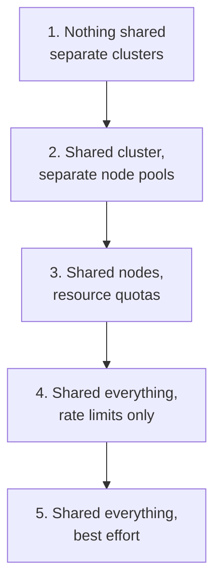

# Multi-Tenancy, Isolation and Quotas

Scenarios `M-01` … `M-09`.

Meridian serves six tenants whose volumes span a factor of 370 — Corridor at 1.85 million events
a second, Gateline at 5,000. Everything in this document exists because of one fact: **on a
shared platform, one tenant's mistake is everyone's incident, and the tenant who made it is
usually not the one who notices.**

## 1. What a tenant actually is

Before designing isolation you have to decide what you are isolating, and the granularity
question has a real answer rather than an obvious one.

| Granularity | Count on Meridian | What it is good for | What it fails at |
|---|---|---|---|
| Business unit | 6 | Billing, contracts, capacity commitments | Too coarse — Corridor's 47 teams share a quota |
| Team | 84 | Ownership, on-call routing | Teams share streams, so a stream has several owners |
| Stream | 45 external, ~200 total | Quotas, retention, schema, contracts | A team's jobs can still interfere |
| Job | 180 | Resource isolation, scaling | Too fine for billing |

**Meridian uses all four**, for different purposes:

- **Quotas and cost attribution** attach to the **business unit**, because that is who signs the
  contract.
- **Schema, retention and contracts** attach to the **stream**, because that is what has a
  version history.
- **Resource isolation** attaches to the **job**, because that is what runs.
- **Ownership and paging** attach to the **team**.

Trying to use one granularity for everything is how you end up unable to answer either "who do I
page" or "who do I bill."

## 2. The skew you should expect

Tenant volumes are never uniform and the distribution is always the same shape. Meridian's, by
event count:

| Tenant | Events/s | Share | Jobs | State | Share of cost |
|---|---|---|---|---|---|
| Corridor | 1,850,000 | 46.2% | 51 | 24.1 TB | 58.4% |
| Northlight | 1,100,000 | 27.5% | 22 | 1.2 TB | 19.1% |
| Waypoint | 754,060 | 18.9% | 34 | 2.8 TB | 12.7% |
| Lumen | 240,000 | 6.0% | 29 | 1.4 TB | 5.2% |
| Riverbend | 36,000 | 0.9% | 31 | 0.9 TB | 3.1% |
| Gateline | 5,000 | 0.1% | 13 | 0.6 TB | 1.5% |

Two things worth extracting.

**A 370× spread between the largest and smallest tenant.** Any threshold, limit or alert
expressed as an absolute number is either meaningless for Corridor or crippling for Gateline.
Everything must be proportional.

**Cost share is not volume share.** Corridor is 46% of events and 58% of cost, because its jobs
are state-heavy. Riverbend is 0.9% of events and 3.1% of cost, because its 31 jobs each carry
fixed overhead — a JobManager slot, a minimum parallelism, a checkpoint — regardless of how
little data flows through them.

**Fixed per-job overhead dominates for small tenants.** A job processing 67 events/s still needs
at least 2 subtasks for redundancy, a JobManager, checkpoint storage, and a place in the
metrics system. On Meridian that floor is about $180 a month, which for Riverbend's payment job
is $2.7 per thousand events against Corridor's $0.000034. **Small tenants are expensive per
event and that is not a mistake to fix; it is a fact to price.**

## 3. The isolation ladder

Isolation costs money and each rung buys something specific. The design question is which rung
each resource sits on.



Meridian's assignments:

| Resource | Rung | Why |
|---|---|---|
| Kafka clusters | 2 — split by blast radius (`T-11`) | Transactional streams must not share with bulk |
| TaskManager nodes | 2 — three node pools | Large-state jobs need different node shapes anyway |
| Kafka bandwidth | 3 — quotas per principal | Throttling is graceful; separation would be wasteful |
| Partitions | 3 — a budget per tenant | A platform-wide limit shared explicitly |
| Checkpoint storage | 4 — shared bucket, prefix per job | S3 scales; entropy handles the hot-prefix problem |
| Schema registry | 4 — shared, subject prefixes | Low volume |
| The control plane | 5 — shared | If it fails, everything fails anyway |

The rows at rung 2 are the interesting ones, because **separating them was justified by workload
shape rather than by tenancy.** The transactional Kafka cluster exists because 67-events-per-
second payments and 1.85-million-per-second tracking cannot be tuned the same way; that it also
gives Riverbend isolation from Corridor is a bonus, not the reason.

**Isolate by workload shape first; tenancy isolation usually falls out of it.** Isolating purely
by tenant produces many small, badly-utilised clusters.

## 4. Quotas that work

A quota must answer three questions: what is measured, what happens at the limit, and who can
change it.

### What is measured

Bandwidth alone is not enough. Meridian's quota dimensions per tenant:

| Dimension | Why it is separate |
|---|---|
| Produce MB/s | Broker disk and network |
| Fetch MB/s | Broker network, cross-zone cost |
| Request rate % | A high-rate, small-record client uses little bandwidth and much CPU (`T-12` §7) |
| Partitions | A platform-wide budget (`T-11`) |
| Job slots (vCPU) | Processing capacity |
| State (TB) | Local disk on the TaskManager pool |
| Checkpoint storage (TB) | S3, and the restore stampede if everything restarts |

The last one is non-obvious and it is there because of a real incident: a tenant whose jobs held
9 TB of state caused a 40-minute recovery for *other* tenants' jobs after a zone event, because
all of them were downloading from S3 simultaneously and the tenant with 9 TB took most of the
bandwidth. **Shared recovery bandwidth is a resource and it needs a quota.**

### What happens at the limit

Four possible responses, and the choice per dimension matters:

**Throttle** — slow the tenant down. Kafka's quotas do this by delaying responses, which
produces backpressure rather than errors. Best when available, because it degrades gracefully.

**Reject with a retryable error** — `429` with `Retry-After` at the gateway
([02](02-producers-and-the-ingestion-edge.md) Section 6). Best when throttling is not possible
and the client can back off.

**Queue** — accept and process later. Only valid where lateness is acceptable and the queue is
bounded.

**Refuse the operation** — a job that requests more slots than the tenant's quota simply does not
start. Correct for provisioning-time limits; unhelpful for runtime.

⚠️ **Never respond to a quota breach by dropping data silently.** This is the recurring principle:
make degradation visible. A tenant over quota must know, in a way that reaches a human, or they
will keep growing and the first they hear of it is an incident.

### Graded quotas, not a cliff

A hard limit at the committed rate means a tenant who grows 5% has an outage. A limit with no
teeth means the commitment is fiction. The middle:

| Level | Range | Action |
|---|---|---|
| Normal | ≤ 1.0× committed | Nothing |
| Burst | 1.0 – 1.5× | Allowed. Billed at 1.4× the base rate. A weekly report shows it |
| Sustained over | > 1.5× for over 2 h | Throttled to 1.5×. An automated ticket to the tenant |
| Emergency | > 3× | Throttled to 1.0×. Paged to the platform on-call and the tenant's on-call |

The burst level is the important design. **A tenant should be able to have a bad day without an
outage, and should pay for it.** Price signals change behaviour more reliably than policy
documents, and a bill that went up 14% last month produces a conversation that a Confluence page
never does.

## 5. Scenarios

### M-01 — One tenant's spike starves everyone

**What you see.** Corridor deploys a change that triples its event rate. Every tenant's jobs
slow down.

**Mechanism.** Shared brokers, shared TaskManager nodes, shared network. Corridor's traffic
consumes the shared resource and everyone experiences it.

**Confirm it.** Per-tenant resource consumption over the incident window. If one tenant's share
moved and the others' did not, it is this.

**Recover.** Apply an emergency quota. This requires the quota mechanism to be changeable in
seconds without a restart — Kafka's dynamic quotas are, Flink's slot allocation is not, which is
why the node pools exist.

**Prevent.** The graded quotas above, plus **bulkheads rather than rate limits where the
resource cannot be shared gracefully.** A rate limit divides a shared resource; a bulkhead gives
each tenant its own. Bulkheads waste capacity (Gateline's pool is idle most of the week) and
they bound the blast radius absolutely, which rate limits do not.

Meridian's split: bulkheads for **node pools and Kafka clusters**, rate limits for **bandwidth
and request rate**. The rule of thumb is that a resource whose exhaustion causes a *failure*
needs a bulkhead; one whose exhaustion causes *slowness* can use a rate limit.

### M-02 — A tenant's job takes down the platform's control plane

**What you see.** One tenant deploys 400 jobs in a loop because of a broken CI pipeline. The
Flink Kubernetes Operator's reconciliation queue backs up and no tenant can deploy.

**Mechanism.** The control plane is shared at rung 5 and has no per-tenant limits.

**Prevent.**

- **Rate-limit the control plane per tenant.** A tenant may submit *N* job operations per hour.
- **A cap on jobs per tenant**, enforced at submission.
- **Separate the read path from the write path** so that a flood of writes does not stop
  everyone from seeing their jobs' status.

This is the general control-plane lesson from
[`../MicroservicesPOF`](../MicroservicesPOF/README.md): the control plane's availability must
exceed the data plane's, and it usually does not because nobody sizes it.

### M-03 — Cost attribution that nobody believes

**What you see.** The platform's bill is $361,170. The sum of what tenants think they use is
$210,000.

**Mechanism.** Shared costs are not attributed. The 48 brokers, the JobManagers, the control
plane, the observability stack, the 12% cluster headroom — none of it belongs to a tenant
obviously, so it ends up unallocated, and the tenants see only their direct costs.

**Prevent.** Attribute everything, with a stated method:

| Cost | Attribution method |
|---|---|
| Kafka brokers | By bytes produced + bytes fetched, weighted 1:1 |
| Cross-zone network | By measured bytes, per stream and per job |
| TaskManager compute | By slot-hours consumed |
| Local disk | By state bytes |
| Checkpoint storage | By checkpoint bytes |
| Control plane, observability, headroom | Proportionally to the sum of the above |

The last row is the contentious one and there is no correct answer — proportional allocation of
shared overhead is a convention, not a truth. What matters is that it is **stated, consistent,
and applied to everyone**, so the argument is about the convention rather than about whether a
particular tenant was treated fairly.

Meridian's monthly per-tenant report, using this method:

```
Corridor          $210,923   58.4%   ($0.0000039 per event)
Northlight         $68,984   19.1%   ($0.0000024 per event)
Waypoint           $45,869   12.7%   ($0.0000023 per event)
Lumen              $18,781    5.2%   ($0.0000030 per event)
Riverbend          $11,196    3.1%   ($0.0000120 per event)
Gateline            $5,418    1.5%   ($0.0000418 per event)
```

The per-event column is the one that changes behaviour. Gateline's $0.0000418 per event is 11×
Waypoint's, and once that is visible the conversation is about whether 13 jobs is the right
number for a 5,000-events-per-second tenant — which it is not, and consolidating them saved
$1,900 a month.

### M-04 — A tenant's retention request costs everyone

**What you see.** A tenant asks for 30-day retention on a 1.85-million-event-per-second stream.

**Mechanism.** From [04](04-the-transport-log.md) Section 5's arithmetic, that is
`370 MB/s × 2,592,000 s = 959 TB`, single copy in tiered storage, $22,057 a month — and if it
were local, 315 brokers.

**Prevent.** **Make the cost visible at request time.** Meridian's stream-configuration tool
shows the monthly cost delta before the change is applied, exactly as
[03](03-the-event-schema-and-contracts.md)'s `S-12` shows the cost of adding a field. Most
requests for long retention evaporate when the number appears, and the ones that survive are
genuine.

And offer the cheaper alternative in the same interface: "7 days on the log costs $5,148; 400
days in the lake costs $1,340 and is readable by Trino. Which do you need?" The answer is almost
always the lake, and the request was for the log only because that is what the person knew
about.

### M-05 — Fair scheduling of a shared processing pool

**What you see.** Two tenants request slots simultaneously. One gets all of them.

**Mechanism.** Kubernetes schedules by resource availability and priority class, not by tenant
fairness. A tenant submitting 40 jobs at once takes the pool.

**Prevent.** **Per-tenant slot quotas** enforced at admission, plus **weighted fair
allocation** for the contested remainder:

```
guaranteed:  each tenant's committed slot count, always available
burst pool:  20% of the cluster, allocated by weighted fair share
             weight = tenant's committed capacity
```

The guaranteed part is a bulkhead; the burst pool is a rate limit. Combining them gives you
predictability *and* utilisation, which either alone does not.

### M-06 — Noisy neighbour at the node level

Covered as `K-11`. The multi-tenancy angle: **two tenants' jobs on one TaskManager share disk
bandwidth, page cache and the JVM**, and the sharing is invisible in both tenants' metrics. The
symptom is unexplained latency in one job correlated with nothing in that job.

**Prevent.** Node pools by workload shape, and `cluster.evenly-spread-out-slots` so that a job's
subtasks are not all concentrated on one node with a noisy co-tenant.

### M-07 — A tenant reads another tenant's data

**What you see.** An audit finds that a job owned by Lumen has been consuming
`riverbend.payments.settled` for eight months.

**Mechanism.** Kafka ACLs were not configured, or were configured with a wildcard, or the job
uses a shared service account with broad permissions.

**Prevent.**

- **ACLs per principal per topic**, generated from the stream contract's declared consumers
  rather than granted ad hoc. A consumer that is not in the contract does not get an ACL.
- **One service account per job**, not per tenant and certainly not per platform. A shared
  account makes the audit trail useless.
- **Audit the ACL set against the contracts weekly** and report divergence. The divergence is
  usually a legitimate consumer that was never added to the contract, which is worth fixing for
  its own sake.

[20-security-governance-and-pii.md](20-security-governance-and-pii.md) covers this in full.

### M-08 — When to stop sharing

**What you see.** A tenant's requirements no longer fit the platform's defaults: they need
100-millisecond latency, or a different Flink version, or FedRAMP isolation, or a retention
policy the platform cannot express.

**Mechanism.** Every shared platform has a set of assumptions baked into its defaults. A tenant
outside them is either an exception that erodes the platform or a candidate to leave it.

**The criteria for giving a tenant their own platform**, all of which Meridian has used:

1. **Their volume alone justifies the fixed cost.** The fixed cost of a Meridian-shaped platform
   — control plane, observability, minimum broker count, on-call — is roughly $45,000 a month.
   A tenant above about $150,000 a month of variable cost can run their own and still be cheaper
   than the isolation they are currently buying with exceptions.
2. **Their compliance boundary differs.** Data residency, FedRAMP, an air gap. These are not
   negotiable and they are not expressible as a quota.
3. **Their availability requirement differs by an order of magnitude.** A tenant needing four
   nines on a platform designed for three will make everyone else's life worse trying to get it.
4. **Their workload shape is pathological for the shared design.** A tenant whose every job is a
   30-terabyte join on a platform tuned for 50-gigabyte jobs.

**The criteria that are not sufficient**, and which get proposed constantly: "we want control",
"we do not trust the shared platform", "our data is sensitive" (that is what ACLs and encryption
are for), and "our team has Flink expertise." Each of those produces a second platform that is
worse than the first and that one team maintains until they leave.

### M-09 — The tenant who does not know they are a tenant

**What you see.** A stream with no owner, no contract, 40,000 events/s, and three consumers.
Nobody knows what it is for.

**Mechanism.** It was created during a project two years ago by someone who has left.

**Prevent.** **Every stream has an owner, enforced at creation and re-verified.** Meridian's
quarterly ownership sweep:

1. Every stream's owning team is asked to confirm ownership.
2. Unconfirmed streams are marked `deprecation-candidate`, which appears on the stream's
   contract and in every consumer's dashboard.
3. After 60 days, production to the stream is throttled to 10% and a page fires for anyone
   affected — which is how you find the consumers who never registered.
4. After 90 days, the stream is stopped, with the data retained for its normal retention so it
   can be restarted.

Step 3 is the one that works, and it is deliberately disruptive. A gentler process produces a
list nobody acts on. This is the same shape as
[03](03-the-event-schema-and-contracts.md)'s attribute-map expiry: the automated enforcement
step is what makes the hygiene real.

## 6. What a tenant gets, written down

The tenant-facing contract, which is the artefact that makes the rest of this document
enforceable:

```
Tenant:                 Corridor
Committed rate:         1,900,000 events/s produce, 6,500,000/s fetch
Burst:                  to 1.5× (2,850,000/s), billed at 1.4×
Partitions:             1,400 of the platform's 4,000
Slots:                  780 guaranteed, plus weighted share of the burst pool
State:                  26 TB
Retention default:      24 h on the log, 400 d in the lake

Platform commitments
  Availability          99.9% of minutes with ingest accepted
  Ingest latency        p99 < 40 ms produce ack
  Freshness             per-dataset, in each dataset's own contract
  Loss                  < 4 records per billion, measured (doc 02 §9)
  Notice of change      30 days for breaking platform changes

Tenant commitments
  Schema                FULL_TRANSITIVE compatibility, 7-day transitive window
  Envelope              the standard envelope on every record
  Ownership             every stream and job has a current owning team
  Volume notice         14 days' notice of a > 20% planned increase
  On-call               a reachable on-call for Tier 1 streams

Escalation
  Platform incident     #meridian-incidents, paged
  Quota breach          automated ticket, then page at 3×
  Cost anomaly          monthly report, plus an alert at > 25% month over month
```

The "volume notice" line is the one that gets ignored and the one that matters most. **Fourteen
days is how long it takes to add brokers, rebalance partitions and grow the node pool.** Without
it, a tenant's successful product launch is a platform incident, and the platform team finds out
from a graph.

## What to take away

1. **Use several tenancy granularities for different purposes** — business unit for billing,
   stream for contracts, job for isolation, team for paging. One granularity cannot answer both
   "who do I page" and "who do I bill."
2. **Expect a 300×+ spread between tenants**, so every threshold must be proportional. An
   absolute limit is either meaningless for the largest or crippling for the smallest.
3. **Fixed per-job overhead dominates for small tenants** — $0.0000418 per event against
   $0.0000023. That is a fact to price, not a mistake to fix, and making it visible drives
   consolidation.
4. **Isolate by workload shape first.** Tenant isolation usually falls out of it; isolating
   purely by tenant produces many small, badly-utilised clusters.
5. **A resource whose exhaustion causes failure needs a bulkhead; one whose exhaustion causes
   slowness can use a rate limit.** Meridian bulkheads node pools and clusters, rate-limits
   bandwidth.
6. **Quota on more dimensions than bandwidth** — request rate, partitions, slots, state, and
   checkpoint storage, because shared recovery bandwidth is a resource too.
7. **Grade the quota and price the burst.** A tenant should be able to have a bad day without an
   outage and should pay for it; a bill that rose 14% starts a conversation a policy page never
   does.
8. **Attribute every cost with a stated method**, including shared overhead. The per-event
   column is what changes behaviour.
9. **Show the cost at request time**, for retention as for schema fields, and offer the cheaper
   alternative in the same interface.
10. **The criteria for a tenant to leave the shared platform are volume, compliance boundary,
    availability class, and pathological workload shape** — not "we want control."
11. **Every stream has an owner, re-verified quarterly, with an enforcement step that is
    deliberately disruptive.** A gentler process produces a list nobody acts on.
12. **The tenant contract's most important line is the volume-notice clause**, because that is
    the difference between a successful product launch and a platform incident.
