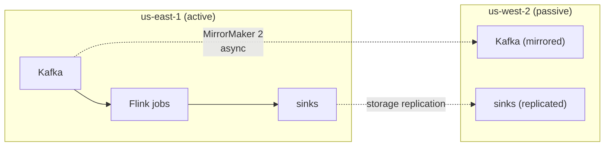
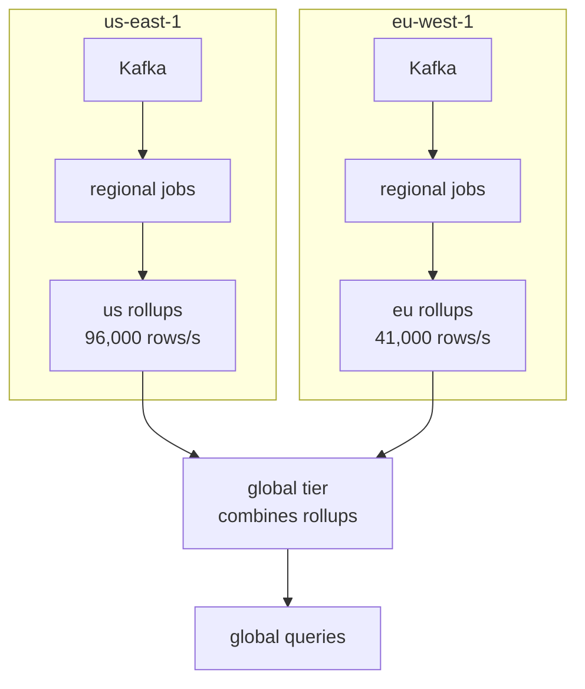
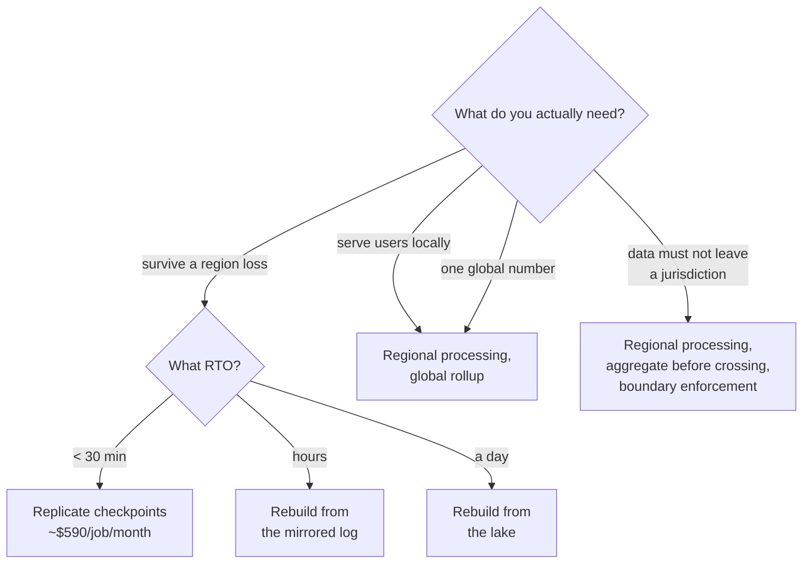

# Multi-Region and Disaster Recovery

Scenarios `G-01` … `G-09`.

Everything so far has assumed one region. This document is about what changes when there are
two, and the honest summary is: **almost every guarantee in this collection gets weaker, and the
ones that do not get much more expensive.**

The reason is a single physical fact. A round trip between `us-east-1` and `eu-west-1` is
roughly 75 milliseconds. Between `us-east-1` and `ap-southeast-1` it is about 230. No
configuration changes that, and every synchronous cross-region operation pays it.

## 1. What you are actually asking for

"Multi-region" conflates four different requirements and they have different costs.

**Disaster recovery.** If a region is lost, the platform comes back somewhere else, with stated
RTO (how long until it is running) and RPO (how much data is lost). Nothing runs in the second
region normally.

**Data locality.** Users in Europe are served from Europe, for latency. The platform runs in
both, mostly independently.

**Data residency.** European personal data must not leave Europe. This is a legal constraint,
not a performance one, and it forbids designs that the other requirements permit.

**Global aggregation.** A count over all regions' data, computed somewhere. This is the one that
forces cross-region data movement and it is where the cost lives.

Meridian's requirements, by tenant, because they differ:

| Tenant | Requirement | Why |
|---|---|---|
| Corridor | Locality + global aggregation | Members worldwide; ad reporting is global |
| Northlight | Locality | Playback telemetry is regional |
| Waypoint | Locality + residency (EU) | GPS data is personal data under GDPR |
| Riverbend | DR only | Single-region business |
| Lumen | Locality + global aggregation | |
| Gateline | DR only, tight RPO | Ticket sales are financial |

**No tenant needs all four**, which is the useful observation. Designing for the union of
everyone's requirements produces a system nobody needs and everybody pays for.

## 2. The four topologies

### Active–passive (DR)

One region runs everything. The second holds replicated data and no running jobs.



RPO: the mirror lag, typically 2–30 seconds. RTO: how long to start every job in the second
region and have it restore state — which, if state is not replicated, means rebuilding from the
mirrored log.

**The state question is what makes streaming DR different from service DR.** A stateless service
fails over in seconds. The attribution job's 4.2 TB of state either has to be replicated
continuously (expensive) or rebuilt from 24 hours of mirrored history (slow). Section 4 costs
both.

Cost: the passive region's storage plus cross-region replication bandwidth. No compute.

### Active–active, partitioned by key

Both regions run, each owning a disjoint set of keys. A user is served by their home region.

Correct, and it requires: a routing layer that sends each key's traffic to the right region, a
plan for what happens when a user travels, and acceptance that a global aggregate needs a third
place to combine.

Cost: both regions fully provisioned, plus the routing layer, plus cross-region traffic for
aggregation.

### Active–active, full replication

Both regions process everything. Every event is mirrored both ways, both regions compute the
same results.

This is almost always wrong. It doubles the compute, doubles the cross-region bandwidth, and
creates the hardest correctness problem in this document — two regions computing "the same"
aggregate over slightly different data, at slightly different times, with no way to say which is
right.

The one case where it is correct: a **read-only derived dataset that must survive a region loss
with zero RTO** and whose computation is cheap. A fraud-rule evaluation, say.

### Regional with global rollup

Each region processes its own data independently and emits **pre-aggregated** results to a
global tier, which combines them.



**This is the right answer for almost every case**, and the arithmetic says why:

```
raw cross-region:    1,850,000 events/s × 640 B         = 1,184 MB/s
rollup cross-region:    96,000 rows/s   × 180 B         =   17.3 MB/s
                                                          ────────────
                                                          68× less
```

At AWS's cross-region transfer price of roughly $0.02/GB:

```
raw:    1,184 MB/s × 2,629,800 s ÷ 1,000 × $0.02 = $62,274/month
rollup:    17.3 MB/s × 2,629,800 s ÷ 1,000 × $0.02 =   $910/month
```

**$62,274 against $910.** And the rollup approach also satisfies data residency, because raw
personal data never crosses the boundary — only aggregates do, and an aggregate over enough
individuals is not personal data (with caveats;
[20-security-governance-and-pii.md](20-security-governance-and-pii.md) Section 6 covers the
k-anonymity threshold).

The constraint is the same one as in [13](13-serving-the-results.md) Section 6: **the rollup
must be decomposable.** Sums and counts combine; distinct counts need sketches; medians need
t-digests; "top 10 by engagement" needs each region to send its top 100 and accept a bounded
error.

## 3. Mirroring a Kafka cluster

MirrorMaker 2 (or Confluent Replicator, or Cluster Linking) reads from one cluster and produces
to another. Three properties define the design.

### It is asynchronous, so RPO is nonzero

There is no synchronous cross-region Kafka replication that anyone should use. A `min.insync.replicas`
spanning regions means every produce waits 75 milliseconds, which at Corridor's rate is not a
latency problem but a throughput one — the producer's in-flight limit becomes binding:

```
5 in-flight requests × (1 ÷ 0.075 s) = 66.7 requests/s per connection
at 118 KB per batch = 7.9 MB/s per producer connection
to sustain 1,184 MB/s you need 150 connections per producer
```

Possible and absurd. **Accept asynchronous replication and a nonzero RPO.**

Meridian's measured mirror lag: p50 1.9 s, p99 14 s, p99.9 95 s. RPO is therefore "up to about
95 seconds of data, and 14 seconds at p99." That is the number to write in the DR plan, and it
is much larger than the "a few seconds" people assume.

### Offsets do not translate

Topic `corridor.tracking.events` partition 14 offset 8,812,004 in `us-east-1` is a *different
record* from offset 8,812,004 in `eu-west-1`, because the mirror started at a different point
and may have gaps or duplicates.

A consumer failing over cannot simply resume from its committed offset. MirrorMaker 2 maintains
an **offset translation** topic (`__checkpoints`) mapping source offsets to target offsets per
consumer group, and the failover procedure has to use it:

```bash
kafka-consumer-groups.sh --bootstrap-server dr-broker:9092 \
  --group attribution-job --reset-offsets --from-file translated-offsets.csv --execute
```

**Translation is approximate.** It maps to the nearest offset, which means a small number of
records may be reprocessed or — if the translation is wrong in the other direction — skipped.
Reprocessing is fine for an at-least-once pipeline and is the direction to prefer.

### Topic naming and loop prevention

MirrorMaker's default prefixes mirrored topics with the source cluster alias:
`us-east-1.corridor.tracking.events`. This prevents replication loops in an active-active setup
and it means **consumers in the DR region must subscribe to a different topic name**, which
every failover runbook forgets.

The alternative — `IdentityReplicationPolicy`, same names both sides — is cleaner for
active-passive and dangerous for active-active because nothing prevents a loop. Choose
deliberately, and if you choose identity naming, make sure only one direction of replication
exists.

## 4. State and DR: the expensive question

A job's state lives on local disks in one region. After a region loss, it is gone.

Three options.

### Option 1 — rebuild from the mirrored log

The job starts in the DR region with empty state and replays enough history to rebuild it.

```
attribution job: 24 h window
replay 24 h at the DR region's available parallelism
  1,850,000/s × 86,400 s = 159.8 billion events
  at 8.4× replay (doc 17 R-03) = 2.9 hours
```

**RTO ≈ 3 hours** for that job. Cheap — no continuous cost — and slow.

### Option 2 — replicate checkpoints cross-region

S3 Cross-Region Replication on the checkpoint bucket. The DR region's job restores from the
replicated checkpoint.

```
checkpoint traffic to replicate:
  incremental checkpoints, all jobs: measured 41 GB/minute
  = 683 MB/s of cross-region transfer
  × 2,629,800 s ÷ 1,000 × $0.02 = $35,923/month
```

**RTO ≈ 15 minutes** (restore plus catch-up on the mirror lag). $35,923 a month.

### Option 3 — run the job in both regions continuously

Full active-active for that job. RTO near zero, cost is double compute plus full data
replication.

### The decision

RTO against cost, per job, and it should be a per-job decision rather than a platform one:

| Tier | RTO target | Approach | Jobs | Monthly cost |
|---|---|---|---|---|
| 1 — financial, customer-facing | 15 min | Checkpoint replication | 14 | $8,200 |
| 2 — operational dashboards | 4 h | Rebuild from mirrored log | 61 | $0 |
| 3 — analytical, batch-adjacent | 24 h | Rebuild from the lake | 105 | $0 |

Only 14 jobs justify checkpoint replication, and restricting it to those takes the cost from
$35,923 to $8,200. **The per-job decision is worth $27,000 a month**, and the platform-wide
version of it — "replicate everything" — is the default that nobody costs.

## 5. Scenarios

### G-01 — Failover that has never been tested

**What you see.** A region is lost. The DR runbook's step 3 references a topic name that changed
eight months ago. Step 7 requires a credential nobody has. The whole thing takes six hours
instead of the documented fifteen minutes.

**Prevent.** Test it. Quarterly, in production, with the actual runbook:

1. **Announce it**, so nobody diagnoses a real incident.
2. **Fail over one Tier 1 job**, fully: stop it in the primary, translate offsets, start it in
   DR, verify output.
3. **Measure everything**: actual RTO, actual RPO (compare the last record processed in the
   primary against the first in DR), and how many runbook steps were wrong.
4. **Fail back**, which is the half nobody tests and which has its own problems (`G-05`).

What this reliably finds: the topic prefix, an IAM permission that exists only in the primary, a
schema registry in the DR region that is empty, and a DNS record with a 3,600-second TTL.

### G-02 — Mirror lag spiked and RPO silently grew

**What you see.** MirrorMaker lag went from 2 seconds to 40 minutes over a week. Nobody noticed
because nothing failed.

**Mechanism.** MirrorMaker is a consumer and a producer; it is subject to everything in this
collection. It fell behind for an ordinary reason — a rebalance, a slow broker, insufficient
parallelism after a traffic increase.

**The consequence is that your RPO is 40 minutes and your DR plan says 95 seconds.** You find
out during the failover.

**Prevent.** **Alert on mirror lag as an SLI, at 3× the documented RPO.** And publish the
current measured RPO on the DR dashboard rather than the designed one, so the number people see
is the true one.

### G-03 — Both regions processed the same data

**What you see.** After a failover and failback, a period of data was processed twice and
downstream counts are double.

**Mechanism.** The primary was not fully stopped before the DR region started, or the failback
started the primary from a stale offset.

**Prevent.**

- **Fencing.** The failover procedure must make the primary unable to produce or commit — revoke
  its credentials, or use a distributed lock the jobs check. "We stopped the jobs" is not
  fencing; a job that was partitioned rather than stopped comes back.
- **Idempotent sinks**, which make double processing harmless. This is the same answer as
  everywhere else in this collection, and it is why Method A from
  [09](09-delivery-guarantees-and-exactly-once.md) matters so much: **an idempotent sink turns a
  split-brain from a data-corruption event into a non-event.**

### G-04 — Exactly-once does not survive a region failover

**What you see.** A 2PC pipeline fails over and duplicates appear.

**Mechanism.** Transactional state lives in the source cluster's `__transaction_state` topic. It
is mirrored (or not), and the producer IDs do not translate. A transaction pre-committed in the
primary cannot be committed by a producer in DR.

**Prevent.** Accept that **exactly-once is a within-region guarantee**. Across a region
boundary, the achievable guarantee is at-least-once with idempotent sinks. State this in the
contract rather than discovering it during a failover.

### G-05 — Failback is harder than failover

**What you see.** The primary region recovers. Moving back takes three days.

**Mechanism.** During the failover, the DR region accumulated data the primary does not have.
Moving back means replicating in the reverse direction, catching the primary up, and then
switching — with a cut-over point that must be consistent across every topic and every job.

And the reverse replication may not be configured, because MirrorMaker was set up one-way.

**Prevent.**

- **Configure bidirectional replication from the start**, even if one direction is normally
  idle. Turning it on during an incident means learning its failure modes at the worst time.
- **Treat failback as a planned migration, not an emergency**, and do not rush it. The DR region
  is working; there is no urgency beyond cost and latency.
- **Or do not fail back.** If both regions are equivalent, the recovered primary becomes the new
  DR. This is much simpler and it requires the two regions to be genuinely equivalent, which is
  a design commitment worth making.

### G-06 — Data residency violated by a global aggregation

**What you see.** An audit finds that European member IDs appear in a US-region ClickHouse
table.

**Mechanism.** A global rollup included a dimension with high enough cardinality to be personal
data. "Events per member per country" is personal data no matter where you aggregate it.

**Prevent.**

- **Aggregate to a grain that is not personal before crossing the boundary.** A count per
  (minute, surface, country) is not personal; a count per (minute, member) is.
- **k-anonymity thresholds**: suppress any group with fewer than *k* distinct subjects.
  Meridian uses *k* = 50 for cross-border aggregates, which is conservative and defensible.
- **Enforce at the boundary, not in the job.** A cross-region replication policy that inspects
  the schema and refuses anything carrying an identifier column. A job's code can be changed; a
  boundary control cannot be changed by accident.

### G-07 — Clock differences across regions

**What you see.** Event-time windows combining two regions' data have systematically different
lateness profiles.

**Mechanism.** Not clock skew — NTP handles that to within milliseconds — but **network
lateness**. A record produced in `ap-southeast-1` and processed in `us-east-1` has an extra 230
milliseconds of lateness structurally.

**Prevent.** Watermark delays for cross-region streams must include the inter-region latency.
And if regions differ substantially — 75 ms to Europe, 230 to Singapore — a single watermark
delay makes the near region slower than necessary or the far region lossier than acceptable.
The clean answer is the regional-rollup topology, where each region watermarks its own data and
the global tier combines already-closed windows.

### G-08 — The DR region has different capacity

**What you see.** The failover succeeds and the DR region runs at 40% of the primary's
throughput.

**Mechanism.** The DR region was provisioned for storage, not compute — which is the point of
active-passive — and nobody wrote down how long it takes to get compute.

**Prevent.** **Know the provisioning time for your DR compute and include it in the RTO.** If
the plan is "scale the Kubernetes node group", the node group's maximum size, the instance
type's availability in that region, and the account's service quotas are all part of the RTO.
Service quotas in particular: an account that has never run 200 `r6id.4xlarge` instances in
`us-west-2` may have a quota of 20, and raising it takes a support ticket.

Verify the quotas quarterly. This is a five-minute check that has saved multi-hour outages.

### G-09 — The control plane is single-region

**What you see.** The primary region is lost. The DR region's jobs cannot be deployed, because
the Flink operator's configuration, the container registry, the CI system and the schema
registry are all in the primary.

**Mechanism.** DR planning covered the data plane. The control plane's dependencies were not
enumerated.

**Prevent.** **Enumerate every dependency of "start a job in the DR region" and verify each is
regionally available.** Meridian's list:

```
container images        → replicated registry in both regions ✓
Flink operator          → deployed in both ✓
job manifests           → in git, mirrored ✓
schema registry         → replicated, read-only in DR ✓
secrets                 → replicated secret store ✓
IAM roles               → defined in both ✓
service quotas          → verified quarterly ✓
DNS / service discovery → low TTL, both regions ✓
observability           → metrics collected in both, dashboards global ✓
the runbook itself      → not in a wiki hosted in the primary region ✓
```

The last line is not a joke. A DR runbook in a wiki that is down during the disaster is a
recurring, genuine failure.

## 6. The decision procedure



And the questions to answer before building any of it:

1. **What is the actual RPO requirement, per stream?** "Zero" is not achievable across regions.
2. **What is the actual RTO requirement, per job?** Most jobs' honest answer is hours.
3. **Which data may cross which boundary?** This is a legal answer, not a technical one, and it
   constrains everything above.
4. **Is the aggregate decomposable?** If not, the rollup topology does not work and you are
   moving raw data at 68× the cost.
5. **Who fences the primary during a failover?**
6. **Has the failover been tested this quarter, including failback?**

## What to take away

1. **"Multi-region" is four different requirements** — DR, locality, residency, global
   aggregation — with different costs. No tenant needs all four, and designing for the union
   costs everybody.
2. **Regional processing with a global rollup is the right topology for almost every case**:
   68× less cross-region traffic, $910 a month against $62,274, and it satisfies residency for
   free.
3. **The rollup must be decomposable.** Sums and counts combine; distinct counts and quantiles
   need sketches; top-N needs each region to over-send and accept a bounded error.
4. **Accept asynchronous replication and a nonzero RPO.** Meridian's measured mirror lag is 14 s
   at p99 and 95 s at p99.9 — much larger than the "a few seconds" people assume.
5. **Offsets do not translate across clusters.** Failover needs MirrorMaker's checkpoint
   translation, and translation is approximate — prefer the direction that reprocesses.
6. **State is what makes streaming DR different.** Rebuild from the log (3 h, free), replicate
   checkpoints (15 min, $590/job/month), or run both regions. Decide per job: restricting
   replication to 14 of 180 jobs saves $27,000 a month.
7. **Exactly-once is a within-region guarantee.** Across a failover, at-least-once with
   idempotent sinks is what you get. State it in the contract.
8. **An idempotent sink turns split-brain from a data-corruption event into a non-event**, which
   is the strongest argument for it anywhere in this collection.
9. **Fence the primary properly.** "We stopped the jobs" is not fencing; a partitioned job comes
   back.
10. **Failback is harder than failover.** Configure bidirectional replication from the start,
    treat failback as a planned migration, or design so that you never need to fail back.
11. **Enumerate every control-plane dependency of "start a job in DR"**, including service
    quotas and where the runbook is hosted.
12. **Test quarterly, including failback**, and publish the *measured* RPO rather than the
    designed one.
