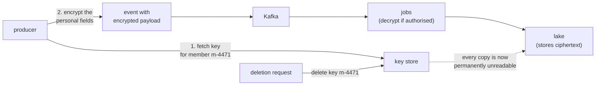

# Security, Governance and Personal Data

Scenarios `Z-01` … `Z-10`.

A streaming platform is an unusually attractive target and an unusually awkward place to comply
with privacy law. It is attractive because it carries, in one place, a real-time copy of
everything happening across the business. It is awkward because the central data structure is
an **append-only log**, and the central legal obligation is **deletion**.

This document is about both.

## 1. What is actually flowing through here

Before any control, an inventory. Meridian's streams, classified:

| Class | Definition | Streams | Volume share |
|---|---|---|---|
| **Direct identifiers** | Name, email, phone, precise location, payment details | 4 | 0.2% |
| **Pseudonymous identifiers** | Member IDs, device IDs, cookie IDs — identify a person, do not name them | 31 | 94.1% |
| **Sensitive attributes** | Health, sexual orientation, religion, political views, biometrics | 2 (inferred) | 0.4% |
| **Behavioural** | Clicks, views, searches — personal *because* they are linked to an identifier | 28 | 88.3% |
| **Non-personal** | Infrastructure metrics, aggregates above the k-threshold | 12 | 5.5% |

(Shares overlap because a stream can be in several classes.)

Two observations that determine the design.

**Pseudonymous is personal.** Under GDPR, a member ID that can be linked back to a person — and
yours can, or the platform would be useless — is personal data. The whole of
`corridor.tracking.events` is personal data, at 1.85 million records a second. There is no
version of this where "we only store IDs" makes the obligations go away.

**`waypoint.location.updates` is the hardest stream on the platform.** Precise location, tied to
an identifiable driver, at 750,000 records a second. It is a direct identifier under most
readings (a location trace identifies a person even without a name), it is in the EU residency
scope, and it is the highest-volume stream to which the strictest controls apply.

Four of the five classes need different controls, and the mistake is applying one policy to all
of them: either the strict policy applies to 94% of your volume and costs a fortune, or the
loose one applies to the 0.2% that needed strictness.

## 2. Stopping personal data before it becomes a problem

Five places to intervene, in order of how much they save.

### 1. Do not collect it

The cheapest control by an enormous margin. Meridian's schema review asks, for every field on a
new stream: *who will use this, and for what?* Fields with no named consumer and no named use
are not added.

This removed 14 fields from `corridor.tracking.events` in one review, including a full
`user_agent` string (replaced by a parsed `device_class` with 9 values) and a `referrer_url`
with query parameters (replaced by the domain). The `user_agent` change alone:

```
380 B → 12 B, at 1,850,000/s
= 681 MB/s uncompressed removed
```

and it removed a field that is a well-known fingerprinting vector.

### 2. Reduce it at the producer

Precision reduction is often free in utility terms:

| Field | Full | Reduced | Utility lost |
|---|---|---|---|
| Location | 6 decimal places (~0.1 m) | 4 decimals (~11 m) for analytics | None for demand heat maps |
| IP address | Full | /24 for IPv4, /48 for IPv6 | None for geo-lookup |
| Timestamp | Microsecond | Second for analytical streams | None for minute windows |
| Birth date | Exact | Age bucket | None for segmentation |

Waypoint keeps full precision on the operational stream (a driver's exact position matters for
dispatch, 12-hour retention) and writes a reduced copy to the analytical stream (400-day
retention). **The stream that lives longest carries the least.**

### 3. Tokenise at the edge

Replace an identifier with a token at the ingestion gateway, keeping the mapping in a separate,
access-controlled store. The stream then carries a token that is useless without the mapping.

The cost is a lookup per record — which at 1.85 million a second is a serious system in its own
right — and the benefit is that a leak of the stream is not a leak of identities.

Meridian tokenises the 4 direct-identifier streams and not the pseudonymous ones, because
pseudonymous IDs are already tokens.

### 4. Encrypt per subject (crypto-shredding)

Section 5. The mechanism that makes deletion possible on an append-only log.

### 5. Redact in the pipeline

The last resort, because by then the data is already on the log. A processing step that detects
and removes personal data from free-text fields.

**This works badly and it should be understood why.** There is no regular expression for a name.
There is one for an email address, a credit card (with a Luhn check, which reduces false
positives by a large factor), a phone number (with a country-code and length check). For
anything unstructured — a support message, an error string, a search query — detection is a
machine-learning problem with a false-negative rate that is not zero.

So: **redaction is a mitigation, not a control.** Design so that free text does not carry
personal data, and use redaction to catch what leaks anyway, with a metric for how often it
fires.

⚠️ A redaction rule that stops matching — because the format changed — fails silently. Meridian
alerts when any redaction rule's match rate drops by more than 80% week over week, which has
caught two genuine regressions. **Make degradation visible: a rule that has stopped firing looks
identical to a rule that has nothing to do.**

## 3. Access control

### The principals

Every actor on the platform has an identity, and the granularity matters:

| Principal | Identity | Scope |
|---|---|---|
| A producing service | mTLS certificate, SPIFFE ID | Produce to its own streams |
| A Flink job | Kubernetes service account → IAM role | Consume its declared inputs, produce its declared outputs |
| A human | SSO, via a tool | Read-only, sampled, audited |
| The platform itself | Separate identity | Administrative operations |
| A partner | API key at the gateway | Produce to one stream, rate-limited |

**One identity per job, not per team**, for the reason in `M-07`: a shared identity makes the
audit trail useless, which is the one thing an audit trail must not be.

### ACLs derived from contracts

Meridian generates Kafka ACLs from the job manifests (`O-10`) and stream contracts (`S-11`),
rather than granting them on request:

```
for each job manifest:
  for each declared input:  grant READ on that topic to the job's principal
  for each declared output: grant WRITE
revoke everything not generated
```

This has one property that hand-granted ACLs never achieve: **the access control and the
documentation cannot diverge**, because they are generated from the same source. A job that
starts consuming a stream it did not declare fails immediately, which is exactly when you want
to find out.

### Human access

The rules that matter, because human access is where most real leaks happen:

- **No direct broker access.** A tool, which enforces sampling, redaction of direct identifiers,
  a row limit, and an audit record with a stated reason.
- **Read-only by default**, with production write access requiring a break-glass flow.
- **Break-glass is available, logged, and reviewed.** A control that cannot be bypassed in an
  emergency will be bypassed in a way you cannot see. Meridian's break-glass grants 60 minutes
  of elevated access, pages the security on-call, and produces a review item.
- **Audit the audit.** A quarterly check that every break-glass use has a matching incident.

## 4. Encryption, and where it is not enough

**In transit:** TLS everywhere, mTLS between services. Uncontroversial.

**At rest:** disk encryption on brokers, TaskManagers and object storage. Also uncontroversial,
and it protects against exactly one threat — a stolen disk — which is not the threat you have.

**The gap:** disk encryption does not protect against anything with legitimate access to the
running system. A compromised job, an over-broad ACL, a leaked credential, an engineer with
break-glass — all of these read plaintext, because the system decrypts for them by design.

**Field-level encryption** closes part of that gap: the sensitive field is encrypted by the
producer with a key the platform does not hold, and only authorised consumers can decrypt.

```
event:
  member_id:     "m-4471"                          plaintext, needed for partitioning
  event_type:    "SearchPerformed"                 plaintext, needed for routing
  query:         <encrypted with the member's key> only the search team can read
```

Costs: key management, the partition key must stay plaintext (so it cannot be the sensitive
field), and encrypted fields cannot be filtered or aggregated by anything that lacks the key —
which includes your query engine.

Use it for the 0.2%, not the 94%.

## 5. Deletion on an append-only log

The hard problem. GDPR Article 17 says a person may require deletion of their personal data. A
Kafka log is append-only and a Parquet file in the lake is immutable.

### Why the obvious answers do not work

**"Compaction with a tombstone."** Works only for compacted topics, which are the minority, and
`T-07` covers how tombstones themselves expire. A history topic cannot be compacted without
destroying it.

**"Wait for retention."** Works for 7-day topics and not for the 400-day lake. And it does not
satisfy "delete now."

**"Rewrite the files."** Technically possible for Iceberg — a `DELETE` produces new data files —
and at Meridian's scale, rewriting to remove one member's rows from 7.48 PB touches essentially
every file, because rows are sorted by time and a member appears throughout.

```
one deletion request → rewrite 7.48 PB
at $0.004 per 1,000 PUT + read costs ≈ $180,000 per request
```

with 4,200 requests a month.

### Crypto-shredding

Encrypt every subject's data with a per-subject key. Deleting the key makes every copy of that
subject's data — on the log, in the lake, in every backup, in every downstream store — unreadable
permanently.



The properties:

- **Deletion is O(1)** — delete one key, in one store.
- **It covers copies you have lost track of**, including backups and downstream systems, which
  no rewrite-based approach does.
- **It is defensible**: data encrypted with a destroyed key is, under most regulatory readings,
  effectively erased.

The costs, which are real:

- **A key per subject.** 1 billion Corridor members × a 32-byte key plus metadata ≈ 120 GB. A
  key store with sub-millisecond lookup at 1.85 million requests a second is a serious system.
  In practice this is solved with envelope encryption and aggressive caching: a data key per
  subject, wrapped by a small number of master keys, cached in the producer for its TTL.
- **Every read needs a key.** A batch job over 400 days needs every key it touches; a cold-start
  read of billions of rows is billions of key lookups. Batch-fetch and cache.
- **Losing the key store is losing everything.** It must be backed up more carefully than the
  data, which is an uncomfortable inversion.
- **You cannot aggregate encrypted fields.** Anything aggregated must be outside the encryption
  envelope, which means deciding per field.

Meridian applies crypto-shredding to the 4 direct-identifier streams and to `waypoint.location.updates`,
and relies on retention plus lake deletion for the pseudonymous streams — with the pseudonymous
identifier itself in the key-shredding scope, so deleting the key breaks the link between the
behavioural data and the person. **That is the design that makes it affordable: shred the link,
not the behaviour.**

## 6. Scenarios

### Z-01 — Personal data in a field nobody classified

**What you see.** A scan finds email addresses in the `attributes` map of
`corridor.tracking.events`, at roughly 400 records a second.

**Mechanism.** [03](03-the-event-schema-and-contracts.md)'s open map (`S-06`). It is untyped, so
the schema review never saw the field, and the PII classification is per-field.

**Prevent.** **Scan the open map**, continuously, with the structured detectors (email, card,
phone with checksums). Meridian samples 1 in 10,000 records per stream and scans; at 185
records/s of sampling it costs almost nothing and it found this.

And enforce the 60-day promotion rule, so the map does not accumulate unclassified fields.

### Z-02 — A leaked mobile credential

**What you see.** A credential extracted from the Waypoint app is being used to produce 40,000
fabricated location events a second from a data centre.

**Mechanism.** Anything shipped in a mobile app is extractable. This is not a vulnerability; it
is a property.

**Prevent.** The gateway (`I-08`):

- **Short-lived, per-session tokens** issued after a real authentication, not a static key.
- **Per-device and per-account rate limits**, so one credential cannot produce 40,000/s.
- **Anomaly detection on the producing pattern** — a device producing from a data-centre IP
  range, or producing positions that move at 900 km/h.
- **The ability to revoke a single device's token**, which requires per-device identity.

### Z-03 — A job reading data it should not

Covered as `M-07`. The governance addition: **the detection is the contract-derived ACL
generation**. A job that starts reading an undeclared stream cannot, because the ACL does not
exist.

### Z-04 — Re-identification from an aggregate

**What you see.** A "non-personal" aggregate — events per (minute, surface, country, device
model, app version) — has groups of size 1 for rare device models in small countries.

**Mechanism.** Enough dimensions make a group uniquely identifying. This is the standard
k-anonymity failure and it is how "anonymised" datasets are routinely re-identified.

**Prevent.**

- **A k-threshold on every published aggregate.** Suppress groups with fewer than *k* distinct
  subjects. Meridian uses *k* = 50 for anything crossing a jurisdictional boundary and *k* = 10
  internally.
- **Compute the threshold on distinct subjects, not on row count.** One member generating 200
  events is one subject, not 200.
- **Cap the dimension count.** Each added dimension multiplies the number of small groups. A
  rollup with 9 dimensions will have small groups no matter what the data looks like.

### Z-05 — Deletion that did not propagate

**What you see.** A member's data was deleted from the primary database. Eight months later
their events are still in the lake, in a ClickHouse table, in a feature store and in three
model training sets.

**Mechanism.** Deletion was implemented in the system of record and not in the derived systems,
which is where streaming platforms put copies by design.

**Prevent.**

- **A deletion stream.** The deletion request is itself an event, `subject.deletion.requested`,
  which every derived store subscribes to and acts on. This makes propagation a pipeline rather
  than a project.
- **A registry of every store that holds subject-linked data**, generated from the job manifests'
  declared outputs rather than maintained by hand.
- **Verification**: a sampled check that deleted subjects do not appear in any registered store,
  run monthly, and a report.
- **Crypto-shredding for the streams where it applies**, which removes the propagation problem
  entirely for those.

### Z-06 — The stream that became a system of record

**What you see.** A team built a business process whose authoritative state lives in a Kafka
topic with 7-day retention.

**Mechanism.** Covered as `Q-10`. The governance angle: **a system of record has retention,
audit, access-control and deletion obligations that a transport buffer does not.** A topic that
became authoritative acquired them without anyone deciding.

**Prevent.** Classify streams as transport or system-of-record at creation. A system-of-record
stream requires: a documented retention that satisfies the business requirement, an audit trail,
and a deletion mechanism. Most teams, asked to provide those, discover they wanted a database.

### Z-07 — Audit logs that cannot answer the question

**What you see.** A regulator asks who accessed a particular member's data in the last two
years. The audit log records that a job read a topic, which is not the same question.

**Mechanism.** Access is logged at topic granularity; the question is at record granularity. A
job that read 160 billion records read that member's; so did every other job on the stream.

**Prevent.** Be honest about what is answerable. At streaming volumes, **per-record access
logging is not feasible** — it would be a larger stream than the data. What is feasible:

- **Every job's declared purpose**, from the manifest, so "which processes touch this member's
  data" is answerable from the lineage graph.
- **Per-record logging for human access only**, which is low-volume and is where the question is
  actually aimed.
- **Per-record logging for the direct-identifier streams**, which at 0.2% of volume is
  affordable.

State this scope in your privacy documentation rather than implying record-level auditing of
everything, which nobody does.

### Z-08 — Log injection through an event field

**What you see.** An event's `search_query` field contains a string that, when written into a
downstream log and viewed in a dashboard, executes as a formula.

**Mechanism.** User-controlled content flowing through the pipeline into a system that
interprets it — a CSV export opened in a spreadsheet (formula injection), a log viewer that
renders HTML, a query engine where the string is concatenated into SQL.

**Prevent.** **Treat every field that originated outside your system as untrusted, at every
consumer.** Escape at the point of rendering, not at the point of ingestion (escaping at
ingestion corrupts the data and does not know the destination's escaping rules).

Specifically for exports: CSV is dangerous. A field beginning with `=`, `+`, `-` or `@` is a
formula. Prefer Parquet or JSON for exports, and if CSV is required, prefix such fields with a
single quote and document it.

### Z-09 — The platform as a target

**What you see.** A threat model finds that compromising one Flink job gives access to 31
streams.

**Mechanism.** A job with broad input ACLs is a high-value target: it runs arbitrary code
(yours), holds credentials, and reads streams.

**Prevent.**

- **Minimal ACLs per job**, from the contract, which is `Z-03`.
- **No shared credentials** between jobs.
- **Jobs cannot make arbitrary outbound network calls.** Egress policy allowing only the
  specific sinks and lookup stores the manifest declares. This is the control that turns a
  compromised job from an exfiltration channel into a limited one.
- **Job code goes through review and signed images.** A streaming platform runs arbitrary user
  code by design; the supply chain for that code is part of the platform's threat model.

### Z-10 — Compliance requirements that conflict

**What you see.** GDPR requires deletion within 30 days. A financial regulation requires
retaining transaction records for seven years.

**Mechanism.** Both are real and they apply to overlapping data.

**Prevent.** This is resolved legally rather than technically, and the technical requirement is
to **support a per-stream, per-field policy rather than one platform policy**:

- The transaction record is retained for seven years with a legal basis that overrides the
  deletion right (which GDPR provides for).
- The *behavioural* data linked to it is deleted.
- The link between them is what crypto-shredding removes: the transaction survives, the
  identification of who made it is shredded, and the retained record satisfies the financial
  requirement while no longer being personal data.

**That is the design pattern worth carrying**: where retention and deletion conflict, shred the
link rather than the record.

## 7. Governance: the artefacts that make this enforceable

Five, and each has appeared elsewhere in this collection because governance is not a separate
system — it is the same metadata, used differently.

**The stream contract** ([03](03-the-event-schema-and-contracts.md) `S-11`) — carries the PII
classification per field, the retention, and the legal basis.

**The job manifest** ([15](15-failure-modes-and-the-operations-playbook.md) `O-10`) — carries
declared inputs and outputs, from which ACLs, lineage and the deletion registry are generated.

**The lineage graph** — derived from the manifests. Answers "where does this member's data end
up", which is the question every privacy review asks and which nobody can answer without it.

**The data catalogue** — every stream and derived dataset, its owner, its classification, its
consumers. Generated, not maintained, or it will be wrong.

**The deletion registry** — every store holding subject-linked data, derived from the manifests'
outputs, used to verify propagation.

The unifying property: **all five are generated from two hand-written documents.** A governance
programme that asks teams to maintain five separate registers produces five stale registers. One
that derives five views from the contract and the manifest produces five accurate ones, and the
two sources stay accurate because the platform breaks when they are wrong.

## What to take away

1. **Pseudonymous is personal.** A member ID that links to a person is personal data, which
   makes 94% of a typical platform's volume in scope. "We only store IDs" does not change the
   obligations.
2. **Four data classes need four policies.** One policy is either ruinously expensive on 94% of
   volume or insufficient for the 0.2% that mattered.
3. **The cheapest control is not collecting it.** Ask for every field: who uses this, for what?
   One review removed 681 MB/s and a fingerprinting vector.
4. **The stream that lives longest should carry the least.** Full precision on the 12-hour
   operational stream, reduced precision on the 400-day analytical one.
5. **There is no regular expression for a name.** Redaction is a mitigation for leakage, not a
   control — and a redaction rule that stops matching fails silently, so alert on its match rate
   falling.
6. **Generate ACLs from the contracts and manifests.** Then access control and documentation
   cannot diverge, and a job reading an undeclared stream fails immediately.
7. **Disk encryption protects against a stolen disk, which is not your threat.** Field-level
   encryption closes part of the gap, at the cost of not being able to aggregate the field.
8. **Crypto-shredding makes deletion O(1) on an append-only log** and covers copies you have
   lost track of. Apply it to the link — the identifier — rather than to all the behaviour, and
   it becomes affordable.
9. **Aggregates re-identify.** Apply a k-threshold computed on distinct subjects, and cap the
   dimension count, because each dimension multiplies the number of small groups.
10. **Make deletion a stream**, so propagation to derived stores is a pipeline rather than a
    project, and verify it by sampling monthly.
11. **Per-record access auditing is not feasible at streaming volume.** Be explicit about what
    your audit answers — lineage for jobs, per-record for humans and for direct-identifier
    streams.
12. **Where retention and deletion conflict, shred the link, not the record.** The transaction
    survives seven years; who made it does not.
