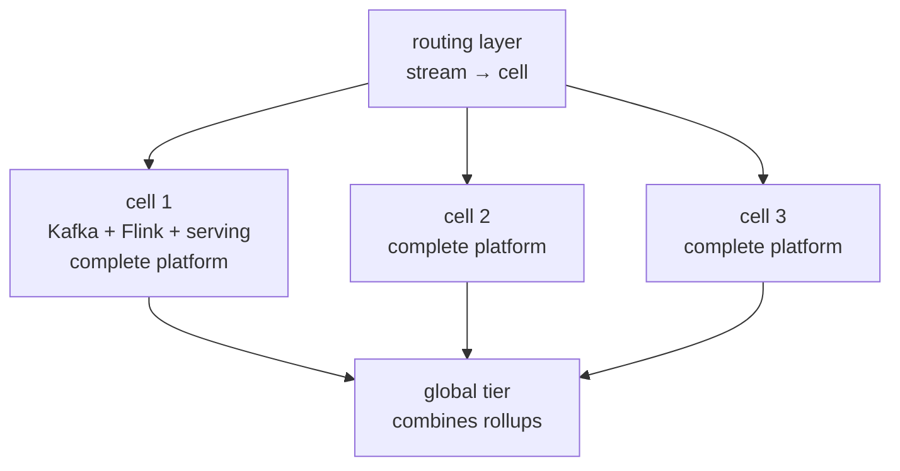

# Scaling to 10× and 100×

Every design decision in this collection was made at a particular scale, and every one of them
expires. This document says where.

It is organised around three questions: what stays true at any scale, what should be *removed*
if you are ten times smaller, and what breaks first as you grow. The threshold table in
Section 5 is the part to keep.

## 1. What is scale-invariant

A small number of things are true at 4,000 events a second and at 400 million. They are worth
separating out, because they are the parts of this collection you can adopt without checking the
arithmetic.

**Event time versus processing time.** The three clocks, the watermark as an assertion, the
lateness distribution, the completeness curve. None of this depends on volume. A 100-event-per-
second pipeline with a mobile producer has exactly the same lateness problem as Waypoint's.

**The guarantee decision tree.** Idempotent sink, then dedupe key, then 2PC, then accept
at-least-once. The costs scale but the ordering does not.

**Make degradation visible.** Count what you drop, publish completeness, name the guarantee.
Cheaper at small scale and equally necessary.

**A stream is an API.** Schema compatibility, the envelope, the contract, "what does null mean."
A two-consumer stream breaks just as thoroughly as a thirty-one-consumer one; it is just faster
to fix.

**State needs a bound.** An unbounded key space fills a 20 GB disk as reliably as a 950 GB one.

**Reconciliation against an independent source is the only way to find silent wrongness.** CS-3,
CS-5 and CS-6 would have happened at any scale.

Everything else in this collection is arithmetic, and arithmetic moves.

## 2. What to delete if you are ten times smaller

At roughly 400,000 events/s — 60 MB/s onto the log, 18 jobs, 3 TB of state — most of Meridian's
machinery is overhead. What to remove:

**The ingestion gateway**, unless you have untrusted producers. If everything producing is
yours, produce directly. You lose the central control point and you save a tier.

**Tiered storage.** At 60 MB/s, 7 days is `60 × 604,800 = 36 TB × RF3 = 109 TB`, which is 22
brokers of local disk — or 8 brokers with 14 TB each. Tiered storage's complexity is not worth
it until the broker count it saves is large.

**Separate Kafka clusters.** One cluster, with quotas. The blast-radius argument (`T-11`) needs
enough volume that the workload shapes genuinely conflict.

**Autoscaling.** 18 jobs can be sized by hand and reviewed quarterly. The autoscaler's failure
modes (`P-06`) cost more than the capacity it saves.

**The cost-attribution system.** At $40,000 a month, a spreadsheet updated quarterly is fine.

**Per-subtask metrics retention tiers.** 18 jobs × 9 operators × 24 subtasks × 40 metrics =
155,520 series. Keep everything for 90 days; it costs nothing.

**Node pools by workload shape.** One pool.

**Multi-region anything**, unless you have a legal or DR requirement that is actually written
down.

**What to keep, even at a tenth the scale**: everything in Section 1, plus watermark alerting,
late-record ratios, `uid`s on operators, pre-deploy savepoints, the job manifest, and the
reconciliation. Those are all cheap and all of them prevent the incidents in
[22](22-case-studies.md).

## 3. What breaks first at 10×

At 40 million events/s — 6 GB/s onto the log, 1,800 jobs, 310 TB of state — here is the order in
which Meridian's design fails, which is also the order to plan for.

### First: the partition budget

```
4,000 partitions × 10 = 40,000 partitions
× RF3 = 120,000 replicas
÷ 400 per broker = 300 brokers
```

But page-cache residency at 10× volume:

```
write rate 18.2 GB/s
residency = 55,800 MB ÷ (18,216 ÷ N)
for 25 min (1,500 s): N = 490 brokers
```

490 brokers in one cluster is past what a single KRaft controller quorum handles comfortably —
metadata propagation, leader election and controller failover all degrade. **The single-cluster
design expires somewhere between 200 and 400 brokers**, and the answer is cells (Section 4).

### Second: the cross-zone bill

```
$240,813 × 10 = $2.4 million a month
```

At that number the mitigations stop being optimisations and become architecture. Rack-aware
fetch and zone-local placement are mandatory. Running in two zones instead of three becomes a
serious proposal. And **the design of the platform starts to be driven by network topology**
rather than by anything about streams.

### Third: the control plane

1,800 jobs against Meridian's 180. The Flink Kubernetes Operator's reconciliation loop, the
metadata store, the schema registry's read rate, and the job-submission path all scale with job
count rather than with volume, and none of them were designed for 1,800.

**Job count grows faster than volume** in every platform, because each new use case is a job and
volume growth is organic. Plan the control plane for job count, not for bytes.

### Fourth: the humans

180 jobs across 84 teams is roughly two jobs per team, which a platform team of 6 can support.
1,800 jobs is not 10× the platform team; it is more, because the interaction surface grows
faster than linearly.

The only answers that work are **self-service and enforced conventions**: a job template that
makes the right choices by default, automated checks that reject the wrong ones, and a
paved path that is genuinely easier than the alternatives. A platform team that reviews every
job does not scale past about 300 jobs.

## 4. Cells, and what they actually cost

Past a few hundred brokers, the answer is not a bigger cluster; it is several complete
platforms, each serving a subset of tenants or streams.



**What cells buy:**

- **A bounded blast radius.** A cell failure affects one cell's tenants.
- **Bounded operational units.** Each cell is a size you already know how to run.
- **Independent upgrades.** Roll Flink version by version across cells.
- **Capacity that scales by adding cells**, which is a repeatable operation rather than a
  re-architecture.

**What cells cost, and these are routinely understated:**

- **Cross-cell joins are not possible.** Two streams in different cells cannot be joined without
  moving data between cells, which means either a routing rule that keeps related streams
  together (constraining placement) or mirroring (paying the bandwidth twice).
- **Global aggregation needs a tier.** The same rollup problem as multi-region
  ([19](19-multi-region-and-disaster-recovery.md) Section 2), and the same requirement that the
  aggregate be decomposable.
- **Fleet-wide operations become N operations.** A schema registry change, a security patch, a
  config rollout — each is now a campaign.
- **Utilisation falls.** Each cell needs its own headroom, its own control plane, its own
  minimum broker count. At Meridian's sizes, six cells cost roughly 18% more than one cluster of
  six times the size, for the same throughput.
- **Placement becomes a design decision with consequences**, and a bad placement is expensive to
  fix.

**When to move to cells:** when the blast radius of the single cluster is unacceptable, or when
the single cluster's control plane is the constraint — not when it is merely large. Meridian at
48 brokers is not close; at 250 it would be.

## 5. The threshold table

This is the part to keep. For each decision in the collection, the value at which it expires and
what replaces it.

### Transport

| Decision | Current | Expires at | Replacement |
|---|---|---|---|
| One Kafka cluster per blast-radius class | 3 clusters, 48/8/6 brokers | ~250 brokers in one cluster | Cells |
| Partition count per stream | 6–480 | per-broker replica count > 400 | More brokers, or cells |
| Page-cache residency sizing | 48 brokers, 24.5 min | when brokers-for-residency > brokers-for-anything-else by 6× | Reconsider: faster local disk, or accept disk reads for replay |
| Tiered storage, 6 h local | 39.3 TB local | local retention below ~2 h (too little for recovery) | Bigger instances |
| RF3, min.insync 2 | all topics | never (this is a correctness floor) | — |
| zstd-3 producer compression | all streams | producer CPU > 15% of the producing service | zstd-1 or lz4, and recompute residency |

### Processing

| Decision | Current | Expires at | Replacement |
|---|---|---|---|
| `maxParallelism` 1440 | all jobs | parallelism needed > 1440 | Cannot change — a new job and a state rebuild |
| Parallelism from throughput | most jobs | state per subtask > ~30 GB | Parallelism from state, not throughput |
| One Flink session cluster per ~12 jobs | 16 clusters | JobManager reconciliation latency > 30 s | More clusters, or per-job application mode |
| Slot sharing, 16 slots/node | default pool | when one job's state per node > 40% of disk | 4-slot nodes (the large-state pool) |
| Autoscaling on true processing rate | 156 of 180 jobs | when rescale downtime > 10% of the scaling period | Pre-scaling by schedule |
| RocksDB local state | 106 jobs | state per subtask > ~100 GB | Sharding the job, or remote state |

### Semantics

| Decision | Current | Expires at | Replacement |
|---|---|---|---|
| 60-second checkpoint interval | large-state jobs | p99 checkpoint duration > 6 s | Longer interval, or fix the cause |
| Watermark delay at p99.5 | all streams | when the late-record ratio exceeds the SLO | Split the stream by producer class |
| Allowed lateness 15 min | 22 jobs | retained windows × keys × bytes > 30% of state | Side output + reconciliation |
| 24 h attribution window | 1 job | state > 8 TB (restore time > 10 min) | Shorter window + batch tail |
| Exactly-once via 2PC | 11 jobs | when a topic's `read_committed` consumers exceed ~10 | Idempotent sinks |

### Serving and cost

| Decision | Current | Expires at | Replacement |
|---|---|---|---|
| Shared ClickHouse for derived data | 18 nodes | ingest > ~150 inserts/s/table after batching | Per-tenant clusters |
| 3 availability zones | all | cross-zone > 70% of the bill *and* the data is replayable | 2 zones, documented |
| Single region | Riverbend, Gateline | a residency or DR requirement is written down | Regional + rollup |
| Rack-aware fetch off | current | never — this should be on now | Turn it on |
| One shared metrics backend | 2.1M series | > 8M active series | Per-cell backends + global query |

### Organisation

| Decision | Current | Expires at | Replacement |
|---|---|---|---|
| Platform team reviews new jobs | 180 jobs | ~300 jobs | Self-service with automated gates |
| Quarterly ownership sweep | 45 streams | ~200 streams | Continuous, with automated deprecation |
| Manual capacity planning, annual | current | when volume changes > 30% between reviews | Continuous, from measured trends |
| One on-call rotation | 6 engineers | > 2 pages/week sustained | Split by tier or by cell |

## 6. What 100× looks like

At 400 million events/s — 60 GB/s onto the log, 15,000+ jobs, 3 PB of state — you are one of a
handful of organisations in the world and most of this collection is a starting point rather
than an answer. What is known:

**Cells are mandatory**, probably 15–40 of them, with a placement service, a global rollup tier,
and a fleet-management system that treats a cell as a unit.

**The network dominates completely.** $24 million a month of cross-zone traffic at Meridian's
ratios. At this scale organisations build their own network topology assumptions into the
placement — co-locating producers, brokers and consumers at rack granularity, which is a
capability most cloud environments do not expose and which is one of the main reasons companies
at this scale run their own data centres.

**Custom engines appear.** At 100× the cost of a 5% efficiency gain is $1.2 million a month,
which funds a team. This is why the largest streaming platforms in the industry run
substantially modified or entirely custom processing engines.

**The format matters more than anything.** A 10% reduction in record size is worth more than any
architectural change, which drives investment into encoding, schema design and field-level
governance that seems disproportionate from the outside.

**Human process is the binding constraint.** 15,000 jobs means the platform is a product with
thousands of users, and the engineering is mostly in the paved path, the automated gates, the
self-service tooling and the migration machinery — not in the streaming.

## What to take away

1. **Six things are scale-invariant**: event-time semantics, the guarantee decision tree, making
   degradation visible, treating a stream as an API, bounding state, and reconciling against an
   independent source. Adopt those without checking the arithmetic; check everything else.
2. **At a tenth the scale, delete the gateway, tiered storage, multiple clusters, autoscaling,
   cost attribution and node pools** — and keep watermark alerting, late-record ratios, `uid`s,
   pre-deploy savepoints, the job manifest and the reconciliation, because they are cheap and
   they prevent the case studies.
3. **The single-cluster design expires between 200 and 400 brokers**, on controller behaviour
   rather than on throughput.
4. **Job count grows faster than volume**, so size the control plane by job count.
5. **A platform team that reviews every job does not scale past about 300 jobs.** Past that the
   engineering is in the paved path and the automated gates.
6. **Cells bound the blast radius and cost about 18% in utilisation**, plus the inability to
   join across them and the need for a global rollup tier. Move when blast radius or the control
   plane forces it, not when the cluster is merely large.
7. **`maxParallelism` is the one threshold you cannot cross.** Everything else has a
   replacement; that one means a new job and a state rebuild.
8. **Keep the threshold table.** Knowing six months ahead where "add machines" becomes "a
   project" is the entire value of this exercise.
