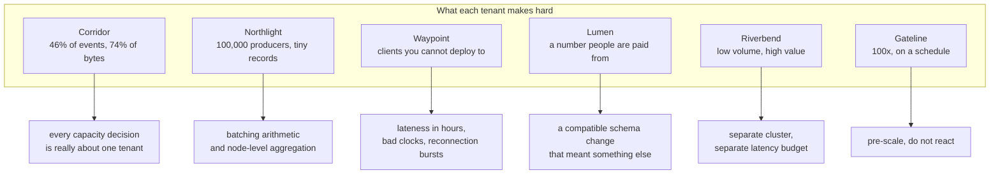

# Building a Scalable Data Streaming Platform — 4 Million Events a Second, End to End

A staff-level collection on the system that sits between `producer.send(event)` and a dashboard
that says something true: how an event gets off a machine, survives the network, becomes
durable, becomes *computable*, and produces an answer that matches what a batch job would have
produced — and every way that goes wrong.

**Scope.** This is about **data in motion** — ingestion, a durable log, stateful stream
processing with event-time semantics, and serving. It is not about video or media streaming;
for that, see [`../../system-design-notes/VideoStreaming`](../../../system-design-notes/VideoStreaming)
and [`liveStreamingHLD.md`](../../../system-design-notes/liveStreamingHLD.md).

It is built around one concrete platform, worked completely:

> Design a streaming platform that ingests **4 million events per second** from six tenants,
> runs **180 stateful processing jobs** holding **31 TB** of state, and serves real-time
> dashboards, a feature store, and an analytics lake — with stated guarantees on freshness,
> completeness and correctness.

The scale figures come from
[`../../system-design-notes`](../../../system-design-notes) — the Flink, Spark, Druid and Kafka
backpressure notes in [`streaming/`](../../../system-design-notes/streaming), plus `uberHLD.md`,
`LinkedIn/`, `instagramHLD.md`, `ticketBookingHLD.md` and `serviceMeshNetflixScale.md` for the
tenants — so this collection and those notes agree with each other.

The organising idea is this. Almost every design for a streaming platform is a design for
**moving events**, and moving events is the easy part. The hard parts are:

- **The hard problem is time, not throughput.** Throughput is a procurement question; you buy
  machines. Event-time correctness is a design question, and getting it wrong does not make the
  system fall over — it makes the system produce plausible, well-formatted, confidently-served
  answers that are quietly incorrect.
- **Every guarantee you buy is paid for in latency, and the invoice arrives at the sink.**
  The same computation is 36 milliseconds at-least-once and 31.8 seconds exactly-once. Same
  code, same hardware, a factor of 870.
- **State is what makes streaming expensive, slow to recover, and hard to change.** A stateless
  job is a deployment. A 4.2-terabyte stateful job is a migration.
- **The network between availability zones costs more than all the compute** — 66.7% of the
  bill, against 21% for every machine that produces, transports or processes an event.
- **A stream that is behind is not broken, and a stream that is caught up is not correct.**
  Lag and completeness are different properties and a healthy-looking job can be silently
  dropping 0.6% of its input for fourteen months.

Everything here that looks like paranoia is a response to one of those five.

## Who this is for

Read this if two or more are true:

- You run stream processing above roughly 50,000 events a second, or you are about to.
- You have a dashboard and a batch report that disagree, and nobody can say by how much or why.
- Someone has asked you for "exactly-once, real-time" and you suspect the answer is more
  complicated than yes.
- You have had an incident where every metric was green and the output was wrong.
- Your streaming bill has grown faster than your traffic and the biggest line item surprises
  you.
- You are choosing between Flink, Spark Structured Streaming, Kafka Streams and a managed
  service, and the comparisons you can find are written by people selling one of them.
- You are preparing for a design interview where this comes up, which it does.

**If your latency requirement is above five minutes, stop here.** Run incremental batch — a job
every one to five minutes over a partitioned table with a watermark column and an idempotent
overwrite. You get event-time correctness for free, recovery for free, schema evolution for
free, and you can hire people who already understand it. Everything in this collection is the
cost of going faster than that.

## Start here, in this order

1. **[00-what-a-streaming-platform-is-and-why-it-is-hard.md](00-what-a-streaming-platform-is-and-why-it-is-hard.md)**
   — read this first even if you have run Flink for years. It defines the vocabulary everything
   else uses without re-explaining: the six stages, the three clocks, the four hard properties,
   the two decisions that define the architecture, and the nineteen failure classes.
2. **[01-requirements-and-the-capacity-model.md](01-requirements-and-the-capacity-model.md)** —
   every number the collection reuses, derived in visible steps. When a later document says
   "recall the 24-minute page-cache residency", it means an arithmetic step on that page.
3. **[05-event-time-watermarks-and-lateness.md](05-event-time-watermarks-and-lateness.md)** — if
   you read only one more, read this one. It is the centre of the collection and everything
   after it depends on the ideas in it.
4. Then read in whatever order matches your problem. Documents cross-reference rather than
   assuming you read them in sequence.

If something is **broken right now**, go to
[25-golden-defaults-and-checklists.md](25-golden-defaults-and-checklists.md) for the triage
order, then to [15](15-failure-modes-and-the-operations-playbook.md) for the runbooks. If you
are **choosing a stack**, go to [21](21-cost-model-and-build-vs-buy.md). If you are **preparing
for an interview**, read 00, 01, 05, 09, then the case closest to your domain in
[22](22-case-studies.md), then [24](24-staff-interview-questions.md).

## Topics

### Part 1 — Foundations

| Doc | Covers |
|-----|--------|
| [00-what-a-streaming-platform-is-and-why-it-is-hard.md](00-what-a-streaming-platform-is-and-why-it-is-hard.md) | Turning the computation inside out; the vocabulary defined once; the six stages; **three clocks and the lateness distribution that forces the design**; four properties you cannot have at full strength; the two decisions that determine everything; the nineteen failure classes; when not to build this |
| [01-requirements-and-the-capacity-model.md](01-requirements-and-the-capacity-model.md) | The five ambiguities to resolve first; 4.0M events/s derived stream by stream; **why encoding beats codec**; derived streams as 47.5% of the log; **page-cache residency as the binding constraint** (48 brokers where bytes say 12); per-core throughput by operator class; state and recovery arithmetic; the cross-zone bill; **the 870× latency cost of exactly-once** |

### Part 2 — Getting events in

| Doc | Covers |
|-----|--------|
| [02-producers-and-the-ingestion-edge.md](02-producers-and-the-ingestion-edge.md) | `I-01…I-13`: what `send()` actually does and the window where data dies silently; the batching arithmetic and why the batch you get is not the batch you configured; keys, ordering and skew; producers you do not control; the gateway and its admission ladder; node-level aggregation at 100,000 sidecars; **measuring what you lost, and the honest sentence** |
| [03-the-event-schema-and-contracts.md](03-the-event-schema-and-contracts.md) | `S-01…S-12`: transport, envelope and body; **why Avro, for the resolution rules rather than the bytes**; the four compatibility modes and which you actually want; five evolution rules; the compatible change that broke everything; one topic per ordering domain; the stream contract template; **the schema as a budget** |
| [04-the-transport-log.md](04-the-transport-log.md) | `T-01…T-12`: what the log is for when its consumer is a processing platform; partition count from three constraints; **retention as a recovery budget**; compaction and what it does not give you; tiered storage; lag as a stock versus a flow; splitting clusters by blast radius; Kafka, Pulsar, Kinesis and Redpanda costed |

### Part 3 — Semantics, the centre of the collection

| Doc | Covers |
|-----|--------|
| [05-event-time-watermarks-and-lateness.md](05-event-time-watermarks-and-lateness.md) | `E-01…E-12`: building up from a batch query to a watermark; the definition stated carefully; **choosing the delay by measuring, and the completeness curve that is flat past p99.5**; the minimum rule and everything it breaks; idle partitions; the record from the year 2287; clock skew; late-arrival paths; **publish completeness, because zero is almost always a lie** |
| [06-windowing-and-aggregation.md](06-windowing-and-aggregation.md) | `W-01…W-11`: the four shapes; **incremental versus buffering — 1.02 GB against 155 GB**; the sliding-window multiplication and the pre-aggregation fix; sessions that never end; early firing against an append-only sink; allowed lateness costed; empty windows; the decision procedure |
| [07-state-the-state-backend-and-keying.md](07-state-the-state-backend-and-keying.md) | `K-01…K-12`: three kinds of state and **why `MapState` beats `ValueState<HashMap>` by 140×**; heap versus RocksDB and why incremental checkpoints decide it; **the five RocksDB facts that show up as symptoms**; the state formula; key groups and the one threshold you cannot cross; TTL's four non-default settings; hot keys and two-phase aggregation |
| [08-checkpointing-savepoints-and-recovery.md](08-checkpointing-savepoints-and-recovery.md) | `C-01…C-12`: what "consistent" means and how barriers give it to you; alignment and its cost; **incremental checkpoints at 727×**; choosing the interval; savepoints versus checkpoints and the `uid` that decides whether you can roll back; recovery strategies; **the checkpoint death spiral**; dangling transactions; the recovery drill |
| [09-delivery-guarantees-and-exactly-once.md](09-delivery-guarantees-and-exactly-once.md) | `D-01…D-11`: effects, not deliveries; **the four ways to make a sink safe, with 2PC last**; a sink-by-sink table; why 11 of 180 jobs use exactly-once; the transactional producer's cost to every consumer; measuring duplication and loss; **what ordering actually guarantees**, which is narrower than assumed |
| [10-joins-and-enrichment.md](10-joins-and-enrichment.md) | `J-01…J-11`: four things called "join" whose costs differ by 1,000×; the state formula worked to 4.2 TB; **filter, then project, then key, then join**; temporal joins and the replay test that tells you when you need one; async I/O as capacity ÷ latency; broadcast state's three hazards; the decision table |

### Part 4 — Running it

| Doc | Covers |
|-----|--------|
| [11-backpressure-and-flow-control.md](11-backpressure-and-flow-control.md) | `B-01…B-10`: credit-based flow control and why backpressure is a feature; **the three metrics and the pattern that locates the bottleneck**; the diagnosis procedure; metastable degradation after a spike; the sink as the usual culprit; buffer bloat and debloating; queues the framework cannot see; **the five-level shedding switch** |
| [12-scaling-parallelism-and-rescaling.md](12-scaling-parallelism-and-rescaling.md) | `P-01…P-11`: four parallelism numbers and how they constrain each other; what a rescale actually costs; **autoscaling on true processing rate, with a dead band and asymmetric scale-down**; what to exclude from autoscaling; **for large-state jobs parallelism comes from state, not throughput**; pre-scaling a 100× scheduled spike |
| [13-serving-the-results.md](13-serving-the-results.md) | `Q-01…Q-10`: five serving shapes and the access pattern that picks one; **worst-case freshness versus pipeline latency**; the freshness contract; ClickHouse, Druid and Pinot for a streaming sink; the small-file problem; **probe the serving store, not the pipeline**; naming the safe view; where the aggregation belongs |
| [14-multi-tenancy-isolation-and-quotas.md](14-multi-tenancy-isolation-and-quotas.md) | `M-01…M-09`: four tenancy granularities for four purposes; the 370× spread and why every threshold must be proportional; **isolate by workload shape, not by tenant**; bulkheads versus rate limits; seven quota dimensions; graded quotas and pricing the burst; cost attribution that people believe; when to stop sharing |
| [15-failure-modes-and-the-operations-playbook.md](15-failure-modes-and-the-operations-playbook.md) | `O-01…O-12`: the four platform-level failure shapes; the triage order; **the restore stampede**; emergency controls on the data plane; the deploy that cannot be rolled back; **four runbooks written out**; the job manifest; the monthly gameday and what it reliably finds |
| [16-observability-of-a-streaming-pipeline.md](16-observability-of-a-streaming-pipeline.md) | Freshness, completeness, correctness, progress — defined precisely; **which metric misleads during which failure**; the twelve that matter, five of which you must derive; the same-clock canary; cardinality tiering; **why freshness stops at three nines and completeness at three**; deploys as two thirds of the error budget |

### Part 5 — Bigger shapes

| Doc | Covers |
|-----|--------|
| [17-reprocessing-backfill-and-the-lambda-question.md](17-reprocessing-backfill-and-the-lambda-question.md) | `R-01…R-10`: five reasons to reprocess that need different designs; **a replay is a second cluster, and node-hours are constant at any speed**; land raw before transformation; **kappa wins for 99% and loses for the 1% where it should**; the two-replay diagnostic; the seven properties that make a job replayable |
| [18-cdc-and-streaming-from-databases.md](18-cdc-and-streaming-from-databases.md) | `X-01…X-10`: four ways out of a database and why only one is good; **a CDC connector can fill your primary's disk**; the change event field by field; **a row diff is not a business event** — raw CDC versus the outbox; incremental snapshotting with watermarks; transaction boundaries; the checklist |
| [19-multi-region-and-disaster-recovery.md](19-multi-region-and-disaster-recovery.md) | `G-01…G-09`: four requirements that "multi-region" conflates; the four topologies; **regional processing with a global rollup at 68× less traffic**; asynchronous mirroring and the RPO you actually have; offsets that do not translate; **state and DR costed per job**; failback; the control-plane dependency list |
| [20-security-governance-and-pii.md](20-security-governance-and-pii.md) | `Z-01…Z-10`: what is actually flowing and why pseudonymous is personal; five places to stop it; ACLs generated from contracts; **crypto-shredding, and shredding the link rather than the behaviour**; re-identification from aggregates; deletion as a stream; **what per-record auditing can honestly claim**; the five generated artefacts |

### Part 6 — Deciding, and practising

| Doc | Covers |
|-----|--------|
| [21-cost-model-and-build-vs-buy.md](21-cost-model-and-build-vs-buy.md) | **The full bill, line by line — $361,170/month, 66.7% cross-zone network**; $114,028 recoverable as configuration; **the encoding decision worth more than every optimisation combined**; the long tail of small jobs; managed Kafka and managed Flink priced at this volume; Flink, Spark, Kafka Streams and SQL compared; a seven-step decision procedure |
| [22-case-studies.md](22-case-studies.md) | `CS-1…CS-10` across six systems: the watermark that went to the year 2287; the on-sale that moved; **0.6% of trips missing for fourteen months**; a mesh config push that moved the binding constraint; a dual-write found only by reconciliation; a schema change that passed every check; the restore stampede; the lookup that took down four jobs; exactly-once that stalled every consumer; the change that could not be rolled back |
| [23-scaling-to-10x-and-100x.md](23-scaling-to-10x-and-100x.md) | What is scale-invariant; what to delete at a tenth the scale; what breaks first at 10×; cells and what they genuinely cost; **the threshold table — where each decision in this collection expires**; what 100× looks like |
| [24-staff-interview-questions.md](24-staff-interview-questions.md) | Twenty questions with model answers and the follow-ups a strong answer invites, plus **the five patterns that distinguish a strong answer from a complete one** |
| [25-golden-defaults-and-checklists.md](25-golden-defaults-and-checklists.md) | Triage order; the annotated golden configuration for every tier; checklists for a new stream and a new job; a twenty-question design review; **what to build at your scale** in three tiers; the numbers worth remembering; **ten things almost always wrong in a first design** |

## The running platform and its tenants

Abstract examples make these documents harder, not easier. Every number below is fixed and
reused throughout, so when document 12 says "recall the attribution job's 4.2 terabytes" it
means this table, and document 12's arithmetic reconciles with document 01's.

**Meridian** is the platform — the 4-million-event-per-second system the brief describes, and
the subject of documents 00 through 21.

Its six tenants are the same fictional companies used across the other collections in this
repository, which is deliberate: when [`../Kafka`](../Kafka/README.md) fixes Riverbend's
`orders.created` at 640 events per second, this collection uses 640.

| System | Shape | Scale that matters for the streaming platform |
|---|---|---|
| **Meridian** | The streaming platform | **4.0M events/s = 1.6 GB/s at ~400 B = 345.6 billion events/day = 138.3 TB/day.** Peak 1.75×. Plus 1.9M/s of derived streams → **5.9M/s on the log, 607 MB/s compressed**. 48 Kafka brokers, 4,000 partitions, **24.5-minute page-cache residency**. 180 jobs, 96→168 nodes, 1,536→2,688 vCPU, **31 TB of state**. $361,170/month, **$34 per billion events**, 66.7% cross-zone network |
| **Corridor** | Professional network, 1B members | `corridor.tracking.events` — **1,850,000/s, 3.1M/s peak**, 159.8 billion/day. 46% of the platform's events and **74% of its bytes**. The 24-hour ad-attribution join holds **4.2 TB**, the largest job on the platform |
| **Northlight** | Video streaming platform, 100,000-sidecar mesh | `northlight.playback.heartbeats` — **1,100,000/s** from 11M concurrent streams. Produced through node-level aggregators, because 100,000 direct producers would be 300,000 TCP connections and 2.2 records per batch |
| **Waypoint** | Ride hailing, 25M trips/day | `waypoint.location.updates` — **750,000/s, 1.2M/s at rush hour**, at a deliberately tight 96 bytes. From 5M mobile clients you do not control: **p99 lateness 4.8 s, maximum 4 h 12 m**, and reconnection bursts at 3.2× |
| **Lumen** | Photo and video sharing, 500M DAU | `lumen.engagement.events` — 240,000/s, 900,000/s peak. The creator-payout calculation that a units change made 1,000× wrong for four days (`CS-6`) |
| **Riverbend** | Online marketplace, 240 services | 36,000/s across five streams — **0.9% of the platform**. Transactional, low-volume, high-value: the reason Meridian runs a separate 8-broker cluster whose produce p99 is 4 ms rather than 18 |
| **Gateline** | Mega-event ticketing | `gateline.ticket.requests` — 5,000/s baseline, **500,000/s within 10 seconds of a sale opening**. A 100× step function on a schedule, which is a capacity-reservation problem rather than an autoscaling one |

## Conventions used across documents

**Scenario IDs.** Every failure has an ID whose letter names the document that owns it. They are
the cross-reference spine — the case studies, the interview bank and the playbook cite them
rather than re-explaining. **207 scenarios in total.**

| Prefix | Doc | Class |
|---|---|---|
| `I-nn` | 02 | **I**ngestion and producers |
| `S-nn` | 03 | **S**chema and contracts |
| `T-nn` | 04 | **T**ransport log |
| `E-nn` | 05 | **E**vent time, watermarks, lateness |
| `W-nn` | 06 | **W**indowing and aggregation |
| `K-nn` | 07 | State and **k**eying |
| `C-nn` | 08 | **C**heckpointing and recovery |
| `D-nn` | 09 | **D**elivery guarantees |
| `J-nn` | 10 | **J**oins and enrichment |
| `B-nn` | 11 | **B**ackpressure and flow control |
| `P-nn` | 12 | **P**arallelism, scaling, rescaling |
| `Q-nn` | 13 | Serving and **q**uerying |
| `M-nn` | 14 | **M**ulti-tenancy and isolation |
| `O-nn` | 15 | **O**perating the platform as a whole |
| `R-nn` | 17 | **R**eprocessing and backfill |
| `X-nn` | 18 | Change data capture |
| `G-nn` | 19 | **G**eography: multi-region and DR |
| `Z-nn` | 20 | Security, governance, personal data |

Case-study incidents are `CS-1` … `CS-10` (document 22).

**Each scenario follows the same five headings**, so you can skim to the part you need:

- **What you see** — the symptom, from the point of view of whoever gets paged.
- **Mechanism** — why it happens, derived rather than asserted.
- **Confirm it** — the query, command or measurement that distinguishes this from the three
  other things it looks like.
- **Recover** — what to do in the next ten minutes.
- **Prevent** — the design or configuration change, and what that change costs.

**Every document ends with a numbered summary.** For documents 00–21 it is headed "What to take
away"; documents 22, 24 and 25 close with their own cross-cutting version — the patterns common
to the ten incidents, the patterns that distinguish a strong interview answer, and the ten
things almost always wrong in a first design. If you are revisiting a document, read that
section first.

**Numbers are derived in visible steps.** Where a document says recovery takes 9.8 minutes, the
arithmetic that produced it is on the page. Check it against your own figures rather than
adopting the conclusion — and note where two documents are coupled: document 04's page-cache
residency moves when an apparently unrelated compression decision changes, which is the clearest
example and is kept as a worked scenario (`T-09`).

**⚠️ marks a step that can make an ongoing incident worse.** These appear in recovery procedures
where the obvious action is the wrong one — restarting a job whose watermark is poisoned,
reducing the checkpoint interval during a death spiral, restarting jobs that are mid-restore.

## Related collections in this repository

This collection deliberately does not re-derive material that already exists here. It cites
instead:

- [`../Kafka`](../Kafka/README.md) — broker, replication, producer, consumer and delivery-
  semantics failures in depth. Document 04 covers the *architectural* role of the log for a
  processing platform and points there for the internals.
- [`../LogCollector`](../LogCollector/README.md) — the same organising principle (silent loss,
  visible degradation) applied to logs. Its volume-control material is the closest analogue to
  document 21's cost argument, and Northlight and Riverbend appear in both.
- [`../Observability`](../Observability/README.md) — RED, USE, SLIs, SLOs, error budgets and
  cardinality. Document 16 applies those methods to a pipeline whose failures are silent,
  rather than re-teaching them.
- [`../MicroservicesPOF`](../MicroservicesPOF/README.md) — retry amplification, metastable
  failure, control planes, bulkheads and cells. The streaming platform exhibits all of them and
  shares its running systems.
- [`../ErrorHandling.md`](../ErrorHandling.md) — the discipline of turning silent failures into
  loud ones, which is the philosophy underneath this entire collection.
- [`../DataPlatform.md`](../DataPlatform.md) — batch, the lakehouse, tenant skew and
  partitioning under skew, which documents 13 and 17 depend on.
- [`../../system-design-notes/streaming`](../../../system-design-notes/streaming) — the Flink,
  Spark and Druid scenario notes and the Kafka ingestion-backpressure worked example that this
  collection's capacity figures are calibrated against.
- [`../../system-design-notes/Clickhouse`](../../../system-design-notes/Clickhouse/README.md)
  and [`../../system-design-notes/Druid`](../../../system-design-notes/Druid/README.md) — the
  columnar-engine internals document 13 assumes.
