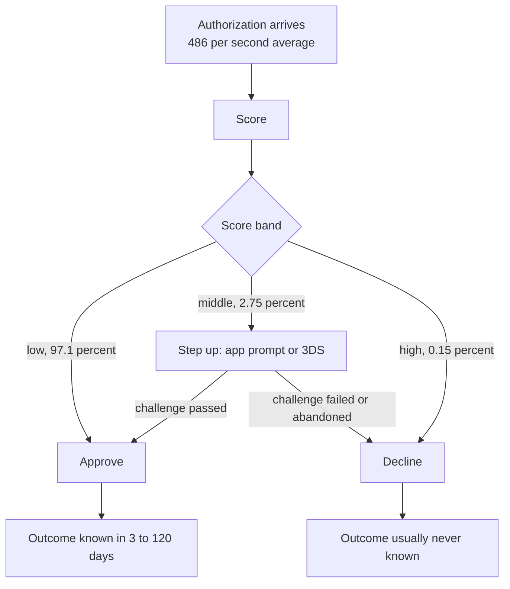
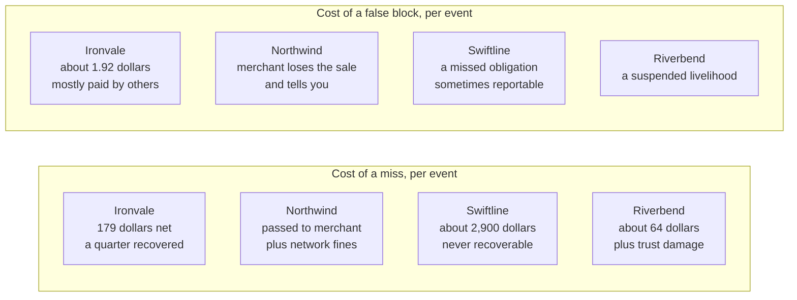

# What a Fraud Detection System Actually Decides, and Who Pays When It Is Wrong

Almost every published answer to "design a fraud detection system" describes the same machine:
events come in through Kafka, features are read from a feature store, a model produces a score,
a threshold turns the score into approve or decline. That machine is not wrong. It is also not
the design. It is the part of the design that is the same at every company, which is exactly why
describing it well does not demonstrate anything.

The parts that differ — the parts that are actually load-bearing — come from four questions that
have different answers at different companies:

1. **What decision are you making, and how many milliseconds do you have to make it?**
2. **How rare is the thing you are detecting?**
3. **Who pays for a wrong "yes", and who pays for a wrong "no"?** These are usually different
   people, and usually neither of them is you.
4. **How long until you find out you were wrong?**

This document answers those four questions in general terms and establishes the vocabulary the
rest of the collection uses. Doc [01](01-the-running-systems-and-their-numbers.md) then fixes
concrete numbers for four systems, and every later document derives from those.

---

## Fraud is not one problem, and the word hides at least five

When somebody says "fraud" inside a bank, they could mean any of the following. They are
detected by different signals, on different timescales, by different teams, under different
regulations. Conflating them is the single most common way a design interview goes wrong in the
first two minutes.

**Transaction fraud.** Somebody who is not the cardholder uses the card. The cardholder will
eventually say "I did not do this." Detection happens in the authorization path, in
milliseconds, before the money moves. This is what most people mean, and most of this collection
is about it.

**Account takeover, usually shortened to ATO.** The real account, used by somebody else, after
they obtained the password or intercepted the one-time code. The signals are about the *login
and the session* — device, location, behaviour — not about the transaction. Detection happens at
login and at sensitive actions (changing the address, adding a payee), not only at payment.

**First-party fraud, also called friendly fraud.** The real cardholder genuinely made the
purchase and then claims they did not, to get the money back. No amount of device fingerprinting
helps, because the device is genuinely theirs. This is detected by *dispute history and pattern*,
over months, not in the authorization path. Industry estimates put it somewhere between a third
and a half of all "fraud" chargebacks, which means a meaningful fraction of your training labels
are wrong in a specific direction — see doc [06](06-models-labels-and-training.md).

**Scams, formally authorized push payment fraud or APP fraud.** The victim was deceived and
*authorized the payment themselves*. Every technical signal says legitimate: right device, right
location, right behaviour, correctly entered credentials. The only signals available are about
the *payee* and the *narrative* — a new payee, an unusual amount, a round number, a transfer
following a long phone call. This is the dominant fraud type in instant-payment systems and it
breaks almost every assumption the card-fraud playbook is built on.

**Abuse and policy violation.** Promotion farming, referral rings, review manipulation, seller
collusion on a marketplace, bonus abuse on a betting site. Nobody's card was stolen. The loss is
real, the detection techniques overlap heavily with fraud, and the regulatory framing is
completely different because declining a promotion is not declining a payment.

Two more things sit nearby and are *not* fraud detection, though they share infrastructure:

- **Credit risk** asks "will this person pay us back", not "is this person who they claim to
  be." A customer who cannot afford the purchase is a credit decision; a customer who is not the
  customer is a fraud decision. Both can decline the same transaction for entirely different
  reasons, and in most banks they are different departments with different models, different
  regulators and different appeal processes.
- **Anti-money-laundering, AML**, asks "is this money's origin legitimate" and operates on a
  completely different clock — a suspicious activity report is filed in days, not milliseconds,
  and the goal is a regulatory filing rather than a blocked transaction. AML and fraud teams
  share a graph of entities and almost nothing else. The commonest interview mistake after
  conflating fraud types is answering an AML question with a real-time scoring architecture.

**If you take nothing else from this document:** when asked to design "a fraud detection
service," your first move is to pick one of these and say which one, out loud, with the reason.
The rest of your design is only coherent relative to that choice.

---

## There are three possible outputs, not two

The textbook version of the decision is binary — approve or decline. Real systems have a third
output, and it changes the economics so much that leaving it out makes the whole design look
naive.

**Approve.** The transaction proceeds. If you were wrong, you own a loss you will discover
somewhere between three days and four months from now.

**Decline.** The transaction is refused. If you were wrong, a real customer standing at a real
checkout cannot buy the thing they wanted, and you will usually never find out it was a mistake
— which is the central measurement problem of this entire field and the subject of doc
[07](07-thresholds-and-the-economics-of-errors.md).

**Step up.** You neither approve nor decline. You demand more evidence: a push notification to
the banking app, a one-time passcode, a 3-D Secure challenge handed back through the merchant, a
biometric prompt, or in the marketplace case simply holding the order for ninety seconds while a
slower check runs. If the evidence arrives, approve. If it does not, decline.

Step-up matters because it converts a *decision* into a *question*, and a question has a much
lower cost of being wrong. Consider a transaction your model scores in the uncertain middle. If
you decline it, a good customer is blocked. If you approve it, you may eat the loss. If you ask
for a passcode, a good customer taps "yes" in their app and loses four seconds, while a
fraudster who does not control the phone simply fails.

The reason step-up is not the answer to everything is that it has three real costs. First,
**friction causes abandonment** — a meaningful share of genuine customers abandon the purchase
rather than complete a challenge, and the share is much higher on an unfamiliar flow than on a
familiar app prompt. Second, **not every channel supports it**: a card-present terminal at a
petrol pump at 2 a.m. has nowhere to show a challenge, and a recurring subscription charge has
no customer present at all. Third, **step-up moves liability**, which is a legal fact rather
than a technical one, and it is the reason step-up exists in the form it does. We come back to
that below.



That last pair of boxes is the asymmetry the whole field is built around, and it is worth
sitting with before reading further. **Your approvals generate labels. Your declines do not.**
Everything in doc [06](06-models-labels-and-training.md) about selection bias, and everything in
doc [07](07-thresholds-and-the-economics-of-errors.md) about holdout groups, exists because of
those two boxes.

---

## The rarity problem, stated as arithmetic rather than as a word

People say fraud detection is "imbalanced." Imbalanced is a word; here is what it costs you.

Take Ironvale Cards, the card issuer defined in doc
[01](01-the-running-systems-and-their-numbers.md). It authorizes **42 million transactions per
day**, of which roughly **5,460 are attempted fraud**. That is a base rate of:

```
5,460 / 42,000,000 = 0.00013 = 1.3 basis points = 1 in 7,692
```

Now suppose you build a model that is, by ordinary standards, very good: it catches 90% of
fraud and has a false positive rate of 1%. One percent sounds small. Run a day through it.

```
Fraud caught:          5,460 × 0.90          =      4,914
Fraud missed:          5,460 × 0.10          =        546
Good transactions:     42,000,000 − 5,460    = 41,994,540
Good ones flagged:     41,994,540 × 0.01     =    419,945
```

Of the 424,859 transactions this model flags, 4,914 are fraud. **Precision is 1.16%.** For every
real fraud you catch you have blocked 85 real customers. A 1% false positive rate — which would
be an unremarkable number in almost any other classification problem — produces a system that is
unusable, and no amount of tuning the model architecture fixes it, because the problem is not the
model. The problem is that 1% of 42 million is 420,000 and 90% of 5,460 is 4,914.

This arithmetic has three consequences that shape every later document:

**First, accuracy is a meaningless metric here and so is ROC-AUC, mostly.** A model that
approves everything is 99.987% accurate. The area under the receiver-operating-characteristic
curve is dominated by the enormous negative class and can look excellent while precision is
catastrophic. Doc [07](07-thresholds-and-the-economics-of-errors.md) uses precision at a fixed
review capacity, and expected dollars, instead.

**Second, you cannot operate at one global threshold.** The 1-in-7,692 base rate is an average
over wildly different populations. Card-present chip transactions at a supermarket are perhaps 1
in 90,000; card-not-present transactions on a first-time merchant from a newly seen device are
perhaps 1 in 400. Applying one threshold to both means you are simultaneously too strict for one
and too lenient for the other. Doc [07](07-thresholds-and-the-economics-of-errors.md) builds
per-segment thresholds, and doc [03](03-rules-and-why-they-never-go-away.md) explains why rules
turn out to be the practical mechanism for expressing them.

**Third, the useful lever is usually a better feature, not a better model.** Going from a 1%
false positive rate to a 0.1% false positive rate takes precision from 1.16% to 10.5% — a
ninefold improvement in the only number that matters operationally. That kind of movement comes
from knowing that this card has never been used in this country before, which is a feature
problem (doc [04](04-features-and-the-feature-store.md)), not from a deeper network.

---

## Who pays: the part nearly every design answer omits

Here is the question that separates a staff-level answer from a competent one. A fraud system
makes two kinds of mistake. **Who pays for each?** Not "the business" — which specific balance
sheet.

The answer depends entirely on which seat you are sitting in, and the four systems in this
collection were chosen because they sit in four different seats.

### The issuer's seat (Ironvale Cards)

A missed fraud becomes a chargeback. Under the card network rules, for most card-not-present
transactions where the merchant did not request 3-D Secure, the *issuer* can push the loss back
to the merchant; where the issuer approved a transaction that the merchant properly
authenticated, the issuer keeps the loss. So some missed fraud costs the issuer the full
transaction value and some costs it almost nothing but the handling. Either way, **the loss lands
in a line item on the issuer's own P&L that somebody is accountable for**, reported monthly,
measured in basis points, and compared against peers.

A false decline costs the issuer: a share of a contact-centre call, the interchange fee on a
transaction that did not happen, and some long-run reduction in how often that card gets reached
for. Doc [07](07-thresholds-and-the-economics-of-errors.md) derives this carefully and gets
about **$1.92**, against about **$179** net for a prevented fraud — $186 of gross transaction
value, less what the chargeback process recovers, plus what handling the case costs.

That ratio — roughly **93 to 1** — is the uncomfortable centre of issuer fraud economics. Taken
literally it says you should accept up to ninety-odd false declines for every fraud you prevent
before the arithmetic turns against you. No issuer actually operates there, and doc 07 spends
several pages on exactly why the literal reading is wrong. But notice what the ratio explains:
the reason card declines feel so aggressive to customers is not incompetence. **It is a rational
response to a cost structure in which most of the cost of a false decline is paid by the
merchant, who loses the sale, and by the customer, who is embarrassed at a checkout — neither of
whom appears in the issuer's fraud-loss report.**

### The acquirer's seat (Northwind Pay)

Northwind Pay is a payment service provider and acquirer-processor; the
[`../Payments`](../Payments/00-what-actually-moves.md) collection describes its position in the
flow in detail. Its exposure is different in kind. Northwind does not own the cardholder
relationship, so a false decline does not cost it a customer — it costs its *merchant* a sale,
and the merchant will notice, complain, and eventually leave for a competitor who approves more.
A missed fraud, conversely, becomes a chargeback that Northwind either passes to the merchant or
— if the merchant has gone out of business, which is precisely when chargebacks spike — absorbs
itself. On top of that, the card networks impose programmes that fine an acquirer whose
merchants exceed chargeback thresholds, so Northwind has a *regulatory* ceiling on how much fraud
it can let through, independent of the dollar loss.

The result is that Northwind's optimum sits in a very different place from Ironvale's: approval
rate is a product feature it sells, while fraud is a cost it mostly passes on but is capped on.

### The instant-payment seat (Swiftline)

Swiftline settles irreversibly in about four and a half seconds. There is no chargeback. There
is no representment. The money is gone to an account that will be emptied within minutes.

This changes two things at once. First, the cost of a miss is the whole amount, with an average
scam transfer of **$2,900** against a card system's $186 — and under reimbursement rules now in
force in several jurisdictions, the sending bank pays the victim back whether or not it was at
fault. Second, the dominant fraud type is the scam, where **the customer authorized the payment
and every technical signal is clean**. A system built on "is this really the cardholder" is
answering a question whose answer is yes.

Meanwhile a false block is not an embarrassment at a checkout; it is a rent payment that did not
arrive, and in several markets it is a reportable event. Both error costs are an order of
magnitude higher than in cards, which is why Swiftline's design looks less like a scoring service
and more like a system for *interrupting a human being with a well-timed question*.

### The marketplace seat (Riverbend)

Riverbend, the marketplace used throughout this repository, has the loosest latency constraint
and the messiest definition of fraud. It can hold an order for ninety seconds. It can reverse a
payout before it leaves. Its losses come as much from policy abuse and seller collusion as from
stolen cards, and its "false positive" is suspending a genuine seller's livelihood, which
produces a different kind of consequence than a declined coffee.

### The point of the comparison



Four systems, four completely different shapes, and the *same* reference architecture would
serve all four badly. The thresholds differ, obviously. But so does the latency budget (120 ms
versus 90 seconds), so does the dominant signal family (card and merchant history versus payee
graph versus seller behaviour), so does whether step-up is even available, and so does whether
you are allowed to tell the customer why.

**This is the reason the collection's first substantive document is about money rather than about
Kafka.** If you can state who pays for each error, you can derive the threshold, and from the
threshold most of the architecture follows. If you cannot, you will build a scoring service and
then discover that nobody can tell you what score to block at.

---

## The clock: four latency regimes, not one

"Real-time" is used to mean at least four different things in this field, and the architecture
is genuinely different in each.

**Inline, blocking, hard deadline — tens to low hundreds of milliseconds.** The card
authorization path. Something upstream is holding a socket open and a network's stand-in
processing will make the decision *for you* if you do not answer in time. Ironvale's fraud
service gets **120 ms at p99 with a 300 ms hard timeout**. Everything about this regime is shaped
by the deadline: precomputed features, no database joins, no remote model calls you cannot
bound, and an explicit, designed answer to "what do we return when the scorer is down," which is
doc [02](02-the-decision-path-and-the-latency-budget.md).

**Inline but interruptible — seconds.** The step-up path. Once you have decided to challenge, you
have several seconds of human time to spend on deeper analysis, and you can afford a database
read, a graph lookup, or a second, slower model. Many teams never exploit this and it is usually
the cheapest available improvement.

**Near-real-time, non-blocking — seconds to minutes.** The order is placed; the payout is held;
the account is flagged for review. Riverbend lives here for most decisions. You can run things
here that are impossible inline: a connected-components pass over a device graph, a look at what
the other eleven orders from this address did, a slower model with far richer features.

**Batch and retrospective — hours to days.** Ring detection, mule-network discovery, label
collection, model retraining, the analyst queue, the regulatory filing. A system without this
layer stops improving, because this is the layer that produces the labels and the feature
definitions the inline layer uses.

Almost every real system is all four at once, which means **the interesting architectural
question is not "how do you score in 120 ms" but "how do these four layers share state and stay
consistent with each other."** Doc [04](04-features-and-the-feature-store.md) on point-in-time
correctness and doc [05](05-the-streaming-pipeline.md) on the streaming topology are both, at
bottom, about that question.

---

## The feedback clock: you find out you were wrong much later than you think

The last structural fact. In most machine-learning systems the label arrives quickly. Here it
does not, and the delay is not an inconvenience — it determines what you are able to build.

At Ironvale, a transaction approved today gets its label from one of four sources:

| Source | Typical delay | What it tells you |
|---|---|---|
| Cardholder calls to report it | median 3 days | Confirmed fraud, high quality, but only for customers who notice and call |
| Chargeback arrives through the network | median 27 days, p95 71 days | Confirmed fraud with a reason code, legally meaningful, but mixed with first-party fraud |
| Network or consortium fraud report | 2 to 10 days | Fraud confirmed elsewhere on the same card or merchant |
| Nobody ever says anything | never | Presumed good — and this is 99.98% of your data |

So on any given day, your most recent *reliable* labels describe transactions from roughly four
weeks ago. Three things follow immediately, and each gets a document:

- **You cannot evaluate today's model on today's traffic.** Your production metrics are a
  lagging indicator with a tail measured in weeks, so you need leading indicators that are not
  labels at all — score distributions, block rates, step-up pass rates. Doc
  [14](14-observability-and-operating-the-service.md).
- **Your training set is censored by your own past decisions.** Every transaction you declined
  has no outcome, so the data you train tomorrow's model on describes only the transactions
  yesterday's model allowed through. Left alone, this makes models progressively blind in exactly
  the regions where they were previously confident. Doc
  [06](06-models-labels-and-training.md) covers the selection-bias problem and the holdout
  mechanism that is the only real fix.
- **An attacker gets a four-week head start.** The adversary adapts in hours; your label-driven
  evidence of the adaptation takes weeks to arrive. This is why rules — which can be written in
  twenty minutes against a pattern an analyst noticed this morning — remain a permanent part of
  the architecture rather than a legacy embarrassment. Doc
  [03](03-rules-and-why-they-never-go-away.md) and doc
  [12](12-adversaries-drift-and-the-arms-race.md).

---

## When you should not build any of this

The style of this collection is to describe systems at a scale where the problems are real. Most
teams are not at that scale, and building the full machine at small scale is a well-known way to
waste a year.

**If you process fewer than roughly 10,000 transactions per day**, you have at most one or two
fraud events a day. You cannot train a model; there is not enough signal, and a model trained on
forty positive examples will memorise them. What you should build instead is: a short list of
velocity rules (same card, many attempts, short window), a block list you can edit quickly, a
third-party score from your payment processor, and a queue a human looks at every morning. That
is a two-week project and it will outperform a model for a long time.

**If your losses are under about 0.1% of revenue and nobody is complaining**, measure before
building. A surprising number of fraud programmes are launched on an intuition and discover,
after instrumenting, that their actual loss rate was already acceptable and their decline rate
was the real problem.

**If your fraud is predominantly first-party** — customers disputing their own genuine purchases
— then real-time transaction scoring is close to useless, because the transaction *is*
legitimate at the moment it happens. The work is in dispute-handling, evidence collection and
customer-level pattern analysis, and it does not look like this collection at all.

**If you are a merchant rather than a processor or an issuer**, your highest-return move is
usually to buy rather than build: your processor's fraud score, a specialist vendor, and 3-D
Secure where the liability shift favours you. The entire point of the liability rules is that you
can move the decision to somebody with more data. Build your own only once you can articulate
what you know that your processor does not — typically your own customer's behavioural history,
which can genuinely be the better signal on a marketplace.

**What is universal, at any scale:** know your base rate, know who pays for each error, and have
a way to find out when you were wrong. Those three cost nothing and almost nobody has all three.

---

## What to take away

1. **"Fraud" is at least five different problems** — transaction fraud, account takeover,
   first-party fraud, scams and abuse — detected by different signals on different clocks, and
   adjacent to credit risk and AML, which are not fraud detection at all. Name which one you are
   designing for before you draw a box.
2. **There are three outputs, not two.** Step-up converts a decision into a question and has a
   far lower cost of being wrong, but it is unavailable in some channels, causes genuine
   abandonment, and exists mainly because it moves legal liability.
3. **State the base rate as arithmetic.** At 1 in 7,692, a 1% false positive rate yields 1.16%
   precision — 85 blocked customers per fraud caught. Accuracy and ROC-AUC are close to
   meaningless at this imbalance.
4. **The best available lever is usually a feature, not a model.** Moving the false positive rate
   from 1% to 0.1% improves precision ninefold; that typically comes from knowing something new
   about the card, device or merchant, not from a deeper network.
5. **Ask who pays for each error, specifically.** The issuer's false-decline cost is about $1.92
   against $179 for a prevented fraud, and most of the real cost of that decline lands on the
   merchant and the customer, who do not appear in the issuer's loss report. That cost structure,
   not incompetence, is why card declines feel aggressive.
6. **The same reference architecture serves the four seats badly.** Issuer, acquirer,
   instant-payment scheme and marketplace differ in latency budget, dominant signal family, step-up
   availability and reversibility — and therefore in architecture, not just in threshold.
7. **"Real-time" means four different regimes** — inline-blocking in milliseconds, interruptible
   in seconds, non-blocking in minutes, retrospective in days. Real systems run all four, and the
   hard architectural question is how they share state.
8. **Approvals produce labels and declines do not**, and the labels that do arrive are a median
   of 27 days late. Your production metrics lag by weeks, your training data is censored by your
   own past decisions, and your adversary adapts faster than your evidence arrives.
9. **At under 10,000 transactions a day, do not build a model.** Velocity rules, a block list, a
   vendor score and a morning queue will beat it, because you do not have enough positive
   examples to train on.
10. **Three things are worth having at any scale, and cost almost nothing:** your base rate, your
    per-error cost structure, and a mechanism that tells you when you were wrong.
