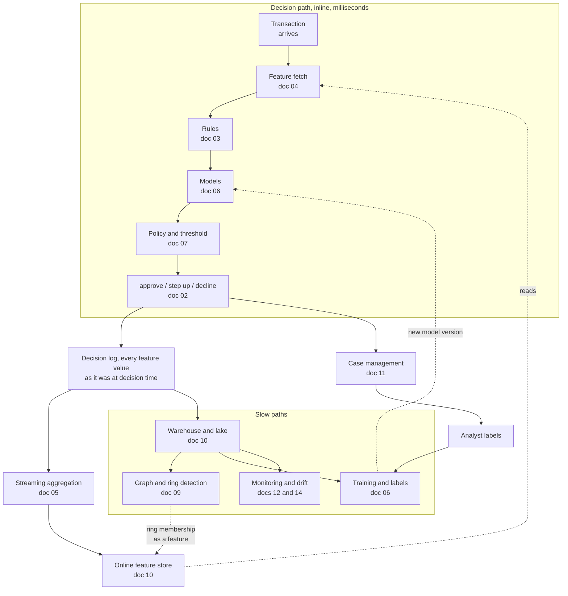

# The Four Running Systems, and Every Number the Collection Reuses

Abstract examples make this material much harder than it needs to be. "The model scores the
transaction and the threshold blocks it" is a sentence you can agree with without learning
anything. "Ironvale's threshold blocks 60,936 good transactions a day to
prevent 5,078 frauds, and loosening it by one band trades 11,000 of those declines for 125 extra
losses" is a sentence you can argue with, and arguing with it is how you learn the trade.

So this collection fixes four systems and derives every figure once, here. When a later document
says "recall the 120 ms budget" or "recall the 1-in-7,692 base rate", it means this page. Where a
figure is derived rather than assumed, the arithmetic is shown, because the point is not for you
to adopt the number — it is for you to be able to redo the calculation with your own inputs and
see which conclusions survive.

The four were chosen because **they fail differently**, in the specific sense that the binding
constraint is a different thing in each one.

| System | Seat | Binding constraint |
|---|---|---|
| **Ironvale Cards** | Card issuer | The organisation. Models must ship weekly into a bank with eight change windows a year |
| **Northwind Pay** | Acquirer / payment service provider | Approval rate is a product its merchants buy, and a network programme caps its chargebacks |
| **Swiftline** | Instant payment scheme | Irreversibility. Four and a half seconds and the money is gone forever |
| **Riverbend** | Marketplace | Definition. Nobody can agree what counts as fraud, and the loss is partly reputational |

Two of these are new to this repository. **Ironvale** the regulated bank already exists in
[`../DBMigrations`](../DBMigrations/README.md); Ironvale Cards is its card-issuing arm, and it
inherits that bank's organisational facts, which turn out to matter more than its technical ones.
**Northwind Pay** is taken unchanged from [`../Payments`](../Payments/00-what-actually-moves.md),
so the flow mechanics, the state machine and the 3-D Secure handling described there are the ones
assumed here. **Riverbend** is the marketplace used across
[`../Kafka`](../Kafka/README.md), [`../MicroservicesPOF`](../MicroservicesPOF/README.md),
[`../LogCollector`](../LogCollector/README.md) and others. **Swiftline** is new.

---

## Ironvale Cards: the issuer, and the system most of this collection describes

### The transaction volume, derived

Ironvale Cards has **70 million active cards**. "Active" means used at least once in the trailing
90 days, which is the definition its regulator uses and roughly 61% of cards it has issued.

A typical active consumer card is used a little over half a day's worth of transactions per day
once you average across the cards people keep in a drawer and the ones they use for everything:

```
70,000,000 cards × 0.60 authorizations per card per day = 42,000,000 authorizations per day
```

Per second, averaged across the whole day:

```
42,000,000 / 86,400 = 486 authorizations per second
```

That average is misleading, as averages of human activity always are. Card spending has a strong
daily shape, peaking in the early evening in each timezone, and Ironvale is concentrated in one
country, so the timezones do not flatten each other out:

```
Diurnal peak (local 18:40):   1,450 per second   =  3.0× average
Diurnal trough (local 04:10):    118 per second   =  0.24× average
Seasonal peak (Black Friday,
  12:40 local):               3,900 per second   =  8.0× average
```

**That 8.0× seasonal ratio is a capacity-planning number you will be asked about.** It means the
scoring tier must be sized for 3,900 requests per second while running at 486 most of the year —
and, more importantly, that the feature store's write path sees eight times its normal update
rate on the one day of the year when being wrong is most expensive. Doc
[05](05-the-streaming-pipeline.md) sizes the pipeline for the peak, not the average, and doc
[15](15-the-failure-catalogue-and-playbook.md) has the runbook for the day it is not enough.

### The money

Average ticket is **$48.20**, so:

```
Daily purchase volume:  42,000,000 × $48.20 = $2.024 billion
Annual:                 $2.024bn × 365      = $739 billion
```

Ironvale earns interchange of roughly **1.65%** of volume on average across its card mix, which
is where the economics in doc [07](07-thresholds-and-the-economics-of-errors.md) start.

### The base rate, and the attempted-fraud figures

If Ironvale blocked nothing at all, **5,460 authorizations per day would be fraudulent.** That is
the number the rest of the collection reasons about, and it is the attempted rate, not the
realised loss.

```
5,460 / 42,000,000 = 0.00013 = 1.3 basis points = 1 in 7,692
```

Fraudsters do not buy the same things as ordinary customers. The attempted-fraud average ticket
is **$186** — about 3.9 times the legitimate average — because a stolen card is used to buy
resellable goods rather than groceries, and because the pattern is often a small test charge
followed by a large one.

```
Attempted fraud value per day:  5,460 × $186     = $1,015,560  ≈ $1.02 million
Attempted fraud value per year: $1.02m × 365     = $371 million
```

As a fraction of volume, attempted fraud is:

```
$1.02m / $2,024m = 0.000502 = 5.0 basis points of value
```

Note that fraud is **1.3 basis points of count but 5.0 basis points of value**, purely because
the average fraudulent ticket is larger. Which of those two numbers you optimise is a real
decision, not a presentational one, and doc [07](07-thresholds-and-the-economics-of-errors.md)
shows that optimising value and optimising count give you materially different thresholds.

### What the system actually achieves

Ironvale's current stack prevents **93% of attempted fraud by value**:

```
Prevented per day:  $1.02m × 0.93 = $0.944 million
Net loss per day:   $1.02m × 0.07 = $0.071 million
Net loss per year:  $0.071m × 365 = $26 million
Net loss as bps of volume: $0.071m / $2,024m = 3.5 basis points
```

**3.5 basis points net is a good number** — it sits around the better end of the published range
for large issuers — and the collection uses it as the realistic target rather than as an
aspiration. A system claiming to be at 0.5 basis points is either measuring something narrower
than all fraud or is declining a great deal more than it admits.

The cost side. The stack blocks 93% of fraud *events* too, approximately:

```
Fraud attempts blocked: 5,460 × 0.93 = 5,078 per day
```

and it does so at a **precision of roughly 1 in 12** — that is, twelve good transactions blocked
for every genuine fraud blocked:

```
Good transactions declined: 5,078 × 12 = 60,936 per day
As a fraction of all volume: 60,936 / 42,000,000 = 0.145%
```

So Ironvale declines about **one in every 690 good transactions** for fraud reasons. That number
is the one customers experience and the one doc
[07](07-thresholds-and-the-economics-of-errors.md) is about.

### The latency budget, decomposed

The card network's stand-in processing will answer on Ironvale's behalf if Ironvale does not
respond within the network's timeout, which is **2,000 ms** at the point the authorization
message reaches the issuer's edge. Stand-in answers using the network's own simple rules and a
stored limit, which is a far worse decision than Ironvale's, so timing out is costly even though
it is not an outage.

Ironvale budgets as follows, and these are the numbers doc
[02](02-the-decision-path-and-the-latency-budget.md) builds on:

```
Network timeout at the issuer edge                    2,000 ms
  − network transit and message parsing, both ways      310 ms
  − core banking: balance, limits, posting              680 ms
  − card status, PIN and cryptogram verification        180 ms
  − safety margin held for the unexpected               410 ms
  ─────────────────────────────────────────────────────────────
  = available to the fraud decision                     420 ms
```

Of that 420 ms, the fraud service commits to **120 ms at p99** and holds a **300 ms hard
timeout** at the caller, leaving 120 ms of slack for a single retry to a second replica. The
caller's behaviour when the deadline passes — fail open, fail closed, or fall back to a cached
rule set — is the most consequential single configuration choice in the entire system, and doc
[02](02-the-decision-path-and-the-latency-budget.md) is largely about it.

Inside the 120 ms:

```
  Request parse, auth, and entity-key derivation          4 ms
  Feature fetch, online store, one batched round trip    22 ms
  Rule engine evaluation, 1,100 rules                     9 ms
  Primary model inference, gradient-boosted trees        11 ms
  Sequence model inference                               31 ms
  Decision assembly, policy, logging handoff              7 ms
  ─────────────────────────────────────────────────────────────
  Sum of medians                                         84 ms
  p99 (not the sum of p99s — see doc 02)                118 ms
```

Note that the sequence model alone is 37% of the budget. Whether it earns that is a question doc
[06](06-models-labels-and-training.md) answers with numbers rather than with enthusiasm.

### The entities, and therefore the state

Scoring uses aggregates keyed on several different entities, because fraud shows up as a pattern
on one of them and not on the others. Ironvale maintains online aggregates on:

| Entity | Count | Why |
|---|---|---|
| Card | 70,000,000 | Velocity, geography, spend profile |
| Account (one per customer, may hold several cards) | 31,000,000 | Cross-card patterns, account takeover |
| Device fingerprint | 54,000,000 | Shared-device rings, new-device risk |
| Merchant | 2,900,000 | Compromised merchant, card-testing target |
| IP prefix (a /24 block) | 14,000,000 | Hosting-provider and proxy signals |
| Email address | 29,000,000 | Account-opening and enumeration patterns |
| **Total entity keys** | **200,900,000** | |

Each key holds a set of windowed counters and summaries averaging **1.4 KB** serialised (the
derivation is in doc [10](10-storage-hot-cold-and-what-it-costs.md); it is 31 counters across
four window lengths plus a small sketch). So:

```
200,900,000 keys × 1.4 KB = 281 GB of hot aggregate state
```

That number is the reason doc [10](10-storage-hot-cold-and-what-it-costs.md) exists. 281 GB of
state that must be readable in single-digit milliseconds, replicated, and survivable across a
process restart, is not a Redis instance; it is a cluster with a real monthly bill, and the
difference between a good and a bad key-design decision here is a factor of three on that bill.

### The detection estate

| Component | Scale |
|---|---|
| Active rules | **1,100**, across 7 packs, with 240 more in shadow mode |
| Primary model | Gradient-boosted trees, 1,870 trees, depth 8, 412 features |
| Sequence model | Transformer over the card's last 64 authorizations, 31 ms p99 |
| Models in shadow | 2 to 4 at any time |
| Analyst review capacity | **1,900 cases per day** across 3 shifts |
| Full retrain cadence | Weekly, with a daily incremental refresh of aggregates |

**The analyst capacity of 1,900 per day against 60,936 daily declines is not a mistake.** Only a
small fraction of declines go to a human; the rest are automated and the customer's only recourse
is to call. Doc [11](11-case-management-and-the-human-loop.md) does the queueing arithmetic and
shows why review capacity, not model quality, sets the operating point for the highest-risk band.

### The organisational constraint, which is the real one

Ironvale Cards lives inside Ironvale the bank, and inherits from
[`../DBMigrations`](../DBMigrations/README.md): 4,100 engineers, 62 teams, 2,400 production
databases, mandatory separation of duties, **eight usable change windows of four hours per year**,
and a median schema-change lead time of 63 days.

Hold that against the fraud team's actual need: **a model refreshed weekly, a rule shipped within
hours of an analyst spotting a pattern, and a threshold adjustable in minutes during an attack.**
Fifty-two model releases a year into an organisation with eight change windows is not a
scheduling problem that better planning solves. It is an impossibility, and the only resolution is
architectural: **separate the things that change weekly from the code that changes quarterly**, so
that shipping a model is a data operation rather than a deployment. That separation — a control
plane that is reviewed and slow, a data plane that is versioned and fast — is the organising idea
of doc [14](14-observability-and-operating-the-service.md) and the reason doc
[13](13-explainability-compliance-and-fairness.md) spends time on model governance rather than
treating it as paperwork.

---

## Northwind Pay: the acquirer, where approval rate is a product

Northwind Pay is defined in [`../Payments`](../Payments/00-what-actually-moves.md) and this
collection changes none of it:

| Quantity | Value |
|---|---|
| Merchants | 40,000 |
| Authorization attempts per year | 1.2 billion |
| Approval rate | 87.3% |
| Average ticket | $47 |
| Peak throughput | 9,000 per second |
| Stored card tokens | 310 million |
| End-to-end authorization latency target | p99 under 800 ms |
| Regions | 3 |

From those, three fraud-relevant figures:

```
Average rate:  1.2bn / 365 / 86,400 = 38 authorizations per second
Peak ratio:    9,000 / 38           = 237×
Annual volume: 1.2bn × $47          = $56.4 billion presented
```

**That 237× peak-to-average ratio is the single most important fact about Northwind's fraud
problem**, and it is quite different from Ironvale's 8×. Northwind's traffic is dominated by
flash sales and ticket on-sales — one merchant going from zero to thousands per second on a
schedule somebody else sets. A velocity feature that is perfectly calibrated at 38 per second
behaves very differently at 9,000, and a rule that throttles "unusual volume from one merchant"
will fire on the most legitimate traffic of the year. Doc
[03](03-rules-and-why-they-never-go-away.md) treats this as a first-class case.

Northwind's distinctive exposures:

**Card testing, also called enumeration.** An attacker with a list of stolen card numbers needs
to know which are still live, and the cheapest way to find out is a sequence of tiny
authorizations against any merchant whose checkout accepts them without friction. Northwind, with
40,000 merchants, always has some merchant whose donation form or gift-card top-up is such an
endpoint. The attack's signature is distinctive — many cards, one merchant, tiny amounts, high
decline rate — and its cost to Northwind is not fraud loss but infrastructure, network fines, and
a merchant whose authorization ratio has become so bad the networks notice.

**The chargeback programmes.** The card networks run monitoring programmes that place an acquirer's
merchant into a remediation plan when its chargeback count and ratio both exceed thresholds — the
commonly cited figures are around **0.9% of transactions and 100 disputes per month**, with fines
escalating monthly thereafter. Northwind holds its merchants to an internal ceiling of **0.65%**
to keep a margin. This gives Northwind something Ironvale does not have: **a hard constraint
expressed as a ratio rather than as a dollar amount**, which cannot be traded against revenue.

**Merchant fraud, as opposed to fraud against merchants.** A merchant that signs up, processes
$400,000 of fraudulent transactions against stolen cards, takes the payout, and disappears before
the chargebacks arrive — leaving Northwind holding them. This is an underwriting and payout-timing
problem rather than a transaction-scoring problem, and doc
[09](09-graphs-rings-and-linked-entities.md) covers the linkage techniques that catch it.

---

## Swiftline: instant payments, where nothing can be undone

Swiftline is a national instant-payment scheme of the kind that now exists in most large
economies — the shape is familiar from UPI in India, Pix in Brazil, FedNow and Zelle in the United
States, and Faster Payments in the United Kingdom.

| Quantity | Value |
|---|---|
| Transfers per day | 240,000,000 |
| Average transfer | $112 |
| Settlement finality | **4.5 seconds**, irrevocable |
| Scheme-mandated response deadline for the sending bank | **1,000 ms** |
| Fraud decision budget inside that | **200 ms p99** |
| Participating institutions | 310 |

```
Average rate: 240,000,000 / 86,400 = 2,778 transfers per second
Daily value:  240,000,000 × $112   = $26.9 billion
```

Swiftline's fraud profile inverts the card assumptions in four ways, and each inversion produces
a different design:

**One. There is no chargeback.** No representment, no dispute window, no liability shift. Once
settled, recovery depends entirely on whether the receiving institution can freeze the funds
before they are withdrawn, and the median time from receipt to full withdrawal at a mule account
is **under 9 minutes**. Doc [15](15-the-failure-catalogue-and-playbook.md) has the recall
runbook and it is a race, not a process.

**Two. The dominant fraud is the scam, where the victim authorized it.** Of Swiftline's fraud
losses, roughly **71% by value** is authorized push payment fraud: the customer was deceived — by
a fake bank-security call, a romance, an investment pitch, an invoice redirection — and sent the
money themselves, from their own device, in their own usual location, having correctly
authenticated. The average scam transfer is **$2,900**, against the $112 overall average.

```
Scam transfers per day:  2,180
Scam value per day:      2,180 × $2,900 = $6.3 million
Annual:                  $2.3 billion across the scheme
```

Every signal the card playbook relies on says this transaction is fine. **The only signals with
any power are about the payee and the context**: the payee account is new to this customer, the
payee has recently received transfers from several unrelated customers, the amount is unusually
round or unusually large for this customer, and — the strongest single signal in practice — the
customer has been on a phone call for the last forty minutes. Doc
[08](08-device-identity-and-behavioural-signals.md) covers the last of these and the uncomfortable
questions it raises.

**Three. Reimbursement regulation moved the cost onto the sending bank.** Several jurisdictions
now require the sending institution to reimburse scam victims up to a cap — the UK's rules took
effect in October 2024 with a cap that has been set at £85,000, split between sending and
receiving institutions. **This changed Swiftline's cost matrix without changing anything about
its models.** Before the rule, a missed scam cost the bank a goodwill payment in some fraction of
cases; afterwards it cost the full amount in nearly all of them, and the economically correct
threshold moved by a factor of several overnight. It is the cleanest available demonstration that
**the threshold is a property of the cost structure, not of the model**, and doc
[07](07-thresholds-and-the-economics-of-errors.md) works through it.

**Four. A false block is a missed obligation.** Blocking a $2,400 transfer that turns out to be a
deposit on a flat means a customer lost the flat. In several markets, wrongly delayed payments
are reportable to the regulator with a service-level expectation attached. Both error costs are
high, which rules out the issuer's strategy of quietly accepting a 93:1 ratio.

The architectural consequence of all four: **Swiftline's fraud system is mostly not a classifier.**
It is a system for deciding when to interrupt a human with a specific, well-chosen question —
"you told us this is a payment to a builder; the account you are paying has received money from
eleven unconnected people this week; do you want to continue?" — and the research question that
dominates its roadmap is which wording actually breaks a scammer's hold on a victim, which is a
behavioural-science problem with a measurable answer.

---

## Riverbend: the marketplace, where nobody agrees what fraud is

Riverbend is the online marketplace used throughout this repository. Its established figures:

| Quantity | Value |
|---|---|
| Orders per day | 5,790,000 |
| Orders per second | 67 average, 350 peak |
| Average order | $64 |
| Platform | EKS, services described in [`../MicroservicesPOF`](../MicroservicesPOF/README.md) |

For fraud purposes, the additional facts:

```
Daily gross merchandise value: 5,790,000 × $64 = $370 million
Fraud-related chargeback rate: 0.09% of orders
Fraud chargebacks per day:     5,211
Value:                         5,211 × $64 = $333,500 per day
```

But the chargebacks are not the whole loss, and that is Riverbend's defining difficulty. Its loss
categories, with roughly what each costs per day:

| Category | Daily cost | Can a transaction score catch it? |
|---|---|---|
| Stolen-card orders | $333,500 | Yes — this is ordinary transaction fraud |
| Account takeover, then gift-card drain | $94,000 | Partly — the signals are at login, not checkout |
| Promotion and referral abuse | $210,000 | Not at the transaction; it needs the graph |
| Seller collusion and fake transactions | $160,000 | No — it needs retrospective network analysis |
| Item-not-received claims that are false | $88,000 | No — this is first-party fraud, handled in disputes |
| **Total** | **$885,500** | |

**Transaction scoring addresses 38% of the loss.** The majority of the money is in abuse patterns
that are only visible across accounts, over days, and in aggregate. This is why Riverbend's
architecture is weighted towards the near-real-time and retrospective layers rather than the
inline one — and why a candidate who answers a marketplace fraud question with a 120 ms scoring
service has solved a third of the problem and will be asked about the rest.

Riverbend's great advantage, which Ironvale lacks entirely, is **time**. There is no network
stand-in waiting. Riverbend can accept the order, hold fulfilment for 90 seconds, run a far richer
check, and cancel before anything ships. It can hold a seller payout for 14 days. It can show a
soft challenge in its own app, with its own wording, and measure the abandonment. Doc
[02](02-the-decision-path-and-the-latency-budget.md) treats this explicitly, because **the first
question to ask about any fraud decision is whether it actually has to be synchronous**, and the
answer is "no" far more often than teams assume.

---

## The reference architecture these four share

Despite the differences, the four systems share a skeleton. Here it is, with the document that
covers each part. Use it as a map rather than as a design; the design is in the parameters.



Three properties of that diagram are worth naming now because they are where real systems break.

**The decision log is the most important component and it is not the model.** Every later
capability — training, monitoring, drift detection, dispute defence, regulatory explanation —
depends on having recorded, for each decision, the exact feature values used, the model version,
the rule versions, the score and the reason. Not the feature values as they are now; as they were
at decision time. Teams that log the decision but not its inputs discover eight months later that
they cannot reproduce or explain anything, and the fix is a year of waiting for new data to
accumulate. Doc [04](04-features-and-the-feature-store.md) treats this as the point-in-time
correctness problem and doc [13](13-explainability-compliance-and-fairness.md) as the
auditability requirement; they are the same requirement seen from two sides.

**The loop from decisions back into features is the system's main source of instability.** Today's
decision changes tomorrow's aggregates, which change tomorrow's decisions. Blocked transactions
never produce labels, so the training data narrows towards what the model already approves. Doc
[06](06-models-labels-and-training.md) and doc
[12](12-adversaries-drift-and-the-arms-race.md) are both about controlling this loop, and the
only real control is a deliberately unmanaged holdout.

**The dotted arrows are the slow-to-fast couplings, and they are where correctness goes wrong.**
A ring-membership flag computed nightly in the lake and served as an inline feature means the
inline path is using a 14-hour-old view of the graph. That is usually fine and occasionally
disastrous, and doc [09](09-graphs-rings-and-linked-entities.md) is explicit about which.

---

## The numbers worth memorising

If you are preparing for an interview, these are the dozen figures that let you reason out loud
instead of hedging. Each links to where it is derived.

| Figure | Value | Where |
|---|---|---|
| Ironvale base rate | 1 in 7,692, or 1.3 bps of count | this doc |
| Fraud as a share of value versus count | 5.0 bps of value, 1.3 bps of count | this doc |
| Net fraud loss, well-run issuer | 3.5 bps of volume | this doc |
| Fraud decision budget, card authorization | 120 ms p99 within a 420 ms allowance | [02](02-the-decision-path-and-the-latency-budget.md) |
| Cost of a false decline to an issuer | about $1.92 | [07](07-thresholds-and-the-economics-of-errors.md) |
| Value of a prevented fraud to an issuer | $179 net, from $186 gross | [07](07-thresholds-and-the-economics-of-errors.md) |
| The resulting break-even precision | 1 in 94 | [07](07-thresholds-and-the-economics-of-errors.md) |
| Good transactions declined per fraud blocked | 12 on average, 88 at the margin | this doc and [07](07-thresholds-and-the-economics-of-errors.md) |
| Share of all good transactions declined | 0.145%, one in 690 | this doc |
| Median label delay, chargeback | 27 days, p95 71 days | [06](06-models-labels-and-training.md) |
| Online aggregate state, 70M cards and friends | 281 GB over 200.9M keys | [10](10-storage-hot-cold-and-what-it-costs.md) |
| Time from mule receipt to full withdrawal | under 9 minutes | [15](15-the-failure-catalogue-and-playbook.md) |

---

## What to take away

1. **Four seats, four different binding constraints.** Ironvale's is organisational — weekly
   models into a bank with eight change windows. Northwind's is contractual — approval rate is a
   product and chargeback ratios are capped. Swiftline's is physical — 4.5 seconds to
   irrevocable. Riverbend's is definitional — most of the loss is not transaction fraud at all.
2. **Peak-to-average ratios differ by thirty times between systems** — 8× at Ironvale, 237× at
   Northwind — and any velocity feature or volume rule is a function of that ratio, not of the
   average.
3. **Fraud is 1.3 basis points of count and 5.0 basis points of value** at Ironvale, because the
   fraudulent ticket is 3.9× the legitimate one. Choosing which to optimise gives you a materially
   different threshold.
4. **3.5 basis points of net loss is what a good issuer achieves**, at the price of declining one
   in 690 good transactions. Any claimed number far below that is measuring something narrower or
   not admitting its decline rate.
5. **The 120 ms budget is not arbitrary** — it falls out of a 2,000 ms network timeout minus core
   banking, transit, verification and a deliberate safety margin. Derive it that way rather than
   asserting it.
6. **200.9 million entity keys at 1.4 KB each is 281 GB of hot state.** The number of entity types
   you key on, not the number of customers, sets your storage bill.
7. **Transaction scoring addresses 38% of Riverbend's loss.** On a marketplace the majority of the
   money is in abuse patterns only visible across accounts and over days.
8. **Swiftline shows that the threshold belongs to the cost structure, not the model.** A
   reimbursement regulation changed the correct operating point overnight while every model stayed
   exactly the same.
9. **The decision log, not the model, is the load-bearing component**, and it must record the
   feature values as they were at decision time. Everything downstream — training, monitoring,
   disputes, regulatory explanation — is impossible without it, and you cannot backfill it.
10. **The system feeds itself.** Decisions change aggregates, aggregates change decisions, and
    blocked transactions never produce labels. Every subsequent document is, in some way, about
    keeping that loop from closing on itself.
