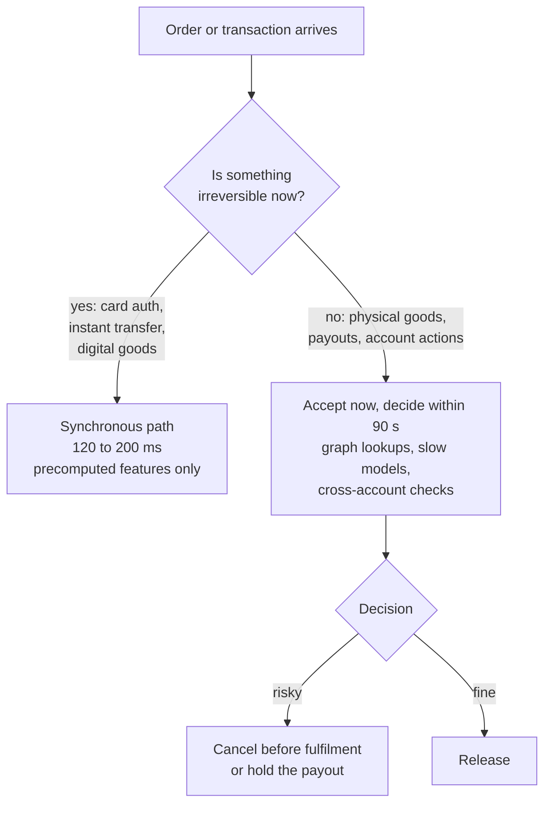
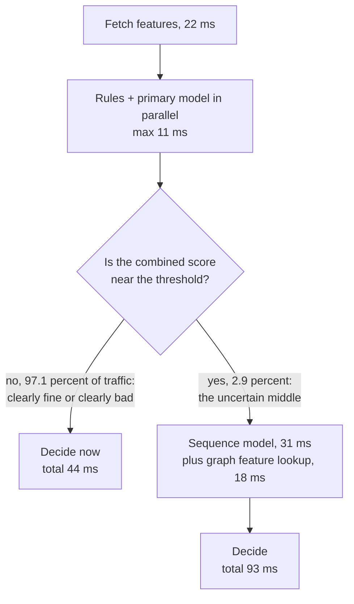

# The Decision Path: 120 Milliseconds, and What Happens When You Do Not Have Them

This document is about the inline path — the code that runs while somebody is holding a socket
open waiting for an answer. It covers how the budget is spent, why the obvious way of adding up
latencies is wrong, what to do when a dependency is slow, and the one configuration choice that
matters more than every model decision combined: **what you return when you cannot decide.**

Scenarios in this document are `D-01` through `D-12`. They are cited by the case studies in doc
[16](16-case-studies.md) and the playbook in doc
[15](15-the-failure-catalogue-and-playbook.md).

---

## First, ask whether the decision has to be synchronous at all

Before designing a 120 ms path, establish that you need one. This sounds obvious and it is
routinely skipped, including in interviews, where candidates reach for a streaming architecture
before asking what the deadline actually is.

A fraud decision must be synchronous when **something irreversible happens the moment you say
yes, and you cannot take it back.** Walk through the four systems:

**Ironvale, card authorization: yes, genuinely synchronous.** When the issuer approves, the
cardholder walks out with the goods. There is a reversal mechanism (the chargeback) but it runs
over weeks and costs more to exercise than most transactions are worth. The network is holding
the message. This is a hard synchronous decision.

**Swiftline, instant transfer: yes, and harder.** Four and a half seconds to irrevocable
settlement, with a scheme deadline of 1,000 ms for the sending bank's response.

**Northwind, acquiring: partly.** Northwind must respond to its merchant within the merchant's
timeout, and it must forward to the network. But a meaningful part of Northwind's fraud work —
merchant risk, payout holds, card-testing detection — operates on a timescale of hours and is not
in the authorization path at all. Mixing the two is a design error: putting merchant-risk logic
inline buys you nothing and spends your budget.

**Riverbend, marketplace: mostly not.** Riverbend places the order, charges the card, and then
has as long as it takes to pick and pack before anything is irreversible. In practice it holds
fulfilment for up to **90 seconds** on the risky band, which is six hundred times the budget
Ironvale has, and uses it to run a second-stage check with features that cannot be computed
inline — a graph lookup, a slow model, a check against the other orders from that address in the
last hour. Digital goods are the exception: a gift-card code delivered instantly is as
irreversible as a card authorization, so Riverbend routes those through the synchronous path and
everything physical through the deferred one.

**The design move this unlocks is the most valuable one in the document.** If you can split your
traffic into "irreversible now" and "irreversible in ninety seconds", you can give the second
group a decision that is dramatically better, because a 90-second budget admits techniques that a
120 ms budget forbids entirely. At Riverbend the split is roughly 4% digital and 96% physical, so
96% of orders get the good decision. Teams that never ask the question give all 100% the fast,
worse decision.



---

## Where the 120 milliseconds goes, and why summing p99s is wrong

Doc [01](01-the-running-systems-and-their-numbers.md) gives the median breakdown. Reproduced
here with the tail, because the tail is the part that pages you:

| Stage | p50 | p99 | Notes |
|---|---|---|---|
| Parse, authenticate, derive entity keys | 4 ms | 7 ms | CPU-bound, predictable |
| Feature fetch — one batched round trip | 22 ms | 61 ms | Network plus store |
| Rule engine, 1,100 rules | 9 ms | 14 ms | CPU-bound |
| Primary model, gradient-boosted trees | 11 ms | 19 ms | CPU-bound |
| Sequence model | 31 ms | 78 ms | Separate service, GPU-backed |
| Decision assembly and policy | 7 ms | 11 ms | |
| **Naive sum** | **84 ms** | **190 ms** | |
| **Measured end to end** | **86 ms** | **118 ms** | |

The naive p99 sum says 190 ms, which would blow the budget. The measured p99 is 118 ms. The
difference is not a measurement error and understanding it is worth real points in an interview.

**Why summing p99s overstates the total.** The p99 of a sum is only the sum of the p99s if the
stages are perfectly correlated — if, whenever one stage is slow, all of them are. In practice the
slow causes are mostly independent: a garbage-collection pause in the feature-store client, a
cold branch predictor in the tree walk, a queue delay at the sequence model. For a request to
take 190 ms, all six stages would have to be at their own 99th percentile simultaneously, which
happens at a rate far below 1 in 100.

**Why it can also understate the total.** Correlation is not always zero. When the underlying
cause is shared — the host is CPU-starved, the network is congested, a neighbouring pod is
saturating the NIC — every stage goes slow together, and the observed tail exceeds even the naive
sum. The practical rule: **independent causes make the sum pessimistic; shared causes make it
optimistic.** Measure the end-to-end distribution directly, never compute it, and specifically
watch whether the correlation structure changes under load, because it does.

**The operational consequence.** Because stages are mostly independent, the most effective way to
protect the budget is not to make every stage faster — it is to make the *slowest stage's tail*
shorter, and to stop any single stage from being able to consume the entire budget. Hence the two
mechanisms below.

### D-01 · A single slow dependency consumes the whole budget

**What you see.** p99 of the fraud decision jumps from 118 ms to 290 ms. The scoring service's own
CPU is flat. Every stage's median is unchanged. The sequence model's p99 has gone from 78 ms to
240 ms.

**Mechanism.** The stages are sequential and share a single deadline, so the slowest one absorbs
all available slack and then overruns. With no per-stage deadline, a dependency that degrades
from 78 ms to 240 ms simply makes every request 162 ms slower, and because the caller's timeout
is 300 ms, a further degradation turns into a timeout rather than a slow answer — which is a much
worse failure, as `D-04` explains.

**Confirm it.** Compare the per-stage p99 panel against the end-to-end p99 and look for a single
stage whose increase accounts for the whole delta. If two or more stages moved together,
suspect a shared cause (host saturation, network) rather than one dependency.

**Recover.** Shed the offending stage. If the sequence model is slow, score without it; the
primary model and the rules still produce a usable decision, with a measurable but acceptable
loss of accuracy. This requires having decided in advance what the decision is without each
component, which is the subject of the degradation ladder below.

**Prevent.** Give every stage its own deadline, derived by dividing the budget rather than by
hoping. Ironvale allocates: features 70 ms, rules 20 ms, primary model 25 ms, sequence model
45 ms, assembly 15 ms — a total of 175 ms against a 120 ms p99 target, deliberately overcommitted
because they do not all peak together. Each deadline is enforced at the call site with a
cancellable context, and exceeding it returns a *typed absence* ("sequence score unavailable"),
not an error and not a zero. The distinction between absent and zero matters enormously and is
`D-07`.

### D-02 · Parallelising the stages, and why it is less help than it looks

The obvious optimisation: run the rule engine, the primary model and the sequence model
concurrently, since all three need only the features. The naive expectation is that the total
becomes `features + max(rules, primary, sequence)`:

```
Sequential p50:  4 + 22 + 9 + 11 + 31 + 7 = 84 ms
Parallel p50:    4 + 22 + max(9, 11, 31) + 7 = 64 ms   → 24% faster
```

Which is real, and worth having. But at the tail the gain shrinks, because the p99 of a maximum
is worse than the maximum of the p99s — you now need *none* of the three to be slow, rather than
one specific one:

```
P(all three fast) = 0.99 × 0.99 × 0.99 = 0.9703
```

So what was the 99th percentile of each becomes roughly the 97th percentile of the group. The
parallel arrangement's p99 is therefore set by a *higher* quantile of each component than the
sequential arrangement's was. At Ironvale the measured effect is a p50 improvement of 23% and a
p99 improvement of only 9%.

**The real reason to parallelise is not the median.** It is that it lets you give each branch an
independent deadline and drop whichever one misses, which is what actually protects the tail. Run
them in parallel for isolation, and treat the median gain as a bonus.

There is also a cost. Parallel evaluation means you pay for the sequence model's inference even
on the 97.1% of transactions the rules and the primary model would have cleared instantly.
Ironvale's measured figure: **running the sequence model on every transaction rather than only on
the uncertain middle costs 31× the GPU capacity for a 0.4% improvement in catch rate**, because
the uncertain middle is 2.9% of traffic. Which leads directly to the next design.

### D-03 · The cascade: spend the expensive budget only where it changes the answer

The best-performing arrangement at Ironvale is neither sequential nor fully parallel. It is a
cascade with an early exit:



The arithmetic that justifies it:

```
Weighted p50:  0.971 × 44 ms + 0.029 × 93 ms = 45.4 ms
GPU load:      2.9% of 486 per second = 14 inferences per second, not 486
Capacity saved: 34×
Accuracy cost: 0.4% of catch rate (measured by running the full path on a 1% sample)
```

**The condition for a cascade to be correct is that the cheap stage must be able to recognise its
own uncertainty.** A model that is confidently wrong defeats it. This is why calibration — making
the score mean what it says it means, covered in doc
[06](06-models-labels-and-training.md) — is a prerequisite for the cascade rather than a nicety.
Ironvale verifies it by running the full path on a random 1% of the "clearly fine" band
continuously and measuring how often the expensive stage would have disagreed. The answer is
0.4%; when it drifts above 1%, the band boundaries get retuned.

**When not to cascade.** If your expensive stage is cheap enough to run on everything, do. The
cascade adds a control-flow branch, a second failure mode, and a sampling job to keep honest.
Below roughly 500 requests per second it is usually not worth the complexity.

---

## The question that matters most: what do you return when you cannot decide?

Everything above concerns the normal path. This section concerns the 0.01% of requests where the
fraud service cannot answer, and it is the single most consequential decision in the design.

Three things can happen: the fraud service is down, the fraud service is slow past the caller's
timeout, or the fraud service answers but its features were unavailable so the answer is
uninformed. Each needs a defined behaviour, and the three behaviours are not the same.

### D-04 · Fail open, fail closed, and the fact that both are wrong

**Fail open** means: if the fraud service does not answer, approve. The customer is served, the
business keeps earning, and during the outage you accept every fraudulent transaction presented.

**Fail closed** means: if the fraud service does not answer, decline. No fraud gets through, and
every customer of the bank is unable to spend money.

Do the arithmetic for a 20-minute total outage at Ironvale, at average rate:

```
Transactions in 20 minutes:  486 × 1,200 = 583,200
Fraud among them:            583,200 / 7,692 = 76 transactions
Fraud cost at risk:          76 × $179 = $13,604
```

Against:

```
Fail closed: 583,200 declines, of which 583,124 are good customers.
Direct cost at $1.92 each:   $1.12 million
Plus: contact centre overwhelmed, regulatory incident, press coverage,
      and a measurable spike in card attrition that persists for months.
```

**So fail open costs $13,604 and fail closed costs over a million dollars.** Stated that way, the
answer is obviously fail open, and that is what nearly every issuer does — which is correct, and
also exactly what an attacker who can cause a 20-minute outage is counting on.

That is the trap. The arithmetic above assumes the fraud *rate* during the outage is the normal
1 in 7,692. If the outage is caused deliberately, or if word gets out, the rate during the window
is nothing like normal. A coordinated group with a stock of stolen cards that knows the scorer is
down does not present 76 fraudulent transactions; it presents as many as it can push through, at
the highest ticket sizes it can get away with. Doc [16](16-case-studies.md), `CS-3`, is an
incident of exactly this shape.

**The resolution is that the binary framing is wrong.** Neither "approve everything" nor "decline
everything" is the right answer, because there is a third option that is strictly better than both
and takes a week to build:

**Fail static.** Keep, on every authorization host, a small, self-contained fallback: a cached
per-card risk tier refreshed hourly, a short list of hard rules, and the card's own stored limits.
When the scorer does not answer, evaluate that instead. It is a far worse decision than the full
stack — it has no velocity features, no graph, no model — but it is enormously better than a
constant.

Ironvale's fallback is 40 lines of logic and one 70-million-row cache keyed by card:

```
IF card is on the active block list                → decline
IF amount > the card's stored 30-day p99 ticket × 3 → step up if the channel allows, else decline
IF card's cached risk tier is "elevated"
   AND the transaction is card-not-present          → step up, else decline
OTHERWISE                                           → approve
```

Measured against replayed traffic from a real outage, this fallback approves 99.2% of good
transactions (against 99.855% for the full stack) and blocks 61% of fraud (against 93%). So
during a 20-minute outage:

```
Good transactions wrongly declined: 583,124 × 0.008 = 4,665  × $1.92 = $8,957
Fraud let through:                  76 × 0.39 = 30            × $179 = $5,370
Total cost of the outage:                                             $14,327
```

Compare: fail open costs $13,604 in fraud but is open to deliberate exploitation; fail closed
costs $1.12 million; fail static costs about the same as fail open *and removes the incentive to
cause the outage*, which is the actual point. The fallback's value is not primarily the fraud it
blocks during an incident. **It is that the attack of causing an outage stops being worth
mounting.**

**Confirm which mode you are actually in.** Most teams believe they fail closed and discover
during the first incident that a timeout in an HTTP client library returned a default-constructed
response whose risk score was 0.0, which the policy layer read as "very safe." Test this
deliberately: block the fraud service at the network level in a staging environment that carries
replayed production traffic, and observe what the authorization service does. Do it quarterly,
because somebody will change a client library's default.

**⚠️ Do not switch to fail closed during an incident** unless you have measured the decline volume
your contact centre can absorb. The commonest way for a fraud incident to become a company-wide
incident is a well-intentioned flip to fail closed at 02:00 that produces half a million declines
before anybody realises the contact centre has a 40-call queue capacity.

### D-05 · The silent degradation: features missing, score computed anyway

**What you see.** Nothing. No errors, no latency change, no alarm. Three weeks later, the fraud
loss for a particular segment has quietly doubled.

**Mechanism.** The feature fetch partially failed — one of the six entity lookups timed out — and
the client returned a map with that entity's features absent. The feature pipeline filled the
absent values with a default (zero, or the training-set mean) and handed a complete-looking
vector to the model. The model, which has never in training seen a card with a velocity count of
exactly zero across all four windows, produces a confident low score, because in its training
data a zero-velocity card really was a quiet card.

**This is the most dangerous failure in the whole document**, because it has no signal at all in
the places people look. The service is healthy, the latency is fine, the score distribution barely
moves if the affected share is small, and the loss shows up only in labels that arrive a month
later.

**Confirm it.** You need three things logged per decision and alerted on: **the count of features
that were absent, per entity type; the imputation method applied to each; and the share of
decisions with any absence at all.** Ironvale alerts when the share of decisions with one or more
absent entity groups exceeds 0.5% over five minutes. Without those fields in the decision log,
this failure is undetectable until the labels arrive.

**Recover.** Mark the decision as degraded and apply a *policy* response rather than a model
response — treat a decision made without card velocity as being in the uncertain band regardless
of its score, and route it to step-up if the channel allows. Accepting slightly more friction for
0.5% of traffic for twenty minutes is cheap; approving it blindly is not.

**Prevent.** Three habits, in order of value:

1. **Distinguish absent from zero, everywhere, with a distinct type.** A velocity count of 0 and a
   velocity count that could not be read are different facts and must not share a representation.
   Doc [04](04-features-and-the-feature-store.md) treats this as a feature-contract requirement.
2. **Train the model with absence as a signal.** Gradient-boosted tree implementations handle
   missing values natively by learning a default branch direction, which is strictly better than
   imputing a mean — but only if the training data actually contains absences in the same
   pattern production produces them. Injecting realistic absence into training data is a cheap
   and very effective practice that few teams do.
3. **Make the policy layer, not the model, responsible for degradation.** The model's job is to
   score what it was given. Deciding what to do with a score computed from two-thirds of the
   inputs is a policy question with a business answer.

### D-06 · The retry that amplifies the outage

**What you see.** The fraud service becomes slow. The authorization service retries. The fraud
service's inbound request rate triples, it becomes much slower, and a partial degradation becomes
a total one in about ninety seconds.

**Mechanism.** The retry policy was written for a stateless service with transient failures, where
retrying is nearly free. Under saturation it is the opposite: every retry adds load to the thing
that is already overloaded, and because the original request is usually still being processed, the
retry is pure amplification. With a 300 ms timeout and two retries, a service that has slowed to
400 ms receives three times its normal load.

**Confirm it.** Plot inbound request rate at the fraud service against outbound rate at the
authorization service. A gap that opens exactly when latency rises is retry amplification. Also
check whether the retried requests carry the same idempotency key — if they do not, you are also
double-counting velocity features, which corrupts the aggregates (`P-05` in doc
[05](05-the-streaming-pipeline.md)).

**Recover.** Disable retries at the caller. This is counterintuitive during an incident and it is
usually the fastest fix available.

**Prevent.** Three mechanisms, which compose:

- **A retry budget rather than a retry count.** Allow retries to be at most 10% of total
  requests, tracked over a sliding window; when the budget is exhausted, stop retrying regardless
  of individual request outcomes. This caps amplification at 1.1× instead of 3×.
- **A circuit breaker on the caller**, which after a threshold of failures stops calling for a
  cooling period and goes straight to the static fallback. The fraud service gets a chance to
  recover, which under sustained retry pressure it never does.
- **Load shedding at the callee, before the queue.** When the inbound queue depth exceeds what
  can be served within the deadline, reject immediately with a distinct "shed" status rather than
  accepting and timing out. A fast rejection lets the caller use its fallback within 5 ms; a
  timeout costs it 300 ms it did not have. Shedding is strictly better than queueing for any
  workload with a hard deadline, because a response that arrives after the deadline has zero
  value and has consumed real capacity to produce.

### D-07 · The hedged request, and when it is a bad idea

A hedge sends a second copy of the request to a different replica after a short delay, and takes
whichever answer comes back first. It is an effective tail-latency technique: if a replica's slow
response is caused by something local to that replica — a garbage-collection pause, a noisy
neighbour, a cold cache — the second copy is unaffected.

Ironvale hedges feature fetches at the p95 (that is, 48 ms), which costs 5% extra read load and
takes the feature-fetch p99 from 61 ms to 34 ms. That is a good trade.

**It does not work for everything, and specifically it is wrong for the sequence model.** Two
reasons. First, the sequence model's slowness is caused by queueing at a GPU pool shared by all
replicas, so a second copy joins the same queue and makes it marginally worse — hedging only helps
when the cause of slowness is *not* shared. Second, inference is expensive; a 5% hedge rate on a
GPU pool sized for the peak means buying 5% more GPUs to reduce a latency that the cascade
(`D-03`) already removed from 97% of requests.

**The rule: hedge reads of replicated state; do not hedge expensive computation on shared
capacity.** And never hedge anything with a side effect, which in this path means never hedge the
decision-logging write.

---

## The degradation ladder: decide in advance, in writing

Every component in the inline path can be unavailable. The time to decide what the system does
without each one is not during the incident. Ironvale maintains the following table, it is
reviewed quarterly, and the behaviour in column three is implemented and tested rather than
aspirational.

| Component unavailable | Decision quality | Behaviour |
|---|---|---|
| Sequence model | −0.4% catch rate | Proceed without it; mark decision degraded; widen the step-up band by 0.5 percentage points |
| Graph / ring features | −2.1% catch rate | Proceed; treat known-ring flag as absent, not false |
| One entity's aggregates (e.g. merchant) | −3 to −9% depending on entity | Proceed; policy escalates to step-up where channel allows |
| All online features | −41% catch rate | Static fallback (`D-04`); step up everything above the card's own p95 ticket |
| Primary model | −63% catch rate | Rules only, with the three highest-precision rule packs promoted to blocking |
| Rule engine | −18% catch rate, and the block list stops working | **Fail to decline for block-listed cards specifically**, approve otherwise — the block list is a legal obligation, not an optimisation |
| Whole fraud service | — | Static fallback at the authorization host (`D-04`) |

Two things about this table are worth stealing regardless of your architecture.

**The percentages are measured, not estimated.** Each row's figure comes from replaying a month
of labelled production traffic with that component disabled and comparing catch rate at a fixed
decline rate. Doc [17](17-testing-fraud-systems.md) describes the harness. Without measurement,
the ladder becomes a list of guesses and the wrong component gets protected.

**The block list row is a different kind of entry.** Most degradations are an accuracy trade.
Failing to honour a block list can be a breach of a sanctions or law-enforcement obligation,
which is not tradeable against convenience. Separating "things we do because they help" from
"things we do because we must" is the distinction doc
[03](03-rules-and-why-they-never-go-away.md) builds the rule-pack structure around, and this is
where it earns its keep.

---

## D-08 through D-12, briefly

### D-08 · The thundering herd after recovery

**What you see.** The fraud service recovers, and immediately falls over again.

**Mechanism.** During the outage the authorization service's clients all backed off to the same
interval, and all of their circuit breakers entered their cooling period at approximately the same
moment, so they all retry within the same few hundred milliseconds. The feature store's caches
are also cold, so each request costs more than normal.

**Prevent.** Jitter every backoff — a uniform random multiplier between 0.5 and 1.5 is sufficient
and is the single cheapest fix. Have the circuit breaker reopen gradually: allow 1% of traffic,
then 5%, then 25%, with a health check between steps. Warm the feature store's cache from the
decision log before admitting traffic.

### D-09 · The deadline that is not propagated

**What you see.** The authorization service gave up 180 ms ago and the fraud service is still
computing, holding a thread, a connection and a GPU slot to produce an answer nobody will read.
Under load this is a large fraction of capacity spent on work with zero value.

**Prevent.** Propagate the deadline as a wall-clock instant in the request, not as a duration, and
check it before each expensive stage. Measure "work completed after the caller's deadline" as a
first-class metric — it is usually between 3% and 15% of capacity in systems that have never
looked, and reclaiming it is free throughput.

### D-10 · The feature fetch that became six round trips

**What you see.** Feature-fetch p99 is 61 ms and nobody can explain it; the store reports 1.2 ms
per read.

**Mechanism.** Six entity types, fetched with six sequential round trips because the code reads
naturally that way. Six × (1.2 ms store time + 7 ms network and client overhead) = 49 ms, of
which 42 ms is overhead.

**Prevent.** One batched multi-get, always. This is the highest-return single change available in
most fraud scoring paths and it is usually a twenty-line patch. Ironvale's 22 ms feature fetch is
one round trip returning 200-odd values; the naive version was 71 ms.

### D-11 · Scoring the same transaction twice, differently

**What you see.** A transaction is retried by the merchant after a timeout and gets a different
decision the second time — approved, then declined, or worse the other way round. Customers see
two holds. Disputes become unarguable because the logs disagree.

**Mechanism.** The fraud decision is not idempotent, because the velocity features changed between
the two calls — specifically, they changed *because of the first call*. The first attempt
incremented the card's hourly count, so the second attempt sees a higher velocity and scores
worse.

**Prevent.** Key the decision by the network's retrieval reference number or the merchant's
idempotency key, cache the decision for the length of the retry window (Ironvale uses 90
seconds), and return the cached decision for a repeat. The
[`../Payments`](../Payments/03-the-api-and-idempotency.md) treatment of idempotency keys applies
directly. Separately, exclude a transaction's own attempt from its own velocity features, which is
a point-in-time correctness requirement covered in doc
[04](04-features-and-the-feature-store.md).

### D-12 · The decision log write on the critical path

**What you see.** Fraud decision p99 tracks the warehouse's ingestion latency, for no reason
anybody can explain.

**Mechanism.** Somebody made the decision log write synchronous, reasonably enough — the log is
required for audit and must not be lost. Now a slow log makes a slow decision.

**Prevent.** Write the decision log asynchronously to a durable local buffer first (an append to a
local log segment, or a produce to a local Kafka agent with acknowledgement from the local broker
only), and ship from there. The decision returns once the record is durable *somewhere*, not once
it is in the warehouse. Monitor buffer depth and age, and treat "log buffer older than 60 seconds"
as a page, because an undelivered decision log is an audit gap that grows silently.

**⚠️ Do not solve this by making the log write best-effort and dropping it under load.** The log
is the only record of why you declined a customer, and you will need it — for a dispute, for a
regulator, and to train the next model. Buffer and backpressure; never drop.

---

## What to take away

1. **Ask whether the decision must be synchronous before designing for synchrony.** Riverbend
   routes 96% of orders through a 90-second path and only 4% through the fast one, which buys a
   dramatically better decision for almost all traffic. The split is between "irreversible now"
   and "irreversible later."
2. **Never compute an end-to-end p99 by summing stage p99s.** Independent slow causes make the
   sum pessimistic (190 ms predicted, 118 ms measured); shared causes make it optimistic. Measure
   the distribution directly and watch whether the correlation changes under load.
3. **Give every stage its own deadline and a typed "unavailable" result.** The protection against a
   slow dependency is not speed, it is the ability to drop that dependency and still answer.
4. **Cascade rather than parallelise.** Running the expensive model only on the 2.9% uncertain
   middle saves 34× the capacity for 0.4% of catch rate — but only if the cheap stage's scores are
   calibrated well enough to recognise their own uncertainty.
5. **Fail static, not open or closed.** Fail closed costs $1.12 million per 20-minute outage
   against fail open's $13,604, so everyone fails open — and an attacker who can cause an outage
   knows it. A 40-line cached fallback costs about the same as failing open and removes the
   incentive to cause the outage, which is the real benefit.
6. **Verify which failure mode you are actually in, quarterly.** Teams that believe they fail
   closed routinely discover a client library returning a zero-valued default that the policy
   layer reads as "safe."
7. **A score computed from missing features is the most dangerous output in the system**, because
   it has no signal anywhere except in labels that arrive a month later. Distinguish absent from
   zero with a distinct type, train with realistic absence, and make the policy layer rather than
   the model responsible for what to do about it.
8. **Shed load rather than queueing it.** With a hard deadline, a response produced after the
   deadline has zero value and consumed real capacity; a fast rejection lets the caller use its
   fallback in 5 ms instead of 300.
9. **Use a retry budget, not a retry count.** Caps amplification at 1.1× instead of 3×, and the
   fastest fix in a saturation incident is usually to turn retries off.
10. **Write the degradation ladder down, with measured numbers, before you need it** — and mark
    which rows are accuracy trades and which are legal obligations, because those are not the same
    kind of decision.
