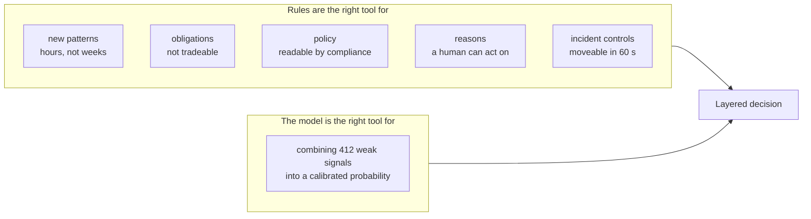

# Rules: Why the Thing Everyone Calls Legacy Is Still There, and How to Keep 1,100 of Them Honest

The received wisdom is that rule-based fraud detection is the old way, machine learning is the new
way, and a mature programme has replaced the first with the second. Every large fraud operation in
the world contradicts this. Ironvale Cards has a model with 1,870 trees and 412 features, and it
also has **1,100 active rules**, and the number of rules has grown every year since the model was
introduced.

That is not institutional failure. Rules and models do different jobs, and five of those jobs
cannot be done by a model at all. This document explains which five, then deals with the real
problem — that a rule estate rots, and 1,100 rules nobody has reviewed is a genuine liability.

Scenarios are `R-01` through `R-12`.

---

## What a rule actually is, and the vocabulary

A **rule** is a named, versioned predicate over the available features plus an action. Concretely,
one of Ironvale's:

```
rule  CNP-NEW-DEVICE-HIGH-TICKET          version 7
when  channel == "card-not-present"
  and device_first_seen_hours < 1
  and amount > card.p95_ticket_90d * 2.5
  and card.cnp_count_30d > 0
then  step_up
pack  cnp-core          precision 1 in 4.1     fires 2,140/day
```

Five parts matter and most rule systems that go wrong are missing one of them:

- **The predicate**, over features that come from the same feature store the model reads. Rules
  reading a different source than the model is a classic source of divergence (`R-09`).
- **The action** — decline, step up, hold, route to review, or just *tag*. The last one is
  underused and is the most valuable action in the set; see "shadow mode" below.
- **A pack**, which groups rules by purpose and determines governance. Ironvale has seven.
- **A version**, because a rule's meaning changes and your decision log must say which meaning was
  applied. A decision log recording `CNP-NEW-DEVICE-HIGH-TICKET` without `version 7` cannot be
  reproduced.
- **Measured performance** — how often it fires and with what precision — attached to the rule
  itself, recomputed continuously. A rule without this is an opinion.

The last one is what separates a rule estate from a pile of if-statements, and it is the thing
most teams add two years too late.

---

## The five jobs a model cannot do

### One. React within hours to a pattern that has no training data

At 09:40 an analyst notices that fourteen transactions in the last hour share a merchant category,
an amount ending in `.00`, and a card issued from a single branch's reissue batch. There is no
model that can learn this, because there are fourteen examples and they appeared forty minutes
ago. There will be four thousand examples by Monday if nobody acts.

A rule can be written, tested against yesterday's traffic, and deployed within the hour. A model
retrain, even a fully automated one, needs labels — and the labels for these fourteen
transactions will arrive in three to twenty-seven days. **The rule is not a worse version of the
model; it is the only instrument available on this timescale.** This is the single strongest
argument for keeping a rule engine and it is sufficient on its own.

### Two. Express an obligation that is not a trade-off

Some predicates are not optimisations. A card reported stolen must be declined, not
"scored as high risk." A sanctions-list match must be blocked. A court order freezing an account
must be honoured. These are legal requirements with a defined, auditable behaviour, and
implementing them as model features — where they would be one input among 412 and could in
principle be outweighed — is both wrong and indefensible to an auditor.

Ironvale's `mandatory` pack contains 23 such rules. They evaluate first, they cannot be disabled
by the on-call engineer, changing one requires a two-person approval, and the degradation ladder
in doc [02](02-the-decision-path-and-the-latency-budget.md) treats their unavailability as a
decline-by-default rather than an accuracy trade.

### Three. Encode a decision the business made, which is not a prediction

"We do not authorize card-not-present transactions from merchant category 7995, gambling, on
cards held by customers under 21." That is not a fraud prediction. It is policy, possibly
regulatory, and it belongs in a rule where a compliance officer can read it, rather than inside a
model where its existence is an empirical accident.

Mixing policy into a model has a specific, nasty failure mode: the model learns the policy from
historical data (because those transactions were always declined, they look risky), and then a
model retrain subtly weakens it, and nobody notices that a compliance control has quietly
degraded into a 0.73 coefficient.

### Four. Provide a reason a human can act on

When a customer calls to ask why their card was declined, "the gradient-boosted model scored
0.0071 against a threshold of 0.0041" is not an answer anybody can use — not the customer, not the
agent, not the analyst, not the regulator. "The transaction was declined because it was the fourth
attempt on a new device within ten minutes" is actionable at every level. Doc
[13](13-explainability-compliance-and-fairness.md) covers the formal requirements; the practical
point is that rules produce reasons as a side effect of existing, and models require separate
machinery (SHAP values, reason-code mappings) to produce worse ones.

### Five. Give you a control you can move in sixty seconds during an attack

At 03:10 an attack is in progress. You need to stop it now. The available moves are: change a
threshold, enable a rule, or deploy a model — and only the first two finish before the attack is
over. A rule estate with a safe, fast, audited change path is an incident-response capability, and
doc [15](15-the-failure-catalogue-and-playbook.md) leans on it heavily.

### And the job a model does that rules cannot

To be fair in the other direction: a model combines 412 weak signals into a calibrated
probability, and no human can write a rule that does this. Each of the model's inputs is nearly
useless alone — "transaction is 1.4× the card's median ticket" is true of a third of all
transactions. The model's value is entirely in the combination, and the combination is where
nearly all of the detection power lives. **Rules provide reach, speed and accountability; the
model provides discrimination.** A system with only rules has precision in the range of 1 in 20
and misses most fraud; a system with only a model cannot respond to anything new, cannot explain
itself, and cannot encode an obligation.



---

## How rules and the model combine, and the three wrong ways

This is a frequent interview question and there are three common answers, two of which are wrong.

**Wrong answer one: the model is a feature of the rules.** Write rules that reference the model
score — `when model_score > 0.004 and channel == "cnp" then decline`. This seems tidy and it
destroys calibration. The whole value of a calibrated score is that 0.004 means "0.4% chance of
fraud"; once that number is buried in forty rule predicates with different companion conditions,
nobody can reason about what any threshold means, and changing the model's calibration breaks
forty rules at once.

**Wrong answer two: the rules are features of the model.** Feed each rule's fired/not-fired flag
into the model as a binary feature and let it learn the weights. This destroys the obligations.
A sanctions match becomes a feature that can be outweighed, and the response-within-an-hour
property disappears because a new rule only takes effect after a retrain.

**The right answer: a policy layer that is neither.** The components run independently and a small,
explicit, auditable policy combines them in a defined precedence:

```
1. Mandatory pack        → if any fires, its action is final. No override.
2. Model score + segment threshold → produces a band: clear / uncertain / block.
3. Discretionary rule packs → may escalate the band (clear → uncertain,
                               uncertain → block) but may never de-escalate.
4. Allow-list pack        → may de-escalate, explicitly, with an owner and an
                               expiry date on every entry.
5. Channel capability     → if the band says step up and the channel cannot
                               challenge, fall back to the configured action
                               for that segment (usually decline above a
                               threshold, approve below).
```

Four properties make this work, and each is worth stating in an interview:

- **Precedence is explicit and one-directional.** Rules escalate, allow-lists de-escalate, and
  nothing else can move a band. This means that for any decision you can state in one line which
  component owns it.
- **The model's score keeps its meaning**, because no rule reads it.
- **Every de-escalation has an owner and an expiry.** Allow-lists are where fraud systems go to
  die — see `R-06`.
- **Channel capability is applied last**, because whether a challenge is possible is a fact about
  the world, not a risk judgment, and conflating the two produces the bug where the system
  "steps up" a petrol pump and effectively approves it.

---

## The real problem: 1,100 rules is an estate, and estates rot

Everything above argues for having rules. This section is about the cost, which is real and which
most of the published enthusiasm for rules ignores.

### R-01 · The rule that fires on 14 million transactions and nobody noticed

**What you see.** Analysts complain that the review queue is full of obvious nonsense. Precision
of the overall system has drifted down. Nothing has been deployed.

**Mechanism.** Somebody wrote `when merchant_country != card_country then tag` in 2021, when
cross-border was 2% of Ironvale's traffic. Cross-border is now 11%, so the rule tags
**4.6 million transactions a day** instead of 840,000, and because its action is `tag` rather than
`decline` nobody treated it as risky. Downstream, a second rule says "if three or more tags, route
to review", so a rule that fires on a tenth of all traffic now dominates the review queue.

**Confirm it.** Rank every rule by fire count over the last 7 days and look at the top twenty.
This is a two-minute query and most teams have never run it. The distribution is always a power
law; the question is whether the head is intentional.

**Recover.** Suppress the rule (not delete — suppression is reversible and auditable), and
recompute the queue.

**Prevent.** Every rule has a **declared expected fire rate** at creation, and the platform alarms
when actual exceeds declared by more than 3×. This single control catches most rule-estate decay,
because decay is nearly always a predicate whose population shifted underneath it.

### R-02 · Rule interaction: two safe rules that are dangerous together

**What you see.** A specific customer segment — in Ironvale's case, customers travelling in
Southeast Asia — has a decline rate of 14% against a baseline of 0.145%, a hundredfold
difference, and no single rule explains it.

**Mechanism.** Rule A escalates when the transaction country differs from the card's home country.
Rule B escalates when the merchant has a high historic decline rate. Rule C escalates when the
device is new. Each is individually sensible with individual precision around 1 in 15. For a
traveller using a new phone at a local merchant that serves mostly tourists, all three fire, and
the policy layer's escalation is cumulative, so the band goes from clear to block in two steps.

**Confirm it.** This is only visible by **co-occurrence analysis**: for every pair of rules, how
often do they fire together, and what is the precision of the conjunction? Ironvale runs this
nightly over the decision log for all pairs that co-occur more than 200 times a day. The pairwise
matrix for 1,100 rules is 604,450 cells, which sounds alarming and is a 40-second query because
the co-occurrence matrix is extremely sparse.

**Recover.** Cap the escalation: no more than one escalation step from the discretionary packs per
decision, regardless of how many fire. Ironvale adopted this and its decline rate dropped 11% with
no measurable change in catch rate — which tells you how much of the cumulative escalation was
doing nothing.

**Prevent.** Measure precision of conjunctions, not just of individual rules, and treat a rule's
reported precision as conditional on the rest of the estate rather than as a property of the rule.

### R-03 · The rule written during an incident that was never removed

**What you see.** 60% of your rule estate was written during an incident, has an owner who has left
the company, and nobody is willing to remove it because nobody knows what it stops.

**Mechanism.** This is the natural end state of an incident-response capability without a
lifecycle. Each rule was correct and necessary for about nine days.

**Prevent, and this is the most valuable single practice in the document: every rule created
through the incident path gets a mandatory expiry date, default 30 days.** At expiry it moves
automatically to shadow mode — still evaluated, still measured, but its action suppressed — and
after a further 14 days of shadow data somebody looks at its measured precision and decides to
promote it permanently or drop it. Promotion requires a named owner and a review date.

The reason this works where "please clean up your rules" does not: **the default is removal, and
the action required is keeping.** Ironvale's estate stabilised at 1,100 active rules after
introducing this, having been on a path to 2,600.

### R-04 · The rule that cannot be evaluated in the budget

**What you see.** The rule engine's p99 jumps from 14 ms to 95 ms after a deployment that added
four rules.

**Mechanism.** One of the new rules calls a function that performs a lookup the feature fetch did
not prefetch — a merchant-category hierarchy traversal, or a regular expression over a free-text
field. Rules are often written in an expression language that makes an expensive call look
syntactically identical to a cheap one.

**Confirm it.** Per-rule evaluation timing, which means instrumenting the engine rather than the
service. Most rule engines can be made to emit this at a sampled rate for a few percent of CPU
cost, and it pays for itself the first time.

**Prevent.** Two controls. First, **the expression language only permits access to features that
were fetched**, so the cost of a rule is bounded by construction and a rule needing a new feature
must declare it, which puts it into the batched fetch. Second, a **cost budget per pack** enforced
at load time: packs declare a maximum evaluation cost, measured in a synthetic benchmark at
deployment, and a pack that exceeds it does not load.

### R-05 · The rule estate with no idea which rules matter

**What you see.** You want to remove 400 rules and cannot justify removing any specific one.

**Mechanism.** Precision per rule is measured, but precision is the wrong metric for a removal
decision, because a rule can have excellent precision and contribute nothing — if every
transaction it blocks would have been blocked by the model anyway, removing it changes nothing at
all.

**The right metric is marginal contribution**: what happens to the system's catch rate and decline
rate if this rule alone is removed, holding everything else fixed. It is computed by replaying
labelled traffic with the rule suppressed.

Ironvale's result on its 1,100 rules is the kind of distribution that recurs everywhere:

| Marginal contribution | Rule count | Share |
|---|---|---|
| Blocks fraud nothing else blocks | 61 | 5.5% |
| Blocks fraud the model also blocks, but 200+ ms earlier in the cascade | 74 | 6.7% |
| Blocks nothing the model does not | 488 | 44.4% |
| Blocks nothing at all — predicate never satisfied in 90 days | 203 | 18.5% |
| Net negative — declines more good than bad | 97 | 8.8% |
| Mandatory or policy, not evaluated on contribution | 177 | 16.1% |

**The 203 that never fire are free to delete, and the 97 that are net negative are urgent.** The
488 redundant ones are the interesting group: they are harmless today and they are your insurance
if the model is unavailable, which is precisely the degradation scenario in doc
[02](02-the-decision-path-and-the-latency-budget.md). Ironvale keeps them, in a pack marked
`redundant-with-model`, measured quarterly, and promotes them to blocking automatically when the
model is in degraded mode. That is a genuinely good use of a redundant rule and it is the
justification for not simply deleting them.

**Prevent the estate becoming unknowable.** Compute marginal contribution for every rule monthly.
It is one replay job over a month of labelled traffic, 1,100 runs with one rule suppressed each,
and at Ironvale's scale it is four hours of batch compute. Four hours a month to know what your
estate does is the best value in this document.

### R-06 · The allow-list that became the attack surface

**What you see.** A merchant with 40,000 fraudulent transactions and a zero decline rate.

**Mechanism.** Two years ago the merchant complained about declines, a relationship manager
escalated, and somebody added the merchant to the allow-list to resolve the escalation. The entry
had no expiry. The merchant was later compromised, or sold, or always intended this.

Allow-lists are the one component of a fraud system where an entry *removes* protection, so they
need the opposite governance to everything else. Ironvale's rules for its allow-list pack, which
are worth copying verbatim:

- **Every entry has an expiry date, maximum 90 days.** No exceptions, including for the largest
  merchants. Renewal is an explicit action with a fresh justification.
- **Every entry has a named owner who is accountable**, not a team.
- **Every entry has a scope**, as narrow as possible: this merchant *and* this transaction type
  *and* under this amount, not "this merchant".
- **Allow-listed traffic is still scored and still logged**, with the suppressed decision recorded.
  This means you can compute, at any time, what the allow-list is costing you.
- **A monthly report of the allow-list's cost** goes to the person who approved each entry. At
  Ironvale this report alone reduced the allow-list from 2,900 entries to 340, because most of the
  entries were requested by people who had no idea they were buying $40,000 a month of fraud.
- **Allow-lists never override the mandatory pack.** A sanctions match is not allow-listable.

### R-07 · Shadow mode, and why every rule should start there

Before a rule takes effect it should run for a period with its action suppressed and its firing
recorded. This is cheap — Ironvale carries 240 shadow rules against 1,100 active ones, at under
2 ms of additional evaluation cost — and it answers the two questions you cannot answer any other
way: how often will it actually fire, and on what.

The discipline that makes shadow mode useful rather than ceremonial:

- **A minimum shadow period expressed in fraud events, not in days.** A rule needs to have seen at
  least 30 labelled fraud events in its firing population before its precision estimate means
  anything. For a rule that fires on 200 transactions a day with an expected 1-in-10 precision,
  that is 20 fraud events a day and so a day and a half. For a rare rule, it can be two months,
  and shipping it after a week is shipping it blind.
- **Shadow results compared against the current production decision**, not in isolation. The
  question is not "is this rule good" but "does this rule change any decision, and are those
  changes improvements."
- **An explicit promotion decision with the numbers attached**, recorded, because in nine months
  somebody will ask why this rule exists.

### R-08 · The flash sale that every volume rule fires on

**What you see.** Northwind Pay, 11:00 on a Tuesday. A ticket on-sale takes one merchant from 20
to 4,100 transactions per second. Eleven volume-based rules fire simultaneously and Northwind
declines a third of the most valuable legitimate traffic of the quarter.

**Mechanism.** Every velocity and volume rule is implicitly a statement about the *ratio* of
current activity to normal activity, and with a 237× peak-to-average ratio (doc
[01](01-the-running-systems-and-their-numbers.md)) "normal" is not a meaningful baseline for
Northwind.

**Recover.** Northwind maintains an **expected-event calendar**: merchants declare on-sales and
promotions in advance, and the platform relaxes volume thresholds for that merchant for that
window. This is unglamorous, it is a form, and it works better than any adaptive baseline anybody
has built, because the merchant knows what is coming and no algorithm does.

**Prevent.** Where a calendar is impossible, express volume rules relative to a baseline that
adapts fast enough to matter — but understand what that costs: an adaptive baseline that absorbs
a 237× increase in ninety seconds will also absorb an attack that ramps over ninety seconds,
which is most of them. **An adaptive baseline is an attack-tolerance setting, not a free
improvement**, and doc [12](12-adversaries-drift-and-the-arms-race.md) treats the general form of
this trade.

### R-09 · The rule and the model that disagree about what a feature means

**What you see.** A rule says the card has made 4 card-not-present transactions in 24 hours. The
model's feature vector for the same decision says 6.

**Mechanism.** The rule engine computes the feature itself, from a slightly different definition —
it counts attempts including declines, while the model's training pipeline counted approvals only.
Both definitions are defensible. Having both is not.

**Prevent.** One feature definition, in one place, consumed by both, with a name that includes its
semantics: `card_cnp_attempts_incl_declined_24h` rather than `cnp_count`. This is the feature
registry in doc [04](04-features-and-the-feature-store.md), and the reason to insist on it is less
about this bug than about what happens in an audit, when you are asked to explain a decision and
your two components disagree about the facts.

### R-10 · The rule nobody can test because it needs production data

**What you see.** A rule that performs correctly in the test suite and fires on 400× the expected
volume in production.

**Prevent.** The only reliable test for a rule is **replay against real historical traffic**, which
requires a decision log complete enough to reconstruct the feature vector as it was. Ironvale's
rule authoring tool runs a candidate against the last 7 days of logged feature vectors and reports
fire count, the distribution of fire count by segment, precision against known labels, and the
twenty transactions nearest the predicate's boundary for a human to eyeball. That last item
catches more errors than the statistics do, because the commonest rule bug is a unit mistake —
amount in cents rather than dollars, hours rather than minutes — and a human looking at twenty
examples spots it instantly while a precision figure does not.

### R-11 · The 1,100-rule estate evaluated in the wrong order

**What you see.** Rule engine p99 is fine on average but has a long tail correlated with a
particular segment.

**Mechanism.** Rules are evaluated in definition order, and the mandatory pack — which should exit
early for the rare transactions it matches — is evaluated after 700 discretionary rules. For the
0.01% of transactions that match a mandatory rule, 700 rules' worth of work was wasted; worse,
the engine's short-circuit optimisations are tuned for the common case, so the uncommon path is
slower than linear.

**Prevent.** Order packs by precedence (mandatory first, with early exit), and within a pack order
rules by **selectivity of their cheapest predicate**, so that the common case rejects on the first
comparison. A rule whose first clause is `channel == "card-not-present"` rejects 58% of traffic in
one integer comparison. Most engines can compute this ordering automatically from the observed
selectivity in the decision log, and doing so is a one-off piece of work that pays permanently.

### R-12 · Removing a rule and discovering what it was holding up

**What you see.** You remove a rule with zero marginal contribution. Three days later, fraud in an
unrelated segment rises.

**Mechanism.** The rule's contribution was zero *because the attack it prevents is not currently
being attempted*. An attacker probes, finds the pattern blocked, and stops; the rule then shows no
fires and no contribution, and looks dead. Removing it reopens the hole, which is discovered
promptly because attackers re-probe continuously.

**This is the deepest problem with contribution-based rule pruning and there is no clean solution.**
The partial mitigations:

- Keep the rule in **shadow** rather than deleting it, so you continue to see when its predicate
  starts being satisfied. A shadow rule costs microseconds and tells you when the attack returns.
- Distinguish, when classifying rules for removal, between "fires but blocks nothing useful" and
  "never fires." The second group is the dangerous one to remove, which inverts the intuition that
  a never-firing rule is obviously safe to delete.
- Record, for each rule, **what it was created in response to**. A rule created in response to a
  specific attack that worked is evidence about the attack surface, and that evidence is worth
  keeping even when the rule is quiet.

---

## What a healthy rule estate looks like

If you want a target to describe in an interview, this is a defensible one:

- **Seven packs or fewer**, each with a stated purpose and a governance level: mandatory (two-person
  approval, no expiry, cannot be disabled), policy (compliance-owned), core detection (fraud team,
  quarterly review), incident (30-day auto-expiry to shadow), experimental (shadow only),
  redundant-with-model (promoted automatically in degraded mode), allow-list (90-day expiry,
  named owner, monthly cost report).
- **Every rule carries**: an owner, a creation reason, a declared expected fire rate, a measured
  actual fire rate, a measured precision, a measured marginal contribution, and a review date.
- **Three automated reports**: top-twenty rules by fire count weekly; pairwise co-occurrence
  precision nightly; full marginal contribution monthly.
- **Two automated alarms**: actual fire rate exceeding declared by 3×, and any rule crossing from
  positive to negative marginal contribution.
- **One hard constraint**: at most one escalation step from discretionary packs per decision.

Four of those cost almost nothing to build and would have prevented five of the twelve scenarios
above.

---

## What to take away

1. **Rules are not a legacy of the pre-model era.** They do five jobs a model structurally cannot:
   react within hours to patterns with no labels, encode obligations that are not tradeable,
   express business policy readably, produce reasons humans can act on, and provide a control
   movable in sixty seconds during an attack.
2. **The model's job is different and also irreplaceable** — combining hundreds of individually
   useless signals into a calibrated probability. Rules give reach, speed and accountability; the
   model gives discrimination.
3. **Combine them in a policy layer, not inside each other.** Rules referencing the model score
   destroy calibration; rule flags as model features destroy both the obligations and the
   response time. Precedence must be explicit and one-directional: rules escalate, allow-lists
   de-escalate, nothing else moves a band.
4. **Precision is the wrong metric for keeping a rule; marginal contribution is the right one.**
   At Ironvale, 44% of rules block nothing the model does not and 18.5% never fire at all — but
   8.8% are net negative, and those are the urgent ones.
5. **Never-firing rules are the dangerous ones to delete**, not the safe ones, because a rule can
   show zero contribution precisely because the attack it blocks is currently not being attempted.
   Move them to shadow instead of deleting; a shadow rule costs microseconds and tells you when
   the attack comes back.
6. **Incident rules get a 30-day automatic expiry to shadow mode.** Making removal the default and
   keeping the exception is what stopped Ironvale's estate growing from 1,100 towards 2,600.
7. **Measure rule conjunctions, not just rules.** Three individually sensible rules escalating
   cumulatively produced a 14% decline rate for travellers; capping discretionary escalation at
   one step cut the overall decline rate 11% with no loss of catch rate.
8. **Allow-lists need inverted governance** — 90-day expiry, named owner, narrow scope, still
   scored and logged, and a monthly cost report to the approver. That report alone took Ironvale
   from 2,900 entries to 340.
9. **Every rule starts in shadow, for a period measured in fraud events rather than days.** Under
   roughly 30 labelled fraud events in the firing population, a precision estimate means nothing.
10. **Test rules by replay against logged feature vectors, and always show a human twenty
    boundary cases.** The commonest rule bug is a unit error, which twenty examples reveal
    instantly and a precision statistic hides completely.
