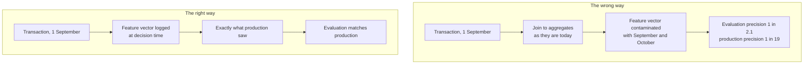
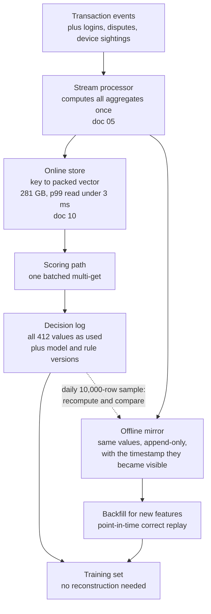

# Features: Where the Detection Power Actually Lives, and the Three Ways Feature Pipelines Lie

Doc [00](00-what-fraud-detection-actually-is.md) made the claim that the highest-return lever in a
fraud system is usually a feature rather than a model. This document makes good on it: what the
features actually are, how they are computed, why the online and offline copies disagree, and the
specific class of bug — training-serving skew — that makes a model look excellent in evaluation
and mediocre in production, with no error anywhere.

Scenarios are `F-01` through `F-14`. If you read one section, read "point-in-time correctness",
because it is the thing most teams get wrong and the thing most interviewers are listening for.

---

## A transaction on its own tells you almost nothing

Here is a real authorization message, reduced to its useful fields:

```
card token      tok_8f1a44c9
amount          $284.00
currency        USD
merchant        MID 4471902, category 5732 (electronics)
channel         card-not-present
timestamp       2026-11-12T03:47:22Z
device          dv_0e31a8
ip              203.0.113.44
entry mode      keyed, no CVV match available
```

Is this fraud? You cannot tell, and neither can any model, because nothing here is suspicious in
isolation. $284 of electronics is an ordinary purchase. 03:47 UTC is the middle of the afternoon
somewhere. Card-not-present is 58% of Ironvale's traffic.

Now add six facts about the context:

```
card's median ticket, 90 days                    $31.40
card's largest previous transaction, 90 days      $96.00
card's previous transactions in category 5732          0
device dv_0e31a8 first seen                   41 seconds ago
distinct cards seen on device dv_0e31a8, 24h          17
merchant's decline rate, last hour       38%, baseline 4%
```

Now it is obvious. And note that **every one of those six facts is an aggregate over history, not
a property of the transaction.** This is the central fact about fraud features: the signal is
almost entirely in the relationship between this event and the entity's past, and a system's
detection power is a direct function of how much relevant history it can bring to bear within its
latency budget.

The design consequence: **the feature store is not a cache in front of a database. It is the
system's memory, and it is the most expensive and most load-bearing component you will build.**

---

## The feature families, with what each is worth

Ironvale's 412 features group into seven families. The "catch rate contribution" column is from
the ablation study described in doc [17](17-testing-fraud-systems.md) — remove the family, retrain,
measure catch rate at a fixed decline rate. The figures do not sum to 100% because the families
overlap substantially.

| Family | Examples | Count | Contribution |
|---|---|---|---|
| **Velocity** | Count and sum over the card, device, IP, email, merchant, in windows of 1 min, 10 min, 1 h, 24 h, 7 d, 30 d | 164 | 31% |
| **Deviation from the entity's own profile** | Ratio of amount to the card's trailing median; distance from its usual merchant categories; hour-of-day likelihood | 71 | 24% |
| **Entity age and novelty** | Seconds since this device/merchant/payee was first seen on this card; first-ever use of this country | 38 | 19% |
| **Linkage / graph** | Cards per device, devices per card, shared-attribute cluster size, known-ring membership | 44 | 14% |
| **Merchant and acceptor risk** | Merchant's trailing fraud rate, decline rate, chargeback rate, category | 29 | 11% |
| **Transaction intrinsics** | Amount, currency, entry mode, CVV and AVS results, cryptogram validity | 31 | 9% |
| **Behavioural / session** | Typing cadence, navigation pattern, time-on-page, app-prompt response time | 35 | 7% |

Three observations that are worth more than the table.

**Velocity is a third of the value and is conceptually trivial.** Counting is not clever. The
difficulty is entirely in computing counts over six entity types and six window lengths,
correctly, at 3,900 events per second, with the result readable in a few milliseconds — which is
an engineering problem, and is doc [05](05-the-streaming-pipeline.md) plus doc
[10](10-storage-hot-cold-and-what-it-costs.md). **The most valuable features in fraud detection are
the ones that are hard to serve rather than hard to invent**, and this is the main reason the
engineering is where the competitive advantage sits.

**Transaction intrinsics contribute 9%.** The fields actually present in the message — amount,
category, entry mode — are the least valuable family. A candidate who designs a model over the
transaction fields has built something that captures a tenth of the available signal.

**Behavioural is last at 7% and is getting less valuable, not more.** Doc
[08](08-device-identity-and-behavioural-signals.md) explains why: the signals that make device and
behavioural fingerprinting work are being systematically removed by browser and operating-system
privacy changes, and a system that leaned heavily on them in 2019 has quietly lost capability
since.

---

## Windowed aggregates: what "count in the last hour" actually means

"Transactions in the last hour" sounds unambiguous. There are at least four implementations with
materially different behaviour, and choosing without knowing you are choosing is the first scenario
below.

### F-01 · Four implementations of "the last hour", one of which has a known bypass

**A sliding window** is the literal reading: count of events with timestamp in
`(now − 3600s, now]`. Exact, and expensive — you must retain every event in the window to know
what to subtract as it expires. For a card with 40 transactions in an hour this is fine. For
Northwind's merchant with 4,100 transactions a second it is 14.8 million retained events for one
key.

**A tumbling window** counts within fixed boundaries: 10:00–11:00, then 11:00–12:00. Cheap — one
counter, reset on the boundary. And it has a bug that attackers find: at 10:59 the counter is
nearly full, and at 11:00 it is zero, so an attacker who paces around the boundary gets double the
allowance. Any rule built on tumbling windows has a known bypass, and card-testing tooling
genuinely exploits it.

**A hopping window** is a sliding window approximated by several overlapping tumbling windows —
twelve 5-minute buckets summed to give "the last hour", advancing one bucket at a time. The error
is bounded by the bucket size (here, up to 5 minutes of staleness at the trailing edge), the cost
is twelve counters instead of one, and the boundary bypass shrinks to the bucket size. **This is
the right default** and it is what Ironvale uses, with bucket sizes chosen per window length:

| Window | Buckets | Bucket size | Max staleness | Counters per key |
|---|---|---|---|---|
| 1 minute | 6 | 10 s | 10 s | 6 |
| 10 minutes | 10 | 1 min | 1 min | 10 |
| 1 hour | 12 | 5 min | 5 min | 12 |
| 24 hours | 24 | 1 h | 1 h | 24 |
| 7 days | 7 | 1 d | 1 d | 7 |
| 30 days | 30 | 1 d | 1 d | 30 |

```
Total buckets per counted quantity: 6 + 10 + 12 + 24 + 7 + 30 = 89
```

And since each bucket holds a count and a sum (4 bytes plus 8 bytes with its key overhead, call it
16 bytes amortised in a packed representation):

```
89 buckets × 16 bytes = 1,424 bytes ≈ 1.4 KB per entity key
```

**That is where the 1.4 KB from doc [01](01-the-running-systems-and-their-numbers.md) comes from**,
and multiplied across 200.9 million keys it is the 281 GB of hot state. It is worth noticing how
directly a modelling choice — "we want six window lengths" — became a storage bill. Cutting to
four windows (1 min, 1 h, 24 h, 30 d) gives 71 buckets, 1.14 KB, and 229 GB, an 18% saving, and
costs about 2% of catch rate. That is a real trade and it should be made deliberately rather than
by whoever wrote the first feature spec.

**A decayed counter** is the fourth option and the one most people have never considered. Instead
of windows, keep a single exponentially decayed value: on each event, `v = v × exp(−Δt/τ) + 1`.
One number, constant memory, no boundaries to exploit, and a tunable time constant. It cannot
answer "exactly how many in the last hour", but for a model input, "recent activity, weighted
towards the present" is usually just as informative and sometimes more. Ironvale uses decayed
counters for 31 of its 164 velocity features, specifically for the high-cardinality entities (IP
prefix, email) where the per-key storage cost dominates, saving about 40 GB.

### F-02 · The window that is wrong at the edges because of late events

**What you see.** Velocity features are slightly lower than the truth, and the shortfall is
concentrated in exactly the transactions you care about.

**Mechanism.** Events arrive at the aggregator out of order and slightly late — a transaction
timestamped 10:00:03 arrives at 10:00:06 because of network and broker latency. If the bucket for
10:00:00–10:00:10 has already been read, the count the scorer saw was short by one.

This matters more than it sounds, because **the late events are not random**. Attack traffic is
bursty, bursts cause queueing, queueing causes lateness, so the transactions most likely to be
undercounted are the ones in a burst, which is the pattern the velocity feature exists to detect.

**Confirm it.** Log, for each event, the difference between its own timestamp and the moment it was
applied to the aggregate. Ironvale's distribution: p50 of 240 ms, p99 of 1.9 s, p99.9 of 14 s.
Then measure what share of scoring reads happen within that window of a preceding event for the
same key.

**Recover and prevent.** Three approaches, in increasing order of cost:

1. **Count the current transaction itself at the point of scoring**, in memory, rather than relying
   on the pipeline to have applied it. This fixes the single most important case — the second of
   two rapid transactions — for free, and it is omitted surprisingly often.
2. **Write-through at decision time.** The scoring path increments the aggregate synchronously as
   part of the decision, in addition to the asynchronous pipeline, with idempotency by transaction
   ID so the pipeline's later write is a no-op. This makes the aggregate correct for the scoring
   path at the cost of a write in the latency budget (Ironvale measures 3 ms for a batched
   increment alongside the read).
3. **Accept the staleness and model it**: include "seconds since last applied event for this key"
   as a feature so the model can learn to discount a velocity count that is known to be stale. This
   is elegant, cheap, and much less effective than it sounds, because it helps the model hedge
   rather than giving it the fact.

Ironvale does 1 and 2. Doc [05](05-the-streaming-pipeline.md) covers watermarks and the general
late-event machinery.

---

## Point-in-time correctness: the bug that makes your model look brilliant

This is the most important section in the document and the thing to be able to explain cleanly.

You are building a training set. For each historical transaction you need the feature values *as
they were at the moment of that transaction*. The obvious way to build it is to join the
transaction table against the aggregate tables:

```sql
-- WRONG. This is the bug.
SELECT t.transaction_id,
       t.amount,
       a.card_txn_count_24h,
       a.card_amount_sum_24h,
       t.is_fraud
FROM   transactions t
JOIN   card_aggregates a ON a.card_token = t.card_token
WHERE  t.ts BETWEEN '2026-08-01' AND '2026-10-31'
```

`card_aggregates` holds the aggregate *as it is now*. For a transaction from 1 September, you have
just attached aggregate values that include everything that happened in September and October —
including the transaction itself, and including the fourteen other fraudulent transactions on that
card that happened in the twenty minutes afterwards.

The model trains on this and learns, correctly, that a high 24-hour velocity predicts fraud. In
evaluation it is spectacular: AUC 0.991, precision at the operating point of 1 in 2.1. In
production it is mediocre, because in production the twenty minutes afterwards have not happened
yet.

**This is called label leakage or temporal leakage, and it is the commonest serious defect in fraud
modelling.** It is particularly insidious because:

- There is no error. Every query runs. Every test passes.
- The symptom is "the model is better in evaluation than in production", which teams routinely
  attribute to distribution shift, infrastructure differences, or bad luck.
- The size of the effect is enormous. Ironvale's measured gap on a leaked model: evaluation
  precision 1 in 2.1, production precision 1 in 19.
- It gets *worse* with better features. The more history-dependent your features are — which is to
  say, the better your feature set — the more leakage inflates your evaluation.

### How to actually build the training set

There are three correct approaches and you should be able to name the trade-off between them.

**Approach one: log the features at decision time, and train on the log.** The scoring service
already assembled a complete feature vector in order to make the decision. Write it down. The
training set is then, by construction, exactly what production saw, with no reconstruction and no
possibility of leakage.

This is the right answer, and it is what Ironvale does — the decision log from doc
[01](01-the-running-systems-and-their-numbers.md) carries all 412 feature values per decision. The
costs are real and worth stating:

```
412 features × 42,000,000 decisions/day
  ≈ 1.9 KB per record compressed (columnar, mostly numeric, highly compressible)
  = 42,000,000 × 1.9 KB = 80 GB per day
  = 29 TB per year
```

29 TB a year in object storage is a few thousand dollars, which is trivial against a $26 million
fraud loss. The genuine limitation is different: **you can only train on features you were already
computing.** A new feature idea has no history, so you cannot evaluate it until you have deployed
it and waited. Which leads to:

**Approach two: a point-in-time correct backfill from the raw event log.** Keep the raw
transaction stream, and recompute any feature as of any historical moment by replaying events up
to that moment and no further. This is what lets you evaluate a new feature against three years of
history.

It is correct if and only if the replay is strictly causal, and the ways it stops being causal are
subtle:

- The replay uses the event's *processing* timestamp rather than its *event* timestamp, so late
  events land in the wrong place — and in the wrong direction, since a late event is included in
  an earlier window than it belongs to.
- A dimension table is joined at its current value rather than its value at the time: the
  merchant's risk category is read as it is today, when today's category was *set because of the
  fraud you are trying to predict*. This is the most common residual leak after the obvious one is
  fixed, and it needs slowly-changing-dimension handling on every reference table.
- A feature depends on an entity resolution (which device fingerprints are "the same device") that
  was itself computed later with later information.

The practical test for whether your backfill is causal: **for a given transaction, compute every
feature twice, once from the backfill and once from the production decision log, and compare.**
They should match to within the known staleness. Ironvale runs this on a 10,000-transaction sample
daily and treats any feature with more than 0.5% mismatch as broken until proven otherwise. This
single check catches nearly every leakage bug, and a team that cannot run it does not know whether
its backfill is correct.

**Approach three: an offline store with as-of join support.** Several feature-store systems
implement the point-in-time join directly — you supply an entity key and a timestamp and they
return the value as of that instant, from a versioned history. This is approach two with the
causality enforced by the tool rather than by your discipline, which is better, and the cost is
storing the version history.



### F-03 · The transaction counted in its own velocity feature

A specific and very common instance of the general problem, worth calling out separately because
it survives the general fix.

**What you see.** `card_txn_count_1h` is 1 for every single-transaction card, in training. In
production the scorer reads the aggregate before its own write, so the same situation yields 0.
A one-unit offset across an entire feature family.

**Mechanism.** The training pipeline computed the aggregate over a window that includes the
transaction itself; the serving path reads before incrementing. An off-by-one in the most
important feature family.

**Prevent.** Define, once, in writing, whether aggregates include the current event, and make both
paths obey it. Ironvale's convention is **exclusive**: all aggregates are over events strictly
before the current one, and where the current event matters it appears as a separate, explicitly
named feature. The alternative convention is fine too; having two conventions is not.

---

## Training-serving skew, beyond leakage

Leakage is the famous one. Three other skews are nearly as damaging and much easier to miss.

### F-04 · The same feature name computed by two different pieces of code

**What you see.** Production precision below evaluation precision by a few points, consistently,
across model versions.

**Mechanism.** The training feature is computed in Spark or SQL by the data team; the serving
feature is computed in Java or Go by the platform team. They were written from the same
specification by different people. They differ on: timezone handling at day boundaries, whether
reversals and refunds are included, how a declined attempt counts, what happens when a currency
conversion is involved, and rounding.

Ironvale audited this once and found **19 of 412 features** differed materially between the two
implementations. Four of them were in the top twenty by model importance.

**Prevent.** The only robust fix is that there is one implementation. Options, best first:

- **Compute features in the streaming layer and have both paths read the same computed values.**
  Training reads them from the decision log or the offline mirror of the same store; serving reads
  them from the online store. The feature is computed once, by one piece of code, and both
  consumers read the output. This is the feature-store architecture's main justification and it is
  a bigger deal than the serving latency.
- **If you must have two implementations, make the comparison a continuous test**, as described
  above: recompute offline, compare against the logged online values, alarm on divergence. Do not
  rely on code review to keep two implementations in agreement; it does not work, and nineteen
  features is what it looks like when it does not.

### F-05 · The feature whose meaning changed and the model did not notice

**What you see.** A gradual, unexplained drop in catch rate beginning on a specific date,
traceable to a deployment in a completely different service.

**Mechanism.** An upstream team changed what they put in a field. The merchant category code
started being populated from a new source with slightly different mappings; the device fingerprint
library was upgraded and now produces different identifiers for the same device, so
`device_first_seen_hours` reset to zero for every device in the world on the day of the upgrade;
a currency field began arriving as a string rather than an integer code.

**Prevent.** This is a contract problem, not a modelling problem, and it is the same problem doc
[05](05-the-streaming-pipeline.md) handles with schema registry and compatibility rules. In
addition:

- **Monitor the distribution of every input feature, not just the score.** A feature whose mean
  moves by more than a few standard deviations overnight is a deployment somewhere, and it should
  page. Doc [14](14-observability-and-operating-the-service.md) details this.
- **Version the feature definition, and record the version in the decision log**, so that a model
  trained on `device_first_seen_hours@v2` can refuse to serve against `@v3` rather than silently
  serving nonsense.

### F-06 · The cold start, which is most of your fraud

**What you see.** Catch rate on first transactions, first devices and newly issued cards is far
below the overall figure. Specifically, Ironvale's catch rate on a card's first-ever
card-not-present transaction is 54% against an overall 93%.

**Mechanism.** The features are all relative to history and there is no history. Every
deviation-from-profile feature is undefined; every velocity count is zero; entity age is zero,
which is itself the only informative thing available.

This is not an edge case. New cards, new devices, new merchants and new payees are where a
disproportionate share of fraud happens, precisely because they carry no history to contradict
them.

**Prevent — and this is a design problem with real answers:**

- **Back off to a less specific entity.** No history for this card? Use the account. No history for
  the account? Use the issuing branch's population, the product type, the segment. The feature
  becomes "deviation from the profile of customers like this one", which is weaker but defined.
  Ironvale implements this as an explicit hierarchy per feature family, with a "backoff level"
  feature so the model knows how specific the comparison was — and knowing is important, because a
  deviation from a segment profile should be weighted differently from a deviation from the card's
  own profile.
- **Treat absence as a signal rather than imputing it.** Covered in doc
  [02](02-the-decision-path-and-the-latency-budget.md) as `D-05`; the same discipline applies in
  training. Tree models handle missing natively and well.
- **Lean harder on the entity-age and linkage families for cold-start traffic**, since those are
  the families that *are* defined. A brand new device with no history is not an absence of signal;
  "first seen 41 seconds ago" is a strong signal in itself.
- **Use step-up aggressively on genuinely new combinations.** You have no information, so acquire
  some: a first card-not-present transaction on a new device is the ideal candidate for an app
  prompt, because the cost of asking is low and the information gained is high. Ironvale steps up
  11% of first-CNP-on-new-device transactions against 2.75% overall.

---

## F-07 through F-14, in brief

### F-07 · The high-cardinality feature that memorises

Encoding merchant ID as a categorical feature with 2.9 million levels lets the model memorise
individual merchants. This looks excellent in evaluation and generalises badly, and it also means
a brand new merchant — the risky case — has no encoding at all. **Prevent:** use target encoding
with smoothing towards the category mean, computed point-in-time correctly (an unsmoothed target
encoding computed over the whole training period is itself a leak), and always include the
merchant's *observation count* as a companion feature so the model can discount a thinly observed
encoding.

### F-08 · The feature that encodes the previous model's decision

`card_declines_24h` is a strong predictor of fraud. It is also a function of what your own system
decided, which means your model is partly predicting itself. When you change the threshold, the
feature's distribution shifts, and the model trained on the old distribution degrades for reasons
that look like drift but are self-inflicted. **Prevent:** keep such features — they are genuinely
predictive — but (a) record the policy version alongside, (b) include declines by *other* issuers
where the network provides them, which is exogenous, and (c) expect to retrain after any
significant threshold change rather than treating the two as independent.

### F-09 · The aggregate that is correct and useless because the key is wrong

Counting transactions per IP address was informative in 2014. Today a large share of mobile traffic
shares carrier-grade NAT addresses, so an IP's transaction count is mostly a measure of how many
customers that carrier has. **Prevent:** choose key granularity empirically, by measuring the
feature's actual discriminative power rather than its intuitive plausibility, and revisit it — IP
granularity, device identifier stability and email normalisation have all shifted materially in
the last five years. Ironvale keys on the /24 prefix rather than the full address, with a separate
flag for known hosting and VPN ranges, and treats the raw per-address count as nearly worthless.

### F-10 · The 90-day window that nobody can afford

A "distinct merchant categories in 90 days" feature requires either retaining 90 days of events
per card or maintaining a set structure. For 70 million cards the exact version is prohibitive.
**Prevent:** use a sketch. A HyperLogLog for distinct counts costs about 1.5 KB for a few percent
error; for low-cardinality domains like merchant category (around 400 values) a 400-bit bitmap is
exact and costs 50 bytes. **Choosing the right compact structure per feature is where a good
chunk of the storage bill is won or lost**, and the question "do we need this exactly?" almost
always has the answer no.

### F-11 · The feature store read that is a join

Someone implements "merchant's trailing fraud rate" as a lookup into a merchant table, which is a
separate round trip, which breaks the single-batched-fetch rule from doc
[02](02-the-decision-path-and-the-latency-budget.md) (`D-10`). **Prevent:** everything the scorer
needs lives in the online store under one of the entity keys, denormalised. The online store is
not a database and should not be used as one; it is a key-to-precomputed-vector map, and features
that cannot be expressed that way need to be precomputed into that shape by the pipeline.

### F-12 · The feature registry nobody maintains

Four hundred and twelve features, no documentation, and the only description of
`card_cnp_attempts_incl_declined_24h` is its name — which at least is honest, unlike `cnp_count`.
**Prevent:** a registry entry per feature carrying: the exact definition, the owner, the entity
key, the window and its implementation, whether it includes the current event, its null semantics,
its serving source, its observed distribution, its model importance, and the date it last changed.
This sounds like bureaucracy until the first time you have to explain a decline to a regulator or
debug a 2% catch-rate drop, at which point it is the difference between an afternoon and a month.

### F-13 · Consortium and third-party features, and their delay

Network-level and consortium data — "this card has been reported fraudulent by another issuer",
"this device appears in a shared fraud database" — is among the most predictive data available,
because it is genuinely exogenous. Two cautions. **It arrives late**, typically 2 to 10 days, so it
is enormously more useful for the next transaction than for this one, and a training set built
with consortium flags joined at their current value is leaking (the flag was set *after* the
transaction). **And it is not free of feedback**: the consortium's flags come from other issuers'
models, so a correlated error becomes a correlated error everywhere.

### F-14 · The feature that is a protected characteristic in disguise

Postcode, device price tier, merchant category of a place of worship, the language of the browser.
Each can be a legitimate risk signal and each can proxy for a protected characteristic, which
matters legally, not just ethically. Doc
[13](13-explainability-compliance-and-fairness.md) covers the testing regime. The practical
discipline here: **every feature's registry entry records whether it was reviewed for proxy risk,
by whom, and when** — and a few features are excluded outright, with the exclusion documented, so
that nobody reintroduces them in eighteen months.

---

## What the online and offline stores actually are

Putting the pieces together, the shape that satisfies everything above:



The dotted line is the control that keeps the whole thing honest, and it is the one component of
this diagram that teams routinely skip. Without it you have two implementations of 412 features
and no evidence they agree.

---

## What to take away

1. **The transaction tells you almost nothing; the context tells you everything.** Transaction
   intrinsics contribute 9% of catch rate, while velocity, profile deviation and entity novelty
   contribute 31%, 24% and 19%. A model over the message fields captures a tenth of the signal.
2. **The valuable features are hard to serve, not hard to invent.** Counting is trivial; counting
   six entity types across six windows at 3,900 events per second with a 3 ms read is the whole
   problem, and it is where the engineering advantage lives.
3. **Choose your window implementation deliberately.** Tumbling windows have a boundary bypass
   attackers genuinely use; sliding windows are exact and expensive; hopping windows are the right
   default; exponentially decayed counters are one number per key and are under-used.
4. **The 1.4 KB per key comes from 89 buckets**, which comes from choosing six window lengths.
   Dropping to four windows saves 18% of 281 GB for about 2% of catch rate — a real trade that
   should be made on purpose.
5. **Point-in-time correctness is the defect that matters most.** Joining today's aggregates to
   historical transactions took Ironvale's evaluation precision to 1 in 2.1 while production was
   1 in 19, with no error anywhere and every test passing. It gets worse as your features get
   better.
6. **Log the feature vector at decision time and train on that.** 80 GB a day is trivially cheap
   against a $26 million loss, and it makes leakage structurally impossible. Keep a causal
   backfill as well, for evaluating features you were not yet computing.
7. **Run the daily recompute-and-compare on a sample.** It is the only evidence that your offline
   and online feature implementations agree. Ironvale's one-time audit found 19 of 412 features
   differing materially, four of them in the top twenty by importance.
8. **State once, in writing, whether aggregates include the current event**, and make both paths
   obey it. An off-by-one in the most important feature family is the commonest residual skew.
9. **Cold start is not an edge case, it is where the fraud is.** Catch rate on a card's first
   card-not-present transaction is 54% against 93% overall. Back off to a less specific entity,
   carry the backoff level as a feature, treat absence as signal rather than imputing, and step up
   aggressively on genuinely new combinations.
10. **Maintain the registry.** Definition, owner, key, window, current-event semantics, null
    semantics, serving source, distribution, importance, last change, and proxy-risk review. It is
    bureaucracy right up until the first regulator question or the first unexplained 2% drop.
