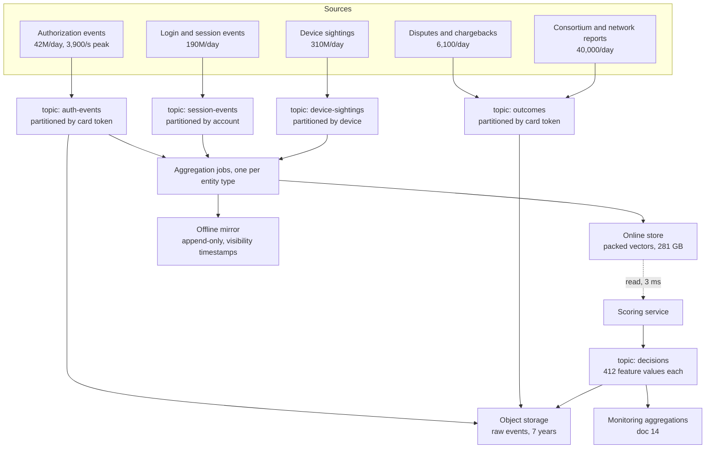

# The Streaming Pipeline: Computing 200 Million Counters Without Lying About Any of Them

Doc [04](04-features-and-the-feature-store.md) established what has to be computed: 89 windowed
buckets per entity key, across six entity types, 200.9 million keys, 281 GB of state, updated from
42 million events a day with a peak of 3,900 per second, and readable in under 3 ms. This document
is about the machinery that does it.

It deliberately does **not** re-teach Kafka or stream processing. The broker internals, consumer
groups, partition assignment, delivery semantics and the general operational failure modes are in
[`../Kafka`](../Kafka/README.md), and the general streaming-architecture material — watermarks,
state backends, exactly-once mechanics, the 4-million-events-per-second Meridian system — is in
[`../DataStreaming`](../DataStreaming/README.md). What is here is the part that is specific to
fraud: why the usual streaming correctness trade-offs land differently when the output is a
blocking decision about somebody's money, and the six ways a fraud aggregation pipeline produces
numbers that are quietly wrong.

Scenarios are `P-01` through `P-12`.

---

## The topology, and why it has the shape it does



Four structural decisions in that diagram are worth defending explicitly, because each is a place
where a reasonable-looking alternative causes real problems.

**One. Raw events go to object storage directly, not via the aggregation job.** The seven-year
retention requirement is regulatory, the volume is large, and coupling it to a stateful stream job
means an aggregation outage becomes a data-loss event. Separate consumers for separate purposes;
the failure domains should not overlap.

**Two. One aggregation job per entity type, not one job computing everything.** The alternative —
a single job that updates card, device, IP, email, merchant and account aggregates from each
event — requires that one event mutate six differently-keyed pieces of state, which means either
distributed state or a shuffle per entity type anyway. Splitting by entity type means each job is
keyed by exactly the thing it aggregates, its state is local, and it can be scaled, restarted and
reasoned about independently. The cost is that the same event is read six times, which at 42
million events a day is a bandwidth cost and not a correctness one.

**Three. Partition by the aggregation key, which forces a skew problem you must solve.** If a
job's state is local to a partition, every event for a key must land on the same partition.
`P-03` is what happens then.

**Four. The decision log is a topic, not a database write.** Already argued in doc
[02](02-the-decision-path-and-the-latency-budget.md) (`D-12`): the scoring path must not wait on
the warehouse. It also means the monitoring aggregations in doc
[14](14-observability-and-operating-the-service.md) read from the same stream rather than querying
a store, so monitoring latency is seconds rather than the warehouse's minutes.

---

## The correctness question that is different here: counters and duplicates

Most streaming discussions of delivery semantics are about whether a record is processed once or
more than once, and conclude that at-least-once with idempotent downstream writes is usually
sufficient. **For fraud aggregates that conclusion is wrong, and understanding why is a genuinely
discriminating interview topic.**

An increment is not idempotent. If `card_txn_count_1h += 1` is applied twice because the consumer
re-read a batch after a failure, the counter is 2 when the truth is 1. Nothing downstream can
detect or correct it, because there is no record of what the count should have been. The error is
permanent for the life of the window, and it affects the exact feature family that carries 31% of
the detection power.

So you need one of three things:

**Exactly-once processing with transactional state.** The stream processor commits the state update
and the input offset atomically, so a replay cannot double-apply. Flink's checkpointing with a
transactional sink, or Kafka Streams' exactly-once semantics, do this. It works, it is the standard
answer, and its cost is latency: a checkpoint interval of, say, 10 seconds means that on recovery
you reprocess up to 10 seconds of events, and more importantly the *committed* state advances in
checkpoint-sized steps. Ironvale runs 5-second checkpoints with incremental state snapshots, which
costs about 4% of throughput.

**Idempotent increments via deduplication on an event identifier.** Keep, per key, a structure
recording which event IDs have already been applied, and skip repeats. Exact deduplication over a
24-hour window for 42 million events a day is 42 million identifiers, which is perfectly feasible
centrally but not per-key. In practice this is done with a bounded structure — a rolling set of
recent IDs per key, since duplicates arrive close together — and Ironvale keeps the last 64 event
IDs per card as a 512-byte ring, catching essentially all duplicates for the cost of 3% more state.

**Reconstructible counters: store the events, not the count.** If the window's contents are
retained rather than just its sum, a duplicate is detectable by identity and the aggregate is a
pure function of a set. This is exact and it is the storage cost the hopping-window design was
built to avoid.

Ironvale uses the first two together, belt and braces, because the cost of each is a few percent
and the cost of silently inflated velocity counters is a model that blocks good customers for a
reason nobody can find. **The general principle to state: for an aggregate that feeds a blocking
decision, prefer exactness over throughput, because the failure is silent and permanent.** This is
the opposite of the usual trade-off in analytics pipelines, where approximate is fine because
somebody will look at a dashboard.

### P-01 · The replay that doubled every counter

**What you see.** Decline rate triples for forty minutes. Velocity features look high across the
board. No deployment, no attack.

**Mechanism.** An aggregation job was restarted after an operator cleared its state incorrectly —
resetting the consumer offset to an earlier point without resetting the state store. The job
reapplied four hours of events to state that already contained them.

**Confirm it.** Compare the aggregate's value against a count derived from the raw event log for a
sample of keys. This requires having the raw log, separately, which is reason number one for the
first structural decision above. Ironvale runs this comparison continuously on 1,000 sampled keys
per hour and alarms at 2% divergence; it is the only check that catches an inflated counter.

**Recover.** Rebuild the state from the raw log rather than attempting to correct it. For a 30-day
window this means replaying 30 days of events, which at 42 million a day and a replay throughput
of 180,000 events per second is:

```
30 × 42,000,000 = 1.26 billion events
1.26bn / 180,000 per second = 7,000 seconds ≈ 1 hour 57 minutes
```

**Two hours to rebuild from scratch is a number worth knowing before you need it**, and worth
rehearsing, because the first time anybody tries it is always during an incident. During the
rebuild, serve the old state (stale but not wrong) rather than partial new state, and have the
cutover be atomic — which means building into a second keyspace and switching a pointer, not
mutating in place.

**Prevent.** Offset and state must be committed together or not at all; operationally, make
"reset the offset" impossible without also resetting the state, by tooling rather than by runbook.

### P-02 · The reordering that puts an event in the wrong bucket

**What you see.** A small, persistent inaccuracy in short-window features, worse during bursts.

**Mechanism.** Events are partitioned by card token, so all events for a card are ordered *within*
the partition. But the authorization service writes to the topic from multiple instances, and a
transaction that was processed first may be produced second. Within a 10-second bucket this is
invisible; across a bucket boundary it misassigns the event.

**Prevent.** Use event time, not processing time, for bucket assignment — which is the standard
answer and is covered in [`../DataStreaming`](../DataStreaming/README.md). The fraud-specific
subtlety is **which event time**: the authorization message carries a merchant-supplied timestamp,
a network timestamp, and the issuer's own receipt timestamp, and they disagree by up to several
minutes because merchant terminal clocks are unreliable. Use the issuer's receipt time for
aggregation, because it is the only one you control, and keep the merchant timestamp as a feature
— a large disagreement between them is itself mildly predictive.

### P-03 · The hot partition that is a single merchant

**What you see.** One aggregation task is at 100% CPU, its consumer lag grows, and 95 of 96 other
tasks are nearly idle. Features for that partition are minutes stale.

**Mechanism.** Merchant-keyed aggregation partitioned by merchant ID. Northwind's ticket on-sale
puts 4,100 events per second onto the partition owning that merchant, while the average partition
sees 0.4 per second. This is the general hot-key problem described in
[`../Kafka`](../Kafka/README.md) and in
[`../DBMigrations`](../DBMigrations/10-sharding-resharding-and-moving-tenants.md); what follows is
the fraud-specific resolution.

**The resolution is two-stage aggregation.** Split the key: produce to `merchant_id + random(0..N)`
for a hot merchant, aggregate each sub-key locally, and sum the N sub-aggregates at read time.
Reading N sub-keys instead of one costs a slightly larger multi-get, which the batched fetch
absorbs. The salt count can be dynamic — Ironvale maintains a small table of "hot merchants" with
a salt factor, updated every five minutes from observed rates, defaulting to 1 for the 2.9 million
ordinary merchants.

**The subtlety to mention:** salting breaks any feature that needs per-key ordering or distinctness
rather than a sum. "Distinct cards on this merchant in 1 hour" cannot be summed across salted
sub-keys without double-counting. For those features, use a mergeable sketch — HyperLogLog unions
correctly across sub-keys, which is exactly why you reach for it here — or accept a separate,
slower, unsalted path for the small number of such features.

### P-04 · The rebalance storm during the peak

**What you see.** At 12:40 on Black Friday, aggregation lag goes from 200 ms to 90 seconds, and
velocity features during the most important hour of the year are a minute and a half stale.

**Mechanism.** Autoscaling added consumers, which triggered a partition rebalance; with large
local state, each reassigned partition has to restore its state from a snapshot before it can
process, and with 281 GB of total state, restoring a meaningful share of it takes minutes.
Scaling up a stateful stream job under load makes it slower before it makes it faster, and the
window of slowness is proportional to the state you are moving.

**Prevent.** Three measures, all of which are specific choices rather than general advice:

- **Do not autoscale stateful aggregation on throughput.** Size it for the known peak. Ironvale's
  8× seasonal ratio is predictable from a calendar, and the correct response to a predictable peak
  is to provision for it, not to react to it.
- **Use incremental cooperative rebalancing** so that only the moving partitions stop, rather than
  all of them. This turns a global stall into a partial one.
- **Keep state restorable fast.** Local RocksDB with regular incremental snapshots to object
  storage restores far faster than replaying the changelog from the beginning; measure the restore
  time per gigabyte and keep a per-task state size below what can be restored inside your
  staleness tolerance. Ironvale caps per-task state at 2 GB, which restores in 40 seconds.

### P-05 · Backpressure that silently becomes staleness

**What you see.** Everything is green. Consumer lag is "normal". Catch rate is down 6%.

**Mechanism.** The aggregation job is keeping up with the *topic* but the online-store writes are
being batched more aggressively under load, so the lag between "event processed" and "value
visible to the scorer" has grown from 240 ms to 9 seconds while consumer lag — the metric everybody
watches — is unchanged.

**This is the single most misleading metric in a fraud pipeline.** Consumer lag measures the
distance between the consumer and the end of the topic. It says nothing about whether the result
is visible to the reader, which is the only thing that matters.

**Confirm it, and this is the fix:** measure **end-to-end feature freshness** directly, as a
heartbeat. Inject a synthetic event with a known key every second, and have a prober read that
key's aggregate and record how long until the event appears. That single number — "seconds from
event to visible" — is the pipeline's real service level, and it should be the headline on the
dashboard with consumer lag relegated to a diagnostic. Ironvale's objective is p99 under 1.5
seconds and it pages at 5.

**Prevent.** Alarm on freshness, not on lag. Make the batching interval on the online-store writer
a bounded parameter rather than something that adapts under pressure, so the system sheds
throughput rather than silently trading freshness for it.

### P-06 · The late event that arrives after the window closed

**What you see.** 0.3% of events are dropped by the aggregation job and nobody noticed for a year.

**Mechanism.** A watermark-based job with an allowed lateness of 10 seconds discards anything
later. Ironvale's arrival-delay distribution (doc [04](04-features-and-the-feature-store.md),
`F-02`) has a p99.9 of 14 seconds, so a small tail is dropped — and, as `F-02` noted, the dropped
tail correlates with bursts, which correlate with attacks.

**Prevent.** For aggregates with a window of an hour or more, do not use a watermark-based window
at all; use an **upsert into a bucketed structure** keyed by `(entity, bucket)`, where a late event
simply updates an older bucket. The bucket's value changes after it was read, which is fine —
these are features, not financial records, and a correction that arrives late is better than a
permanent omission. Reserve watermark semantics for the places where you genuinely need a closed,
final answer, which in a fraud pipeline is mostly the reporting path rather than the feature path.

**Always measure and alarm on the drop count**, broken down by lateness. A pipeline that drops
events without a counter is a pipeline that does not know what it is computing.

### P-07 · The schema change that silently nulled a feature

**What you see.** A feature's mean drops to zero over about four hours as a deployment rolls out.

**Mechanism.** The upstream producer renamed a field. The consumer's deserialisation tolerated the
absence — because the schema evolution rules permitted an optional field — and produced a null,
which the aggregation treated as zero.

**Prevent.** This is the general schema-registry discipline from
[`../Kafka`](../Kafka/README.md) and
[`../DBMigrations`](../DBMigrations/14-migrations-in-nosql-search-and-analytics-stores.md), plus
one fraud-specific rule: **a field the model depends on must be `required` in the schema, and
removing or renaming it must be a breaking change that fails the build.** The convenience of
backward-compatible optional fields is exactly wrong for model inputs, because the failure mode of
a missing input is silence. Doc [14](14-observability-and-operating-the-service.md)'s per-feature
distribution monitoring is the backstop, and it is a backstop, not a substitute.

### P-08 · Reprocessing history and the feature-definition mismatch

**What you see.** A backfill of a new feature produces values that disagree with the streaming job's
values for the overlapping period.

**Mechanism.** The classic lambda-architecture problem: a batch implementation and a streaming
implementation of the same logic, which diverge. Doc [04](04-features-and-the-feature-store.md)'s
`F-04` is the same bug seen from the modelling side.

**Prevent.** Use the same code for both. A stream processor that can run over a historical source
as a bounded input — which Flink and Beam both support — lets the backfill be *the same job* with
a different source and sink, rather than a reimplementation. Where that is impossible, the
recompute-and-compare check from doc [04](04-features-and-the-feature-store.md) is the only
evidence you have, and it should run continuously rather than once.

### P-09 · The outcome stream that needs to update old records

**What you see.** A chargeback arrives for a transaction from 27 days ago. The label must be
attached to that transaction's record in the training set, which was written 27 days ago.

**Mechanism.** This is not an aggregation problem but a data-model one, and it is specific to
fraud: **your fact table is mutable, for months**, because the label is not known when the fact is
written. Append-only designs handle this badly, and an update-in-place design destroys your
ability to reconstruct what was known at any earlier time — which you need, because a model trained
last month must be evaluable on the labels as they stood last month.

**The shape that works:** keep decisions and outcomes as two separate append-only streams, joined
at query time by transaction ID, with every outcome record carrying both the transaction's
timestamp and its own arrival timestamp. A training set is then defined by two dates: the
transactions it covers, and the label-knowledge cutoff. "Transactions from August, labelled as
known on 1 October" is a precise, reproducible statement; "the August training set" is not, and
teams that cannot express the first cannot reproduce a model evaluation six months later. Doc
[06](06-models-labels-and-training.md) builds on this directly.

### P-10 · Exactly-once that is not, across the store boundary

**What you see.** Exactly-once is configured and counters are still occasionally wrong.

**Mechanism.** Exactly-once semantics in a stream processor cover the processor's own state and
its transactional sinks. The online store is usually not a transactional sink — it is a key-value
store with no participation in the processor's commit protocol — so the write to it is at-least-once
regardless of what the job's configuration says. On recovery, the job's state is correct and the
store may have received a write twice.

**Prevent.** Make the store write idempotent by construction: write the *computed value* for a
bucket rather than applying a delta. `SET card:tok_8f1a44c9:bucket:1763000000 = 7` is idempotent;
`INCR` is not. This is why Ironvale's aggregation holds bucket state in the processor and writes
absolute bucket values to the store, which also makes `P-01`'s rebuild a straightforward
overwrite.

### P-11 · The cross-entity feature that needs a join

**What you see.** "Number of distinct cards on this device in the last hour" requires device-keyed
state, but the scoring path wants it keyed by card.

**Mechanism.** Features that relate two entities do not live naturally in either entity's
partition.

**Prevent.** Compute it in the device-keyed job and **fan it out**: when the device's distinct-card
count crosses a threshold, emit an enrichment event to each card currently associated with that
device, which the card-keyed job applies as a feature. This is eventual, it is bounded by the
fan-out size, and it is the right pattern — the alternative, a read of device state from inside the
card-keyed path, reintroduces the extra round trip that doc
[02](02-the-decision-path-and-the-latency-budget.md) spent effort removing. The scoring path can
also simply fetch the device key in its existing batched multi-get, which handles most cases
without any fan-out at all; reserve fan-out for derived flags that are expensive to compute.

### P-12 · The pipeline that cannot be tested

**What you see.** Every pipeline change is a production experiment.

**Prevent.** Two capabilities, both worth building early. **Replay into a shadow keyspace**: run the
candidate job over a historical window writing to a parallel set of keys, then compare the
resulting aggregates against production's for the same period, key by key. And **synthetic scenario
injection**: a library of crafted event sequences — the card-testing burst, the boundary-straddling
pacer, the duplicate delivery, the 14-second-late event — replayed through the pipeline with
asserted expected aggregate values. The second takes a week to build and it is the thing that
catches window-boundary bugs, which are otherwise found by attackers. Doc
[17](17-testing-fraud-systems.md) covers the full harness.

---

## Sizing the pipeline, concretely

Worth being able to do out loud.

```
Events into the aggregation layer, per day:
  authorizations              42,000,000
  logins and sessions        190,000,000
  device sightings           310,000,000
  outcomes                         6,100
  ──────────────────────────────────────
  total                      542,006,100 per day = 6,273 per second average

Each event updates up to 6 entity types, so writes to the store:
  6,273 × 6 = 37,638 bucket writes per second average
  At the 8× seasonal peak: 301,104 per second

Reads from the store:
  486 scoring requests/s × 6 entity keys = 2,916 key reads per second
  At peak: 23,328 per second
```

Note the ratio: **the write path is roughly thirteen times the read path.** This is the opposite of
most people's intuition about a feature store, which is imagined as read-heavy because the
latency-critical path is a read. The sizing, the cost and the hot-key problems are all driven by
writes, and doc [10](10-storage-hot-cold-and-what-it-costs.md) chooses a store accordingly.

State:

```
200,900,000 keys × 1.4 KB = 281 GB logical
  × 1.35 for the store's own overhead and fragmentation = 379 GB
  × 3 replicas = 1.14 TB provisioned
```

Rebuild time from the raw log, which is the number to know for an incident:

```
30-day window: 1.26 billion events at 180,000 events/s replay = 1 h 57 min
24-hour windows only: 42M events = 4 minutes
```

**Splitting the rebuild by window length is a useful operational trick**: the short windows, which
carry most of the detection power, are restorable in four minutes, so a staged rebuild gets you
most of your capability back quickly and the 30-day aggregates follow two hours later.

---

## What to take away

1. **An increment is not idempotent, which breaks the usual at-least-once reasoning.** A
   double-applied counter is permanently wrong, undetectable downstream, and corrupts the feature
   family carrying 31% of your detection power. For aggregates feeding a blocking decision, prefer
   exactness over throughput.
2. **Write absolute bucket values, not deltas.** Exactly-once in the processor does not extend to a
   non-transactional key-value store, so make the store write idempotent by construction. It also
   makes rebuilds a simple overwrite.
3. **Consumer lag is the most misleading metric in the pipeline.** Measure end-to-end feature
   freshness with a synthetic heartbeat — event to visible — and make that the headline. Ironvale's
   is p99 under 1.5 s, paging at 5 s; its consumer lag stayed flat through a 9-second staleness
   incident.
4. **The write path is thirteen times the read path.** Feature stores are imagined as read-heavy
   because the latency-critical path is a read; sizing, cost and hot keys are all driven by writes.
5. **One aggregation job per entity type**, keyed by what it aggregates, so state is local and each
   job scales and restarts independently. The same event being read six times is a bandwidth cost,
   not a correctness one.
6. **Solve hot keys with salting plus mergeable sketches.** Salting breaks sums-of-distincts, which
   is exactly why HyperLogLog belongs here — it unions correctly across salted sub-keys.
7. **Do not autoscale stateful aggregation on throughput.** Scaling up moves state, which makes
   the job slower before faster, during the peak that triggered it. A predictable 8× peak should be
   provisioned, not reacted to; cap per-task state at what restores inside your staleness
   tolerance.
8. **Use upsert-into-buckets rather than watermarked windows for feature aggregates.** A late
   correction is better than a permanent drop, and the dropped tail correlates with bursts, which
   correlate with attacks. Always count and alarm on drops by lateness.
9. **Model inputs must be required fields in the schema.** Backward-compatible optional fields are
   exactly wrong for features, because the failure mode of a missing input is a silent zero.
10. **Know your rebuild time before the incident.** Two hours for 30-day windows, four minutes for
    24-hour ones, from the separately-retained raw log — and stage the rebuild short-windows-first,
    because that is where most of the detection power lives.
