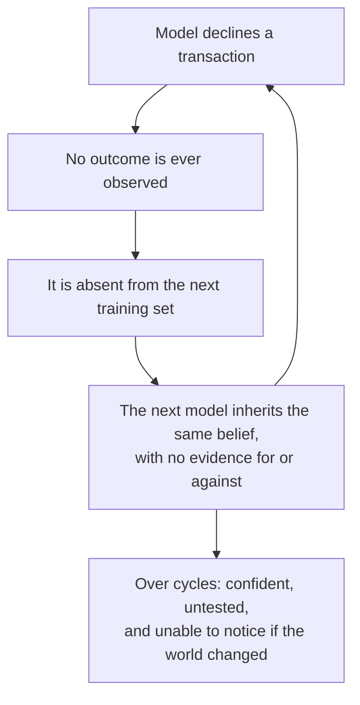

# Models and Labels: The Part Where Your Training Data Is Censored by Your Own Decisions

Everything about modelling fraud follows from two facts established earlier: the positive class is
1 in 7,692 (doc [00](00-what-fraud-detection-actually-is.md)), and the label arrives a median of
27 days late if it arrives at all (doc
[01](01-the-running-systems-and-their-numbers.md)). This document works through what those two
facts do to model choice, training, evaluation and release.

The order is deliberate: **labels first, then models.** Most of the difficulty is in the labels,
most of the published material is about the models, and a candidate who talks about architecture
before talking about where the ground truth comes from has the priorities backwards.

Scenarios are `M-01` through `M-14`.

---

## Where a label comes from, and what each kind is worth

A "fraud label" is not one thing. Ironvale's labels, with volumes, delays and the problem with
each:

| Label source | Per day | Delay (median / p95) | Problem |
|---|---|---|---|
| Cardholder reports it on a call | 3,400 | 3 d / 19 d | Only customers who check statements; biased towards older and higher-balance customers |
| Chargeback with a fraud reason code | 1,900 | 27 d / 71 d | Mixed with first-party fraud; reason codes are chosen by the cardholder's bank, not by evidence |
| Analyst confirms during review | 620 | same day | Only ever applied to cases the system already flagged, so it cannot label anything the system missed |
| Network / consortium fraud report | 1,100 | 4 d / 10 d | Other institutions' models produced it, so errors are correlated with yours |
| Step-up challenge failed | 14,000 | seconds | Weak: a failed challenge may be an old phone, a bad signal, or a customer who gave up |
| Nothing happened | 41,979,000 | never | **Presumed good, and this is 99.95% of your data** |

Several consequences, each of which deserves a sentence in an interview answer.

**Your negatives are presumptions, not observations.** You never receive a signal that says "this
transaction was legitimate." You receive the absence of a complaint, which is a different thing.
Roughly a third of card fraud is never reported by the cardholder at all — small amounts on a
busy statement — so **your negative class contains a meaningful population of unreported fraud**.
Ironvale estimates it from a survey-and-audit exercise at around 0.4 basis points, which is to say
roughly a quarter of all its actual fraud is sitting in the negative class. A model trained this
way is systematically taught that a certain kind of small-value fraud is fine.

**Label delay means the most recent data is the least usable.** Transactions from the last 30 days
have incomplete labels — some of their chargebacks have not arrived. If you train on them as
though their labels were final, you are training on data where some positives are still marked
negative, with the misclassification concentrated in exactly the recent period you most want to
learn from. The standard handling is a **label maturity cutoff**: do not use transactions newer
than the p95 label delay. For Ironvale that is 71 days, which is a painful amount of blindness,
so in practice it runs two training sets:

- A **mature set** with a 71-day cutoff, used for the primary model and for any evaluation you
  will act on.
- A **recent set** with a 14-day cutoff and labels from the fast sources only (cardholder calls,
  analyst confirmations, consortium reports), used for incremental refreshes and for detecting new
  patterns, with the explicit knowledge that its negatives are optimistic.

Combining them naively is `M-02`.

### M-01 · The reason code that does not mean what it says

**What you see.** A segment with a high "fraud" chargeback rate where every transaction looks
legitimate on inspection: right device, right location, usual merchant, cardholder's own behaviour.

**Mechanism.** First-party fraud, also called friendly fraud. The cardholder genuinely made the
purchase and disputed it anyway — sometimes dishonestly, sometimes because a family member used
the card, sometimes because they did not recognise the merchant's billing descriptor. The reason
code on the chargeback says fraud because that is the code that gets the money back fastest.

Published estimates put first-party fraud somewhere between **a third and a half** of
fraud-coded chargebacks. Ironvale's own estimate, from manual review of a 500-case sample, is
**38%**.

**Why this matters more than it first appears.** 38% of your most legally meaningful label source
is mislabelled, and **not randomly** — it is concentrated in digital goods, subscriptions, and
transactions where the device and location signals are perfect. So the model is being taught that
a transaction from the customer's own phone, at their usual time, on a subscription service, is
fraud. It learns a pattern that is real in the data and wrong about the world, and the result is
a model that declines legitimate customers in exactly the circumstances where it should be most
confident.

**Confirm it.** Look at the distribution of your strongest "this is really the customer" features
among positive labels. If a meaningful share of your positives have a perfect device match, a
known IP, and a normal amount, you have first-party fraud in your training set.

**Recover and prevent.** Three measures:

- **Separate the label.** Do not have one `is_fraud` column. Have `is_third_party_fraud`,
  `is_first_party_dispute`, and `label_source`, and train the authorization model on the first
  only. This is a schema decision made at the very beginning or not at all, and it is the single
  highest-return change in this document.
- **Classify disputes before using them as labels**, using the signals that distinguish the two:
  device match, prior relationship with the merchant, the customer's own dispute history, whether
  the goods were delivered to the customer's own address. Ironvale runs a separate first-party
  classifier whose only job is to score incoming disputes, and uses its output to down-weight or
  exclude labels.
- **Accept that some contamination remains and bound it.** A 38% contaminated positive class with
  a known direction of bias can be reasoned about; an unknown one cannot.

### M-02 · Mixing fast and slow labels, and the model that learns your reporting process

**What you see.** A model trained on a blend of mature and recent labels has excellent offline
metrics and inverted behaviour on a specific segment.

**Mechanism.** The fast label sources have different coverage from the slow ones. Cardholder calls
skew towards customers who check statements; analyst confirmations exist only for cases that were
already flagged. If the training set blends them without accounting for coverage, the model learns
features that predict *being labelled*, not features that predict fraud. For analyst-confirmed
labels this is severe and circular: every analyst-confirmed positive was a case the current system
flagged, so the model learns to agree with the current system.

**Prevent.** Carry `label_source` as a column, never as a hidden blend. Where you must combine,
weight by estimated coverage rather than equally, and — most importantly — **evaluate on a
single, consistent label source**, so that comparisons between model versions are not confounded
by changes in label mix. Ironvale evaluates exclusively on mature chargeback-plus-call labels with
first-party classification applied, and uses everything else for training only.

---

## Selection bias: the loop that makes a model blind where it is confident

This is the deepest structural problem in fraud modelling and it is worth getting completely clear.

You decline a transaction. There is now no outcome. The transaction does not appear in your
training set as a positive (you never confirmed it was fraud) and it should not appear as a
negative (it may well have been fraud). It simply vanishes.

So next month's training set describes **only the transactions last month's model allowed
through.** Think about what that means for the regions of feature space where the model is
confident. Where it blocks nearly everything, you observe nearly nothing, so you have no evidence
about whether blocking was correct. The model's belief about that region is untested and
self-perpetuating. Over several retrain cycles, three things happen:

1. **You cannot tell whether your blocks were right.** Precision is unmeasurable in the blocked
   region, which is the region whose precision you most want to know.
2. **The model becomes miscalibrated outward from the decision boundary.** It has dense evidence
   near the boundary (where decisions are mixed) and none far from it.
3. **If the world changes such that a blocked region becomes legitimate** — a new merchant category
   grows, a payment pattern becomes normal, a country's acceptance infrastructure changes — you will
   never find out, because you block it all and observe nothing.



### M-03 · The only real fix is a holdout that costs you money

The mechanism that breaks the loop is uncomfortable and there is no clever alternative: **approve
a random sample of transactions you would have declined, and observe what happens.**

Ironvale runs a **0.3% unconditional holdout**: for a random 0.3% of transactions, selected by a
hash of the transaction ID so the selection is reproducible and cannot be gamed, the fraud
decision is computed, logged, and then *not applied* — except for the mandatory pack, which is
never held out because it encodes legal obligations.

What it costs:

```
Transactions in the holdout:       42,000,000 × 0.003  = 126,000 per day
Of which would have been declined: 126,000 × 0.00145   = 183 per day
  (0.145% overall decline rate, from doc 01)
Of those, actually fraud:          183 / 13             = 14 per day
  (1-in-12 precision means 1 in 13 of declines is fraud)
Fraud value let through:           14 × $186            = $2,604 per day
                                                        = $950,000 per year
```

**Just under a million dollars a year to know whether your system works.** Against a $26 million
annual loss and a $739 billion volume, that is 3.7% of the loss and 0.013 basis points of volume.

What it buys, and this is the list to be able to recite:

- **Measurable precision in the blocked region**, which is otherwise unknowable. The 1-in-12
  figure that the whole of doc [07](07-thresholds-and-the-economics-of-errors.md) depends on comes
  from here and from nowhere else.
- **Unbiased training data** covering the full feature space, including the regions the model
  blocks. Ironvale up-weights holdout samples by 1/0.003 when training so they represent the
  population they were sampled from.
- **The ability to evaluate a candidate model's decisions in the region where it differs from
  production**, which is the only region where the comparison matters.
- **Detection of a world change in a blocked region** — a merchant category that has become
  legitimate — which no other mechanism provides.
- **A defensible answer to "how do you know your false positive rate?"**, which is the question a
  good interviewer asks third.

**The objections, and the answers.** "We are knowingly approving fraud" — yes, $2,604 a day, in
exchange for the only unbiased information in the system; the alternative is spending $26 million
blind. "Compliance will not allow it" — mandatory-pack rules are excluded, the sample is small, and
every large issuer does a version of this; it is explained to the regulator as model validation,
which is exactly what it is. "Can we use a smaller sample?" — the binding constraint is the number
of *fraud events* observed in the holdout, and at 14 a day you need weeks to say anything about a
segment, so smaller samples quickly become useless. Compute what you need before choosing: to
detect a change in precision from 1-in-12 to 1-in-9 with reasonable confidence you need a few
hundred holdout fraud events, which at 14 a day is a month.

**A cheaper partial substitute, where a holdout is genuinely impossible:** step up instead of
declining for a random sample of the would-be-declined population. A passed challenge is weak
evidence of legitimacy and a failed one is weak evidence of fraud. It is much less informative
than a true holdout — the evidence is confounded by challenge-abandonment behaviour — but it costs
almost nothing and is far better than nothing.

---

## Model choice, with the reasoning rather than the fashion

### M-04 · Why gradient-boosted trees are still the primary model

Ironvale's primary model is LightGBM: 1,870 trees, depth 8, 412 features, 11 ms p99 inference on
CPU. Not a neural network. The reasons are specific and they are the right answer for most fraud
systems in 2026:

- **Tabular, heterogeneous features of wildly different scale and type** — counts, ratios,
  categorical codes, booleans, timestamps — are what trees handle natively and what neural networks
  need substantial preprocessing to handle at all.
- **Missing values are handled as a learned branch direction**, which matters enormously given doc
  [04](04-features-and-the-feature-store.md)'s cold-start and absence problems.
- **Monotonic constraints can be imposed.** You can require that risk is non-decreasing in "number
  of declined attempts in the last ten minutes", which prevents the model from learning a
  nonsensical local inversion from sparse data, and which is also a governance asset — a constraint
  you can state to a model-risk committee.
- **Inference is cheap and CPU-bound**, 11 ms for 1,870 trees, with no accelerator dependency in
  the critical path.
- **It is explainable enough.** Tree SHAP gives exact per-feature attributions in time linear in
  tree size, which is what feeds the reason codes in doc
  [13](13-explainability-compliance-and-fairness.md).
- **It trains in 40 minutes on a month of data**, so a weekly retrain and ad-hoc experiments are
  cheap enough to actually do.

Where neural approaches genuinely win, and Ironvale uses one for exactly this: **sequences**. The
card's last 64 authorizations, as an ordered sequence, carry information that no hand-designed
aggregate captures — the shape of a spending pattern, the rhythm, the transition structure between
merchant categories. A transformer over that sequence adds a measured **4.1% of catch rate** at a
fixed decline rate, at a cost of 31 ms and a GPU pool. Whether that is worth it is a business
decision with a number attached:

```
4.1% of 93% caught = 3.8 percentage points more of $371m attempted = $14.1m/year
GPU pool for the cascade's 2.9% of traffic: 14 inferences/s, ~$180,000/year
```

A hundred-fold return, so yes. Note that the honest version of this calculation needs the cascade
from doc [02](02-the-decision-path-and-the-latency-budget.md) — running it on all traffic is 34×
the GPU cost and the return falls to a threefold one, which is still positive but no longer a
clear decision.

### M-05 · Handling the imbalance, and the three techniques that make it worse

The 1-in-7,692 class ratio prompts everybody to reach for resampling. Here is what each option
actually does.

**Undersampling the negatives** — keep all 5,460 positives and a random 1% of negatives — makes
training fast and works fine, with one critical caveat: **the resulting model's output
probabilities are wrong by a known factor**, because the base rate in training is no longer the
base rate in production. If you undersample negatives by 100×, the model's predicted probability
is inflated and must be recalibrated. Teams that undersample and then set a threshold on the raw
output are operating on a number that means nothing. The correction is standard and is one line
of arithmetic, and the number of production systems where it has been forgotten is not small.

**Oversampling the positives** by duplication is strictly worse than undersampling negatives — same
distortion, more compute, and a strong tendency to overfit the duplicated examples.

**SMOTE and its relatives**, which synthesise new positive examples by interpolating between
existing ones, are popular in tutorials and are usually a mistake here. Interpolating between two
fraud transactions in a 412-dimensional space of counts and ratios produces a point that
corresponds to no possible transaction — a card with 3.5 declined attempts and a device first seen
−40 minutes ago. The model learns a decision boundary around a region of space that cannot occur.
It improves offline metrics on a synthetically balanced test set, which is not a useful thing to
improve.

**What to do instead:** keep the natural distribution and use the model's own class-weighting
(`scale_pos_weight` in the gradient-boosting implementations), which reweights the loss without
fabricating data, and **evaluate with precision-recall rather than ROC**, at the operating point
you will actually use. Undersample negatives if training time demands it, and recalibrate
afterwards. Ironvale undersamples negatives 20× (keeping all positives), which takes training from
14 hours to 40 minutes, and applies the standard prior correction.

### M-06 · Calibration, and why it is load-bearing rather than cosmetic

A calibrated score means what it says: among transactions scored 0.004, 0.4% really are fraud.
Three parts of the system depend on this being true:

- **The threshold** is set from an expected-loss calculation (doc
  [07](07-thresholds-and-the-economics-of-errors.md)) that multiplies probability by cost. If the
  probability is not a probability, the arithmetic is meaningless and the threshold is a magic
  number tuned by trial and error.
- **The cascade** in doc [02](02-the-decision-path-and-the-latency-budget.md) routes the uncertain
  middle to the expensive model, where "uncertain" is defined in probability terms. A
  miscalibrated cheap stage sends the wrong 2.9% of traffic.
- **Per-segment thresholds** require that scores be comparable across segments, which is a
  calibration property, not an accuracy one.

**Measure it with a reliability diagram** — bucket predictions by predicted probability, plot
against observed frequency — and summarise with expected calibration error. Fit a correction
(isotonic regression, or Platt scaling for small data) on a held-out period, never on the training
period. And **recalibrate on a schedule independent of retraining**, because calibration drifts
faster than discrimination: the ranking of transactions by risk stays valid much longer than the
absolute probabilities do, as the underlying base rate moves. Ironvale recalibrates weekly and
retrains fully every week as well, but the recalibration is a separate artefact that can be shipped
on its own in twenty minutes during an incident.

### M-07 · The model that is excellent at predicting last quarter

**What you see.** A model that evaluated beautifully degrades steadily from the day it ships,
losing roughly 1.5 percentage points of catch rate per month.

**Mechanism.** This is drift, and doc [12](12-adversaries-drift-and-the-arms-race.md) covers its
adversarial component. The modelling response is in how you split for evaluation: **never use a
random train/test split.** A random split puts transactions from the same week, the same card and
sometimes the same fraud ring on both sides, so the test set is not independent and the metric is
inflated. Always split by time, train on an earlier period and test on a later one with a gap
between them equal to your label maturity cutoff, so that the evaluation reproduces the actual
deployment condition: a model trained on data up to date X, making decisions after date X plus the
time it takes to train and ship.

Ironvale's split: train on weeks 1–38, validate on 39–41, test on 43–46, with week 42 left empty
as a gap. The measured difference between a random split and this one is **AUC 0.986 versus 0.971
and precision at the operating point of 1 in 7.4 versus 1 in 12** — the random split overstates the
production figure by 62%.

---

## M-08 through M-14, briefly

### M-08 · Training on data your current policy produced

Beyond the holdout problem: a model trained on traffic shaped by the current rule estate learns
patterns that only exist because of the rules. Remove a rule, and the model's assumptions about
that region are wrong. **Mitigate** by including policy and rule-estate version as context when
reasoning about a model's validity, by preferring the holdout sample for evaluation, and by
retraining after any significant policy change rather than treating model and policy as
independently versioned things. They are not independent; they are two halves of one system.

### M-09 · The ensemble nobody can debug

Three models, a stacking layer, and a reason-code mapping that no longer corresponds to anything.
**The guidance:** ensemble only where you can attribute. Ironvale's combination is deliberately
simple — the primary model's score, the sequence model's score, and a fixed linear blend with
weights set by a measured sweep, so that any decision can be decomposed into "the primary said X,
the sequence model said Y, and the blend is 0.7/0.3". A stacked meta-learner would add perhaps
0.5% of catch rate and would cost the ability to answer a regulator's question, which is a bad
trade in a regulated environment and an acceptable one in an unregulated one. Say which you are in.

### M-10 · The feature that was leaked through the label

Subtler than doc [04](04-features-and-the-feature-store.md)'s temporal leakage: a feature that
exists *because* of the label. `card_status = blocked` is a superb predictor of fraud and it is
set by the fraud process itself. `merchant_risk_tier = high` may have been set by an analyst
reviewing this very incident. **Prevent** by auditing the top twenty features by importance for
causal direction, asking of each: could this value have been set after, or because of, the
outcome? Any feature whose answer is yes needs point-in-time versioning of the attribute (doc
[04](04-features-and-the-feature-store.md), approach two's dimension-table caveat), or exclusion.

### M-11 · The retrain that shipped a worse model because the metric improved

Offline AUC improved; production catch rate fell. **Mechanism:** the offline metric was computed
over the whole score range while the system operates at one point on the curve, and the new model
was better in the middle and worse in the extreme tail where the threshold sits. **Prevent:**
evaluate at the operating point and at the operating points you might move to, never with a
single summary statistic. The useful summary is a small table: catch rate at decline rates of
0.10%, 0.145%, 0.20% and 0.30%, computed on the holdout, for the champion and the challenger.

### M-12 · Shadow deployment, and what it cannot tell you

Running a candidate model in shadow — scoring every transaction, logging, taking no action — is
necessary and insufficient. It tells you the score distribution, the latency, and the agreement
rate with the champion. It does **not** tell you the candidate's precision in the region where it
would have declined and the champion approved, because those transactions were approved (so you
have labels, good) nor where it would have approved and the champion declined (no labels at all).
Shadow plus holdout answers both halves; shadow alone answers one.

### M-13 · The champion-challenger release, and the number of weeks it takes

Ironvale's model release path, which is the answer to "how do you deploy a model safely":

```
1. Offline evaluation on the mature test set, at four operating points.       1 day
2. Shadow mode: score everything, act on nothing. Compare distributions,
   latency, agreement rate, per-segment score shifts.                        7 days
3. Canary at 1% of traffic, by hash of card token so a customer gets a
   consistent experience. Watch decline rate, step-up rate, approval rate
   by segment, and contact-centre volume.                                    5 days
4. 10% for a further                                                         7 days
5. 50%, and at this point the holdout's fraud events begin to accumulate
   fast enough to say something about catch rate                            14 days
6. 100%, champion retired to shadow for 30 days in case of rollback.
   ──────────────────────────────────────────────────────────────────────────────
   Total                                                                 34 days
```

**Thirty-four days, of which the last 21 are waiting for labels.** This is the clearest statement
of the field's central operational constraint: you can ship in an hour and you cannot *know* for a
month. Which is also why the leading indicators in doc
[14](14-observability-and-operating-the-service.md) matter so much — they are what you watch during
the 34 days.

### M-14 · Model governance in an organisation with eight change windows

Doc [01](01-the-running-systems-and-their-numbers.md) posed Ironvale's structural problem: a weekly
model cadence inside a bank whose change process assumes quarterly. The resolution, stated as a
principle worth taking to an interview:

**Separate the control plane from the data plane.** The scoring *service* — the code that fetches
features, evaluates rules, runs inference, applies policy — changes rarely, goes through the full
change process, and is deployed in a change window. The *model artefact*, the *rule definitions*,
the *thresholds* and the *calibration* are versioned data, loaded at runtime, with their own
governance: a model risk review for the artefact, a two-person approval for a threshold, an
automated gate for a rule. Shipping a model becomes a configuration change with an audit record and
a one-click rollback, not a deployment.

This is not a loophole. It is better governance, because the thing being reviewed is the thing that
changed, by people who understand it, with a rollback that takes seconds instead of a release. The
argument that persuades a change board: **a model artefact swap has a smaller blast radius and a
faster reversal than any code deployment, so treating it as one is both slower and riskier.**
Getting this accepted is political work, it takes months, and it is the single highest-value thing
a staff engineer in this position does.

---

## What to take away

1. **Labels first, models second.** Most of the difficulty is in the ground truth; most of the
   published material is about architecture.
2. **Your negative class contains unreported fraud** — roughly a quarter of Ironvale's actual
   fraud — because a negative is the absence of a complaint, not an observation of legitimacy.
3. **First-party fraud contaminates 38% of your fraud-coded chargebacks, non-randomly**,
   concentrated exactly where device and location signals are perfect. Separate
   `is_third_party_fraud` from `is_first_party_dispute` at the schema level on day one, or you
   will teach the model that a customer's own phone is suspicious.
4. **Use a label maturity cutoff of the p95 delay** — 71 days at Ironvale — for anything you will
   act on, and keep a separate fast-label set for pattern detection with its optimism acknowledged.
   Never blend label sources without carrying `label_source`.
5. **Declines produce no labels, so your training data is censored by your own past decisions**,
   and the censoring is worst exactly where the model is most confident.
6. **A randomised holdout is the only real fix.** Ironvale's 0.3% costs about $950,000 a year — 3.7%
   of its fraud loss — and is the sole source of its false-positive rate, its blocked-region
   precision, and any defensible answer to "how do you know?" Exclude only the mandatory pack.
7. **Gradient-boosted trees remain the right primary model** for heterogeneous tabular features with
   missing values, monotonic constraints, 11 ms CPU inference and exact SHAP. Sequence models earn
   their 31 ms — 4.1% more catch rate, $14.1m against $180,000 — but only behind the cascade.
8. **SMOTE and oversampling are usually mistakes**; undersample negatives if you must, and then
   remember to correct the prior, because a model trained at an altered base rate outputs
   probabilities that are wrong by a known factor.
9. **Calibration is load-bearing, not cosmetic.** The threshold arithmetic, the cascade's
   uncertainty band and cross-segment comparability all require that a score be a probability.
   Recalibrate on its own schedule; calibration drifts faster than discrimination.
10. **Never split randomly for evaluation.** Ironvale's random split reported 1-in-7.4 precision
    against a time-split 1-in-12 — a 62% overstatement. Split by time with a gap equal to the
    label maturity cutoff.
11. **A safe model release takes 34 days and 21 of them are waiting for labels.** Ship in an hour,
    know in a month; everything in between is leading indicators.
12. **Separate the control plane from the data plane** so a model release is a governed
    configuration change rather than a deployment. In an organisation with eight change windows a
    year this is not a workaround, it is the only honest way to review the thing that actually
    changed.
