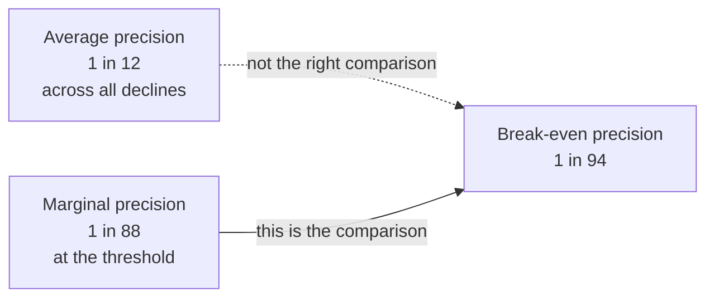

# Thresholds: Turning a Score Into a Decision, Which Is an Economics Problem Wearing a Statistics Costume

A model produces a number between 0 and 1. A business needs an approve, a step-up or a decline.
The thing in between is a threshold, and the question "what should the threshold be?" has a real
answer that falls out of four quantities: the probability, the cost of a miss, the cost of a false
block, and the capacity of whoever handles the ambiguous middle.

This is the document that ties the collection together. It is also where most published material
stops at "it depends on your business", which is true and useless. The numbers below are worked
through fully so that you can redo them with your own figures.

Scenarios are `E-01` through `E-10`.

---

## The cost of a false decline, derived

Doc [00](00-what-fraud-detection-actually-is.md) asserted $1.92. Here is where it comes from, for
Ironvale Cards, per falsely declined transaction.

**Component one: contact-centre handling.** Ironvale measures that **23%** of fraud declines
produce an inbound call within 48 hours. Its fully-loaded handled cost per fraud-related call,
including the agent's time, the verification steps and the follow-up, is **$6.10**.

```
0.23 × $6.10 = $1.403
```

**Component two: the interchange on the transaction that did not happen.** When a transaction is
declined, the customer may retry on the same card (and succeed), retry on another card, or abandon.
Ironvale's measurement, from matching declined attempts against subsequent approvals within two
hours: **59% are completed on the Ironvale card**, so **41%** are lost. The average ticket is
$48.20 and average interchange is 1.65%.

```
0.41 × $48.20 × 0.0165 = $0.326
```

**Component three: subsequent spend displacement.** This is the one that matters and the one nobody
can measure well. Ironvale ran a matched-control study: cardholders who experienced exactly one
false decline, compared against matched cardholders who did not, over the following 90 days. The
measured difference in spend on the Ironvale card was **$12**.

```
$12 × 0.0165 = $0.198
```

**Total:**

```
$1.403 + $0.326 + $0.198 = $1.927  ≈ $1.92
```

**That third component is where the honest uncertainty lives, and you should say so out loud.** A
90-day window measures a 90-day effect. The mechanism people actually worry about — the card
ceasing to be the one reached for first, which compounds over years — operates on a longer
timescale than any holdout study that has been run, and a matched-control design cannot easily
separate it from ordinary attrition. If the true displacement is $410 over 24 months rather than
$12 over 90 days, the per-event cost becomes:

```
$1.403 + $0.326 + ($410 × 0.0165) = $8.49
```

which is 4.4× the measured figure. **Both numbers appear in this document because the gap between
them is the real decision, and pretending to a precision you do not have is worse than stating the
range.**

---

## The cost of a missed fraud, derived

**Component one: the write-off, net of recovery.** The gross value at risk is the attempted-fraud
average ticket of **$186** from doc [01](01-the-running-systems-and-their-numbers.md). Ironvale
recovers some of it from merchants through the chargeback process, but less than the liability
rules would suggest, because it does not pursue small amounts, it loses some representments, and
pursuit has its own cost. Its measured net recovery is **25% of gross fraud value**.

```
$186 × (1 − 0.25) = $139.50
```

**Component two: the operational cost of handling a fraud case.** Dispute processing **$22.00**,
card reissue and reshipment **$5.80**, and the contact-centre interaction **$11.60**.

```
$22.00 + $5.80 + $11.60 = $39.40
```

**Total:**

```
$139.50 + $39.40 = $178.90  ≈ $179
```

**Note the coincidence and do not be fooled by it.** The recovery subtracts $46.50 and the
operations add $39.40, so the net cost ($179) sits within 4% of the gross value ($186). This has
misled more than one fraud team into using gross fraud value in their threshold arithmetic and
concluding that it does not matter much. It does matter: the coincidence is specific to a 25%
recovery rate. At a 62% recovery rate — which is what a portfolio weighted towards card-not-present
without 3-D Secure would produce — the net cost is $110, and the correct threshold moves by 63%.
**The recovery rate is a bigger lever on your operating point than anything inside the model**, and
it is usually owned by a disputes team that has never been asked about it.

---

## The threshold, derived

For a transaction with estimated fraud probability `p`, the expected cost of each action:

```
Expected cost of approving  = p × C_miss        = p × 179
Expected cost of declining  = (1 − p) × C_false = (1 − p) × 1.92
```

(Declining a genuinely fraudulent transaction costs approximately nothing, and approving a
genuinely good one costs nothing, so each expression has one term.)

Decline when declining is cheaper:

```
p × 179 > (1 − p) × 1.92
p × 179 + p × 1.92 > 1.92
p × 180.92 > 1.92
p > 1.92 / 180.92 = 0.01061
```

**The break-even probability is 1.06%.** Which is to say: decline when the chance of fraud exceeds
roughly 1 in 94.

That number has a second, more intuitive reading, and it is the same number as the ratio from doc
[00](00-what-fraud-detection-actually-is.md):

```
C_miss / C_false = 179 / 1.92 = 93.2
```

**The break-even precision is 1 fraud per 94 blocked transactions.** Blocking at better precision
than that leaves money on the table; blocking at worse precision than that destroys value. The
general form, which is worth memorising because it is two symbols and answers the whole question:

```
Break-even precision = 1 : (C_miss / C_false)
```

At Swiftline, where a missed scam costs $2,900 and a wrongly delayed payment costs — on Swiftline's
own estimate, including the regulatory reporting and the remediation — about $95, the ratio is
30.5, so the break-even precision is 1 in 31. At Riverbend, where a fraudulent order costs $64 net
and a wrongly cancelled order costs a measured $9.40 in customer lifetime value, the ratio is 6.8
and the break-even precision is 1 in 8. **Three systems, break-even precisions of 94, 31 and 8.**
Any claim that a fraud system should aim for some particular precision, absent the cost ratio, is
noise.

### E-01 · Average precision is not marginal precision, and the threshold is about the margin

Here is where the arithmetic above gets misapplied, and it is the most common error among people
who have got this far.

Ironvale operates at an **average precision of 1 in 12** — far better than the break-even 1 in 94 —
so the naive conclusion is that it is blocking far too little and should loosen until precision
degrades to 1 in 94. That conclusion is wrong, and acting on it would cost Ironvale about $790,000
a day.

The threshold condition applies to the **marginal** transaction — the next one you would decline if
you moved the threshold — not to the average of all the transactions you currently decline. Those
are wildly different, because the score distribution is extremely steep. Ironvale's declines
include a core of very high-scoring transactions where precision is 1 in 2; the average of 1 in 12
is dragged by a long tail.

At Ironvale's current threshold, the measured **marginal** precision — from the holdout described
in doc [06](06-models-labels-and-training.md), which is the only place this is observable — is
**1 in 88**. Against a break-even of 1 in 94, Ironvale is operating almost exactly at the
dollar-optimal point, very slightly on the strict side.

Check it by stepping the threshold one band looser:

```
Declines removed:     11,000 per day
Frauds newly missed:     125 per day     (so marginal precision = 11,000 / 125 = 1 in 88)
False-decline cost saved:  11,000 × $1.92 = $21,120
Fraud cost incurred:          125 × $179  = $22,375
Net:                                       −$1,255 per day
```

Essentially break-even, slightly negative — which is what "operating at the optimum" looks like
when you probe it. **This is the single most useful diagnostic in the document: step your threshold
and compute the marginal trade.** If one step in either direction is clearly positive, you are not
at the optimum. If both are slightly negative, you are.



### E-02 · One global threshold, and the money it leaves on the table

The break-even precision is a property of the costs, which vary by segment, and the achievable
precision at any threshold is a property of the base rate, which varies enormously by segment.
One threshold applied to all of them is wrong everywhere.

Ironvale's segmentation, with the base rate and the resulting threshold:

| Segment | Share of volume | Base rate | Break-even precision | Threshold |
|---|---|---|---|---|
| Card-present, chip, domestic | 34% | 1 in 94,000 | 1 in 94 | 0.0106 |
| Card-present, contactless, under $45 | 18% | 1 in 61,000 | 1 in 210 — low-value floor-limit rules make the miss cheaper | 0.0048 |
| Card-not-present, known merchant, known device | 29% | 1 in 11,400 | 1 in 94 | 0.0106 |
| Card-not-present, new merchant or new device | 12% | 1 in 1,900 | 1 in 72 — higher average ticket raises C_miss | 0.0139 |
| Card-not-present, cross-border, new device | 4% | 1 in 410 | 1 in 48 | 0.0208 |
| Recurring / card-on-file | 3% | 1 in 220,000 | 1 in 310 — no customer present, so a decline cannot be challenged and breaks a subscription | 0.0032 |

Two things to notice.

**The base rate ranges over 500× between segments.** At one threshold, the card-present chip
population contributes almost no true positives and a large share of the false declines, while the
cross-border new-device population contributes most of the fraud and could profitably be blocked
much harder.

**The costs vary too, and sometimes in the opposite direction to the base rate.** Recurring
card-on-file has the *lowest* base rate and the *strictest* threshold, because a false decline
there does not inconvenience a customer at a checkout — it silently cancels a subscription, with
a much larger downstream cost and no opportunity to challenge. The segment where fraud is rarest is
the one where you should be most reluctant to decline.

Ironvale's measured gain from segmented thresholds over a single global one, at equal total
decline volume: **catch rate from 88.1% to 93.0%**. Five percentage points of catch rate for a
configuration change, which is more than the sequence model contributes for 31 ms and a GPU pool.
**Segmented thresholds are the cheapest large improvement available in most fraud systems** and
they require no modelling work at all.

**The limit on segmentation.** Each segment needs enough fraud events to set and monitor its
threshold. With 5,460 fraud events a day, a segment holding 0.5% of them sees 27 a day, and the
noise in a weekly precision estimate is large. Ironvale caps itself at six segments for
threshold-setting and uses finer segmentation only for monitoring. The rule of thumb: **a segment
needs at least about 30 fraud events per day to carry its own threshold**, which at Ironvale's
volume means at most around a dozen segments, and at a smaller issuer's volume means one.

### E-03 · Optimising count versus optimising value

Fraud is 1.3 basis points of Ironvale's transaction count and 5.0 basis points of its value (doc
[01](01-the-running-systems-and-their-numbers.md)). You can set a threshold to minimise expected
dollars or to minimise expected events, and they give different answers.

The dollar-optimal rule makes the threshold depend on the amount: `p × 179(A) > (1 − p) × 1.92`
where `C_miss` scales with the transaction amount `A`. Rearranged, **the threshold falls as the
amount rises** — you should block a $4,000 transaction at a much lower probability than a $40 one.
Concretely, with `C_miss ≈ 0.75A + 39.40`:

| Amount | C_miss | Break-even p | Break-even precision |
|---|---|---|---|
| $20 | $54.40 | 3.40% | 1 in 29 |
| $48 (average) | $75.40 | 2.48% | 1 in 40 |
| $186 (fraud average) | $178.90 | 1.06% | 1 in 94 |
| $1,000 | $789.40 | 0.243% | 1 in 412 |
| $4,000 | $3,039.40 | 0.063% | 1 in 1,580 |

**This is a 54-fold variation in the correct threshold across the amount range**, and a system with
one threshold is making a serious error at both ends. It is also why "amount" being only one of 412
features is not the same as the amount being properly handled: the model estimates the
*probability*, and the amount belongs in the *decision*, not only in the estimate.

The counter-argument, which is real: a customer whose $4,000 transaction is declined is far more
upset than one whose $20 coffee is declined, so `C_false` scales with amount too, partially
cancelling the effect. Ironvale's measurement is that `C_false` scales much more weakly than
`C_miss` — roughly `0.9 + 0.021A` against `0.75A + 39.40` — so the effect survives, attenuated:
the threshold still falls by about 11× from $20 to $4,000 rather than 54×. **The practical
instruction is to put the amount in the decision rule, with a measured, sub-linear false-decline
cost, and never to use a flat threshold across three orders of magnitude of transaction size.**

### E-04 · The constraint that is not dollars: review capacity

Ironvale's analysts handle **1,900 cases a day** (doc
[01](01-the-running-systems-and-their-numbers.md)). This is a hard constraint and it changes the
problem from "choose a threshold" to "choose a threshold subject to a capacity bound", which is a
different optimisation.

For the band routed to human review, the objective is no longer expected cost per transaction; it
is **expected value recovered per analyst-hour**, and the right rule is to rank candidates by
`p × C_miss` — expected loss prevented — and take the top 1,900. Note what this implies: a
transaction with `p = 0.02` and an amount of $3,000 outranks one with `p = 0.4` and an amount of
$60, because `0.02 × 2,289 = $46` beats `0.4 × 84 = $34`. **A review queue ordered by score is
ordered by the wrong thing**, and reordering by expected loss is a one-day change that typically
improves recovered value by 20–40%. Doc [11](11-case-management-and-the-human-loop.md) works
through the queueing properly.

### E-05 · The threshold that moved because a law changed

Swiftline, October 2024. A reimbursement rule took effect requiring the sending institution to
reimburse scam victims up to a cap. Before the rule, Swiftline's member banks reimbursed
discretionarily — their measured average payout was **31% of loss**. Afterwards it was **96%**.

Nothing about the model changed. No feature drifted. No attacker adapted. And:

```
Before:  C_miss = $2,900 × 0.31 = $899    → break-even precision 1 in 9.5
After:   C_miss = $2,900 × 0.96 = $2,784  → break-even precision 1 in 29.3
```

**The correct operating point moved by a factor of three overnight because of a change in law.**
Banks that understood their threshold as an output of a cost model adjusted it in an afternoon.
Banks that understood it as a tuned constant discovered the change in their loss figures a quarter
later.

This is the cleanest available demonstration of the document's thesis, and it is a good thing to
have ready for an interview: **the threshold belongs to the cost structure, not to the model**, and
the cost structure is set by liability rules, recovery rates, contact-centre economics and
regulation, none of which the data science team owns. A fraud system whose threshold cannot be
re-derived from a spreadsheet of current costs is a fraud system that will be wrong the next time
one of those costs changes — and one of them changes every year.

### E-06 · The ratio ceiling, which cannot be traded against dollars

Northwind Pay has a constraint Ironvale does not: the card networks' monitoring programmes place a
merchant into escalating remediation when its chargeback count and ratio exceed thresholds
(commonly cited at around 0.9% of transactions and 100 disputes a month), with fines that
compound. Northwind holds its merchants to an internal ceiling of **0.65%**.

This is not a cost to be traded off. It is a constraint, and the correct formulation is:

```
minimise  expected dollars
subject to  chargeback ratio ≤ 0.65% for every merchant
```

The consequence is that for a merchant approaching the ceiling, Northwind must decline
transactions that are dollar-positive to approve. That is the right answer — the alternative is a
fine schedule and ultimately losing the ability to process for that merchant — and it looks
irrational to anyone reasoning only about expected loss. **Being able to say "this is a constraint,
not a cost" is a mark of having understood the problem**, and the same shape recurs with regulatory
limits, contractual service levels and capacity bounds.

### E-07 · Step-up changes the arithmetic, and usually for the better

Everything above is a two-action problem. With step-up there are three, and the right threshold
structure is two boundaries rather than one.

Ironvale's measured step-up economics:

```
Challenge pass rate, genuine customer:        94.1%
Challenge abandonment, genuine customer:       5.9%
Challenge pass rate, fraudster:                2.8%
Cost of issuing a challenge (infrastructure,
  plus the friction):                         $0.31 per challenge
Cost of a genuine customer abandoning:        the same $1.92 as a decline
```

So for a transaction with probability `p`, the expected cost of stepping up:

```
E[step up] = $0.31
           + (1 − p) × 0.059 × $1.92      ← genuine customer abandons
           + p × 0.028 × $179             ← fraudster passes the challenge
           = 0.31 + 0.113(1 − p) + 5.01p
```

Compare against approving (`179p`) and declining (`1.92(1 − p)`):

```
Step up beats approving when:   0.31 + 0.113 − 0.113p + 5.01p < 179p
                                0.423 < 174.1p
                                p > 0.00243

Step up beats declining when:   0.31 + 0.113 − 0.113p + 5.01p < 1.92 − 1.92p
                                7.043p < 1.497
                                p < 0.2126
```

**So the step-up band is `0.24% < p < 21.3%`**, which is enormous — it spans two orders of
magnitude, and at Ironvale's score distribution it covers 2.75% of traffic. Below it, approve;
above 21.3%, decline outright because even a challenge is not worth issuing.

Two observations worth carrying. **The band is wide because challenges are cheap and
discriminating** — a 94.1% genuine pass rate against a 2.8% fraudster pass rate is a very strong
separation, far stronger than most model features. And **the band's width is extremely sensitive to
the abandonment rate**: at 20% abandonment rather than 5.9%, the lower bound rises to 0.78% and the
band shrinks by two thirds. Which is why doc
[11](11-case-management-and-the-human-loop.md) treats challenge design — in-app prompt versus SMS
code versus a redirect to a 3-D Secure page — as a first-class engineering concern rather than a
user-interface detail. **Moving the abandonment rate from 20% to 6% is worth more than most
modelling work**, and it is achieved by using the channel the customer already trusts.

### E-08 · The threshold set once and never revisited

**What you see.** A threshold of `0.0041` in a configuration file, committed three years ago, with
a commit message saying "tuned".

**Mechanism.** Someone found it empirically, it worked, and nothing since has connected it to a
cost. Meanwhile interchange rates changed, the contact centre was outsourced at a different cost
per call, the recovery rate moved when the disputes team changed its pursuit policy, and the fraud
mix shifted towards higher tickets.

**Prevent.** Hold the threshold as a *derived* value: a small, reviewed spreadsheet or
configuration object containing the input costs, with the threshold computed from them, and a
quarterly review of the inputs with their owners — disputes for recovery, operations for call cost,
product for interchange, and the holdout for marginal precision. Record the derivation in the
decision log's policy version, so that a decision from eighteen months ago can be explained in
terms of the costs that were current then. This is a half-day of work and it converts the most
important number in the system from folklore into something with an owner.

### E-09 · The threshold change deployed without a ramp

**What you see.** A threshold is changed at 14:00. By 14:40 the contact centre has a 900-call queue
and the fraud team cannot tell whether the change is working.

**Mechanism.** A threshold change is instantaneous and global. Unlike a model release (doc
[06](06-models-labels-and-training.md), `M-13`), there is no shadow mode — the change *is* the
effect.

**Prevent.** Treat thresholds like any other risky change: ramp by hash of card token (1%, 10%,
50%), with an automatic rollback on decline-rate deviation, and **notify the contact centre before
any change expected to move decline volume by more than 5%**. Ironvale's threshold changes carry a
predicted decline-volume delta computed by replaying the last 24 hours, and a change whose
prediction exceeds the contact centre's stated spare capacity requires their sign-off. That
sign-off requirement has never been popular and has prevented three company-level incidents.

### E-10 · The optimum you should not actually operate at

The document's arithmetic says Ironvale's dollar-optimal marginal precision is 1 in 94. Ironvale
operates at 1 in 88 — slightly stricter. The gap is deliberate and the reasons are the honest
caveats on everything above:

- **The $12 spend-displacement figure is probably low**, and the plausible alternative of $410 over
  24 months would move the break-even precision from 1 in 94 to 1 in 21.
- **The costs are averages over a population with a long tail.** The customer whose card is
  declined while their child is in hospital is not an average customer, and the distribution of
  consequence is much wider than the distribution of cost.
- **Some consequences are not priced at all**: a regulator's view of a bank that declines 1.2% of
  legitimate transactions, press coverage, and the social cost of unreliable payments for people
  with no alternative.
- **The model's probability estimate is itself uncertain**, and at the extreme tail of the
  distribution — which is where the threshold sits — the calibration is weakest and the confidence
  interval widest. Optimising to the edge of a quantity you estimate poorly is a way to be
  precisely wrong.

**So the position to take is: derive the optimum, then operate deliberately inside it, and be able
to say by how much and why.** "We are 7% stricter than the dollar optimum because the long-run
franchise cost of a decline is probably understated by our 90-day study" is a defensible,
quantified, reviewable position. "0.0041, tuned" is not. The value of the arithmetic is not that
you obey it; it is that you know where you are standing relative to it.

---

## What to take away

1. **Derive both error costs before touching the threshold.** Ironvale's false decline is $1.92
   (call handling $1.40, lost interchange $0.33, measured 90-day displacement $0.20) and its missed
   fraud is $179 (write-off net of 25% recovery $139.50, plus $39.40 of case handling).
2. **The break-even precision is 1 : (C_miss / C_false).** 1 in 94 at Ironvale, 1 in 31 at
   Swiftline, 1 in 8 at Riverbend. Any target precision quoted without a cost ratio is noise.
3. **Average precision is not marginal precision, and the threshold is about the margin.**
   Ironvale's average is 1 in 12 and its marginal is 1 in 88 — the naive comparison of average
   against break-even would have cost $790,000 a day.
4. **Probe the optimum by stepping the threshold and computing the marginal trade.** If one
   direction is clearly positive you are not at the optimum; if both are slightly negative, you
   are.
5. **The recovery rate is a bigger lever than anything in the model.** Moving it from 25% to 62%
   changes the correct threshold by 63%, and it is usually owned by a disputes team nobody has
   asked.
6. **Segmented thresholds are the cheapest large win available** — 88.1% to 93.0% catch rate at
   equal decline volume, with no modelling work. A segment needs roughly 30 fraud events a day to
   carry its own threshold, which caps most issuers at a handful.
7. **The amount belongs in the decision, not only in the probability.** The dollar-optimal
   threshold varies 54-fold across the amount range, attenuated to about 11-fold once the
   false-decline cost's own weak amount-dependence is measured. A flat threshold across three
   orders of magnitude is a serious error at both ends.
8. **Order the review queue by expected loss prevented, not by score.** Capacity-bounded review is
   a different optimisation, and reordering typically recovers 20–40% more value for the same
   analyst hours.
9. **The threshold belongs to the cost structure, not the model.** Swiftline's correct operating
   point moved threefold overnight when a reimbursement law changed average payout from 31% to 96%
   of loss, with nothing about the model altered.
10. **Some limits are constraints, not costs.** Northwind must decline dollar-positive transactions
    to hold a merchant under a 0.65% chargeback ratio, and recognising the difference is a mark of
    having understood the problem.
11. **Step-up has a wide band — 0.24% to 21.3% of probability at Ironvale — because challenges are
    cheap and highly discriminating.** Its width is dominated by the abandonment rate, so moving
    abandonment from 20% to 6% by using a channel the customer trusts is worth more than most
    modelling work.
12. **Derive the optimum, then stand deliberately inside it and say by how much.** The arithmetic's
    value is not obedience; it is knowing where you are relative to it, and being able to defend
    the gap.
