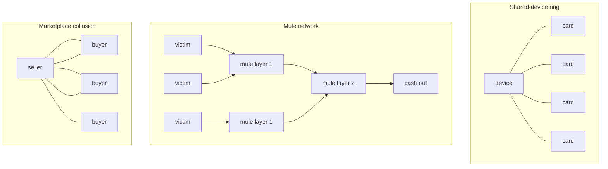
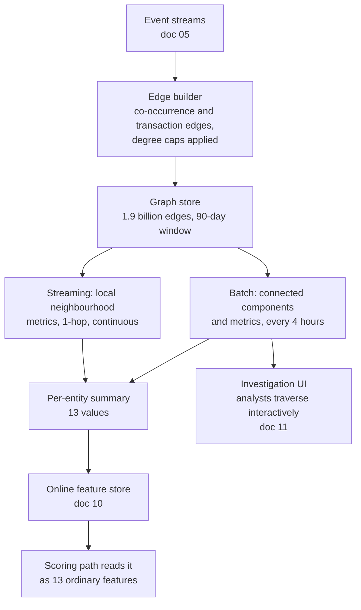

# Graphs: Finding the Thing That Is Only Visible When You Look at Several Accounts at Once

Everything up to this point scores one transaction against one entity's history. A large share of
fraud is invisible to that view by construction, because no individual transaction in it looks
wrong. A mule network, a promotion ring, a collusive seller and a bust-out scheme each consist
entirely of ordinary-looking events, and are obvious the moment you draw the connections between
them.

This document covers what to connect, how to compute it at a scale where connected components over
hundreds of millions of nodes is a real engineering problem, and — the part that most treatments
skip — how to get a graph-derived signal into a 120 ms decision path without pretending you can run
a traversal there.

Scenarios are `G-01` through `G-10`.

---

## The graph, concretely

Nodes are entities; edges are shared attributes or transactions between them. At Ironvale:

| Node type | Count |
|---|---|
| Card | 70,000,000 |
| Account | 31,000,000 |
| Device | 54,000,000 |
| Email | 29,000,000 |
| Phone number | 28,000,000 |
| Postal address | 19,000,000 |
| Merchant | 2,900,000 |
| Bank account (for transfers) | 44,000,000 |
| **Total nodes** | **277,900,000** |

Edges come from co-occurrence — this card was used on this device, this account uses this phone
number — and from transactions. Ironvale's graph holds roughly **1.9 billion edges** with a 90-day
retention.

The crucial structural point, which decides everything about how you query it: **this graph is
mostly a very large number of tiny components plus a small number of enormous ones.** The component
size distribution:

| Component size | Count of components | Share of nodes |
|---|---|---|
| 1–3 nodes | 94,100,000 | 71.4% |
| 4–10 nodes | 6,800,000 | 14.2% |
| 11–100 nodes | 410,000 | 6.1% |
| 101–10,000 nodes | 11,400 | 2.8% |
| Over 10,000 nodes | 290 | 5.5% |

The 290 giant components are almost never fraud rings. They are artefacts: a shared corporate
proxy IP, a popular public email domain treated as an entity, a payment processor's shared
descriptor, a carrier-grade NAT range, a device fingerprint so generic it collapses millions of
cheap Android handsets into one identifier. **If you build a naive connected-components job and act
on it, you will flag five and a half percent of your customers as one fraud ring**, and this is the
first thing that goes wrong in every graph project.

### G-01 · The supernode that swallows the graph

**What you see.** A connected-components job produces one component containing 14 million nodes.
Every "ring size" feature is saturated. The job also takes six hours instead of forty minutes,
because one partition holds a hub with 40 million edges.

**Mechanism.** One node with enormous degree bridges unrelated subgraphs. Transitivity does the
rest: A shares an IP with the proxy, the proxy is used by B, so A and B are "connected", and after
a few hops so is everybody.

**Confirm it.** Plot the degree distribution of every node type before doing anything else. The
hubs are obvious and there are usually fewer than a thousand of them.

**Prevent, and these controls are the whole difference between a working graph system and a
useless one:**

- **Degree-cap every node type.** An IP shared by more than 50 accounts is not evidence of a
  relationship; it is evidence of a shared network. Ironvale's caps, set from the degree
  distribution's knee: IP 50, device 25, postal address 12, email 6, phone 8. **Edges through a
  node exceeding its cap are not traversed.** This is a blunt instrument and it is correct — above
  the cap, the attribute has stopped carrying relational information.
- **Weight edges by how much evidence they represent**, and require a path's cumulative weight
  rather than mere connectivity. A shared device identifier is strong evidence; a shared /24 prefix
  is weak; a shared email domain is no evidence at all and should not be an edge.
- **Bound path length.** Ironvale traverses at most 3 hops. Beyond that, "connected" has no
  meaning on a graph of this density, and the fraud patterns that matter are tight.
- **Exclude attribute types that are definitionally shared**: email domain, carrier, user-agent
  string, merchant category. The test is whether two strangers can share it innocently; if the
  answer is yes at scale, it is not an edge.

With those four controls, Ironvale's largest non-artefact component is 2,900 nodes and the 290
giants disappear.

---

## The patterns worth detecting, and what each looks like

### Pattern one: the shared-device ring

Several accounts, several cards, one or a few devices. This is the simplest and most common
pattern, and the one already partly covered by the cardinality features in doc
[08](08-device-identity-and-behavioural-signals.md). The graph adds what cardinality cannot: the
*shape*. A household looks like a stable small clique that persists for months. A fraud workstation
looks like a star whose leaves churn completely every few days. **Component churn rate — what
fraction of the component's membership is new this week — separates them better than component size
does**, and it is a cheap feature to compute.

### Pattern two: the mule network

Swiftline's central problem. Funds from victims converge on a small number of receiving accounts,
which forward to a second layer, which cash out. The signature in the graph:

- **High in-degree from unconnected sources.** An ordinary personal account receives money from
  people it has a relationship with; a mule receives from strangers who have no connection to each
  other. **"Number of unconnected senders in 7 days" is the single most powerful mule feature** —
  the emphasis on *unconnected* matters, because a plumber also receives from many senders, and
  those senders are often connected to each other through the neighbourhood.
- **Pass-through behaviour**: funds in and out within minutes, leaving a near-zero balance, with
  outbound amounts summing to inbound minus a fee-like fraction.
- **Short account tenure**, or a long-dormant account that suddenly becomes active — the latter is
  characteristic of a bought or recovered account and is more dangerous because tenure-based
  features say it is safe.
- **Layered topology**: the second-layer accounts have exactly the inverse profile, many inbound
  from a few, many outbound to cash-out points.

**The detection is useful even when it is late.** A mule identified two hours after a scam is too
late for the transfer but prevents the next forty, since mule accounts are reused heavily. This
reframes the latency requirement: **mule detection is a retrospective job whose output is a
real-time feature**, and that is the general shape of every graph signal in this document.

### Pattern three: the bust-out

A credit-specific pattern, included because it is a frequent interview subject and because it is
not detectable transactionally. An applicant opens an account with good credentials, behaves
perfectly for six to eighteen months, grows their limit, then draws the full line across several
products in a few days and disappears. Every individual transaction is normal; the account's
behaviour is exemplary until the end.

The graph signal is that bust-outs are run as an *industry*, so the "good" accounts share
attributes with each other and with previously busted-out accounts — a device, an address, a
phone, a common data-furnisher used to construct the identities. **The detection is in the
application graph, months before the loss**, which means it belongs to onboarding rather than to
authorization, and an organisation whose fraud and onboarding teams do not share a graph will never
find it.

### Pattern four: synthetic identity

An identity assembled from a real identifier (often a stolen or unused national identification
number) plus fabricated details, cultivated until it has a credit file. The graph signature is
**many identities sharing a small number of real attributes in inconsistent combinations** — the
same phone number across six names, the same address with mismatched date-of-birth patterns, a
cluster of identities created in a short window with sequential identifiers.

### Pattern five: marketplace collusion

Riverbend's largest single loss category after promotion abuse. A seller and a set of buyer
accounts they control transact with each other to build a reputation, launder stolen cards into
payouts, or harvest promotions. The signature is a **dense bipartite subgraph with unusually
reciprocal structure**: these buyers buy from almost nobody else, and this seller sells to almost
nobody else. On a healthy marketplace, buyer–seller relationships look like a sparse random
bipartite graph with a heavy-tailed degree distribution; a collusion cluster looks like a near
complete bipartite block, and the local clustering coefficient finds it.



---

## Getting a graph signal into a 120 ms decision

This is the engineering question and it has a clean answer that is worth knowing precisely, because
the wrong answer — "query the graph database in the scoring path" — is both the obvious one and
unworkable.

**You do not traverse the graph inline. You precompute per-entity summaries and serve them as
ordinary features.**

Ironvale's graph pipeline:



The 13 values written per entity, which is the whole interface between the graph and the decision:

```
component_id                     (for grouping in investigation)
component_size
component_size_percentile
component_churn_7d               (share of members new this week)
component_known_fraud_count      (members with a confirmed fraud label)
component_known_fraud_rate
distance_to_nearest_known_fraud  (1, 2, 3, or absent)
degree_own                       (this entity's own edge count)
degree_max_in_neighbourhood
unconnected_inbound_senders_7d   (mule signal)
reciprocity_local                (collusion signal)
component_last_computed_at       (so staleness is visible — see G-02)
graph_summary_version
```

Three design points in that list are worth defending.

**`distance_to_nearest_known_fraud` is the single most valuable graph feature**, worth 6.2
percentage points of catch rate on its own at Ironvale, which is more than the rest of the graph
family combined. It is also the most dangerous, which is `G-03`.

**`component_last_computed_at` is in the feature set deliberately**, so the model and the policy
layer can both see how stale the graph view is. Doc
[02](02-the-decision-path-and-the-latency-budget.md)'s insistence on distinguishing absent from
zero applies here: a four-hour-old component size is a different fact from a current one.

**The streaming path and the batch path coexist.** One-hop metrics — the degrees, the unconnected
inbound count — can be maintained continuously in the stream processor, because they require no
traversal beyond the immediate neighbours. Multi-hop metrics — component membership, distance to
known fraud — need the global structure and run in batch. **Splitting on "does this need more than
one hop" is the right line**, and it gets the most time-critical signals (a device suddenly
touching many cards) to real-time freshness while accepting hours of staleness on the structural
ones.

### G-02 · The four-hour-old graph that made the decision

**What you see.** A ring is detected at 14:00 and the transactions it makes at 14:20 are approved,
because the component summary in the online store was computed at 12:00 and the new members are not
in it.

**Mechanism.** Batch recomputation at a fixed interval means the graph signal is on average half an
interval stale, and attacks are faster than that.

**Prevent, in order of cost:**

- **Incremental propagation on a confirmed hit.** When an entity is confirmed as fraud, do not wait
  for the next batch: walk its 2-hop neighbourhood immediately — which is bounded and small after
  degree capping, typically under 400 nodes — and update those entities' summaries directly. This
  costs milliseconds and closes the gap for the case that matters most.
- **Shorten the interval for the highest-value metrics only.** Distance-to-known-fraud recomputes
  every 15 minutes; full component structure every 4 hours.
- **Carry the staleness as a feature** and let the policy layer widen the step-up band when the
  graph view is old.

### G-03 · Guilt by association, and the customer whose flatmate committed fraud

**What you see.** A customer with a 9-year perfect history is declined. The reason, traced back, is
`distance_to_nearest_known_fraud = 1`. The edge is a shared postal address. The customer's former
flatmate committed fraud four months ago.

**Mechanism.** The most powerful graph feature is a statement about somebody else. This is
qualitatively different from every other feature in the system, and it carries a specific set of
problems:

- **It is unfair in a way that is legible to a customer.** "You are being declined because of
  something your flatmate did" is a sentence no bank wants to say and no customer will accept.
- **It can be weaponised.** An attacker who can create an edge to a target — by using the target's
  address on an application, or by transacting with them — can degrade the target's risk profile
  deliberately. This has happened, and the cheapest version is to simply send a small payment to
  somebody you want to harm.
- **It propagates and compounds.** If distance-to-fraud is a feature and a decline raises the
  likelihood of a future fraud label, association risk can spread outwards through the graph over
  retraining cycles.
- **It can correlate with protected characteristics** through address, which correlates with
  neighbourhood, which correlates with ethnicity in most countries. Doc
  [13](13-explainability-compliance-and-fairness.md) treats this; it is the clearest case of a
  proxy in the whole feature set.

**The controls Ironvale applies, which are worth copying:**

1. **Association is never sufficient on its own.** A graph feature can escalate a decision from
   clear to uncertain, or from uncertain to block — in combination with other evidence — but
   `distance = 1` alone can never move a decision from clear to block. This is a policy constraint
   in the layer from doc [03](03-rules-and-why-they-never-go-away.md), not a modelling hope.
2. **Weight by edge strength, not just distance.** A shared device identifier is strong; a shared
   address is moderate and frequently innocent (flatmates, previous occupants, large buildings,
   family); a shared IP prefix is weak. Ironvale uses distance-weighted-by-edge-strength rather
   than raw hop count, which removed most of the address-based false positives.
3. **Decay by time.** A fraud label from four months ago on a former co-resident carries far less
   information than one from last week. Ironvale applies a 45-day half-life to
   known-fraud influence.
4. **Exclude address edges entirely for decline decisions**, using them only for investigation
   prioritisation. This cost 0.9 percentage points of catch rate and removed the great majority of
   the complaints, and Ironvale regards it as the correct trade.
5. **Make association-driven decisions reviewable by a human and visible in the reason.** If a
   decision was materially driven by a graph feature, it goes to the review queue rather than being
   auto-declined, and the case file shows the subgraph.

**State this trade-off unprompted in an interview.** Graph features are the strongest thing in the
toolkit and they are the place where a fraud system most easily does something indefensible to an
innocent person. A candidate who presents ring detection without raising it has described half of
the design.

### G-04 · Computing connected components on 277 million nodes

The engineering, briefly, because it comes up.

Ironvale runs a **label-propagation** variant rather than a true connected-components algorithm:
each node adopts the minimum identifier in its neighbourhood, iterated to convergence. On a graph
of this shape — after degree capping, with a 3-hop bound — it converges in 7 iterations.

```
Nodes:       277,900,000
Edges:       1,900,000,000 (after degree capping: 1,240,000,000)
Iterations:  7
Edge traversals: 7 × 1.24bn × 2 = 17.4 billion
Runtime on a 60-core Spark cluster: 38 minutes
Cost per run: about $9. Six runs a day: $54. Annual: $19,700
```

**$19,700 a year for the most valuable feature family in the system** is the sort of number worth
having ready, because the intuition that graph processing is prohibitively expensive is widespread
and, at this scale and with these controls, wrong. What *is* prohibitively expensive is a graph
database serving traversals in the decision path, which is why the architecture above does not have
one.

Two implementation notes. **Partition by node rather than by edge** and accept the shuffle;
edge-partitioned layouts save a shuffle and make the hub problem worse. And **cap iterations
explicitly** — on a graph with an undetected supernode, label propagation does not converge in any
reasonable number of rounds, and a cap converts a pathological run into a detectable bad result
rather than a six-hour job.

### G-05 · The graph database bought and then not used

**What you see.** A six-figure graph database licence, used by four analysts for interactive
investigation and by nothing in production.

**Mechanism.** The graph database was bought to serve features in the decision path, discovered to
be unable to do so within the latency budget, and relegated to investigation.

**This is not a failure — investigation is a real and valuable use** — but it should be the stated
purpose from the beginning, because it changes the requirements completely. For interactive
investigation you need: expressive traversal, visualisation, a few dozen concurrent users, and
freshness measured in minutes. For feature serving you need: one key lookup in 3 ms at 23,000
requests per second and no traversal at all. **These are different products and the second one is a
key-value store.** Doc [11](11-case-management-and-the-human-loop.md) covers the investigation side
properly.

### G-06 · The ring that is detected after the money has gone

Already noted for mules and worth generalising. A graph signal almost always arrives after the
first loss in a cluster, because the cluster must exist before it can be detected. **The value is
therefore in the second through fortieth events, not the first**, and the metric that matters is
"losses prevented after first detection within a cluster" rather than catch rate on the cluster as a
whole. Ironvale measures: median cluster size at first detection **4 transactions**, median final
cluster size **31**, so graph detection prevents roughly **87% of each cluster's potential events**.
That is the honest way to state graph detection's value, and it is much more persuasive than a
catch-rate delta.

### G-07 · Entity resolution errors propagating through the graph

If identity resolution (doc [08](08-device-identity-and-behavioural-signals.md), `I-07`) merges two
customers wrongly, the graph inherits the error and amplifies it — the merged node gets both
parties' edges, which may bridge two unrelated components. **Practice:** resolution confidence must
be an edge property, low-confidence merges must not be traversable for decline-affecting features,
and un-merging must be supported, which means the graph must be rebuildable from the event log
rather than being the system of record.

### G-08 · The feature that only exists during an attack

`component_known_fraud_count` is zero for nearly every entity nearly always, and becomes non-zero
precisely when it matters. This makes it a poor candidate for a model that sees it as zero in
99.99% of training rows — the tree may never split on it usefully. **Practice:** for signals that
are extremely sparse but highly precise when present, prefer a **rule** over a model feature. This
is one of the clearest instances of doc [03](03-rules-and-why-they-never-go-away.md)'s argument:
the rule engine is the right home for a high-precision, low-frequency signal, and the model is the
right home for a low-precision, high-frequency one.

### G-09 · The analyst who needs the subgraph and gets a score

A case arrives in the queue with a risk score and no context. The analyst's actual question is
"what else is connected to this?" **Practice:** every case file includes the entity's 2-hop
subgraph, rendered, with known labels marked and edges annotated by type and strength. Ironvale
measured the effect of adding this: **median case handling time fell from 7.1 to 4.4 minutes and
analyst agreement with the eventual outcome rose 9 points.** That is a 38% capacity increase from a
user-interface change, which against the capacity constraint in doc
[07](07-thresholds-and-the-economics-of-errors.md) is worth more than a model improvement.

### G-10 · When not to build a graph

Graph detection earns its complexity when fraud in your system is **organised** — when the same
adversary runs many events. Signals that it is: repeated attributes across confirmed cases, clusters
your analysts find by hand, mule or collusion patterns, abuse of promotions.

If your fraud is predominantly **opportunistic and uncoordinated** — a single stolen card used a few
times by one person — the graph will find almost nothing, because there is no structure to find.
Ironvale's own split is roughly 61% organised by value, which justifies the investment; a small
merchant whose fraud is a handful of stolen cards a week has no structure and should spend the
effort elsewhere. **Test it cheaply before building anything**: take your last 200 confirmed fraud
cases and check how many share any attribute with another case. If the answer is under 15%, you do
not have a graph problem.

---

## What to take away

1. **A large share of fraud is invisible to transaction scoring by construction**, because every
   individual event in a mule network, a collusion ring or a bust-out looks ordinary. The pattern
   exists only across entities.
2. **The graph is 71% tiny components and a few hundred giants, and the giants are artefacts.**
   Without degree caps you will flag 5.5% of your customers as one ring; this is the first thing
   that goes wrong in every graph project.
3. **Four controls make it work:** degree-cap each node type at its distribution's knee, weight
   edges by evidence strength, bound path length at 3 hops, and exclude attributes two strangers can
   innocently share.
4. **Do not traverse the graph inline.** Precompute 13 per-entity summary values and serve them as
   ordinary features from the key-value store. A graph database is an investigation tool, not a
   feature server — a different product with different requirements.
5. **Split the computation on "does this need more than one hop."** Degrees and unconnected-sender
   counts stream continuously; component structure and distance-to-known-fraud run in batch, with
   incremental 2-hop propagation on a confirmed hit to close the gap that matters.
6. **Distance to known fraud is the most valuable graph feature and the most dangerous**, worth 6.2
   points of catch rate and capable of declining a nine-year customer because of a former
   flatmate. Never sufficient alone, weighted by edge strength, decayed over time, address edges
   excluded from decline decisions, and always human-reviewable.
7. **Association features can be weaponised.** Sending a small payment to somebody creates an edge
   to them; design on the assumption that an attacker will do this deliberately.
8. **Label propagation over 277 million nodes costs $9 a run and 38 minutes.** $19,700 a year for
   the most valuable feature family — the intuition that graph processing is prohibitive is wrong
   at this scale with these controls.
9. **State graph value as events prevented after first detection within a cluster**, not as catch
   rate. Median cluster is 4 transactions at detection and 31 at the end, so 87% of each cluster is
   prevented — a far more honest and more persuasive framing.
10. **Test for structure before building.** If fewer than 15% of your last 200 confirmed cases share
    any attribute with another case, your fraud is opportunistic and a graph will find nothing.
