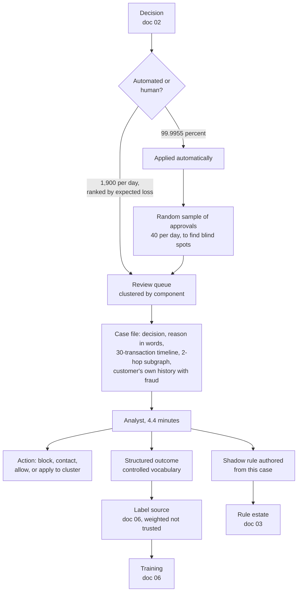

# The Human Loop: 1,900 Cases a Day, the Queue That Is Ordered Wrongly, and Where Your Labels Come From

Almost every fraud-detection design discussion stops at the decision. In a real system the decision
is the beginning of a second system, staffed by people, that reviews the ambiguous cases, talks to
customers, decides the hard ones, and — crucially — **produces the labels the models are trained
on.** A design that omits it has omitted the part that makes the first part improve.

This document covers the queue and its arithmetic, how to order it, what a case file needs to
contain, how the challenge channel determines your economics, and the feedback path by which human
judgment becomes training data.

Scenarios are `H-01` through `H-10`.

---

## The capacity arithmetic, which constrains the design

Ironvale's review operation: **1,900 cases a day across three shifts**, against 60,936 daily
declines and 1,155,000 daily step-ups. So:

```
Cases reviewed:                      1,900/day
Share of declines reviewed:          1,900 / 60,936 = 3.1%
Share of all decisions reviewed:     1,900 / 42,000,000 = 0.0045%
```

Staffing, derived from the handling time:

```
Median case handling time:           4.4 minutes (after the subgraph change in doc 09, G-09)
Effective analyst hours per shift:   6.2 of 8 (breaks, training, escalations, admin)
Cases per analyst-shift:             6.2 × 60 / 4.4 = 85
Analysts needed:                     1,900 / 85 = 23 per day across shifts
With coverage for leave, attrition
  and 24-hour staffing:              31 analysts
Fully loaded cost:                   31 × $78,000 = $2.4 million/year
```

**$2.4 million a year to review 0.0045% of decisions.** Hold that against the $26 million loss and
the $99,400 feature store. **The human operation is the second-largest line in the fraud
programme's budget and it is the one most architectural discussions never mention.**

Two consequences follow immediately.

**Capacity is a hard constraint and therefore a design input.** You cannot route "the uncertain
cases" to review; you can route 1,900 of them. Everything else is decided automatically, and the
decision of *which* 1,900 is a bigger lever than anything in the model.

**Reducing handling time is equivalent to buying capacity.** The doc
[09](09-graphs-rings-and-linked-entities.md) finding — median handling time from 7.1 to 4.4 minutes
by putting the 2-hop subgraph in the case file — is a 38% capacity increase, worth roughly $900,000
a year in avoided headcount, achieved by a user-interface change. **Interface work in the case tool
has a better return than almost anything else in a fraud programme** and it is systematically
underfunded because it is not glamorous.

---

## H-01 · The queue ordered by score, which is the wrong order

Already stated as `E-04` in doc [07](07-thresholds-and-the-economics-of-errors.md) and worth the
full treatment here, because it is the highest-return change in the document.

**What you see.** The review queue is sorted by risk score, descending. Analysts work down it. At
the end of the shift, the unworked remainder is dropped.

**Mechanism.** Sorting by score maximises the probability that each case is fraud. The objective is
not to be right as often as possible; it is to **prevent as much loss as possible with 85 cases per
analyst**. Those are different objectives and they give different orderings.

The correct ranking is by **expected loss prevented**:

```
priority = p(fraud) × C_miss(amount) × P(analyst's action prevents the loss)
```

Worked example with two real cases:

```
Case A: p = 0.42, amount = $60
        C_miss = 0.75 × 60 + 39.40 = $84.40
        priority = 0.42 × 84.40 = $35.45

Case B: p = 0.020, amount = $3,000
        C_miss = 0.75 × 3,000 + 39.40 = $2,289
        priority = 0.020 × 2,289 = $45.78
```

**Case B outranks Case A despite a 21× lower fraud probability**, and a score-ordered queue puts it
far below. Ironvale's measured result from reordering: **value of fraud prevented per analyst-hour
rose 34%**, with no change to headcount, model or threshold. A one-day change to a sort key.

The third factor matters too and is usually forgotten. **A case the analyst cannot act on in time is
worth nothing.** A card-present transaction that already completed cannot be prevented, only
investigated; a pending transfer at Swiftline can be stopped for four and a half seconds and then
cannot. So the priority must include actionability and its decay, which in practice means a **time
budget per case type**: cases where the window closes soonest are promoted sharply as they age, and
cases where the money has already moved are deprioritised to a separate investigation queue with a
different purpose. Mixing "stop this" and "understand this" in one queue guarantees that the
urgent work waits behind the thorough work.

### H-02 · The queue that is full of the same ring

**What you see.** Analysts work 85 cases and 60 of them are the same attack, reviewed
independently 60 times.

**Mechanism.** Cases are created per transaction. A ring generating 200 transactions generates 200
cases, each individually high-scoring.

**Prevent.** **Cluster cases before queueing**, using the component identifier from doc
[09](09-graphs-rings-and-linked-entities.md). One case covering 60 transactions, with a single
decision applied to all of them, takes perhaps 11 minutes rather than 60 × 4.4 = 264 minutes.
Ironvale's measurement: **23% of its queue volume collapses into clusters**, which is a 19%
effective capacity gain.

The design requirement this imposes: **an analyst action must be applicable to a set**, not just to
one transaction. "Block this card" is a single-entity action; "block every card seen on this device
in the last 48 hours and queue their holders for contact" is a set action, and a case tool without
set actions forces the analyst to do 60 things that should be one thing.

**⚠️ Set actions need a confirmation step with the count shown.** The failure mode is an analyst
applying a set action to a component that turns out to be an artefact (doc
[09](09-graphs-rings-and-linked-entities.md), `G-01`) and blocking 14,000 cards. Ironvale requires a
second person's approval for any set action affecting more than 50 entities, which has been invoked
41 times and prevented two mass-blocking incidents.

---

## What a case file must contain

The case file is the analyst's entire world and its contents determine the handling time, the
decision quality, and the quality of the label it produces. Ironvale's, assembled automatically:

**The decision.** What was decided, by which component (which rule, or the model with its score and
band), under which policy version, and what the customer experienced.

**The reason, in words.** The top five SHAP contributions rendered as sentences —
"amount is 9.0× this card's 90-day median", "device first seen 41 seconds ago", "17 distinct cards
on this device in 24 hours" — not as a feature-importance plot. Doc
[13](13-explainability-compliance-and-fairness.md) covers the generation.

**The transaction in context.** The card's last 30 transactions as a timeline, with this one marked,
amounts and merchants visible, so the analyst can see the pattern rather than infer it from
aggregates.

**The 2-hop subgraph**, rendered, with known fraud labels marked and edge types annotated (doc
[09](09-graphs-rings-and-linked-entities.md), `G-09`).

**The customer's history with the fraud process itself** — previous cases, previous disputes,
previous false declines. An analyst deciding whether to block a customer who has been wrongly
blocked twice this year should know that, and this field changes decisions more than its obscurity
suggests.

**The actions available**, with their consequences stated: block the card (customer cannot spend
until reissue, 3–5 days); contact the customer (which channel, what the expected response time is);
allow and monitor; apply to the whole cluster.

**A structured outcome field**, which is the part that matters for doc
[06](06-models-labels-and-training.md). Not a free-text note: a controlled vocabulary —
`confirmed_third_party_fraud`, `confirmed_first_party`, `legitimate_unusual`,
`legitimate_customer_contacted`, `insufficient_evidence`, `customer_unreachable` — because this
field becomes a training label and free text cannot.

### H-03 · The free-text outcome that destroyed six months of labels

**What you see.** Six months of analyst decisions, and no usable labels from any of them.

**Mechanism.** The outcome field was free text. Analysts wrote "fraud", "FRAUD", "confirmed",
"spoke to cust - ok", "ok", "legit", "cx confirms", "NTD" (meaning nothing to do), and 400 other
variants. Extracting labels requires a classifier over the notes, which is both unreliable and
absurd.

**Prevent.** A controlled vocabulary, chosen with the modelling team, with free text available
*additionally* rather than instead. And — the part that is usually missed — **the vocabulary must
distinguish the things the model needs to distinguish**, which means `confirmed_third_party_fraud`
and `confirmed_first_party` are separate values because doc
[06](06-models-labels-and-training.md) trains on only the first. A vocabulary designed for
operational reporting rather than for labelling will collapse exactly the distinction that matters.

### H-04 · The analyst label that is not ground truth

**What you see.** Analyst-confirmed labels disagree with eventual chargeback outcomes 18% of the
time.

**Mechanism.** An analyst decides from the evidence available in four minutes. They are frequently
right and systematically biased in a specific direction: they see cases the system flagged, so
their prior is that flagged cases are fraud, and the evidence they are shown is the evidence that
caused the flag. Doc [06](06-models-labels-and-training.md)'s `M-02` covers the training
consequence.

**Prevent, or at least bound.** Three measures: **measure analyst-versus-outcome agreement
continuously** and report it per analyst and per case type; **blind a sample** — give analysts a
small share of cases with the score and the flagging reason hidden, to measure how much of their
judgment is independent of the system's; and **treat analyst labels as a distinct, weighted
label source** rather than as ground truth, per doc
[06](06-models-labels-and-training.md).

The blind-sample result at Ironvale is worth knowing: on cases where the score and reason were
hidden, analyst agreement with eventual outcome was **71%**; with the score and reason shown it was
**83%**. The system genuinely helps. But the 12-point difference is partly the analyst agreeing
with the system rather than with the truth, which is the circularity to bound.

---

## The customer contact, which is a channel-design problem

Doc [07](07-thresholds-and-the-economics-of-errors.md) showed that the step-up band's width is
dominated by the abandonment rate, and that moving abandonment from 20% to 6% is worth more than
most modelling work. This is where that is won.

Ironvale's channels, measured:

| Channel | Genuine pass rate | Abandonment | Fraudster pass rate | Cost per challenge | Availability |
|---|---|---|---|---|---|
| In-app push approval | 94.1% | 5.9% | 2.8% | $0.004 | 61% of cardholders |
| SMS one-time code | 81.3% | 18.7% | 11.2% | $0.041 | 96% |
| 3-D Secure redirect at merchant | 72.0% | 28.0% | 6.1% | $0.012 | card-not-present only |
| Outbound call from fraud team | 44% answered | — | near zero | $6.10 | all, but capacity-bound |
| Email verification link | 51.0% | 49.0% | 14.0% | $0.001 | all |

Four conclusions.

**The in-app push is dramatically better on every axis** — pass rate, abandonment, fraudster pass
rate and cost — and is available to 61% of cardholders. **Therefore the single highest-value
investment in the step-up pathway is increasing app adoption**, which is a product and marketing
objective rather than a fraud one, and which a fraud team should be loudly funding. Taking app
coverage from 61% to 80% is worth more to Ironvale's fraud economics than any model improvement
available.

**SMS is the fallback and it is weak.** An 11.2% fraudster pass rate reflects SIM swaps, social
engineering of the code out of the customer, and interception. It is better than nothing and it
should never be the only option for a high-value decision.

**Email verification is close to useless** — a 49% abandonment rate and a 14% fraudster pass rate
means it blocks genuine customers more than fraudsters. Ironvale retains it only for
low-risk confirmations.

**The outbound call has a near-zero fraudster pass rate and is capacity-bound**, which makes it the
right instrument for exactly the top of the risk distribution and nothing else. The
expected-loss ranking from `H-01` is what decides who gets one.

### H-05 · The challenge that trains customers to be scammed

**What you see.** Customers report receiving scam calls that mimic the bank's own fraud
verification, and succeeding.

**Mechanism.** If your legitimate fraud process involves calling customers and asking them to
confirm details, you have taught your customers that a call asking them to confirm details is
normal. Scammers use exactly this, and the impersonation is effective *because* the real process
looks the same.

**This is a design defect in the fraud operation, not a customer-education problem**, and it is one
of the clearest cases where the fraud function creates the vulnerability it then has to detect.

**Prevent.** Make the legitimate channel structurally distinguishable: **the bank initiates
verification only inside the app, never by asking for information over a call**. If an outbound call
is necessary, it should ask the customer to open the app and respond to the prompt there, and never
ask them to confirm a code, a password or a transaction over the phone. Then the customer education
is true and simple — "we will never ask you to do that over the phone" — rather than a nuance
customers cannot be expected to apply. Swiftline's intervention wording in doc
[08](08-device-identity-and-behavioural-signals.md) depends entirely on this being actually true.

### H-06 · The customer who cannot reach anybody

**What you see.** A customer whose card is blocked at 02:00 in a foreign country, whose contact
number is the one that was stolen with their phone, and whose only route to resolution is a
contact centre with a 40-minute queue.

**Mechanism.** The block is instantaneous and automated; the unblock is manual and
capacity-bound. The asymmetry between how fast you can take something away and how fast you can
give it back is where most of the human cost of fraud systems lives.

**Prevent.** Three things that are worth more than they cost: a **self-service unblock in the app**
for cases where the customer can satisfy a strong authentication, which resolves a large share
without a human; a **documented path for the hardest cases** — travelling, phone lost, no app — that
does not depend on the stolen factor; and **asymmetric alerting**, where the time-to-resolution for
blocked customers is a monitored service level with a target, not just a contact-centre statistic.
Ironvale targets p95 resolution within 20 minutes for app-capable customers and 4 hours otherwise,
and reports it alongside the fraud-loss figure in the same monthly review. **Putting the two numbers
on the same page is an organisational intervention and it changes behaviour.**

---

## H-07 through H-10, briefly

### H-07 · The escalation path that does not exist at 03:00

A ring is detected at 03:00 and the action needed — blocking a merchant, changing a threshold,
enabling a rule pack — exceeds the on-call analyst's authority. The documented process is "contact
the fraud manager", who is asleep. **Practice:** define, in advance and in writing, what the
overnight shift may do unilaterally, with a stated blast-radius limit (Ironvale: any action
affecting up to 500 entities, any rule enablement from the pre-approved incident pack, any
threshold change up to one band), and an explicit page path above it. **The limit's purpose is to
make the common case fast, not to prevent action** — an undefined authority limit means nothing
happens until morning.

### H-08 · The quality programme that measures the wrong thing

Analyst performance measured by cases-per-hour produces analysts who close cases quickly, which is
not the objective. **Practice:** measure, per analyst, agreement with eventual outcome (where
available), value of loss prevented per hour, and false-block rate on their decisions, alongside
throughput — and review the four together. Throughput alone is the metric that creates a quality
problem; it is not that it should not be measured.

### H-09 · The feedback that never reaches the model

Analysts find a new pattern weekly. The path from "an analyst noticed something" to "the system
acts on it" runs through a rule (doc [03](03-rules-and-why-they-never-go-away.md)) and it must be
short enough to be used. **Practice:** analysts can author a shadow rule directly, from the case
tool, pre-populated from the case they are looking at, which is then measured automatically and
promoted by the fraud team if it performs. Ironvale's number: **of 240 shadow rules, 171 originated
from an analyst**, and 34 of the 61 rules with positive marginal contribution did. **The people
looking at the cases are your best source of new detection, and the usual architecture gives them
no way to contribute except by filing a ticket.**

### H-10 · The review queue as the only quality signal

Because the queue contains only flagged cases, it tells you nothing about what you missed. An
operation that reviews only its own flags has no view of its false negatives. **Practice:** route a
small random sample of *approved* transactions to review as well — Ironvale sends 40 a day, chosen
with probability proportional to amount — and measure what analysts find. It costs 2% of capacity
and it is the only human-side detection of a blind spot. It complements rather than replaces the
holdout from doc [06](06-models-labels-and-training.md): the holdout measures what you wrongly
blocked, this measures what you wrongly approved.

---

## The whole loop, drawn



---

## What to take away

1. **The human operation is the second-largest line in the budget** — $2.4 million a year at
   Ironvale for 31 analysts reviewing 0.0045% of decisions — and it is the part architectural
   discussions omit entirely.
2. **Capacity is a hard constraint, so the real decision is which 1,900 cases**, and that choice is
   a bigger lever than anything in the model.
3. **Order the queue by expected loss prevented, not by score.** A case at p=0.020 on $3,000
   outranks one at p=0.42 on $60. Reordering raised value prevented per analyst-hour by 34% in one
   day.
4. **Include actionability and its decay in the ranking**, and separate "stop this" from
   "understand this" into different queues — otherwise urgent work waits behind thorough work.
5. **Cluster cases before queueing.** 23% of Ironvale's volume collapses into clusters, a 19%
   capacity gain, which requires that analyst actions apply to sets — with a second approval above
   50 entities, because a set action on an artefact component blocks 14,000 cards.
6. **Reducing handling time is buying capacity.** Putting the 2-hop subgraph in the case file took
   4.4 minutes off 7.1 and was worth about $900,000 a year. Case-tool interface work has the best
   return in the programme and is systematically underfunded.
7. **The outcome field is a training label, so it must be a controlled vocabulary** that
   distinguishes third-party fraud from first-party dispute — the distinction the model depends on.
   Free text destroys the labels completely.
8. **Analyst labels are not ground truth.** They disagree with eventual outcomes 18% of the time and
   are biased towards agreeing with the system that flagged the case — 83% agreement with the score
   shown against 71% with it hidden. Measure it with a blind sample and weight accordingly.
9. **The in-app push beats every other challenge channel on all four axes at once**, so increasing
   app adoption from 61% to 80% is worth more to fraud economics than any available model
   improvement. Email verification blocks genuine customers more than fraudsters and should be
   retired.
10. **Your verification process may be teaching customers to be scammed.** Never ask for
    information over a call; initiate verification only in the app, so that "we will never ask you
    to do that by phone" is literally true.
11. **Blocking is instant and automated; unblocking is manual and capacity-bound.** Report
    time-to-resolution for blocked customers next to the fraud-loss figure in the same monthly
    review — putting both numbers on one page changes behaviour.
12. **Let analysts author shadow rules from the case tool.** 171 of Ironvale's 240 shadow rules came
    from analysts, as did 34 of the 61 rules with positive marginal contribution; the usual
    architecture gives the people looking at the evidence no way to contribute but a ticket.
