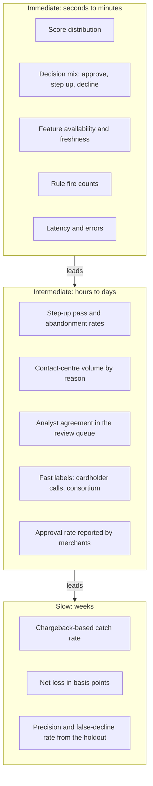

# Observability: Watching a System Whose Most Important Metric Arrives Four Weeks Late

Every other service you operate tells you when it is broken. A fraud service does not. Its worst
failures — a score computed from missing features, a model that has quietly stopped
discriminating, a capability that drained away over four years — produce no errors, no latency
change and no alarm, and become visible only in labels that arrive a median of 27 days later.

So the central problem of fraud observability is this: **you must detect, from things you can see
today, a degradation whose only direct evidence arrives next month.** This document is about which
things those are.

It does not re-teach RED, USE, SLIs or error budgets — those are in
[`../Observability`](../Observability/README.md) and the service-level monitoring of the scoring
tier is an ordinary application of them. What is here is the fraud-specific layer that sits above.

Scenarios are `O-01` through `O-12`.

---

## The three tiers of signal, by how fast they tell you something



**The discipline is to alert on the immediate tier, investigate on the intermediate tier, and report
on the slow tier.** Teams that alert on the slow tier are alerting a month after the incident;
teams that only report on the immediate tier never find out whether any of it worked.

---

## The immediate tier: what to watch every minute

### O-01 · Score distribution, which is the single most useful panel

Plot the distribution of produced scores — deciles, or a histogram with fixed bucket boundaries —
per minute, per segment, overlaid against the same period last week.

**It moves before anything else does.** A model misbehaving, a feature pipeline degrading, a
population shift, an attack and a deployment all move the score distribution, usually within
minutes, and usually before any of them move a decision metric enough to notice.

**The specific failure it catches that nothing else does:** a model that has begun producing
compressed scores — everything in a narrow band — has stopped discriminating while continuing to
produce plausible numbers at normal latency with a normal mean. The mean is unchanged; the variance
has collapsed. **Alert on the spread, not only on the central tendency**, and specifically on the
score distribution's interdecile range and on the share of traffic in the top and bottom percentile.

Ironvale's alarms on this panel: top-percentile share deviating more than 40% from the trailing
7-day value for the same hour-of-week; interdecile range falling more than 25%; and any segment's
median moving more than 2 standard deviations of its own weekly variation.

### O-02 · The decision mix, with hour-of-week comparison

Approve, step-up and decline rates, per segment, per minute. The obvious panel, with one
non-obvious requirement: **compare against the same hour of the same day of the week, not against
the last hour or yesterday.** Payment traffic has a strong weekly shape, and an alarm threshold set
against a daily average fires every Sunday morning and is therefore turned off, after which it
catches nothing.

**The derived metric worth building: predicted versus actual decline volume.** Every threshold or
rule change at Ironvale carries a predicted decline-volume delta computed by replay (doc
[07](07-thresholds-and-the-economics-of-errors.md), `E-09`). Plotting the prediction against the
actual is the fastest possible detection of a change that did something other than intended — within
five minutes rather than within a shift.

### O-03 · Feature availability and freshness, which most teams do not have

From doc [02](02-the-decision-path-and-the-latency-budget.md)'s `D-05` and doc
[05](05-the-streaming-pipeline.md)'s `P-05`, the two panels that catch the most dangerous failure in
the system:

- **Availability:** per entity type, the share of decisions in which that entity's features were
  present and usable. Alarm at 0.5% absence over five minutes. This is the only detection of a
  silently degraded score.
- **Freshness:** end-to-end from event to visible, measured by a synthetic heartbeat, not consumer
  lag. Objective p99 under 1.5 s, page at 5 s.

And from doc [08](08-device-identity-and-behavioural-signals.md)'s `I-01`, a third panel on a much
longer timescale: **signal availability trended over months**, which catches structural decay rather
than incidents. This one belongs on a quarterly review rather than a dashboard, which is precisely
why it needs to exist as an artefact — nobody notices a four-year trend by looking at a week.

### O-04 · Per-feature distribution monitoring, and keeping it useful

For each of 412 features, the distribution, compared against the training distribution and against
last week. This catches the upstream contract changes from doc
[04](04-features-and-the-feature-store.md)'s `F-05` and doc
[05](05-the-streaming-pipeline.md)'s `P-07`.

**The problem is alert volume.** 412 features × several statistics each, compared continuously, will
produce several alerts a day forever, and a channel with several false alerts a day is a channel
nobody reads. The measures that make it workable:

- **Alert only on features that matter.** Weight the alerting threshold by the feature's model
  importance; the top 30 features get tight thresholds and a page, the bottom 200 get a weekly
  report and no alert at all.
- **Alert on step changes, not on gradual movement.** A feature whose mean moves 4 standard
  deviations in one hour is a deployment; one that moves 4 standard deviations over three months is
  drift and belongs in the quarterly review.
- **Group by source.** Twenty features derived from the device SDK moving together is one alert
  about the SDK, not twenty alerts. Grouping alerts by their upstream source converts an
  unreadable channel into a readable one and is usually a one-day change to the alerting
  configuration.

### O-05 · Rule-estate telemetry

From doc [03](03-rules-and-why-they-never-go-away.md): fire count per rule per day with the
declared-versus-actual alarm at 3×, the weekly top-twenty by fire count, the nightly pairwise
co-occurrence precision, and the monthly marginal contribution. **Four reports, two alarms, and they
would have prevented five of that document's twelve scenarios.**

---

## The intermediate tier: hours to days

### O-06 · Step-up outcomes, which are a fast proxy for everything

Challenge issue rate, pass rate, abandonment rate and failure rate, per channel and per segment,
hourly.

**This is the best fast proxy available for whether your scoring is working**, and it is
underexploited. The reasoning: if the step-up band is correctly placed, the population inside it
should contain a predictable mix of genuine customers (who pass at 94.1%) and fraudsters (who pass
at 2.8%). So the **observed pass rate within the band is an estimate of the band's fraud rate,
available within minutes rather than within a month**:

```
observed_pass_rate = (1 − f) × 0.941 + f × 0.028
```

Rearranged for the implied fraud rate `f`:

```
f = (0.941 − observed_pass_rate) / 0.913
```

If the band's pass rate drops from 92.8% to 88.1%, the implied fraud rate in the band has gone from
1.4% to 6.6% — a near-fivefold increase, detected in minutes, from a quantity that has nothing to do
with labels. Ironvale alarms on implied-fraud-rate deviation by segment and it is the earliest
attack detector it has.

**The caveats to state:** the pass rates are themselves estimates that drift, so recalibrate them
from the holdout periodically; and a change in challenge *delivery* (an SMS provider degrading, a
push-notification outage) moves the pass rate for reasons that have nothing to do with fraud, so
this panel must be read alongside delivery-success telemetry. That second caveat has produced at
least one false attack declaration at every institution that uses this technique.

### O-07 · Contact-centre volume, segmented by reason

Call volume tagged "card declined" or "transaction blocked", hourly, against baseline.

**This is the customer-side signal, and it is the one that detects over-blocking fastest** — faster
than the decline rate itself in some failure modes, because a 0.3 percentage point rise in declines
is within normal variation while a doubling of fraud-related calls is not.

**Build the integration.** Most fraud teams do not have contact-centre volume on their dashboard,
because it belongs to a different department with a different data platform, and acquiring it is
organisational work rather than engineering work. It is worth doing: it is a measurement of the
harm your false positives cause, which is otherwise invisible, and it is the number that lets you
tell operations what is coming before they tell you.

### O-08 · Merchant-reported approval rate, for the acquirer

Northwind's equivalent signal. Its merchants know their own approval rate and will tell Northwind
within hours when it falls, which is faster than Northwind's own weekly reporting cycle. The
practice: **treat your customers' complaints as a monitoring input with a defined ingestion path**,
tagged and trended, rather than as a support queue. The rate of complaints about declines, by
merchant, is a real-time false-positive signal that costs nothing to collect.

---

## The slow tier: reporting, and the metrics that mislead

### O-09 · Which metric misleads during which failure

The table worth having, because during an incident the instinct is to look at the wrong panel.

| Failure | The metric that looks fine | The metric that shows it |
|---|---|---|
| Features silently absent, imputed as zero | Latency, error rate, score mean | Feature availability; score variance |
| Feature pipeline stale | Consumer lag | End-to-end freshness heartbeat |
| Model has stopped discriminating | Score mean, latency | Score interdecile range; implied fraud rate from step-up pass rate |
| Attack in one segment | Aggregate decline rate, aggregate catch rate | Per-segment decline rate and score distribution |
| Over-blocking after a threshold change | Fraud loss (improves!) | Contact-centre volume; predicted-versus-actual decline volume |
| Rule estate decayed | Everything, for months | Rule fire counts; marginal contribution |
| Device signal capability draining | Catch rate, slowly | Signal availability trended over months |
| Holdout accidentally disabled | Everything | Holdout sample volume as an explicit metric |
| A model canary that is actually worse | Offline AUC | Catch rate at the operating point, per segment, on the holdout |

**The second row of that table is the one that gets people.** When you over-block, your fraud loss
improves and every fraud-specific metric looks excellent. The system is doing more damage than
before and its own dashboard is green. **This is why the contact-centre volume and the
false-decline rate must be on the same dashboard as the loss figure** — the fraud team's instruments
measure only one of the two errors it makes, and the instrument for the other one lives in a
different department.

### O-10 · The four programme-level metrics, and the one that should not be zero

Reported monthly, to the same audience, on the same page:

1. **Net fraud loss in basis points of volume.** Ironvale: 3.5 bps. The number everybody already
   reports.
2. **False-decline rate, from the holdout.** 0.145% of good transactions. **The number almost nobody
   reports, and the one that makes the first number honest.**
3. **Time to resolution for blocked customers**, p95, split by channel capability. 20 minutes for
   app-capable, 4 hours otherwise (doc [11](11-case-management-and-the-human-loop.md), `H-06`).
4. **Holdout sample integrity** — the number of holdout decisions in the period, against expectation.

That fourth one needs explaining. **The holdout is the measurement instrument for everything else,
and it fails silently.** Somebody adds a condition to the policy layer that happens to exclude
holdout traffic; a refactor drops the bypass; a well-intentioned engineer "fixes" the bug where
high-risk transactions are being approved. Ironvale has lost its holdout twice, once for eleven
days, and both times discovered it weeks later when a precision figure looked suspiciously stable.
**Monitor the holdout's volume as a first-class metric with a page**, because a measurement system
you do not measure is a measurement system you do not have.

And the metric that should not be zero: **the number of model or threshold changes rolled back during
canary.** A programme that has never rolled back a canary is either not shipping, or not watching.
Ironvale's figure is 2 to 4 a year against roughly 50 releases, and a year at zero prompts a
question about whether the canary gates are actually connected.

---

## O-11 and O-12

### O-11 · Change annotations, the highest-return hour in observability

Every deployment, model release, threshold change, rule enablement, upstream service release and
infrastructure change, as an annotation on every fraud dashboard.

**Doc [12](12-adversaries-drift-and-the-arms-race.md) established that "your own drift" is the most
common cause of an apparent drift event, and the first diagnostic question is "did we change
anything".** An annotated dashboard answers it in two seconds. An unannotated one turns it into an
archaeology exercise across five teams' change logs, during an incident, at 03:00.

The subtlety that makes this hard and is worth solving: **the changes that matter most are other
teams' changes.** A device-SDK upgrade, a merchant-category data-source change, a core banking
release — each has caused a fraud incident at Ironvale and none of them appears in the fraud team's
own change log. Ingesting change events from upstream services into the fraud dashboards is
organisational work and it is the single highest-return hour available in this document.

### O-12 · Alerting that a human can act on

The closing discipline. Every alert must say: what changed, which segment, what the expected value
was, what the available actions are, and what the blast radius of each is. An alert that says
"decline rate anomaly detected" at 03:00 produces fifteen minutes of orientation before any action;
one that says "decline rate in segment CNP-cross-border is 0.81% against an expected 0.19%, 4,100
excess declines in the last hour, predicted contact-centre impact 940 calls, candidate actions:
raise segment threshold one band (reversible, 5 min) or disable rule pack cnp-geo (reversible,
2 min)" produces action in two.

**Writing that second form requires the per-segment metrics, the predicted-impact model, and the
action catalogue from doc [15](15-the-failure-catalogue-and-playbook.md) to already exist.** The
alert is where the rest of the observability work gets cashed in, and an organisation that has built
everything else and still writes the first form has left most of the value on the table.

---

## What to take away

1. **Alert on the immediate tier, investigate on the intermediate, report on the slow.** The
   definitive metric arrives 27 days late, so everything operational is a leading indicator.
2. **The score distribution is the single most useful panel**, and it moves before any decision
   metric. Alert on the spread, not just the mean — a model that has stopped discriminating has an
   unchanged mean and a collapsed variance.
3. **Compare against the same hour of the same day of the week.** Payment traffic has a strong weekly
   shape, and thresholds set against a daily average fire every Sunday and get turned off.
4. **Feature availability and end-to-end freshness are the two panels most teams lack**, and they are
   the only detection of the most dangerous failure in the system. Freshness means a synthetic
   heartbeat, not consumer lag.
5. **Make per-feature monitoring readable by weighting thresholds by model importance, alerting on
   step changes rather than gradual movement, and grouping alerts by upstream source.** Twenty
   features from one SDK is one alert.
6. **The step-up pass rate yields an implied fraud rate within minutes.** From pass rates of 94.1%
   genuine and 2.8% fraudster, `f = (0.941 − observed) / 0.913` — a near-fivefold rise detected in
   minutes from a quantity involving no labels. Read it alongside challenge-delivery telemetry or it
   will declare a false attack.
7. **Get contact-centre volume onto your dashboard.** It is the fastest detector of over-blocking,
   it measures harm that is otherwise invisible, and acquiring it is organisational rather than
   technical work.
8. **When you over-block, your fraud loss improves and every fraud metric goes green.** The fraud
   team's instruments measure one of its two errors; the instrument for the other lives in another
   department, and both numbers must appear on one page.
9. **Report four programme metrics together:** net loss in basis points, false-decline rate from the
   holdout, time-to-resolution for blocked customers, and holdout sample integrity.
10. **Monitor the holdout's own volume with a page.** Ironvale has silently lost it twice — a
    measurement system you do not measure is one you do not have.
11. **A canary rollback rate of zero is a problem**, not an achievement: it means you are either not
    shipping or not watching.
12. **Change annotations are the highest-return hour available**, and the changes that matter most
    are other teams' — SDK upgrades, data-source changes, core banking releases — none of which
    appear in your own change log.
