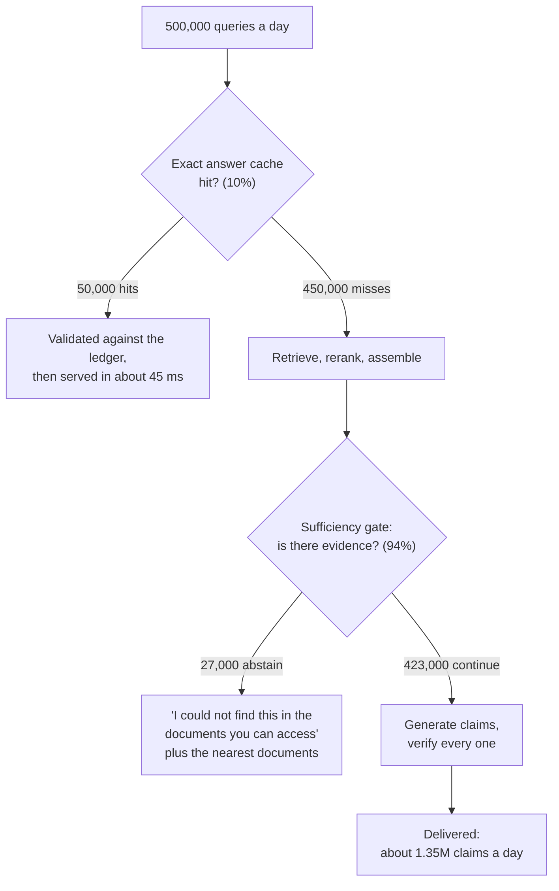

# 01 — The Running System and Every Number the Design Reuses

Designs built on round, unexplained numbers fail in a particular way: a reviewer asks "why eight
shards?" and nobody can say, because the number was copied from somewhere else. This document
fixes every number the collection uses, and derives each one in steps you can check against your
own system.

When a later document says "recall the 120 million chunks" or "the 3 H100s", it means this page.
All the arithmetic is also in [reference_impl/capacity.py](reference_impl/capacity.py), which
exits with an error if any number here drifts from what the code computes. Run it after you
change an assumption:

```bash
python3 reference_impl/capacity.py --verbose
```

Two kinds of number appear below, and it matters which is which:

- **Assumptions** are inputs. Kestrel measured them on its own corpus and traffic; yours will
differ. They are marked *(assumption)*.
- **Derived numbers** are arithmetic on the assumptions. If you change an assumption, recompute
them rather than copying them.

---


## 1. Kestrel Group, the organisation


|                  |                                                                                                                      |
| ---------------- | -------------------------------------------------------------------------------------------------------------------- |
| Employees        | 120,000                                                                                                              |
| India            | 66,000 (55%) — head office in Pune, plants in Chennai and Pune, offices in Mumbai and Bengaluru                      |
| Spain and Mexico | 30,000 (25%) — Madrid, Barcelona, Mexico City, Monterrey                                                             |
| US and UK        | 24,000 (20%)                                                                                                         |
| Departments      | HR, Finance, Legal, Compliance, Engineering, Manufacturing, Sales, IT                                                |
| Identity         | One corporate directory; about 41,000 groups; a typical employee is in 40 groups, a few administrators in over 2,000 |


The three regions matter because they set the languages (doc [11](11-multilingual-en-hi-es.md)),
the number formats (₹1,50,000 in India, €1.500,50 in Spain, $1,500.50 pesos in Mexico), and the
shape of the daily traffic curve (§3).

---


## 2. The corpus


### Where the documents come from


| Source          | Documents | What is in it                                                                  |
| --------------- | --------- | ------------------------------------------------------------------------------ |
| SharePoint      | 4.1M      | Policies, procedures, templates, presentations saved as PDF and DOCX           |
| Confluence      | 3.2M      | Engineering runbooks, team wikis, project pages (HTML and Markdown)            |
| Team drives     | 1.4M      | Everything else: exported reports, spreadsheets saved as PDF, plain-text notes |
| Contract system | 0.9M      | Signed contracts, many of them scanned                                         |
| Direct upload   | 0.4M      | Documents users add through Lodestar itself                                    |
| **Total**       | **10.0M** |                                                                                |


### Formats


| Format     | Share | Documents | Notes                                                                                                                                      |
| ---------- | ----- | --------- | ------------------------------------------------------------------------------------------------------------------------------------------ |
| PDF        | 46%   | 4.6M      | About 30% of PDFs (1.4M, or 14% of the whole corpus) are scans with no text layer, so they need optical character recognition (OCR)        |
| DOCX       | 24%   | 2.4M      | Converted once to PDF at ingestion so citations have stable pages (doc [00](00-requirements-and-what-zero-hallucination-can-mean.md) §3.3) |
| HTML       | 20%   | 2.0M      | Mostly Confluence pages                                                                                                                    |
| Markdown   | 6%    | 0.6M      | Engineering repositories                                                                                                                   |
| Plain text | 4%    | 0.4M      | Notes, exported chat transcripts                                                                                                           |


### Languages *(assumption)*


| Language | Share of documents | Typical content                                                            |
| -------- | ------------------ | -------------------------------------------------------------------------- |
| English  | 70%                | Global policies, engineering, legal                                        |
| Spanish  | 18%                | Spain and Mexico HR, local finance procedures, plant instructions          |
| Hindi    | 12%                | India HR circulars, plant safety instructions, government-mandated notices |


A further detail that turns out to matter: Kestrel's Spanish documents come from two countries
that write numbers differently. Spain writes one thousand five hundred and a half as `1.500,50`;
Mexico writes it `1,500.50`, the same as the US. Doc [11](11-multilingual-en-hi-es.md) §6 shows
why the verifier must know which country a document is from, not just its language.

### Length *(assumption, measured on a 50,000-document sample)*


|                  | Tokens | Pages |
| ---------------- | ------ | ----- |
| Median document  | 1,900  | 3.8   |
| Mean document    | 4,800  | 9.6   |
| 99th percentile  | 95,000 | 190   |
| Largest accepted | —      | 2,000 |


A **token** is the unit a language model reads; for English it is roughly three-quarters of a
word. The mean is two and a half times the median because a small number of very long documents
— contracts, technical manuals, annual reports — pull it up. That long tail is what makes some
updates slow (doc [09](09-freshness-updates-and-deletion.md) §3).

### Who may read what *(assumption)*


| Visibility        | Share | Meaning                                                                         |
| ----------------- | ----- | ------------------------------------------------------------------------------- |
| Organisation-wide | 62%   | Any employee                                                                    |
| Department        | 30%   | Members of the owning department                                                |
| Restricted        | 8%    | An explicit list of groups: legal matters, salary data, M&A, disciplinary cases |


### Document classes that get strict mode

Legal, compliance and HR-policy documents are about 15% of the corpus but supply the evidence for
**22% of queries** *(assumption)*, because questions about leave, benefits and conduct are among the
most common. Those queries get verbatim-quote answers (doc
[00](00-requirements-and-what-zero-hallucination-can-mean.md) §6).

### The ingestion mix *(assumption)*

Doc [00](00-requirements-and-what-zero-hallucination-can-mean.md) §3.11 showed that "100,000 new
documents a day" cannot mean new documents. Measured at the connectors:


| Daily event                                   | Count       | Share of ingestion |
| --------------------------------------------- | ----------- | ------------------ |
| New version of an existing document           | 75,000      | 75%                |
| Genuinely new document                        | 25,000      | 25%                |
| **Ingestion events**                          | **100,000** |                    |
| Deletion (retention, archiving, user deletes) | 22,000      | not ingestion      |


Net growth: 25,000 − 22,000 = **3,000 documents a day**, which is 3,000 × 365 = **1.1 million a
year**. Capacity below is sized for 10M and provisioned with enough headroom for about two years
of that growth.

---


## 3. Traffic: from headcount to queries per second

The requirements give no query rate, so it has to be derived. Each step is an assumption you
should replace with your own.

**Step 1 — human questions.** On a working day, 40% of employees use Lodestar *(assumption)*, and
each asks 5 questions on average *(assumption)*:

> 120,000 × 0.40 × 5 = **240,000 human questions a day**

**Step 2 — machine callers.** Lodestar is also called by other systems: the IT and HR service-desk
copilot (which looks up policy for every ticket), a chat bot in Microsoft Teams, and a sales
assistant. Together they make **260,000 queries a day** *(assumption)*. These matter because they
are not shaped like human traffic: the service-desk copilot fires two or three queries per ticket,
in bursts when a queue is worked down.

> 240,000 + 260,000 = **500,000 queries a day**

**Step 3 — the busiest hour.** Kestrel's working day spans India, Europe and the Americas, so
traffic is spread over about 16 hours. But India's afternoon overlaps Spain's morning, and that
hour carries **12% of the day's traffic** *(assumption)*:

> 500,000 × 0.12 = 60,000 queries in the peak hour
> 60,000 ÷ 3,600 seconds = **16.7 queries per second**, averaged over that hour

**Step 4 — the busiest second.** Traffic within an hour is not smooth. Meetings end on the hour,
service-desk queues get worked in bursts. Kestrel measured the busiest seconds of its existing
search system at twice the hour's average *(assumption)*:

> 16.7 × 2 = **33.3 queries per second** at the burst peak

**Step 5 — what to provision.** Capacity is provisioned at **3×** the burst peak *(design
choice)*, to absorb growth, a failed availability zone, and the day a new policy is announced and
everyone asks about it at once:

> 33.3 × 3 = **100 queries per second**

For comparison, the daily mean is 500,000 ÷ 86,400 = **5.8 queries per second**. Most of the
day, Lodestar runs at under a tenth of its provisioned capacity. That fact shapes the cost model
in doc [16](16-availability-degradation-scaling-and-cost.md): things that cost money per hour
(GPUs, index nodes) are sized for 100; things that cost money per query (LLM tokens) are paid
at 5.8.

**Two more traffic facts:**

- **35% of queries are follow-ups** in a conversation *(assumption)*, like "what about
contractors?" These need an extra step to resolve what "what about" refers to (doc
[10](10-multi-turn-conversations.md)).
- **About a third of Hindi queries are typed in Latin script** (romanized Hindi). Query language
mix: English 64%, Spanish 22%, Hindi 14% *(assumption)*.

> **If your traffic is 5,000 queries per second rather than 100**, doc
> [16](16-availability-degradation-scaling-and-cost.md) §7 shows which parts of this design
> scale linearly, which scale not at all, and the two that need a different design.

---


## 4. What happens to 500,000 queries a day

Not every query reaches the expensive part of the system. Following them through:




- **10% are served from the answer cache** *(assumption, to be measured)*. Doc
[12](12-latency-budget-and-caching.md) §6 explains why this is an exact cache and not the
"semantic cache" many designs use, and why the hit rate is lower as a result.
- Of the 450,000 that miss the cache, **6% are stopped by the sufficiency gate** *(assumption)*
before any generation happens: the retrieved evidence is too weak to answer from. That is
450,000 × 0.06 = 27,000 abstentions, which cost retrieval but no generation.
- That leaves 450,000 − 27,000 = **423,000 generations a day**.
- At **3.2 claims per answer** *(assumption, measured on pilot traffic)*, that is 423,000 × 3.2 =
**1,353,600 claims a day**, every one of which is verified before delivery.

---


## 5. Sizing the corpus


### Chunks and sentences

A **chunk** is the unit of retrieval: a passage of about 400 tokens that the search indexes find
and the model reads. Doc [04](04-parsing-and-chunking.md) explains how documents are cut into
chunks along their structure.

> 4,800 tokens per document ÷ 400 tokens per chunk = **12 chunks per document**
> 10,000,000 documents × 12 = **120,000,000 chunks**

A **sentence** is the unit of citation: what the model points at, and what the user sees when
they hover over a citation. At 22 tokens per sentence *(assumption)*:

> 400 ÷ 22 = **18.2 sentences per chunk**
> 120M × 18.2 = **2.18 billion sentences**


### The vector index

An **embedding** is a list of numbers — here 1,024 of them — that a model computes from a piece
of text, such that texts with similar meanings get similar lists. A **vector index** stores one
embedding per chunk and can find the stored embeddings closest to a query's embedding. Doc
[06](06-indexing-at-120m-chunks.md) explains how; here is how big it is.

Each number in an embedding can be stored as a 4-byte floating-point value (**float32**) or
compressed to a 1-byte integer (**int8**, called scalar quantization) at a small cost in
precision:


| Component                                                                 | Per chunk | × 120M chunks |
| ------------------------------------------------------------------------- | --------- | ------------- |
| Full-precision vector: 1,024 × 4 bytes                                    | 4,096 B   | **491.5 GB**  |
| Quantized vector: 1,024 × 1 byte                                          | 1,024 B   | **122.9 GB**  |
| HNSW graph links (doc 06 §2)                                              | ~150 B    | 18.0 GB       |
| Filter fields: document, version, department, dates, language, visibility | ~150 B    | 18.0 GB       |


The search itself runs on the quantized vectors, which must be in memory. The full-precision
vectors are kept on local NVMe disk and read only to re-score the best few hundred candidates.
So the memory needed for one complete copy of the index is:

> 122.9 + 18.0 + 18.0 = **158.9 GB of RAM per copy**

Split into **8 shards** (doc [06](06-indexing-at-120m-chunks.md) §3 explains why eight), each
shard needs 158.9 ÷ 8 = **19.9 GB**. With **3 replicas** of every shard, one in each availability
zone, the cluster holds 158.9 × 3 = **476.6 GB of RAM** and 491.5 × 3 = **1.47 TB** of
full-precision vectors on NVMe — about **12 nodes** with 64 GB of RAM and 1.8 TB of NVMe each.

For contrast, the design many tutorials start with — 1,536-dimension float32 vectors, all held in
memory — needs 120M × 1,536 × 4 bytes = **737 GB of RAM per copy**, 4.6 times as much, before
replication.

### The chunk store

The **chunk store** is a table in PostgreSQL holding each chunk's text, its sentence boundaries,
its page or section locator, and the IDs that link it to its document version. It is the only
place evidence text is read from (doc [02](02-architecture-and-the-ledger.md) §3).

Text size depends on the language, because the embedding model's tokens cover different amounts
of text in different scripts, and Devanagari characters take 3 bytes each in UTF-8 against 1 byte
for most Latin characters:


| Language | Bytes of text in a 400-token chunk | Share of corpus | Contribution |
| -------- | ---------------------------------- | --------------- | ------------ |
| English  | 1,680                              | 70%             | 1,176 B      |
| Spanish  | 1,600                              | 18%             | 288 B        |
| Hindi    | 3,000                              | 12%             | 360 B        |
| **Mean** |                                    |                 | **1,824 B**  |


Adding 700 bytes per chunk for sentence offsets, page maps, the heading breadcrumb and IDs:

> 120M × (1,824 + 700) bytes = **302.9 GB**

That is comfortably one PostgreSQL cluster, partitioned by document ID.

### The keyword index

The **keyword index** (also called the lexical index) finds chunks containing the query's actual
words, using the BM25 ranking formula. It is what finds `FIN-POL-017`, `Form 16` or `section 80C`
when a vector search would not (doc [06](06-indexing-at-120m-chunks.md) §7). Its size is roughly
45% of the raw text *(assumption)*:

> 120M × 1,824 B = 218.9 GB of raw text
> 218.9 × 0.45 = **98.5 GB** of index per copy


### The object store

Raw uploads average 1.1 MB, so 10M × 1.1 MB = 11 TB; the PDF renderings of DOCX files add about
1 TB, parsed intermediate files 0.4 TB, and superseded versions kept for 30 days another 15%.
That comes to **about 15 TB**.

---


## 6. Tokens per answer, and what they cost

The generation call sends the model four things:


| Part                                                                      | Tokens    | Notes                                                 |
| ------------------------------------------------------------------------- | --------- | ----------------------------------------------------- |
| System prompt: instructions, the claim output format, two worked examples | 1,100     | Identical on every call, so the provider can cache it |
| Context: 5 chunks × 400 tokens                                            | 2,000     | The admitted evidence                                 |
| Expansion: neighbouring sentences added around the best chunks            | 600       | Doc 07 §6                                             |
| Sentence ID markers: `[S2.4]` on each of ~90 sentences, ~3 tokens each    | 270       | What the model cites                                  |
| Chunk headers: title, version, locator, effective date                    | 130       | So the model can tell sources apart                   |
| Conversation history (mean across all queries)                            | 250       | Only follow-ups carry history                         |
| The question                                                              | 40        |                                                       |
| **Total input**                                                           | **4,390** |                                                       |


Output averages **150 tokens** (median 130): about 3.2 claims of 30–40 tokens each, plus the
citation markers.

**Prices** *(assumption — a fast-tier hosted model; check your provider)*: $1.00 per million
input tokens, $0.10 per million for input read from the provider's prompt cache, $5.00 per million
output tokens.

> Cached system prompt: 1,100 × $0.10/M = $0.00011
> Uncached input: 3,290 × $1.00/M = $0.00329
> Output: 150 × $5.00/M = $0.00075
> **Generation: $0.00415 per answer**

Two smaller calls add to that. Follow-up questions (35% of queries) need a short rewriting call,
amortised to **$0.00018** per query. Claims whose verification is uncertain (18% of answers have at
least one) go to a judge model, amortised to **$0.00012** per answer (doc
[08](08-grounded-generation-and-verification.md) §5). Together:

> **$0.00445 of LLM spend per answer**
> 423,000 answers × $0.00445 × 30 days = **$56,400 a month**

At provisioned capacity, the provider must sustain 100 × 4,390 = **439,000 input tokens per
second** and 100 × 150 = **15,000 output tokens per second**. That is far above default rate
limits; it needs a provisioned-throughput agreement, and the agreement should include zero data
retention on the provider's side (doc [13](13-access-control-security-and-privacy.md) §8).

---


## 7. GPU sizing, from first principles

Three models run on GPUs that Kestrel operates: the **embedder** (turns text into vectors), the
**reranker** (reads a query and a candidate passage together and scores how well the passage
answers it), and the **entailment model** (reads a piece of evidence and a claim and scores
whether the evidence supports the claim). Their sizes follow from one formula.

### The formula

A transformer encoder doing a forward pass over a sequence of `s` tokens performs roughly:

> FLOPs ≈ s × (2 × P + 4 × L × s × d)

where **P** is the number of non-embedding parameters, **L** the number of layers and **d** the
hidden width. The first term is the matrix multiplications; the second is attention, which grows
with sequence length.

The word "non-embedding" matters a great deal for multilingual models. The embedder and reranker
here are built on XLM-RoBERTa-large, which is described as a 568-million-parameter model. But
about 256 million of those parameters are the **vocabulary table** — one row of 1,024 numbers for
each of 250,000 tokens across a hundred languages — and looking up a row costs nothing. The
compute comes from the 24 transformer layers:

> P = 24 layers × 12 × 1,024² = **302 million**

So the model computes like a 302M model, not a 568M one. Sizing it from the headline number
over-provisions GPUs by almost 2×.

**Hardware** *(assumption)*: an NVIDIA L4 delivers 121 TFLOPS of dense FP16 compute; an H100 SXM
delivers 989. Well-batched inference achieves about **40%** of that *(assumption)*: 48.4 TFLOPS on
an L4, 395.6 on an H100. Prices *(assumption)*: $0.85 per hour for an L4, $6.00 for an H100.

### The embedder

Each chunk plus its 30-token heading breadcrumb is 430 tokens:

> 430 × (2 × 302M + 4 × 24 × 430 × 1,024) = **278 GFLOP per chunk**
> 48.4 TFLOPS ÷ 278 GFLOP = **174 chunks per second per L4**

Re-embedding the entire corpus — needed whenever the embedding model changes — is therefore:

> 120M chunks ÷ 174 per second = 690,000 GPU-seconds = **191 L4-hours**, about **$163**, or
> **12 hours** on 16 L4s

That number surprises people, and it should change how you think about embedding-model upgrades.
The GPU cost is trivial. What is expensive is building a second index alongside the first,
evaluating it, and switching over without losing deletions in between — doc
[06](06-indexing-at-120m-chunks.md) §9.

A query is only about 32 tokens, so embedding it takes **0.4 ms** of L4 time; that is negligible.

### The reranker — where the GPU budget actually goes

The reranker reads each candidate passage together with the query. A common design sends **50
candidates of 512 tokens** each (plus 32 for the query):

> 50 × 544 × (2 × 302M + 4 × 24 × 544 × 1,024) = 17.9 TFLOP per queryc On an L4: **369 ms**. On an H100: **45 ms**.

369 ms on an L4 is a quarter of the entire p50 latency budget. Lodestar instead reranks **40
candidates**, each truncated to its first **256 tokens** (the reranker needs to judge relevance,
not read the whole passage; doc [07](07-retrieval-reranking-and-context.md) §5 shows this costs
little recall):

> 40 × 288 tokens → **150 ms on an L4, 18.4 ms on an H100**

Now size the fleet at 100 queries per second, keeping each GPU at most 65% busy:


|      | GPU time per query | GPU-seconds per second at 100 QPS | GPUs at 65% | Cost per hour |
| ---- | ------------------ | --------------------------------- | ----------- | ------------- |
| L4   | 150.5 ms           | 15.05                             | **24**      | $20.40        |
| H100 | 18.4 ms            | 1.84                              | **3**       | $18.00        |


The H100 fleet is both cheaper and eight times faster per query. That is not a general rule — at
low load, the minimum of one H100 per availability zone would be wasteful — but at this load and
latency target, the larger GPU wins on both counts. Three H100s also gives one per zone, which the
availability design needs anyway.

### The entailment model — almost free

Verification runs a smaller model (12 layers, width 768, mDeBERTa-v3-base class) on short pairs:
each claim (about 35 tokens) against its cited sentences (about 70) and their neighbours (about
40), for 3.2 claims:

> 3.2 × 145 × (2 × 85M + 4 × 12 × 145 × 768) = **81 GFLOP per answer** → **1.7 ms on an L4**

Reranking costs **90 times** as much compute as verification. This is the arithmetic behind a
claim doc [08](08-grounded-generation-and-verification.md) makes: verifying every claim of every
answer is affordable *because* the model cites sentences, which keeps each entailment check short.
Verifying claims against whole 400-token chunks would multiply the cost by roughly four.

The online L4s — one per zone, running the query embedder and the entailment model — total 3.

---


## 8. Ingestion throughput


### Steady state and spikes

> 100,000 events ÷ 86,400 s = **1.16 documents per second**
> × 12 chunks = **13.9 chunks per second** to embed
> At a 10× spike: **139 chunks per second**, which keeps 139 ÷ 174 = **0.8 of an L4** busy

Embedding is not the bottleneck. **Parsing is.** Layout-aware parsing of a digital PDF page takes
about 0.35 CPU-core-seconds *(assumption)*; OCR of a scanned page takes about 2.5
*(assumption)*. With 14% of documents scanned:

> 0.86 × 0.35 + 0.14 × 2.5 = **0.651 core-seconds per page**, blended
> Average: 1.16 docs/s × 9.6 pages × 0.651 = **7.2 cores**
> 10× spike: **72 cores**

A spike needs ten times the parsing fleet of a normal day, but only for hours, which is why the
parsing workers autoscale on queue depth and run on interruptible (spot) capacity (doc
[05](05-ingestion-pipeline-and-versions.md) §5).

### Churn: what updates do to the indexes

Every update replaces a document's 12 chunks, and every deletion removes 12:

> Updates: 75,000 × 12 = **900,000 chunk replacements a day**
> Tombstoned chunks (updates + deletions): (75,000 + 22,000) × 12 = **1,164,000 a day**
> = 1,164,000 ÷ 120M = **0.97% of the index tombstoned every day**

Without compaction, a fifth of the index would be dead entries in 0.20 ÷ 0.0097 = **21 days**.
Doc [06](06-indexing-at-120m-chunks.md) §5 explains what that does to search speed and recall, and
how the compaction schedule prevents it.

### The initial load

Loading the first 10M documents is a one-off job: 10M × 9.6 = **96M pages**.

> 96M pages × 0.651 core-seconds = 62.5M core-seconds
> ÷ 400 cores = **43 hours** of parsing

Embedding runs alongside it (12 hours on 16 L4s), so the initial load takes about **two days**,
bounded by parsing.

---


## 9. The latency budget, in one table

Doc [12](12-latency-budget-and-caching.md) derives this in detail. Each stage has a median (p50)
and a 99th-percentile (p99) budget:


| Stage                                                     | p50 ms  | p99 ms   |
| --------------------------------------------------------- | ------- | -------- |
| Gateway and authentication                                | 12      | 40       |
| Follow-up rewriting (35% of queries only)                 | 150     | 400      |
| Embed the query                                           | 12      | 35       |
| Vector search and keyword search, in parallel             | 30 / 35 | 95 / 110 |
| Fuse, hydrate through the ledger                          | 10      | 30       |
| Rerank 40 × 288 on H100                                   | 40      | 105      |
| Assemble context                                          | 8       | 22       |
| Model: time to first token                                | 300     | 900      |
| Model: output, 130 tokens at 160 tokens/s (300-token cap) | 813     | 2,700    |
| Verify the last claim, deliver                            | 30      | 95       |


Adding up the p99 column gives over 4.4 seconds, which would suggest the target is impossible.
That sum is wrong, because it assumes every stage is at its worst on the same request. Simulating
200,000 requests with each stage drawn independently (doc 12 §3) gives:


|                      | Result       | Target  |
| -------------------- | ------------ | ------- |
| p50, all queries     | **1,338 ms** | < 1,500 |
| p99, all queries     | **2,593 ms** | < 3,000 |
| p50, follow-ups only | **1,490 ms** | —       |


The follow-up figure is the one with no margin, and it is why the follow-up rewriting model is a
small model on Kestrel's own GPUs rather than a hosted call: with a hosted model the follow-up p50
is 1,543 ms (doc 12 §5).

---


## 10. Cost and availability, in one paragraph each

**Cost.** About **$100,300 a month** in total, or **$0.0067 per query**. Generation calls are 56% of
it, and all model-provider spend together 64%; the three H100s are $13,100; the twelve vector-index
nodes $6,000. The full breakdown, and what changes at other loads, is in doc
[16](16-availability-degradation-scaling-and-cost.md) §6.

**Availability.** If every component had to be working for an answer to be delivered, eight
components at 99.9–99.99% each multiply to **99.63%** — 32 hours of downtime a year against a
budget of 8.8. Lodestar meets 99.9% only because most components can fail without stopping
answers: without the LLM it serves quote-only answers, without the vector index it searches by
keyword, without the reranker it uses the fused ranking. The minimal path that must work —
gateway, query service, PostgreSQL, and either search index — is **99.93%**, or 6.1 hours a year
(doc [16](16-availability-degradation-scaling-and-cost.md) §2).

---


## 11. The numbers worth remembering


| Number                                  | Value                  | Where it comes from                  |
| --------------------------------------- | ---------------------- | ------------------------------------ |
| Documents                               | 10M                    | Requirement                          |
| Chunks                                  | **120M**               | 10M × 4,800 ÷ 400                    |
| Sentences                               | 2.18B                  | 120M × 18.2                          |
| Vector RAM per copy                     | **158.9 GB**           | int8 vectors + graph + filter fields |
| Shards × replicas                       | 8 × 3                  | Doc 06 §3                            |
| Chunk store                             | 302.9 GB               | 120M × 2,524 B                       |
| Ingestion events per day                | 100,000                | 75% updates                          |
| Chunks tombstoned per day               | 1.16M                  | 0.97% of the index                   |
| Queries per day                         | **500,000**            | 240k human + 260k machine            |
| Burst peak / provisioned                | 33 / **100 QPS**       | §3                                   |
| Generations per day                     | 423,000                | After cache and sufficiency gate     |
| Claims per day                          | **1.35M**              | 3.2 per answer                       |
| Input tokens per generation             | 4,390                  | §6                                   |
| LLM cost per answer                     | $0.00445               | §6                                   |
| Rerank on H100                          | **18.4 ms** of compute | 40 × 288 tokens                      |
| Reranker : verifier compute             | **90 : 1**             | §7                                   |
| Re-embed the corpus                     | 191 L4-hours, **$163** | §7                                   |
| p50 / p99 latency                       | **1,338 / 2,593 ms**   | Simulated, doc 12                    |
| Unsupported claims, fine-tuned verifier | **0.066%** of claims   | Doc 08 §10                           |
| Total cost                              | **$100,300 / month**   | Doc 16 §6                            |


---


## What to take away

1. **Derive the load from the organisation, and write down every assumption.** 120,000 employees
  became 100 provisioned queries per second through five assumptions, each of which you can
   check. A number you cannot derive is a number you cannot defend.
2. **Most ingestion is updates.** 75% of Kestrel's daily ingestion events replace existing
  documents, which makes freshness the common path, not the edge case.
3. **Quantize the vectors and keep full precision on disk.** int8 in memory with float32 re-scoring
  on NVMe needs 158.9 GB per copy; float32 at 1,536 dimensions in memory needs 737 GB.
4. **Size encoder GPUs from non-embedding parameters.** A multilingual model's vocabulary table is
  nearly half its parameters and none of its compute.
5. **The reranker is where online GPU money goes; verification is nearly free.** 90:1 — because
  claims cite short sentences, not whole chunks.
6. **Re-embedding 120M chunks costs $163 of GPU.** Do not avoid model upgrades on cost grounds; plan
  for the cutover, which is the hard part.
7. **Parsing, not embedding, bounds ingestion.** OCR is 2.5 core-seconds a page; a 10× spike needs
  72 cores for hours, not more GPUs.
8. **Never add p99s.** The sum of the stage p99s is 4.4 seconds; the real end-to-end p99 is 2.6.

Continue to [02 — The architecture and the ledger](02-architecture-and-the-ledger.md).