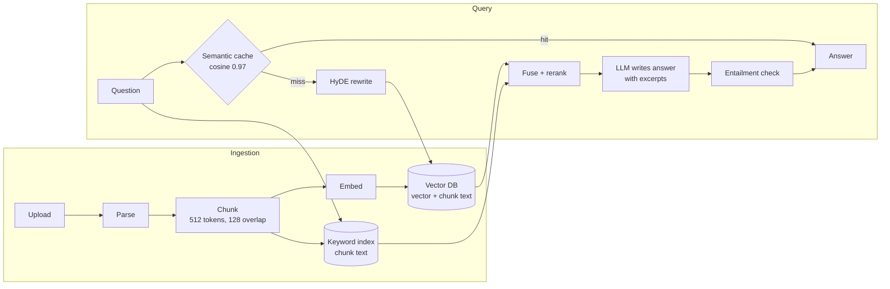
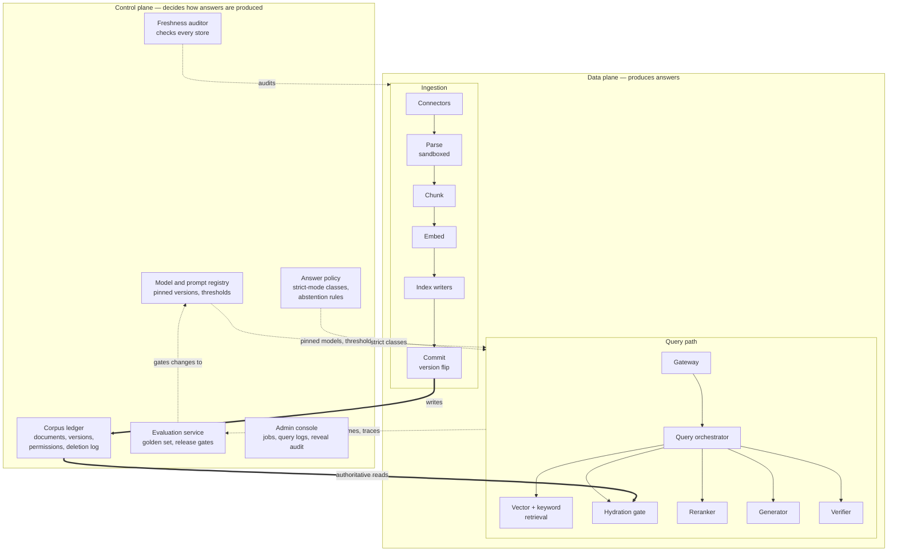
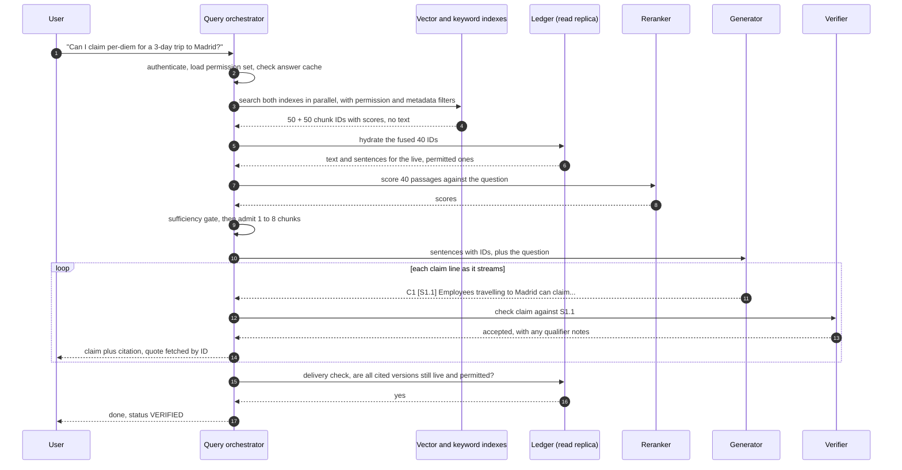
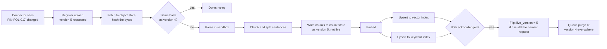
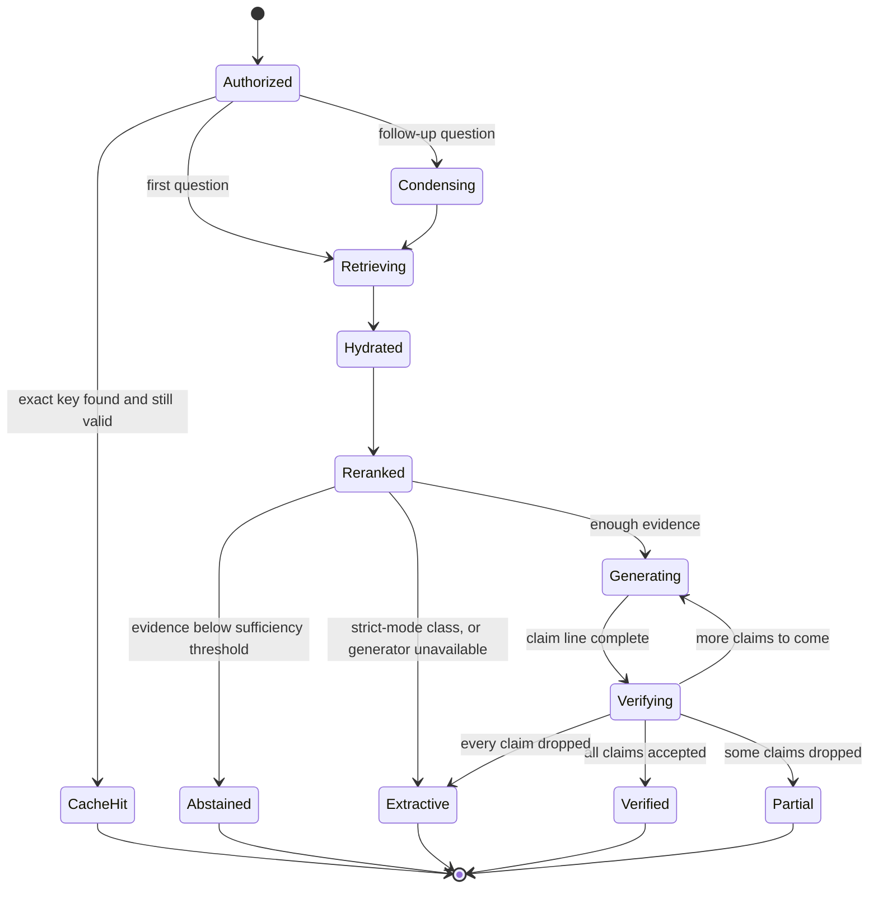

# 02 — The Architecture, and Why One Database Decides What Counts as Evidence

This document draws the whole system. It starts with the architecture most RAG designs draw,
because it is a reasonable first attempt and you have probably seen it. Then it walks through
five concrete failures that architecture produces at Kestrel, shows that all five have the same
root cause, and builds the design that removes that cause.

The root cause, stated now so you can watch for it: **in the naive design, evidence text is read
from copies.** The fix is that evidence text is read from exactly one place, at the moment an
answer is built, and everything else is allowed to be wrong for a while.

---

## 1. The architecture most designs draw



Read it left to right and it makes sense. Documents are parsed, cut into overlapping chunks,
embedded, and written to a vector database (with the chunk text stored next to each vector so the
query side can use it) and to a keyword index. At query time, a **semantic cache** — a cache
looked up by meaning rather than by exact text — returns a previous answer if a stored question is
similar enough. Otherwise a **HyDE** step (Hypothetical Document Embeddings: the model writes a
fake answer, and the fake answer is embedded and searched for) improves the vector search, both
indexes are searched, the results are fused and reranked, the model writes an answer with
excerpts from the chunks, and an entailment check confirms the answer is supported.

Each box is defensible on its own. The problems appear when you run the whole thing against
Kestrel's actual traffic.

---

## 2. Five failures, one cause

### Failure 1 — a deleted document keeps answering

At 10:02, Legal deletes `LEGAL-TMP-0911`, a superseded indemnity template, because it contains a
clause the company no longer agrees to. The delete call succeeds.

At 10:03, a sales manager in Monterrey asks *"¿Qué cláusula de indemnización usamos con
distribuidores?"* ("Which indemnity clause do we use with distributors?"). The vector database's
delete has been queued but not applied — its write path is busy absorbing an ingestion spike —
so the search still returns the template's chunks. Their text is right there in the vector
payload. The model reads it and quotes it. The sales manager pastes the deleted clause into a
contract.

Nothing malfunctioned. The delete was in flight. **The answer was built from a copy of the text
that had not yet heard about the delete.**

### Failure 2 — two indexes, two versions, one answer

`FIN-POL-017`, the travel policy, goes from version 3 (per-diem €80) to version 4 (per-diem €85).
The keyword index refreshes every second and has version 4. The vector index applies upserts in
batches and still has version 3 for another forty seconds.

A question during those forty seconds retrieves version 4's chunk from the keyword index and
version 3's chunk from the vector index. Both mention the Madrid per-diem. The model, shown two
passages from the same policy with different numbers, writes *"The per-diem is €80–85 depending on
the travel date."* That sentence is supported by the context. It is also invented: no version of
the policy ever said it.

### Failure 3 — a quotation the source never contained

The model is asked to "include the supporting excerpt". It writes:

> According to the policy: *"Employees may claim a per-diem of €95 per day for travel to Madrid."*

The policy says €85. The model did not copy the excerpt; it wrote it, the way it writes
everything, one token at a time. The entailment check compares the answer to the excerpt — and
they agree perfectly, because the model wrote both. The excerpt has been checked against itself.

This is the most dangerous failure in the list, because the citation popup is exactly what users
are told to trust.

### Failure 4 — a revoked permission keeps working

Priya, a finance analyst, was on the M&A deal team for project Halcyon. On Tuesday at 14:00 she is
removed from the `grp:mna-halcyon` group. The vector index stores each chunk's allowed groups in
its payload, and the payload updates for 31,000 affected chunks are queued behind the morning's
re-indexing work.

At 14:20 Priya asks about the deal's valuation range. The index's copy of the permissions still
lists her group. She gets an answer.

### Failure 5 — restoring a backup brings back the dead

On Thursday a vector-index node's disk fails, and the shard is restored from Wednesday night's
snapshot. Between the snapshot and the failure, 22,000 documents were deleted. The restore brings
every one of them back into the index, and with them their payload text. Nobody re-applies the
deletes, because the restore runbook says "restore the snapshot, verify the shard is healthy" —
and it is healthy.

### The common cause

Look at what each failure has in common. In every one, **the text that became evidence was read
from a copy**: the vector payload, a lagging index, the model's own output, the index's stale
permission list, a restored snapshot. Every copy is correct eventually. None of them is correct at
every moment, and an answer is built at a moment.

Patching each failure separately — faster deletes, synchronised indexes, a stricter prompt, faster
permission propagation, a better runbook — narrows each window without closing it. There will
always be a slower path, a busier hour, a forgotten runbook step. The fix has to remove the
dependency on copies being current.

---

## 3. The ledger: one authority, read at answer time

Lodestar has one component that decides what may be used as evidence. It is called the **ledger**,
and it is a PostgreSQL database with four kinds of record:

- **documents** — one row per document: its status (active, deleted, or blacked out during a slow
  update), which version is live, and its visibility.
- **versions** — one row per uploaded version: its sequence number, its status, and when it went
  live.
- **permissions** — which groups may read each restricted or department-scoped document.
- **chunks** — the **chunk store**: every chunk's text, sentence boundaries, page or section
  locator, and the version it belongs to.

Everything else that holds document content is a **projection**: a copy derived from the ledger,
built for one purpose, allowed to lag.

| Projection | Built for | What it returns | Allowed to be stale? |
|---|---|---|---|
| Vector index | Finding chunks by meaning | Chunk IDs and scores, **never text** | Yes |
| Keyword index | Finding chunks by exact words | Chunk IDs and scores, **never text** | Yes |
| Answer cache | Skipping work for repeated questions | A candidate answer **that must be re-validated** | Yes |
| Conversation store | Showing history | Claim text and **references** to evidence | Yes |

The rule that makes the design work is short:

> **Nothing becomes evidence until it is hydrated through the ledger, at the moment the answer
> is built.**

**Hydration** means: take the chunk IDs the indexes returned, and fetch their text from the chunk
store with a query that joins against the documents and permissions tables and keeps only chunks
that are (a) in the live version of (b) an active document that (c) the asking user may read. In
SQL it looks like this:

```sql
SELECT c.chunk_id, c.text, c.sentences, c.locator, d.title, v.version_seq
  FROM chunks c
  JOIN documents d ON d.doc_id = c.doc_id
  JOIN doc_versions v ON v.version_id = c.version_id
 WHERE c.chunk_id = ANY($1)                      -- the 40 candidates from the indexes
   AND d.status = 'active'
   AND c.version_id = d.live_version_id          -- only the live version
   AND ( d.visibility = 'org_wide'
         OR (d.visibility = 'department' AND d.department = ANY($2))
         OR EXISTS (SELECT 1 FROM doc_acl a
                     WHERE a.doc_id = d.doc_id AND a.principal_id = ANY($3)) );
```

It is a primary-key lookup of 40 rows with three joins, about 3 ms against a read replica.

Now replay the five failures.

1. **Deleted document.** The delete commits at 10:02 and removes the chunks from the chunk store
   in the same transaction. At 10:03 the vector index still returns the template's chunk IDs. The
   hydration query finds no rows for them. The model never sees the text. The vector index's purge
   can take its time.
2. **Two versions.** Version 4 goes live by a single-row update to `documents.live_version_id`.
   From that instant, version 3's chunks fail the `c.version_id = d.live_version_id` condition,
   whichever index returned them. The model sees only version 4.
3. **Fabricated quote.** This one needs a second idea, introduced in doc
   [08](08-grounded-generation-and-verification.md): the model never writes excerpts. It cites
   sentence IDs, and the excerpt the user sees is the hydrated sentence text. There is no path by
   which model-written text can appear inside a quotation.
4. **Revoked permission.** Priya's group membership is checked against the ledger's permissions at
   hydration time. The index's stale copy can still *return* the chunks, but hydration drops them.
5. **Restored snapshot.** The restored shard returns deleted documents' chunk IDs. Hydration finds
   no rows. The answers are correct even before anyone notices the restore needed a follow-up step.
   (It still does need one, because the index is now carrying 22,000 deleted documents' text; doc
   [09](09-freshness-updates-and-deletion.md) §8 makes the replay part of the restore.)

### What this buys, and what it costs

**It buys a different meaning for the 5-minute freshness SLA.** Correctness no longer depends on
how fast the copies catch up. An update, delete or revocation takes effect for answers the moment
its transaction commits. The 5 minutes become a deadline for *cleaning up* copies — so that the
copies stop holding text that should be gone — and an auditor verifies that deadline (doc
[09](09-freshness-updates-and-deletion.md) §5).

**It costs one database round trip per query** (3 ms at p50), a read replica sized for 100 queries
per second, and a hard dependency on that replica: if PostgreSQL is unreachable, no evidence can be
hydrated and no answer can be given. Doc [16](16-availability-degradation-scaling-and-cost.md) §3
shows how that dependency is made highly available. This is the right trade: an assistant that
occasionally says "I can't answer right now" is a product inconvenience; one that occasionally
quotes deleted legal text is an incident.

**It costs a little recall during churn.** Stale chunk IDs returned by an index occupy candidate
slots until they are purged, and then hydration drops them. If an index returned 40 candidates and
3 were stale, the reranker sees 37. Lodestar over-fetches slightly (50 from each index before
fusion) to absorb this. At 0.97% of the index churned per day and purges completing in seconds, the
effect is too small to measure in the golden set.

---

## 4. Control plane and data plane

The components divide into two groups that run at different speeds and fail in different ways.

The **data plane** does the work on every request: it ingests documents, searches indexes, calls
models and streams answers. It must be fast and must keep working when parts of it are degraded.

The **control plane** decides how the data plane behaves: which model versions are pinned, which
thresholds the verifier uses, which document classes are strict, what the golden set says about a
proposed change, and whether the copies have caught up with the ledger. It runs on minutes and
hours, not milliseconds. **The control plane governs the data plane**: the data plane reads its
configuration from the control plane and reports its outcomes back, but never changes its own
rules.



Two arrows are drawn thicker on purpose. The ledger is the only control-plane component the data
plane touches on every request, and it is touched in exactly two places: the commit step of
ingestion writes to it, and the hydration gate reads from it. Every other path between the planes
is configuration or telemetry.

### The components

**Control plane**

| Component | Responsibility | Doc |
|---|---|---|
| Corpus ledger | The authority on documents, versions, permissions and deletions. Holds the chunk store | 03, 05, 09 |
| Model and prompt registry | Pins the exact versions of the embedder, reranker, generator, condenser, entailment model and judge, and the verifier thresholds. Nothing in the data plane names a model directly | 14, 19 |
| Answer policy | Which document classes get strict mode; the sufficiency threshold; when to abstain; the maximum answer length | 08 |
| Evaluation service | Runs the golden set against any proposed change; blocks changes that fail per-language gates | 14 |
| Freshness auditor | Independently asks each store whether a deleted document is really gone, and pages when one is not | 09 |
| Admin console | Ingestion job status, query logs with pseudonymised users, audited reveal | 15 |

**Data plane**

| Component | Responsibility | Doc |
|---|---|---|
| Connectors | Pull from SharePoint, Confluence, the contract system and drives; produce ingestion events | 05 |
| Parsers | Turn files into structured text with page and section positions; run in a sandbox with no network | 04, 13 |
| Chunker | Cuts along document structure, splits sentences, builds breadcrumbs | 04 |
| Embedder | Batched GPU encoding of chunks and queries | 06 |
| Index writers | Idempotent upserts to the vector and keyword indexes | 05, 06 |
| Committer | Flips the live version in the ledger once every index has acknowledged | 05 |
| Query orchestrator | Runs the query state machine (§6) with a deadline on every step | 12 |
| Retrievers | Vector and keyword search in parallel, with permission and metadata filters | 06, 07 |
| Hydration gate | The ledger read described in §3 | 09 |
| Reranker | Cross-encoder scoring of 40 candidates on H100s | 07 |
| Generator | The LLM call that produces claims citing sentence IDs | 08 |
| Verifier | Deterministic checks, entailment model, gray-zone judge | 08 |

---

## 5. The two paths through the system

### A question, end to end



Three things to notice. The indexes never return text (step 5). The user sees each claim only
after it has been verified (the loop). And the very last database call (step 15) re-checks
liveness and permission, because the documents may have changed during the second it took to
generate — doc [09](09-freshness-updates-and-deletion.md) §6 explains why that matters for a
delete that lands mid-answer.

### A document, end to end



The order matters. The new version's chunks reach the chunk store and both indexes **before** the
flip, so at the moment version 5 becomes live, every place that could return it already has it.
The flip is conditional — it succeeds only if no newer version was requested in the meantime —
which is what stops a slow, older upload from overwriting a faster, newer one (doc
[05](05-ingestion-pipeline-and-versions.md) §4).

---

## 6. The query is a state machine with a deadline on every step

The query orchestrator is not a sequence of function calls. It is an explicit **state machine**:
a fixed set of states, a fixed set of allowed transitions, and a deadline attached to each state.
That matters for two reasons. First, a request that is running late must be able to give a useful
answer instead of a timeout — and a state machine knows exactly what it has at every point.
Second, every outcome is one of a small number of named end states, which makes the system
observable: "4.1% of queries ended in PARTIAL today" is a sentence you can alert on.



Each terminal state is a different answer the user can see:

| End state | The user sees | Share of queries |
|---|---|---:|
| **Verified** | Every claim the model wrote, verified | 56.2% |
| **Partial** | The verified claims, with a line: "1 statement was removed because it could not be verified against the sources" | 9.8% |
| **Extractive** | Verbatim source sentences under a template — strict mode, or every claim failed, or the generator is unavailable | 18.6% |
| **Abstained** | "I couldn't find this in the documents you can access", with the three closest documents | 5.4% |
| **CacheHit** | A previous answer, re-validated | 10.0% |

The shares are derived, not guessed. Strict mode takes 22% of the 423,000 generations, which is
18.6% of all queries. Of the remaining generative answers, 14.8% lose at least one claim, because
each claim has a 4.9% chance of being dropped: 2.9 percentage points from unsupported claims the
verifier correctly catches, and 1.9 from supported claims it wrongly rejects (doc
[08](08-grounded-generation-and-verification.md) §10). Every claim being dropped at once is rare
in this arithmetic, but in practice drops cluster — a bad retrieval makes every claim fail — and
the pilot measured about 0.5% of generative answers falling back to quotes that way.

A Partial rate near 10% is the visible cost of strict verification. It is worth showing to the
product owner early, because the alternative — delivering those claims unverified — is the thing
the requirement forbids.

The deadlines come from the latency budget (doc [12](12-latency-budget-and-caching.md)). Two of
them have special behaviour. If time to first token passes 700 ms, the orchestrator sends the same
request to a second model deployment and takes whichever answers first (a **hedged request**). If
the whole request reaches 2,900 ms, generation stops, the claims verified so far are delivered, and
the answer is marked Partial with "Answer shortened; ask me to continue." Both are measured: 3.6%
of generations are hedged and 0.29% are shortened.

---

## 7. Why each store, and what each store is forbidden to do

Choosing a store is as much about what it must not do as about what it does.

| Store | Holds | Chosen because | Forbidden to |
|---|---|---|---|
| **PostgreSQL** (ledger and chunk store) | Documents, versions, permissions, deletion log, chunk text and sentences, ingestion jobs, conversations | Transactions: a version flip, a delete, and the outbox event that triggers purging must commit together or not at all | Be bypassed. No component reads evidence text from anywhere else |
| **Vector index** (Qdrant-class: filtered HNSW, quantization, sharding) | 120M quantized vectors, filter fields, no text | Filtered approximate search at this size with payload indexes and on-disk re-scoring (doc 06) | Return text. Its payload holds IDs and filter fields only |
| **Keyword index** (OpenSearch) | Inverted index over chunk text with per-language analyzers | Mature analyzers for Hindi, Spanish and English; per-field boosting; delete-by-query | Serve its stored text as evidence. `_source` is disabled except for IDs and filter fields |
| **Object store** (S3) | Raw uploads, DOCX-to-PDF renderings, parsed intermediate files | Cheap, versioned, lifecycle policies for expiry | Be read by the query path, except to open the cited PDF page in the viewer |
| **Kafka** | Ingestion events, lifecycle events (delete, revoke), purge tasks | Ordered per document, replayable, decouples connectors from parsing | **Carry document content.** Messages carry document IDs and object keys, so there is nothing in Kafka to purge (doc 09 §4) |
| **Redis** | Answer cache, rate limits, session state | Sub-millisecond reads | Be an authority. Every cached answer is re-validated against the ledger on read |

The Kafka row deserves a sentence more. A pipeline that passes chunk text through its queues has
copied that text into a log with a retention period — commonly seven days. A deleted document's
text then sits in the log for a week, replicated three times, and no index purge touches it.
Passing references instead of content removes Kafka from the list of places a deletion has to
reach.

---

## 8. Two search engines, or one?

The design uses a dedicated vector database and a separate keyword engine. That is two clusters to
operate, two write paths, and two places a delete must reach. Several engines — OpenSearch with its
k-NN plugin, Elasticsearch, Vespa — can hold both kinds of index in one cluster, and update both
with one write.

The naive argument for one engine is consistency: a chunk is in both indexes or neither, so
Failure 2 (two versions, one answer) cannot happen. In this design that argument does not apply,
because Failure 2 is already prevented by the hydration gate. The indexes are allowed to disagree.

What remains is a straightforward engineering trade:

| | Two engines (this design) | One engine |
|---|---|---|
| Vector search at 120M with restrictive filters | Strong: filtered HNSW with payload indexes and cardinality-based query planning (doc 06 §6) | Varies by engine; check recall under your tightest permission filters |
| Hindi and Spanish keyword analysis | Mature in OpenSearch | Same if the one engine is OpenSearch or Elasticsearch |
| Operating cost | Two clusters, two upgrade cycles, two on-call runbooks | One |
| Re-embedding (doc 06 §9) | Build a new vector collection; the keyword index is untouched | Re-index both together, or manage two vector fields in one index |

**Use one engine** if your team is small, your corpus is under roughly 20 million chunks, or your
permission filters are broad. **Use two** when the vector index is large enough that its tuning,
memory layout and filtered-search behaviour deserve their own system, which at 120M chunks with 8%
restricted documents they do.

---

## 9. The invariants

These are the statements that must be true at every moment, and where each is enforced. When a
later document says "this preserves I3", it means this list.

| | Invariant | Enforced in |
|---|---|---|
| **I1** | Evidence text is read only from the chunk store, through the hydration query | Query orchestrator: the generator's context is built only from hydration results |
| **I2** | Only the live version of an active document can be hydrated | The hydration query's `WHERE` clause |
| **I3** | Only documents the asking user may read can be hydrated, checked against the ledger at answer time | The hydration query's permission clause |
| **I4** | A version becomes live only if it is the newest requested version and every index has acknowledged it | The committer's conditional update (doc 05 §4) |
| **I5** | The model never writes a quotation; displayed quotes are fetched by sentence ID | Output grammar and renderer (doc 08 §2) |
| **I6** | No claim is displayed before it has been verified | The streaming loop (§5) |
| **I7** | Every cited version is re-checked for liveness and permission at delivery | The delivery check (doc 09 §6) |
| **I8** | Every deletion is recorded in the deletion log, and every store's purge is independently audited | Ledger transaction and freshness auditor (doc 09 §5) |
| **I9** | Queues carry references, never document content | Pipeline message schemas (doc 05 §3) |

---

## 10. What this design deliberately leaves out

Four techniques appear in many RAG designs and are absent here, each for a stated reason. Each
could be added later if measurement justified it.

**HyDE on the hot path.** Writing a hypothetical answer and embedding it costs a full LLM call —
about 450 ms at p50 — before retrieval can even start. Lodestar's p50 budget cannot absorb it (doc
[12](12-latency-budget-and-caching.md) §2). It also injects text the model invented into the search,
which biases retrieval towards what the model expects documents to say. Hybrid search plus a
reranker plus a glossary of Kestrel's acronyms recovers most of what HyDE offers (doc
[07](07-retrieval-reranking-and-context.md) §3). *Add it* as an offline technique for generating
evaluation questions, or as a second retrieval pass only when the sufficiency gate fails and there
is time left in the budget.

**A semantic cache.** Returning a stored answer whenever a new question is 97% similar in meaning
sounds safe. But *"What is the notice period for employees in Spain?"* and *"What is the notice
period for contractors in Spain?"* are about that similar, and have different answers. In a system
whose guarantee is "never say something unsupported", a cache that answers a different question is
a hallucination generator. Lodestar uses an exact cache keyed on the normalised question, the
filters, the user's permission set and the language (doc [12](12-latency-budget-and-caching.md) §6).

**Agentic multi-step retrieval.** Letting the model decide to search again, read more and reason
across several rounds improves hard multi-hop questions. It also multiplies latency by the number
of rounds and makes every answer's evidence path different, which is harder to verify and audit.
Lodestar's questions are mostly single-hop policy lookups. *Add it* as a separate, slower "research"
mode with its own SLO if users need multi-document synthesis.

**Fine-tuning the generator.** It is tempting to fine-tune the model to be more faithful. But the
guarantee does not rest on the generator; it rests on the verifier. Fine-tuning effort is far better
spent on the **entailment model** — doc [08](08-grounded-generation-and-verification.md) §10 shows
it is the difference between missing and meeting the M1 target.

---

## What to take away

1. **The naive RAG architecture reads evidence from copies.** Vector payloads, lagging indexes, the
   model's own excerpts, stale permission lists and restored snapshots are all copies, and each one
   is wrong at some moment.
2. **Make one store the authority and read it at answer time.** The ledger decides what is
   evidence; the indexes return only IDs. Updates, deletes and revocations take effect at commit.
3. **The freshness SLA then becomes a cleanup deadline, not a correctness deadline** — which is why
   it can be audited rather than hoped for.
4. **The control plane governs, the data plane executes.** Model versions, thresholds, strict-mode
   classes and release gates live in the control plane; the data plane never changes its own rules.
5. **Run the query as a state machine with deadlines.** Every outcome is a named end state —
   Verified, Partial, Extractive, Abstained, CacheHit — which makes late requests degrade usefully
   and makes the system's behaviour countable.
6. **Choose stores by what they must not do.** Indexes must not return text; Kafka must not carry
   content; Redis must not be an authority.
7. **Leave out techniques whose cost you cannot justify.** HyDE, semantic caching and agentic
   retrieval each have a good use; none belongs on this hot path.

Continue to [03 — APIs and the data model](03-apis-and-data-model.md).
