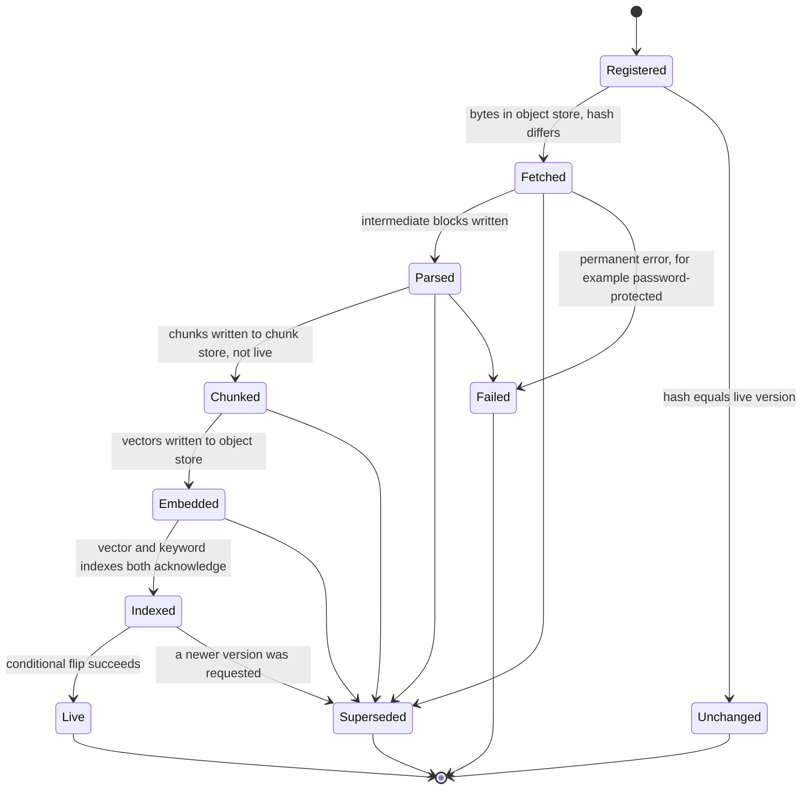

# 05 — The Ingestion Pipeline, and How a New Version Becomes the Live One

Doc [04](04-parsing-and-chunking.md) turned a file into clean chunks. This document is about
everything around that: how 100,000 ingestion events a day flow through fetch, parse, chunk,
embed and index; how a crash halfway through does not corrupt anything; how a 2,000-page scanned
contract does not block a one-page policy update; and — the part that matters most for
correctness — how exactly one version of each document is live at any moment, even when versions
arrive out of order.

The central idea is easy to state and easy to violate: **queue ordering is an efficiency, not a
correctness mechanism.** Correctness comes from the ledger's version guard. Once that is true, the
pipeline can retry, parallelise and reorder freely.

---

## 1. What the pipeline must guarantee

| Property | Meaning | How |
|---|---|---|
| **Exactly-once effect** | A document processed twice ends up exactly as if processed once | Deterministic chunk IDs and idempotent upserts (§4) |
| **Monotonic versions** | An older version can never replace a newer one as live | The conditional flip (§4) |
| **Resumability** | A crash in the embed stage resumes at embed, not at parse | Each stage's output is persisted before the next starts (§4) |
| **Freshness for updates** | An update to an existing document swaps within 270 s, or the old version is hidden | Lanes with reserved capacity, page-level parallelism for large files (§5, §6) |
| **Deletes never wait for ingestion** | A 10× ingestion spike cannot delay a deletion | Lifecycle events on a separate topic with its own consumers (§3) |
| **No content in queues** | Kafka never holds document text | Messages carry IDs and object-store keys (§3) |
| **Isolation of the query path** | Bulk indexing cannot push query latency past its SLO | Write throttling with feedback from query latency (§8) |

---

## 2. Sizing for the real mix

Doc [00](00-requirements-and-what-zero-hallucination-can-mean.md) §3.11 established that Kestrel's
100,000 daily ingestion events are 75,000 new versions and 25,000 new documents, with 22,000
deletions alongside. Two more facts shape the pipeline.

**Most proposed work is not real work.** Connectors re-scan folders and change feeds and propose a
document whenever its modification time changes — including when someone opens and re-saves a file
without changing it. The registration API compares the uploaded file's SHA-256 hash with the live
version's (doc [03](03-apis-and-data-model.md) §2) and drops unchanged files immediately. That
check removes about 40% of proposals, so the connectors actually propose:

> 100,000 ÷ (1 − 0.40) ≈ **167,000 proposals a day**, of which 67,000 end at a hash lookup

**The work per stage is very uneven.** Using the per-unit costs from doc
[01](01-the-running-system-and-its-numbers.md) §8:

| Stage | Unit cost | Average load | 10× spike | Bottleneck? |
|---|---|---:|---:|---|
| Fetch | ~0.4 s of I/O | 1.16 docs/s | 11.6 docs/s | No |
| Parse | 0.651 core-s per page | **7.2 cores** | **72 cores** | **Yes** |
| Chunk and split sentences | ~0.03 core-s per page | 0.3 cores | 3 cores | No |
| Embed | 174 chunks/s per L4 | 0.08 L4 | 0.8 L4 | No |
| Index writes | ~14 chunks/s | Trivial | 139 chunks/s | No, but must be throttled (§8) |
| Commit | One transaction | Trivial | Trivial | No |

Parsing is the only stage that needs elastic capacity. Everything after it fits comfortably on a
small fixed fleet. That asymmetry decides the deployment: parse workers autoscale on spot capacity,
everything else runs on a few always-on pods.

---

## 3. Topics and messages: references, never content

The pipeline runs on Kafka. Here are its topics:

| Topic | Partition key | Carries | Consumers |
|---|---|---|---|
| `ingest.interactive` | `doc_id` | User uploads and single-document updates from webhooks | Reserved worker pool |
| `ingest.sync` | `doc_id` | Connector change feeds | Shared pool, autoscaled |
| `ingest.bulk` | `doc_id` | Initial load, re-ingestion after a parser upgrade | Spot pool, throttled |
| `ingest.reembed` | `doc_id` | Re-embedding for a new embedding model (doc 06 §9) | Spot GPU pool, lowest priority |
| `doc.lifecycle` | `doc_id` | `version_live`, `deleted`, `acl_changed`, `blackout` — published from the outbox | Purge workers, index payload updaters, cache invalidators |
| `purge.tasks` | `store` | One task per (deletion, store) | Per-store purge workers |

A message looks like this:

```json
{
  "event": "ingest_requested",
  "job_id": "job_01JB7K3VB0XE",
  "doc_id": "doc_01JB7K3V9Q2R",
  "version_id": "doc_01JB7K3V9Q2R@5",
  "seq": 5,
  "object_key": "raw/doc_01JB7K3V9Q2R/5/FIN-POL-017.pdf",
  "lane": "sync",
  "requested_at": "2026-10-21T09:14:09Z"
}
```

There is no document text in it, and no chunk text in any later message either. A stage that needs
text reads it from the object store (for raw and parsed files) or the chunk store (for chunks).
This is invariant I9 from doc [02](02-architecture-and-the-ledger.md) §9, and the reason is
deletion: Kafka topics keep messages for a retention period — seven days is common — replicated
three times. A pipeline that passes text through Kafka has put every document into a log that no
purge job touches. Passing references means a deletion has nothing to clean up in Kafka.

### Why deletions get their own topic

Suppose deletions shared a topic with ingestion. On the day a connector backfills a newly connected
SharePoint site with 400,000 documents, the `ingest.sync` partitions hold hours of backlog. A
deletion behind them in the same partition waits hours.

Because the ledger makes the deletion effective at commit (doc
[02](02-architecture-and-the-ledger.md) §3), no answer would be wrong during that wait. But the
5-minute deadline for the copies to be cleaned up would be missed by hours, and the auditor would
page. So `doc.lifecycle` is a separate topic with its own consumers and its own lag alert (30
seconds), and nothing that happens to ingestion can slow it down.

### Kafka ordering is not what keeps versions correct

Partitioning by `doc_id` means all messages for one document land in one partition, in order. It
is tempting to rely on that: "version 5 is processed after version 4, so version 5 ends up live."

That reasoning fails in three ordinary situations. A worker processing version 4 crashes after
indexing and before committing, and the retry runs *after* version 5 committed. A large version 4
is split into page tasks that finish after a small version 5. An operator replays a partition from
an old offset to recover from a bug. In all three, version 4 reaches the commit step after version
5, and ordering-based logic makes version 4 live.

So Lodestar does not rely on it. The commit step checks the ledger (§4), and the pipeline treats
Kafka ordering only as a way to avoid wasted work: before each stage, a worker checks whether a
newer version has been requested, and if so, stops and marks its job `SUPERSEDED`.

---

## 4. The job, stage by stage

Each ingestion job moves through a fixed sequence of stages. Each stage writes its output to the
object store under a key derived from `(version_id, stage)` before marking itself done, so a retry
picks up from the last completed stage.



### Exactly-once effect without exactly-once delivery

Kafka can deliver a message more than once, and a worker can crash after doing work but before
recording that it did it. Lodestar does not try to prevent duplicate processing. It makes duplicate
processing harmless:

- **Chunk IDs are deterministic**: UUIDv5 of `version_id:ordinal` (doc
  [03](03-apis-and-data-model.md) §6). Parsing and chunking the same version twice produces the
  same IDs.
- **Every index write is an upsert by ID.** A second write of the same chunk overwrites the first.
- **The chunk-store insert is `ON CONFLICT (doc_id, chunk_id) DO NOTHING`.**
- **The flip is conditional** (below), so running it twice is the same as running it once.

The combination gives the *effect* of exactly-once processing, which is what matters, using only
at-least-once delivery, which is what Kafka provides.

### The order of the last three steps

The order of indexing and flipping is the most important ordering in the pipeline:

1. Write the new version's chunks to the chunk store, with the version marked `ready` (not live).
2. Upsert the new vectors to the vector index and the new chunks to the keyword index. Wait for both
   acknowledgements, and for the keyword index's refresh, so the chunks are searchable.
3. **Then** flip the live version in the ledger.
4. **Then** publish `version_live` and queue the purge of the old version's chunks everywhere.

If the order were reversed — flip first, then index — there would be a window in which the new
version is live in the ledger but not yet in the indexes. The indexes would still return the old
version's chunk IDs; hydration would drop them as not-live; the new version's chunks would not be
returned at all. For that window, the document would be invisible. Indexing first means that at the
moment of the flip, every index can already return the new version.

### The conditional flip

The flip is one SQL statement (shown in full in doc [03](03-apis-and-data-model.md) §7):

```sql
UPDATE documents SET live_version_id = $version_id, …
 WHERE doc_id = $doc_id AND requested_seq = $seq AND status <> 'deleted';
```

`requested_seq` is incremented when a version is *registered*, not when it finishes. So the
statement succeeds only for the newest version anyone has asked for. Walk through the
out-of-order case with real times:

| Time | Event | `requested_seq` | Live version |
|---|---|---:|---|
| 09:00:00 | Version 4 registered, ingested and flipped | 4 | 4 |
| 09:14:09 | Version 5 registered (a large scan) | 5 | 4 |
| 09:14:40 | Version 6 registered (someone fixed a typo) | 6 | 4 |
| 09:15:05 | Version 6 finishes; flip with `seq = 6` succeeds | 6 | **6** |
| 09:16:30 | Version 5 finishes; flip with `seq = 5` matches **0 rows** | 6 | 6 |

Version 5 is marked `SUPERSEDED` and its chunks are queued for purging. Nothing else needed to know
about the race. [reference_impl/ledger.py](reference_impl/ledger.py) reproduces this sequence in
its first test.

### What if the new version fails permanently?

Suppose version 5 of a policy is a password-protected PDF. It will never parse. What should happen
to version 4?

The tempting answer is "keep serving version 4". But someone has asserted, by uploading version 5,
that version 4 is out of date, and requirement F6 says old answers must not be served. So the
document goes into **blackout** at upload + 270 s like any slow update (doc
[09](09-freshness-updates-and-deletion.md) §3), the job fails with `PASSWORD_PROTECTED`, and the
document's owner is notified. An administrator can explicitly **reinstate** version 4 as live — an
audited action, recorded with a reason — if the owner confirms it is still correct.

This is a deliberate choice of *silence over staleness*. It is the right default for policies and
contracts. For some sources — a wiki where uploads fail for trivial reasons and pages are rarely
critical — a team might choose the opposite, and the answer policy allows that per source. What it
does not allow is making the choice implicitly.

### Retries and the dead-letter queue

Transient failures (a timeout reading the object store, an index node restarting) are retried with
exponential backoff: 2 s, 8 s, 30 s, 2 min, 8 min. After five attempts, or immediately for a
permanent error, the job moves to a **dead-letter queue** — a holding area for work that needs a
human — with a typed error code:

| Code | Typical cause | Share of failures at Kestrel |
|---|---|---:|
| `PASSWORD_PROTECTED` | Encrypted PDF or DOCX | 31% |
| `PARSE_FAILED` | Corrupt file, unsupported PDF feature | 22% |
| `OCR_UNUSABLE` | Scan quality below 0.60 after re-OCR | 18% |
| `FILE_TOO_LARGE` | Over 2,000 pages or 50 MB | 11% |
| `SOURCE_GONE` | Connector reported a file that was deleted before fetch | 9% |
| `INDEX_TIMEOUT` | Index unavailable for all five attempts | 6% |
| Other | | 3% |

About 0.4% of ingestion events end in the dead-letter queue, roughly 400 a day. The dashboard groups
them by code and source (doc [15](15-observability-slos-and-admin-dashboard.md) §5), because "400
failures" is not actionable and "120 password-protected PDFs from the contracts connector" is.

---

## 5. Lanes: why a one-page update does not wait behind a 2,000-page scan

Not all ingestion is equally urgent. An HR officer who just fixed a wrong number in the leave policy
needs it live in minutes. A backfill of 400,000 archived project documents can take days.

Lodestar runs four **lanes**, each with its own topic, worker pool and service level:

| Lane | Source | Target time to live | Capacity |
|---|---|---|---|
| **Interactive** | Uploads through Lodestar; webhook-driven single-document updates | p99 under 120 s | 24 reserved parse cores, always on |
| **Sync** | Connector change feeds | p99 under 240 s | Autoscaled from 8 cores, on-demand instances |
| **Bulk** | Initial loads, new connectors, parser upgrades | No time target | Spot instances, up to 400 cores, throttled |
| **Reembed** | Embedding-model migration | No time target | Spot GPUs |

The interactive and sync targets both sit inside the 270-second blackout threshold, so an update
that meets its lane's target never causes a blackout.

### When the clock starts

The freshness SLA is measured from the moment Lodestar *learns* about a version — when it is
registered. It cannot be measured from when a person edited the file in SharePoint, because Lodestar
does not know that moment. The gap between the two is the connector's detection delay: seconds for
sources that send change notifications (webhooks), up to the polling interval for sources that do
not.

At Kestrel, SharePoint and Confluence send change notifications, and median detection delay is
about 20 seconds. The contract system can only be polled, every 10 minutes. Both numbers are
reported separately on the dashboard, labelled as connector delay, so that nobody reads "freshness
SLA met" as "the contract system is fresh within 5 minutes" — it is not, and the reason is outside
the pipeline.

### Autoscaling the parse fleet

Parse workers scale on **queue depth expressed as time**: the number of pages waiting in a lane,
multiplied by the blended 0.651 core-seconds per page, divided by the current core count. That gives
"how many seconds of work is queued", which is compared directly against the lane's target.

For the sync lane, if queued work exceeds 60 seconds, the fleet grows; below 10 seconds for 15
minutes, it shrinks. During a 10× spike that means growing from 8 to about 72 cores — the figure from
doc [01](01-the-running-system-and-its-numbers.md) §8 — within a few minutes. Bulk uses spot
instances, which can be reclaimed at short notice; that is acceptable because bulk work is
checkpointed per stage and has no deadline. If spot capacity is unavailable, bulk simply waits;
interactive and sync never depend on spot.

---

## 6. Large documents: splitting by page

A 300-page scanned contract takes 300 × 2.5 = 750 core-seconds to OCR. On one core that is 12.5
minutes, which blows through the 270-second blackout threshold for an update.

So the parse stage fans large documents out by page range. Any document over 20 pages is split into
tasks of 10 pages each, which run in parallel on separate cores; a final merge task stitches the
blocks back into reading order and re-runs the cross-page steps (repeated header and footer
detection, tables continuing across pages). For the 300-page contract on 30 cores:

> 750 core-seconds ÷ 30 cores = **25 seconds** of OCR, plus about 10 seconds to merge

The worst case Kestrel accepts — 2,000 scanned pages — is 5,000 core-seconds; on 64 cores, about 78
seconds. That still fits inside 270 s, but only if 64 cores are free, which during a spike they may
not be. That is the case blackout exists for.

### A typical update, timed

For the most common update — a 10-page digital PDF from SharePoint — on a normal day:

| Step | Time |
|---|---:|
| Connector notices the change | ~20 s (outside the SLA clock) |
| Register, fetch, hash | 0.6 s |
| Parse 10 pages at 0.35 core-s, page-parallel | 0.7 s |
| Chunk, split sentences, extract metadata | 0.3 s |
| Embed 12 chunks (batched with others, up to 50 ms wait) | 0.2 s |
| Write to both indexes, wait for keyword refresh | 1.5 s |
| Flip, publish `version_live` | 0.05 s |
| **Registration to live** | **about 3.4 s** |

The p50 across all updates is about 6 seconds and the p99, measured in the pilot during spikes, about
90 seconds. Blackout — the old version hidden before the new one is ready — happened to 0.3% of
updates, almost all of them large scans registered during the morning sync peak.

---

## 7. The initial load

Loading the first 10 million documents takes about two days, bounded by parsing (doc
[01](01-the-running-system-and-its-numbers.md) §8: 43 hours on 400 cores). Two choices make those
two days less painful.

**Load in order of value, not in order of source.** If the load proceeds source by source, the
assistant is useless until it finishes, because the policies everyone asks about might be loaded
last. Kestrel loaded, in order: the official policy repositories (about 300,000 documents, answering
most of the pilot's questions), then the documents most often opened in the old intranet search over
the previous 90 days, then everything else. The assistant was useful after six hours.

**Gate each source on its own evaluation.** A source is enabled for answering only when the golden-set
questions whose answers live in that source pass (doc [14](14-evaluation.md) §5). The contract system
was held back for four extra days because its OCR quality was poor until the Devanagari OCR model was
tuned.

---

## 8. Protecting the query path from the write path

The same index nodes serve queries and absorb writes. An HNSW insert is not free — each new vector
must be connected into the graph, which means searching the graph — and a bulk load writing tens of
thousands of vectors a second will raise query latency on the same shard.

Lodestar's index writers therefore throttle with feedback:

- Each writer has a target rate per shard (initially 2,000 points per second for bulk, unlimited for
  interactive and sync, which are small).
- Every 10 seconds the writer reads the shard's query p99 latency. If it exceeds 80% of the shard's
  budget (95 ms, from doc [12](12-latency-budget-and-caching.md) §2), the bulk rate halves. If it is
  below 50% for a minute, the rate rises by 20%.
- Interactive and sync writes are never throttled by this mechanism, because they are small and they
  carry freshness deadlines.

The keyword index has the same issue in a different form: every write creates a small segment that
must later be merged, and merges consume disk I/O. Bulk writes use OpenSearch's bulk API with the same
feedback loop.

This is the same principle as the backfill throttle in [`../DBMigrations/06-backfills.md`](../DBMigrations/06-backfills.md):
**throttle on the signal that measures harm to the thing you are protecting** — here, query latency —
not on a fixed rate chosen in advance.

---

## 9. Connectors, and the deletes they miss

A connector turns a source system's view of the world into ingestion and lifecycle events. Change
notifications are efficient but not perfectly reliable: a webhook can be dropped, a delta token can
expire, a whole site can be archived without per-file delete events.

A missed *update* is visible — someone notices the old version. A missed *delete* is not — the document
just keeps existing in Lodestar after it has gone from SharePoint. For a privacy request or a retention
policy, that is a compliance failure.

So every connector also runs a **weekly reconciliation**: it lists every document reference the source
currently holds, and the ledger lists every active `external_ref` for that source. Anything active in
the ledger but absent from the source is deleted, with reason `reconciliation`. For Kestrel's 10 million
references, the listing takes about three hours per source and finds a few hundred missed deletes each
week, which is the measure of how reliable the change feeds really are.

Permissions are reconciled the same way, because a permission removed in SharePoint but not
propagated is a revocation that never happened (doc [13](13-access-control-security-and-privacy.md)
§4).

---

## What to take away

1. **Queue ordering is an efficiency; the version guard is correctness.** Retries, page-level
   parallelism and partition replays all reorder work; a conditional flip on `requested_seq` makes the
   order irrelevant.
2. **Get exactly-once effect from idempotency.** Deterministic chunk IDs, upserts and a conditional flip
   make duplicate processing harmless, using only at-least-once delivery.
3. **Index everywhere, then flip.** At the moment a version goes live, every index can already return
   it.
4. **Never put document content in a queue.** Kafka retention would turn every topic into an unpurged
   copy of the corpus.
5. **Deletes get their own topic.** An ingestion backlog must never delay a deletion's cleanup.
6. **Parsing is the only elastic stage.** Scale it on queued work measured in seconds; run everything
   else on a small fixed fleet.
7. **Split large documents by page.** A 300-page scan goes from 12.5 minutes to about 35 seconds.
8. **Choose silence over staleness when a new version fails, and make reinstating the old one an
   explicit, audited act.**
9. **Throttle bulk writes on query latency**, and **reconcile every connector weekly**, because the
   deletes a change feed misses are the ones nobody notices.

Continue to [06 — Indexing at 120 million chunks](06-indexing-at-120m-chunks.md).
